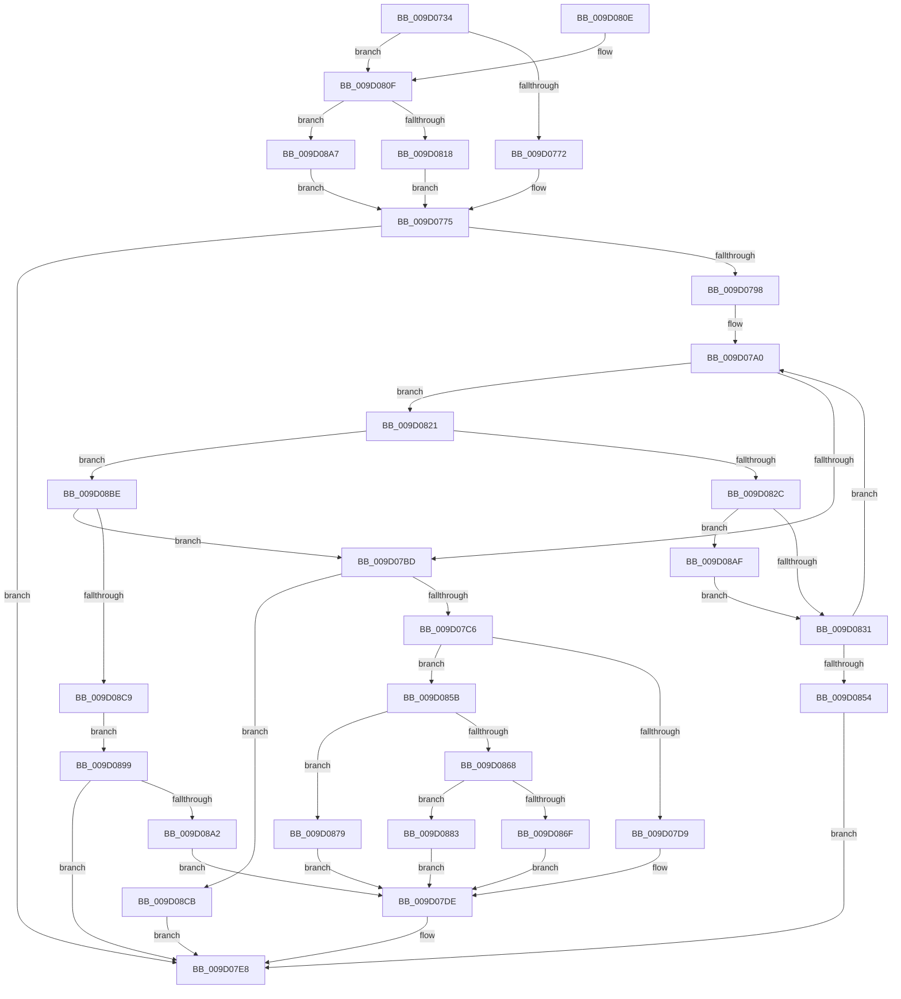

# CmGetDeviceSiblings

- RVA: `0x009D0734`–`0x009D08D5` (길이 `417` bytes)
- VA: `0x00000001409D0734`
- 실행 섹션: `PAGE`
- PDB 이름 있음: `예`; PDB Function 태그: `아니요`
- unwind 정보 RVA: `0x000A130C`
- 디코드: `116`개 명령, `417/417` bytes 표시
- 미해석 바이트: `0` (있으면 어셈블리에 `.byte`로 보존)

> 이 문서는 커널 이미지의 기계어와 PDB 기호를 분석해 생성했습니다. 4번과 5번은 함수 원형과 자료형을 바이너리 사용 방식에서 추정한 C 해석이며 원본 소스 복구 결과는 아닙니다.

## 1. Dependencies

- 직접 호출 지점: **9**; 고유 호출 대상: **8**
- 직접 호출자로 확인된 함수: **1**
- RIP 상대 이미지 참조: **1**

### Outgoing calls
- `0x009D078D` → [CmGetDeviceParent](../93/CmGetDeviceParent_function_00932368.md) (function, `0x00932368`)
- `0x009D07B0` → [CmGetDeviceChildren](CmGetDeviceChildren_function_009D08DC.md) (function, `0x009D08DC`)
- `0x009D07CC` → [PnpMultiSzDeleteString](PnpMultiSzDeleteString_function_009D0C8C.md) (function, `0x009D0C8C`)
- `0x009D07E3` → [ExFreePoolWithTag](../../poolcode/B8/ExFreePoolWithTag_function_00B82870.md) (function, `0x00B82870`)
- `0x009D07F5` → [_security_check_cookie](../../text/6A/_security_check_cookie_function_006AC640.md) (function, `0x006AC640`)
- `0x009D0843` → [ExAllocatePool2](../../poolcode/B8/ExAllocatePool2_function_00B820F0.md) (function, `0x00B820F0`)
- `0x009D085E` → [PnpMultiSzGetLen](PnpMultiSzGetLen_function_009D3180.md) (function, `0x009D3180`)
- `0x009D088F` → [memcpy](../../text/6C/memcpy_function_006C6840.md) (function, `0x006C6840`)
- `0x009D08B4` → [ExFreePoolWithTag](../../poolcode/B8/ExFreePoolWithTag_function_00B82870.md) (function, `0x00B82870`)

### Direct callers
- [_CmGetDeviceMappedPropertyFromComposite](_CmGetDeviceMappedPropertyFromComposite_function_009D1684.md) at `0x009D2593`

### Static image references
- `0x009D0748` → RVA `0x00E0A740` (`.data`; read)

## 2. Other-region calls and transfers

- 다른 실행 섹션으로 향하는 call: **5**
  - `0x009D07E3` → [ExFreePoolWithTag](../../poolcode/B8/ExFreePoolWithTag_function_00B82870.md) (`PAGE` → `POOLCODE`)
  - `0x009D07F5` → [_security_check_cookie](../../text/6A/_security_check_cookie_function_006AC640.md) (`PAGE` → `.text`)
  - `0x009D0843` → [ExAllocatePool2](../../poolcode/B8/ExAllocatePool2_function_00B820F0.md) (`PAGE` → `POOLCODE`)
  - `0x009D088F` → [memcpy](../../text/6C/memcpy_function_006C6840.md) (`PAGE` → `.text`)
  - `0x009D08B4` → [ExFreePoolWithTag](../../poolcode/B8/ExFreePoolWithTag_function_00B82870.md) (`PAGE` → `POOLCODE`)
- 별도 외부 분기/꼬리 이동을 확인하지 못했습니다.

## 3. Assembly (complete function range)

```asm
009D0734  40 53                           push rbx
009D0736  55                              push rbp
009D0737  56                              push rsi
009D0738  57                              push rdi
009D0739  41 54                           push r12
009D073B  41 55                           push r13
009D073D  41 56                           push r14
009D073F  41 57                           push r15
009D0741  48 81 EC D8 01 00 00            sub rsp, 0x1d8
009D0748  48 8B 05 F1 9F 43 00            mov rax, qword ptr [rip + 0x439ff1]
009D074F  48 33 C4                        xor rax, rsp
009D0752  48 89 84 24 C0 01 00 00         mov qword ptr [rsp + 0x1c0], rax
009D075A  45 33 ED                        xor r13d, r13d
009D075D  49 8B F1                        mov rsi, r9
009D0760  4D 8B F0                        mov r14, r8
009D0763  4C 8B FA                        mov r15, rdx
009D0766  48 8B E9                        mov rbp, rcx
009D0769  4D 85 C0                        test r8, r8
009D076C  0F 85 9D 00 00 00               jne 0x1409d080f
009D0772  45 89 29                        mov dword ptr [r9], r13d
009D0775  45 8B 21                        mov r12d, dword ptr [r9]
009D0778  4C 8D 44 24 30                  lea r8, [rsp + 0x30]
009D077D  45 89 29                        mov dword ptr [r9], r13d
009D0780  4C 8D 4C 24 20                  lea r9, [rsp + 0x20]
009D0785  C7 44 24 20 C8 00 00 00         mov dword ptr [rsp + 0x20], 0xc8
009D078D  E8 D6 1B F6 FF                  call 0x140932368
009D0792  8B D8                           mov ebx, eax
009D0794  85 C0                           test eax, eax
009D0796  78 50                           js 0x1409d07e8
009D0798  49 8B FD                        mov rdi, r13
009D079B  44 89 6C 24 20                  mov dword ptr [rsp + 0x20], r13d
009D07A0  4C 8D 4C 24 20                  lea r9, [rsp + 0x20]
009D07A5  4C 8B C7                        mov r8, rdi
009D07A8  48 8D 54 24 30                  lea rdx, [rsp + 0x30]
009D07AD  48 8B CD                        mov rcx, rbp
009D07B0  E8 27 01 00 00                  call 0x1409d08dc
009D07B5  8B D8                           mov ebx, eax
009D07B7  8B C8                           mov ecx, eax
009D07B9  85 C0                           test eax, eax
009D07BB  75 64                           jne 0x1409d0821
009D07BD  48 85 FF                        test rdi, rdi
009D07C0  0F 84 05 01 00 00               je 0x1409d08cb
009D07C6  49 8B D7                        mov rdx, r15
009D07C9  48 8B CF                        mov rcx, rdi
009D07CC  E8 BB 04 00 00                  call 0x1409d0c8c
009D07D1  84 C0                           test al, al
009D07D3  0F 85 82 00 00 00               jne 0x1409d085b
009D07D9  BB E5 00 00 C0                  mov ebx, 0xc00000e5
009D07DE  33 D2                           xor edx, edx
009D07E0  48 8B CF                        mov rcx, rdi
009D07E3  E8 88 20 1B 00                  call 0x140b82870
009D07E8  8B C3                           mov eax, ebx
009D07EA  48 8B 8C 24 C0 01 00 00         mov rcx, qword ptr [rsp + 0x1c0]
009D07F2  48 33 CC                        xor rcx, rsp
009D07F5  E8 46 BE CD FF                  call 0x1406ac640
009D07FA  48 81 C4 D8 01 00 00            add rsp, 0x1d8
009D0801  41 5F                           pop r15
009D0803  41 5E                           pop r14
009D0805  41 5D                           pop r13
009D0807  41 5C                           pop r12
009D0809  5F                              pop rdi
009D080A  5E                              pop rsi
009D080B  5D                              pop rbp
009D080C  5B                              pop rbx
009D080D  C3                              ret
009D080E  CC                              int3
009D080F  45 39 29                        cmp dword ptr [r9], r13d
009D0812  0F 84 8F 00 00 00               je 0x1409d08a7
009D0818  66 45 89 28                     mov word ptr [r8], r13w
009D081C  E9 54 FF FF FF                  jmp 0x1409d0775
009D0821  3D 23 00 00 C0                  cmp eax, 0xc0000023
009D0826  0F 85 92 00 00 00               jne 0x1409d08be
009D082C  48 85 FF                        test rdi, rdi
009D082F  75 7E                           jne 0x1409d08af
009D0831  8B 54 24 20                     mov edx, dword ptr [rsp + 0x20]
009D0835  B9 00 01 00 00                  mov ecx, 0x100
009D083A  48 03 D2                        add rdx, rdx
009D083D  41 B8 50 4E 50 52               mov r8d, 0x52504e50
009D0843  E8 A8 18 1B 00                  call 0x140b820f0
009D0848  48 8B F8                        mov rdi, rax
009D084B  48 85 C0                        test rax, rax
009D084E  0F 85 4C FF FF FF               jne 0x1409d07a0
009D0854  BB 17 00 00 C0                  mov ebx, 0xc0000017
009D0859  EB 8D                           jmp 0x1409d07e8
009D085B  48 8B CF                        mov rcx, rdi
009D085E  E8 1D 29 00 00                  call 0x1409d3180
009D0863  83 F8 01                        cmp eax, 1
009D0866  76 11                           jbe 0x1409d0879
009D0868  89 06                           mov dword ptr [rsi], eax
009D086A  44 3B E0                        cmp r12d, eax
009D086D  73 14                           jae 0x1409d0883
009D086F  BB 23 00 00 C0                  mov ebx, 0xc0000023
009D0874  E9 65 FF FF FF                  jmp 0x1409d07de
009D0879  BB 25 02 00 C0                  mov ebx, 0xc0000225
009D087E  E9 5B FF FF FF                  jmp 0x1409d07de
009D0883  44 8B C0                        mov r8d, eax
009D0886  48 8B D7                        mov rdx, rdi
009D0889  4D 03 C0                        add r8, r8
009D088C  49 8B CE                        mov rcx, r14
009D088F  E8 AC 5F CF FF                  call 0x1406c6840
009D0894  E9 45 FF FF FF                  jmp 0x1409d07de
009D0899  48 85 C0                        test rax, rax
009D089C  0F 84 46 FF FF FF               je 0x1409d07e8
009D08A2  E9 37 FF FF FF                  jmp 0x1409d07de
009D08A7  4D 8B F5                        mov r14, r13
009D08AA  E9 C6 FE FF FF                  jmp 0x1409d0775
009D08AF  33 D2                           xor edx, edx
009D08B1  48 8B CF                        mov rcx, rdi
009D08B4  E8 B7 1F 1B 00                  call 0x140b82870
009D08B9  E9 73 FF FF FF                  jmp 0x1409d0831
009D08BE  48 8B C7                        mov rax, rdi
009D08C1  85 C9                           test ecx, ecx
009D08C3  0F 89 F4 FE FF FF               jns 0x1409d07bd
009D08C9  EB CE                           jmp 0x1409d0899
009D08CB  BB 25 02 00 C0                  mov ebx, 0xc0000225
009D08D0  E9 13 FF FF FF                  jmp 0x1409d07e8
```

## 4. C-style interpretation (structured pseudocode)

```c
__int64 __fastcall CmGetDeviceSiblings(__int64 a1, __int64 a2, __int64 a3, __int64 a4)
{
    __int64 result;
    __int64 v_r13;
    __int64 v_rsp;
    unsigned __int64 v_stack_m1E8;
    unsigned __int64 v_stack_m1F8;
    unsigned __int64 v_stack_m58;
    unsigned int v_stack_p20;

    v_rsp = (v_rsp) - (472);
    result = (*(unsigned __int64 *)(v_rip + 4431857)) ^ (v_rsp);
    v_stack_m58 = result;
    v_r13 = 0;
    if (a3 != 0) goto loc_009D080F;
    *(unsigned int *)(a4) = 0;
loc_009D0775:
    *(unsigned int *)(a4) = 0;
    v_stack_m1F8 = 200;
    result = CmGetDeviceParent(a1, a2, v_stack_m1E8, v_stack_m1F8);
    if (sign_flag) goto loc_009D07E8;
    v_stack_m1F8 = 0;
loc_009D07A0:
    result = CmGetDeviceChildren(a1, v_stack_m1E8, 0, v_stack_m1F8);
    if ((unsigned int)(result) != 0) goto loc_009D0821;
loc_009D07BD:
    if (0 == 0) goto loc_009D08CB;
    result = PnpMultiSzDeleteString(0, a2, 0, v_stack_m1F8);
    if ((unsigned __int8)(result) != 0) goto loc_009D085B;
loc_009D07DE:
    a2 = 0;
    result = ExFreePoolWithTag(0, a2, 0, v_stack_m1F8);
loc_009D07E8:
    a1 = (v_stack_m58) ^ (v_rsp);
    result = _security_check_cookie(a1, a2, 0, v_stack_m1F8);
    v_rsp = (v_rsp) + (472);
    return result;
loc_009D080F:
    if ((*(unsigned int *)(v_stack_m1F8)) == 0) goto loc_009D08A7;
    *(unsigned __int16 *)(0) = 0;
    goto loc_009D0775;
loc_009D0821:
    if (((unsigned int)(result)) != 0xC0000023ULL) goto loc_009D08BE;
    if (0 != 0) goto loc_009D08AF;
loc_009D0831:
    a2 = ((unsigned int)(v_stack_p20)) + ((unsigned int)(v_stack_p20));
    result = ExAllocatePool2(256, a2, (unsigned int)(0x52504E50ULL), v_stack_m1F8);
    if (result != 0) goto loc_009D07A0;
    goto loc_009D07E8;
loc_009D085B:
    result = PnpMultiSzGetLen(result, a2, (unsigned int)(0x52504E50ULL), v_stack_m1F8);
    if (((unsigned int)(result)) <= 1) goto loc_009D0879;
    *(unsigned int *)(a4) = (unsigned int)(result);
    if (((unsigned int)((unsigned int)(*(unsigned int *)(a4)))) >= ((unsigned int)(result))) goto loc_009D0883;
    goto loc_009D07DE;
loc_009D0879:
    goto loc_009D07DE;
loc_009D0883:
    a3 = ((unsigned int)((unsigned int)(result))) + ((unsigned int)((unsigned int)(result)));
    result = memcpy(a3, result, a3, v_stack_m1F8);
    goto loc_009D07DE;
loc_009D0899:
    if (result == 0) goto loc_009D07E8;
    goto loc_009D07DE;
loc_009D08A7:
    goto loc_009D0775;
loc_009D08AF:
    a2 = 0;
    result = ExFreePoolWithTag(result, a2, a3, v_stack_m1F8);
    goto loc_009D0831;
loc_009D08BE:
    if (!sign_flag) goto loc_009D07BD;
    goto loc_009D0899;
loc_009D08CB:
    goto loc_009D07E8;
}
```

## 5. (Beta) C Style

```c
int64_t CmGetDeviceSiblings(int64_t Arg1, int64_t Arg2, int64_t Arg3, void *Arg4)
{
    uint8_t *arg4 = (uint8_t *)Arg4;

    int64_t result;
    int64_t local_r13;
    int64_t local_rsp;
    uint64_t v_stack_m1E8;
    uint64_t v_stack_m1F8;
    uint64_t v_stack_m58;
    uint32_t v_stack_p20;

    local_rsp = (local_rsp) - (472);
    result = (*(uint64_t *)(v_rip + 0x439FF1)) ^ (local_rsp);
    v_stack_m58 = result;
    local_r13 = 0;
    if (Arg3 != 0) goto loc_009D080F;
    *(uint32_t *)(arg4) = 0;
loc_009D0775:
    *(uint32_t *)(arg4) = 0;
    v_stack_m1F8 = 200;
    result = CmGetDeviceParent(Arg1, Arg2, v_stack_m1E8, v_stack_m1F8);
    if (sign_flag) goto loc_009D07E8;
    v_stack_m1F8 = 0;
loc_009D07A0:
    result = CmGetDeviceChildren(Arg1, v_stack_m1E8, 0, v_stack_m1F8);
    if ((uint32_t)(result) != 0) goto loc_009D0821;
loc_009D07BD:
    if (0 == 0) goto loc_009D08CB;
    result = PnpMultiSzDeleteString(0, Arg2, 0, v_stack_m1F8);
    if ((uint8_t)(result) != 0) goto loc_009D085B;
loc_009D07DE:
    Arg2 = 0;
    result = ExFreePoolWithTag(0, Arg2, 0, v_stack_m1F8);
loc_009D07E8:
    Arg1 = (v_stack_m58) ^ (local_rsp);
    result = _security_check_cookie(Arg1, Arg2, 0, v_stack_m1F8);
    local_rsp = (local_rsp) + (472);
    return result;
loc_009D080F:
    if ((*(uint32_t *)(v_stack_m1F8)) == 0) goto loc_009D08A7;
    *(uint16_t *)(0) = 0;
    goto loc_009D0775;
loc_009D0821:
    if (((uint32_t)(result)) != 0xC0000023ULL) goto loc_009D08BE;
    if (0 != 0) goto loc_009D08AF;
loc_009D0831:
    Arg2 = ((uint32_t)(v_stack_p20)) + ((uint32_t)(v_stack_p20));
    result = ExAllocatePool2(256, Arg2, (uint32_t)(0x52504E50ULL), v_stack_m1F8);
    if (result != 0) goto loc_009D07A0;
    goto loc_009D07E8;
loc_009D085B:
    result = PnpMultiSzGetLen(result, Arg2, (uint32_t)(0x52504E50ULL), v_stack_m1F8);
    if (((uint32_t)(result)) <= 1) goto loc_009D0879;
    *(uint32_t *)(arg4) = (uint32_t)(result);
    if (((uint32_t)((uint32_t)(*(uint32_t *)(arg4)))) >= ((uint32_t)(result))) goto loc_009D0883;
    goto loc_009D07DE;
loc_009D0879:
    goto loc_009D07DE;
loc_009D0883:
    Arg3 = ((uint32_t)((uint32_t)(result))) + ((uint32_t)((uint32_t)(result)));
    result = memcpy(Arg3, result, Arg3, v_stack_m1F8);
    goto loc_009D07DE;
loc_009D0899:
    if (result == 0) goto loc_009D07E8;
    goto loc_009D07DE;
loc_009D08A7:
    goto loc_009D0775;
loc_009D08AF:
    Arg2 = 0;
    result = ExFreePoolWithTag(result, Arg2, Arg3, v_stack_m1F8);
    goto loc_009D0831;
loc_009D08BE:
    if (!sign_flag) goto loc_009D07BD;
    goto loc_009D0899;
loc_009D08CB:
    goto loc_009D07E8;
}
```

### 관측된 메모리 오프셋

구조체 형식이 확인되지 않은 접근은 인자 기준의 오프셋으로만 기록했습니다.

| 기준 인자 | 오프셋 표현 | 폭 (bit) | 접근 |
|---|---:|---:|---|
| `Arg4` | `+ 0x0` | `32` | `R` |
| `Arg4` | `+ 0x0` | `32` | `W` |

## 6. Execution-region graph

[열기: 2D/3D 그래프와 함수 탐색 컨트롤 패널](../../../control-panel.html?section=page&rva=0x009D0734&view=graph)

- 2D 그래프는 위에서 아래로 흐르고, 3D 그래프는 빈 공간을 드래그해 회전합니다. Shift+드래그는 이동, 휠은 확대·축소, 함수 노드 선택은 대상 보고서 이동입니다.

### Static fallback


