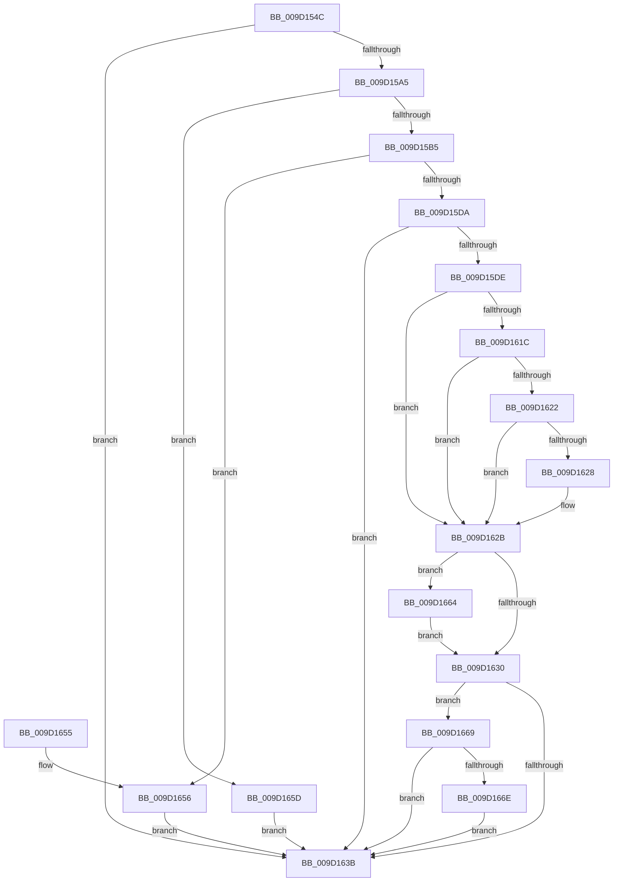

# CmGetDeviceStatus

- RVA: `0x009D154C`–`0x009D167B` (길이 `303` bytes)
- VA: `0x00000001409D154C`
- 실행 섹션: `PAGE`
- PDB 이름 있음: `예`; PDB Function 태그: `아니요`
- unwind 정보 RVA: `0x000A141C`
- 디코드: `95`개 명령, `303/303` bytes 표시
- 미해석 바이트: `0` (있으면 어셈블리에 `.byte`로 보존)

> 이 문서는 커널 이미지의 기계어와 PDB 기호를 분석해 생성했습니다. 4번과 5번은 함수 원형과 자료형을 바이너리 사용 방식에서 추정한 C 해석이며 원본 소스 복구 결과는 아닙니다.

## 1. Dependencies

- 직접 호출 지점: **3**; 고유 호출 대상: **3**
- 직접 호출자로 확인된 함수: **9**
- RIP 상대 이미지 참조: **0**

### Outgoing calls
- `0x009D1596` → [RtlInitUnicodeStringEx](../../text/46/RtlInitUnicodeStringEx_function_00463960.md) (function, `0x00463960`)
- `0x009D15CB` → [guard_dispatch_icall](../../text/6B/guard_dispatch_icall_function_006BAAD0.md) (function, `0x006BAAD0`)
- `0x009D1613` → [CmGetDeviceRegProp](../8E/CmGetDeviceRegProp_function_008ED870.md) (function, `0x008ED870`)

### Direct callers
- [PpDevCfgProcessDevices](../73/PpDevCfgProcessDevices_function_007373C0.md) at `0x00737483`
- [PiCMDeleteDeviceWorker](../73/PiCMDeleteDeviceWorker_function_0073B420.md) at `0x0073B4BA`
- [PiCMGenerateDeviceInstance](../73/PiCMGenerateDeviceInstance_function_0073B69C.md) at `0x0073B85E`
- [PiCMSetProblem](../73/PiCMSetProblem_function_0073B9E4.md) at `0x0073BA37`
- [CmIsDeviceSafeRemovalRequired](CmIsDeviceSafeRemovalRequired_function_009D1040.md) at `0x009D10BB`
- [PiCMGetDeviceStatus](PiCMGetDeviceStatus_function_009D136C.md) at `0x009D1424`
- [_CmGetDeviceMappedPropertyFromComposite](_CmGetDeviceMappedPropertyFromComposite_function_009D1684.md) at `0x009D1D44`
- [PiCMQueryRemove](../AD/PiCMQueryRemove_function_00AD43F4.md) at `0x00AD45A9`
- [sub_00B284C0](../B2/Unknown_function_00B284C0.md) at `0x00B28655`

### Static image references
- 디코드된 RIP-relative 메모리 참조가 없습니다.

## 2. Other-region calls and transfers

- 다른 실행 섹션으로 향하는 call: **2**
  - `0x009D1596` → [RtlInitUnicodeStringEx](../../text/46/RtlInitUnicodeStringEx_function_00463960.md) (`PAGE` → `.text`)
  - `0x009D15CB` → [guard_dispatch_icall](../../text/6B/guard_dispatch_icall_function_006BAAD0.md) (`PAGE` → `.text`)
- 별도 외부 분기/꼬리 이동을 확인하지 못했습니다.

## 3. Assembly (complete function range)

```asm
009D154C  48 89 5C 24 08                  mov qword ptr [rsp + 8], rbx
009D1551  4C 89 44 24 18                  mov qword ptr [rsp + 0x18], r8
009D1556  55                              push rbp
009D1557  56                              push rsi
009D1558  57                              push rdi
009D1559  41 54                           push r12
009D155B  41 55                           push r13
009D155D  41 56                           push r14
009D155F  41 57                           push r15
009D1561  48 8B EC                        mov rbp, rsp
009D1564  48 83 EC 60                     sub rsp, 0x60
009D1568  4C 8B 7D 60                     mov r15, qword ptr [rbp + 0x60]
009D156C  33 DB                           xor ebx, ebx
009D156E  4C 8B 65 68                     mov r12, qword ptr [rbp + 0x68]
009D1572  4C 8B F1                        mov r14, rcx
009D1575  41 89 19                        mov dword ptr [r9], ebx
009D1578  48 8D 4D E8                     lea rcx, [rbp - 0x18]
009D157C  0F 57 C0                        xorps xmm0, xmm0
009D157F  89 5D 58                        mov dword ptr [rbp + 0x58], ebx
009D1582  41 89 1F                        mov dword ptr [r15], ebx
009D1585  49 8B F1                        mov rsi, r9
009D1588  41 89 1C 24                     mov dword ptr [r12], ebx
009D158C  4C 8B EA                        mov r13, rdx
009D158F  0F 11 45 E8                     movups xmmword ptr [rbp - 0x18], xmm0
009D1593  89 5D E0                        mov dword ptr [rbp - 0x20], ebx
009D1596  E8 C5 23 A9 FF                  call 0x140463960
009D159B  8B F8                           mov edi, eax
009D159D  85 C0                           test eax, eax
009D159F  0F 88 96 00 00 00               js 0x1409d163b
009D15A5  49 8B 86 08 01 00 00            mov rax, qword ptr [r14 + 0x108]
009D15AC  48 85 C0                        test rax, rax
009D15AF  0F 84 A8 00 00 00               je 0x1409d165d
009D15B5  89 5C 24 28                     mov dword ptr [rsp + 0x28], ebx
009D15B9  48 8D 55 E8                     lea rdx, [rbp - 0x18]
009D15BD  4D 8B CF                        mov r9, r15
009D15C0  4C 89 64 24 20                  mov qword ptr [rsp + 0x20], r12
009D15C5  4C 8B C6                        mov r8, rsi
009D15C8  49 8B CE                        mov rcx, r14
009D15CB  E8 00 95 CE FF                  call 0x1406baad0
009D15D0  48 8B F8                        mov rdi, rax
009D15D3  3D 05 00 00 80                  cmp eax, 0x80000005
009D15D8  74 7C                           je 0x1409d1656
009D15DA  85 C0                           test eax, eax
009D15DC  78 5D                           js 0x1409d163b
009D15DE  4C 8B 45 50                     mov r8, qword ptr [rbp + 0x50]
009D15E2  48 8D 45 70                     lea rax, [rbp + 0x70]
009D15E6  89 5C 24 38                     mov dword ptr [rsp + 0x38], ebx
009D15EA  44 8D 63 04                     lea r12d, [rbx + 4]
009D15EE  48 89 44 24 30                  mov qword ptr [rsp + 0x30], rax
009D15F3  44 8D 4B 0B                     lea r9d, [rbx + 0xb]
009D15F7  48 8D 45 E0                     lea rax, [rbp - 0x20]
009D15FB  44 89 65 70                     mov dword ptr [rbp + 0x70], r12d
009D15FF  48 89 44 24 28                  mov qword ptr [rsp + 0x28], rax
009D1604  49 8B D5                        mov rdx, r13
009D1607  48 8D 45 58                     lea rax, [rbp + 0x58]
009D160B  49 8B CE                        mov rcx, r14
009D160E  48 89 44 24 20                  mov qword ptr [rsp + 0x20], rax
009D1613  E8 58 C2 F1 FF                  call 0x1408ed870
009D1618  85 C0                           test eax, eax
009D161A  75 0F                           jne 0x1409d162b
009D161C  44 39 65 70                     cmp dword ptr [rbp + 0x70], r12d
009D1620  72 09                           jb 0x1409d162b
009D1622  44 39 65 58                     cmp dword ptr [rbp + 0x58], r12d
009D1626  75 03                           jne 0x1409d162b
009D1628  8B 5D E0                        mov ebx, dword ptr [rbp - 0x20]
009D162B  41 84 DC                        test r12b, bl
009D162E  75 34                           jne 0x1409d1664
009D1630  8B 06                           mov eax, dword ptr [rsi]
009D1632  B9 00 04 00 00                  mov ecx, 0x400
009D1637  85 C1                           test ecx, eax
009D1639  74 2E                           je 0x1409d1669
009D163B  48 8B 9C 24 A0 00 00 00         mov rbx, qword ptr [rsp + 0xa0]
009D1643  8B C7                           mov eax, edi
009D1645  48 83 C4 60                     add rsp, 0x60
009D1649  41 5F                           pop r15
009D164B  41 5E                           pop r14
009D164D  41 5D                           pop r13
009D164F  41 5C                           pop r12
009D1651  5F                              pop rdi
009D1652  5E                              pop rsi
009D1653  5D                              pop rbp
009D1654  C3                              ret
009D1655  CC                              int3
009D1656  BF 23 00 00 C0                  mov edi, 0xc0000023
009D165B  EB DE                           jmp 0x1409d163b
009D165D  BF 02 00 00 C0                  mov edi, 0xc0000002
009D1662  EB D7                           jmp 0x1409d163b
009D1664  83 0E 10                        or dword ptr [rsi], 0x10
009D1667  EB C7                           jmp 0x1409d1630
009D1669  F6 C3 40                        test bl, 0x40
009D166C  74 CD                           je 0x1409d163b
009D166E  0B C1                           or eax, ecx
009D1670  89 06                           mov dword ptr [rsi], eax
009D1672  41 C7 07 1C 00 00 00            mov dword ptr [r15], 0x1c
009D1679  EB C0                           jmp 0x1409d163b
```

## 4. C-style interpretation (structured pseudocode)

```c
__int64 __fastcall CmGetDeviceStatus(__int64 a1, __int64 a2, __int64 a3, __int64 a4, __int64 a5, __int64 a6, unsigned int a7)
{
    __int64 result;
    __int64 v_rbx;
    __int64 v_rsp;
    unsigned __int64 v_stack_m50;
    unsigned int v_stack_m58;
    unsigned int v_stack_m60;
    unsigned __int64 v_stack_m68;
    unsigned int v_stack_m70;
    unsigned __int64 v_stack_m78;
    unsigned __int64 v_stack_p18;
    unsigned int v_stack_p20;
    unsigned int v_stack_p38;
    unsigned __int64 v_stack_p8;

    v_stack_p8 = v_rbx;
    v_stack_p18 = a3;
    v_rsp = (v_rsp) - (96);
    v_rbx = 0;
    *(unsigned int *)(a4) = 0;
    v_stack_p20 = 0;
    *(unsigned int *)(a5) = 0;
    *(unsigned int *)(a6) = 0;
    v_stack_m50 = v_xmm0;
    v_stack_m58 = 0;
    result = RtlInitUnicodeStringEx(v_stack_m50, a2, a3, a4);
    if (sign_flag) goto loc_009D163B;
    if (*(unsigned __int64 *)(a1 + 264) == 0) goto loc_009D165D;
    v_stack_m70 = 0;
    v_stack_m78 = a6;
    result = guard_dispatch_icall(a1, v_stack_m50, a4, a5);
    if (((unsigned int)(result)) == 0x80000005ULL) goto loc_009D1656;
    if (sign_flag) goto loc_009D163B;
    v_stack_m60 = 0;
    v_stack_m68 = a7;
    v_stack_p38 = (unsigned int)(v_rbx + 4);
    v_stack_m70 = v_stack_m58;
    v_stack_m78 = v_stack_p20;
    result = CmGetDeviceRegProp(a1, a2, v_stack_p18, v_rbx + 11);
    if ((unsigned int)(result) != 0) goto loc_009D162B;
    if (a7 < ((unsigned int)(v_rbx + 4))) goto loc_009D162B;
    if (v_stack_p20 == ((unsigned int)(v_rbx + 4))) {
        v_rbx = v_stack_m58;
    }
    if ((((unsigned __int8)(v_rbx + 4)) & ((unsigned __int8)(v_rbx))) != 0) goto loc_009D1664;
loc_009D1630:
    if ((((unsigned int)((unsigned int)(0x400ULL))) & ((unsigned int)((unsigned int)(*(unsigned int *)(a4))))) == 0) goto loc_009D1669;
loc_009D163B:
    v_rsp = (v_rsp) + (96);
    return (unsigned int)((unsigned int)(result));
loc_009D1656:
    goto loc_009D163B;
loc_009D165D:
    goto loc_009D163B;
loc_009D1664:
    goto loc_009D1630;
loc_009D1669:
    if ((((unsigned __int8)(v_stack_p8)) & (64)) == 0) goto loc_009D163B;
    result = (unsigned int)(((unsigned int)((unsigned int)(result))) | ((unsigned int)((unsigned int)(0x400ULL))));
    *(unsigned int *)(a4) = (unsigned int)(result);
    *(unsigned int *)(a5) = 28;
    goto loc_009D163B;
}
```

## 5. (Beta) C Style

```c
int64_t CmGetDeviceStatus(void *Arg1, int64_t Arg2, int64_t Arg3, void *Arg4, void *Arg5, void *Arg6, uint32_t Arg7)
{
    uint8_t *arg1 = (uint8_t *)Arg1;
    uint8_t *arg4 = (uint8_t *)Arg4;
    uint8_t *arg5 = (uint8_t *)Arg5;
    uint8_t *arg6 = (uint8_t *)Arg6;

    int64_t result;
    int64_t local_rbx;
    int64_t local_rsp;
    uint64_t v_stack_m50;
    uint32_t v_stack_m58;
    uint32_t v_stack_m60;
    uint64_t v_stack_m68;
    uint32_t v_stack_m70;
    uint64_t v_stack_m78;
    uint64_t v_stack_p18;
    uint32_t v_stack_p20;
    uint32_t v_stack_p38;
    uint64_t v_stack_p8;

    v_stack_p8 = local_rbx;
    v_stack_p18 = Arg3;
    local_rsp = (local_rsp) - (96);
    local_rbx = 0;
    *(uint32_t *)(arg4) = 0;
    v_stack_p20 = 0;
    *(uint32_t *)(arg5) = 0;
    *(uint32_t *)(arg6) = 0;
    v_stack_m50 = v_xmm0;
    v_stack_m58 = 0;
    result = RtlInitUnicodeStringEx(v_stack_m50, Arg2, Arg3, Arg4);
    if (sign_flag) goto loc_009D163B;
    if (*(uint64_t *)(arg1 + 0x108) == 0) goto loc_009D165D;
    v_stack_m70 = 0;
    v_stack_m78 = Arg6;
    result = guard_dispatch_icall(Arg1, v_stack_m50, Arg4, Arg5);
    if (((uint32_t)(result)) == 0x80000005ULL) goto loc_009D1656;
    if (sign_flag) goto loc_009D163B;
    v_stack_m60 = 0;
    v_stack_m68 = Arg7;
    v_stack_p38 = (uint32_t)(local_rbx + 4);
    v_stack_m70 = v_stack_m58;
    v_stack_m78 = v_stack_p20;
    result = CmGetDeviceRegProp(Arg1, Arg2, v_stack_p18, local_rbx + 11);
    if ((uint32_t)(result) != 0) goto loc_009D162B;
    if (Arg7 < ((uint32_t)(local_rbx + 4))) goto loc_009D162B;
    if (v_stack_p20 == ((uint32_t)(local_rbx + 4))) {
        local_rbx = v_stack_m58;
    }
    if ((((uint8_t)(local_rbx + 4)) & ((uint8_t)(local_rbx))) != 0) goto loc_009D1664;
loc_009D1630:
    if ((((uint32_t)((uint32_t)(0x400ULL))) & ((uint32_t)((uint32_t)(*(uint32_t *)(arg4))))) == 0) goto loc_009D1669;
loc_009D163B:
    local_rsp = (local_rsp) + (96);
    return (uint32_t)((uint32_t)(result));
loc_009D1656:
    goto loc_009D163B;
loc_009D165D:
    goto loc_009D163B;
loc_009D1664:
    goto loc_009D1630;
loc_009D1669:
    if ((((uint8_t)(v_stack_p8)) & (64)) == 0) goto loc_009D163B;
    result = (uint32_t)(((uint32_t)((uint32_t)(result))) | ((uint32_t)((uint32_t)(0x400ULL))));
    *(uint32_t *)(arg4) = (uint32_t)(result);
    *(uint32_t *)(arg5) = 28;
    goto loc_009D163B;
}
```

### 관측된 메모리 오프셋

구조체 형식이 확인되지 않은 접근은 인자 기준의 오프셋으로만 기록했습니다.

| 기준 인자 | 오프셋 표현 | 폭 (bit) | 접근 |
|---|---:|---:|---|
| `Arg1` | `+ 0x108` | `64` | `R` |
| `Arg4` | `+ 0x0` | `32` | `R` |
| `Arg4` | `+ 0x0` | `32` | `R/W` |
| `Arg4` | `+ 0x0` | `32` | `W` |
| `Arg5` | `+ 0x0` | `32` | `W` |
| `Arg6` | `+ 0x0` | `32` | `W` |

## 6. Execution-region graph

[열기: 2D/3D 그래프와 함수 탐색 컨트롤 패널](../../../control-panel.html?section=page&rva=0x009D154C&view=graph)

- 2D 그래프는 위에서 아래로 흐르고, 3D 그래프는 빈 공간을 드래그해 회전합니다. Shift+드래그는 이동, 휠은 확대·축소, 함수 노드 선택은 대상 보고서 이동입니다.

### Static fallback


