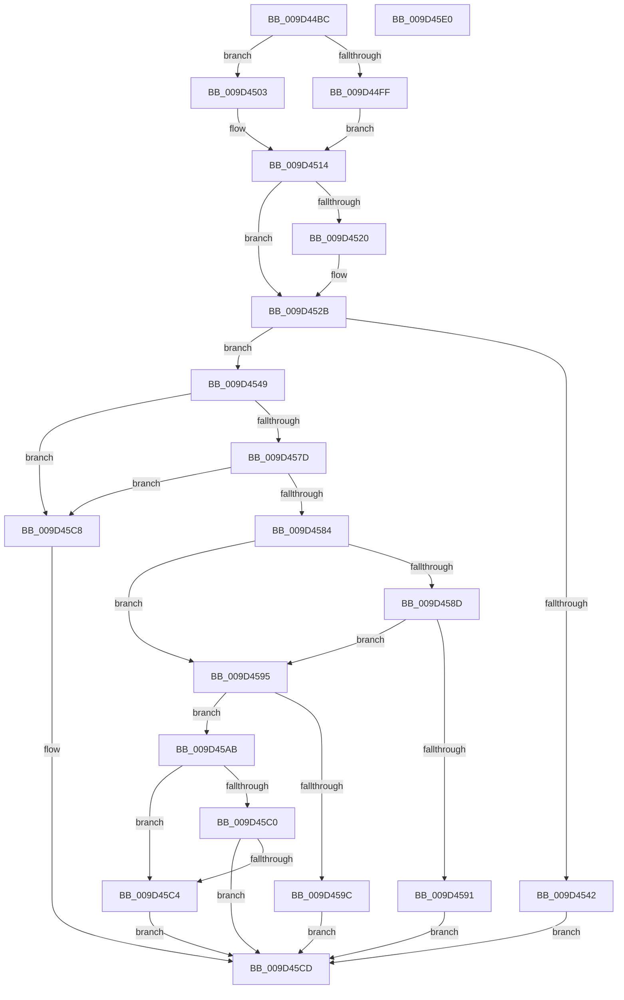

# CmGetInstallerClassMappedPropertyFromCoInstallers

- RVA: `0x009D44BC`–`0x009D45E1` (길이 `293` bytes)
- VA: `0x00000001409D44BC`
- 실행 섹션: `PAGE`
- PDB 이름 있음: `예`; PDB Function 태그: `아니요`
- unwind 정보 RVA: `0x000A1660`
- 디코드: `87`개 명령, `293/293` bytes 표시
- 미해석 바이트: `0` (있으면 어셈블리에 `.byte`로 보존)

> 이 문서는 커널 이미지의 기계어와 PDB 기호를 분석해 생성했습니다. 4번과 5번은 함수 원형과 자료형을 바이너리 사용 방식에서 추정한 C 해석이며 원본 소스 복구 결과는 아닙니다.

## 1. Dependencies

- 직접 호출 지점: **3**; 고유 호출 대상: **3**
- 직접 호출자로 확인된 함수: **2**
- RIP 상대 이미지 참조: **0**

### Outgoing calls
- `0x009D4539` → [_PnpCtxGetCachedNodeBaseKey](../8E/_PnpCtxGetCachedNodeBaseKey_function_008EF9C0.md) (function, `0x008EF9C0`)
- `0x009D456F` → [PnpCtxRegQueryValue](../99/PnpCtxRegQueryValue_function_009940FC.md) (function, `0x009940FC`)
- `0x009D45A4` → [PnpCtxRegDeleteValue](../8F/PnpCtxRegDeleteValue_function_008FE5E0.md) (function, `0x008FE5E0`)

### Direct callers
- [CmGetInstallerClassMappedPropertyKeys](../83/CmGetInstallerClassMappedPropertyKeys_function_00830704.md) at `0x008309B5`
- [CmGetInstallerClassMappedProperty](CmGetInstallerClassMappedProperty_function_009D3764.md) at `0x009D396E`

### Static image references
- 디코드된 RIP-relative 메모리 참조가 없습니다.

## 2. Other-region calls and transfers

- 다른 실행 섹션으로 향하는 call: **0**
- 별도 외부 분기/꼬리 이동을 확인하지 못했습니다.

## 3. Assembly (complete function range)

```asm
009D44BC  48 8B C4                        mov rax, rsp
009D44BF  48 89 58 10                     mov qword ptr [rax + 0x10], rbx
009D44C3  4C 89 40 18                     mov qword ptr [rax + 0x18], r8
009D44C7  55                              push rbp
009D44C8  56                              push rsi
009D44C9  57                              push rdi
009D44CA  41 56                           push r14
009D44CC  41 57                           push r15
009D44CE  48 83 EC 30                     sub rsp, 0x30
009D44D2  4C 8B BC 24 90 00 00 00         mov r15, qword ptr [rsp + 0x90]
009D44DA  33 DB                           xor ebx, ebx
009D44DC  48 8B B4 24 80 00 00 00         mov rsi, qword ptr [rsp + 0x80]
009D44E4  4D 8B F1                        mov r14, r9
009D44E7  41 89 19                        mov dword ptr [r9], ebx
009D44EA  48 8B EA                        mov rbp, rdx
009D44ED  89 58 18                        mov dword ptr [rax + 0x18], ebx
009D44F0  4C 8B D1                        mov r10, rcx
009D44F3  41 89 1F                        mov dword ptr [r15], ebx
009D44F6  48 89 58 08                     mov qword ptr [rax + 8], rbx
009D44FA  48 85 F6                        test rsi, rsi
009D44FD  75 04                           jne 0x1409d4503
009D44FF  8B FB                           mov edi, ebx
009D4501  EB 11                           jmp 0x1409d4514
009D4503  8B BC 24 88 00 00 00            mov edi, dword ptr [rsp + 0x88]
009D450A  8B C7                           mov eax, edi
009D450C  F7 D8                           neg eax
009D450E  48 1B C9                        sbb rcx, rcx
009D4511  48 23 F1                        and rsi, rcx
009D4514  49 8B 92 C8 00 00 00            mov rdx, qword ptr [r10 + 0xc8]
009D451B  48 85 D2                        test rdx, rdx
009D451E  75 0B                           jne 0x1409d452b
009D4520  49 8B 52 58                     mov rdx, qword ptr [r10 + 0x58]
009D4524  49 89 92 C8 00 00 00            mov qword ptr [r10 + 0xc8], rdx
009D452B  4C 8D 4C 24 60                  lea r9, [rsp + 0x60]
009D4530  41 B8 0D 00 00 00               mov r8d, 0xd
009D4536  49 8B CA                        mov rcx, r10
009D4539  E8 82 B4 F1 FF                  call 0x1408ef9c0
009D453E  85 C0                           test eax, eax
009D4540  79 07                           jns 0x1409d4549
009D4542  8B D8                           mov ebx, eax
009D4544  E9 84 00 00 00                  jmp 0x1409d45cd
009D4549  48 8B 54 24 60                  mov rdx, qword ptr [rsp + 0x60]
009D454E  48 8D 84 24 90 00 00 00         lea rax, [rsp + 0x90]
009D4556  48 89 44 24 28                  mov qword ptr [rsp + 0x28], rax
009D455B  4C 8D 4C 24 70                  lea r9, [rsp + 0x70]
009D4560  4C 8B C5                        mov r8, rbp
009D4563  48 89 74 24 20                  mov qword ptr [rsp + 0x20], rsi
009D4568  89 BC 24 90 00 00 00            mov dword ptr [rsp + 0x90], edi
009D456F  E8 88 FB FB FF                  call 0x1409940fc
009D4574  8B C8                           mov ecx, eax
009D4576  3D 34 00 00 C0                  cmp eax, 0xc0000034
009D457B  74 4B                           je 0x1409d45c8
009D457D  3D 7C 01 00 C0                  cmp eax, 0xc000017c
009D4582  74 44                           je 0x1409d45c8
009D4584  BA 23 00 00 C0                  mov edx, 0xc0000023
009D4589  85 C0                           test eax, eax
009D458B  74 08                           je 0x1409d4595
009D458D  3B C2                           cmp eax, edx
009D458F  74 04                           je 0x1409d4595
009D4591  8B D8                           mov ebx, eax
009D4593  EB 38                           jmp 0x1409d45cd
009D4595  83 7C 24 70 07                  cmp dword ptr [rsp + 0x70], 7
009D459A  74 0F                           je 0x1409d45ab
009D459C  48 8B 54 24 60                  mov rdx, qword ptr [rsp + 0x60]
009D45A1  4C 8B C5                        mov r8, rbp
009D45A4  E8 37 A0 F2 FF                  call 0x1408fe5e0
009D45A9  EB 22                           jmp 0x1409d45cd
009D45AB  8B 84 24 90 00 00 00            mov eax, dword ptr [rsp + 0x90]
009D45B2  41 89 07                        mov dword ptr [r15], eax
009D45B5  41 C7 06 12 20 00 00            mov dword ptr [r14], 0x2012
009D45BC  85 C9                           test ecx, ecx
009D45BE  75 04                           jne 0x1409d45c4
009D45C0  85 FF                           test edi, edi
009D45C2  75 09                           jne 0x1409d45cd
009D45C4  8B DA                           mov ebx, edx
009D45C6  EB 05                           jmp 0x1409d45cd
009D45C8  BB 25 02 00 C0                  mov ebx, 0xc0000225
009D45CD  8B C3                           mov eax, ebx
009D45CF  48 8B 5C 24 68                  mov rbx, qword ptr [rsp + 0x68]
009D45D4  48 83 C4 30                     add rsp, 0x30
009D45D8  41 5F                           pop r15
009D45DA  41 5E                           pop r14
009D45DC  5F                              pop rdi
009D45DD  5E                              pop rsi
009D45DE  5D                              pop rbp
009D45DF  C3                              ret
009D45E0  CC                              int3
```

## 4. C-style interpretation (structured pseudocode)

```c
__int64 __fastcall CmGetInstallerClassMappedPropertyFromCoInstallers(__int64 a1, __int64 a2, __int64 a3, __int64 a4, __int64 a5, unsigned int a6, unsigned int a7)
{
    __int64 result;
    __int64 v_rbx;
    __int64 v_rsi;
    __int64 v_rsp;
    unsigned __int64 v_stack_m30;
    unsigned __int64 v_stack_m38;
    unsigned __int64 v_stack_p10;
    unsigned __int64 v_stack_p18;
    unsigned int v_stack_p38;
    unsigned __int64 v_stack_p8;

    *(unsigned __int64 *)(v_rsp + 16) = v_rbx;
    *(unsigned __int64 *)(v_rsp + 24) = a3;
    v_rsp = (v_rsp) - (48);
    v_rbx = 0;
    *(unsigned int *)(a4) = 0;
    *(unsigned int *)(v_rsp + 24) = 0;
    *(unsigned int *)(a7) = 0;
    *(unsigned __int64 *)(v_rsp + 8) = 0;
    if (a5 != 0) goto loc_009D4503;
    goto loc_009D4514;
loc_009D4503:
    result = (unsigned int)(-((unsigned int)((unsigned int)((unsigned int)(a6)))));
    v_rsi = (a5) & (a1);
loc_009D4514:
    if (*(unsigned __int64 *)(a1 + 200) == 0) {
        a2 = *(unsigned __int64 *)(a1 + 88);
        *(unsigned __int64 *)(a1 + 200) = a2;
    }
    result = _PnpCtxGetCachedNodeBaseKey(a1, a2, 13, v_stack_p8);
    if (!sign_flag) goto loc_009D4549;
    goto loc_009D45CD;
loc_009D4549:
    v_stack_m30 = a7;
    v_stack_m38 = v_rsi;
    v_stack_p38 = (unsigned int)((unsigned int)(a6));
    result = PnpCtxRegQueryValue(a1, v_stack_p8, a2, v_stack_p18);
    if (((unsigned int)(result)) == 0xC0000034ULL) goto loc_009D45C8;
    if (((unsigned int)(result)) == 0xC000017CULL) goto loc_009D45C8;
    if ((unsigned int)(result) == 0) goto loc_009D4595;
    if (((unsigned int)(result)) == ((unsigned int)((unsigned int)(0xC0000023ULL)))) goto loc_009D4595;
    goto loc_009D45CD;
loc_009D4595:
    if (v_stack_p18 == 7) goto loc_009D45AB;
    result = PnpCtxRegDeleteValue((unsigned int)((unsigned int)(result)), v_stack_p8, a2, v_stack_p18);
    goto loc_009D45CD;
loc_009D45AB:
    *(unsigned int *)(a7) = (unsigned int)((unsigned int)(a7));
    *(unsigned int *)(a4) = 0x2012ULL;
    if ((unsigned int)((unsigned int)((unsigned int)(result))) != 0) goto loc_009D45C4;
    if ((unsigned int)((unsigned int)(a6)) != 0) goto loc_009D45CD;
loc_009D45C4:
    goto loc_009D45CD;
loc_009D45C8:
loc_009D45CD:
    v_rsp = (v_rsp) + (48);
    return (unsigned int)((unsigned int)((unsigned int)(0xC0000225ULL)));
}
```

## 5. (Beta) C Style

```c
int64_t CmGetInstallerClassMappedPropertyFromCoInstallers(void *Arg1, int64_t Arg2, int64_t Arg3, void *Arg4, int64_t Arg5, uint32_t Arg6, void *Arg7)
{
    uint8_t *arg1 = (uint8_t *)Arg1;
    uint8_t *arg4 = (uint8_t *)Arg4;
    uint8_t *arg7 = (uint8_t *)Arg7;

    int64_t result;
    int64_t local_rbx;
    int64_t local_rsi;
    int64_t local_rsp;
    uint64_t v_stack_m30;
    uint64_t v_stack_m38;
    uint64_t v_stack_p10;
    uint64_t v_stack_p18;
    uint32_t v_stack_p38;
    uint64_t v_stack_p8;

    *(uint64_t *)(local_rsp + 0x10) = local_rbx;
    *(uint64_t *)(local_rsp + 0x18) = Arg3;
    local_rsp = (local_rsp) - (48);
    local_rbx = 0;
    *(uint32_t *)(arg4) = 0;
    *(uint32_t *)(local_rsp + 0x18) = 0;
    *(uint32_t *)(arg7) = 0;
    *(uint64_t *)(local_rsp + 0x8) = 0;
    if (Arg5 != 0) goto loc_009D4503;
    goto loc_009D4514;
loc_009D4503:
    result = (uint32_t)(-((uint32_t)((uint32_t)((uint32_t)(Arg6)))));
    local_rsi = (Arg5) & (Arg1);
loc_009D4514:
    if (*(uint64_t *)(arg1 + 0xC8) == 0) {
        Arg2 = *(uint64_t *)(arg1 + 0x58);
        *(uint64_t *)(arg1 + 0xC8) = Arg2;
    }
    result = _PnpCtxGetCachedNodeBaseKey(Arg1, Arg2, 13, v_stack_p8);
    if (!sign_flag) goto loc_009D4549;
    goto loc_009D45CD;
loc_009D4549:
    v_stack_m30 = Arg7;
    v_stack_m38 = local_rsi;
    v_stack_p38 = (uint32_t)((uint32_t)(Arg6));
    result = PnpCtxRegQueryValue(Arg1, v_stack_p8, Arg2, v_stack_p18);
    if (((uint32_t)(result)) == 0xC0000034ULL) goto loc_009D45C8;
    if (((uint32_t)(result)) == 0xC000017CULL) goto loc_009D45C8;
    if ((uint32_t)(result) == 0) goto loc_009D4595;
    if (((uint32_t)(result)) == ((uint32_t)((uint32_t)(0xC0000023ULL)))) goto loc_009D4595;
    goto loc_009D45CD;
loc_009D4595:
    if (v_stack_p18 == 7) goto loc_009D45AB;
    result = PnpCtxRegDeleteValue((uint32_t)((uint32_t)(result)), v_stack_p8, Arg2, v_stack_p18);
    goto loc_009D45CD;
loc_009D45AB:
    *(uint32_t *)(arg7) = (uint32_t)((uint32_t)(Arg7));
    *(uint32_t *)(arg4) = 0x2012ULL;
    if ((uint32_t)((uint32_t)((uint32_t)(result))) != 0) goto loc_009D45C4;
    if ((uint32_t)((uint32_t)(Arg6)) != 0) goto loc_009D45CD;
loc_009D45C4:
    goto loc_009D45CD;
loc_009D45C8:
loc_009D45CD:
    local_rsp = (local_rsp) + (48);
    return (uint32_t)((uint32_t)((uint32_t)(0xC0000225ULL)));
}
```

### 관측된 메모리 오프셋

구조체 형식이 확인되지 않은 접근은 인자 기준의 오프셋으로만 기록했습니다.

| 기준 인자 | 오프셋 표현 | 폭 (bit) | 접근 |
|---|---:|---:|---|
| `Arg1` | `+ 0x58` | `64` | `R` |
| `Arg1` | `+ 0xC8` | `64` | `R` |
| `Arg1` | `+ 0xC8` | `64` | `W` |
| `Arg4` | `+ 0x0` | `32` | `W` |
| `Arg7` | `+ 0x0` | `32` | `W` |

## 6. Execution-region graph

[열기: 2D/3D 그래프와 함수 탐색 컨트롤 패널](../../../control-panel.html?section=page&rva=0x009D44BC&view=graph)

- 2D 그래프는 위에서 아래로 흐르고, 3D 그래프는 빈 공간을 드래그해 회전합니다. Shift+드래그는 이동, 휠은 확대·축소, 함수 노드 선택은 대상 보고서 이동입니다.

### Static fallback


