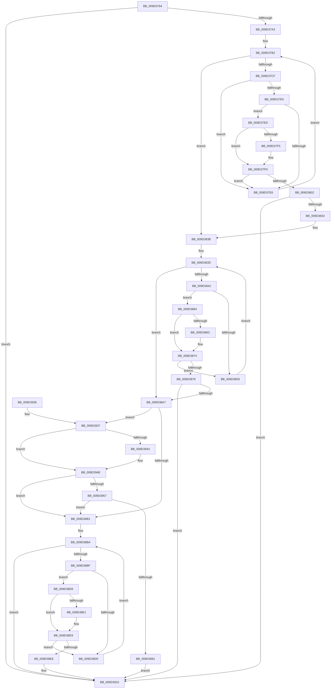

# CmGetInstallerClassMappedProperty

- RVA: `0x009D3764`–`0x009D3983` (길이 `543` bytes)
- VA: `0x00000001409D3764`
- 실행 섹션: `PAGE`
- PDB 이름 있음: `예`; PDB Function 태그: `아니요`
- unwind 정보 RVA: `0x000A1584`
- 디코드: `146`개 명령, `543/543` bytes 표시
- 미해석 바이트: `0` (있으면 어셈블리에 `.byte`로 보존)

> 이 문서는 커널 이미지의 기계어와 PDB 기호를 분석해 생성했습니다. 4번과 5번은 함수 원형과 자료형을 바이너리 사용 방식에서 추정한 C 해석이며 원본 소스 복구 결과는 아닙니다.

## 1. Dependencies

- 직접 호출 지점: **4**; 고유 호출 대상: **4**
- 직접 호출자로 확인된 함수: **1**
- RIP 상대 이미지 참조: **3**

### Outgoing calls
- `0x009D3821` → [_CmGetInstallerClassMappedPropertyFromRegProp](_CmGetInstallerClassMappedPropertyFromRegProp_function_009D3E34.md) (function, `0x009D3E34`)
- `0x009D3898` → [_CmGetInstallerClassMappedPropertyFromRegValue](_CmGetInstallerClassMappedPropertyFromRegValue_function_009D4058.md) (function, `0x009D4058`)
- `0x009D390D` → [_CmGetInstallerClassMappedPropertyFromComposite](_CmGetInstallerClassMappedPropertyFromComposite_function_009D398C.md) (function, `0x009D398C`)
- `0x009D396E` → [CmGetInstallerClassMappedPropertyFromCoInstallers](CmGetInstallerClassMappedPropertyFromCoInstallers_function_009D44BC.md) (function, `0x009D44BC`)

### Direct callers
- [_PnpDispatchInstallerClass](_PnpDispatchInstallerClass_function_009D3580.md) at `0x009D361E`

### Static image references
- `0x009D37AB` → RVA `0x00000000` (`image boundary/outside`; read)
- `0x009D393A` → RVA `0x000143F8` (`.rdata`; read)
- `0x009D3947` → RVA `0x00014400` (`.rdata`; read)

## 2. Other-region calls and transfers

- 다른 실행 섹션으로 향하는 call: **0**
- 별도 외부 분기/꼬리 이동을 확인하지 못했습니다.

## 3. Assembly (complete function range)

```asm
009D3764  48 89 5C 24 08                  mov qword ptr [rsp + 8], rbx
009D3769  48 89 6C 24 10                  mov qword ptr [rsp + 0x10], rbp
009D376E  48 89 74 24 18                  mov qword ptr [rsp + 0x18], rsi
009D3773  57                              push rdi
009D3774  41 54                           push r12
009D3776  41 55                           push r13
009D3778  41 56                           push r14
009D377A  41 57                           push r15
009D377C  48 83 EC 40                     sub rsp, 0x40
009D3780  48 8B BC 24 B0 00 00 00         mov rdi, qword ptr [rsp + 0xb0]
009D3788  4D 8B E8                        mov r13, r8
009D378B  4C 8B FA                        mov r15, rdx
009D378E  4C 8B E1                        mov r12, rcx
009D3791  41 BA 16 00 00 C0               mov r10d, 0xc0000016
009D3797  83 27 00                        and dword ptr [rdi], 0
009D379A  4D 85 C9                        test r9, r9
009D379D  0F 85 72 01 00 00               jne 0x1409d3915
009D37A3  48 8B 9C 24 90 00 00 00         mov rbx, qword ptr [rsp + 0x90]
009D37AB  4C 8D 05 4E C8 62 FF            lea r8, [rip - 0x9d37b2]
009D37B2  8B B4 24 A8 00 00 00            mov esi, dword ptr [rsp + 0xa8]
009D37B9  48 8B AC 24 A0 00 00 00         mov rbp, qword ptr [rsp + 0xa0]
009D37C1  4C 8B B4 24 98 00 00 00         mov r14, qword ptr [rsp + 0x98]
009D37C9  41 83 F9 09                     cmp r9d, 9
009D37CD  73 6C                           jae 0x1409d383b
009D37CF  4B 8D 0C 49                     lea rcx, [r9 + r9*2]
009D37D3  49 8B 94 C8 10 C7 B4 00         mov rdx, qword ptr [r8 + rcx*8 + 0xb4c710]
009D37DB  48 85 D2                        test rdx, rdx
009D37DE  74 08                           je 0x1409d37e8
009D37E0  8B 42 10                        mov eax, dword ptr [rdx + 0x10]
009D37E3  39 43 10                        cmp dword ptr [rbx + 0x10], eax
009D37E6  74 05                           je 0x1409d37ed
009D37E8  41 FF C1                        inc r9d
009D37EB  EB C5                           jmp 0x1409d37b2
009D37ED  48 8B 0B                        mov rcx, qword ptr [rbx]
009D37F0  48 2B 0A                        sub rcx, qword ptr [rdx]
009D37F3  75 08                           jne 0x1409d37fd
009D37F5  48 8B 4B 08                     mov rcx, qword ptr [rbx + 8]
009D37F9  48 2B 4A 08                     sub rcx, qword ptr [rdx + 8]
009D37FD  48 85 C9                        test rcx, rcx
009D3800  75 E6                           jne 0x1409d37e8
009D3802  48 89 7C 24 38                  mov qword ptr [rsp + 0x38], rdi
009D3807  4C 8B CB                        mov r9, rbx
009D380A  89 74 24 30                     mov dword ptr [rsp + 0x30], esi
009D380E  4D 8B C5                        mov r8, r13
009D3811  48 89 6C 24 28                  mov qword ptr [rsp + 0x28], rbp
009D3816  49 8B D7                        mov rdx, r15
009D3819  49 8B CC                        mov rcx, r12
009D381C  4C 89 74 24 20                  mov qword ptr [rsp + 0x20], r14
009D3821  E8 0E 06 00 00                  call 0x1409d3e34
009D3826  44 8B D0                        mov r10d, eax
009D3829  3D 16 00 00 C0                  cmp eax, 0xc0000016
009D382E  0F 85 E1 00 00 00               jne 0x1409d3915
009D3834  4C 8D 05 C5 C7 62 FF            lea r8, [rip - 0x9d383b]
009D383B  33 D2                           xor edx, edx
009D383D  83 FA 0D                        cmp edx, 0xd
009D3840  73 65                           jae 0x1409d38a7
009D3842  8B CA                           mov ecx, edx
009D3844  48 C1 E1 05                     shl rcx, 5
009D3848  4E 8B 84 01 20 D3 B4 00         mov r8, qword ptr [rcx + r8 + 0xb4d320]
009D3850  41 8B 40 10                     mov eax, dword ptr [r8 + 0x10]
009D3854  39 43 10                        cmp dword ptr [rbx + 0x10], eax
009D3857  74 0B                           je 0x1409d3864
009D3859  FF C2                           inc edx
009D385B  4C 8D 05 9E C7 62 FF            lea r8, [rip - 0x9d3862]
009D3862  EB D9                           jmp 0x1409d383d
009D3864  48 8B 0B                        mov rcx, qword ptr [rbx]
009D3867  49 2B 08                        sub rcx, qword ptr [r8]
009D386A  75 08                           jne 0x1409d3874
009D386C  48 8B 4B 08                     mov rcx, qword ptr [rbx + 8]
009D3870  49 2B 48 08                     sub rcx, qword ptr [r8 + 8]
009D3874  48 85 C9                        test rcx, rcx
009D3877  75 E0                           jne 0x1409d3859
009D3879  48 89 7C 24 38                  mov qword ptr [rsp + 0x38], rdi
009D387E  4C 8B CB                        mov r9, rbx
009D3881  89 74 24 30                     mov dword ptr [rsp + 0x30], esi
009D3885  4D 8B C5                        mov r8, r13
009D3888  48 89 6C 24 28                  mov qword ptr [rsp + 0x28], rbp
009D388D  49 8B D7                        mov rdx, r15
009D3890  49 8B CC                        mov rcx, r12
009D3893  4C 89 74 24 20                  mov qword ptr [rsp + 0x20], r14
009D3898  E8 BB 07 00 00                  call 0x1409d4058
009D389D  44 8B D0                        mov r10d, eax
009D38A0  3D 16 00 00 C0                  cmp eax, 0xc0000016
009D38A5  75 6E                           jne 0x1409d3915
009D38A7  83 7B 10 02                     cmp dword ptr [rbx + 0x10], 2
009D38AB  0F 84 86 00 00 00               je 0x1409d3937
009D38B1  33 D2                           xor edx, edx
009D38B3  4C 8D 0D 46 C7 62 FF            lea r9, [rip - 0x9d38ba]
009D38BA  83 FA 04                        cmp edx, 4
009D38BD  73 56                           jae 0x1409d3915
009D38BF  8B C2                           mov eax, edx
009D38C1  48 03 C0                        add rax, rax
009D38C4  4D 8B 84 C1 40 BA B4 00         mov r8, qword ptr [r9 + rax*8 + 0xb4ba40]
009D38CC  41 8B 40 10                     mov eax, dword ptr [r8 + 0x10]
009D38D0  39 43 10                        cmp dword ptr [rbx + 0x10], eax
009D38D3  74 04                           je 0x1409d38d9
009D38D5  FF C2                           inc edx
009D38D7  EB E1                           jmp 0x1409d38ba
009D38D9  48 8B 0B                        mov rcx, qword ptr [rbx]
009D38DC  49 2B 08                        sub rcx, qword ptr [r8]
009D38DF  75 08                           jne 0x1409d38e9
009D38E1  48 8B 4B 08                     mov rcx, qword ptr [rbx + 8]
009D38E5  49 2B 48 08                     sub rcx, qword ptr [r8 + 8]
009D38E9  48 85 C9                        test rcx, rcx
009D38EC  75 E7                           jne 0x1409d38d5
009D38EE  48 89 7C 24 38                  mov qword ptr [rsp + 0x38], rdi
009D38F3  4C 8B CB                        mov r9, rbx
009D38F6  89 74 24 30                     mov dword ptr [rsp + 0x30], esi
009D38FA  4D 8B C5                        mov r8, r13
009D38FD  48 89 6C 24 28                  mov qword ptr [rsp + 0x28], rbp
009D3902  49 8B D7                        mov rdx, r15
009D3905  49 8B CC                        mov rcx, r12
009D3908  4C 89 74 24 20                  mov qword ptr [rsp + 0x20], r14
009D390D  E8 7A 00 00 00                  call 0x1409d398c
009D3912  44 8B D0                        mov r10d, eax
009D3915  4C 8D 5C 24 40                  lea r11, [rsp + 0x40]
009D391A  41 8B C2                        mov eax, r10d
009D391D  49 8B 5B 30                     mov rbx, qword ptr [r11 + 0x30]
009D3921  49 8B 6B 38                     mov rbp, qword ptr [r11 + 0x38]
009D3925  49 8B 73 40                     mov rsi, qword ptr [r11 + 0x40]
009D3929  49 8B E3                        mov rsp, r11
009D392C  41 5F                           pop r15
009D392E  41 5E                           pop r14
009D3930  41 5D                           pop r13
009D3932  41 5C                           pop r12
009D3934  5F                              pop rdi
009D3935  C3                              ret
009D3936  CC                              int3
009D3937  48 8B 03                        mov rax, qword ptr [rbx]
009D393A  48 2B 05 B7 0A 64 FF            sub rax, qword ptr [rip - 0x9bf549]
009D3941  75 0B                           jne 0x1409d394e
009D3943  48 8B 43 08                     mov rax, qword ptr [rbx + 8]
009D3947  48 2B 05 B2 0A 64 FF            sub rax, qword ptr [rip - 0x9bf54e]
009D394E  48 85 C0                        test rax, rax
009D3951  0F 85 5A FF FF FF               jne 0x1409d38b1
009D3957  48 89 7C 24 30                  mov qword ptr [rsp + 0x30], rdi
009D395C  4D 8B CE                        mov r9, r14
009D395F  89 74 24 28                     mov dword ptr [rsp + 0x28], esi
009D3963  49 8B D7                        mov rdx, r15
009D3966  49 8B CC                        mov rcx, r12
009D3969  48 89 6C 24 20                  mov qword ptr [rsp + 0x20], rbp
009D396E  E8 49 0B 00 00                  call 0x1409d44bc
009D3973  44 8B D0                        mov r10d, eax
009D3976  3D 16 00 00 C0                  cmp eax, 0xc0000016
009D397B  0F 84 30 FF FF FF               je 0x1409d38b1
009D3981  EB 92                           jmp 0x1409d3915
```

## 4. C-style interpretation (structured pseudocode)

```c
__int64 __fastcall CmGetInstallerClassMappedProperty(__int64 a1, __int64 a2, __int64 a3, __int64 a4, __int64 a5, __int64 a6, __int64 a7, unsigned int a8, __int64 a9)
{
    __int64 result;
    __int64 v_rsp;
    unsigned __int64 v_stack_m10;
    unsigned int v_stack_m18;
    unsigned __int64 v_stack_m20;
    unsigned __int64 v_stack_m28;
    unsigned __int64 v_stack_m30;
    unsigned int v_stack_m38;
    unsigned __int64 v_stack_m40;
    unsigned __int64 v_stack_m48;
    unsigned __int64 v_stack_p10;
    unsigned __int64 v_stack_p18;
    unsigned __int64 v_stack_p8;

    v_stack_p8 = v_rbx;
    v_stack_p10 = v_rbp;
    v_stack_p18 = v_rsi;
    v_rsp = (v_rsp) - (64);
    if (a4 != 0) goto loc_009D3915;
loc_009D37B2:
    if (((unsigned int)(a4)) >= 9) goto loc_009D383B;
    if (*(unsigned __int64 *)(v_rip - 10303410 + a4 + a4 * 2 * 8 + 11847440) == 0) goto loc_009D37E8;
    if ((*(unsigned int *)(a5 + 16)) == ((unsigned int)((unsigned int)(*(unsigned int *)(*(unsigned __int64 *)(v_rip - 10303410 + a4 + a4 * 2 * 8 + 11847440) + 16))))) goto loc_009D37ED;
loc_009D37E8:
    a4 = (unsigned int)((a4) + 1);
    goto loc_009D37B2;
loc_009D37ED:
    a1 = (*(unsigned __int64 *)(a5)) - (*(unsigned __int64 *)(*(unsigned __int64 *)(v_rip - 10303410 + a4 + a4 * 2 * 8 + 11847440)));
    if (!(condition_is_not_equal)) {
        a1 = *(unsigned __int64 *)(a5 + 8);
        a1 = (a1) - (*(unsigned __int64 *)(*(unsigned __int64 *)(v_rip - 10303410 + a4 + a4 * 2 * 8 + 11847440) + 8));
    }
    if (a1 != 0) goto loc_009D37E8;
    v_stack_m30 = a9;
    v_stack_m38 = (unsigned int)((unsigned int)(a8));
    v_stack_m40 = a7;
    v_stack_m48 = a6;
    result = _CmGetInstallerClassMappedPropertyFromRegProp(a1, a2, a3, a5);
    if (((unsigned int)(result)) != 0xC0000016ULL) goto loc_009D3915;
loc_009D383B:
    a2 = 0;
loc_009D383D:
    if (0 >= 13) goto loc_009D38A7;
    a1 = (0) << (5);
    if ((*(unsigned int *)(a5 + 16)) == ((unsigned int)((unsigned int)(*(unsigned int *)(*(unsigned __int64 *)(a1 + v_rip - 10303547 * 1 + 11850528) + 16))))) goto loc_009D3864;
loc_009D3859:
    a2 = (unsigned int)((a2) + 1);
    goto loc_009D383D;
loc_009D3864:
    a1 = (*(unsigned __int64 *)(a5)) - (*(unsigned __int64 *)(v_rip - 10303586));
    if (!(condition_is_not_equal)) {
        a1 = *(unsigned __int64 *)(a5 + 8);
        a1 = (a1) - (*(unsigned __int64 *)(v_rip - 10303586 + 8));
    }
    if (a1 != 0) goto loc_009D3859;
    v_stack_m30 = a9;
    v_stack_m38 = (unsigned int)((unsigned int)(a8));
    v_stack_m40 = a7;
    v_stack_m48 = a6;
    result = _CmGetInstallerClassMappedPropertyFromRegValue(a1, a2, a3, a5);
    if (((unsigned int)(result)) != 0xC0000016ULL) goto loc_009D3915;
loc_009D38A7:
    if ((*(unsigned int *)(a5 + 16)) == 2) goto loc_009D3937;
loc_009D38B1:
    a2 = 0;
loc_009D38BA:
    if (0 >= 4) goto loc_009D3915;
    result = (0) + (0);
    if ((*(unsigned int *)(a5 + 16)) == ((unsigned int)((unsigned int)(*(unsigned int *)(*(unsigned __int64 *)(v_rip - 10303674 + result * 8 + 11844160) + 16))))) goto loc_009D38D9;
loc_009D38D5:
    a2 = (unsigned int)((a2) + 1);
    goto loc_009D38BA;
loc_009D38D9:
    a1 = (*(unsigned __int64 *)(a5)) - (*(unsigned __int64 *)(*(unsigned __int64 *)(v_rip - 10303674 + result * 8 + 11844160)));
    if (!(condition_is_not_equal)) {
        a1 = *(unsigned __int64 *)(a5 + 8);
        a1 = (a1) - (*(unsigned __int64 *)(*(unsigned __int64 *)(v_rip - 10303674 + result * 8 + 11844160) + 8));
    }
    if (a1 != 0) goto loc_009D38D5;
    v_stack_m30 = a9;
    v_stack_m38 = (unsigned int)((unsigned int)(a8));
    v_stack_m40 = a7;
    v_stack_m48 = a6;
    result = _CmGetInstallerClassMappedPropertyFromComposite(a1, a2, a3, a5);
loc_009D3915:
    return (unsigned int)((unsigned int)((unsigned int)((unsigned int)(result))));
loc_009D3937:
    result = (*(unsigned __int64 *)(*(unsigned __int64 *)(v_stack_m28 + 48))) - (*(unsigned __int64 *)(v_rip - 10220873));
    if (!(condition_is_not_equal)) {
        result = *(unsigned __int64 *)(*(unsigned __int64 *)(v_stack_m28 + 48) + 8);
        result = (result) - (*(unsigned __int64 *)(v_rip - 10220878));
    }
    if (result != 0) goto loc_009D38B1;
    v_stack_m10 = a9;
    v_stack_m18 = (unsigned int)(*(unsigned __int64 *)(v_stack_m28 + 64));
    v_stack_m20 = *(unsigned __int64 *)(v_stack_m28 + 56);
    result = CmGetInstallerClassMappedPropertyFromCoInstallers(a1, a2, a3, a6);
    if (((unsigned int)(result)) == 0xC0000016ULL) goto loc_009D38B1;
    goto loc_009D3915;
}
```

## 5. (Beta) C Style

```c
int64_t CmGetInstallerClassMappedProperty(int64_t Arg1, int64_t Arg2, int64_t Arg3, int64_t Arg4, void *Arg5, int64_t Arg6, int64_t Arg7, uint32_t Arg8, void *Arg9)
{
    uint8_t *arg5 = (uint8_t *)Arg5;
    uint8_t *arg9 = (uint8_t *)Arg9;

    int64_t result;
    int64_t local_rsp;
    uint64_t v_stack_m10;
    uint32_t v_stack_m18;
    uint64_t v_stack_m20;
    uint64_t v_stack_m28;
    uint64_t v_stack_m30;
    uint32_t v_stack_m38;
    uint64_t v_stack_m40;
    uint64_t v_stack_m48;
    uint64_t v_stack_p10;
    uint64_t v_stack_p18;
    uint64_t v_stack_p8;

    v_stack_p8 = local_rbx;
    v_stack_p10 = local_rbp;
    v_stack_p18 = local_rsi;
    local_rsp = (local_rsp) - (64);
    if (Arg4 != 0) goto loc_009D3915;
loc_009D37B2:
    if (((uint32_t)(Arg4)) >= 9) goto loc_009D383B;
    if (*(uint64_t *)(v_rip - 0x9D37B2 + Arg4 + Arg4 * 2 * 8 + 0xB4C710) == 0) goto loc_009D37E8;
    if ((*(uint32_t *)(arg5 + 0x10)) == ((uint32_t)((uint32_t)(*(uint32_t *)(*(uint64_t *)(v_rip - 0x9D37B2 + Arg4 + Arg4 * 2 * 8 + 0xB4C710) + 0x10))))) goto loc_009D37ED;
loc_009D37E8:
    Arg4 = (uint32_t)((Arg4) + 1);
    goto loc_009D37B2;
loc_009D37ED:
    Arg1 = (*(uint64_t *)(arg5)) - (*(uint64_t *)(*(uint64_t *)(v_rip - 0x9D37B2 + Arg4 + Arg4 * 2 * 8 + 0xB4C710)));
    if (!(condition_is_not_equal)) {
        Arg1 = *(uint64_t *)(arg5 + 0x8);
        Arg1 = (Arg1) - (*(uint64_t *)(*(uint64_t *)(v_rip - 0x9D37B2 + Arg4 + Arg4 * 2 * 8 + 0xB4C710) + 0x8));
    }
    if (Arg1 != 0) goto loc_009D37E8;
    v_stack_m30 = Arg9;
    v_stack_m38 = (uint32_t)((uint32_t)(Arg8));
    v_stack_m40 = Arg7;
    v_stack_m48 = Arg6;
    result = _CmGetInstallerClassMappedPropertyFromRegProp(Arg1, Arg2, Arg3, Arg5);
    if (((uint32_t)(result)) != 0xC0000016ULL) goto loc_009D3915;
loc_009D383B:
    Arg2 = 0;
loc_009D383D:
    if (0 >= 13) goto loc_009D38A7;
    Arg1 = (0) << (5);
    if ((*(uint32_t *)(arg5 + 0x10)) == ((uint32_t)((uint32_t)(*(uint32_t *)(*(uint64_t *)(Arg1 + v_rip - 0x9D383B * 1 + 0xB4D320) + 0x10))))) goto loc_009D3864;
loc_009D3859:
    Arg2 = (uint32_t)((Arg2) + 1);
    goto loc_009D383D;
loc_009D3864:
    Arg1 = (*(uint64_t *)(arg5)) - (*(uint64_t *)(v_rip - 0x9D3862));
    if (!(condition_is_not_equal)) {
        Arg1 = *(uint64_t *)(arg5 + 0x8);
        Arg1 = (Arg1) - (*(uint64_t *)(v_rip - 0x9D3862 + 0x8));
    }
    if (Arg1 != 0) goto loc_009D3859;
    v_stack_m30 = Arg9;
    v_stack_m38 = (uint32_t)((uint32_t)(Arg8));
    v_stack_m40 = Arg7;
    v_stack_m48 = Arg6;
    result = _CmGetInstallerClassMappedPropertyFromRegValue(Arg1, Arg2, Arg3, Arg5);
    if (((uint32_t)(result)) != 0xC0000016ULL) goto loc_009D3915;
loc_009D38A7:
    if ((*(uint32_t *)(arg5 + 0x10)) == 2) goto loc_009D3937;
loc_009D38B1:
    Arg2 = 0;
loc_009D38BA:
    if (0 >= 4) goto loc_009D3915;
    result = (0) + (0);
    if ((*(uint32_t *)(arg5 + 0x10)) == ((uint32_t)((uint32_t)(*(uint32_t *)(*(uint64_t *)(v_rip - 0x9D38BA + result * 8 + 0xB4BA40) + 0x10))))) goto loc_009D38D9;
loc_009D38D5:
    Arg2 = (uint32_t)((Arg2) + 1);
    goto loc_009D38BA;
loc_009D38D9:
    Arg1 = (*(uint64_t *)(arg5)) - (*(uint64_t *)(*(uint64_t *)(v_rip - 0x9D38BA + result * 8 + 0xB4BA40)));
    if (!(condition_is_not_equal)) {
        Arg1 = *(uint64_t *)(arg5 + 0x8);
        Arg1 = (Arg1) - (*(uint64_t *)(*(uint64_t *)(v_rip - 0x9D38BA + result * 8 + 0xB4BA40) + 0x8));
    }
    if (Arg1 != 0) goto loc_009D38D5;
    v_stack_m30 = Arg9;
    v_stack_m38 = (uint32_t)((uint32_t)(Arg8));
    v_stack_m40 = Arg7;
    v_stack_m48 = Arg6;
    result = _CmGetInstallerClassMappedPropertyFromComposite(Arg1, Arg2, Arg3, Arg5);
loc_009D3915:
    return (uint32_t)((uint32_t)((uint32_t)((uint32_t)(result))));
loc_009D3937:
    result = (*(uint64_t *)(*(uint64_t *)(v_stack_m28 + 0x30))) - (*(uint64_t *)(v_rip - 0x9BF549));
    if (!(condition_is_not_equal)) {
        result = *(uint64_t *)(*(uint64_t *)(v_stack_m28 + 0x30) + 0x8);
        result = (result) - (*(uint64_t *)(v_rip - 0x9BF54E));
    }
    if (result != 0) goto loc_009D38B1;
    v_stack_m10 = Arg9;
    v_stack_m18 = (uint32_t)(*(uint64_t *)(v_stack_m28 + 0x40));
    v_stack_m20 = *(uint64_t *)(v_stack_m28 + 0x38);
    result = CmGetInstallerClassMappedPropertyFromCoInstallers(Arg1, Arg2, Arg3, Arg6);
    if (((uint32_t)(result)) == 0xC0000016ULL) goto loc_009D38B1;
    goto loc_009D3915;
}
```

### 관측된 메모리 오프셋

구조체 형식이 확인되지 않은 접근은 인자 기준의 오프셋으로만 기록했습니다.

| 기준 인자 | 오프셋 표현 | 폭 (bit) | 접근 |
|---|---:|---:|---|
| `Arg5` | `+ 0x0` | `64` | `R` |
| `Arg5` | `+ 0x8` | `64` | `R` |
| `Arg5` | `+ 0x10` | `32` | `R` |
| `Arg9` | `+ 0x0` | `32` | `R/W` |

## 6. Execution-region graph

[열기: 2D/3D 그래프와 함수 탐색 컨트롤 패널](../../../control-panel.html?section=page&rva=0x009D3764&view=graph)

- 2D 그래프는 위에서 아래로 흐르고, 3D 그래프는 빈 공간을 드래그해 회전합니다. Shift+드래그는 이동, 휠은 확대·축소, 함수 노드 선택은 대상 보고서 이동입니다.

### Static fallback


