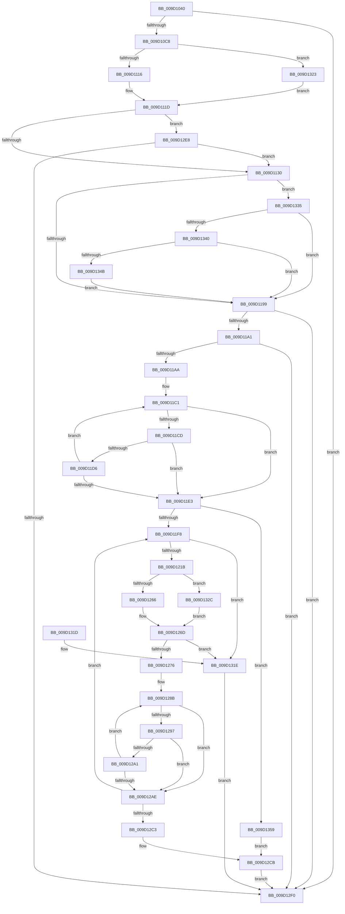

# CmIsDeviceSafeRemovalRequired

- RVA: `0x009D1040`–`0x009D1366` (길이 `806` bytes)
- VA: `0x00000001409D1040`
- 실행 섹션: `PAGE`
- PDB 이름 있음: `예`; PDB Function 태그: `아니요`
- unwind 정보 RVA: `0x000A13A0`
- 디코드: `193`개 명령, `806/806` bytes 표시
- 미해석 바이트: `0` (있으면 어셈블리에 `.byte`로 보존)

> 이 문서는 커널 이미지의 기계어와 PDB 기호를 분석해 생성했습니다. 4번과 5번은 함수 원형과 자료형을 바이너리 사용 방식에서 추정한 C 해석이며 원본 소스 복구 결과는 아닙니다.

## 1. Dependencies

- 직접 호출 지점: **7**; 고유 호출 대상: **6**
- 직접 호출자로 확인된 함수: **1**
- RIP 상대 이미지 참조: **2**

### Outgoing calls
- `0x009D10BB` → [CmGetDeviceStatus](CmGetDeviceStatus_function_009D154C.md) (function, `0x009D154C`)
- `0x009D1109` → [CmGetDeviceRegProp](../8E/CmGetDeviceRegProp_function_008ED870.md) (function, `0x008ED870`)
- `0x009D118C` → [PnpGetObjectProperty](../8E/PnpGetObjectProperty_function_008E2180.md) (function, `0x008E2180`)
- `0x009D120E` → [CmGetDeviceParent](../93/CmGetDeviceParent_function_00932368.md) (function, `0x00932368`)
- `0x009D1259` → [CmGetDeviceRegProp](../8E/CmGetDeviceRegProp_function_008ED870.md) (function, `0x008ED870`)
- `0x009D12E1` → [RtlStringExHandleOtherFlagsW](../../text/41/RtlStringExHandleOtherFlagsW_function_0041E3F0.md) (function, `0x0041E3F0`)
- `0x009D12FD` → [_security_check_cookie](../../text/6A/_security_check_cookie_function_006AC640.md) (function, `0x006AC640`)

### Direct callers
- [_CmGetDeviceMappedPropertyFromComposite](_CmGetDeviceMappedPropertyFromComposite_function_009D1684.md) at `0x009D1E21`

### Static image references
- `0x009D105F` → RVA `0x00E0A740` (`.data`; read)
- `0x009D116C` → RVA `0x00014038` (`.rdata`; read)

## 2. Other-region calls and transfers

- 다른 실행 섹션으로 향하는 call: **2**
  - `0x009D12E1` → [RtlStringExHandleOtherFlagsW](../../text/41/RtlStringExHandleOtherFlagsW_function_0041E3F0.md) (`PAGE` → `.text`)
  - `0x009D12FD` → [_security_check_cookie](../../text/6A/_security_check_cookie_function_006AC640.md) (`PAGE` → `.text`)
- 별도 외부 분기/꼬리 이동을 확인하지 못했습니다.

## 3. Assembly (complete function range)

```asm
009D1040  48 89 5C 24 20                  mov qword ptr [rsp + 0x20], rbx
009D1045  55                              push rbp
009D1046  56                              push rsi
009D1047  57                              push rdi
009D1048  41 54                           push r12
009D104A  41 55                           push r13
009D104C  41 56                           push r14
009D104E  41 57                           push r15
009D1050  48 8D AC 24 40 FD FF FF         lea rbp, [rsp - 0x2c0]
009D1058  48 81 EC C0 03 00 00            sub rsp, 0x3c0
009D105F  48 8B 05 DA 96 43 00            mov rax, qword ptr [rip + 0x4396da]
009D1066  48 33 C4                        xor rax, rsp
009D1069  48 89 85 B0 02 00 00            mov qword ptr [rbp + 0x2b0], rax
009D1070  45 33 ED                        xor r13d, r13d
009D1073  48 8D 44 24 78                  lea rax, [rsp + 0x78]
009D1078  48 89 44 24 28                  mov qword ptr [rsp + 0x28], rax
009D107D  4C 8D 4C 24 6C                  lea r9, [rsp + 0x6c]
009D1082  48 8D 44 24 7C                  lea rax, [rsp + 0x7c]
009D1087  44 89 6C 24 70                  mov dword ptr [rsp + 0x70], r13d
009D108C  48 89 44 24 20                  mov qword ptr [rsp + 0x20], rax
009D1091  4D 8B F8                        mov r15, r8
009D1094  48 8B F2                        mov rsi, rdx
009D1097  44 89 6C 24 74                  mov dword ptr [rsp + 0x74], r13d
009D109C  4C 8B E1                        mov r12, rcx
009D109F  44 89 6C 24 68                  mov dword ptr [rsp + 0x68], r13d
009D10A4  41 8A FD                        mov dil, r13b
009D10A7  44 88 6C 24 60                  mov byte ptr [rsp + 0x60], r13b
009D10AC  44 89 6C 24 6C                  mov dword ptr [rsp + 0x6c], r13d
009D10B1  44 89 6C 24 7C                  mov dword ptr [rsp + 0x7c], r13d
009D10B6  44 89 6C 24 78                  mov dword ptr [rsp + 0x78], r13d
009D10BB  E8 8C 04 00 00                  call 0x1409d154c
009D10C0  85 C0                           test eax, eax
009D10C2  0F 88 28 02 00 00               js 0x1409d12f0
009D10C8  44 8A 74 24 6C                  mov r14b, byte ptr [rsp + 0x6c]
009D10CD  48 8D 44 24 64                  lea rax, [rsp + 0x64]
009D10D2  44 89 6C 24 38                  mov dword ptr [rsp + 0x38], r13d
009D10D7  45 8D 4D 10                     lea r9d, [r13 + 0x10]
009D10DB  48 89 44 24 30                  mov qword ptr [rsp + 0x30], rax
009D10E0  4D 8B C7                        mov r8, r15
009D10E3  48 8D 44 24 68                  lea rax, [rsp + 0x68]
009D10E8  C7 44 24 64 04 00 00 00         mov dword ptr [rsp + 0x64], 4
009D10F0  48 89 44 24 28                  mov qword ptr [rsp + 0x28], rax
009D10F5  48 8B D6                        mov rdx, rsi
009D10F8  48 8D 44 24 74                  lea rax, [rsp + 0x74]
009D10FD  49 8B CC                        mov rcx, r12
009D1100  48 89 44 24 20                  mov qword ptr [rsp + 0x20], rax
009D1105  41 80 E6 08                     and r14b, 8
009D1109  E8 62 C7 F1 FF                  call 0x1408ed870
009D110E  85 C0                           test eax, eax
009D1110  0F 89 0D 02 00 00               jns 0x1409d1323
009D1116  41 8B C5                        mov eax, r13d
009D1119  89 44 24 68                     mov dword ptr [rsp + 0x68], eax
009D111D  8A D8                           mov bl, al
009D111F  8A C8                           mov cl, al
009D1121  80 E3 04                        and bl, 4
009D1124  80 E1 80                        and cl, 0x80
009D1127  45 84 F6                        test r14b, r14b
009D112A  0F 84 B8 01 00 00               je 0x1409d12e8
009D1130  44 89 6C 24 50                  mov dword ptr [rsp + 0x50], r13d
009D1135  48 8D 44 24 64                  lea rax, [rsp + 0x64]
009D113A  48 89 44 24 48                  mov qword ptr [rsp + 0x48], rax
009D113F  84 C9                           test cl, cl
009D1141  C7 44 24 40 01 00 00 00         mov dword ptr [rsp + 0x40], 1
009D1149  48 8D 44 24 60                  lea rax, [rsp + 0x60]
009D114E  48 89 44 24 38                  mov qword ptr [rsp + 0x38], rax
009D1153  41 0F 94 C6                     sete r14b
009D1157  48 8D 44 24 70                  lea rax, [rsp + 0x70]
009D115C  C7 44 24 64 01 00 00 00         mov dword ptr [rsp + 0x64], 1
009D1164  48 89 44 24 30                  mov qword ptr [rsp + 0x30], rax
009D1169  4D 8B CF                        mov r9, r15
009D116C  48 8D 05 C5 2E 64 FF            lea rax, [rip - 0x9bd13b]
009D1173  41 B8 01 00 00 00               mov r8d, 1
009D1179  48 89 44 24 28                  mov qword ptr [rsp + 0x28], rax
009D117E  48 8B D6                        mov rdx, rsi
009D1181  49 8B CC                        mov rcx, r12
009D1184  4C 89 6C 24 20                  mov qword ptr [rsp + 0x20], r13
009D1189  41 8A FE                        mov dil, r14b
009D118C  E8 EF 0F F1 FF                  call 0x1408e2180
009D1191  85 C0                           test eax, eax
009D1193  0F 84 9C 01 00 00               je 0x1409d1335
009D1199  84 DB                           test bl, bl
009D119B  0F 85 4F 01 00 00               jne 0x1409d12f0
009D11A1  40 84 FF                        test dil, dil
009D11A4  0F 84 46 01 00 00               je 0x1409d12f0
009D11AA  41 BE C8 00 00 00               mov r14d, 0xc8
009D11B0  48 8D 45 90                     lea rax, [rbp - 0x70]
009D11B4  41 8B D6                        mov edx, r14d
009D11B7  48 8D 4D 90                     lea rcx, [rbp - 0x70]
009D11BB  48 2B F0                        sub rsi, rax
009D11BE  41 8A FD                        mov dil, r13b
009D11C1  48 8D 82 36 FF FF 7F            lea rax, [rdx + 0x7fffff36]
009D11C8  48 85 C0                        test rax, rax
009D11CB  74 16                           je 0x1409d11e3
009D11CD  0F B7 04 0E                     movzx eax, word ptr [rsi + rcx]
009D11D1  66 85 C0                        test ax, ax
009D11D4  74 0D                           je 0x1409d11e3
009D11D6  66 89 01                        mov word ptr [rcx], ax
009D11D9  48 83 C1 02                     add rcx, 2
009D11DD  48 83 EA 01                     sub rdx, 1
009D11E1  75 DE                           jne 0x1409d11c1
009D11E3  48 85 D2                        test rdx, rdx
009D11E6  48 8D 41 FE                     lea rax, [rcx - 2]
009D11EA  48 0F 45 C1                     cmovne rax, rcx
009D11EE  66 44 89 28                     mov word ptr [rax], r13w
009D11F2  0F 84 61 01 00 00               je 0x1409d1359
009D11F8  4C 8D 4D 80                     lea r9, [rbp - 0x80]
009D11FC  44 89 75 80                     mov dword ptr [rbp - 0x80], r14d
009D1200  4C 8D 85 20 01 00 00            lea r8, [rbp + 0x120]
009D1207  49 8B CC                        mov rcx, r12
009D120A  48 8D 55 90                     lea rdx, [rbp - 0x70]
009D120E  E8 55 11 F6 FF                  call 0x140932368
009D1213  85 C0                           test eax, eax
009D1215  0F 88 03 01 00 00               js 0x1409d131e
009D121B  44 89 6C 24 38                  mov dword ptr [rsp + 0x38], r13d
009D1220  48 8D 44 24 64                  lea rax, [rsp + 0x64]
009D1225  48 89 44 24 30                  mov qword ptr [rsp + 0x30], rax
009D122A  48 8D 95 20 01 00 00            lea rdx, [rbp + 0x120]
009D1231  48 8D 44 24 68                  lea rax, [rsp + 0x68]
009D1236  C7 44 24 64 04 00 00 00         mov dword ptr [rsp + 0x64], 4
009D123E  48 89 44 24 28                  mov qword ptr [rsp + 0x28], rax
009D1243  41 B9 10 00 00 00               mov r9d, 0x10
009D1249  48 8D 44 24 74                  lea rax, [rsp + 0x74]
009D124E  45 33 C0                        xor r8d, r8d
009D1251  49 8B CC                        mov rcx, r12
009D1254  48 89 44 24 20                  mov qword ptr [rsp + 0x20], rax
009D1259  E8 12 C6 F1 FF                  call 0x1408ed870
009D125E  85 C0                           test eax, eax
009D1260  0F 89 C6 00 00 00               jns 0x1409d132c
009D1266  41 8B DD                        mov ebx, r13d
009D1269  89 5C 24 68                     mov dword ptr [rsp + 0x68], ebx
009D126D  80 E3 04                        and bl, 4
009D1270  0F 85 A8 00 00 00               jne 0x1409d131e
009D1276  4C 8D 85 20 01 00 00            lea r8, [rbp + 0x120]
009D127D  49 8B D6                        mov rdx, r14
009D1280  48 8D 45 90                     lea rax, [rbp - 0x70]
009D1284  4C 2B C0                        sub r8, rax
009D1287  48 8D 4D 90                     lea rcx, [rbp - 0x70]
009D128B  48 8D 82 36 FF FF 7F            lea rax, [rdx + 0x7fffff36]
009D1292  48 85 C0                        test rax, rax
009D1295  74 17                           je 0x1409d12ae
009D1297  41 0F B7 04 08                  movzx eax, word ptr [r8 + rcx]
009D129C  66 85 C0                        test ax, ax
009D129F  74 0D                           je 0x1409d12ae
009D12A1  66 89 01                        mov word ptr [rcx], ax
009D12A4  48 83 C1 02                     add rcx, 2
009D12A8  48 83 EA 01                     sub rdx, 1
009D12AC  75 DD                           jne 0x1409d128b
009D12AE  48 85 D2                        test rdx, rdx
009D12B1  48 8D 41 FE                     lea rax, [rcx - 2]
009D12B5  48 0F 45 C1                     cmovne rax, rcx
009D12B9  66 44 89 28                     mov word ptr [rax], r13w
009D12BD  0F 85 35 FF FF FF               jne 0x1409d11f8
009D12C3  48 8D 45 88                     lea rax, [rbp - 0x78]
009D12C7  4C 8D 4D 80                     lea r9, [rbp - 0x80]
009D12CB  C7 44 24 28 00 08 00 00         mov dword ptr [rsp + 0x28], 0x800
009D12D3  48 8D 4D 90                     lea rcx, [rbp - 0x70]
009D12D7  BA 90 01 00 00                  mov edx, 0x190
009D12DC  48 89 44 24 20                  mov qword ptr [rsp + 0x20], rax
009D12E1  E8 0A D1 A4 FF                  call 0x14041e3f0
009D12E6  EB 08                           jmp 0x1409d12f0
009D12E8  A8 02                           test al, 2
009D12EA  0F 85 40 FE FF FF               jne 0x1409d1130
009D12F0  40 8A C7                        mov al, dil
009D12F3  48 8B 8D B0 02 00 00            mov rcx, qword ptr [rbp + 0x2b0]
009D12FA  48 33 CC                        xor rcx, rsp
009D12FD  E8 3E B3 CD FF                  call 0x1406ac640
009D1302  48 8B 9C 24 18 04 00 00         mov rbx, qword ptr [rsp + 0x418]
009D130A  48 81 C4 C0 03 00 00            add rsp, 0x3c0
009D1311  41 5F                           pop r15
009D1313  41 5E                           pop r14
009D1315  41 5D                           pop r13
009D1317  41 5C                           pop r12
009D1319  5F                              pop rdi
009D131A  5E                              pop rsi
009D131B  5D                              pop rbp
009D131C  C3                              ret
009D131D  CC                              int3
009D131E  40 8A FB                        mov dil, bl
009D1321  EB CD                           jmp 0x1409d12f0
009D1323  8B 44 24 68                     mov eax, dword ptr [rsp + 0x68]
009D1327  E9 F1 FD FF FF                  jmp 0x1409d111d
009D132C  8B 5C 24 68                     mov ebx, dword ptr [rsp + 0x68]
009D1330  E9 38 FF FF FF                  jmp 0x1409d126d
009D1335  83 7C 24 70 11                  cmp dword ptr [rsp + 0x70], 0x11
009D133A  0F 85 59 FE FF FF               jne 0x1409d1199
009D1340  83 7C 24 64 01                  cmp dword ptr [rsp + 0x64], 1
009D1345  0F 85 4E FE FF FF               jne 0x1409d1199
009D134B  44 38 6C 24 60                  cmp byte ptr [rsp + 0x60], r13b
009D1350  40 0F 95 C7                     setne dil
009D1354  E9 40 FE FF FF                  jmp 0x1409d1199
009D1359  48 8D 45 80                     lea rax, [rbp - 0x80]
009D135D  4C 8D 4D 88                     lea r9, [rbp - 0x78]
009D1361  E9 65 FF FF FF                  jmp 0x1409d12cb
```

## 4. C-style interpretation (structured pseudocode)

```c
__int64 __fastcall CmIsDeviceSafeRemovalRequired(__int64 a1, __int64 a2, __int64 a3)
{
    __int64 result;
    __int64 v_r13;
    __int64 v_r14;
    __int64 v_rbx;
    __int64 v_rdi;
    __int64 v_rsi;
    __int64 v_rsp;
    unsigned __int64 v_stack_m1D8;
    unsigned __int64 v_stack_m2F8;
    unsigned __int64 v_stack_m368;
    unsigned __int64 v_stack_m370;
    unsigned __int64 v_stack_m378;
    unsigned __int64 v_stack_m37C;
    unsigned __int64 v_stack_m380;
    unsigned int v_stack_m384;
    unsigned int v_stack_m388;
    unsigned __int64 v_stack_m38C;
    unsigned int v_stack_m390;
    unsigned __int64 v_stack_m394;
    unsigned __int8 v_stack_m398;
    unsigned int v_stack_m3A8;
    unsigned __int64 v_stack_m3B0;
    unsigned int v_stack_m3B8;
    unsigned int v_stack_m3C0;
    unsigned __int64 v_stack_m3C8;
    unsigned __int64 v_stack_m3D0;
    unsigned __int64 v_stack_m3D8;
    unsigned __int64 v_stack_m48;
    unsigned __int64 v_stack_p20;
    unsigned __int8 v_stack_p60;
    unsigned int v_stack_p64;
    unsigned int v_stack_p68;
    unsigned int v_stack_p70;

    v_stack_p20 = v_rbx;
    v_rsp = (v_rsp) - (960);
    result = (*(unsigned __int64 *)(v_rip + 4429530)) ^ (v_rsp);
    v_stack_m48 = result;
    v_r13 = 0;
    v_stack_m3D0 = v_stack_m380;
    v_stack_m388 = 0;
    v_stack_m3D8 = v_stack_m37C;
    v_stack_m384 = 0;
    v_stack_m390 = 0;
    v_stack_m398 = 0;
    v_stack_m38C = 0;
    v_stack_m37C = 0;
    v_stack_m380 = 0;
    result = CmGetDeviceStatus(a1, a2, a3, v_stack_m38C);
    if (sign_flag) goto loc_009D12F0;
    v_stack_m3C0 = 0;
    v_stack_m3C8 = v_stack_m394;
    v_stack_m394 = 4;
    v_stack_m3D0 = v_stack_m390;
    v_stack_m3D8 = v_stack_m384;
    v_r14 = (unsigned __int8)((v_stack_m38C) & (8));
    result = CmGetDeviceRegProp(a1, a2, a3, v_r13 + 16);
    if (!sign_flag) goto loc_009D1323;
    v_stack_m390 = 0;
loc_009D111D:
    v_rbx = (unsigned __int8)((0) & (4));
    a1 = (unsigned __int8)((0) & (128));
    if ((unsigned __int8)(v_r14) == 0) goto loc_009D12E8;
loc_009D1130:
    v_stack_m3A8 = 0;
    v_stack_m3B0 = v_stack_m394;
    v_stack_m3B8 = 1;
    v_stack_m3C0 = v_stack_m398;
    v_r14 = ((unsigned __int8)(a1) == 0) ? 1 : 0;
    v_stack_m394 = 1;
    v_stack_m3C8 = v_stack_m388;
    v_stack_m3D0 = v_rip - 10211643;
    v_stack_m3D8 = 0;
    result = PnpGetObjectProperty(a1, a2, 1, a3);
    if ((unsigned int)(result) == 0) goto loc_009D1335;
loc_009D1199:
    if ((unsigned __int8)(v_rbx) != 0) goto loc_009D12F0;
    if ((unsigned __int8)((unsigned __int8)(v_r14)) == 0) goto loc_009D12F0;
    v_rsi = (a2) - (v_stack_m368);
loc_009D11C1:
    if (200 + 2147483446 == 0) goto loc_009D11E3;
    if ((unsigned __int16)(*(unsigned __int16 *)(v_rsi + v_stack_m368 * 1)) == 0) goto loc_009D11E3;
    *(unsigned __int16 *)(v_stack_m368) = (unsigned __int16)(*(unsigned __int16 *)(v_rsi + v_stack_m368 * 1));
    a1 = (v_stack_m368) + (2);
    a2 = (200) - (1);
    if (condition_is_not_equal) goto loc_009D11C1;
loc_009D11E3:
    result = a1 - 2;
    if (a2 != 0) { result = a1; }
    *(unsigned __int16 *)(result) = 0;
    if (a2 == 0) goto loc_009D1359;
loc_009D11F8:
    v_stack_m378 = 200;
    result = CmGetDeviceParent(a1, v_stack_m368, v_stack_m1D8, v_stack_m378);
    if (sign_flag) goto loc_009D131E;
    v_stack_m3C0 = 0;
    v_stack_m3C8 = v_stack_m394;
    v_stack_m394 = 4;
    v_stack_m3D0 = v_stack_m390;
    a3 = 0;
    v_stack_m3D8 = v_stack_m384;
    result = CmGetDeviceRegProp(a1, v_stack_m1D8, a3, 16);
    if (!sign_flag) goto loc_009D132C;
    v_stack_m390 = 0;
loc_009D126D:
    v_rbx = (unsigned __int8)((0) & (4));
    if (condition_is_not_equal) goto loc_009D131E;
    a3 = (v_stack_m1D8) - (v_stack_m368);
loc_009D128B:
    if (200 + 2147483446 == 0) goto loc_009D12AE;
    if ((unsigned __int16)(*(unsigned __int16 *)(a3 + v_stack_m368 * 1)) == 0) goto loc_009D12AE;
    *(unsigned __int16 *)(v_stack_m368) = (unsigned __int16)(*(unsigned __int16 *)(a3 + v_stack_m368 * 1));
    a1 = (v_stack_m368) + (2);
    a2 = (200) - (1);
    if (condition_is_not_equal) goto loc_009D128B;
loc_009D12AE:
    result = a1 - 2;
    if (a2 != 0) { result = a1; }
    *(unsigned __int16 *)(result) = 0;
    if (a2 != 0) goto loc_009D11F8;
loc_009D12CB:
    v_stack_m3D0 = 0x800ULL;
    v_stack_m3D8 = v_stack_m370;
    result = RtlStringExHandleOtherFlagsW(v_stack_m368, 400, a3, v_stack_m378);
    goto loc_009D12F0;
loc_009D12E8:
    if ((((unsigned __int8)(result)) & (2)) != 0) goto loc_009D1130;
loc_009D12F0:
    a1 = (v_stack_m48) ^ (v_rsp);
    result = _security_check_cookie(a1, 400, a3, v_stack_m378);
    v_rsp = (v_rsp) + (960);
    return result;
loc_009D131E:
    goto loc_009D12F0;
loc_009D1323:
    goto loc_009D111D;
loc_009D132C:
    goto loc_009D126D;
loc_009D1335:
    if (v_stack_p70 != 17) goto loc_009D1199;
    if (v_stack_p64 != 1) goto loc_009D1199;
    v_rdi = (v_stack_p60 != 0) ? 1 : 0;
    goto loc_009D1199;
loc_009D1359:
    goto loc_009D12CB;
}
```

## 5. (Beta) C Style

```c
int64_t CmIsDeviceSafeRemovalRequired(int64_t Arg1, void *Arg2, int64_t Arg3)
{
    uint8_t *arg2 = (uint8_t *)Arg2;

    int64_t result;
    int64_t local_r13;
    int64_t local_r14;
    int64_t local_rbx;
    int64_t local_rdi;
    int64_t local_rsi;
    int64_t local_rsp;
    uint64_t v_stack_m1D8;
    uint64_t v_stack_m2F8;
    uint64_t v_stack_m368;
    uint64_t v_stack_m370;
    uint64_t v_stack_m378;
    uint64_t v_stack_m37C;
    uint64_t v_stack_m380;
    uint32_t v_stack_m384;
    uint32_t v_stack_m388;
    uint64_t v_stack_m38C;
    uint32_t v_stack_m390;
    uint64_t v_stack_m394;
    uint8_t v_stack_m398;
    uint32_t v_stack_m3A8;
    uint64_t v_stack_m3B0;
    uint32_t v_stack_m3B8;
    uint32_t v_stack_m3C0;
    uint64_t v_stack_m3C8;
    uint64_t v_stack_m3D0;
    uint64_t v_stack_m3D8;
    uint64_t v_stack_m48;
    uint64_t v_stack_p20;
    uint8_t v_stack_p60;
    uint32_t v_stack_p64;
    uint32_t v_stack_p68;
    uint32_t v_stack_p70;

    v_stack_p20 = local_rbx;
    local_rsp = (local_rsp) - (960);
    result = (*(uint64_t *)(v_rip + 0x4396DA)) ^ (local_rsp);
    v_stack_m48 = result;
    local_r13 = 0;
    v_stack_m3D0 = v_stack_m380;
    v_stack_m388 = 0;
    v_stack_m3D8 = v_stack_m37C;
    v_stack_m384 = 0;
    v_stack_m390 = 0;
    v_stack_m398 = 0;
    v_stack_m38C = 0;
    v_stack_m37C = 0;
    v_stack_m380 = 0;
    result = CmGetDeviceStatus(Arg1, Arg2, Arg3, v_stack_m38C);
    if (sign_flag) goto loc_009D12F0;
    v_stack_m3C0 = 0;
    v_stack_m3C8 = v_stack_m394;
    v_stack_m394 = 4;
    v_stack_m3D0 = v_stack_m390;
    v_stack_m3D8 = v_stack_m384;
    local_r14 = (uint8_t)((v_stack_m38C) & (8));
    result = CmGetDeviceRegProp(Arg1, Arg2, Arg3, local_r13 + 16);
    if (!sign_flag) goto loc_009D1323;
    v_stack_m390 = 0;
loc_009D111D:
    local_rbx = (uint8_t)((0) & (4));
    Arg1 = (uint8_t)((0) & (128));
    if ((uint8_t)(local_r14) == 0) goto loc_009D12E8;
loc_009D1130:
    v_stack_m3A8 = 0;
    v_stack_m3B0 = v_stack_m394;
    v_stack_m3B8 = 1;
    v_stack_m3C0 = v_stack_m398;
    local_r14 = ((uint8_t)(Arg1) == 0) ? 1 : 0;
    v_stack_m394 = 1;
    v_stack_m3C8 = v_stack_m388;
    v_stack_m3D0 = v_rip - 10211643;
    v_stack_m3D8 = 0;
    result = PnpGetObjectProperty(Arg1, Arg2, 1, Arg3);
    if ((uint32_t)(result) == 0) goto loc_009D1335;
loc_009D1199:
    if ((uint8_t)(local_rbx) != 0) goto loc_009D12F0;
    if ((uint8_t)((uint8_t)(local_r14)) == 0) goto loc_009D12F0;
    local_rsi = (Arg2) - (v_stack_m368);
loc_009D11C1:
    if (200 + 2147483446 == 0) goto loc_009D11E3;
    if ((uint16_t)(*(uint16_t *)(local_rsi + v_stack_m368 * 1)) == 0) goto loc_009D11E3;
    *(uint16_t *)(v_stack_m368) = (uint16_t)(*(uint16_t *)(local_rsi + v_stack_m368 * 1));
    Arg1 = (v_stack_m368) + (2);
    Arg2 = (200) - (1);
    if (condition_is_not_equal) goto loc_009D11C1;
loc_009D11E3:
    result = Arg1 - 2;
    if (Arg2 != NULL) { result = Arg1; }
    *(uint16_t *)(result) = 0;
    if (Arg2 == NULL) goto loc_009D1359;
loc_009D11F8:
    v_stack_m378 = 200;
    result = CmGetDeviceParent(Arg1, v_stack_m368, v_stack_m1D8, v_stack_m378);
    if (sign_flag) goto loc_009D131E;
    v_stack_m3C0 = 0;
    v_stack_m3C8 = v_stack_m394;
    v_stack_m394 = 4;
    v_stack_m3D0 = v_stack_m390;
    Arg3 = 0;
    v_stack_m3D8 = v_stack_m384;
    result = CmGetDeviceRegProp(Arg1, v_stack_m1D8, Arg3, 16);
    if (!sign_flag) goto loc_009D132C;
    v_stack_m390 = 0;
loc_009D126D:
    local_rbx = (uint8_t)((0) & (4));
    if (condition_is_not_equal) goto loc_009D131E;
    Arg3 = (v_stack_m1D8) - (v_stack_m368);
loc_009D128B:
    if (200 + 2147483446 == 0) goto loc_009D12AE;
    if ((uint16_t)(*(uint16_t *)(Arg3 + v_stack_m368 * 1)) == 0) goto loc_009D12AE;
    *(uint16_t *)(v_stack_m368) = (uint16_t)(*(uint16_t *)(Arg3 + v_stack_m368 * 1));
    Arg1 = (v_stack_m368) + (2);
    Arg2 = (200) - (1);
    if (condition_is_not_equal) goto loc_009D128B;
loc_009D12AE:
    result = Arg1 - 2;
    if (Arg2 != NULL) { result = Arg1; }
    *(uint16_t *)(result) = 0;
    if (Arg2 != NULL) goto loc_009D11F8;
loc_009D12CB:
    v_stack_m3D0 = 0x800ULL;
    v_stack_m3D8 = v_stack_m370;
    result = RtlStringExHandleOtherFlagsW(v_stack_m368, 400, Arg3, v_stack_m378);
    goto loc_009D12F0;
loc_009D12E8:
    if ((((uint8_t)(result)) & (2)) != 0) goto loc_009D1130;
loc_009D12F0:
    Arg1 = (v_stack_m48) ^ (local_rsp);
    result = _security_check_cookie(Arg1, 400, Arg3, v_stack_m378);
    local_rsp = (local_rsp) + (960);
    return result;
loc_009D131E:
    goto loc_009D12F0;
loc_009D1323:
    goto loc_009D111D;
loc_009D132C:
    goto loc_009D126D;
loc_009D1335:
    if (v_stack_p70 != 17) goto loc_009D1199;
    if (v_stack_p64 != 1) goto loc_009D1199;
    local_rdi = (v_stack_p60 != 0) ? 1 : 0;
    goto loc_009D1199;
loc_009D1359:
    goto loc_009D12CB;
}
```

### 관측된 메모리 오프셋

구조체 형식이 확인되지 않은 접근은 인자 기준의 오프셋으로만 기록했습니다.

| 기준 인자 | 오프셋 표현 | 폭 (bit) | 접근 |
|---|---:|---:|---|
| `Arg2` | `+ 0x0 + rcx*1` | `16` | `R` |

## 6. Execution-region graph

[열기: 2D/3D 그래프와 함수 탐색 컨트롤 패널](../../../control-panel.html?section=page&rva=0x009D1040&view=graph)

- 2D 그래프는 위에서 아래로 흐르고, 3D 그래프는 빈 공간을 드래그해 회전합니다. Shift+드래그는 이동, 휠은 확대·축소, 함수 노드 선택은 대상 보고서 이동입니다.

### Static fallback


