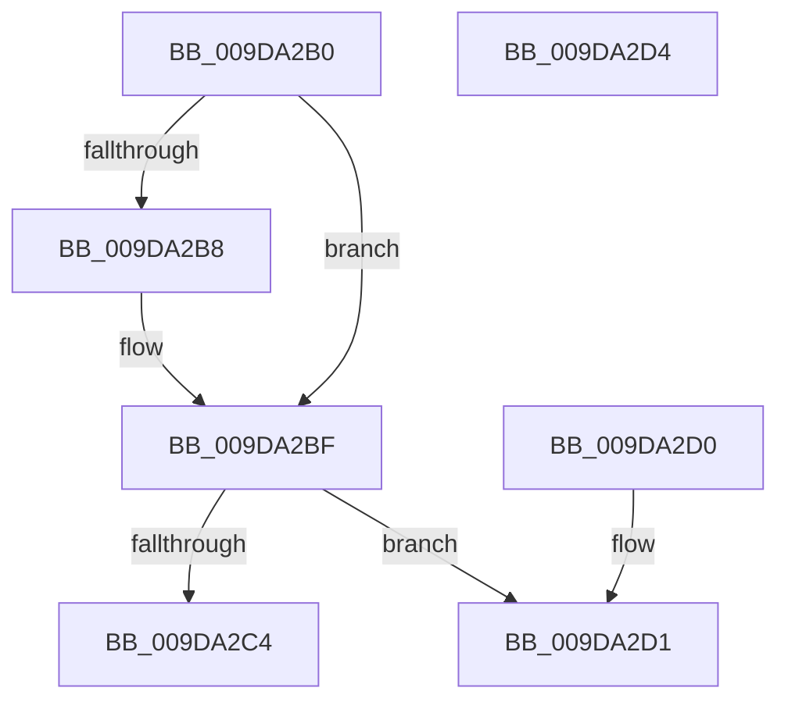

# CmListGetPrevElement

- RVA: `0x009DA2B0`–`0x009DA2D5` (길이 `37` bytes)
- VA: `0x00000001409DA2B0`
- 실행 섹션: `PAGE`
- PDB 이름 있음: `예`; PDB Function 태그: `아니요`
- unwind 정보 RVA: `0x000DB714`
- 디코드: `15`개 명령, `37/37` bytes 표시
- 미해석 바이트: `0` (있으면 어셈블리에 `.byte`로 보존)

> 이 문서는 커널 이미지의 기계어와 PDB 기호를 분석해 생성했습니다. 4번과 5번은 함수 원형과 자료형을 바이너리 사용 방식에서 추정한 C 해석이며 원본 소스 복구 결과는 아닙니다.

## 1. Dependencies

- 직접 호출 지점: **0**; 고유 호출 대상: **0**
- 직접 호출자로 확인된 함수: **2**
- RIP 상대 이미지 참조: **0**

### Outgoing calls
- 직접 디코드된 call 명령이 없습니다.

### Direct callers
- [sub_00B258D8](../B2/Unknown_function_00B258D8.md) at `0x00B258E7`
- [sub_00B49904](../B4/Unknown_function_00B49904.md) at `0x00B4990C`

### Static image references
- 디코드된 RIP-relative 메모리 참조가 없습니다.

## 2. Other-region calls and transfers

- 다른 실행 섹션으로 향하는 call: **0**
- 별도 외부 분기/꼬리 이동을 확인하지 못했습니다.

## 3. Assembly (complete function range)

```asm
009DA2B0  48 8B 02                        mov rax, qword ptr [rdx]
009DA2B3  48 85 C0                        test rax, rax
009DA2B6  75 07                           jne 0x1409da2bf
009DA2B8  48 8B 41 08                     mov rax, qword ptr [rcx + 8]
009DA2BC  48 89 02                        mov qword ptr [rdx], rax
009DA2BF  48 3B C8                        cmp rcx, rax
009DA2C2  74 0D                           je 0x1409da2d1
009DA2C4  48 8B 48 08                     mov rcx, qword ptr [rax + 8]
009DA2C8  48 83 C0 E0                     add rax, -0x20
009DA2CC  48 89 0A                        mov qword ptr [rdx], rcx
009DA2CF  C3                              ret
009DA2D0  CC                              int3
009DA2D1  33 C0                           xor eax, eax
009DA2D3  C3                              ret
009DA2D4  CC                              int3
```

## 4. C-style interpretation (structured pseudocode)

```c
__int64 __fastcall CmListGetPrevElement(__int64 a1, __int64 a2)
{
    __int64 result;

    result = *(unsigned __int64 *)(a2);
    if (*(unsigned __int64 *)(a2) == 0) {
        result = *(unsigned __int64 *)(a1 + 8);
        *(unsigned __int64 *)(a2) = result;
    }
    if (a1 == result) goto loc_009DA2D1;
    result = (result) + (-32);
    *(unsigned __int64 *)(a2) = *(unsigned __int64 *)(result + 8);
    return result;
loc_009DA2D1:
    result = 0;
    return result;
}
```

## 5. (Beta) C Style

```c
int64_t CmListGetPrevElement(void *Arg1, void *Arg2)
{
    uint8_t *arg1 = (uint8_t *)Arg1;
    uint8_t *arg2 = (uint8_t *)Arg2;

    int64_t result;

    result = *(uint64_t *)(arg2);
    if (*(uint64_t *)(arg2) == 0) {
        result = *(uint64_t *)(arg1 + 0x8);
        *(uint64_t *)(arg2) = result;
    }
    if (Arg1 == result) goto loc_009DA2D1;
    result = (result) + (-32);
    *(uint64_t *)(arg2) = *(uint64_t *)(result + 0x8);
    return result;
loc_009DA2D1:
    result = 0;
    return result;
}
```

### 관측된 메모리 오프셋

구조체 형식이 확인되지 않은 접근은 인자 기준의 오프셋으로만 기록했습니다.

| 기준 인자 | 오프셋 표현 | 폭 (bit) | 접근 |
|---|---:|---:|---|
| `Arg1` | `+ 0x8` | `64` | `R` |
| `Arg2` | `+ 0x0` | `64` | `R` |
| `Arg2` | `+ 0x0` | `64` | `W` |

## 6. Execution-region graph

[열기: 2D/3D 그래프와 함수 탐색 컨트롤 패널](../../../control-panel.html?section=page&rva=0x009DA2B0&view=graph)

- 2D 그래프는 위에서 아래로 흐르고, 3D 그래프는 빈 공간을 드래그해 회전합니다. Shift+드래그는 이동, 휠은 확대·축소, 함수 노드 선택은 대상 보고서 이동입니다.

### Static fallback


