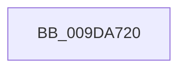

# CmpAssignSecurityToKcb

- RVA: `0x009DA720`–`0x009DA74E` (길이 `46` bytes)
- VA: `0x00000001409DA720`
- 실행 섹션: `PAGE`
- PDB 이름 있음: `예`; PDB Function 태그: `아니요`
- unwind 정보 RVA: `0x000A3290`
- 디코드: `16`개 명령, `46/46` bytes 표시
- 미해석 바이트: `0` (있으면 어셈블리에 `.byte`로 보존)

> 이 문서는 커널 이미지의 기계어와 PDB 기호를 분석해 생성했습니다. 4번과 5번은 함수 원형과 자료형을 바이너리 사용 방식에서 추정한 C 해석이며 원본 소스 복구 결과는 아닙니다.

## 1. Dependencies

- 직접 호출 지점: **0**; 고유 호출 대상: **0**
- 직접 호출자로 확인된 함수: **3**
- RIP 상대 이미지 참조: **0**

### Outgoing calls
- 직접 디코드된 call 명령이 없습니다.

### Direct callers
- [CmRestoreKey](../7D/CmRestoreKey_function_007DCF04.md) at `0x007DD984`
- [CmpDoBuildVirtualStack](../7E/CmpDoBuildVirtualStack_function_007EB4C4.md) at `0x007EB8B1`
- [CmpAssignKeySecurity](../7E/CmpAssignKeySecurity_function_007EC8B0.md) at `0x007EC9E9`

### Static image references
- 디코드된 RIP-relative 메모리 참조가 없습니다.

## 2. Other-region calls and transfers

- 다른 실행 섹션으로 향하는 call: **0**
- call이 아닌 외부 분기/꼬리 이동: **1**
  - `0x009DA74C` → [sub_009DA7A6 + 0x17](Unknown_function_009DA7A6.md) (`tail-transfer`)

## 3. Assembly (complete function range)

```asm
009DA720  48 89 6C 24 18                  mov qword ptr [rsp + 0x18], rbp
009DA725  56                              push rsi
009DA726  57                              push rdi
009DA727  41 54                           push r12
009DA729  41 56                           push r14
009DA72B  41 57                           push r15
009DA72D  48 83 EC 30                     sub rsp, 0x30
009DA731  45 33 E4                        xor r12d, r12d
009DA734  44 8B F2                        mov r14d, edx
009DA737  44 89 64 24 68                  mov dword ptr [rsp + 0x68], r12d
009DA73C  41 0F B6 F9                     movzx edi, r9b
009DA740  4D 8B F8                        mov r15, r8
009DA743  48 8B F1                        mov rsi, rcx
009DA746  40 B5 01                        mov bpl, 1
009DA749  83 FA FF                        cmp edx, -1
009DA74C  74 6F                           je 0x1409da7bd
```

## 4. C-style interpretation (structured pseudocode)

```c
void __fastcall CmpAssignSecurityToKcb(__int64 a1, int a2, __int64 a3, unsigned __int8 a4)
{
    __int64 v_r12;
    __int64 v_rsp;
    unsigned int v_stack_p10;
    unsigned __int64 v_stack_p18;

    v_stack_p18 = v_rbp;
    v_rsp = (v_rsp) - (48);
    v_r12 = 0;
    v_stack_p10 = 0;
}
```

## 5. (Beta) C Style

```c
void CmpAssignSecurityToKcb(int64_t Arg1, int32_t Arg2, int64_t Arg3, uint8_t Arg4)
{
    int64_t local_r12;
    int64_t local_rsp;
    uint32_t v_stack_p10;
    uint64_t v_stack_p18;

    v_stack_p18 = local_rbp;
    local_rsp = (local_rsp) - (48);
    local_r12 = 0;
    v_stack_p10 = 0;
}
```

## 6. Execution-region graph

[열기: 2D/3D 그래프와 함수 탐색 컨트롤 패널](../../../control-panel.html?section=page&rva=0x009DA720&view=graph)

- 2D 그래프는 위에서 아래로 흐르고, 3D 그래프는 빈 공간을 드래그해 회전합니다. Shift+드래그는 이동, 휠은 확대·축소, 함수 노드 선택은 대상 보고서 이동입니다.

### Static fallback


