# CmpDelayCloseWorker

- RVA: `0x009DB8E0`–`0x009DBCF0` (길이 `1,040` bytes)
- VA: `0x00000001409DB8E0`
- 실행 섹션: `PAGE`
- PDB 이름 있음: `예`; PDB Function 태그: `아니요`
- unwind 정보 RVA: `0x000A35C0`
- 디코드: `254`개 명령, `1,040/1,040` bytes 표시
- 미해석 바이트: `0` (있으면 어셈블리에 `.byte`로 보존)

> 이 문서는 커널 이미지의 기계어와 PDB 기호를 분석해 생성했습니다. 4번과 5번은 함수 원형과 자료형을 바이너리 사용 방식에서 추정한 C 해석이며 원본 소스 복구 결과는 아닙니다.

## 1. Dependencies

- 직접 호출 지점: **24**; 고유 호출 대상: **20**
- 직접 호출자로 확인된 함수: **0**
- RIP 상대 이미지 참조: **11**

### Outgoing calls
- `0x009DB93F` → [CmpInitializeThreadInfo](../../text/3F/CmpInitializeThreadInfo_function_003FBE70.md) (function, `0x003FBE70`)
- `0x009DB949` → [CmpAttachToRegistryProcess](../../pagecmrc/BC/CmpAttachToRegistryProcess_function_00BC98E0.md) (function, `0x00BC98E0`)
- `0x009DB953` → [CmpInitializeDelayDerefContext](../../text/42/CmpInitializeDelayDerefContext_function_0042A7F0.md) (function, `0x0042A7F0`)
- `0x009DB958` → [CmpLockRegistry](../../pagecmrc/BC/CmpLockRegistry_function_00BC9B34.md) (function, `0x00BC9B34`)
- `0x009DB97F` → [ExAcquireFastMutex](../../text/20/ExAcquireFastMutex_function_0020E5A0.md) (function, `0x0020E5A0`)
- `0x009DBA31` → [ExReleaseFastMutex](../../text/25/ExReleaseFastMutex_function_002519C0.md) (function, `0x002519C0`)
- `0x009DBA89` → [KeAbPreAcquire](../../text/21/KeAbPreAcquire_function_00210230.md) (function, `0x00210230`)
- `0x009DBAA2` → [ExfAcquirePushLockExclusiveEx](../../text/20/ExfAcquirePushLockExclusiveEx_function_0020FC90.md) (function, `0x0020FC90`)
- `0x009DBB19` → [CmpLockKcbExclusive](../86/CmpLockKcbExclusive_function_00861EB0.md) (function, `0x00861EB0`)
- `0x009DBB3C` → [CmpCleanUpKcbCacheWithLock](../86/CmpCleanUpKcbCacheWithLock_function_00861F20.md) (function, `0x00861F20`)
- `0x009DBB44` → [CmpUnlockKcb](../../pagecmrc/BC/CmpUnlockKcb_function_00BC92C0.md) (function, `0x00BC92C0`)
- `0x009DBB51` → [CmpUnlockKcb](../../pagecmrc/BC/CmpUnlockKcb_function_00BC92C0.md) (function, `0x00BC92C0`)
- `0x009DBBDD` → [KeAbPostRelease](../../text/2E/KeAbPostRelease_function_002E1600.md) (function, `0x002E1600`)
- `0x009DBBF7` → [CmpDeleteHive](../86/CmpDeleteHive_function_0086450C.md) (function, `0x0086450C`)
- `0x009DBC39` → [CmpDrainDelayDerefContext](../../text/41/CmpDrainDelayDerefContext_function_0041B9A0.md) (function, `0x0041B9A0`)
- `0x009DBC3E` → [CmpUnlockRegistry](../../pagecmrc/BC/CmpUnlockRegistry_function_00BC9A84.md) (function, `0x00BC9A84`)
- `0x009DBC48` → [CmpDetachFromRegistryProcess](../../pagecmrc/BC/CmpDetachFromRegistryProcess_function_00BC9920.md) (function, `0x00BC9920`)
- `0x009DBC52` → [CmCleanupThreadInfo](../../text/41/CmCleanupThreadInfo_function_0041FD50.md) (function, `0x0041FD50`)
- `0x009DBC62` → [_security_check_cookie](../../text/6A/_security_check_cookie_function_006AC640.md) (function, `0x006AC640`)
- `0x009DBC9A` → [CmpUnlockKcb](../../pagecmrc/BC/CmpUnlockKcb_function_00BC92C0.md) (function, `0x00BC92C0`)
- `0x009DBCA2` → [CmpLockKcbExclusive](../86/CmpLockKcbExclusive_function_00861EB0.md) (function, `0x00861EB0`)
- `0x009DBCAA` → [CmpLockKcbExclusive](../86/CmpLockKcbExclusive_function_00861EB0.md) (function, `0x00861EB0`)
- `0x009DBCB7` → [ExfReleasePushLock](../../text/26/ExfReleasePushLock_function_002638D0.md) (function, `0x002638D0`)
- `0x009DBCD6` → [KeBugCheckEx](../../text/4F/KeBugCheckEx_function_004FD660.md) (function, `0x004FD660`)

### Direct callers
- 이 함수 시작 RVA로 연결되는 직접 call은 확인되지 않았습니다. 간접 호출은 완전히 역산할 수 없습니다.

### Static image references
- `0x009DB8FF` → RVA `0x00E0A740` (`.data`; read)
- `0x009DB95F` → RVA `0x00EF58E0` (`.data`; read)
- `0x009DB970` → RVA `0x00EEFC34` (`.data`; read/write)
- `0x009DB976` → RVA `0x00EF5880` (`.data`; read)
- `0x009DB98C` → RVA `0x00EEFC30` (`.data`; read)
- `0x009DB992` → RVA `0x00E0ECA8` (`.data`; read)
- `0x009DB99E` → RVA `0x00EF58E8` (`.data`; read)
- `0x009DB9C2` → RVA `0x00EF58E8` (`.data`; write)
- `0x009DB9D6` → RVA `0x00FDA438` (`PAGEDATA`; read/write)
- `0x009DB9DD` → RVA `0x00EEFC30` (`.data`; write)
- `0x009DBC24` → RVA `0x00EEFC34` (`.data`; read)

## 2. Other-region calls and transfers

- 다른 실행 섹션으로 향하는 call: **19**
  - `0x009DB93F` → [CmpInitializeThreadInfo](../../text/3F/CmpInitializeThreadInfo_function_003FBE70.md) (`PAGE` → `.text`)
  - `0x009DB949` → [CmpAttachToRegistryProcess](../../pagecmrc/BC/CmpAttachToRegistryProcess_function_00BC98E0.md) (`PAGE` → `PAGECMRC`)
  - `0x009DB953` → [CmpInitializeDelayDerefContext](../../text/42/CmpInitializeDelayDerefContext_function_0042A7F0.md) (`PAGE` → `.text`)
  - `0x009DB958` → [CmpLockRegistry](../../pagecmrc/BC/CmpLockRegistry_function_00BC9B34.md) (`PAGE` → `PAGECMRC`)
  - `0x009DB97F` → [ExAcquireFastMutex](../../text/20/ExAcquireFastMutex_function_0020E5A0.md) (`PAGE` → `.text`)
  - `0x009DBA31` → [ExReleaseFastMutex](../../text/25/ExReleaseFastMutex_function_002519C0.md) (`PAGE` → `.text`)
  - `0x009DBA89` → [KeAbPreAcquire](../../text/21/KeAbPreAcquire_function_00210230.md) (`PAGE` → `.text`)
  - `0x009DBAA2` → [ExfAcquirePushLockExclusiveEx](../../text/20/ExfAcquirePushLockExclusiveEx_function_0020FC90.md) (`PAGE` → `.text`)
  - `0x009DBB44` → [CmpUnlockKcb](../../pagecmrc/BC/CmpUnlockKcb_function_00BC92C0.md) (`PAGE` → `PAGECMRC`)
  - `0x009DBB51` → [CmpUnlockKcb](../../pagecmrc/BC/CmpUnlockKcb_function_00BC92C0.md) (`PAGE` → `PAGECMRC`)
  - `0x009DBBDD` → [KeAbPostRelease](../../text/2E/KeAbPostRelease_function_002E1600.md) (`PAGE` → `.text`)
  - `0x009DBC39` → [CmpDrainDelayDerefContext](../../text/41/CmpDrainDelayDerefContext_function_0041B9A0.md) (`PAGE` → `.text`)
  - `0x009DBC3E` → [CmpUnlockRegistry](../../pagecmrc/BC/CmpUnlockRegistry_function_00BC9A84.md) (`PAGE` → `PAGECMRC`)
  - `0x009DBC48` → [CmpDetachFromRegistryProcess](../../pagecmrc/BC/CmpDetachFromRegistryProcess_function_00BC9920.md) (`PAGE` → `PAGECMRC`)
  - `0x009DBC52` → [CmCleanupThreadInfo](../../text/41/CmCleanupThreadInfo_function_0041FD50.md) (`PAGE` → `.text`)
  - `0x009DBC62` → [_security_check_cookie](../../text/6A/_security_check_cookie_function_006AC640.md) (`PAGE` → `.text`)
  - `0x009DBC9A` → [CmpUnlockKcb](../../pagecmrc/BC/CmpUnlockKcb_function_00BC92C0.md) (`PAGE` → `PAGECMRC`)
  - `0x009DBCB7` → [ExfReleasePushLock](../../text/26/ExfReleasePushLock_function_002638D0.md) (`PAGE` → `.text`)
  - `0x009DBCD6` → [KeBugCheckEx](../../text/4F/KeBugCheckEx_function_004FD660.md) (`PAGE` → `.text`)
- 별도 외부 분기/꼬리 이동을 확인하지 못했습니다.

## 3. Assembly (complete function range)

```asm
009DB8E0  48 89 5C 24 08                  mov qword ptr [rsp + 8], rbx
009DB8E5  48 89 6C 24 10                  mov qword ptr [rsp + 0x10], rbp
009DB8EA  48 89 74 24 18                  mov qword ptr [rsp + 0x18], rsi
009DB8EF  57                              push rdi
009DB8F0  41 54                           push r12
009DB8F2  41 55                           push r13
009DB8F4  41 56                           push r14
009DB8F6  41 57                           push r15
009DB8F8  48 81 EC 00 01 00 00            sub rsp, 0x100
009DB8FF  48 8B 05 3A EE 42 00            mov rax, qword ptr [rip + 0x42ee3a]
009DB906  48 33 C4                        xor rax, rsp
009DB909  48 89 84 24 F0 00 00 00         mov qword ptr [rsp + 0xf0], rax
009DB911  0F 57 C9                        xorps xmm1, xmm1
009DB914  0F 57 C0                        xorps xmm0, xmm0
009DB917  33 C0                           xor eax, eax
009DB919  4C 8B E1                        mov r12, rcx
009DB91C  48 8D 4C 24 40                  lea rcx, [rsp + 0x40]
009DB921  48 89 44 24 50                  mov qword ptr [rsp + 0x50], rax
009DB926  0F 11 44 24 30                  movups xmmword ptr [rsp + 0x30], xmm0
009DB92B  0F 11 4C 24 58                  movups xmmword ptr [rsp + 0x58], xmm1
009DB930  0F 11 4C 24 68                  movups xmmword ptr [rsp + 0x68], xmm1
009DB935  0F 11 4C 24 78                  movups xmmword ptr [rsp + 0x78], xmm1
009DB93A  0F 11 44 24 40                  movups xmmword ptr [rsp + 0x40], xmm0
009DB93F  E8 2C 05 A2 FF                  call 0x1403fbe70
009DB944  48 8D 4C 24 58                  lea rcx, [rsp + 0x58]
009DB949  E8 92 DF 1E 00                  call 0x140bc98e0
009DB94E  48 8D 4C 24 30                  lea rcx, [rsp + 0x30]
009DB953  E8 98 EE A4 FF                  call 0x14042a7f0
009DB958  E8 D7 E1 1E 00                  call 0x140bc9b34
009DB95D  33 ED                           xor ebp, ebp
009DB95F  48 8D 1D 7A 9F 51 00            lea rbx, [rip + 0x519f7a]
009DB966  4D 85 E4                        test r12, r12
009DB969  75 0B                           jne 0x1409db976
009DB96B  B8 02 00 00 00                  mov eax, 2
009DB970  87 05 BE 42 51 00               xchg dword ptr [rip + 0x5142be], eax
009DB976  48 8D 0D 03 9F 51 00            lea rcx, [rip + 0x519f03]
009DB97D  8B FD                           mov edi, ebp
009DB97F  E8 1C 2C 83 FF                  call 0x14020e5a0
009DB984  4C 8D 8C 24 98 00 00 00         lea r9, [rsp + 0x98]
009DB98C  8B 05 9E 42 51 00               mov eax, dword ptr [rip + 0x51429e]
009DB992  3B 05 10 33 43 00               cmp eax, dword ptr [rip + 0x433310]
009DB998  0F 86 83 00 00 00               jbe 0x1409dba21
009DB99E  48 8B 0D 43 9F 51 00            mov rcx, qword ptr [rip + 0x519f43]
009DB9A5  4C 8D 81 20 FF FF FF            lea r8, [rcx - 0xe0]
009DB9AC  48 39 19                        cmp qword ptr [rcx], rbx
009DB9AF  0F 85 27 03 00 00               jne 0x1409dbcdc
009DB9B5  48 8B 51 08                     mov rdx, qword ptr [rcx + 8]
009DB9B9  48 39 0A                        cmp qword ptr [rdx], rcx
009DB9BC  0F 85 1A 03 00 00               jne 0x1409dbcdc
009DB9C2  48 89 15 1F 9F 51 00            mov qword ptr [rip + 0x519f1f], rdx
009DB9C9  FF C8                           dec eax
009DB9CB  48 89 1A                        mov qword ptr [rdx], rbx
009DB9CE  48 8D 94 24 A0 00 00 00         lea rdx, [rsp + 0xa0]
009DB9D6  48 FF 0D 5B EA 5F 00            dec qword ptr [rip + 0x5fea5b]
009DB9DD  89 05 4D 42 51 00               mov dword ptr [rip + 0x51424d], eax
009DB9E3  49 8B 40 20                     mov rax, qword ptr [r8 + 0x20]
009DB9E7  49 89 41 F8                     mov qword ptr [r9 - 8], rax
009DB9EB  4D 89 01                        mov qword ptr [r9], r8
009DB9EE  8B C7                           mov eax, edi
009DB9F0  FF C7                           inc edi
009DB9F2  48 8D 0C 40                     lea rcx, [rax + rax*2]
009DB9F6  C6 04 CA 00                     mov byte ptr [rdx + rcx*8], 0
009DB9FA  48 8D 14 CA                     lea rdx, [rdx + rcx*8]
009DB9FE  41 8B 40 10                     mov eax, dword ptr [r8 + 0x10]
009DBA02  41 89 41 0C                     mov dword ptr [r9 + 0xc], eax
009DBA06  49 83 C1 18                     add r9, 0x18
009DBA0A  41 80 48 40 04                  or byte ptr [r8 + 0x40], 4
009DBA0F  49 89 90 E0 00 00 00            mov qword ptr [r8 + 0xe0], rdx
009DBA16  83 FF 04                        cmp edi, 4
009DBA19  0F 82 6D FF FF FF               jb 0x1409db98c
009DBA1F  EB 09                           jmp 0x1409dba2a
009DBA21  4D 85 E4                        test r12, r12
009DBA24  0F 85 B9 02 00 00               jne 0x1409dbce3
009DBA2A  48 8D 0D 4F 9E 51 00            lea rcx, [rip + 0x519e4f]
009DBA31  E8 8A 5F 87 FF                  call 0x1402519c0
009DBA36  8B F5                           mov esi, ebp
009DBA38  85 FF                           test edi, edi
009DBA3A  0F 84 D1 01 00 00               je 0x1409dbc11
009DBA40  4C 8D B4 24 A4 00 00 00         lea r14, [rsp + 0xa4]
009DBA48  41 8B 1E                        mov ebx, dword ptr [r14]
009DBA4B  45 33 C0                        xor r8d, r8d
009DBA4E  49 8B 6E EC                     mov rbp, qword ptr [r14 - 0x14]
009DBA52  8B C3                           mov eax, ebx
009DBA54  C1 E8 09                        shr eax, 9
009DBA57  33 C3                           xor eax, ebx
009DBA59  69 C0 A3 8A 01 00               imul eax, eax, 0x18aa3
009DBA5F  8B C8                           mov ecx, eax
009DBA61  8B D0                           mov edx, eax
009DBA63  48 8B 85 70 06 00 00            mov rax, qword ptr [rbp + 0x670]
009DBA6A  48 C1 EA 09                     shr rdx, 9
009DBA6E  48 33 D1                        xor rdx, rcx
009DBA71  8B 8D 78 06 00 00               mov ecx, dword ptr [rbp + 0x678]
009DBA77  FF C9                           dec ecx
009DBA79  48 23 D1                        and rdx, rcx
009DBA7C  48 8D 0C 52                     lea rcx, [rdx + rdx*2]
009DBA80  33 D2                           xor edx, edx
009DBA82  4C 8D 3C C8                     lea r15, [rax + rcx*8]
009DBA86  49 8B CF                        mov rcx, r15
009DBA89  E8 A2 47 83 FF                  call 0x140210230
009DBA8E  F0 49 0F BA 2F 00               lock bts qword ptr [r15], 0
009DBA94  4C 8B E8                        mov r13, rax
009DBA97  73 0E                           jae 0x1409dbaa7
009DBA99  4D 8B C7                        mov r8, r15
009DBA9C  48 8B D0                        mov rdx, rax
009DBA9F  49 8B CF                        mov rcx, r15
009DBAA2  E8 E9 41 83 FF                  call 0x14020fc90
009DBAA7  4D 85 ED                        test r13, r13
009DBAAA  74 05                           je 0x1409dbab1
009DBAAC  41 C6 45 0A 01                  mov byte ptr [r13 + 0xa], 1
009DBAB1  65 48 8B 04 25 88 01 00 00      mov rax, qword ptr gs:[0x188]
009DBABA  49 89 47 08                     mov qword ptr [r15 + 8], rax
009DBABE  0F 0D 8D 88 10 00 00            prefetchw byte ptr [rbp + 0x1088]
009DBAC5  8B 85 88 10 00 00               mov eax, dword ptr [rbp + 0x1088]
009DBACB  85 C0                           test eax, eax
009DBACD  0F 84 EE 01 00 00               je 0x1409dbcc1
009DBAD3  8D 48 01                        lea ecx, [rax + 1]
009DBAD6  F0 0F B1 8D 88 10 00 00         lock cmpxchg dword ptr [rbp + 0x1088], ecx
009DBADE  75 EB                           jne 0x1409dbacb
009DBAE0  8B EE                           mov ebp, esi
009DBAE2  3B F7                           cmp esi, edi
009DBAE4  0F 83 84 00 00 00               jae 0x1409dbb6e
009DBAEA  8B C6                           mov eax, esi
009DBAEC  48 8D 9C 24 98 00 00 00         lea rbx, [rsp + 0x98]
009DBAF4  48 8D 0C 40                     lea rcx, [rax + rax*2]
009DBAF8  48 8D 1C CB                     lea rbx, [rbx + rcx*8]
009DBAFC  41 8B 06                        mov eax, dword ptr [r14]
009DBAFF  39 43 0C                        cmp dword ptr [rbx + 0xc], eax
009DBB02  75 60                           jne 0x1409dbb64
009DBB04  49 8B 46 EC                     mov rax, qword ptr [r14 - 0x14]
009DBB08  48 39 43 F8                     cmp qword ptr [rbx - 8], rax
009DBB0C  75 56                           jne 0x1409dbb64
009DBB0E  0F B6 43 08                     movzx eax, byte ptr [rbx + 8]
009DBB12  84 C0                           test al, al
009DBB14  75 4E                           jne 0x1409dbb64
009DBB16  48 8B 0B                        mov rcx, qword ptr [rbx]
009DBB19  E8 92 63 E8 FF                  call 0x140861eb0
009DBB1E  48 8B 0B                        mov rcx, qword ptr [rbx]
009DBB21  45 33 FF                        xor r15d, r15d
009DBB24  48 8B 81 C0 00 00 00            mov rax, qword ptr [rcx + 0xc0]
009DBB2B  48 85 C0                        test rax, rax
009DBB2E  0F 85 55 01 00 00               jne 0x1409dbc89
009DBB34  48 8B 0B                        mov rcx, qword ptr [rbx]
009DBB37  48 8D 54 24 30                  lea rdx, [rsp + 0x30]
009DBB3C  E8 DF 63 E8 FF                  call 0x140861f20
009DBB41  48 8B 0B                        mov rcx, qword ptr [rbx]
009DBB44  E8 77 D7 1E 00                  call 0x140bc92c0
009DBB49  4D 85 FF                        test r15, r15
009DBB4C  74 08                           je 0x1409dbb56
009DBB4E  49 8B CF                        mov rcx, r15
009DBB51  E8 6A D7 1E 00                  call 0x140bc92c0
009DBB56  8B C5                           mov eax, ebp
009DBB58  48 8D 0C 40                     lea rcx, [rax + rax*2]
009DBB5C  C6 84 CC A0 00 00 00 01         mov byte ptr [rsp + rcx*8 + 0xa0], 1
009DBB64  FF C5                           inc ebp
009DBB66  48 83 C3 18                     add rbx, 0x18
009DBB6A  3B EF                           cmp ebp, edi
009DBB6C  72 8E                           jb 0x1409dbafc
009DBB6E  41 8B 06                        mov eax, dword ptr [r14]
009DBB71  8B C8                           mov ecx, eax
009DBB73  49 8B 5E EC                     mov rbx, qword ptr [r14 - 0x14]
009DBB77  C1 E9 09                        shr ecx, 9
009DBB7A  33 C8                           xor ecx, eax
009DBB7C  69 C1 A3 8A 01 00               imul eax, ecx, 0x18aa3
009DBB82  8B C8                           mov ecx, eax
009DBB84  8B D0                           mov edx, eax
009DBB86  48 8B 83 70 06 00 00            mov rax, qword ptr [rbx + 0x670]
009DBB8D  48 C1 EA 09                     shr rdx, 9
009DBB91  48 33 D1                        xor rdx, rcx
009DBB94  8B 8B 78 06 00 00               mov ecx, dword ptr [rbx + 0x678]
009DBB9A  FF C9                           dec ecx
009DBB9C  48 23 D1                        and rdx, rcx
009DBB9F  33 ED                           xor ebp, ebp
009DBBA1  48 8D 0C 52                     lea rcx, [rdx + rdx*2]
009DBBA5  4C 8D 3C C8                     lea r15, [rax + rcx*8]
009DBBA9  49 89 6F 08                     mov qword ptr [r15 + 8], rbp
009DBBAD  41 0F 0D 0F                     prefetchw byte ptr [r15]
009DBBB1  49 8B 07                        mov rax, qword ptr [r15]
009DBBB4  48 8B C8                        mov rcx, rax
009DBBB7  48 83 E1 F0                     and rcx, 0xfffffffffffffff0
009DBBBB  48 83 F9 10                     cmp rcx, 0x10
009DBBBF  48 8D 50 F0                     lea rdx, [rax - 0x10]
009DBBC3  48 0F 46 D5                     cmovbe rdx, rbp
009DBBC7  A8 02                           test al, 2
009DBBC9  0F 85 E5 00 00 00               jne 0x1409dbcb4
009DBBCF  F0 49 0F B1 17                  lock cmpxchg qword ptr [r15], rdx
009DBBD4  0F 85 DA 00 00 00               jne 0x1409dbcb4
009DBBDA  49 8B CF                        mov rcx, r15
009DBBDD  E8 1E 5A 90 FF                  call 0x1402e1600
009DBBE2  B8 FF FF FF FF                  mov eax, 0xffffffff
009DBBE7  F0 0F C1 83 88 10 00 00         lock xadd dword ptr [rbx + 0x1088], eax
009DBBEF  83 F8 01                        cmp eax, 1
009DBBF2  75 08                           jne 0x1409dbbfc
009DBBF4  48 8B CB                        mov rcx, rbx
009DBBF7  E8 10 89 E8 FF                  call 0x14086450c
009DBBFC  FF C6                           inc esi
009DBBFE  49 83 C6 18                     add r14, 0x18
009DBC02  3B F7                           cmp esi, edi
009DBC04  0F 82 3E FE FF FF               jb 0x1409dba48
009DBC0A  48 8D 1D CF 9C 51 00            lea rbx, [rip + 0x519ccf]
009DBC11  83 FF 04                        cmp edi, 4
009DBC14  0F 84 5C FD FF FF               je 0x1409db976
009DBC1A  4D 85 E4                        test r12, r12
009DBC1D  75 13                           jne 0x1409dbc32
009DBC1F  B8 02 00 00 00                  mov eax, 2
009DBC24  F0 0F B1 2D 08 40 51 00         lock cmpxchg dword ptr [rip + 0x514008], ebp
009DBC2C  0F 85 39 FD FF FF               jne 0x1409db96b
009DBC32  33 D2                           xor edx, edx
009DBC34  48 8D 4C 24 30                  lea rcx, [rsp + 0x30]
009DBC39  E8 62 FD A3 FF                  call 0x14041b9a0
009DBC3E  E8 41 DE 1E 00                  call 0x140bc9a84
009DBC43  48 8D 4C 24 58                  lea rcx, [rsp + 0x58]
009DBC48  E8 D3 DC 1E 00                  call 0x140bc9920
009DBC4D  48 8D 4C 24 40                  lea rcx, [rsp + 0x40]
009DBC52  E8 F9 40 A4 FF                  call 0x14041fd50
009DBC57  48 8B 8C 24 F0 00 00 00         mov rcx, qword ptr [rsp + 0xf0]
009DBC5F  48 33 CC                        xor rcx, rsp
009DBC62  E8 D9 09 CD FF                  call 0x1406ac640
009DBC67  4C 8D 9C 24 00 01 00 00         lea r11, [rsp + 0x100]
009DBC6F  49 8B 5B 30                     mov rbx, qword ptr [r11 + 0x30]
009DBC73  49 8B 6B 38                     mov rbp, qword ptr [r11 + 0x38]
009DBC77  49 8B 73 40                     mov rsi, qword ptr [r11 + 0x40]
009DBC7B  49 8B E3                        mov rsp, r11
009DBC7E  41 5F                           pop r15
009DBC80  41 5E                           pop r14
009DBC82  41 5D                           pop r13
009DBC84  41 5C                           pop r12
009DBC86  5F                              pop rdi
009DBC87  C3                              ret
009DBC88  CC                              int3
009DBC89  48 8B 50 18                     mov rdx, qword ptr [rax + 0x18]
009DBC8D  48 85 D2                        test rdx, rdx
009DBC90  0F 84 9E FE FF FF               je 0x1409dbb34
009DBC96  4C 8B 7A 10                     mov r15, qword ptr [rdx + 0x10]
009DBC9A  E8 21 D6 1E 00                  call 0x140bc92c0
009DBC9F  49 8B CF                        mov rcx, r15
009DBCA2  E8 09 62 E8 FF                  call 0x140861eb0
009DBCA7  48 8B 0B                        mov rcx, qword ptr [rbx]
009DBCAA  E8 01 62 E8 FF                  call 0x140861eb0
009DBCAF  E9 80 FE FF FF                  jmp 0x1409dbb34
009DBCB4  49 8B CF                        mov rcx, r15
009DBCB7  E8 14 7C 88 FF                  call 0x1402638d0
009DBCBC  E9 19 FF FF FF                  jmp 0x1409dbbda
009DBCC1  41 B9 0C 00 00 00               mov r9d, 0xc
009DBCC7  48 89 5C 24 20                  mov qword ptr [rsp + 0x20], rbx
009DBCCC  4C 8B C5                        mov r8, rbp
009DBCCF  41 8D 51 0B                     lea edx, [r9 + 0xb]
009DBCD3  8D 4A 3A                        lea ecx, [rdx + 0x3a]
009DBCD6  E8 85 19 B2 FF                  call 0x1404fd660
009DBCDB  CC                              int3
009DBCDC  B9 03 00 00 00                  mov ecx, 3
009DBCE1  CD 29                           int 0x29
009DBCE3  85 C0                           test eax, eax
009DBCE5  0F 84 3F FD FF FF               je 0x1409dba2a
009DBCEB  E9 AE FC FF FF                  jmp 0x1409db99e
```

## 4. C-style interpretation (structured pseudocode)

```c
__int64 __fastcall CmpDelayCloseWorker(__int64 a1)
{
    __int64 result;
    __int64 v_r14;
    __int64 v_r15;
    __int64 v_rbp;
    __int64 v_rbx;
    __int64 v_rdi;
    __int64 v_rsi;
    __int64 v_rsp;
    unsigned __int64 v_stack_m28;
    unsigned __int64 v_stack_m38;
    unsigned __int64 v_stack_m84;
    unsigned __int64 v_stack_m88;
    unsigned __int64 v_stack_m90;
    unsigned __int64 v_stack_mB0;
    unsigned __int64 v_stack_mC0;
    unsigned __int64 v_stack_mD0;
    unsigned __int64 v_stack_mD8;
    unsigned __int64 v_stack_mE0;
    unsigned __int64 v_stack_mE8;
    unsigned __int64 v_stack_mF8;
    unsigned __int64 v_stack_p10;
    unsigned __int64 v_stack_p18;
    unsigned __int64 v_stack_p8;

    v_stack_p8 = v_rbx;
    v_stack_p10 = v_rbp;
    v_stack_p18 = v_rsi;
    v_rsp = (v_rsp) - (256);
    result = (*(unsigned __int64 *)(v_rip + 4386362)) ^ (v_rsp);
    v_stack_m38 = result;
    result = 0;
    v_stack_mD8 = 0;
    v_stack_mF8 = v_xmm0;
    v_stack_mD0 = v_xmm1;
    v_stack_mC0 = v_xmm1;
    v_stack_mB0 = v_xmm1;
    v_stack_mE8 = v_xmm0;
    result = CmpInitializeThreadInfo(v_stack_mE8, a2, a3, a4);
    result = CmpAttachToRegistryProcess(v_stack_mD0, a2, a3, a4);
    result = CmpInitializeDelayDerefContext(v_stack_mF8, a2, a3, a4);
    result = CmpLockRegistry(v_stack_mF8, a2, a3, a4);
    v_rbp = 0;
    if (a1 == 0) {
        result = 2;
    }
    result = ExAcquireFastMutex(v_rip + 5349123, a2, a3, a4);
loc_009DB98C:
    if (((unsigned int)((unsigned int)(*(unsigned int *)(v_rip + 5325470)))) <= (*(unsigned int *)(v_rip + 4403984))) goto loc_009DBA21;
loc_009DB99E:
    if ((*(unsigned __int64 *)(*(unsigned __int64 *)(v_rip + 5349187))) != (v_rip + 5349242)) goto loc_009DBCDC;
    if ((*(unsigned __int64 *)(*(unsigned __int64 *)(*(unsigned __int64 *)(v_rip + 5349187) + 8))) != (*(unsigned __int64 *)(v_rip + 5349187))) goto loc_009DBCDC;
    *(unsigned __int64 *)(v_rip + 5349151) = *(unsigned __int64 *)(*(unsigned __int64 *)(v_rip + 5349187) + 8);
    result = (unsigned int)(((unsigned int)(*(unsigned int *)(v_rip + 5325470))) - 1);
    *(unsigned __int64 *)(*(unsigned __int64 *)(*(unsigned __int64 *)(v_rip + 5349187) + 8)) = v_rip + 5349242;
    *(unsigned int *)(v_rip + 5325389) = (unsigned int)(result);
    *(unsigned __int64 *)(v_stack_m90 - 8) = *(unsigned __int64 *)(*(unsigned __int64 *)(v_rip + 5349187) - 224 + 32);
    *(unsigned __int64 *)(v_stack_m90) = *(unsigned __int64 *)(v_rip + 5349187) - 224;
    v_rdi = (unsigned int)((0) + 1);
    *(unsigned __int8 *)(v_stack_m88 + 0 + 0 * 2 * 8) = 0;
    *(unsigned int *)(v_stack_m90 + 12) = (unsigned int)((unsigned int)(*(unsigned int *)(*(unsigned __int64 *)(v_rip + 5349187) - 224 + 16)));
    a4 = (v_stack_m90) + (24);
    *(unsigned __int64 *)(*(unsigned __int64 *)(v_rip + 5349187) - 224 + 224) = v_stack_m88 + 0 + 0 * 2 * 8;
    if (((unsigned int)(v_rdi)) < 4) goto loc_009DB98C;
    goto loc_009DBA2A;
loc_009DBA21:
    if (a1 != 0) goto loc_009DBCE3;
loc_009DBA2A:
    result = ExReleaseFastMutex(v_rip + 5348943, v_stack_m88 + 0 + 0 * 2 * 8, *(unsigned __int64 *)(v_rip + 5349187) - 224, a4);
    if ((unsigned int)(v_rdi) == 0) goto loc_009DBC11;
loc_009DBA48:
    a3 = 0;
    result = (unsigned int)(((unsigned int)((unsigned int)((unsigned int)(*(unsigned int *)(v_stack_m84))))) >> (9));
    result = (unsigned int)((result) ^ ((unsigned int)((unsigned int)(*(unsigned int *)(v_stack_m84)))));
    result = (unsigned int)((result) * ((unsigned int)(result)));
    a2 = ((unsigned int)((unsigned int)(result))) >> (9);
    a2 = (a2) ^ ((unsigned int)((unsigned int)(result)));
    a1 = (unsigned int)(((unsigned int)(*(unsigned int *)(*(unsigned __int64 *)(v_stack_m84 - 20) + 1656))) - 1);
    a2 = (a2) & (a1);
    a2 = 0;
    result = KeAbPreAcquire(*(unsigned __int64 *)(*(unsigned __int64 *)(v_stack_m84 - 20) + 1648) + a2 + a2 * 2 * 8, a2, a3, a4);
    if (!(condition_is_above_or_equal)) {
        a3 = *(unsigned __int64 *)(*(unsigned __int64 *)(v_stack_m84 - 20) + 1648) + a2 + a2 * 2 * 8;
        a2 = result;
        a1 = *(unsigned __int64 *)(*(unsigned __int64 *)(v_stack_m84 - 20) + 1648) + a2 + a2 * 2 * 8;
        result = ExfAcquirePushLockExclusiveEx(a1, a2, a3, a4);
    }
    if (result != 0) {
        *(unsigned __int8 *)(result + 10) = 1;
    }
    *(unsigned __int64 *)(*(unsigned __int64 *)(*(unsigned __int64 *)(v_stack_m84 - 20) + 1648) + a2 + a2 * 2 * 8 + 8) = *(unsigned __int64 *)(gs_base + (0 + 392));
loc_009DBACB:
    if ((unsigned int)((unsigned int)(*(unsigned int *)(*(unsigned __int64 *)(v_stack_m84 - 20) + 4232))) == 0) goto loc_009DBCC1;
    if ((unsigned int)((unsigned int)(*(unsigned int *)(*(unsigned __int64 *)(v_stack_m84 - 20) + 4232))) != 0) goto loc_009DBACB;
    if (0 >= ((unsigned int)(v_rdi))) goto loc_009DBB6E;
loc_009DBAFC:
    if ((*(unsigned int *)(v_stack_m90 + 0 + 0 * 2 * 8 + 12)) != ((unsigned int)((unsigned int)(*(unsigned int *)(v_stack_m84))))) goto loc_009DBB64;
    if ((*(unsigned __int64 *)(v_stack_m90 + 0 + 0 * 2 * 8 - 8)) != (*(unsigned __int64 *)(v_stack_m84 - 20))) goto loc_009DBB64;
    if ((unsigned __int8)(*(unsigned __int8 *)(v_stack_m90 + 0 + 0 * 2 * 8 + 8)) != 0) goto loc_009DBB64;
    result = CmpLockKcbExclusive(*(unsigned __int64 *)(v_stack_m90 + 0 + 0 * 2 * 8), a2, a3, a4);
    v_r15 = 0;
    if (*(unsigned __int64 *)(*(unsigned __int64 *)(v_stack_m90 + 0 + 0 * 2 * 8) + 192) != 0) goto loc_009DBC89;
loc_009DBB34:
    result = CmpCleanUpKcbCacheWithLock(*(unsigned __int64 *)(v_stack_m90 + 0 + 0 * 2 * 8), v_stack_mF8, a3, a4);
    result = CmpUnlockKcb(*(unsigned __int64 *)(v_stack_m90 + 0 + 0 * 2 * 8), v_stack_mF8, a3, a4);
    if (0 != 0) {
        a1 = 0;
        result = CmpUnlockKcb(a1, v_stack_mF8, a3, a4);
    }
    *(unsigned __int8 *)(v_rsp + 0 + 0 * 2 * 8 + 160) = 1;
loc_009DBB64:
    v_rbp = (unsigned int)((0) + 1);
    v_rbx = (v_stack_m90 + 0 + 0 * 2 * 8) + (24);
    if (((unsigned int)(v_rbp)) < ((unsigned int)(v_rdi))) goto loc_009DBAFC;
loc_009DBB6E:
    a1 = (unsigned int)(((unsigned int)((unsigned int)((unsigned int)(*(unsigned int *)(v_stack_m84))))) >> (9));
    a1 = (unsigned int)((a1) ^ ((unsigned int)((unsigned int)(*(unsigned int *)(v_stack_m84)))));
    result = (unsigned int)(((unsigned int)(*(unsigned int *)(v_stack_m84))) * ((unsigned int)(a1)));
    a2 = ((unsigned int)((unsigned int)(result))) >> (9);
    a2 = (a2) ^ ((unsigned int)((unsigned int)(result)));
    a1 = (unsigned int)(((unsigned int)(*(unsigned int *)(*(unsigned __int64 *)(v_stack_m84 - 20) + 1656))) - 1);
    a2 = (a2) & (a1);
    v_rbp = 0;
    *(unsigned __int64 *)(*(unsigned __int64 *)(*(unsigned __int64 *)(v_stack_m84 - 20) + 1648) + a2 + a2 * 2 * 8 + 8) = 0;
    a1 = (*(unsigned __int64 *)(*(unsigned __int64 *)(*(unsigned __int64 *)(v_stack_m84 - 20) + 1648) + a2 + a2 * 2 * 8)) & (-16);
    a2 = *(unsigned __int64 *)(*(unsigned __int64 *)(*(unsigned __int64 *)(v_stack_m84 - 20) + 1648) + a2 + a2 * 2 * 8) - 16;
    if (a1 <= 16) { a2 = 0; }
    if ((((unsigned __int8)(*(unsigned __int64 *)(*(unsigned __int64 *)(*(unsigned __int64 *)(v_stack_m84 - 20) + 1648) + a2 + a2 * 2 * 8))) & (2)) != 0) goto loc_009DBCB4;
    if ((((unsigned __int8)(*(unsigned __int64 *)(*(unsigned __int64 *)(*(unsigned __int64 *)(v_stack_m84 - 20) + 1648) + a2 + a2 * 2 * 8))) & (2)) != 0) goto loc_009DBCB4;
loc_009DBBDA:
    result = KeAbPostRelease(*(unsigned __int64 *)(*(unsigned __int64 *)(v_stack_m84 - 20) + 1648) + a2 + a2 * 2 * 8, a2, a3, a4);
    result = (unsigned int)(0xFFFFFFFFULL);
    if (((unsigned int)((unsigned int)(0xFFFFFFFFULL))) == 1) {
        a1 = *(unsigned __int64 *)(v_stack_m84 - 20);
        result = CmpDeleteHive(a1, a2, a3, a4);
    }
    v_rsi = (unsigned int)((0) + 1);
    v_r14 = (v_stack_m84) + (24);
    if (((unsigned int)(v_rsi)) < ((unsigned int)(v_rdi))) goto loc_009DBA48;
loc_009DBC11:
    if (((unsigned int)(v_rdi)) == 4) goto loc_009DB976;
    if (a1 != 0) goto loc_009DBC32;
    if (a1 != 0) goto loc_009DB96B;
loc_009DBC32:
    a2 = 0;
    result = CmpDrainDelayDerefContext(v_stack_mF8, a2, a3, a4);
    result = CmpUnlockRegistry(v_stack_mF8, a2, a3, a4);
    result = CmpDetachFromRegistryProcess(v_stack_mD0, a2, a3, a4);
    result = CmCleanupThreadInfo(v_stack_mE8, a2, a3, a4);
    a1 = (v_stack_m38) ^ (v_rsp);
    result = _security_check_cookie(a1, a2, a3, a4);
    return result;
loc_009DBC89:
    if (*(unsigned __int64 *)(result + 24) == 0) goto loc_009DBB34;
    result = CmpUnlockKcb(a1, *(unsigned __int64 *)(result + 24), a3, a4);
    result = CmpLockKcbExclusive(*(unsigned __int64 *)(*(unsigned __int64 *)(result + 24) + 16), *(unsigned __int64 *)(result + 24), a3, a4);
    result = CmpLockKcbExclusive(*(unsigned __int64 *)(*(unsigned __int64 *)(v_stack_m28 + 48)), *(unsigned __int64 *)(result + 24), a3, a4);
    goto loc_009DBB34;
loc_009DBCB4:
    result = ExfReleasePushLock(*(unsigned __int64 *)(*(unsigned __int64 *)(result + 24) + 16), *(unsigned __int64 *)(result + 24), a3, a4);
    goto loc_009DBBDA;
loc_009DBCC1:
    v_stack_mE0 = *(unsigned __int64 *)(v_stack_m28 + 48);
    result = KeBugCheckEx(12 + 11 + 58, 12 + 11, *(unsigned __int64 *)(v_stack_m28 + 56), 12);
loc_009DBCDC:
loc_009DBCE3:
    if ((unsigned int)(result) == 0) goto loc_009DBA2A;
    goto loc_009DB99E;
}
```

## 5. (Beta) C Style

```c
int64_t CmpDelayCloseWorker(int64_t Arg1)
{
    int64_t result;
    int64_t local_r14;
    int64_t local_r15;
    int64_t local_rbp;
    int64_t local_rbx;
    int64_t local_rdi;
    int64_t local_rsi;
    int64_t local_rsp;
    uint64_t v_stack_m28;
    uint64_t v_stack_m38;
    uint64_t v_stack_m84;
    uint64_t v_stack_m88;
    uint64_t v_stack_m90;
    uint64_t v_stack_mB0;
    uint64_t v_stack_mC0;
    uint64_t v_stack_mD0;
    uint64_t v_stack_mD8;
    uint64_t v_stack_mE0;
    uint64_t v_stack_mE8;
    uint64_t v_stack_mF8;
    uint64_t v_stack_p10;
    uint64_t v_stack_p18;
    uint64_t v_stack_p8;

    v_stack_p8 = local_rbx;
    v_stack_p10 = local_rbp;
    v_stack_p18 = local_rsi;
    local_rsp = (local_rsp) - (256);
    result = (*(uint64_t *)(v_rip + 0x42EE3A)) ^ (local_rsp);
    v_stack_m38 = result;
    result = 0;
    v_stack_mD8 = 0;
    v_stack_mF8 = v_xmm0;
    v_stack_mD0 = v_xmm1;
    v_stack_mC0 = v_xmm1;
    v_stack_mB0 = v_xmm1;
    v_stack_mE8 = v_xmm0;
    result = CmpInitializeThreadInfo(v_stack_mE8, a2, a3, a4);
    result = CmpAttachToRegistryProcess(v_stack_mD0, a2, a3, a4);
    result = CmpInitializeDelayDerefContext(v_stack_mF8, a2, a3, a4);
    result = CmpLockRegistry(v_stack_mF8, a2, a3, a4);
    local_rbp = 0;
    if (Arg1 == 0) {
        result = 2;
    }
    result = ExAcquireFastMutex(v_rip + 5349123, a2, a3, a4);
loc_009DB98C:
    if (((uint32_t)((uint32_t)(*(uint32_t *)(v_rip + 0x51429E)))) <= (*(uint32_t *)(v_rip + 0x433310))) goto loc_009DBA21;
loc_009DB99E:
    if ((*(uint64_t *)(*(uint64_t *)(v_rip + 0x519F43))) != (v_rip + 5349242)) goto loc_009DBCDC;
    if ((*(uint64_t *)(*(uint64_t *)(*(uint64_t *)(v_rip + 0x519F43) + 0x8))) != (*(uint64_t *)(v_rip + 0x519F43))) goto loc_009DBCDC;
    *(uint64_t *)(v_rip + 0x519F1F) = *(uint64_t *)(*(uint64_t *)(v_rip + 0x519F43) + 0x8);
    result = (uint32_t)(((uint32_t)(*(uint32_t *)(v_rip + 0x51429E))) - 1);
    *(uint64_t *)(*(uint64_t *)(*(uint64_t *)(v_rip + 0x519F43) + 0x8)) = v_rip + 5349242;
    *(uint32_t *)(v_rip + 0x51424D) = (uint32_t)(result);
    *(uint64_t *)(v_stack_m90 - 0x8) = *(uint64_t *)(*(uint64_t *)(v_rip + 0x519F43) - 0xE0 + 0x20);
    *(uint64_t *)(v_stack_m90) = *(uint64_t *)(v_rip + 0x519F43) - 224;
    local_rdi = (uint32_t)((0) + 1);
    *(uint8_t *)(v_stack_m88 + 0x0 + 0x0 * 2 * 8) = 0;
    *(uint32_t *)(v_stack_m90 + 0xC) = (uint32_t)((uint32_t)(*(uint32_t *)(*(uint64_t *)(v_rip + 0x519F43) - 0xE0 + 0x10)));
    a4 = (v_stack_m90) + (24);
    *(uint64_t *)(*(uint64_t *)(v_rip + 0x519F43) - 0xE0 + 0xE0) = v_stack_m88 + 0 + 0 * 2 * 8;
    if (((uint32_t)(local_rdi)) < 4) goto loc_009DB98C;
    goto loc_009DBA2A;
loc_009DBA21:
    if (Arg1 != 0) goto loc_009DBCE3;
loc_009DBA2A:
    result = ExReleaseFastMutex(v_rip + 5348943, v_stack_m88 + 0 + 0 * 2 * 8, *(uint64_t *)(v_rip + 0x519F43) - 224, a4);
    if ((uint32_t)(local_rdi) == 0) goto loc_009DBC11;
loc_009DBA48:
    a3 = 0;
    result = (uint32_t)(((uint32_t)((uint32_t)((uint32_t)(*(uint32_t *)(v_stack_m84))))) >> (9));
    result = (uint32_t)((result) ^ ((uint32_t)((uint32_t)(*(uint32_t *)(v_stack_m84)))));
    result = (uint32_t)((result) * ((uint32_t)(result)));
    a2 = ((uint32_t)((uint32_t)(result))) >> (9);
    a2 = (a2) ^ ((uint32_t)((uint32_t)(result)));
    Arg1 = (uint32_t)(((uint32_t)(*(uint32_t *)(*(uint64_t *)(v_stack_m84 - 0x14) + 0x678))) - 1);
    a2 = (a2) & (Arg1);
    a2 = 0;
    result = KeAbPreAcquire(*(uint64_t *)(*(uint64_t *)(v_stack_m84 - 0x14) + 0x670) + a2 + a2 * 2 * 8, a2, a3, a4);
    if (!(condition_is_above_or_equal)) {
        a3 = *(uint64_t *)(*(uint64_t *)(v_stack_m84 - 0x14) + 0x670) + a2 + a2 * 2 * 8;
        a2 = result;
        Arg1 = *(uint64_t *)(*(uint64_t *)(v_stack_m84 - 0x14) + 0x670) + a2 + a2 * 2 * 8;
        result = ExfAcquirePushLockExclusiveEx(Arg1, a2, a3, a4);
    }
    if (result != 0) {
        *(uint8_t *)(result + 0xA) = 1;
    }
    *(uint64_t *)(*(uint64_t *)(*(uint64_t *)(v_stack_m84 - 0x14) + 0x670) + a2 + a2 * 2 * 8 + 0x8) = *(uint64_t *)(gs_base + (0 + 0x188));
loc_009DBACB:
    if ((uint32_t)((uint32_t)(*(uint32_t *)(*(uint64_t *)(v_stack_m84 - 0x14) + 0x1088))) == 0) goto loc_009DBCC1;
    if ((uint32_t)((uint32_t)(*(uint32_t *)(*(uint64_t *)(v_stack_m84 - 0x14) + 0x1088))) != 0) goto loc_009DBACB;
    if (0 >= ((uint32_t)(local_rdi))) goto loc_009DBB6E;
loc_009DBAFC:
    if ((*(uint32_t *)(v_stack_m90 + 0x0 + 0x0 * 2 * 8 + 0xC)) != ((uint32_t)((uint32_t)(*(uint32_t *)(v_stack_m84))))) goto loc_009DBB64;
    if ((*(uint64_t *)(v_stack_m90 + 0x0 + 0x0 * 2 * 8 - 0x8)) != (*(uint64_t *)(v_stack_m84 - 0x14))) goto loc_009DBB64;
    if ((uint8_t)(*(uint8_t *)(v_stack_m90 + 0x0 + 0x0 * 2 * 8 + 0x8)) != 0) goto loc_009DBB64;
    result = CmpLockKcbExclusive(*(uint64_t *)(v_stack_m90 + 0x0 + 0x0 * 2 * 8), a2, a3, a4);
    local_r15 = 0;
    if (*(uint64_t *)(*(uint64_t *)(v_stack_m90 + 0x0 + 0x0 * 2 * 8) + 0xC0) != 0) goto loc_009DBC89;
loc_009DBB34:
    result = CmpCleanUpKcbCacheWithLock(*(uint64_t *)(v_stack_m90 + 0x0 + 0x0 * 2 * 8), v_stack_mF8, a3, a4);
    result = CmpUnlockKcb(*(uint64_t *)(v_stack_m90 + 0x0 + 0x0 * 2 * 8), v_stack_mF8, a3, a4);
    if (0 != 0) {
        Arg1 = 0;
        result = CmpUnlockKcb(Arg1, v_stack_mF8, a3, a4);
    }
    *(uint8_t *)(local_rsp + 0x0 + 0x0 * 2 * 8 + 0xA0) = 1;
loc_009DBB64:
    local_rbp = (uint32_t)((0) + 1);
    local_rbx = (v_stack_m90 + 0 + 0 * 2 * 8) + (24);
    if (((uint32_t)(local_rbp)) < ((uint32_t)(local_rdi))) goto loc_009DBAFC;
loc_009DBB6E:
    Arg1 = (uint32_t)(((uint32_t)((uint32_t)((uint32_t)(*(uint32_t *)(v_stack_m84))))) >> (9));
    Arg1 = (uint32_t)((Arg1) ^ ((uint32_t)((uint32_t)(*(uint32_t *)(v_stack_m84)))));
    result = (uint32_t)(((uint32_t)(*(uint32_t *)(v_stack_m84))) * ((uint32_t)(Arg1)));
    a2 = ((uint32_t)((uint32_t)(result))) >> (9);
    a2 = (a2) ^ ((uint32_t)((uint32_t)(result)));
    Arg1 = (uint32_t)(((uint32_t)(*(uint32_t *)(*(uint64_t *)(v_stack_m84 - 0x14) + 0x678))) - 1);
    a2 = (a2) & (Arg1);
    local_rbp = 0;
    *(uint64_t *)(*(uint64_t *)(*(uint64_t *)(v_stack_m84 - 0x14) + 0x670) + a2 + a2 * 2 * 8 + 0x8) = 0;
    Arg1 = (*(uint64_t *)(*(uint64_t *)(*(uint64_t *)(v_stack_m84 - 0x14) + 0x670) + a2 + a2 * 2 * 8)) & (-16);
    a2 = *(uint64_t *)(*(uint64_t *)(*(uint64_t *)(v_stack_m84 - 0x14) + 0x670) + a2 + a2 * 2 * 8) - 16;
    if (Arg1 <= 16) { a2 = 0; }
    if ((((uint8_t)(*(uint64_t *)(*(uint64_t *)(*(uint64_t *)(v_stack_m84 - 0x14) + 0x670) + a2 + a2 * 2 * 8))) & (2)) != 0) goto loc_009DBCB4;
    if ((((uint8_t)(*(uint64_t *)(*(uint64_t *)(*(uint64_t *)(v_stack_m84 - 0x14) + 0x670) + a2 + a2 * 2 * 8))) & (2)) != 0) goto loc_009DBCB4;
loc_009DBBDA:
    result = KeAbPostRelease(*(uint64_t *)(*(uint64_t *)(v_stack_m84 - 0x14) + 0x670) + a2 + a2 * 2 * 8, a2, a3, a4);
    result = (uint32_t)(0xFFFFFFFFULL);
    if (((uint32_t)((uint32_t)(0xFFFFFFFFULL))) == 1) {
        Arg1 = *(uint64_t *)(v_stack_m84 - 0x14);
        result = CmpDeleteHive(Arg1, a2, a3, a4);
    }
    local_rsi = (uint32_t)((0) + 1);
    local_r14 = (v_stack_m84) + (24);
    if (((uint32_t)(local_rsi)) < ((uint32_t)(local_rdi))) goto loc_009DBA48;
loc_009DBC11:
    if (((uint32_t)(local_rdi)) == 4) goto loc_009DB976;
    if (Arg1 != 0) goto loc_009DBC32;
    if (Arg1 != 0) goto loc_009DB96B;
loc_009DBC32:
    a2 = 0;
    result = CmpDrainDelayDerefContext(v_stack_mF8, a2, a3, a4);
    result = CmpUnlockRegistry(v_stack_mF8, a2, a3, a4);
    result = CmpDetachFromRegistryProcess(v_stack_mD0, a2, a3, a4);
    result = CmCleanupThreadInfo(v_stack_mE8, a2, a3, a4);
    Arg1 = (v_stack_m38) ^ (local_rsp);
    result = _security_check_cookie(Arg1, a2, a3, a4);
    return result;
loc_009DBC89:
    if (*(uint64_t *)(result + 0x18) == 0) goto loc_009DBB34;
    result = CmpUnlockKcb(Arg1, *(uint64_t *)(result + 0x18), a3, a4);
    result = CmpLockKcbExclusive(*(uint64_t *)(*(uint64_t *)(result + 0x18) + 0x10), *(uint64_t *)(result + 0x18), a3, a4);
    result = CmpLockKcbExclusive(*(uint64_t *)(*(uint64_t *)(v_stack_m28 + 0x30)), *(uint64_t *)(result + 0x18), a3, a4);
    goto loc_009DBB34;
loc_009DBCB4:
    result = ExfReleasePushLock(*(uint64_t *)(*(uint64_t *)(result + 0x18) + 0x10), *(uint64_t *)(result + 0x18), a3, a4);
    goto loc_009DBBDA;
loc_009DBCC1:
    v_stack_mE0 = *(uint64_t *)(v_stack_m28 + 0x30);
    result = KeBugCheckEx(12 + 11 + 58, 12 + 11, *(uint64_t *)(v_stack_m28 + 0x38), 12);
loc_009DBCDC:
loc_009DBCE3:
    if ((uint32_t)(result) == 0) goto loc_009DBA2A;
    goto loc_009DB99E;
}
```

## 6. Execution-region graph

[열기: 2D/3D 그래프와 함수 탐색 컨트롤 패널](../../../control-panel.html?section=page&rva=0x009DB8E0&view=graph)

- 2D 그래프는 위에서 아래로 흐르고, 3D 그래프는 빈 공간을 드래그해 회전합니다. Shift+드래그는 이동, 휠은 확대·축소, 함수 노드 선택은 대상 보고서 이동입니다.

### Static fallback

```mermaid
flowchart TD
  bb_009DB8E0[BB_009DB8E0]
  bb_009DB96B[BB_009DB96B]
  bb_009DB976[BB_009DB976]
  bb_009DB98C[BB_009DB98C]
  bb_009DB99E[BB_009DB99E]
  bb_009DB9B5[BB_009DB9B5]
  bb_009DB9C2[BB_009DB9C2]
  bb_009DBA1F[BB_009DBA1F]
  bb_009DBA21[BB_009DBA21]
  bb_009DBA2A[BB_009DBA2A]
  bb_009DBA40[BB_009DBA40]
  bb_009DBA48[BB_009DBA48]
  bb_009DBA99[BB_009DBA99]
  bb_009DBAA7[BB_009DBAA7]
  bb_009DBAAC[BB_009DBAAC]
  bb_009DBAB1[BB_009DBAB1]
  bb_009DBACB[BB_009DBACB]
  bb_009DBAD3[BB_009DBAD3]
  bb_009DBAE0[BB_009DBAE0]
  bb_009DBAEA[BB_009DBAEA]
  bb_009DBAFC[BB_009DBAFC]
  bb_009DBB04[BB_009DBB04]
  bb_009DBB0E[BB_009DBB0E]
  bb_009DBB16[BB_009DBB16]
  bb_009DBB34[BB_009DBB34]
  bb_009DBB4E[BB_009DBB4E]
  bb_009DBB56[BB_009DBB56]
  bb_009DBB64[BB_009DBB64]
  bb_009DBB6E[BB_009DBB6E]
  bb_009DBBCF[BB_009DBBCF]
  bb_009DBBDA[BB_009DBBDA]
  bb_009DBBF4[BB_009DBBF4]
  bb_009DBBFC[BB_009DBBFC]
  bb_009DBC0A[BB_009DBC0A]
  bb_009DBC11[BB_009DBC11]
  bb_009DBC1A[BB_009DBC1A]
  bb_009DBC1F[BB_009DBC1F]
  bb_009DBC32[BB_009DBC32]
  bb_009DBC88[BB_009DBC88]
  bb_009DBC89[BB_009DBC89]
  bb_009DBC96[BB_009DBC96]
  bb_009DBCB4[BB_009DBCB4]
  bb_009DBCC1[BB_009DBCC1]
  bb_009DBCDC[BB_009DBCDC]
  bb_009DBCE3[BB_009DBCE3]
  bb_009DBCEB[BB_009DBCEB]
  bb_009DB8E0 -->|branch| bb_009DB976
  bb_009DB8E0 -->|fallthrough| bb_009DB96B
  bb_009DB96B -->|flow| bb_009DB976
  bb_009DB976 -->|flow| bb_009DB98C
  bb_009DB98C -->|branch| bb_009DBA21
  bb_009DB98C -->|fallthrough| bb_009DB99E
  bb_009DB99E -->|branch| bb_009DBCDC
  bb_009DB99E -->|fallthrough| bb_009DB9B5
  bb_009DB9B5 -->|branch| bb_009DBCDC
  bb_009DB9B5 -->|fallthrough| bb_009DB9C2
  bb_009DB9C2 -->|branch| bb_009DB98C
  bb_009DB9C2 -->|fallthrough| bb_009DBA1F
  bb_009DBA1F -->|branch| bb_009DBA2A
  bb_009DBA21 -->|branch| bb_009DBCE3
  bb_009DBA21 -->|fallthrough| bb_009DBA2A
  bb_009DBA2A -->|branch| bb_009DBC11
  bb_009DBA2A -->|fallthrough| bb_009DBA40
  bb_009DBA40 -->|flow| bb_009DBA48
  bb_009DBA48 -->|branch| bb_009DBAA7
  bb_009DBA48 -->|fallthrough| bb_009DBA99
  bb_009DBA99 -->|flow| bb_009DBAA7
  bb_009DBAA7 -->|branch| bb_009DBAB1
  bb_009DBAA7 -->|fallthrough| bb_009DBAAC
  bb_009DBAAC -->|flow| bb_009DBAB1
  bb_009DBAB1 -->|flow| bb_009DBACB
  bb_009DBACB -->|branch| bb_009DBCC1
  bb_009DBACB -->|fallthrough| bb_009DBAD3
  bb_009DBAD3 -->|branch| bb_009DBACB
  bb_009DBAD3 -->|fallthrough| bb_009DBAE0
  bb_009DBAE0 -->|branch| bb_009DBB6E
  bb_009DBAE0 -->|fallthrough| bb_009DBAEA
  bb_009DBAEA -->|flow| bb_009DBAFC
  bb_009DBAFC -->|branch| bb_009DBB64
  bb_009DBAFC -->|fallthrough| bb_009DBB04
  bb_009DBB04 -->|branch| bb_009DBB64
  bb_009DBB04 -->|fallthrough| bb_009DBB0E
  bb_009DBB0E -->|branch| bb_009DBB64
  bb_009DBB0E -->|fallthrough| bb_009DBB16
  bb_009DBB16 -->|branch| bb_009DBC89
  bb_009DBB16 -->|fallthrough| bb_009DBB34
  bb_009DBB34 -->|branch| bb_009DBB56
  bb_009DBB34 -->|fallthrough| bb_009DBB4E
  bb_009DBB4E -->|flow| bb_009DBB56
  bb_009DBB56 -->|flow| bb_009DBB64
  bb_009DBB64 -->|branch| bb_009DBAFC
  bb_009DBB64 -->|fallthrough| bb_009DBB6E
  bb_009DBB6E -->|branch| bb_009DBCB4
  bb_009DBB6E -->|fallthrough| bb_009DBBCF
  bb_009DBBCF -->|branch| bb_009DBCB4
  bb_009DBBCF -->|fallthrough| bb_009DBBDA
  bb_009DBBDA -->|branch| bb_009DBBFC
  bb_009DBBDA -->|fallthrough| bb_009DBBF4
  bb_009DBBF4 -->|flow| bb_009DBBFC
  bb_009DBBFC -->|branch| bb_009DBA48
  bb_009DBBFC -->|fallthrough| bb_009DBC0A
  bb_009DBC0A -->|flow| bb_009DBC11
  bb_009DBC11 -->|branch| bb_009DB976
  bb_009DBC11 -->|fallthrough| bb_009DBC1A
  bb_009DBC1A -->|branch| bb_009DBC32
  bb_009DBC1A -->|fallthrough| bb_009DBC1F
  bb_009DBC1F -->|branch| bb_009DB96B
  bb_009DBC1F -->|fallthrough| bb_009DBC32
  bb_009DBC88 -->|flow| bb_009DBC89
  bb_009DBC89 -->|branch| bb_009DBB34
  bb_009DBC89 -->|fallthrough| bb_009DBC96
  bb_009DBC96 -->|branch| bb_009DBB34
  bb_009DBCB4 -->|branch| bb_009DBBDA
  bb_009DBCC1 -->|flow| bb_009DBCDC
  bb_009DBCDC -->|flow| bb_009DBCE3
  bb_009DBCE3 -->|branch| bb_009DBA2A
  bb_009DBCE3 -->|fallthrough| bb_009DBCEB
  bb_009DBCEB -->|branch| bb_009DB99E
```


