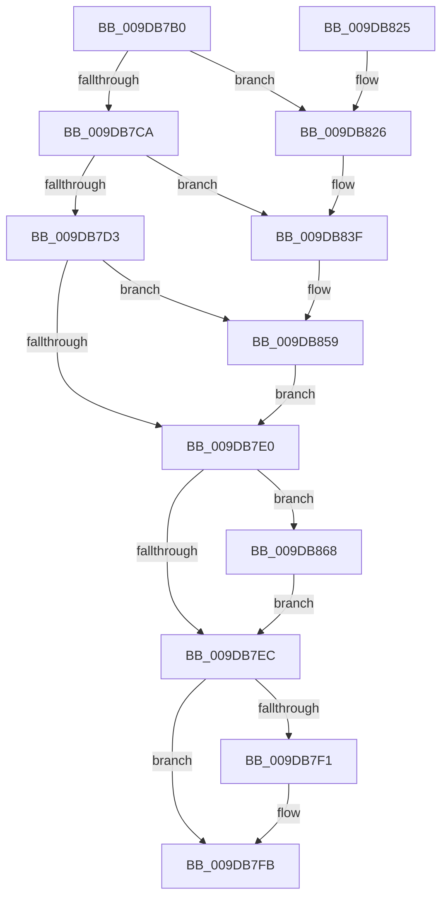

# CmpFreeKeyControlBlock

- RVA: `0x009DB7B0`–`0x009DB871` (길이 `193` bytes)
- VA: `0x00000001409DB7B0`
- 실행 섹션: `PAGE`
- PDB 이름 있음: `예`; PDB Function 태그: `아니요`
- unwind 정보 RVA: `0x000A34AC`
- 디코드: `51`개 명령, `193/193` bytes 표시
- 미해석 바이트: `0` (있으면 어셈블리에 `.byte`로 보존)

> 이 문서는 커널 이미지의 기계어와 PDB 기호를 분석해 생성했습니다. 4번과 5번은 함수 원형과 자료형을 바이너리 사용 방식에서 추정한 C 해석이며 원본 소스 복구 결과는 아닙니다.

## 1. Dependencies

- 직접 호출 지점: **5**; 고유 호출 대상: **4**
- 직접 호출자로 확인된 함수: **2**
- RIP 상대 이미지 참조: **3**

### Outgoing calls
- `0x009DB7F6` → [CmpFreePoolWithTag](../../text/44/CmpFreePoolWithTag_function_004489E0.md) (function, `0x004489E0`)
- `0x009DB812` → [ExFreeToLookasideListEx](../../text/38/ExFreeToLookasideListEx_function_0038ACC0.md) (function, `0x0038ACC0`)
- `0x009DB839` → [KeBugCheckEx](../../text/4F/KeBugCheckEx_function_004FD660.md) (function, `0x004FD660`)
- `0x009DB853` → [KeBugCheckEx](../../text/4F/KeBugCheckEx_function_004FD660.md) (function, `0x004FD660`)
- `0x009DB85E` → [ExFreePoolWithTag](../../poolcode/B8/ExFreePoolWithTag_function_00B82870.md) (function, `0x00B82870`)

### Direct callers
- [CmpCloneToUnbackedKcb](../7E/CmpCloneToUnbackedKcb_function_007EA9A8.md) at `0x007EAA99`
- [CmpCreateKeyControlBlock](../85/CmpCreateKeyControlBlock_function_00851DB0.md) at `0x0085256A`

### Static image references
- `0x009DB7B6` → RVA `0x00FDA430` (`PAGEDATA`; read/write)
- `0x009DB802` → RVA `0x00E2CAC0` (`.data`; read)
- `0x009DB817` → RVA `0x00FDA450` (`PAGEDATA`; read/write)

## 2. Other-region calls and transfers

- 다른 실행 섹션으로 향하는 call: **5**
  - `0x009DB7F6` → [CmpFreePoolWithTag](../../text/44/CmpFreePoolWithTag_function_004489E0.md) (`PAGE` → `.text`)
  - `0x009DB812` → [ExFreeToLookasideListEx](../../text/38/ExFreeToLookasideListEx_function_0038ACC0.md) (`PAGE` → `.text`)
  - `0x009DB839` → [KeBugCheckEx](../../text/4F/KeBugCheckEx_function_004FD660.md) (`PAGE` → `.text`)
  - `0x009DB853` → [KeBugCheckEx](../../text/4F/KeBugCheckEx_function_004FD660.md) (`PAGE` → `.text`)
  - `0x009DB85E` → [ExFreePoolWithTag](../../poolcode/B8/ExFreePoolWithTag_function_00B82870.md) (`PAGE` → `POOLCODE`)
- 별도 외부 분기/꼬리 이동을 확인하지 못했습니다.

## 3. Assembly (complete function range)

```asm
009DB7B0  40 53                           push rbx
009DB7B2  48 83 EC 30                     sub rsp, 0x30
009DB7B6  F0 48 FF 0D 72 EC 5F 00         lock dec qword ptr [rip + 0x5fec72]
009DB7BE  48 8D 41 78                     lea rax, [rcx + 0x78]
009DB7C2  48 8B D9                        mov rbx, rcx
009DB7C5  48 39 00                        cmp qword ptr [rax], rax
009DB7C8  75 5C                           jne 0x1409db826
009DB7CA  F7 41 08 00 00 01 00            test dword ptr [rcx + 8], 0x10000
009DB7D1  75 6C                           jne 0x1409db83f
009DB7D3  48 8B 89 C8 00 00 00            mov rcx, qword ptr [rcx + 0xc8]
009DB7DA  48 83 F9 02                     cmp rcx, 2
009DB7DE  73 79                           jae 0x1409db859
009DB7E0  48 8B 8B 28 01 00 00            mov rcx, qword ptr [rbx + 0x128]
009DB7E7  F6 C1 01                        test cl, 1
009DB7EA  75 7C                           jne 0x1409db868
009DB7EC  48 85 C9                        test rcx, rcx
009DB7EF  74 0A                           je 0x1409db7fb
009DB7F1  BA 43 4D 4E 62                  mov edx, 0x624e4d43
009DB7F6  E8 E5 D1 A6 FF                  call 0x1404489e0
009DB7FB  81 4B 08 00 00 01 00            or dword ptr [rbx + 8], 0x10000
009DB802  48 8D 0D B7 12 45 00            lea rcx, [rip + 0x4512b7]
009DB809  33 C0                           xor eax, eax
009DB80B  48 8B D3                        mov rdx, rbx
009DB80E  48 89 43 20                     mov qword ptr [rbx + 0x20], rax
009DB812  E8 A9 F4 9A FF                  call 0x14038acc0
009DB817  F0 48 FF 0D 31 EC 5F 00         lock dec qword ptr [rip + 0x5fec31]
009DB81F  48 83 C4 30                     add rsp, 0x30
009DB823  5B                              pop rbx
009DB824  C3                              ret
009DB825  CC                              int3
009DB826  33 C0                           xor eax, eax
009DB828  45 33 C9                        xor r9d, r9d
009DB82B  4C 8B C3                        mov r8, rbx
009DB82E  48 89 44 24 20                  mov qword ptr [rsp + 0x20], rax
009DB833  8D 50 11                        lea edx, [rax + 0x11]
009DB836  8D 48 51                        lea ecx, [rax + 0x51]
009DB839  E8 22 1E B2 FF                  call 0x1404fd660
009DB83E  CC                              int3
009DB83F  33 C0                           xor eax, eax
009DB841  4C 8B C3                        mov r8, rbx
009DB844  48 89 44 24 20                  mov qword ptr [rsp + 0x20], rax
009DB849  44 8D 48 01                     lea r9d, [rax + 1]
009DB84D  8D 50 11                        lea edx, [rax + 0x11]
009DB850  8D 48 51                        lea ecx, [rax + 0x51]
009DB853  E8 08 1E B2 FF                  call 0x1404fd660
009DB858  CC                              int3
009DB859  BA 43 4D 4E 62                  mov edx, 0x624e4d43
009DB85E  E8 0D 70 1A 00                  call 0x140b82870
009DB863  E9 78 FF FF FF                  jmp 0x1409db7e0
009DB868  48 83 E1 FE                     and rcx, 0xfffffffffffffffe
009DB86C  E9 7B FF FF FF                  jmp 0x1409db7ec
```

## 4. C-style interpretation (structured pseudocode)

```c
__int64 __fastcall CmpFreeKeyControlBlock(__int64 a1, __int64 a2, __int64 a3, int a4)
{
    __int64 result;
    __int64 v_rsp;
    unsigned __int64 v_stack_p20;

    v_rsp = (v_rsp) - (48);
    if ((*(unsigned __int64 *)(a1 + 120)) != (a1 + 120)) goto loc_009DB826;
    if (((*(unsigned int *)(a1 + 8)) & (0x10000ULL)) != 0) goto loc_009DB83F;
    if ((*(unsigned __int64 *)(a1 + 200)) >= 2) goto loc_009DB859;
loc_009DB7E0:
    if ((((unsigned __int8)(*(unsigned __int64 *)(a1 + 296))) & (1)) != 0) goto loc_009DB868;
loc_009DB7EC:
    result = a1 + 120;
    if (*(unsigned __int64 *)(a1 + 296) != 0) {
        a2 = 0x624E4D43ULL;
        result = CmpFreePoolWithTag(*(unsigned __int64 *)(a1 + 296), a2, a3, a4);
    }
    result = 0;
    *(unsigned __int64 *)(a1 + 32) = 0;
    result = ExFreeToLookasideListEx(v_rip + 4526775, a1, a3, a4);
    v_rsp = (v_rsp) + (48);
    return result;
loc_009DB826:
    result = 0;
    a4 = 0;
    v_stack_p20 = 0;
    result = KeBugCheckEx(result + 81, result + 17, a1, a4);
loc_009DB83F:
    result = 0;
    v_stack_p20 = 0;
    result = KeBugCheckEx(result + 81, result + 17, a1, result + 1);
loc_009DB859:
    result = ExFreePoolWithTag(result + 81, (unsigned int)(0x624E4D43ULL), a1, result + 1);
    goto loc_009DB7E0;
loc_009DB868:
    a1 = (result + 81) & (-2);
    goto loc_009DB7EC;
}
```

## 5. (Beta) C Style

```c
int64_t CmpFreeKeyControlBlock(void *Arg1, int64_t Arg2, int64_t Arg3, int32_t Arg4)
{
    uint8_t *arg1 = (uint8_t *)Arg1;

    int64_t result;
    int64_t local_rsp;
    uint64_t v_stack_p20;

    local_rsp = (local_rsp) - (48);
    if ((*(uint64_t *)(arg1 + 0x78)) != (Arg1 + 120)) goto loc_009DB826;
    if (((*(uint32_t *)(arg1 + 0x8)) & (0x10000ULL)) != 0) goto loc_009DB83F;
    if ((*(uint64_t *)(arg1 + 0xC8)) >= 2) goto loc_009DB859;
loc_009DB7E0:
    if ((((uint8_t)(*(uint64_t *)(arg1 + 0x128))) & (1)) != 0) goto loc_009DB868;
loc_009DB7EC:
    result = Arg1 + 120;
    if (*(uint64_t *)(arg1 + 0x128) != 0) {
        Arg2 = 0x624E4D43ULL;
        result = CmpFreePoolWithTag(*(uint64_t *)(arg1 + 0x128), Arg2, Arg3, Arg4);
    }
    result = 0;
    *(uint64_t *)(arg1 + 0x20) = 0;
    result = ExFreeToLookasideListEx(v_rip + 4526775, Arg1, Arg3, Arg4);
    local_rsp = (local_rsp) + (48);
    return result;
loc_009DB826:
    result = 0;
    Arg4 = 0;
    v_stack_p20 = 0;
    result = KeBugCheckEx(result + 81, result + 17, Arg1, Arg4);
loc_009DB83F:
    result = 0;
    v_stack_p20 = 0;
    result = KeBugCheckEx(result + 81, result + 17, Arg1, result + 1);
loc_009DB859:
    result = ExFreePoolWithTag(result + 81, (uint32_t)(0x624E4D43ULL), Arg1, result + 1);
    goto loc_009DB7E0;
loc_009DB868:
    Arg1 = (result + 81) & (-2);
    goto loc_009DB7EC;
}
```

### 관측된 메모리 오프셋

구조체 형식이 확인되지 않은 접근은 인자 기준의 오프셋으로만 기록했습니다.

| 기준 인자 | 오프셋 표현 | 폭 (bit) | 접근 |
|---|---:|---:|---|
| `Arg1` | `+ 0x0` | `64` | `R` |
| `Arg1` | `+ 0x8` | `32` | `R` |
| `Arg1` | `+ 0x8` | `32` | `R/W` |
| `Arg1` | `+ 0x20` | `64` | `W` |
| `Arg1` | `+ 0x78` | `64` | `R` |
| `Arg1` | `+ 0xC8` | `64` | `R` |
| `Arg1` | `+ 0x128` | `64` | `R` |

## 6. Execution-region graph

[열기: 2D/3D 그래프와 함수 탐색 컨트롤 패널](../../../control-panel.html?section=page&rva=0x009DB7B0&view=graph)

- 2D 그래프는 위에서 아래로 흐르고, 3D 그래프는 빈 공간을 드래그해 회전합니다. Shift+드래그는 이동, 휠은 확대·축소, 함수 노드 선택은 대상 보고서 이동입니다.

### Static fallback


