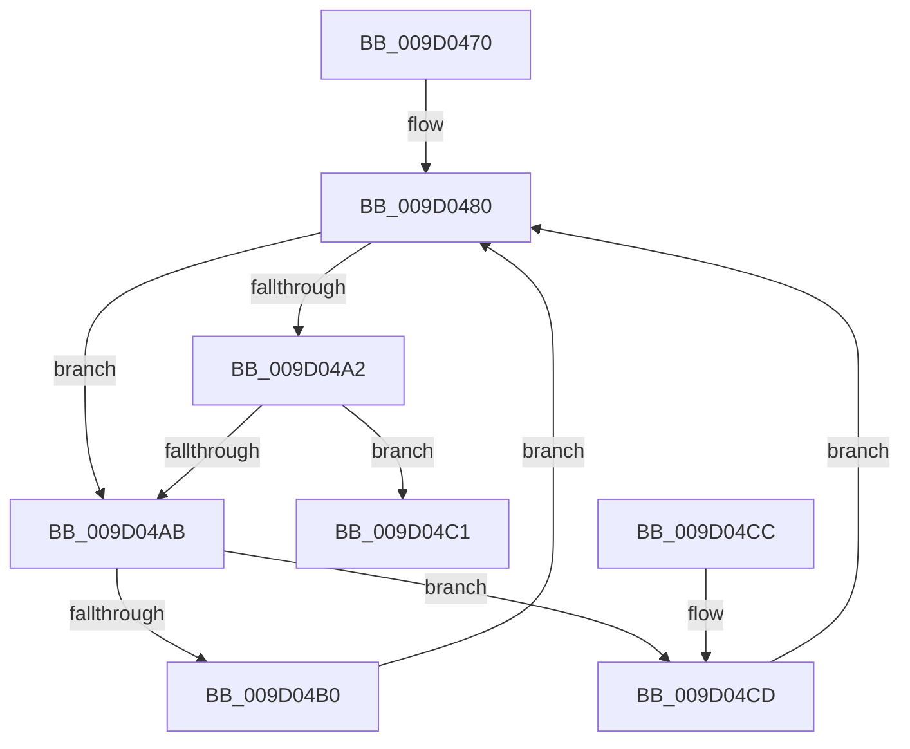

# CmpGetRegistryNamespaceRootForSilo

- RVA: `0x009D0470`–`0x009D04D2` (길이 `98` bytes)
- VA: `0x00000001409D0470`
- 실행 섹션: `PAGE`
- PDB 이름 있음: `예`; PDB Function 태그: `아니요`
- unwind 정보 RVA: `0x000A11F8`
- 디코드: `30`개 명령, `98/98` bytes 표시
- 미해석 바이트: `0` (있으면 어셈블리에 `.byte`로 보존)

> 이 문서는 커널 이미지의 기계어와 PDB 기호를 분석해 생성했습니다. 4번과 5번은 함수 원형과 자료형을 바이너리 사용 방식에서 추정한 C 해석이며 원본 소스 복구 결과는 아닙니다.

## 1. Dependencies

- 직접 호출 지점: **2**; 고유 호출 대상: **2**
- 직접 호출자로 확인된 함수: **1**
- RIP 상대 이미지 참조: **1**

### Outgoing calls
- `0x009D0493` → [PsGetPermanentSiloContext](../../text/3E/PsGetPermanentSiloContext_function_003EE100.md) (function, `0x003EE100`)
- `0x009D04B7` → [PspGetJobSilo](../../text/41/PspGetJobSilo_function_00418670.md) (function, `0x00418670`)

### Direct callers
- [CmpParseKey](../89/CmpParseKey_function_0089DDC0.md) at `0x0089DEAF`

### Static image references
- `0x009D0480` → RVA `0x00EF7A50` (`.data`; read)

## 2. Other-region calls and transfers

- 다른 실행 섹션으로 향하는 call: **2**
  - `0x009D0493` → [PsGetPermanentSiloContext](../../text/3E/PsGetPermanentSiloContext_function_003EE100.md) (`PAGE` → `.text`)
  - `0x009D04B7` → [PspGetJobSilo](../../text/41/PspGetJobSilo_function_00418670.md) (`PAGE` → `.text`)
- 별도 외부 분기/꼬리 이동을 확인하지 못했습니다.

## 3. Assembly (complete function range)

```asm
009D0470  48 89 5C 24 10                  mov qword ptr [rsp + 0x10], rbx
009D0475  57                              push rdi
009D0476  48 83 EC 20                     sub rsp, 0x20
009D047A  48 8B D9                        mov rbx, rcx
009D047D  33 FF                           xor edi, edi
009D047F  90                              nop
009D0480  8B 15 CA 75 52 00               mov edx, dword ptr [rip + 0x5275ca]
009D0486  4C 8D 44 24 30                  lea r8, [rsp + 0x30]
009D048B  48 8B CB                        mov rcx, rbx
009D048E  48 89 7C 24 30                  mov qword ptr [rsp + 0x30], rdi
009D0493  E8 68 DC A1 FF                  call 0x1403ee100
009D0498  48 8B 44 24 30                  mov rax, qword ptr [rsp + 0x30]
009D049D  48 85 C0                        test rax, rax
009D04A0  74 09                           je 0x1409d04ab
009D04A2  48 8B 40 20                     mov rax, qword ptr [rax + 0x20]
009D04A6  48 85 C0                        test rax, rax
009D04A9  75 16                           jne 0x1409d04c1
009D04AB  48 85 DB                        test rbx, rbx
009D04AE  74 1D                           je 0x1409d04cd
009D04B0  48 8B 8B 18 05 00 00            mov rcx, qword ptr [rbx + 0x518]
009D04B7  E8 B4 81 A4 FF                  call 0x140418670
009D04BC  48 8B D8                        mov rbx, rax
009D04BF  EB BF                           jmp 0x1409d0480
009D04C1  48 8B 5C 24 38                  mov rbx, qword ptr [rsp + 0x38]
009D04C6  48 83 C4 20                     add rsp, 0x20
009D04CA  5F                              pop rdi
009D04CB  C3                              ret
009D04CC  CC                              int3
009D04CD  48 8B DF                        mov rbx, rdi
009D04D0  EB AE                           jmp 0x1409d0480
```

## 4. C-style interpretation (structured pseudocode)

```c
__int64 __fastcall CmpGetRegistryNamespaceRootForSilo(__int64 a1)
{
    __int64 result;
    __int64 v_rdi;
    __int64 v_rsp;
    unsigned __int64 v_stack_p10;
    unsigned __int64 v_stack_p8;

    v_stack_p10 = v_rbx;
    v_rsp = (v_rsp) - (32);
    v_rdi = 0;
loc_009D0480:
    v_stack_p8 = 0;
    result = PsGetPermanentSiloContext(a1, (unsigned int)(*(unsigned int *)(v_rip + 5404106)), v_stack_p8, a4);
    if (v_stack_p8 == 0) goto loc_009D04AB;
    if (*(unsigned __int64 *)(v_stack_p8 + 32) != 0) goto loc_009D04C1;
loc_009D04AB:
    if (a1 == 0) goto loc_009D04CD;
    result = PspGetJobSilo(*(unsigned __int64 *)(a1 + 1304), (unsigned int)(*(unsigned int *)(v_rip + 5404106)), v_stack_p8, a4);
    goto loc_009D0480;
loc_009D04C1:
    v_rsp = (v_rsp) + (32);
    return result;
loc_009D04CD:
    goto loc_009D0480;
}
```

## 5. (Beta) C Style

```c
int64_t CmpGetRegistryNamespaceRootForSilo(int64_t Arg1)
{
    int64_t result;
    int64_t local_rdi;
    int64_t local_rsp;
    uint64_t v_stack_p10;
    uint64_t v_stack_p8;

    v_stack_p10 = local_rbx;
    local_rsp = (local_rsp) - (32);
    local_rdi = 0;
loc_009D0480:
    v_stack_p8 = 0;
    result = PsGetPermanentSiloContext(Arg1, (uint32_t)(*(uint32_t *)(v_rip + 0x5275CA)), v_stack_p8, a4);
    if (v_stack_p8 == 0) goto loc_009D04AB;
    if (*(uint64_t *)(v_stack_p8 + 0x20) != 0) goto loc_009D04C1;
loc_009D04AB:
    if (Arg1 == 0) goto loc_009D04CD;
    result = PspGetJobSilo(*(uint64_t *)(Arg1 + 0x518), (uint32_t)(*(uint32_t *)(v_rip + 0x5275CA)), v_stack_p8, a4);
    goto loc_009D0480;
loc_009D04C1:
    local_rsp = (local_rsp) + (32);
    return result;
loc_009D04CD:
    goto loc_009D0480;
}
```

## 6. Execution-region graph

[열기: 2D/3D 그래프와 함수 탐색 컨트롤 패널](../../../control-panel.html?section=page&rva=0x009D0470&view=graph)

- 2D 그래프는 위에서 아래로 흐르고, 3D 그래프는 빈 공간을 드래그해 회전합니다. Shift+드래그는 이동, 휠은 확대·축소, 함수 노드 선택은 대상 보고서 이동입니다.

### Static fallback


