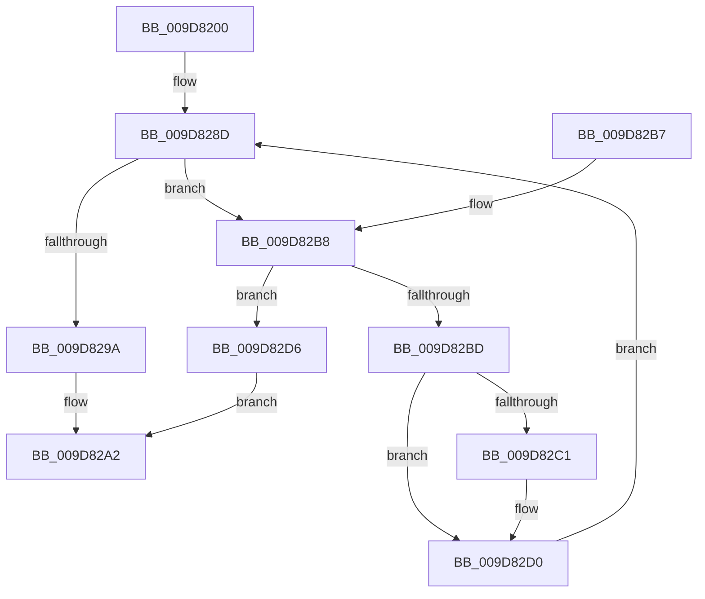

# EtwpCovSampHashLookupInTable

- RVA: `0x009D8200`–`0x009D82DD` (길이 `221` bytes)
- VA: `0x00000001409D8200`
- 실행 섹션: `PAGE`
- PDB 이름 있음: `예`; PDB Function 태그: `아니요`
- unwind 정보 RVA: `0x000A2CF8`
- 디코드: `65`개 명령, `221/221` bytes 표시
- 미해석 바이트: `0` (있으면 어셈블리에 `.byte`로 보존)

> 이 문서는 커널 이미지의 기계어와 PDB 기호를 분석해 생성했습니다. 4번과 5번은 함수 원형과 자료형을 바이너리 사용 방식에서 추정한 C 해석이며 원본 소스 복구 결과는 아닙니다.

## 1. Dependencies

- 직접 호출 지점: **0**; 고유 호출 대상: **0**
- 직접 호출자로 확인된 함수: **1**
- RIP 상대 이미지 참조: **0**

### Outgoing calls
- 직접 디코드된 call 명령이 없습니다.

### Direct callers
- [sub_00B1C2E2](../B1/Unknown_function_00B1C2E2.md) at `0x00B1C37F`

### Static image references
- 디코드된 RIP-relative 메모리 참조가 없습니다.

## 2. Other-region calls and transfers

- 다른 실행 섹션으로 향하는 call: **0**
- 별도 외부 분기/꼬리 이동을 확인하지 못했습니다.

## 3. Assembly (complete function range)

```asm
009D8200  48 89 5C 24 08                  mov qword ptr [rsp + 8], rbx
009D8205  48 89 6C 24 10                  mov qword ptr [rsp + 0x10], rbp
009D820A  48 89 74 24 18                  mov qword ptr [rsp + 0x18], rsi
009D820F  48 89 7C 24 20                  mov qword ptr [rsp + 0x20], rdi
009D8214  0F B6 02                        movzx eax, byte ptr [rdx]
009D8217  48 8B DA                        mov rbx, rdx
009D821A  48 05 CB 5D B1 00               add rax, 0xb15dcb
009D8220  4C 8B D9                        mov r11, rcx
009D8223  4C 6B C8 25                     imul r9, rax, 0x25
009D8227  0F B6 42 01                     movzx eax, byte ptr [rdx + 1]
009D822B  49 8B F0                        mov rsi, r8
009D822E  41 8B 6B 14                     mov ebp, dword ptr [r11 + 0x14]
009D8232  4C 03 C8                        add r9, rax
009D8235  0F B6 42 02                     movzx eax, byte ptr [rdx + 2]
009D8239  FF CD                           dec ebp
009D823B  4D 8B 43 18                     mov r8, qword ptr [r11 + 0x18]
009D823F  33 FF                           xor edi, edi
009D8241  4D 6B D1 25                     imul r10, r9, 0x25
009D8245  41 BB B1 79 37 9E               mov r11d, 0x9e3779b1
009D824B  4C 03 D0                        add r10, rax
009D824E  0F B6 42 03                     movzx eax, byte ptr [rdx + 3]
009D8252  4D 6B CA 25                     imul r9, r10, 0x25
009D8256  4C 03 C8                        add r9, rax
009D8259  0F B6 43 04                     movzx eax, byte ptr [rbx + 4]
009D825D  49 6B D1 25                     imul rdx, r9, 0x25
009D8261  4C 8B 0B                        mov r9, qword ptr [rbx]
009D8264  48 03 D0                        add rdx, rax
009D8267  0F B6 43 05                     movzx eax, byte ptr [rbx + 5]
009D826B  48 6B CA 25                     imul rcx, rdx, 0x25
009D826F  48 03 C8                        add rcx, rax
009D8272  0F B6 43 06                     movzx eax, byte ptr [rbx + 6]
009D8276  48 6B D1 25                     imul rdx, rcx, 0x25
009D827A  48 03 D0                        add rdx, rax
009D827D  0F B6 43 07                     movzx eax, byte ptr [rbx + 7]
009D8281  4C 6B D2 25                     imul r10, rdx, 0x25
009D8285  8B D5                           mov edx, ebp
009D8287  4C 03 D0                        add r10, rax
009D828A  41 23 D2                        and edx, r10d
009D828D  49 8B 0C D0                     mov rcx, qword ptr [r8 + rdx*8]
009D8291  49 8D 04 D0                     lea rax, [r8 + rdx*8]
009D8295  49 3B C9                        cmp rcx, r9
009D8298  75 1E                           jne 0x1409d82b8
009D829A  48 89 06                        mov qword ptr [rsi], rax
009D829D  B8 01 00 00 00                  mov eax, 1
009D82A2  48 8B 5C 24 08                  mov rbx, qword ptr [rsp + 8]
009D82A7  48 8B 6C 24 10                  mov rbp, qword ptr [rsp + 0x10]
009D82AC  48 8B 74 24 18                  mov rsi, qword ptr [rsp + 0x18]
009D82B1  48 8B 7C 24 20                  mov rdi, qword ptr [rsp + 0x20]
009D82B6  C3                              ret
009D82B7  CC                              int3
009D82B8  48 85 C9                        test rcx, rcx
009D82BB  74 19                           je 0x1409d82d6
009D82BD  85 FF                           test edi, edi
009D82BF  75 0F                           jne 0x1409d82d0
009D82C1  41 8B C2                        mov eax, r10d
009D82C4  49 0F AF C3                     imul rax, r11
009D82C8  A8 01                           test al, 1
009D82CA  8D 78 01                        lea edi, [rax + 1]
009D82CD  0F 45 F8                        cmovne edi, eax
009D82D0  03 D7                           add edx, edi
009D82D2  23 D5                           and edx, ebp
009D82D4  EB B7                           jmp 0x1409d828d
009D82D6  48 89 06                        mov qword ptr [rsi], rax
009D82D9  33 C0                           xor eax, eax
009D82DB  EB C5                           jmp 0x1409d82a2
```

## 4. C-style interpretation (structured pseudocode)

```c
__int64 __fastcall EtwpCovSampHashLookupInTable(__int64 a1, __int64 a2, __int64 a3)
{
    __int64 result;
    __int64 v_r10;
    __int64 v_rbp;
    __int64 v_rdi;
    unsigned __int64 v_stack_p10;
    unsigned __int64 v_stack_p18;
    unsigned __int64 v_stack_p20;
    unsigned __int64 v_stack_p8;

    v_stack_p8 = v_rbx;
    v_stack_p10 = v_rbp;
    v_stack_p18 = v_rsi;
    v_stack_p20 = v_rdi;
    result = (*(unsigned __int8 *)(a2)) + (0xB15DCBULL);
    a4 = (a4) * (result);
    a4 = (a4) + (*(unsigned __int8 *)(a2 + 1));
    v_rbp = (unsigned int)(((unsigned int)(*(unsigned int *)(a1 + 20))) - 1);
    v_rdi = 0;
    v_r10 = (v_r10) * (a4);
    v_r10 = (v_r10) + (*(unsigned __int8 *)(a2 + 2));
    a4 = (a4) * (v_r10);
    a4 = (a4) + (*(unsigned __int8 *)(a2 + 3));
    a2 = (a2) * (a4);
    a2 = (a2) + (*(unsigned __int8 *)(a2 + 4));
    a1 = (a1) * (a2);
    a1 = (a1) + (*(unsigned __int8 *)(a2 + 5));
    a2 = (a2) * (a1);
    a2 = (a2) + (*(unsigned __int8 *)(a2 + 6));
    v_r10 = (v_r10) * (a2);
    v_r10 = (v_r10) + (*(unsigned __int8 *)(a2 + 7));
    a2 = (unsigned int)(((unsigned int)((unsigned int)(v_rbp))) & ((unsigned int)(v_r10)));
loc_009D828D:
    if ((*(unsigned __int64 *)(*(unsigned __int64 *)(a1 + 24) + a2 * 8)) != (*(unsigned __int64 *)(a2))) goto loc_009D82B8;
    *(unsigned __int64 *)(a3) = *(unsigned __int64 *)(a1 + 24) + a2 * 8;
loc_009D82A2:
    return 1;
loc_009D82B8:
    if (*(unsigned __int64 *)(*(unsigned __int64 *)(a1 + 24) + a2 * 8) == 0) goto loc_009D82D6;
    result = 1;
    v_rdi = v_stack_p20;
    if ((unsigned int)(v_stack_p20) == 0) {
        result = (unsigned int)(v_r10);
        result = (result) * ((unsigned int)(0x9E3779B1ULL));
        v_rdi = result + 1;
        if ((((unsigned __int8)(result)) & (1)) != 0) { v_rdi = (unsigned int)(result); }
    }
    a2 = (unsigned int)((a2) + ((unsigned int)(v_rdi)));
    a2 = (unsigned int)((a2) & ((unsigned int)(v_stack_p10)));
    goto loc_009D828D;
loc_009D82D6:
    *(unsigned __int64 *)(v_stack_p18) = result;
    result = 0;
    goto loc_009D82A2;
}
```

## 5. (Beta) C Style

```c
int64_t EtwpCovSampHashLookupInTable(void *Arg1, void *Arg2, void *Arg3)
{
    uint8_t *arg1 = (uint8_t *)Arg1;
    uint8_t *arg2 = (uint8_t *)Arg2;
    uint8_t *arg3 = (uint8_t *)Arg3;

    int64_t result;
    int64_t local_r10;
    int64_t local_rbp;
    int64_t local_rdi;
    uint64_t v_stack_p10;
    uint64_t v_stack_p18;
    uint64_t v_stack_p20;
    uint64_t v_stack_p8;

    v_stack_p8 = local_rbx;
    v_stack_p10 = local_rbp;
    v_stack_p18 = local_rsi;
    v_stack_p20 = local_rdi;
    result = (*(uint8_t *)(arg2)) + (0xB15DCBULL);
    a4 = (a4) * (result);
    a4 = (a4) + (*(uint8_t *)(arg2 + 0x1));
    local_rbp = (uint32_t)(((uint32_t)(*(uint32_t *)(arg1 + 0x14))) - 1);
    local_rdi = 0;
    local_r10 = (local_r10) * (a4);
    local_r10 = (local_r10) + (*(uint8_t *)(arg2 + 0x2));
    a4 = (a4) * (local_r10);
    a4 = (a4) + (*(uint8_t *)(arg2 + 0x3));
    Arg2 = (Arg2) * (a4);
    Arg2 = (Arg2) + (*(uint8_t *)(arg2 + 0x4));
    Arg1 = (Arg1) * (Arg2);
    Arg1 = (Arg1) + (*(uint8_t *)(arg2 + 0x5));
    Arg2 = (Arg2) * (Arg1);
    Arg2 = (Arg2) + (*(uint8_t *)(arg2 + 0x6));
    local_r10 = (local_r10) * (Arg2);
    local_r10 = (local_r10) + (*(uint8_t *)(arg2 + 0x7));
    Arg2 = (uint32_t)(((uint32_t)((uint32_t)(local_rbp))) & ((uint32_t)(local_r10)));
loc_009D828D:
    if ((*(uint64_t *)(*(uint64_t *)(arg1 + 0x18) + arg2 * 8)) != (*(uint64_t *)(arg2))) goto loc_009D82B8;
    *(uint64_t *)(arg3) = *(uint64_t *)(arg1 + 0x18) + Arg2 * 8;
loc_009D82A2:
    return 1;
loc_009D82B8:
    if (*(uint64_t *)(*(uint64_t *)(arg1 + 0x18) + arg2 * 8) == 0) goto loc_009D82D6;
    result = 1;
    local_rdi = v_stack_p20;
    if ((uint32_t)(v_stack_p20) == 0) {
        result = (uint32_t)(local_r10);
        result = (result) * ((uint32_t)(0x9E3779B1ULL));
        local_rdi = result + 1;
        if ((((uint8_t)(result)) & (1)) != 0) { local_rdi = (uint32_t)(result); }
    }
    Arg2 = (uint32_t)((Arg2) + ((uint32_t)(local_rdi)));
    Arg2 = (uint32_t)((Arg2) & ((uint32_t)(v_stack_p10)));
    goto loc_009D828D;
loc_009D82D6:
    *(uint64_t *)(v_stack_p18) = result;
    result = 0;
    goto loc_009D82A2;
}
```

### 관측된 메모리 오프셋

구조체 형식이 확인되지 않은 접근은 인자 기준의 오프셋으로만 기록했습니다.

| 기준 인자 | 오프셋 표현 | 폭 (bit) | 접근 |
|---|---:|---:|---|
| `Arg1` | `+ 0x14` | `32` | `R` |
| `Arg1` | `+ 0x18` | `64` | `R` |
| `Arg2` | `+ 0x0` | `8` | `R` |
| `Arg2` | `+ 0x0` | `64` | `R` |
| `Arg2` | `+ 0x1` | `8` | `R` |
| `Arg2` | `+ 0x2` | `8` | `R` |
| `Arg2` | `+ 0x3` | `8` | `R` |
| `Arg2` | `+ 0x4` | `8` | `R` |
| `Arg2` | `+ 0x5` | `8` | `R` |
| `Arg2` | `+ 0x6` | `8` | `R` |
| `Arg2` | `+ 0x7` | `8` | `R` |
| `Arg3` | `+ 0x0` | `64` | `W` |

## 6. Execution-region graph

[열기: 2D/3D 그래프와 함수 탐색 컨트롤 패널](../../../control-panel.html?section=page&rva=0x009D8200&view=graph)

- 2D 그래프는 위에서 아래로 흐르고, 3D 그래프는 빈 공간을 드래그해 회전합니다. Shift+드래그는 이동, 휠은 확대·축소, 함수 노드 선택은 대상 보고서 이동입니다.

### Static fallback


