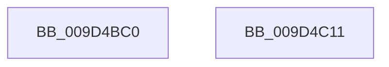

# ExSubscribeWnfStateChange

- RVA: `0x009D4BC0`–`0x009D4C12` (길이 `82` bytes)
- VA: `0x00000001409D4BC0`
- 실행 섹션: `PAGE`
- PDB 이름 있음: `예`; PDB Function 태그: `아니요`
- unwind 정보 RVA: `0x000697A4`
- 디코드: `22`개 명령, `82/82` bytes 표시
- 미해석 바이트: `0` (있으면 어셈블리에 `.byte`로 보존)

> 이 문서는 커널 이미지의 기계어와 PDB 기호를 분석해 생성했습니다. 4번과 5번은 함수 원형과 자료형을 바이너리 사용 방식에서 추정한 C 해석이며 원본 소스 복구 결과는 아닙니다.

## 1. Dependencies

- 직접 호출 지점: **2**; 고유 호출 대상: **2**
- 직접 호출자로 확인된 함수: **30**
- RIP 상대 이미지 참조: **0**

### Outgoing calls
- `0x009D4BFD` → [ExpWnfSubscribeWnfStateChange](ExpWnfSubscribeWnfStateChange_function_009D4D0C.md) (function, `0x009D4D0C`)
- `0x009D4C04` → [KeLeaveCriticalRegion](../../text/25/KeLeaveCriticalRegion_function_0025D8B0.md) (function, `0x0025D8B0`)

### Direct callers
- [CcRegisterForContainerRestore](../../text/57/CcRegisterForContainerRestore_function_0057B220.md) at `0x0057B252`
- [IopLiveDumpRegisterWnfNotificationCallback](../../text/59/IopLiveDumpRegisterWnfNotificationCallback_function_0059DE08.md) at `0x0059DE53`
- [PopEnsureErratumSubscribed](../../text/5D/PopEnsureErratumSubscribed_function_005D46A0.md) at `0x005D473E`
- [CmFcpSubscribeScmWnfStateChange](../../text/66/CmFcpSubscribeScmWnfStateChange_function_0066B41C.md) at `0x0066B452`
- [IopInitializeDumpPolicySettings](../71/IopInitializeDumpPolicySettings_function_0071A444.md) at `0x0071A657`
- [PnpBootPhaseComplete](../72/PnpBootPhaseComplete_function_00723A44.md) at `0x00723A95`
- [PopSetupAirplaneModeNotification](../75/PopSetupAirplaneModeNotification_function_007539F0.md) at `0x00753A19`
- [PopSetupAudioEventNotification](../75/PopSetupAudioEventNotification_function_00753A2C.md) at `0x00753A55`
- [PopSetupBluetoothChargingNotification](../75/PopSetupBluetoothChargingNotification_function_00753A68.md) at `0x00753A91`
- [PopSetupFullScrenVideoNotification](../75/PopSetupFullScrenVideoNotification_function_00753AA4.md) at `0x00753ACD`
- [PopSetupMixedRealitytNotification](../75/PopSetupMixedRealitytNotification_function_00753B1C.md) at `0x00753B86`
- [PopSetupMobileHotspotNotification](../75/PopSetupMobileHotspotNotification_function_00753B98.md) at `0x00753BC1`
- [PopSetupSprActiveSessionChangeNotification](../75/PopSetupSprActiveSessionChangeNotification_function_00753BD4.md) at `0x00753BFD`
- [PopSetupUsb4DisplayPresenceNotification](../75/PopSetupUsb4DisplayPresenceNotification_function_00753C10.md) at `0x00753C39`
- [PopSetupUserPresencePredictionNotification](../75/PopSetupUserPresencePredictionNotification_function_00753C4C.md) at `0x00753C75`
- [PoRegisterForEffectivePowerModeNotifications](../75/PoRegisterForEffectivePowerModeNotifications_function_0075C210.md) at `0x0075C2D7`
- [PopSubscribeHibernatePolicyWnf](../75/PopSubscribeHibernatePolicyWnf_function_0075DF6C.md) at `0x0075DF9D`
- [PopSubscribeHibernatePolicyWnf](../75/PopSubscribeHibernatePolicyWnf_function_0075DF6C.md) at `0x0075DFD5`
- [PopAdaptiveStandbyInitialize](../76/PopAdaptiveStandbyInitialize_function_0076DDF8.md) at `0x0076E021`
- [TtmiInitTerminals](../77/TtmiInitTerminals_function_0077CA40.md) at `0x0077CBF1`
- [RtlpCtContextInit](../79/RtlpCtContextInit_function_00794938.md) at `0x00794A2E`
- [EtwpInitializeSiloState](../7B/EtwpInitializeSiloState_function_007B6A3C.md) at `0x007B6B79`
- [WheapInitWnfCallbacks](../7D/WheapInitWnfCallbacks_function_007D9594.md) at `0x007D95D2`
- [PopEsWorker](../AC/PopEsWorker_function_00AC6EE0.md) at `0x00AC6FE9`
- [PopEsWorker](../AC/PopEsWorker_function_00AC6EE0.md) at `0x00AC700E`
- [PopEsWorker](../AC/PopEsWorker_function_00AC6EE0.md) at `0x00AC7033`
- [VslRegisterIumPowerCallbacks](../../init/C2/VslRegisterIumPowerCallbacks_function_00C29DF0.md) at `0x00C29E52`
- [PiUEventInit](../../init/C3/PiUEventInit_function_00C33D24.md) at `0x00C33EAA`
- [PopPowerButtonSuppressionInit](../../init/C4/PopPowerButtonSuppressionInit_function_00C40B00.md) at `0x00C40BD9`
- [PopBatteryInitPhaseTwo](../../init/C4/PopBatteryInitPhaseTwo_function_00C42148.md) at `0x00C42225`
- [PopBatteryInitPhaseTwo](../../init/C4/PopBatteryInitPhaseTwo_function_00C42148.md) at `0x00C4224E`
- [PopBatteryInitPhaseTwo](../../init/C4/PopBatteryInitPhaseTwo_function_00C42148.md) at `0x00C4228E`
- [PopNetInitialize](../../init/C4/PopNetInitialize_function_00C423AC.md) at `0x00C42587`
- [PopEsInit](../../init/C4/PopEsInit_function_00C42F24.md) at `0x00C42FF8`
- [PopInitializeAdpm](../../init/C4/PopInitializeAdpm_function_00C43B1C.md) at `0x00C43BAB`

### Static image references
- 디코드된 RIP-relative 메모리 참조가 없습니다.

## 2. Other-region calls and transfers

- 다른 실행 섹션으로 향하는 call: **1**
  - `0x009D4C04` → [KeLeaveCriticalRegion](../../text/25/KeLeaveCriticalRegion_function_0025D8B0.md) (`PAGE` → `.text`)
- 별도 외부 분기/꼬리 이동을 확인하지 못했습니다.

## 3. Assembly (complete function range)

```asm
009D4BC0  40 53                           push rbx
009D4BC2  48 83 EC 40                     sub rsp, 0x40
009D4BC6  65 48 8B 04 25 88 01 00 00      mov rax, qword ptr gs:[0x188]
009D4BCF  C6 44 24 38 00                  mov byte ptr [rsp + 0x38], 0
009D4BD4  44 89 44 24 30                  mov dword ptr [rsp + 0x30], r8d
009D4BD9  4C 8B C2                        mov r8, rdx
009D4BDC  48 8B D1                        mov rdx, rcx
009D4BDF  33 C9                           xor ecx, ecx
009D4BE1  66 FF 88 E4 01 00 00            dec word ptr [rax + 0x1e4]
009D4BE8  90                              nop
009D4BE9  48 8B 44 24 78                  mov rax, qword ptr [rsp + 0x78]
009D4BEE  48 89 44 24 28                  mov qword ptr [rsp + 0x28], rax
009D4BF3  48 8B 44 24 70                  mov rax, qword ptr [rsp + 0x70]
009D4BF8  48 89 44 24 20                  mov qword ptr [rsp + 0x20], rax
009D4BFD  E8 0A 01 00 00                  call 0x1409d4d0c
009D4C02  8B D8                           mov ebx, eax
009D4C04  E8 A7 8C 88 FF                  call 0x14025d8b0
009D4C09  8B C3                           mov eax, ebx
009D4C0B  48 83 C4 40                     add rsp, 0x40
009D4C0F  5B                              pop rbx
009D4C10  C3                              ret
009D4C11  CC                              int3
```

## 4. C-style interpretation (structured pseudocode)

```c
__int64 __fastcall ExSubscribeWnfStateChange(__int64 a1, __int64 a2, int a3, __int64 a4, __int64 a5, __int64 a6)
{
    __int64 result;
    __int64 v_rsp;
    unsigned __int8 v_stack_m10;
    unsigned int v_stack_m18;
    unsigned __int64 v_stack_m20;
    unsigned __int64 v_stack_m28;

    v_rsp = (v_rsp) - (64);
    v_stack_m10 = 0;
    v_stack_m18 = a3;
    a1 = 0;
    v_stack_m20 = a6;
    v_stack_m28 = a5;
    result = ExpWnfSubscribeWnfStateChange(a1, a1, a2, a4);
    result = KeLeaveCriticalRegion(a1, a1, a2, a4);
    v_rsp = (v_rsp) + (64);
    return (unsigned int)((unsigned int)((unsigned int)((unsigned int)(result))));
}
```

## 5. (Beta) C Style

```c
int64_t ExSubscribeWnfStateChange(int64_t Arg1, int64_t Arg2, int32_t Arg3, int64_t Arg4, int64_t Arg5, int64_t Arg6)
{
    int64_t result;
    int64_t local_rsp;
    uint8_t v_stack_m10;
    uint32_t v_stack_m18;
    uint64_t v_stack_m20;
    uint64_t v_stack_m28;

    local_rsp = (local_rsp) - (64);
    v_stack_m10 = 0;
    v_stack_m18 = Arg3;
    Arg1 = 0;
    v_stack_m20 = Arg6;
    v_stack_m28 = Arg5;
    result = ExpWnfSubscribeWnfStateChange(Arg1, Arg1, Arg2, Arg4);
    result = KeLeaveCriticalRegion(Arg1, Arg1, Arg2, Arg4);
    local_rsp = (local_rsp) + (64);
    return (uint32_t)((uint32_t)((uint32_t)((uint32_t)(result))));
}
```

## 6. Execution-region graph

[열기: 2D/3D 그래프와 함수 탐색 컨트롤 패널](../../../control-panel.html?section=page&rva=0x009D4BC0&view=graph)

- 2D 그래프는 위에서 아래로 흐르고, 3D 그래프는 빈 공간을 드래그해 회전합니다. Shift+드래그는 이동, 휠은 확대·축소, 함수 노드 선택은 대상 보고서 이동입니다.

### Static fallback


