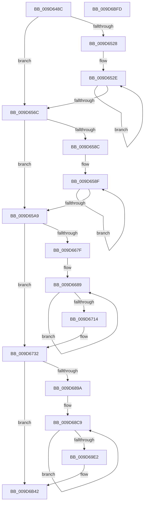

# ExpQuerySystemPerformanceInformation

- RVA: `0x009D648C`–`0x009D6BFE` (길이 `1,906` bytes)
- VA: `0x00000001409D648C`
- 실행 섹션: `PAGE`
- PDB 이름 있음: `예`; PDB Function 태그: `아니요`
- unwind 정보 RVA: `0x000A2530`
- 디코드: `414`개 명령, `1,906/1,906` bytes 표시
- 미해석 바이트: `0` (있으면 어셈블리에 `.byte`로 보존)

> 이 문서는 커널 이미지의 기계어와 PDB 기호를 분석해 생성했습니다. 4번과 5번은 함수 원형과 자료형을 바이너리 사용 방식에서 추정한 C 해석이며 원본 소스 복구 결과는 아닙니다.

## 1. Dependencies

- 직접 호출 지점: **21**; 고유 호출 대상: **20**
- 직접 호출자로 확인된 함수: **1**
- RIP 상대 이미지 참조: **13**

### Outgoing calls
- `0x009D64E5` → [memset](../../text/6C/memset_function_006C6C40.md) (function, `0x006C6C40`)
- `0x009D65D4` → [MmGetProcessPartitionId](../../text/47/MmGetProcessPartitionId_function_0047BB44.md) (function, `0x0047BB44`)
- `0x009D65E6` → [MmGetAvailablePages](../../text/46/MmGetAvailablePages_function_0046A4C0.md) (function, `0x0046A4C0`)
- `0x009D6600` → [MmGetTotalCommittedPages](../../text/46/MmGetTotalCommittedPages_function_0046B638.md) (function, `0x0046B638`)
- `0x009D6613` → [MmGetTotalCommitLimit](../../text/46/MmGetTotalCommitLimit_function_0046B754.md) (function, `0x0046B754`)
- `0x009D6627` → [MmGetPeakCommitment](../../text/46/MmGetPeakCommitment_function_0046BCF4.md) (function, `0x0046BCF4`)
- `0x009D6768` → [MmGetNumberOfFreeSystemPtes](../../text/46/MmGetNumberOfFreeSystemPtes_function_004640D0.md) (function, `0x004640D0`)
- `0x009D6782` → [MmGetSystemPageCounts](../../text/49/MmGetSystemPageCounts_function_0049FA58.md) (function, `0x0049FA58`)
- `0x009D6793` → [MmGetWorkingSetLeafSize](../../text/47/MmGetWorkingSetLeafSize_function_0047DEF8.md) (function, `0x0047DEF8`)
- `0x009D67A7` → [MmGetWorkingSetLeafSize](../../text/47/MmGetWorkingSetLeafSize_function_0047DEF8.md) (function, `0x0047DEF8`)
- `0x009D67D0` → [MiFreePoolPagesLeft](../../text/45/MiFreePoolPagesLeft_function_00450C40.md) (function, `0x00450C40`)
- `0x009D67D8` → [MiMaximumCommitmentAvailable](../../text/47/MiMaximumCommitmentAvailable_function_00470F18.md) (function, `0x00470F18`)
- `0x009D67F6` → [PsQueryRuntimeProcess](PsQueryRuntimeProcess_function_009D6C10.md) (function, `0x009D6C10`)
- `0x009D683E` → [ExQueryPoolUsage](../../text/47/ExQueryPoolUsage_function_0047D000.md) (function, `0x0047D000`)
- `0x009D6B67` → [MmGetResidentAvailablePages](../../text/46/MmGetResidentAvailablePages_function_0046C480.md) (function, `0x0046C480`)
- `0x009D6B73` → [MmGetSharedCommit](../../text/47/MmGetSharedCommit_function_0047BAC0.md) (function, `0x0047BAC0`)
- `0x009D6B7F` → [MmGetMdlPagesAllocated](../../text/4A/MmGetMdlPagesAllocated_function_004A7A7C.md) (function, `0x004A7A7C`)
- `0x009D6B8B` → [MmGetPfnDatabaseCommit](../../text/4A/MmGetPfnDatabaseCommit_function_004A82D8.md) (function, `0x004A82D8`)
- `0x009D6B97` → [MmGetSystemPageTableCommit](../../text/4A/MmGetSystemPageTableCommit_function_004A85F4.md) (function, `0x004A85F4`)
- `0x009D6BA3` → [MmGetContiguousPagesAllocated](../../text/4A/MmGetContiguousPagesAllocated_function_004A8B10.md) (function, `0x004A8B10`)
- `0x009D6BC2` → [memcpy](../../text/6C/memcpy_function_006C6840.md) (function, `0x006C6840`)

### Direct callers
- [ExpQuerySystemInformation](../A5/ExpQuerySystemInformation_function_00A57858.md) at `0x00A57EFF`

### Static image references
- `0x009D64EA` → RVA `0x00F8D120` (`.data`; read)
- `0x009D64F3` → RVA `0x00F8D140` (`.data`; read)
- `0x009D64FD` → RVA `0x00F8D118` (`.data`; read)
- `0x009D6503` → RVA `0x00FC8C40` (`ALMOSTRO`; read)
- `0x009D650A` → RVA `0x00F8D128` (`.data`; read)
- `0x009D6511` → RVA `0x00F8D11C` (`.data`; read)
- `0x009D6518` → RVA `0x00F8D138` (`.data`; read)
- `0x009D67DD` → RVA `0x00FC6B70` (`ALMOSTRO`; read)
- `0x009D67FB` → RVA `0x00FC6AA0` (`ALMOSTRO`; read)
- `0x009D6843` → RVA `0x00F8F4D0` (`.data`; read)
- `0x009D69A5` → RVA `0x00010400` (`.rdata`; read)
- `0x009D6B42` → RVA `0x00E65B80` (`.data`; read)
- `0x009D6B4C` → RVA `0x00E65B78` (`.data`; read)

## 2. Other-region calls and transfers

- 다른 실행 섹션으로 향하는 call: **20**
  - `0x009D64E5` → [memset](../../text/6C/memset_function_006C6C40.md) (`PAGE` → `.text`)
  - `0x009D65D4` → [MmGetProcessPartitionId](../../text/47/MmGetProcessPartitionId_function_0047BB44.md) (`PAGE` → `.text`)
  - `0x009D65E6` → [MmGetAvailablePages](../../text/46/MmGetAvailablePages_function_0046A4C0.md) (`PAGE` → `.text`)
  - `0x009D6600` → [MmGetTotalCommittedPages](../../text/46/MmGetTotalCommittedPages_function_0046B638.md) (`PAGE` → `.text`)
  - `0x009D6613` → [MmGetTotalCommitLimit](../../text/46/MmGetTotalCommitLimit_function_0046B754.md) (`PAGE` → `.text`)
  - `0x009D6627` → [MmGetPeakCommitment](../../text/46/MmGetPeakCommitment_function_0046BCF4.md) (`PAGE` → `.text`)
  - `0x009D6768` → [MmGetNumberOfFreeSystemPtes](../../text/46/MmGetNumberOfFreeSystemPtes_function_004640D0.md) (`PAGE` → `.text`)
  - `0x009D6782` → [MmGetSystemPageCounts](../../text/49/MmGetSystemPageCounts_function_0049FA58.md) (`PAGE` → `.text`)
  - `0x009D6793` → [MmGetWorkingSetLeafSize](../../text/47/MmGetWorkingSetLeafSize_function_0047DEF8.md) (`PAGE` → `.text`)
  - `0x009D67A7` → [MmGetWorkingSetLeafSize](../../text/47/MmGetWorkingSetLeafSize_function_0047DEF8.md) (`PAGE` → `.text`)
  - `0x009D67D0` → [MiFreePoolPagesLeft](../../text/45/MiFreePoolPagesLeft_function_00450C40.md) (`PAGE` → `.text`)
  - `0x009D67D8` → [MiMaximumCommitmentAvailable](../../text/47/MiMaximumCommitmentAvailable_function_00470F18.md) (`PAGE` → `.text`)
  - `0x009D683E` → [ExQueryPoolUsage](../../text/47/ExQueryPoolUsage_function_0047D000.md) (`PAGE` → `.text`)
  - `0x009D6B67` → [MmGetResidentAvailablePages](../../text/46/MmGetResidentAvailablePages_function_0046C480.md) (`PAGE` → `.text`)
  - `0x009D6B73` → [MmGetSharedCommit](../../text/47/MmGetSharedCommit_function_0047BAC0.md) (`PAGE` → `.text`)
  - `0x009D6B7F` → [MmGetMdlPagesAllocated](../../text/4A/MmGetMdlPagesAllocated_function_004A7A7C.md) (`PAGE` → `.text`)
  - `0x009D6B8B` → [MmGetPfnDatabaseCommit](../../text/4A/MmGetPfnDatabaseCommit_function_004A82D8.md) (`PAGE` → `.text`)
  - `0x009D6B97` → [MmGetSystemPageTableCommit](../../text/4A/MmGetSystemPageTableCommit_function_004A85F4.md) (`PAGE` → `.text`)
  - `0x009D6BA3` → [MmGetContiguousPagesAllocated](../../text/4A/MmGetContiguousPagesAllocated_function_004A8B10.md) (`PAGE` → `.text`)
  - `0x009D6BC2` → [memcpy](../../text/6C/memcpy_function_006C6840.md) (`PAGE` → `.text`)
- 별도 외부 분기/꼬리 이동을 확인하지 못했습니다.

## 3. Assembly (complete function range)

```asm
009D648C  48 8B C4                        mov rax, rsp
009D648F  44 89 40 18                     mov dword ptr [rax + 0x18], r8d
009D6493  48 89 50 10                     mov qword ptr [rax + 0x10], rdx
009D6497  55                              push rbp
009D6498  53                              push rbx
009D6499  56                              push rsi
009D649A  57                              push rdi
009D649B  41 54                           push r12
009D649D  41 55                           push r13
009D649F  41 56                           push r14
009D64A1  41 57                           push r15
009D64A3  48 8D A8 68 FE FF FF            lea rbp, [rax - 0x198]
009D64AA  48 81 EC 58 02 00 00            sub rsp, 0x258
009D64B1  0F 29 70 A8                     movaps xmmword ptr [rax - 0x58], xmm6
009D64B5  33 D2                           xor edx, edx
009D64B7  0F 29 78 98                     movaps xmmword ptr [rax - 0x68], xmm7
009D64BB  41 B8 78 01 00 00               mov r8d, 0x178
009D64C1  44 0F 29 40 88                  movaps xmmword ptr [rax - 0x78], xmm8
009D64C6  44 0F 29 88 78 FF FF FF         movaps xmmword ptr [rax - 0x88], xmm9
009D64CE  8B D9                           mov ebx, ecx
009D64D0  48 8D 4C 24 70                  lea rcx, [rsp + 0x70]
009D64D5  44 0F 29 90 68 FF FF FF         movaps xmmword ptr [rax - 0x98], xmm10
009D64DD  44 0F 29 98 58 FF FF FF         movaps xmmword ptr [rax - 0xa8], xmm11
009D64E5  E8 56 07 CF FF                  call 0x1406c6c40
009D64EA  8B 3D 30 6C 5B 00               mov edi, dword ptr [rip + 0x5b6c30]
009D64F0  0F 57 C0                        xorps xmm0, xmm0
009D64F3  48 8B 05 46 6C 5B 00            mov rax, qword ptr [rip + 0x5b6c46]
009D64FA  44 8B D3                        mov r10d, ebx
009D64FD  8B 35 15 6C 5B 00               mov esi, dword ptr [rip + 0x5b6c15]
009D6503  4C 8D 3D 36 27 5F 00            lea r15, [rip + 0x5f2736]
009D650A  4C 8B 0D 17 6C 5B 00            mov r9, qword ptr [rip + 0x5b6c17]
009D6511  44 8B 35 04 6C 5B 00            mov r14d, dword ptr [rip + 0x5b6c04]
009D6518  48 8B 15 19 6C 5B 00            mov rdx, qword ptr [rip + 0x5b6c19]
009D651F  0F 11 44 24 58                  movups xmmword ptr [rsp + 0x58], xmm0
009D6524  85 DB                           test ebx, ebx
009D6526  74 44                           je 0x1409d656c
009D6528  4D 8B DF                        mov r11, r15
009D652B  44 8B E3                        mov r12d, ebx
009D652E  4D 8B 03                        mov r8, qword ptr [r11]
009D6531  4D 8D 5B 08                     lea r11, [r11 + 8]
009D6535  41 8B 88 64 2D 00 00            mov ecx, dword ptr [r8 + 0x2d64]
009D653C  03 F9                           add edi, ecx
009D653E  41 8B 88 5C 2D 00 00            mov ecx, dword ptr [r8 + 0x2d5c]
009D6545  03 F1                           add esi, ecx
009D6547  41 8B 88 60 2D 00 00            mov ecx, dword ptr [r8 + 0x2d60]
009D654E  44 03 F1                        add r14d, ecx
009D6551  49 03 90 70 2D 00 00            add rdx, qword ptr [r8 + 0x2d70]
009D6558  49 03 80 78 2D 00 00            add rax, qword ptr [r8 + 0x2d78]
009D655F  4D 03 88 68 2D 00 00            add r9, qword ptr [r8 + 0x2d68]
009D6566  49 83 EC 01                     sub r12, 1
009D656A  75 C2                           jne 0x1409d652e
009D656C  48 89 55 80                     mov qword ptr [rbp - 0x80], rdx
009D6570  45 33 C0                        xor r8d, r8d
009D6573  33 D2                           xor edx, edx
009D6575  4C 89 4C 24 78                  mov qword ptr [rsp + 0x78], r9
009D657A  48 89 45 88                     mov qword ptr [rbp - 0x78], rax
009D657E  89 75 90                        mov dword ptr [rbp - 0x70], esi
009D6581  44 89 75 94                     mov dword ptr [rbp - 0x6c], r14d
009D6585  89 7D 98                        mov dword ptr [rbp - 0x68], edi
009D6588  85 DB                           test ebx, ebx
009D658A  74 1D                           je 0x1409d65a9
009D658C  49 8B CF                        mov rcx, r15
009D658F  48 8B 01                        mov rax, qword ptr [rcx]
009D6592  48 8D 49 08                     lea rcx, [rcx + 8]
009D6596  44 03 80 3C 2D 00 00            add r8d, dword ptr [rax + 0x2d3c]
009D659D  03 90 38 2D 00 00               add edx, dword ptr [rax + 0x2d38]
009D65A3  49 83 EA 01                     sub r10, 1
009D65A7  75 E6                           jne 0x1409d658f
009D65A9  65 48 8B 0C 25 88 01 00 00      mov rcx, qword ptr gs:[0x188]
009D65B2  83 A5 9C 00 00 00 00            and dword ptr [rbp + 0x9c], 0
009D65B9  83 A5 A0 00 00 00 00            and dword ptr [rbp + 0xa0], 0
009D65C0  44 89 85 98 00 00 00            mov dword ptr [rbp + 0x98], r8d
009D65C7  48 8B 89 B8 00 00 00            mov rcx, qword ptr [rcx + 0xb8]
009D65CE  89 95 A4 00 00 00               mov dword ptr [rbp + 0xa4], edx
009D65D4  E8 6B 55 AA FF                  call 0x14047bb44
009D65D9  0F B7 C8                        movzx ecx, ax
009D65DC  66 89 85 A0 01 00 00            mov word ptr [rbp + 0x1a0], ax
009D65E3  0F B7 F8                        movzx edi, ax
009D65E6  E8 D5 3E A9 FF                  call 0x14046a4c0
009D65EB  41 B9 FF FF FF FF               mov r9d, 0xffffffff
009D65F1  49 3B C1                        cmp rax, r9
009D65F4  41 8B C9                        mov ecx, r9d
009D65F7  0F 46 C8                        cmovbe ecx, eax
009D65FA  89 4D 9C                        mov dword ptr [rbp - 0x64], ecx
009D65FD  0F B7 CF                        movzx ecx, di
009D6600  E8 33 50 A9 FF                  call 0x14046b638
009D6605  49 3B C1                        cmp rax, r9
009D6608  45 8B C1                        mov r8d, r9d
009D660B  44 0F 46 C0                     cmovbe r8d, eax
009D660F  44 89 45 A0                     mov dword ptr [rbp - 0x60], r8d
009D6613  E8 3C 51 A9 FF                  call 0x14046b754
009D6618  49 3B C1                        cmp rax, r9
009D661B  41 8B C9                        mov ecx, r9d
009D661E  0F 46 C8                        cmovbe ecx, eax
009D6621  89 4D A4                        mov dword ptr [rbp - 0x5c], ecx
009D6624  0F B7 CF                        movzx ecx, di
009D6627  E8 C8 56 A9 FF                  call 0x14046bcf4
009D662C  49 3B C1                        cmp rax, r9
009D662F  41 8B C9                        mov ecx, r9d
009D6632  0F 46 C8                        cmovbe ecx, eax
009D6635  41 3B C8                        cmp ecx, r8d
009D6638  41 0F 42 C8                     cmovb ecx, r8d
009D663C  33 C0                           xor eax, eax
009D663E  21 44 24 4C                     and dword ptr [rsp + 0x4c], eax
009D6642  33 D2                           xor edx, edx
009D6644  21 44 24 50                     and dword ptr [rsp + 0x50], eax
009D6648  45 33 C0                        xor r8d, r8d
009D664B  89 4D A8                        mov dword ptr [rbp - 0x58], ecx
009D664E  45 33 C9                        xor r9d, r9d
009D6651  33 C9                           xor ecx, ecx
009D6653  89 85 B8 01 00 00               mov dword ptr [rbp + 0x1b8], eax
009D6659  45 33 D2                        xor r10d, r10d
009D665C  89 4C 24 40                     mov dword ptr [rsp + 0x40], ecx
009D6660  45 33 DB                        xor r11d, r11d
009D6663  89 54 24 44                     mov dword ptr [rsp + 0x44], edx
009D6667  33 F6                           xor esi, esi
009D6669  44 89 44 24 48                  mov dword ptr [rsp + 0x48], r8d
009D666E  45 33 F6                        xor r14d, r14d
009D6671  45 33 E4                        xor r12d, r12d
009D6674  45 33 ED                        xor r13d, r13d
009D6677  85 DB                           test ebx, ebx
009D6679  0F 84 B3 00 00 00               je 0x1409d6732
009D667F  8B 7C 24 50                     mov edi, dword ptr [rsp + 0x50]
009D6683  49 8B D7                        mov rdx, r15
009D6686  4C 8B C3                        mov r8, rbx
009D6689  48 8B 0A                        mov rcx, qword ptr [rdx]
009D668C  48 8D 52 08                     lea rdx, [rdx + 8]
009D6690  8B 81 10 2D 00 00               mov eax, dword ptr [rcx + 0x2d10]
009D6696  44 03 C8                        add r9d, eax
009D6699  8B 81 14 2D 00 00               mov eax, dword ptr [rcx + 0x2d14]
009D669F  44 03 D0                        add r10d, eax
009D66A2  8B 81 18 2D 00 00               mov eax, dword ptr [rcx + 0x2d18]
009D66A8  44 03 D8                        add r11d, eax
009D66AB  8B 81 28 88 00 00               mov eax, dword ptr [rcx + 0x8828]
009D66B1  03 F0                           add esi, eax
009D66B3  8B 81 1C 2D 00 00               mov eax, dword ptr [rcx + 0x2d1c]
009D66B9  44 03 F0                        add r14d, eax
009D66BC  8B 81 20 2D 00 00               mov eax, dword ptr [rcx + 0x2d20]
009D66C2  44 03 E0                        add r12d, eax
009D66C5  8B 81 24 2D 00 00               mov eax, dword ptr [rcx + 0x2d24]
009D66CB  44 03 E8                        add r13d, eax
009D66CE  8B 81 2C 88 00 00               mov eax, dword ptr [rcx + 0x882c]
009D66D4  01 85 B8 01 00 00               add dword ptr [rbp + 0x1b8], eax
009D66DA  8B 81 30 88 00 00               mov eax, dword ptr [rcx + 0x8830]
009D66E0  01 44 24 40                     add dword ptr [rsp + 0x40], eax
009D66E4  8B 81 28 2D 00 00               mov eax, dword ptr [rcx + 0x2d28]
009D66EA  01 44 24 44                     add dword ptr [rsp + 0x44], eax
009D66EE  8B 81 2C 2D 00 00               mov eax, dword ptr [rcx + 0x2d2c]
009D66F4  01 44 24 48                     add dword ptr [rsp + 0x48], eax
009D66F8  8B 81 30 2D 00 00               mov eax, dword ptr [rcx + 0x2d30]
009D66FE  01 44 24 4C                     add dword ptr [rsp + 0x4c], eax
009D6702  8B 81 34 2D 00 00               mov eax, dword ptr [rcx + 0x2d34]
009D6708  03 F8                           add edi, eax
009D670A  49 83 E8 01                     sub r8, 1
009D670E  0F 85 75 FF FF FF               jne 0x1409d6689
009D6714  8B 85 B8 01 00 00               mov eax, dword ptr [rbp + 0x1b8]
009D671A  8B 4C 24 40                     mov ecx, dword ptr [rsp + 0x40]
009D671E  8B 54 24 44                     mov edx, dword ptr [rsp + 0x44]
009D6722  44 8B 44 24 48                  mov r8d, dword ptr [rsp + 0x48]
009D6727  89 7C 24 50                     mov dword ptr [rsp + 0x50], edi
009D672B  0F B7 BD A0 01 00 00            movzx edi, word ptr [rbp + 0x1a0]
009D6732  89 45 C8                        mov dword ptr [rbp - 0x38], eax
009D6735  8B 44 24 4C                     mov eax, dword ptr [rsp + 0x4c]
009D6739  89 45 D8                        mov dword ptr [rbp - 0x28], eax
009D673C  8B 44 24 50                     mov eax, dword ptr [rsp + 0x50]
009D6740  89 45 DC                        mov dword ptr [rbp - 0x24], eax
009D6743  44 89 4D AC                     mov dword ptr [rbp - 0x54], r9d
009D6747  44 89 55 B0                     mov dword ptr [rbp - 0x50], r10d
009D674B  44 89 5D B4                     mov dword ptr [rbp - 0x4c], r11d
009D674F  89 75 B8                        mov dword ptr [rbp - 0x48], esi
009D6752  44 89 75 BC                     mov dword ptr [rbp - 0x44], r14d
009D6756  44 89 65 C0                     mov dword ptr [rbp - 0x40], r12d
009D675A  44 89 6D C4                     mov dword ptr [rbp - 0x3c], r13d
009D675E  89 4D CC                        mov dword ptr [rbp - 0x34], ecx
009D6761  89 55 D0                        mov dword ptr [rbp - 0x30], edx
009D6764  44 89 45 D4                     mov dword ptr [rbp - 0x2c], r8d
009D6768  E8 63 D9 A8 FF                  call 0x1404640d0
009D676D  41 B8 FF FF FF FF               mov r8d, 0xffffffff
009D6773  48 8D 4C 24 58                  lea rcx, [rsp + 0x58]
009D6778  49 3B C0                        cmp rax, r8
009D677B  49 0F 47 C0                     cmova rax, r8
009D677F  89 45 F8                        mov dword ptr [rbp - 8], eax
009D6782  E8 D1 92 AC FF                  call 0x14049fa58
009D6787  8B 44 24 58                     mov eax, dword ptr [rsp + 0x58]
009D678B  B9 01 00 00 00                  mov ecx, 1
009D6790  89 45 FC                        mov dword ptr [rbp - 4], eax
009D6793  E8 60 77 AA FF                  call 0x14047def8
009D6798  49 3B C0                        cmp rax, r8
009D679B  B9 02 00 00 00                  mov ecx, 2
009D67A0  49 0F 47 C0                     cmova rax, r8
009D67A4  89 45 14                        mov dword ptr [rbp + 0x14], eax
009D67A7  E8 4C 77 AA FF                  call 0x14047def8
009D67AC  49 3B C0                        cmp rax, r8
009D67AF  B9 05 00 00 00                  mov ecx, 5
009D67B4  49 0F 47 C0                     cmova rax, r8
009D67B8  89 45 18                        mov dword ptr [rbp + 0x18], eax
009D67BB  8B 44 24 5C                     mov eax, dword ptr [rsp + 0x5c]
009D67BF  89 45 1C                        mov dword ptr [rbp + 0x1c], eax
009D67C2  8B 44 24 60                     mov eax, dword ptr [rsp + 0x60]
009D67C6  89 45 04                        mov dword ptr [rbp + 4], eax
009D67C9  8B 44 24 64                     mov eax, dword ptr [rsp + 0x64]
009D67CD  89 45 00                        mov dword ptr [rbp], eax
009D67D0  E8 6B A4 A7 FF                  call 0x140450c40
009D67D5  4C 8B C0                        mov r8, rax
009D67D8  E8 3B A7 A9 FF                  call 0x140470f18
009D67DD  48 8B 0D 8C 03 5F 00            mov rcx, qword ptr [rip + 0x5f038c]
009D67E4  48 8D 95 B8 01 00 00            lea rdx, [rbp + 0x1b8]
009D67EB  4C 3B C0                        cmp r8, rax
009D67EE  4C 0F 47 C0                     cmova r8, rax
009D67F2  44 89 45 10                     mov dword ptr [rbp + 0x10], r8d
009D67F6  E8 15 04 00 00                  call 0x1409d6c10
009D67FB  8B 0D 9F 02 5F 00               mov ecx, dword ptr [rip + 0x5f029f]
009D6801  4C 8D 4D EC                     lea r9, [rbp - 0x14]
009D6805  48 0F AF C8                     imul rcx, rax
009D6809  48 8D 45 08                     lea rax, [rbp + 8]
009D680D  48 89 44 24 38                  mov qword ptr [rsp + 0x38], rax
009D6812  4C 8D 45 E8                     lea r8, [rbp - 0x18]
009D6816  48 8D 45 F4                     lea rax, [rbp - 0xc]
009D681A  48 89 4C 24 70                  mov qword ptr [rsp + 0x70], rcx
009D681F  48 89 44 24 30                  mov qword ptr [rsp + 0x30], rax
009D6824  48 8D 4D E0                     lea rcx, [rbp - 0x20]
009D6828  48 8D 45 F0                     lea rax, [rbp - 0x10]
009D682C  48 89 44 24 28                  mov qword ptr [rsp + 0x28], rax
009D6831  48 8D 55 E4                     lea rdx, [rbp - 0x1c]
009D6835  48 8D 45 0C                     lea rax, [rbp + 0xc]
009D6839  48 89 44 24 20                  mov qword ptr [rsp + 0x20], rax
009D683E  E8 BD 67 AA FF                  call 0x14047d000
009D6843  8B 05 87 8C 5B 00               mov eax, dword ptr [rip + 0x5b8c87]
009D6849  33 C9                           xor ecx, ecx
009D684B  48 89 4D 20                     mov qword ptr [rbp + 0x20], rcx
009D684F  48 89 4D 28                     mov qword ptr [rbp + 0x28], rcx
009D6853  89 4D 30                        mov dword ptr [rbp + 0x30], ecx
009D6856  48 89 4D 38                     mov qword ptr [rbp + 0x38], rcx
009D685A  48 89 4D 40                     mov qword ptr [rbp + 0x40], rcx
009D685E  48 89 4D 48                     mov qword ptr [rbp + 0x48], rcx
009D6862  48 89 4D 50                     mov qword ptr [rbp + 0x50], rcx
009D6866  48 89 4D 58                     mov qword ptr [rbp + 0x58], rcx
009D686A  48 89 4D 60                     mov qword ptr [rbp + 0x60], rcx
009D686E  48 89 4D 68                     mov qword ptr [rbp + 0x68], rcx
009D6872  48 89 4D 70                     mov qword ptr [rbp + 0x70], rcx
009D6876  48 89 4D 78                     mov qword ptr [rbp + 0x78], rcx
009D687A  89 45 34                        mov dword ptr [rbp + 0x34], eax
009D687D  48 89 8D 80 00 00 00            mov qword ptr [rbp + 0x80], rcx
009D6884  48 89 8D 88 00 00 00            mov qword ptr [rbp + 0x88], rcx
009D688B  48 89 8D 90 00 00 00            mov qword ptr [rbp + 0x90], rcx
009D6892  85 DB                           test ebx, ebx
009D6894  0F 84 A8 02 00 00               je 0x1409d6b42
009D689A  66 0F 6E C1                     movd xmm0, ecx
009D689E  0F 57 ED                        xorps xmm5, xmm5
009D68A1  66 0F 6E C8                     movd xmm1, eax
009D68A5  0F 57 E4                        xorps xmm4, xmm4
009D68A8  66 0F 62 C8                     punpckldq xmm1, xmm0
009D68AC  45 0F 57 DB                     xorps xmm11, xmm11
009D68B0  66 0F 62 E9                     punpckldq xmm5, xmm1
009D68B4  0F 57 F6                        xorps xmm6, xmm6
009D68B7  0F 57 FF                        xorps xmm7, xmm7
009D68BA  45 0F 57 C0                     xorps xmm8, xmm8
009D68BE  45 0F 57 C9                     xorps xmm9, xmm9
009D68C2  45 0F 57 D2                     xorps xmm10, xmm10
009D68C6  48 8B CB                        mov rcx, rbx
009D68C9  49 8B 07                        mov rax, qword ptr [r15]
009D68CC  4D 8D 7F 08                     lea r15, [r15 + 8]
009D68D0  66 0F 6E 80 00 88 00 00         movd xmm0, dword ptr [rax + 0x8800]
009D68D8  F3 0F 7E 90 48 2D 00 00         movq xmm2, qword ptr [rax + 0x2d48]
009D68E0  66 0F 6E 88 14 88 00 00         movd xmm1, dword ptr [rax + 0x8814]
009D68E8  66 0F 6E 98 44 2D 00 00         movd xmm3, dword ptr [rax + 0x2d44]
009D68F0  66 0F 62 D8                     punpckldq xmm3, xmm0
009D68F4  66 0F 6E 80 08 88 00 00         movd xmm0, dword ptr [rax + 0x8808]
009D68FC  66 0F 62 DA                     punpckldq xmm3, xmm2
009D6900  F3 0F 7E 90 C4 87 00 00         movq xmm2, qword ptr [rax + 0x87c4]
009D6908  66 0F FE E3                     paddd xmm4, xmm3
009D690C  66 0F 6E 98 C0 87 00 00         movd xmm3, dword ptr [rax + 0x87c0]
009D6914  66 0F 62 D8                     punpckldq xmm3, xmm0
009D6918  66 0F 6E 80 50 2D 00 00         movd xmm0, dword ptr [rax + 0x2d50]
009D6920  66 0F 62 DA                     punpckldq xmm3, xmm2
009D6924  F3 0F 7E 90 0C 88 00 00         movq xmm2, qword ptr [rax + 0x880c]
009D692C  66 0F FE EB                     paddd xmm5, xmm3
009D6930  F3 0F 7E 98 CC 87 00 00         movq xmm3, qword ptr [rax + 0x87cc]
009D6938  66 0F 6C DA                     punpcklqdq xmm3, xmm2
009D693C  66 0F 6E 90 DC 87 00 00         movd xmm2, dword ptr [rax + 0x87dc]
009D6944  66 0F FE F3                     paddd xmm6, xmm3
009D6948  F3 0F 7E 98 D4 87 00 00         movq xmm3, qword ptr [rax + 0x87d4]
009D6950  66 0F 62 D1                     punpckldq xmm2, xmm1
009D6954  66 0F 6E 88 1C 88 00 00         movd xmm1, dword ptr [rax + 0x881c]
009D695C  66 0F 6C DA                     punpcklqdq xmm3, xmm2
009D6960  F3 0F 7E 90 54 2D 00 00         movq xmm2, qword ptr [rax + 0x2d54]
009D6968  66 0F FE FB                     paddd xmm7, xmm3
009D696C  66 0F 6E 98 18 88 00 00         movd xmm3, dword ptr [rax + 0x8818]
009D6974  66 0F 62 D8                     punpckldq xmm3, xmm0
009D6978  66 0F 6E 80 E0 87 00 00         movd xmm0, dword ptr [rax + 0x87e0]
009D6980  66 0F 6C DA                     punpcklqdq xmm3, xmm2
009D6984  66 0F 6E 90 E4 87 00 00         movd xmm2, dword ptr [rax + 0x87e4]
009D698C  66 44 0F FE C3                  paddd xmm8, xmm3
009D6991  66 0F 6E 98 04 88 00 00         movd xmm3, dword ptr [rax + 0x8804]
009D6999  66 0F 62 D1                     punpckldq xmm2, xmm1
009D699D  F3 0F 7E 88 F4 87 00 00         movq xmm1, qword ptr [rax + 0x87f4]
009D69A5  66 0F 6C 0D 53 9A 63 FF         punpcklqdq xmm1, xmmword ptr [rip - 0x9c65ad]
009D69AD  66 0F 62 D8                     punpckldq xmm3, xmm0
009D69B1  66 44 0F FE D9                  paddd xmm11, xmm1
009D69B6  66 0F 6C DA                     punpcklqdq xmm3, xmm2
009D69BA  F3 0F 7E 90 EC 87 00 00         movq xmm2, qword ptr [rax + 0x87ec]
009D69C2  66 44 0F FE CB                  paddd xmm9, xmm3
009D69C7  F3 0F 7E 98 20 88 00 00         movq xmm3, qword ptr [rax + 0x8820]
009D69CF  66 0F 6C DA                     punpcklqdq xmm3, xmm2
009D69D3  66 44 0F FE D3                  paddd xmm10, xmm3
009D69D8  48 83 E9 01                     sub rcx, 1
009D69DC  0F 85 E7 FE FF FF               jne 0x1409d68c9
009D69E2  66 0F 6F C4                     movdqa xmm0, xmm4
009D69E6  66 0F 7E 65 20                  movd dword ptr [rbp + 0x20], xmm4
009D69EB  66 0F 73 D8 04                  psrldq xmm0, 4
009D69F0  66 0F 6F CC                     movdqa xmm1, xmm4
009D69F4  66 0F 73 D9 08                  psrldq xmm1, 8
009D69F9  66 0F 7E 45 24                  movd dword ptr [rbp + 0x24], xmm0
009D69FE  66 0F 6F C5                     movdqa xmm0, xmm5
009D6A02  66 0F 7E 4D 28                  movd dword ptr [rbp + 0x28], xmm1
009D6A07  66 0F 6F CD                     movdqa xmm1, xmm5
009D6A0B  66 0F 73 D8 04                  psrldq xmm0, 4
009D6A10  66 0F 73 D9 08                  psrldq xmm1, 8
009D6A15  66 0F 7E 45 34                  movd dword ptr [rbp + 0x34], xmm0
009D6A1A  66 0F 6F C6                     movdqa xmm0, xmm6
009D6A1E  66 0F 7E 4D 38                  movd dword ptr [rbp + 0x38], xmm1
009D6A23  66 0F 6F CE                     movdqa xmm1, xmm6
009D6A27  66 0F 73 D8 04                  psrldq xmm0, 4
009D6A2C  66 0F 73 D9 08                  psrldq xmm1, 8
009D6A31  66 0F 7E 45 44                  movd dword ptr [rbp + 0x44], xmm0
009D6A36  66 0F 6F C7                     movdqa xmm0, xmm7
009D6A3A  66 0F 7E 4D 48                  movd dword ptr [rbp + 0x48], xmm1
009D6A3F  66 0F 6F CF                     movdqa xmm1, xmm7
009D6A43  66 0F 73 D8 04                  psrldq xmm0, 4
009D6A48  66 0F 73 D9 08                  psrldq xmm1, 8
009D6A4D  66 0F 7E 45 54                  movd dword ptr [rbp + 0x54], xmm0
009D6A52  66 41 0F 6F C0                  movdqa xmm0, xmm8
009D6A57  66 0F 7E 4D 58                  movd dword ptr [rbp + 0x58], xmm1
009D6A5C  66 41 0F 6F C8                  movdqa xmm1, xmm8
009D6A61  66 0F 73 D8 04                  psrldq xmm0, 4
009D6A66  66 0F 73 D9 08                  psrldq xmm1, 8
009D6A6B  66 0F 7E 45 64                  movd dword ptr [rbp + 0x64], xmm0
009D6A70  66 41 0F 6F C1                  movdqa xmm0, xmm9
009D6A75  66 0F 7E 4D 68                  movd dword ptr [rbp + 0x68], xmm1
009D6A7A  66 41 0F 6F C9                  movdqa xmm1, xmm9
009D6A7F  66 0F 73 D8 04                  psrldq xmm0, 4
009D6A84  66 0F 73 D9 08                  psrldq xmm1, 8
009D6A89  66 0F 7E 45 74                  movd dword ptr [rbp + 0x74], xmm0
009D6A8E  66 41 0F 6F C2                  movdqa xmm0, xmm10
009D6A93  66 0F 7E 4D 78                  movd dword ptr [rbp + 0x78], xmm1
009D6A98  66 41 0F 6F CA                  movdqa xmm1, xmm10
009D6A9D  66 0F 7E 6D 30                  movd dword ptr [rbp + 0x30], xmm5
009D6AA2  66 0F 7E 75 40                  movd dword ptr [rbp + 0x40], xmm6
009D6AA7  66 0F 7E 7D 50                  movd dword ptr [rbp + 0x50], xmm7
009D6AAC  66 44 0F 7E 45 60               movd dword ptr [rbp + 0x60], xmm8
009D6AB2  66 44 0F 7E 4D 70               movd dword ptr [rbp + 0x70], xmm9
009D6AB8  66 44 0F 7E 95 80 00 00 00      movd dword ptr [rbp + 0x80], xmm10
009D6AC1  66 44 0F 7E 9D 90 00 00 00      movd dword ptr [rbp + 0x90], xmm11
009D6ACA  66 0F 73 D8 04                  psrldq xmm0, 4
009D6ACF  66 0F 73 D9 08                  psrldq xmm1, 8
009D6AD4  66 0F 73 DC 0C                  psrldq xmm4, 0xc
009D6AD9  66 0F 73 DD 0C                  psrldq xmm5, 0xc
009D6ADE  66 0F 73 DE 0C                  psrldq xmm6, 0xc
009D6AE3  66 0F 73 DF 0C                  psrldq xmm7, 0xc
009D6AE8  66 41 0F 73 D8 0C               psrldq xmm8, 0xc
009D6AEE  66 41 0F 73 D9 0C               psrldq xmm9, 0xc
009D6AF4  66 41 0F 73 DA 0C               psrldq xmm10, 0xc
009D6AFA  66 41 0F 73 DB 04               psrldq xmm11, 4
009D6B00  66 0F 7E 85 84 00 00 00         movd dword ptr [rbp + 0x84], xmm0
009D6B08  66 0F 7E 8D 88 00 00 00         movd dword ptr [rbp + 0x88], xmm1
009D6B10  66 0F 7E 65 2C                  movd dword ptr [rbp + 0x2c], xmm4
009D6B15  66 0F 7E 6D 3C                  movd dword ptr [rbp + 0x3c], xmm5
009D6B1A  66 0F 7E 75 4C                  movd dword ptr [rbp + 0x4c], xmm6
009D6B1F  66 0F 7E 7D 5C                  movd dword ptr [rbp + 0x5c], xmm7
009D6B24  66 44 0F 7E 45 6C               movd dword ptr [rbp + 0x6c], xmm8
009D6B2A  66 44 0F 7E 4D 7C               movd dword ptr [rbp + 0x7c], xmm9
009D6B30  66 44 0F 7E 95 8C 00 00 00      movd dword ptr [rbp + 0x8c], xmm10
009D6B39  66 44 0F 7E 9D 94 00 00 00      movd dword ptr [rbp + 0x94], xmm11
009D6B42  48 8B 05 37 F0 48 00            mov rax, qword ptr [rip + 0x48f037]
009D6B49  48 8B 08                        mov rcx, qword ptr [rax]
009D6B4C  48 8B 05 25 F0 48 00            mov rax, qword ptr [rip + 0x48f025]
009D6B53  48 89 8D A8 00 00 00            mov qword ptr [rbp + 0xa8], rcx
009D6B5A  48 8B 08                        mov rcx, qword ptr [rax]
009D6B5D  48 89 8D B0 00 00 00            mov qword ptr [rbp + 0xb0], rcx
009D6B64  0F B7 CF                        movzx ecx, di
009D6B67  E8 14 59 A9 FF                  call 0x14046c480
009D6B6C  48 89 85 B8 00 00 00            mov qword ptr [rbp + 0xb8], rax
009D6B73  E8 48 4F AA FF                  call 0x14047bac0
009D6B78  48 89 85 C0 00 00 00            mov qword ptr [rbp + 0xc0], rax
009D6B7F  E8 F8 0E AD FF                  call 0x1404a7a7c
009D6B84  48 89 85 C8 00 00 00            mov qword ptr [rbp + 0xc8], rax
009D6B8B  E8 48 17 AD FF                  call 0x1404a82d8
009D6B90  48 89 85 D0 00 00 00            mov qword ptr [rbp + 0xd0], rax
009D6B97  E8 58 1A AD FF                  call 0x1404a85f4
009D6B9C  48 89 85 D8 00 00 00            mov qword ptr [rbp + 0xd8], rax
009D6BA3  E8 68 1F AD FF                  call 0x1404a8b10
009D6BA8  44 8B 85 B0 01 00 00            mov r8d, dword ptr [rbp + 0x1b0]
009D6BAF  48 8D 54 24 70                  lea rdx, [rsp + 0x70]
009D6BB4  48 8B 8D A8 01 00 00            mov rcx, qword ptr [rbp + 0x1a8]
009D6BBB  48 89 85 E0 00 00 00            mov qword ptr [rbp + 0xe0], rax
009D6BC2  E8 79 FC CE FF                  call 0x1406c6840
009D6BC7  4C 8D 9C 24 58 02 00 00         lea r11, [rsp + 0x258]
009D6BCF  41 0F 28 73 E8                  movaps xmm6, xmmword ptr [r11 - 0x18]
009D6BD4  41 0F 28 7B D8                  movaps xmm7, xmmword ptr [r11 - 0x28]
009D6BD9  45 0F 28 43 C8                  movaps xmm8, xmmword ptr [r11 - 0x38]
009D6BDE  45 0F 28 4B B8                  movaps xmm9, xmmword ptr [r11 - 0x48]
009D6BE3  45 0F 28 53 A8                  movaps xmm10, xmmword ptr [r11 - 0x58]
009D6BE8  45 0F 28 5B 98                  movaps xmm11, xmmword ptr [r11 - 0x68]
009D6BED  49 8B E3                        mov rsp, r11
009D6BF0  41 5F                           pop r15
009D6BF2  41 5E                           pop r14
009D6BF4  41 5D                           pop r13
009D6BF6  41 5C                           pop r12
009D6BF8  5F                              pop rdi
009D6BF9  5E                              pop rsi
009D6BFA  5B                              pop rbx
009D6BFB  5D                              pop rbp
009D6BFC  C3                              ret
009D6BFD  CC                              int3
```

## 4. C-style interpretation (structured pseudocode)

```c
__int64 __fastcall ExpQuerySystemPerformanceInformation(int a1, __int64 a2, int a3)
{
    __int64 result;
    __int64 v_r10;
    __int64 v_r11;
    __int64 v_r12;
    __int64 v_r13;
    __int64 v_r14;
    __int64 v_rdi;
    __int64 v_rsi;
    __int64 v_rsp;
    unsigned __int64 v_stack_m220;
    unsigned __int64 v_stack_m228;
    unsigned int v_stack_m234;
    unsigned int v_stack_m238;
    unsigned int v_stack_m23C;
    unsigned __int64 v_stack_m240;
    unsigned int v_stack_m248;
    unsigned int v_stack_m24C;
    unsigned int v_stack_m250;
    unsigned int v_stack_m254;
    unsigned int v_stack_m258;
    unsigned __int64 v_stack_m260;
    unsigned __int64 v_stack_m268;
    unsigned __int64 v_stack_m270;
    unsigned __int64 v_stack_m278;
    unsigned __int64 v_stack_m40;

    *(unsigned int *)(v_rsp + 24) = a3;
    *(unsigned __int64 *)(v_rsp + 16) = a2;
    v_rsp = (v_rsp) - (600);
    *(unsigned __int64 *)(v_rsp - 88) = v_xmm6;
    a2 = 0;
    *(unsigned __int64 *)(v_rsp - 104) = v_xmm7;
    *(unsigned __int64 *)(v_rsp - 120) = v_xmm8;
    *(unsigned __int64 *)(v_rsp - 136) = v_xmm9;
    *(unsigned __int64 *)(v_rsp - 152) = v_xmm10;
    *(unsigned __int64 *)(v_rsp - 168) = v_xmm11;
    result = memset(v_stack_m228, a2, 376, a4);
    v_stack_m240 = v_xmm0;
    if ((unsigned int)((unsigned int)(a1)) == 0) goto loc_009D656C;
loc_009D652E:
    v_rdi = (unsigned int)(((unsigned int)(*(unsigned int *)(v_rip + 5991472))) + ((unsigned int)((unsigned int)(*(unsigned int *)(*(unsigned __int64 *)(v_rip + 6235958) + 11620)))));
    v_rsi = (unsigned int)(((unsigned int)(*(unsigned int *)(v_rip + 5991445))) + ((unsigned int)((unsigned int)(*(unsigned int *)(*(unsigned __int64 *)(v_rip + 6235958) + 11612)))));
    v_r14 = (unsigned int)(((unsigned int)(*(unsigned int *)(v_rip + 5991428))) + ((unsigned int)((unsigned int)(*(unsigned int *)(*(unsigned __int64 *)(v_rip + 6235958) + 11616)))));
    a2 = (*(unsigned __int64 *)(v_rip + 5991449)) + (*(unsigned __int64 *)(*(unsigned __int64 *)(v_rip + 6235958) + 11632));
    result = (*(unsigned __int64 *)(v_rip + 5991494)) + (*(unsigned __int64 *)(*(unsigned __int64 *)(v_rip + 6235958) + 11640));
    a4 = (*(unsigned __int64 *)(v_rip + 5991447)) + (*(unsigned __int64 *)(*(unsigned __int64 *)(v_rip + 6235958) + 11624));
    v_r12 = ((unsigned int)((unsigned int)((unsigned int)(a1)))) - (1);
    if (condition_is_not_equal) goto loc_009D652E;
loc_009D656C:
    *(unsigned __int64 *)(v_rsp - 408 - 128) = a2;
    a3 = 0;
    a2 = 0;
    v_stack_m220 = a4;
    *(unsigned __int64 *)(v_rsp - 408 - 120) = result;
    *(unsigned int *)(v_rsp - 408 - 112) = (unsigned int)(v_rsi);
    *(unsigned int *)(v_rsp - 408 - 108) = (unsigned int)(v_r14);
    *(unsigned int *)(v_rsp - 408 - 104) = (unsigned int)(v_rdi);
    if ((unsigned int)((unsigned int)(a1)) == 0) goto loc_009D65A9;
loc_009D658F:
    a3 = (unsigned int)((a3) + (*(unsigned int *)(*(unsigned __int64 *)(v_rip + 6235958) + 11580)));
    a2 = (unsigned int)((a2) + (*(unsigned int *)(*(unsigned __int64 *)(v_rip + 6235958) + 11576)));
    v_r10 = ((unsigned int)((unsigned int)((unsigned int)(a1)))) - (1);
    if (condition_is_not_equal) goto loc_009D658F;
loc_009D65A9:
    *(unsigned int *)(v_rsp - 408 + 152) = a3;
    *(unsigned int *)(v_rsp - 408 + 164) = (unsigned int)(a2);
    result = MmGetProcessPartitionId(*(unsigned __int64 *)(*(unsigned __int64 *)(gs_base + (0 + 392)) + 184), a2, a3, a4);
    *(unsigned __int16 *)(v_rsp - 408 + 416) = (unsigned __int16)(result);
    result = MmGetAvailablePages((unsigned __int16)(result), a2, a3, a4);
    a1 = (unsigned int)((unsigned int)((unsigned int)(0xFFFFFFFFULL)));
    if (result <= ((unsigned int)(0xFFFFFFFFULL))) { a1 = (unsigned int)(result); }
    *(unsigned int *)(v_rsp - 408 - 100) = a1;
    result = MmGetTotalCommittedPages((unsigned __int16)((unsigned __int16)(result)), a2, a3, (unsigned int)(0xFFFFFFFFULL));
    a3 = (unsigned int)((unsigned int)((unsigned int)(0xFFFFFFFFULL)));
    if (result <= ((unsigned int)(0xFFFFFFFFULL))) { a3 = (unsigned int)(result); }
    *(unsigned int *)(v_rsp - 408 - 96) = a3;
    result = MmGetTotalCommitLimit((unsigned __int16)((unsigned __int16)(result)), a2, a3, (unsigned int)(0xFFFFFFFFULL));
    a1 = (unsigned int)((unsigned int)((unsigned int)(0xFFFFFFFFULL)));
    if (result <= ((unsigned int)(0xFFFFFFFFULL))) { a1 = (unsigned int)(result); }
    *(unsigned int *)(v_rsp - 408 - 92) = a1;
    result = MmGetPeakCommitment((unsigned __int16)((unsigned __int16)(result)), a2, a3, (unsigned int)(0xFFFFFFFFULL));
    a1 = (unsigned int)((unsigned int)((unsigned int)(0xFFFFFFFFULL)));
    if (result <= ((unsigned int)(0xFFFFFFFFULL))) { a1 = (unsigned int)(result); }
    if (a1 < a3) { a1 = a3; }
    result = 0;
    a2 = 0;
    a3 = 0;
    *(unsigned int *)(v_rsp - 408 - 88) = a1;
    a4 = 0;
    a1 = 0;
    *(unsigned int *)(v_rsp - 408 + 440) = 0;
    v_r10 = 0;
    v_stack_m258 = 0;
    v_r11 = 0;
    v_stack_m254 = 0;
    v_rsi = 0;
    v_stack_m250 = 0;
    v_r14 = 0;
    v_r12 = 0;
    v_r13 = 0;
    if ((unsigned int)((unsigned int)(a1)) == 0) goto loc_009D6732;
loc_009D6689:
    a4 = (unsigned int)((a4) + ((unsigned int)((unsigned int)(*(unsigned int *)(*(unsigned __int64 *)(v_rip + 6235958) + 11536)))));
    v_r10 = (unsigned int)((v_r10) + ((unsigned int)((unsigned int)(*(unsigned int *)(*(unsigned __int64 *)(v_rip + 6235958) + 11540)))));
    v_r11 = (unsigned int)((v_r11) + ((unsigned int)((unsigned int)(*(unsigned int *)(*(unsigned __int64 *)(v_rip + 6235958) + 11544)))));
    v_rsi = (unsigned int)((v_rsi) + ((unsigned int)((unsigned int)(*(unsigned int *)(*(unsigned __int64 *)(v_rip + 6235958) + 34856)))));
    v_r14 = (unsigned int)((v_r14) + ((unsigned int)((unsigned int)(*(unsigned int *)(*(unsigned __int64 *)(v_rip + 6235958) + 11548)))));
    v_r12 = (unsigned int)((v_r12) + ((unsigned int)((unsigned int)(*(unsigned int *)(*(unsigned __int64 *)(v_rip + 6235958) + 11552)))));
    v_r13 = (unsigned int)((v_r13) + ((unsigned int)((unsigned int)(*(unsigned int *)(*(unsigned __int64 *)(v_rip + 6235958) + 11556)))));
    v_rdi = (unsigned int)(((unsigned int)(v_stack_m248)) + ((unsigned int)((unsigned int)(*(unsigned int *)(*(unsigned __int64 *)(v_rip + 6235958) + 11572)))));
    a3 = ((unsigned int)(a1)) - (1);
    if (condition_is_not_equal) goto loc_009D6689;
    v_stack_m248 = (unsigned int)(v_rdi);
loc_009D6732:
    *(unsigned int *)(v_rsp - 408 - 56) = (unsigned int)((unsigned int)(*(unsigned int *)(v_rsp - 408 + 440)));
    *(unsigned int *)(v_rsp - 408 - 40) = (unsigned int)((unsigned int)(v_stack_m24C));
    *(unsigned int *)(v_rsp - 408 - 36) = (unsigned int)((unsigned int)(v_stack_m248));
    *(unsigned int *)(v_rsp - 408 - 84) = (unsigned int)(a4);
    *(unsigned int *)(v_rsp - 408 - 80) = (unsigned int)(v_r10);
    *(unsigned int *)(v_rsp - 408 - 76) = (unsigned int)(v_r11);
    *(unsigned int *)(v_rsp - 408 - 72) = (unsigned int)(v_rsi);
    *(unsigned int *)(v_rsp - 408 - 68) = (unsigned int)(v_r14);
    *(unsigned int *)(v_rsp - 408 - 64) = (unsigned int)(v_r12);
    *(unsigned int *)(v_rsp - 408 - 60) = (unsigned int)(v_r13);
    *(unsigned int *)(v_rsp - 408 - 52) = (unsigned int)((unsigned int)(v_stack_m258));
    *(unsigned int *)(v_rsp - 408 - 48) = (unsigned int)((unsigned int)(v_stack_m254));
    *(unsigned int *)(v_rsp - 408 - 44) = (unsigned int)((unsigned int)(v_stack_m250));
    result = MmGetNumberOfFreeSystemPtes((unsigned int)(v_stack_m258), (unsigned int)(v_stack_m254), (unsigned int)(v_stack_m250), a4);
    if (result > ((unsigned int)(0xFFFFFFFFULL))) { result = (unsigned int)(0xFFFFFFFFULL); }
    *(unsigned int *)(v_rsp - 408 - 8) = (unsigned int)(result);
    result = MmGetSystemPageCounts(v_stack_m240, (unsigned int)(v_stack_m254), (unsigned int)(0xFFFFFFFFULL), a4);
    *(unsigned int *)(v_rsp - 408 - 4) = (unsigned int)((unsigned int)(v_stack_m240));
    result = MmGetWorkingSetLeafSize(1, (unsigned int)(v_stack_m254), (unsigned int)(0xFFFFFFFFULL), a4);
    if (result > ((unsigned int)(0xFFFFFFFFULL))) { result = (unsigned int)(0xFFFFFFFFULL); }
    *(unsigned int *)(v_rsp - 408 + 20) = (unsigned int)(result);
    result = MmGetWorkingSetLeafSize(2, (unsigned int)(v_stack_m254), (unsigned int)(0xFFFFFFFFULL), a4);
    if (result > ((unsigned int)(0xFFFFFFFFULL))) { result = (unsigned int)(0xFFFFFFFFULL); }
    *(unsigned int *)(v_rsp - 408 + 24) = (unsigned int)(result);
    *(unsigned int *)(v_rsp - 408 + 28) = (unsigned int)((unsigned int)(v_stack_m23C));
    *(unsigned int *)(v_rsp - 408 + 4) = (unsigned int)((unsigned int)(v_stack_m238));
    *(unsigned int *)(v_rsp - 408) = (unsigned int)((unsigned int)(v_stack_m234));
    result = MiFreePoolPagesLeft(5, (unsigned int)(v_stack_m254), (unsigned int)(0xFFFFFFFFULL), a4);
    result = MiMaximumCommitmentAvailable(5, (unsigned int)(v_stack_m254), result, a4);
    a3 = result;
    if (result > result) { a3 = result; }
    *(unsigned int *)(v_rsp - 408 + 16) = a3;
    result = PsQueryRuntimeProcess(*(unsigned __int64 *)(v_rip + 6226828), v_rsp - 408 + 440, a3, a4);
    a1 = ((unsigned int)(*(unsigned int *)(v_rip + 6226591))) * (result);
    v_stack_m260 = v_rsp - 408 + 8;
    v_stack_m228 = a1;
    v_stack_m268 = v_rsp - 408 - 12;
    v_stack_m270 = v_rsp - 408 - 16;
    v_stack_m278 = v_rsp - 408 + 12;
    result = ExQueryPoolUsage(v_rsp - 408 - 32, v_rsp - 408 - 28, v_rsp - 408 - 24, v_rsp - 408 - 20);
    a1 = 0;
    *(unsigned __int64 *)(v_rsp - 408 + 32) = 0;
    *(unsigned __int64 *)(v_rsp - 408 + 40) = 0;
    *(unsigned int *)(v_rsp - 408 + 48) = 0;
    *(unsigned __int64 *)(v_rsp - 408 + 56) = 0;
    *(unsigned __int64 *)(v_rsp - 408 + 64) = 0;
    *(unsigned __int64 *)(v_rsp - 408 + 72) = 0;
    *(unsigned __int64 *)(v_rsp - 408 + 80) = 0;
    *(unsigned __int64 *)(v_rsp - 408 + 88) = 0;
    *(unsigned __int64 *)(v_rsp - 408 + 96) = 0;
    *(unsigned __int64 *)(v_rsp - 408 + 104) = 0;
    *(unsigned __int64 *)(v_rsp - 408 + 112) = 0;
    *(unsigned __int64 *)(v_rsp - 408 + 120) = 0;
    *(unsigned int *)(v_rsp - 408 + 52) = (unsigned int)((unsigned int)(*(unsigned int *)(v_rip + 5999751)));
    *(unsigned __int64 *)(v_rsp - 408 + 128) = 0;
    *(unsigned __int64 *)(v_rsp - 408 + 136) = 0;
    *(unsigned __int64 *)(v_rsp - 408 + 144) = 0;
    if ((unsigned int)((unsigned int)(a1)) == 0) goto loc_009D6B42;
loc_009D68C9:
    a1 = ((unsigned int)(a1)) - (1);
    if (condition_is_not_equal) goto loc_009D68C9;
    *(unsigned int *)(v_rsp - 408 + 32) = v_xmm4;
    *(unsigned int *)(v_rsp - 408 + 36) = v_xmm0;
    *(unsigned int *)(v_rsp - 408 + 40) = v_xmm1;
    *(unsigned int *)(v_rsp - 408 + 52) = v_xmm0;
    *(unsigned int *)(v_rsp - 408 + 56) = v_xmm1;
    *(unsigned int *)(v_rsp - 408 + 68) = v_xmm0;
    *(unsigned int *)(v_rsp - 408 + 72) = v_xmm1;
    *(unsigned int *)(v_rsp - 408 + 84) = v_xmm0;
    *(unsigned int *)(v_rsp - 408 + 88) = v_xmm1;
    *(unsigned int *)(v_rsp - 408 + 100) = v_xmm0;
    *(unsigned int *)(v_rsp - 408 + 104) = v_xmm1;
    *(unsigned int *)(v_rsp - 408 + 116) = v_xmm0;
    *(unsigned int *)(v_rsp - 408 + 120) = v_xmm1;
    *(unsigned int *)(v_rsp - 408 + 48) = v_xmm5;
    *(unsigned int *)(v_rsp - 408 + 64) = v_xmm6;
    *(unsigned int *)(v_rsp - 408 + 80) = v_xmm7;
    *(unsigned int *)(v_rsp - 408 + 96) = v_xmm8;
    *(unsigned int *)(v_rsp - 408 + 112) = v_xmm9;
    *(unsigned int *)(v_rsp - 408 + 128) = v_xmm10;
    *(unsigned int *)(v_rsp - 408 + 144) = v_xmm11;
    *(unsigned int *)(v_rsp - 408 + 132) = v_xmm0;
    *(unsigned int *)(v_rsp - 408 + 136) = v_xmm1;
    *(unsigned int *)(v_rsp - 408 + 44) = v_xmm4;
    *(unsigned int *)(v_rsp - 408 + 60) = v_xmm5;
    *(unsigned int *)(v_rsp - 408 + 76) = v_xmm6;
    *(unsigned int *)(v_rsp - 408 + 92) = v_xmm7;
    *(unsigned int *)(v_rsp - 408 + 108) = v_xmm8;
    *(unsigned int *)(v_rsp - 408 + 124) = v_xmm9;
    *(unsigned int *)(v_rsp - 408 + 140) = v_xmm10;
    *(unsigned int *)(v_rsp - 408 + 148) = v_xmm11;
loc_009D6B42:
    *(unsigned __int64 *)(v_rsp - 408 + 168) = *(unsigned __int64 *)(*(unsigned __int64 *)(v_rip + 4780087));
    *(unsigned __int64 *)(v_rsp - 408 + 176) = *(unsigned __int64 *)(*(unsigned __int64 *)(v_rip + 4780069));
    result = MmGetResidentAvailablePages((unsigned __int16)(*(unsigned __int16 *)(v_rsp - 408 + 416)), v_rsp - 408 - 28, v_rsp - 408 - 24, v_rsp - 408 - 20);
    *(unsigned __int64 *)(v_rsp - 408 + 184) = result;
    result = MmGetSharedCommit((unsigned __int16)(*(unsigned __int16 *)(v_rsp - 408 + 416)), v_rsp - 408 - 28, v_rsp - 408 - 24, v_rsp - 408 - 20);
    *(unsigned __int64 *)(v_rsp - 408 + 192) = result;
    result = MmGetMdlPagesAllocated((unsigned __int16)(*(unsigned __int16 *)(v_rsp - 408 + 416)), v_rsp - 408 - 28, v_rsp - 408 - 24, v_rsp - 408 - 20);
    *(unsigned __int64 *)(v_rsp - 408 + 200) = result;
    result = MmGetPfnDatabaseCommit((unsigned __int16)(*(unsigned __int16 *)(v_rsp - 408 + 416)), v_rsp - 408 - 28, v_rsp - 408 - 24, v_rsp - 408 - 20);
    *(unsigned __int64 *)(v_rsp - 408 + 208) = result;
    result = MmGetSystemPageTableCommit((unsigned __int16)(*(unsigned __int16 *)(v_rsp - 408 + 416)), v_rsp - 408 - 28, v_rsp - 408 - 24, v_rsp - 408 - 20);
    *(unsigned __int64 *)(v_rsp - 408 + 216) = result;
    result = MmGetContiguousPagesAllocated((unsigned __int16)(*(unsigned __int16 *)(v_rsp - 408 + 416)), v_rsp - 408 - 28, v_rsp - 408 - 24, v_rsp - 408 - 20);
    *(unsigned __int64 *)(v_rsp - 408 + 224) = result;
    result = memcpy(*(unsigned __int64 *)(v_rsp - 408 + 424), v_stack_m228, (unsigned int)(*(unsigned int *)(v_rsp - 408 + 432)), v_rsp - 408 - 20);
    return result;
}
```

## 5. (Beta) C Style

```c
int64_t ExpQuerySystemPerformanceInformation(int32_t Arg1, int64_t Arg2, int32_t Arg3)
{
    int64_t result;
    int64_t local_r10;
    int64_t local_r11;
    int64_t local_r12;
    int64_t local_r13;
    int64_t local_r14;
    int64_t local_rdi;
    int64_t local_rsi;
    int64_t local_rsp;
    uint64_t v_stack_m220;
    uint64_t v_stack_m228;
    uint32_t v_stack_m234;
    uint32_t v_stack_m238;
    uint32_t v_stack_m23C;
    uint64_t v_stack_m240;
    uint32_t v_stack_m248;
    uint32_t v_stack_m24C;
    uint32_t v_stack_m250;
    uint32_t v_stack_m254;
    uint32_t v_stack_m258;
    uint64_t v_stack_m260;
    uint64_t v_stack_m268;
    uint64_t v_stack_m270;
    uint64_t v_stack_m278;
    uint64_t v_stack_m40;

    *(uint32_t *)(local_rsp + 0x18) = Arg3;
    *(uint64_t *)(local_rsp + 0x10) = Arg2;
    local_rsp = (local_rsp) - (600);
    *(uint64_t *)(local_rsp - 0x58) = v_xmm6;
    Arg2 = 0;
    *(uint64_t *)(local_rsp - 0x68) = v_xmm7;
    *(uint64_t *)(local_rsp - 0x78) = v_xmm8;
    *(uint64_t *)(local_rsp - 0x88) = v_xmm9;
    *(uint64_t *)(local_rsp - 0x98) = v_xmm10;
    *(uint64_t *)(local_rsp - 0xA8) = v_xmm11;
    result = memset(v_stack_m228, Arg2, 376, a4);
    v_stack_m240 = v_xmm0;
    if ((uint32_t)((uint32_t)(Arg1)) == 0) goto loc_009D656C;
loc_009D652E:
    local_rdi = (uint32_t)(((uint32_t)(*(uint32_t *)(v_rip + 0x5B6C30))) + ((uint32_t)((uint32_t)(*(uint32_t *)(*(uint64_t *)(v_rip + 0x5F2736) + 0x2D64)))));
    local_rsi = (uint32_t)(((uint32_t)(*(uint32_t *)(v_rip + 0x5B6C15))) + ((uint32_t)((uint32_t)(*(uint32_t *)(*(uint64_t *)(v_rip + 0x5F2736) + 0x2D5C)))));
    local_r14 = (uint32_t)(((uint32_t)(*(uint32_t *)(v_rip + 0x5B6C04))) + ((uint32_t)((uint32_t)(*(uint32_t *)(*(uint64_t *)(v_rip + 0x5F2736) + 0x2D60)))));
    Arg2 = (*(uint64_t *)(v_rip + 0x5B6C19)) + (*(uint64_t *)(*(uint64_t *)(v_rip + 0x5F2736) + 0x2D70));
    result = (*(uint64_t *)(v_rip + 0x5B6C46)) + (*(uint64_t *)(*(uint64_t *)(v_rip + 0x5F2736) + 0x2D78));
    a4 = (*(uint64_t *)(v_rip + 0x5B6C17)) + (*(uint64_t *)(*(uint64_t *)(v_rip + 0x5F2736) + 0x2D68));
    local_r12 = ((uint32_t)((uint32_t)((uint32_t)(Arg1)))) - (1);
    if (condition_is_not_equal) goto loc_009D652E;
loc_009D656C:
    *(uint64_t *)(local_rsp - 0x198 - 0x80) = Arg2;
    Arg3 = 0;
    Arg2 = 0;
    v_stack_m220 = a4;
    *(uint64_t *)(local_rsp - 0x198 - 0x78) = result;
    *(uint32_t *)(local_rsp - 0x198 - 0x70) = (uint32_t)(local_rsi);
    *(uint32_t *)(local_rsp - 0x198 - 0x6C) = (uint32_t)(local_r14);
    *(uint32_t *)(local_rsp - 0x198 - 0x68) = (uint32_t)(local_rdi);
    if ((uint32_t)((uint32_t)(Arg1)) == 0) goto loc_009D65A9;
loc_009D658F:
    Arg3 = (uint32_t)((Arg3) + (*(uint32_t *)(*(uint64_t *)(v_rip + 0x5F2736) + 0x2D3C)));
    Arg2 = (uint32_t)((Arg2) + (*(uint32_t *)(*(uint64_t *)(v_rip + 0x5F2736) + 0x2D38)));
    local_r10 = ((uint32_t)((uint32_t)((uint32_t)(Arg1)))) - (1);
    if (condition_is_not_equal) goto loc_009D658F;
loc_009D65A9:
    *(uint32_t *)(local_rsp - 0x198 + 0x98) = Arg3;
    *(uint32_t *)(local_rsp - 0x198 + 0xA4) = (uint32_t)(Arg2);
    result = MmGetProcessPartitionId(*(uint64_t *)(*(uint64_t *)(gs_base + (0 + 0x188)) + 0xB8), Arg2, Arg3, a4);
    *(uint16_t *)(local_rsp - 0x198 + 0x1A0) = (uint16_t)(result);
    result = MmGetAvailablePages((uint16_t)(result), Arg2, Arg3, a4);
    Arg1 = (uint32_t)((uint32_t)((uint32_t)(0xFFFFFFFFULL)));
    if (result <= ((uint32_t)(0xFFFFFFFFULL))) { Arg1 = (uint32_t)(result); }
    *(uint32_t *)(local_rsp - 0x198 - 0x64) = Arg1;
    result = MmGetTotalCommittedPages((uint16_t)((uint16_t)(result)), Arg2, Arg3, (uint32_t)(0xFFFFFFFFULL));
    Arg3 = (uint32_t)((uint32_t)((uint32_t)(0xFFFFFFFFULL)));
    if (result <= ((uint32_t)(0xFFFFFFFFULL))) { Arg3 = (uint32_t)(result); }
    *(uint32_t *)(local_rsp - 0x198 - 0x60) = Arg3;
    result = MmGetTotalCommitLimit((uint16_t)((uint16_t)(result)), Arg2, Arg3, (uint32_t)(0xFFFFFFFFULL));
    Arg1 = (uint32_t)((uint32_t)((uint32_t)(0xFFFFFFFFULL)));
    if (result <= ((uint32_t)(0xFFFFFFFFULL))) { Arg1 = (uint32_t)(result); }
    *(uint32_t *)(local_rsp - 0x198 - 0x5C) = Arg1;
    result = MmGetPeakCommitment((uint16_t)((uint16_t)(result)), Arg2, Arg3, (uint32_t)(0xFFFFFFFFULL));
    Arg1 = (uint32_t)((uint32_t)((uint32_t)(0xFFFFFFFFULL)));
    if (result <= ((uint32_t)(0xFFFFFFFFULL))) { Arg1 = (uint32_t)(result); }
    if (Arg1 < Arg3) { Arg1 = Arg3; }
    result = 0;
    Arg2 = 0;
    Arg3 = 0;
    *(uint32_t *)(local_rsp - 0x198 - 0x58) = Arg1;
    a4 = 0;
    Arg1 = 0;
    *(uint32_t *)(local_rsp - 0x198 + 0x1B8) = 0;
    local_r10 = 0;
    v_stack_m258 = 0;
    local_r11 = 0;
    v_stack_m254 = 0;
    local_rsi = 0;
    v_stack_m250 = 0;
    local_r14 = 0;
    local_r12 = 0;
    local_r13 = 0;
    if ((uint32_t)((uint32_t)(Arg1)) == 0) goto loc_009D6732;
loc_009D6689:
    a4 = (uint32_t)((a4) + ((uint32_t)((uint32_t)(*(uint32_t *)(*(uint64_t *)(v_rip + 0x5F2736) + 0x2D10)))));
    local_r10 = (uint32_t)((local_r10) + ((uint32_t)((uint32_t)(*(uint32_t *)(*(uint64_t *)(v_rip + 0x5F2736) + 0x2D14)))));
    local_r11 = (uint32_t)((local_r11) + ((uint32_t)((uint32_t)(*(uint32_t *)(*(uint64_t *)(v_rip + 0x5F2736) + 0x2D18)))));
    local_rsi = (uint32_t)((local_rsi) + ((uint32_t)((uint32_t)(*(uint32_t *)(*(uint64_t *)(v_rip + 0x5F2736) + 0x8828)))));
    local_r14 = (uint32_t)((local_r14) + ((uint32_t)((uint32_t)(*(uint32_t *)(*(uint64_t *)(v_rip + 0x5F2736) + 0x2D1C)))));
    local_r12 = (uint32_t)((local_r12) + ((uint32_t)((uint32_t)(*(uint32_t *)(*(uint64_t *)(v_rip + 0x5F2736) + 0x2D20)))));
    local_r13 = (uint32_t)((local_r13) + ((uint32_t)((uint32_t)(*(uint32_t *)(*(uint64_t *)(v_rip + 0x5F2736) + 0x2D24)))));
    local_rdi = (uint32_t)(((uint32_t)(v_stack_m248)) + ((uint32_t)((uint32_t)(*(uint32_t *)(*(uint64_t *)(v_rip + 0x5F2736) + 0x2D34)))));
    Arg3 = ((uint32_t)(Arg1)) - (1);
    if (condition_is_not_equal) goto loc_009D6689;
    v_stack_m248 = (uint32_t)(local_rdi);
loc_009D6732:
    *(uint32_t *)(local_rsp - 0x198 - 0x38) = (uint32_t)((uint32_t)(*(uint32_t *)(local_rsp - 0x198 + 0x1B8)));
    *(uint32_t *)(local_rsp - 0x198 - 0x28) = (uint32_t)((uint32_t)(v_stack_m24C));
    *(uint32_t *)(local_rsp - 0x198 - 0x24) = (uint32_t)((uint32_t)(v_stack_m248));
    *(uint32_t *)(local_rsp - 0x198 - 0x54) = (uint32_t)(a4);
    *(uint32_t *)(local_rsp - 0x198 - 0x50) = (uint32_t)(local_r10);
    *(uint32_t *)(local_rsp - 0x198 - 0x4C) = (uint32_t)(local_r11);
    *(uint32_t *)(local_rsp - 0x198 - 0x48) = (uint32_t)(local_rsi);
    *(uint32_t *)(local_rsp - 0x198 - 0x44) = (uint32_t)(local_r14);
    *(uint32_t *)(local_rsp - 0x198 - 0x40) = (uint32_t)(local_r12);
    *(uint32_t *)(local_rsp - 0x198 - 0x3C) = (uint32_t)(local_r13);
    *(uint32_t *)(local_rsp - 0x198 - 0x34) = (uint32_t)((uint32_t)(v_stack_m258));
    *(uint32_t *)(local_rsp - 0x198 - 0x30) = (uint32_t)((uint32_t)(v_stack_m254));
    *(uint32_t *)(local_rsp - 0x198 - 0x2C) = (uint32_t)((uint32_t)(v_stack_m250));
    result = MmGetNumberOfFreeSystemPtes((uint32_t)(v_stack_m258), (uint32_t)(v_stack_m254), (uint32_t)(v_stack_m250), a4);
    if (result > ((uint32_t)(0xFFFFFFFFULL))) { result = (uint32_t)(0xFFFFFFFFULL); }
    *(uint32_t *)(local_rsp - 0x198 - 0x8) = (uint32_t)(result);
    result = MmGetSystemPageCounts(v_stack_m240, (uint32_t)(v_stack_m254), (uint32_t)(0xFFFFFFFFULL), a4);
    *(uint32_t *)(local_rsp - 0x198 - 0x4) = (uint32_t)((uint32_t)(v_stack_m240));
    result = MmGetWorkingSetLeafSize(1, (uint32_t)(v_stack_m254), (uint32_t)(0xFFFFFFFFULL), a4);
    if (result > ((uint32_t)(0xFFFFFFFFULL))) { result = (uint32_t)(0xFFFFFFFFULL); }
    *(uint32_t *)(local_rsp - 0x198 + 0x14) = (uint32_t)(result);
    result = MmGetWorkingSetLeafSize(2, (uint32_t)(v_stack_m254), (uint32_t)(0xFFFFFFFFULL), a4);
    if (result > ((uint32_t)(0xFFFFFFFFULL))) { result = (uint32_t)(0xFFFFFFFFULL); }
    *(uint32_t *)(local_rsp - 0x198 + 0x18) = (uint32_t)(result);
    *(uint32_t *)(local_rsp - 0x198 + 0x1C) = (uint32_t)((uint32_t)(v_stack_m23C));
    *(uint32_t *)(local_rsp - 0x198 + 0x4) = (uint32_t)((uint32_t)(v_stack_m238));
    *(uint32_t *)(local_rsp - 0x198) = (uint32_t)((uint32_t)(v_stack_m234));
    result = MiFreePoolPagesLeft(5, (uint32_t)(v_stack_m254), (uint32_t)(0xFFFFFFFFULL), a4);
    result = MiMaximumCommitmentAvailable(5, (uint32_t)(v_stack_m254), result, a4);
    Arg3 = result;
    if (result > result) { Arg3 = result; }
    *(uint32_t *)(local_rsp - 0x198 + 0x10) = Arg3;
    result = PsQueryRuntimeProcess(*(uint64_t *)(v_rip + 0x5F038C), local_rsp - 408 + 440, Arg3, a4);
    Arg1 = ((uint32_t)(*(uint32_t *)(v_rip + 0x5F029F))) * (result);
    v_stack_m260 = local_rsp - 408 + 8;
    v_stack_m228 = Arg1;
    v_stack_m268 = local_rsp - 408 - 12;
    v_stack_m270 = local_rsp - 408 - 16;
    v_stack_m278 = local_rsp - 408 + 12;
    result = ExQueryPoolUsage(local_rsp - 408 - 32, local_rsp - 408 - 28, local_rsp - 408 - 24, local_rsp - 408 - 20);
    Arg1 = 0;
    *(uint64_t *)(local_rsp - 0x198 + 0x20) = 0;
    *(uint64_t *)(local_rsp - 0x198 + 0x28) = 0;
    *(uint32_t *)(local_rsp - 0x198 + 0x30) = 0;
    *(uint64_t *)(local_rsp - 0x198 + 0x38) = 0;
    *(uint64_t *)(local_rsp - 0x198 + 0x40) = 0;
    *(uint64_t *)(local_rsp - 0x198 + 0x48) = 0;
    *(uint64_t *)(local_rsp - 0x198 + 0x50) = 0;
    *(uint64_t *)(local_rsp - 0x198 + 0x58) = 0;
    *(uint64_t *)(local_rsp - 0x198 + 0x60) = 0;
    *(uint64_t *)(local_rsp - 0x198 + 0x68) = 0;
    *(uint64_t *)(local_rsp - 0x198 + 0x70) = 0;
    *(uint64_t *)(local_rsp - 0x198 + 0x78) = 0;
    *(uint32_t *)(local_rsp - 0x198 + 0x34) = (uint32_t)((uint32_t)(*(uint32_t *)(v_rip + 0x5B8C87)));
    *(uint64_t *)(local_rsp - 0x198 + 0x80) = 0;
    *(uint64_t *)(local_rsp - 0x198 + 0x88) = 0;
    *(uint64_t *)(local_rsp - 0x198 + 0x90) = 0;
    if ((uint32_t)((uint32_t)(Arg1)) == 0) goto loc_009D6B42;
loc_009D68C9:
    Arg1 = ((uint32_t)(Arg1)) - (1);
    if (condition_is_not_equal) goto loc_009D68C9;
    *(uint32_t *)(local_rsp - 0x198 + 0x20) = v_xmm4;
    *(uint32_t *)(local_rsp - 0x198 + 0x24) = v_xmm0;
    *(uint32_t *)(local_rsp - 0x198 + 0x28) = v_xmm1;
    *(uint32_t *)(local_rsp - 0x198 + 0x34) = v_xmm0;
    *(uint32_t *)(local_rsp - 0x198 + 0x38) = v_xmm1;
    *(uint32_t *)(local_rsp - 0x198 + 0x44) = v_xmm0;
    *(uint32_t *)(local_rsp - 0x198 + 0x48) = v_xmm1;
    *(uint32_t *)(local_rsp - 0x198 + 0x54) = v_xmm0;
    *(uint32_t *)(local_rsp - 0x198 + 0x58) = v_xmm1;
    *(uint32_t *)(local_rsp - 0x198 + 0x64) = v_xmm0;
    *(uint32_t *)(local_rsp - 0x198 + 0x68) = v_xmm1;
    *(uint32_t *)(local_rsp - 0x198 + 0x74) = v_xmm0;
    *(uint32_t *)(local_rsp - 0x198 + 0x78) = v_xmm1;
    *(uint32_t *)(local_rsp - 0x198 + 0x30) = v_xmm5;
    *(uint32_t *)(local_rsp - 0x198 + 0x40) = v_xmm6;
    *(uint32_t *)(local_rsp - 0x198 + 0x50) = v_xmm7;
    *(uint32_t *)(local_rsp - 0x198 + 0x60) = v_xmm8;
    *(uint32_t *)(local_rsp - 0x198 + 0x70) = v_xmm9;
    *(uint32_t *)(local_rsp - 0x198 + 0x80) = v_xmm10;
    *(uint32_t *)(local_rsp - 0x198 + 0x90) = v_xmm11;
    *(uint32_t *)(local_rsp - 0x198 + 0x84) = v_xmm0;
    *(uint32_t *)(local_rsp - 0x198 + 0x88) = v_xmm1;
    *(uint32_t *)(local_rsp - 0x198 + 0x2C) = v_xmm4;
    *(uint32_t *)(local_rsp - 0x198 + 0x3C) = v_xmm5;
    *(uint32_t *)(local_rsp - 0x198 + 0x4C) = v_xmm6;
    *(uint32_t *)(local_rsp - 0x198 + 0x5C) = v_xmm7;
    *(uint32_t *)(local_rsp - 0x198 + 0x6C) = v_xmm8;
    *(uint32_t *)(local_rsp - 0x198 + 0x7C) = v_xmm9;
    *(uint32_t *)(local_rsp - 0x198 + 0x8C) = v_xmm10;
    *(uint32_t *)(local_rsp - 0x198 + 0x94) = v_xmm11;
loc_009D6B42:
    *(uint64_t *)(local_rsp - 0x198 + 0xA8) = *(uint64_t *)(*(uint64_t *)(v_rip + 0x48F037));
    *(uint64_t *)(local_rsp - 0x198 + 0xB0) = *(uint64_t *)(*(uint64_t *)(v_rip + 0x48F025));
    result = MmGetResidentAvailablePages((uint16_t)(*(uint16_t *)(local_rsp - 0x198 + 0x1A0)), local_rsp - 408 - 28, local_rsp - 408 - 24, local_rsp - 408 - 20);
    *(uint64_t *)(local_rsp - 0x198 + 0xB8) = result;
    result = MmGetSharedCommit((uint16_t)(*(uint16_t *)(local_rsp - 0x198 + 0x1A0)), local_rsp - 408 - 28, local_rsp - 408 - 24, local_rsp - 408 - 20);
    *(uint64_t *)(local_rsp - 0x198 + 0xC0) = result;
    result = MmGetMdlPagesAllocated((uint16_t)(*(uint16_t *)(local_rsp - 0x198 + 0x1A0)), local_rsp - 408 - 28, local_rsp - 408 - 24, local_rsp - 408 - 20);
    *(uint64_t *)(local_rsp - 0x198 + 0xC8) = result;
    result = MmGetPfnDatabaseCommit((uint16_t)(*(uint16_t *)(local_rsp - 0x198 + 0x1A0)), local_rsp - 408 - 28, local_rsp - 408 - 24, local_rsp - 408 - 20);
    *(uint64_t *)(local_rsp - 0x198 + 0xD0) = result;
    result = MmGetSystemPageTableCommit((uint16_t)(*(uint16_t *)(local_rsp - 0x198 + 0x1A0)), local_rsp - 408 - 28, local_rsp - 408 - 24, local_rsp - 408 - 20);
    *(uint64_t *)(local_rsp - 0x198 + 0xD8) = result;
    result = MmGetContiguousPagesAllocated((uint16_t)(*(uint16_t *)(local_rsp - 0x198 + 0x1A0)), local_rsp - 408 - 28, local_rsp - 408 - 24, local_rsp - 408 - 20);
    *(uint64_t *)(local_rsp - 0x198 + 0xE0) = result;
    result = memcpy(*(uint64_t *)(local_rsp - 0x198 + 0x1A8), v_stack_m228, (uint32_t)(*(uint32_t *)(local_rsp - 0x198 + 0x1B0)), local_rsp - 408 - 20);
    return result;
}
```

## 6. Execution-region graph

[열기: 2D/3D 그래프와 함수 탐색 컨트롤 패널](../../../control-panel.html?section=page&rva=0x009D648C&view=graph)

- 2D 그래프는 위에서 아래로 흐르고, 3D 그래프는 빈 공간을 드래그해 회전합니다. Shift+드래그는 이동, 휠은 확대·축소, 함수 노드 선택은 대상 보고서 이동입니다.

### Static fallback


