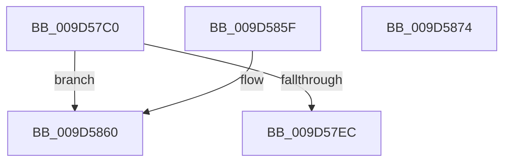

# ExpWnfCheckCallerAccess

- RVA: `0x009D57C0`–`0x009D5875` (길이 `181` bytes)
- VA: `0x00000001409D57C0`
- 실행 섹션: `PAGE`
- PDB 이름 있음: `예`; PDB Function 태그: `아니요`
- unwind 정보 RVA: `0x000A1DBC`
- 디코드: `49`개 명령, `181/181` bytes 표시
- 미해석 바이트: `0` (있으면 어셈블리에 `.byte`로 보존)

> 이 문서는 커널 이미지의 기계어와 PDB 기호를 분석해 생성했습니다. 4번과 5번은 함수 원형과 자료형을 바이너리 사용 방식에서 추정한 C 해석이며 원본 소스 복구 결과는 아닙니다.

## 1. Dependencies

- 직접 호출 지점: **3**; 고유 호출 대상: **3**
- 직접 호출자로 확인된 함수: **3**
- RIP 상대 이미지 참조: **1**

### Outgoing calls
- `0x009D57F0` → [SeCaptureSubjectContext](../86/SeCaptureSubjectContext_function_0086B820.md) (function, `0x0086B820`)
- `0x009D5837` → [SeAccessCheck](../../text/3A/SeAccessCheck_function_003A6BC0.md) (function, `0x003A6BC0`)
- `0x009D5841` → [SeReleaseSubjectContext](../86/SeReleaseSubjectContext_function_0086B710.md) (function, `0x0086B710`)

### Direct callers
- [ExpNtDeleteWnfStateData](../7C/ExpNtDeleteWnfStateData_function_007CF1A8.md) at `0x007CF3DF`
- [ExpNtDeleteWnfStateData](../7C/ExpNtDeleteWnfStateData_function_007CF1A8.md) at `0x007CF439`
- [ExpWnfSubscribeWnfStateChange](ExpWnfSubscribeWnfStateChange_function_009D4D0C.md) at `0x009D4F82`
- [ExpWnfSubscribeWnfStateChange](ExpWnfSubscribeWnfStateChange_function_009D4D0C.md) at `0x009D50AE`
- [NtQueryWnfStateNameInformation](../9E/NtQueryWnfStateNameInformation_function_009EBD20.md) at `0x009EBF7C`

### Static image references
- `0x009D5822` → RVA `0x00B4B070` (`ExpWnfNotificationMapping`; read)

## 2. Other-region calls and transfers

- 다른 실행 섹션으로 향하는 call: **1**
  - `0x009D5837` → [SeAccessCheck](../../text/3A/SeAccessCheck_function_003A6BC0.md) (`PAGE` → `.text`)
- 별도 외부 분기/꼬리 이동을 확인하지 못했습니다.

## 3. Assembly (complete function range)

```asm
009D57C0  48 8B C4                        mov rax, rsp
009D57C3  48 89 58 08                     mov qword ptr [rax + 8], rbx
009D57C7  48 89 70 20                     mov qword ptr [rax + 0x20], rsi
009D57CB  57                              push rdi
009D57CC  48 83 EC 70                     sub rsp, 0x70
009D57D0  33 F6                           xor esi, esi
009D57D2  0F 57 C0                        xorps xmm0, xmm0
009D57D5  89 70 18                        mov dword ptr [rax + 0x18], esi
009D57D8  8B DA                           mov ebx, edx
009D57DA  89 70 10                        mov dword ptr [rax + 0x10], esi
009D57DD  48 8B F9                        mov rdi, rcx
009D57E0  0F 11 40 D8                     movups xmmword ptr [rax - 0x28], xmm0
009D57E4  0F 11 40 E8                     movups xmmword ptr [rax - 0x18], xmm0
009D57E8  85 D2                           test edx, edx
009D57EA  74 74                           je 0x1409d5860
009D57EC  48 8D 48 D8                     lea rcx, [rax - 0x28]
009D57F0  E8 2B 60 E9 FF                  call 0x14086b820
009D57F5  48 8D 84 24 88 00 00 00         lea rax, [rsp + 0x88]
009D57FD  44 8B CB                        mov r9d, ebx
009D5800  48 89 44 24 48                  mov qword ptr [rsp + 0x48], rax
009D5805  48 8D 54 24 50                  lea rdx, [rsp + 0x50]
009D580A  48 8D 84 24 90 00 00 00         lea rax, [rsp + 0x90]
009D5812  45 33 C0                        xor r8d, r8d
009D5815  48 89 44 24 40                  mov qword ptr [rsp + 0x40], rax
009D581A  48 8B CF                        mov rcx, rdi
009D581D  C6 44 24 38 01                  mov byte ptr [rsp + 0x38], 1
009D5822  48 8D 05 47 58 17 00            lea rax, [rip + 0x175847]
009D5829  48 89 44 24 30                  mov qword ptr [rsp + 0x30], rax
009D582E  48 89 74 24 28                  mov qword ptr [rsp + 0x28], rsi
009D5833  89 74 24 20                     mov dword ptr [rsp + 0x20], esi
009D5837  E8 84 13 9D FF                  call 0x1403a6bc0
009D583C  48 8D 4C 24 50                  lea rcx, [rsp + 0x50]
009D5841  E8 CA 5E E9 FF                  call 0x14086b710
009D5846  8B 84 24 88 00 00 00            mov eax, dword ptr [rsp + 0x88]
009D584D  4C 8D 5C 24 70                  lea r11, [rsp + 0x70]
009D5852  49 8B 5B 10                     mov rbx, qword ptr [r11 + 0x10]
009D5856  49 8B 73 28                     mov rsi, qword ptr [r11 + 0x28]
009D585A  49 8B E3                        mov rsp, r11
009D585D  5F                              pop rdi
009D585E  C3                              ret
009D585F  CC                              int3
009D5860  4C 8D 5C 24 70                  lea r11, [rsp + 0x70]
009D5865  33 C0                           xor eax, eax
009D5867  49 8B 5B 10                     mov rbx, qword ptr [r11 + 0x10]
009D586B  49 8B 73 28                     mov rsi, qword ptr [r11 + 0x28]
009D586F  49 8B E3                        mov rsp, r11
009D5872  5F                              pop rdi
009D5873  C3                              ret
009D5874  CC                              int3
```

## 4. C-style interpretation (structured pseudocode)

```c
__int64 __fastcall ExpWnfCheckCallerAccess(__int64 a1, int a2, int a3)
{
    __int64 result;
    __int64 v_rsi;
    __int64 v_rsp;
    unsigned __int64 v_stack_m28;
    unsigned __int64 v_stack_m30;
    unsigned __int64 v_stack_m38;
    unsigned __int8 v_stack_m40;
    unsigned __int64 v_stack_m48;
    unsigned __int64 v_stack_m50;
    unsigned int v_stack_m58;
    unsigned __int64 v_stack_m8;
    unsigned __int64 v_stack_p0;
    unsigned __int64 v_stack_p10;
    unsigned __int64 v_stack_p18;

    *(unsigned __int64 *)(v_rsp + 8) = v_rbx;
    *(unsigned __int64 *)(v_rsp + 32) = v_rsi;
    v_rsp = (v_rsp) - (112);
    v_rsi = 0;
    *(unsigned int *)(v_rsp + 24) = 0;
    *(unsigned int *)(v_rsp + 16) = 0;
    *(unsigned __int64 *)(v_rsp - 40) = v_xmm0;
    *(unsigned __int64 *)(v_rsp - 24) = v_xmm0;
    if (a2 == 0) goto loc_009D5860;
    result = SeCaptureSubjectContext(v_rsp - 40, a2, a3, a4);
    v_stack_m30 = v_stack_p10;
    a3 = 0;
    v_stack_m38 = v_stack_p18;
    v_stack_m40 = 1;
    v_stack_m48 = v_rip + 1529927;
    v_stack_m50 = 0;
    v_stack_m58 = 0;
    result = SeAccessCheck(a1, v_stack_m28, a3, (unsigned int)((unsigned int)((unsigned int)(a2))));
    result = SeReleaseSubjectContext(v_stack_m28, v_stack_m28, a3, (unsigned int)((unsigned int)((unsigned int)(a2))));
    return (unsigned int)(v_stack_p10);
loc_009D5860:
    result = 0;
    return result;
}
```

## 5. (Beta) C Style

```c
int64_t ExpWnfCheckCallerAccess(int64_t Arg1, int32_t Arg2, int32_t Arg3)
{
    int64_t result;
    int64_t local_rsi;
    int64_t local_rsp;
    uint64_t v_stack_m28;
    uint64_t v_stack_m30;
    uint64_t v_stack_m38;
    uint8_t v_stack_m40;
    uint64_t v_stack_m48;
    uint64_t v_stack_m50;
    uint32_t v_stack_m58;
    uint64_t v_stack_m8;
    uint64_t v_stack_p0;
    uint64_t v_stack_p10;
    uint64_t v_stack_p18;

    *(uint64_t *)(local_rsp + 0x8) = local_rbx;
    *(uint64_t *)(local_rsp + 0x20) = local_rsi;
    local_rsp = (local_rsp) - (112);
    local_rsi = 0;
    *(uint32_t *)(local_rsp + 0x18) = 0;
    *(uint32_t *)(local_rsp + 0x10) = 0;
    *(uint64_t *)(local_rsp - 0x28) = v_xmm0;
    *(uint64_t *)(local_rsp - 0x18) = v_xmm0;
    if (Arg2 == 0) goto loc_009D5860;
    result = SeCaptureSubjectContext(local_rsp - 40, Arg2, Arg3, a4);
    v_stack_m30 = v_stack_p10;
    Arg3 = 0;
    v_stack_m38 = v_stack_p18;
    v_stack_m40 = 1;
    v_stack_m48 = v_rip + 1529927;
    v_stack_m50 = 0;
    v_stack_m58 = 0;
    result = SeAccessCheck(Arg1, v_stack_m28, Arg3, (uint32_t)((uint32_t)((uint32_t)(Arg2))));
    result = SeReleaseSubjectContext(v_stack_m28, v_stack_m28, Arg3, (uint32_t)((uint32_t)((uint32_t)(Arg2))));
    return (uint32_t)(v_stack_p10);
loc_009D5860:
    result = 0;
    return result;
}
```

## 6. Execution-region graph

[열기: 2D/3D 그래프와 함수 탐색 컨트롤 패널](../../../control-panel.html?section=page&rva=0x009D57C0&view=graph)

- 2D 그래프는 위에서 아래로 흐르고, 3D 그래프는 빈 공간을 드래그해 회전합니다. Shift+드래그는 이동, 휠은 확대·축소, 함수 노드 선택은 대상 보고서 이동입니다.

### Static fallback


