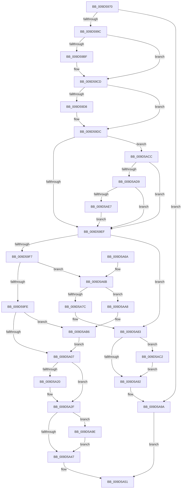

# ExpWnfInsertSubscriptionInPendingQueue

- RVA: `0x009D5970`–`0x009D5AEF` (길이 `383` bytes)
- VA: `0x00000001409D5970`
- 실행 섹션: `PAGE`
- PDB 이름 있음: `예`; PDB Function 태그: `아니요`
- unwind 정보 RVA: `0x0007A230`
- 디코드: `109`개 명령, `383/383` bytes 표시
- 미해석 바이트: `0` (있으면 어셈블리에 `.byte`로 보존)

> 이 문서는 커널 이미지의 기계어와 PDB 기호를 분석해 생성했습니다. 4번과 5번은 함수 원형과 자료형을 바이너리 사용 방식에서 추정한 C 해석이며 원본 소스 복구 결과는 아닙니다.

## 1. Dependencies

- 직접 호출 지점: **6**; 고유 호출 대상: **4**
- 직접 호출자로 확인된 함수: **1**
- RIP 상대 이미지 참조: **0**

### Outgoing calls
- `0x009D59AF` → [KeAbPreAcquire](../../text/21/KeAbPreAcquire_function_00210230.md) (function, `0x00210230`)
- `0x009D59C8` → [ExfAcquirePushLockExclusiveEx](../../text/20/ExfAcquirePushLockExclusiveEx_function_0020FC90.md) (function, `0x0020FC90`)
- `0x009D5A4A` → [KeAbPostRelease](../../text/2E/KeAbPostRelease_function_002E1600.md) (function, `0x002E1600`)
- `0x009D5A95` → [KeAbPostRelease](../../text/2E/KeAbPostRelease_function_002E1600.md) (function, `0x002E1600`)
- `0x009D5AA1` → [ExfTryToWakePushLock](../../text/26/ExfTryToWakePushLock_function_00265DD0.md) (function, `0x00265DD0`)
- `0x009D5AC5` → [ExfTryToWakePushLock](../../text/26/ExfTryToWakePushLock_function_00265DD0.md) (function, `0x00265DD0`)

### Direct callers
- [ExpWnfNotifySubscription](ExpWnfNotifySubscription_function_009D587C.md) at `0x009D58EE`

### Static image references
- 디코드된 RIP-relative 메모리 참조가 없습니다.

## 2. Other-region calls and transfers

- 다른 실행 섹션으로 향하는 call: **6**
  - `0x009D59AF` → [KeAbPreAcquire](../../text/21/KeAbPreAcquire_function_00210230.md) (`PAGE` → `.text`)
  - `0x009D59C8` → [ExfAcquirePushLockExclusiveEx](../../text/20/ExfAcquirePushLockExclusiveEx_function_0020FC90.md) (`PAGE` → `.text`)
  - `0x009D5A4A` → [KeAbPostRelease](../../text/2E/KeAbPostRelease_function_002E1600.md) (`PAGE` → `.text`)
  - `0x009D5A95` → [KeAbPostRelease](../../text/2E/KeAbPostRelease_function_002E1600.md) (`PAGE` → `.text`)
  - `0x009D5AA1` → [ExfTryToWakePushLock](../../text/26/ExfTryToWakePushLock_function_00265DD0.md) (`PAGE` → `.text`)
  - `0x009D5AC5` → [ExfTryToWakePushLock](../../text/26/ExfTryToWakePushLock_function_00265DD0.md) (`PAGE` → `.text`)
- 별도 외부 분기/꼬리 이동을 확인하지 못했습니다.

## 3. Assembly (complete function range)

```asm
009D5970  48 89 5C 24 08                  mov qword ptr [rsp + 8], rbx
009D5975  48 89 6C 24 10                  mov qword ptr [rsp + 0x10], rbp
009D597A  48 89 74 24 18                  mov qword ptr [rsp + 0x18], rsi
009D597F  57                              push rdi
009D5980  41 56                           push r14
009D5982  41 57                           push r15
009D5984  48 83 EC 20                     sub rsp, 0x20
009D5988  48 8B 41 28                     mov rax, qword ptr [rcx + 0x28]
009D598C  33 FF                           xor edi, edi
009D598E  8B EA                           mov ebp, edx
009D5990  48 8B F1                        mov rsi, rcx
009D5993  48 85 C0                        test rax, rax
009D5996  0F 84 FE 00 00 00               je 0x1409d5a9a
009D599C  4C 8B B8 E8 05 00 00            mov r15, qword ptr [rax + 0x5e8]
009D59A3  45 33 C0                        xor r8d, r8d
009D59A6  33 D2                           xor edx, edx
009D59A8  49 8D 5F 68                     lea rbx, [r15 + 0x68]
009D59AC  48 8B CB                        mov rcx, rbx
009D59AF  E8 7C A8 83 FF                  call 0x140210230
009D59B4  F0 48 0F BA 2B 00               lock bts qword ptr [rbx], 0
009D59BA  4C 8B F0                        mov r14, rax
009D59BD  73 0E                           jae 0x1409d59cd
009D59BF  4C 8B C3                        mov r8, rbx
009D59C2  48 8B D0                        mov rdx, rax
009D59C5  48 8B CB                        mov rcx, rbx
009D59C8  E8 C3 A2 83 FF                  call 0x14020fc90
009D59CD  41 B8 01 00 00 00               mov r8d, 1
009D59D3  4D 85 F6                        test r14, r14
009D59D6  74 04                           je 0x1409d59dc
009D59D8  45 88 46 0A                     mov byte ptr [r14 + 0xa], r8b
009D59DC  23 6E 64                        and ebp, dword ptr [rsi + 0x64]
009D59DF  41 B9 F7 FF FF FF               mov r9d, 0xfffffff7
009D59E5  40 F6 C5 08                     test bpl, 8
009D59E9  0F 85 DD 00 00 00               jne 0x1409d5acc
009D59EF  85 ED                           test ebp, ebp
009D59F1  0F 84 8C 00 00 00               je 0x1409d5a83
009D59F7  8B 46 78                        mov eax, dword ptr [rsi + 0x78]
009D59FA  85 C0                           test eax, eax
009D59FC  74 6D                           je 0x1409d5a6b
009D59FE  83 F8 03                        cmp eax, 3
009D5A01  0F 84 AF 00 00 00               je 0x1409d5ab6
009D5A07  8B 8E 80 00 00 00               mov ecx, dword ptr [rsi + 0x80]
009D5A0D  0B 4E 7C                        or ecx, dword ptr [rsi + 0x7c]
009D5A10  41 84 C8                        test r8b, cl
009D5A13  0F 94 C1                        sete cl
009D5A16  41 84 E8                        test r8b, bpl
009D5A19  0F 95 C0                        setne al
009D5A1C  84 C8                           test al, cl
009D5A1E  74 0F                           je 0x1409d5a2f
009D5A20  48 8B 46 30                     mov rax, qword ptr [rsi + 0x30]
009D5A24  F0 44 01 80 A4 00 00 00         lock add dword ptr [rax + 0xa4], r8d
009D5A2C  41 23 E9                        and ebp, r9d
009D5A2F  0B 6E 7C                        or ebp, dword ptr [rsi + 0x7c]
009D5A32  23 6E 64                        and ebp, dword ptr [rsi + 0x64]
009D5A35  89 6E 7C                        mov dword ptr [rsi + 0x7c], ebp
009D5A38  48 83 C8 FF                     or rax, 0xffffffffffffffff
009D5A3C  F0 48 0F C1 03                  lock xadd qword ptr [rbx], rax
009D5A41  24 06                           and al, 6
009D5A43  3C 02                           cmp al, 2
009D5A45  74 57                           je 0x1409d5a9e
009D5A47  48 8B CB                        mov rcx, rbx
009D5A4A  E8 B1 BB 90 FF                  call 0x1402e1600
009D5A4F  8B C7                           mov eax, edi
009D5A51  48 8B 5C 24 40                  mov rbx, qword ptr [rsp + 0x40]
009D5A56  48 8B 6C 24 48                  mov rbp, qword ptr [rsp + 0x48]
009D5A5B  48 8B 74 24 50                  mov rsi, qword ptr [rsp + 0x50]
009D5A60  48 83 C4 20                     add rsp, 0x20
009D5A64  41 5F                           pop r15
009D5A66  41 5E                           pop r14
009D5A68  5F                              pop rdi
009D5A69  C3                              ret
009D5A6A  CC                              int3
009D5A6B  49 8D 4F 70                     lea rcx, [r15 + 0x70]
009D5A6F  48 8B 51 08                     mov rdx, qword ptr [rcx + 8]
009D5A73  48 8D 46 68                     lea rax, [rsi + 0x68]
009D5A77  48 39 0A                        cmp qword ptr [rdx], rcx
009D5A7A  74 2C                           je 0x1409d5aa8
009D5A7C  B9 03 00 00 00                  mov ecx, 3
009D5A81  CD 29                           int 0x29
009D5A83  48 83 C8 FF                     or rax, 0xffffffffffffffff
009D5A87  F0 48 0F C1 03                  lock xadd qword ptr [rbx], rax
009D5A8C  24 06                           and al, 6
009D5A8E  3C 02                           cmp al, 2
009D5A90  74 30                           je 0x1409d5ac2
009D5A92  48 8B CB                        mov rcx, rbx
009D5A95  E8 66 BB 90 FF                  call 0x1402e1600
009D5A9A  33 C0                           xor eax, eax
009D5A9C  EB B3                           jmp 0x1409d5a51
009D5A9E  48 8B CB                        mov rcx, rbx
009D5AA1  E8 2A 03 89 FF                  call 0x140265dd0
009D5AA6  EB 9F                           jmp 0x1409d5a47
009D5AA8  48 89 08                        mov qword ptr [rax], rcx
009D5AAB  48 89 50 08                     mov qword ptr [rax + 8], rdx
009D5AAF  48 89 02                        mov qword ptr [rdx], rax
009D5AB2  48 89 41 08                     mov qword ptr [rcx + 8], rax
009D5AB6  41 8B F8                        mov edi, r8d
009D5AB9  44 89 46 78                     mov dword ptr [rsi + 0x78], r8d
009D5ABD  E9 45 FF FF FF                  jmp 0x1409d5a07
009D5AC2  48 8B CB                        mov rcx, rbx
009D5AC5  E8 06 03 89 FF                  call 0x140265dd0
009D5ACA  EB C6                           jmp 0x1409d5a92
009D5ACC  48 8B 46 30                     mov rax, qword ptr [rsi + 0x30]
009D5AD0  48 85 C0                        test rax, rax
009D5AD3  0F 84 16 FF FF FF               je 0x1409d59ef
009D5AD9  8B 80 A4 00 00 00               mov eax, dword ptr [rax + 0xa4]
009D5ADF  85 C0                           test eax, eax
009D5AE1  0F 84 08 FF FF FF               je 0x1409d59ef
009D5AE7  41 23 E9                        and ebp, r9d
009D5AEA  E9 00 FF FF FF                  jmp 0x1409d59ef
```

## 4. C-style interpretation (structured pseudocode)

```c
__int64 __fastcall ExpWnfInsertSubscriptionInPendingQueue(__int64 a1, int a2, int a3)
{
    __int64 result;
    __int64 v_rbp;
    __int64 v_rdi;
    __int64 v_rsp;
    unsigned __int64 v_stack_p10;
    unsigned __int64 v_stack_p18;
    unsigned __int64 v_stack_p8;

    v_stack_p8 = v_rbx;
    v_stack_p10 = v_rbp;
    v_stack_p18 = v_rsi;
    v_rsp = (v_rsp) - (32);
    v_rdi = 0;
    if (*(unsigned __int64 *)(a1 + 40) == 0) goto loc_009D5A9A;
    a3 = 0;
    a2 = 0;
    result = KeAbPreAcquire(*(unsigned __int64 *)(*(unsigned __int64 *)(a1 + 40) + 1512) + 104, a2, a3, a4);
    if (!(condition_is_above_or_equal)) {
        a3 = *(unsigned __int64 *)(*(unsigned __int64 *)(a1 + 40) + 1512) + 104;
        a2 = result;
        a1 = *(unsigned __int64 *)(*(unsigned __int64 *)(a1 + 40) + 1512) + 104;
        result = ExfAcquirePushLockExclusiveEx(a1, a2, a3, a4);
    }
    if (result != 0) {
        *(unsigned __int8 *)(result + 10) = 1;
    }
    v_rbp = (unsigned int)(((unsigned int)(a2)) & (*(unsigned int *)(a1 + 100)));
    if ((((unsigned __int8)(v_rbp)) & (8)) != 0) goto loc_009D5ACC;
loc_009D59EF:
    if ((unsigned int)(v_rbp) == 0) goto loc_009D5A83;
    if ((unsigned int)((unsigned int)(*(unsigned int *)(a1 + 120))) == 0) goto loc_009D5A6B;
    if (((unsigned int)((unsigned int)(*(unsigned int *)(a1 + 120)))) == 3) goto loc_009D5AB6;
loc_009D5A07:
    a1 = (unsigned int)(((unsigned int)(*(unsigned int *)(a1 + 128))) | (*(unsigned int *)(a1 + 124)));
    a1 = (((1) & ((unsigned __int8)(a1))) == 0) ? 1 : 0;
    result = (((1) & ((unsigned __int8)(v_rbp))) != 0) ? 1 : 0;
    if ((((unsigned __int8)(result)) & ((unsigned __int8)(a1))) != 0) {
        result = *(unsigned __int64 *)(a1 + 48);
        v_rbp = (unsigned int)((v_rbp) & ((unsigned int)((unsigned int)(0xFFFFFFF7ULL))));
    }
    v_rbp = (unsigned int)((v_rbp) | (*(unsigned int *)(a1 + 124)));
    v_rbp = (unsigned int)((v_rbp) & (*(unsigned int *)(a1 + 100)));
    *(unsigned int *)(a1 + 124) = (unsigned int)(v_rbp);
    result = (result) | (-1);
    result = (unsigned __int8)((result) & (6));
    if (((unsigned __int8)(result)) == 2) goto loc_009D5A9E;
loc_009D5A47:
    result = KeAbPostRelease(*(unsigned __int64 *)(*(unsigned __int64 *)(a1 + 40) + 1512) + 104, a2, 1, (unsigned int)(0xFFFFFFF7ULL));
loc_009D5A51:
    v_rsp = (v_rsp) + (32);
    return 0;
loc_009D5A6B:
    if ((*(unsigned __int64 *)(*(unsigned __int64 *)(*(unsigned __int64 *)(*(unsigned __int64 *)(a1 + 40) + 1512) + 112 + 8))) == (*(unsigned __int64 *)(*(unsigned __int64 *)(a1 + 40) + 1512) + 112)) goto loc_009D5AA8;
loc_009D5A83:
    result = (v_stack_p18 + 104) | (-1);
    result = (unsigned __int8)((result) & (6));
    if (((unsigned __int8)(result)) == 2) goto loc_009D5AC2;
loc_009D5A92:
    result = KeAbPostRelease(v_stack_p8, *(unsigned __int64 *)(*(unsigned __int64 *)(*(unsigned __int64 *)(a1 + 40) + 1512) + 112 + 8), 1, (unsigned int)(0xFFFFFFF7ULL));
loc_009D5A9A:
    result = 0;
    goto loc_009D5A51;
loc_009D5A9E:
    result = ExfTryToWakePushLock(v_stack_p8, *(unsigned __int64 *)(*(unsigned __int64 *)(*(unsigned __int64 *)(a1 + 40) + 1512) + 112 + 8), 1, (unsigned int)(0xFFFFFFF7ULL));
    goto loc_009D5A47;
loc_009D5AA8:
    *(unsigned __int64 *)(result) = v_stack_p8;
    *(unsigned __int64 *)(result + 8) = *(unsigned __int64 *)(*(unsigned __int64 *)(*(unsigned __int64 *)(a1 + 40) + 1512) + 112 + 8);
    *(unsigned __int64 *)(*(unsigned __int64 *)(*(unsigned __int64 *)(*(unsigned __int64 *)(a1 + 40) + 1512) + 112 + 8)) = result;
    *(unsigned __int64 *)(v_stack_p8 + 8) = result;
loc_009D5AB6:
    *(unsigned int *)(v_stack_p18 + 120) = 1;
    goto loc_009D5A07;
loc_009D5AC2:
    result = ExfTryToWakePushLock(v_stack_p8, *(unsigned __int64 *)(*(unsigned __int64 *)(*(unsigned __int64 *)(a1 + 40) + 1512) + 112 + 8), 1, (unsigned int)(0xFFFFFFF7ULL));
    goto loc_009D5A92;
loc_009D5ACC:
    if (*(unsigned __int64 *)(v_stack_p18 + 48) == 0) goto loc_009D59EF;
    if ((unsigned int)((unsigned int)(*(unsigned int *)(*(unsigned __int64 *)(v_stack_p18 + 48) + 164))) == 0) goto loc_009D59EF;
    v_rbp = (unsigned int)((v_stack_p10) & ((unsigned int)((unsigned int)(0xFFFFFFF7ULL))));
    goto loc_009D59EF;
}
```

## 5. (Beta) C Style

```c
int64_t ExpWnfInsertSubscriptionInPendingQueue(void *Arg1, int32_t Arg2, int32_t Arg3)
{
    uint8_t *arg1 = (uint8_t *)Arg1;

    int64_t result;
    int64_t local_rbp;
    int64_t local_rdi;
    int64_t local_rsp;
    uint64_t v_stack_p10;
    uint64_t v_stack_p18;
    uint64_t v_stack_p8;

    v_stack_p8 = local_rbx;
    v_stack_p10 = local_rbp;
    v_stack_p18 = local_rsi;
    local_rsp = (local_rsp) - (32);
    local_rdi = 0;
    if (*(uint64_t *)(arg1 + 0x28) == 0) goto loc_009D5A9A;
    Arg3 = 0;
    Arg2 = 0;
    result = KeAbPreAcquire(*(uint64_t *)(*(uint64_t *)(arg1 + 0x28) + 0x5E8) + 104, Arg2, Arg3, a4);
    if (!(condition_is_above_or_equal)) {
        Arg3 = *(uint64_t *)(*(uint64_t *)(arg1 + 0x28) + 0x5E8) + 104;
        Arg2 = result;
        Arg1 = *(uint64_t *)(*(uint64_t *)(arg1 + 0x28) + 0x5E8) + 104;
        result = ExfAcquirePushLockExclusiveEx(Arg1, Arg2, Arg3, a4);
    }
    if (result != 0) {
        *(uint8_t *)(result + 0xA) = 1;
    }
    local_rbp = (uint32_t)(((uint32_t)(Arg2)) & (*(uint32_t *)(arg1 + 0x64)));
    if ((((uint8_t)(local_rbp)) & (8)) != 0) goto loc_009D5ACC;
loc_009D59EF:
    if ((uint32_t)(local_rbp) == 0) goto loc_009D5A83;
    if ((uint32_t)((uint32_t)(*(uint32_t *)(arg1 + 0x78))) == 0) goto loc_009D5A6B;
    if (((uint32_t)((uint32_t)(*(uint32_t *)(arg1 + 0x78)))) == 3) goto loc_009D5AB6;
loc_009D5A07:
    Arg1 = (uint32_t)(((uint32_t)(*(uint32_t *)(arg1 + 0x80))) | (*(uint32_t *)(arg1 + 0x7C)));
    Arg1 = (((1) & ((uint8_t)(Arg1))) == 0) ? 1 : 0;
    result = (((1) & ((uint8_t)(local_rbp))) != 0) ? 1 : 0;
    if ((((uint8_t)(result)) & ((uint8_t)(Arg1))) != 0) {
        result = *(uint64_t *)(arg1 + 0x30);
        local_rbp = (uint32_t)((local_rbp) & ((uint32_t)((uint32_t)(0xFFFFFFF7ULL))));
    }
    local_rbp = (uint32_t)((local_rbp) | (*(uint32_t *)(arg1 + 0x7C)));
    local_rbp = (uint32_t)((local_rbp) & (*(uint32_t *)(arg1 + 0x64)));
    *(uint32_t *)(arg1 + 0x7C) = (uint32_t)(local_rbp);
    result = (result) | (-1);
    result = (uint8_t)((result) & (6));
    if (((uint8_t)(result)) == 2) goto loc_009D5A9E;
loc_009D5A47:
    result = KeAbPostRelease(*(uint64_t *)(*(uint64_t *)(arg1 + 0x28) + 0x5E8) + 104, Arg2, 1, (uint32_t)(0xFFFFFFF7ULL));
loc_009D5A51:
    local_rsp = (local_rsp) + (32);
    return 0;
loc_009D5A6B:
    if ((*(uint64_t *)(*(uint64_t *)(*(uint64_t *)(*(uint64_t *)(arg1 + 0x28) + 0x5E8) + 0x70 + 0x8))) == (*(uint64_t *)(*(uint64_t *)(arg1 + 0x28) + 0x5E8) + 112)) goto loc_009D5AA8;
loc_009D5A83:
    result = (v_stack_p18 + 104) | (-1);
    result = (uint8_t)((result) & (6));
    if (((uint8_t)(result)) == 2) goto loc_009D5AC2;
loc_009D5A92:
    result = KeAbPostRelease(v_stack_p8, *(uint64_t *)(*(uint64_t *)(*(uint64_t *)(arg1 + 0x28) + 0x5E8) + 0x70 + 0x8), 1, (uint32_t)(0xFFFFFFF7ULL));
loc_009D5A9A:
    result = 0;
    goto loc_009D5A51;
loc_009D5A9E:
    result = ExfTryToWakePushLock(v_stack_p8, *(uint64_t *)(*(uint64_t *)(*(uint64_t *)(arg1 + 0x28) + 0x5E8) + 0x70 + 0x8), 1, (uint32_t)(0xFFFFFFF7ULL));
    goto loc_009D5A47;
loc_009D5AA8:
    *(uint64_t *)(result) = v_stack_p8;
    *(uint64_t *)(result + 0x8) = *(uint64_t *)(*(uint64_t *)(*(uint64_t *)(arg1 + 0x28) + 0x5E8) + 0x70 + 0x8);
    *(uint64_t *)(*(uint64_t *)(*(uint64_t *)(*(uint64_t *)(arg1 + 0x28) + 0x5E8) + 0x70 + 0x8)) = result;
    *(uint64_t *)(v_stack_p8 + 0x8) = result;
loc_009D5AB6:
    *(uint32_t *)(v_stack_p18 + 0x78) = 1;
    goto loc_009D5A07;
loc_009D5AC2:
    result = ExfTryToWakePushLock(v_stack_p8, *(uint64_t *)(*(uint64_t *)(*(uint64_t *)(arg1 + 0x28) + 0x5E8) + 0x70 + 0x8), 1, (uint32_t)(0xFFFFFFF7ULL));
    goto loc_009D5A92;
loc_009D5ACC:
    if (*(uint64_t *)(v_stack_p18 + 0x30) == 0) goto loc_009D59EF;
    if ((uint32_t)((uint32_t)(*(uint32_t *)(*(uint64_t *)(v_stack_p18 + 0x30) + 0xA4))) == 0) goto loc_009D59EF;
    local_rbp = (uint32_t)((v_stack_p10) & ((uint32_t)((uint32_t)(0xFFFFFFF7ULL))));
    goto loc_009D59EF;
}
```

### 관측된 메모리 오프셋

구조체 형식이 확인되지 않은 접근은 인자 기준의 오프셋으로만 기록했습니다.

| 기준 인자 | 오프셋 표현 | 폭 (bit) | 접근 |
|---|---:|---:|---|
| `Arg1` | `+ 0x0` | `64` | `W` |
| `Arg1` | `+ 0x8` | `64` | `W` |
| `Arg1` | `+ 0x28` | `64` | `R` |
| `Arg1` | `+ 0x30` | `64` | `R` |
| `Arg1` | `+ 0x64` | `32` | `R` |
| `Arg1` | `+ 0x68` | `64` | `R` |
| `Arg1` | `+ 0x78` | `32` | `R` |
| `Arg1` | `+ 0x78` | `32` | `W` |
| `Arg1` | `+ 0x7C` | `32` | `R` |
| `Arg1` | `+ 0x7C` | `32` | `W` |
| `Arg1` | `+ 0x80` | `32` | `R` |

## 6. Execution-region graph

[열기: 2D/3D 그래프와 함수 탐색 컨트롤 패널](../../../control-panel.html?section=page&rva=0x009D5970&view=graph)

- 2D 그래프는 위에서 아래로 흐르고, 3D 그래프는 빈 공간을 드래그해 회전합니다. Shift+드래그는 이동, 휠은 확대·축소, 함수 노드 선택은 대상 보고서 이동입니다.

### Static fallback


