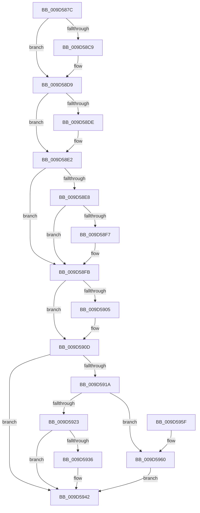

# ExpWnfNotifySubscription

- RVA: `0x009D587C`–`0x009D596A` (길이 `238` bytes)
- VA: `0x00000001409D587C`
- 실행 섹션: `PAGE`
- PDB 이름 있음: `예`; PDB Function 태그: `아니요`
- unwind 정보 RVA: `0x00088DC8`
- 디코드: `72`개 명령, `238/238` bytes 표시
- 미해석 바이트: `0` (있으면 어셈블리에 `.byte`로 보존)

> 이 문서는 커널 이미지의 기계어와 PDB 기호를 분석해 생성했습니다. 4번과 5번은 함수 원형과 자료형을 바이너리 사용 방식에서 추정한 C 해석이며 원본 소스 복구 결과는 아닙니다.

## 1. Dependencies

- 직접 호출 지점: **7**; 고유 호출 대상: **7**
- 직접 호출자로 확인된 함수: **1**
- RIP 상대 이미지 참조: **1**

### Outgoing calls
- `0x009D58B3` → [KeAbPreAcquire](../../text/21/KeAbPreAcquire_function_00210230.md) (function, `0x00210230`)
- `0x009D58D4` → [ExfAcquirePushLockSharedEx](../../text/21/ExfAcquirePushLockSharedEx_function_0021044C.md) (function, `0x0021044C`)
- `0x009D58EE` → [ExpWnfInsertSubscriptionInPendingQueue](ExpWnfInsertSubscriptionInPendingQueue_function_009D5970.md) (function, `0x009D5970`)
- `0x009D5908` → [ExfReleasePushLockShared](../../text/26/ExfReleasePushLockShared_function_00263440.md) (function, `0x00263440`)
- `0x009D5910` → [KeAbPostRelease](../../text/2E/KeAbPostRelease_function_002E1600.md) (function, `0x002E1600`)
- `0x009D593D` → [KeSetEvent](../../text/33/KeSetEvent_function_0033F310.md) (function, `0x0033F310`)
- `0x009D5963` → [ExpWnfStartKernelDispatcher](ExpWnfStartKernelDispatcher_function_009D5AF8.md) (function, `0x009D5AF8`)

### Direct callers
- [ExpWnfSubscribeWnfStateChange](ExpWnfSubscribeWnfStateChange_function_009D4D0C.md) at `0x009D5065`

### Static image references
- `0x009D591A` → RVA `0x00FC6AB0` (`ALMOSTRO`; read)

## 2. Other-region calls and transfers

- 다른 실행 섹션으로 향하는 call: **5**
  - `0x009D58B3` → [KeAbPreAcquire](../../text/21/KeAbPreAcquire_function_00210230.md) (`PAGE` → `.text`)
  - `0x009D58D4` → [ExfAcquirePushLockSharedEx](../../text/21/ExfAcquirePushLockSharedEx_function_0021044C.md) (`PAGE` → `.text`)
  - `0x009D5908` → [ExfReleasePushLockShared](../../text/26/ExfReleasePushLockShared_function_00263440.md) (`PAGE` → `.text`)
  - `0x009D5910` → [KeAbPostRelease](../../text/2E/KeAbPostRelease_function_002E1600.md) (`PAGE` → `.text`)
  - `0x009D593D` → [KeSetEvent](../../text/33/KeSetEvent_function_0033F310.md) (`PAGE` → `.text`)
- 별도 외부 분기/꼬리 이동을 확인하지 못했습니다.

## 3. Assembly (complete function range)

```asm
009D587C  48 89 5C 24 10                  mov qword ptr [rsp + 0x10], rbx
009D5881  48 89 6C 24 18                  mov qword ptr [rsp + 0x18], rbp
009D5886  48 89 74 24 20                  mov qword ptr [rsp + 0x20], rsi
009D588B  57                              push rdi
009D588C  41 54                           push r12
009D588E  41 55                           push r13
009D5890  41 56                           push r14
009D5892  41 57                           push r15
009D5894  48 83 EC 20                     sub rsp, 0x20
009D5898  48 8D 59 70                     lea rbx, [rcx + 0x70]
009D589C  45 8B F8                        mov r15d, r8d
009D589F  48 8B F2                        mov rsi, rdx
009D58A2  45 33 E4                        xor r12d, r12d
009D58A5  48 8B CB                        mov rcx, rbx
009D58A8  45 33 C0                        xor r8d, r8d
009D58AB  33 D2                           xor edx, edx
009D58AD  45 8B F1                        mov r14d, r9d
009D58B0  41 8B FC                        mov edi, r12d
009D58B3  E8 78 A9 83 FF                  call 0x140210230
009D58B8  48 8B E8                        mov rbp, rax
009D58BB  45 8D 6C 24 11                  lea r13d, [r12 + 0x11]
009D58C0  33 C0                           xor eax, eax
009D58C2  F0 4C 0F B1 2B                  lock cmpxchg qword ptr [rbx], r13
009D58C7  74 10                           je 0x1409d58d9
009D58C9  4C 8B CB                        mov r9, rbx
009D58CC  4C 8B C5                        mov r8, rbp
009D58CF  33 D2                           xor edx, edx
009D58D1  48 8B CB                        mov rcx, rbx
009D58D4  E8 73 AB 83 FF                  call 0x14021044c
009D58D9  48 85 ED                        test rbp, rbp
009D58DC  74 04                           je 0x1409d58e2
009D58DE  C6 45 0A 01                     mov byte ptr [rbp + 0xa], 1
009D58E2  4C 39 66 30                     cmp qword ptr [rsi + 0x30], r12
009D58E6  74 13                           je 0x1409d58fb
009D58E8  41 8B D7                        mov edx, r15d
009D58EB  48 8B CE                        mov rcx, rsi
009D58EE  E8 7D 00 00 00                  call 0x1409d5970
009D58F3  85 C0                           test eax, eax
009D58F5  74 04                           je 0x1409d58fb
009D58F7  48 8B 7E 28                     mov rdi, qword ptr [rsi + 0x28]
009D58FB  49 8B C5                        mov rax, r13
009D58FE  F0 4C 0F B1 23                  lock cmpxchg qword ptr [rbx], r12
009D5903  74 08                           je 0x1409d590d
009D5905  48 8B CB                        mov rcx, rbx
009D5908  E8 33 DB 88 FF                  call 0x140263440
009D590D  48 8B CB                        mov rcx, rbx
009D5910  E8 EB BC 90 FF                  call 0x1402e1600
009D5915  48 85 FF                        test rdi, rdi
009D5918  74 28                           je 0x1409d5942
009D591A  48 39 3D 8F 11 5F 00            cmp qword ptr [rip + 0x5f118f], rdi
009D5921  74 3D                           je 0x1409d5960
009D5923  48 8B 87 E8 05 00 00            mov rax, qword ptr [rdi + 0x5e8]
009D592A  48 8B 88 80 00 00 00            mov rcx, qword ptr [rax + 0x80]
009D5931  48 85 C9                        test rcx, rcx
009D5934  74 0C                           je 0x1409d5942
009D5936  45 33 C0                        xor r8d, r8d
009D5939  41 8D 50 01                     lea edx, [r8 + 1]
009D593D  E8 CE 99 96 FF                  call 0x14033f310
009D5942  48 8B 5C 24 58                  mov rbx, qword ptr [rsp + 0x58]
009D5947  48 8B 6C 24 60                  mov rbp, qword ptr [rsp + 0x60]
009D594C  48 8B 74 24 68                  mov rsi, qword ptr [rsp + 0x68]
009D5951  48 83 C4 20                     add rsp, 0x20
009D5955  41 5F                           pop r15
009D5957  41 5E                           pop r14
009D5959  41 5D                           pop r13
009D595B  41 5C                           pop r12
009D595D  5F                              pop rdi
009D595E  C3                              ret
009D595F  CC                              int3
009D5960  41 8B CE                        mov ecx, r14d
009D5963  E8 90 01 00 00                  call 0x1409d5af8
009D5968  EB D8                           jmp 0x1409d5942
```

## 4. C-style interpretation (structured pseudocode)

```c
__int64 __fastcall ExpWnfNotifySubscription(__int64 a1, __int64 a2, int a3, int a4)
{
    __int64 result;
    __int64 v_r12;
    __int64 v_rdi;
    __int64 v_rsp;
    unsigned __int64 v_stack_p10;
    unsigned __int64 v_stack_p18;
    unsigned __int64 v_stack_p20;

    v_stack_p10 = v_rbx;
    v_stack_p18 = v_rbp;
    v_stack_p20 = v_rsi;
    v_rsp = (v_rsp) - (32);
    v_r12 = 0;
    a3 = 0;
    a2 = 0;
    result = KeAbPreAcquire(a1 + 112, a2, a3, a4);
    result = 0;
    if (!(condition_is_equal)) {
        a4 = a1 + 112;
        a3 = 0;
        a2 = 0;
        a1 = a1 + 112;
        result = ExfAcquirePushLockSharedEx(a1, a2, a3, a4);
    }
    if (result != 0) {
        *(unsigned __int8 *)(result + 10) = 1;
    }
    if ((*(unsigned __int64 *)(a2 + 48)) == 0) goto loc_009D58FB;
    result = ExpWnfInsertSubscriptionInPendingQueue(0, (unsigned int)((unsigned int)((unsigned int)(a3))), a3, a4);
    v_rdi = 0;
    if ((unsigned int)(result) != 0) {
        v_rdi = *(unsigned __int64 *)(a2 + 40);
    }
    result = v_r12 + 17;
    if ((unsigned int)(result) != 0) {
        a1 = a1 + 112;
        result = ExfReleasePushLockShared(a1, (unsigned int)((unsigned int)((unsigned int)(a3))), a3, a4);
    }
    result = KeAbPostRelease(a1 + 112, (unsigned int)((unsigned int)((unsigned int)(a3))), a3, a4);
    if (v_rdi == 0) goto loc_009D5942;
    if ((*(unsigned __int64 *)(v_rip + 6230415)) == v_rdi) goto loc_009D5960;
    result = *(unsigned __int64 *)(v_rdi + 1512);
    if (*(unsigned __int64 *)(*(unsigned __int64 *)(v_rdi + 1512) + 128) != 0) {
        a3 = 0;
        a2 = a3 + 1;
        result = KeSetEvent(*(unsigned __int64 *)(*(unsigned __int64 *)(v_rdi + 1512) + 128), a2, a3, a4);
    }
    v_rsp = (v_rsp) + (32);
    return result;
loc_009D5960:
    result = ExpWnfStartKernelDispatcher((unsigned int)((unsigned int)((unsigned int)(a4))), a2, a3, a4);
    goto loc_009D5942;
}
```

## 5. (Beta) C Style

```c
int64_t ExpWnfNotifySubscription(void *Arg1, void *Arg2, int32_t Arg3, int32_t Arg4)
{
    uint8_t *arg1 = (uint8_t *)Arg1;
    uint8_t *arg2 = (uint8_t *)Arg2;

    int64_t result;
    int64_t local_r12;
    int64_t local_rdi;
    int64_t local_rsp;
    uint64_t v_stack_p10;
    uint64_t v_stack_p18;
    uint64_t v_stack_p20;

    v_stack_p10 = local_rbx;
    v_stack_p18 = local_rbp;
    v_stack_p20 = local_rsi;
    local_rsp = (local_rsp) - (32);
    local_r12 = 0;
    Arg3 = 0;
    Arg2 = 0;
    result = KeAbPreAcquire(Arg1 + 112, Arg2, Arg3, Arg4);
    result = 0;
    if (!(condition_is_equal)) {
        Arg4 = Arg1 + 112;
        Arg3 = 0;
        Arg2 = 0;
        Arg1 = Arg1 + 112;
        result = ExfAcquirePushLockSharedEx(Arg1, Arg2, Arg3, Arg4);
    }
    if (result != 0) {
        *(uint8_t *)(result + 0xA) = 1;
    }
    if ((*(uint64_t *)(arg2 + 0x30)) == 0) goto loc_009D58FB;
    result = ExpWnfInsertSubscriptionInPendingQueue(0, (uint32_t)((uint32_t)((uint32_t)(Arg3))), Arg3, Arg4);
    local_rdi = 0;
    if ((uint32_t)(result) != 0) {
        local_rdi = *(uint64_t *)(arg2 + 0x28);
    }
    result = local_r12 + 17;
    if ((uint32_t)(result) != 0) {
        Arg1 = Arg1 + 112;
        result = ExfReleasePushLockShared(Arg1, (uint32_t)((uint32_t)((uint32_t)(Arg3))), Arg3, Arg4);
    }
    result = KeAbPostRelease(Arg1 + 112, (uint32_t)((uint32_t)((uint32_t)(Arg3))), Arg3, Arg4);
    if (local_rdi == 0) goto loc_009D5942;
    if ((*(uint64_t *)(v_rip + 0x5F118F)) == local_rdi) goto loc_009D5960;
    result = *(uint64_t *)(local_rdi + 0x5E8);
    if (*(uint64_t *)(*(uint64_t *)(local_rdi + 0x5E8) + 0x80) != 0) {
        Arg3 = 0;
        Arg2 = Arg3 + 1;
        result = KeSetEvent(*(uint64_t *)(*(uint64_t *)(local_rdi + 0x5E8) + 0x80), Arg2, Arg3, Arg4);
    }
    local_rsp = (local_rsp) + (32);
    return result;
loc_009D5960:
    result = ExpWnfStartKernelDispatcher((uint32_t)((uint32_t)((uint32_t)(Arg4))), Arg2, Arg3, Arg4);
    goto loc_009D5942;
}
```

### 관측된 메모리 오프셋

구조체 형식이 확인되지 않은 접근은 인자 기준의 오프셋으로만 기록했습니다.

| 기준 인자 | 오프셋 표현 | 폭 (bit) | 접근 |
|---|---:|---:|---|
| `Arg1` | `+ 0x0` | `64` | `R` |
| `Arg1` | `+ 0x70` | `64` | `R` |
| `Arg2` | `+ 0x28` | `64` | `R` |
| `Arg2` | `+ 0x30` | `64` | `R` |

## 6. Execution-region graph

[열기: 2D/3D 그래프와 함수 탐색 컨트롤 패널](../../../control-panel.html?section=page&rva=0x009D587C&view=graph)

- 2D 그래프는 위에서 아래로 흐르고, 3D 그래프는 빈 공간을 드래그해 회전합니다. Shift+드래그는 이동, 휠은 확대·축소, 함수 노드 선택은 대상 보고서 이동입니다.

### Static fallback


