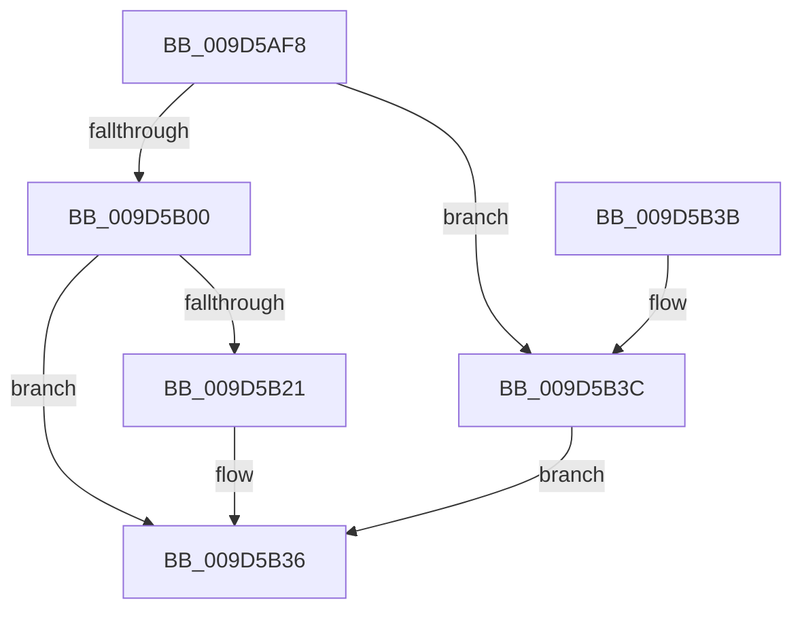

# ExpWnfStartKernelDispatcher

- RVA: `0x009D5AF8`–`0x009D5B43` (길이 `75` bytes)
- VA: `0x00000001409D5AF8`
- 실행 섹션: `PAGE`
- PDB 이름 있음: `예`; PDB Function 태그: `아니요`
- unwind 정보 RVA: `0x0005CEE8`
- 디코드: `19`개 명령, `75/75` bytes 표시
- 미해석 바이트: `0` (있으면 어셈블리에 `.byte`로 보존)

> 이 문서는 커널 이미지의 기계어와 PDB 기호를 분석해 생성했습니다. 4번과 5번은 함수 원형과 자료형을 바이너리 사용 방식에서 추정한 C 해석이며 원본 소스 복구 결과는 아닙니다.

## 1. Dependencies

- 직접 호출 지점: **2**; 고유 호출 대상: **2**
- 직접 호출자로 확인된 함수: **1**
- RIP 상대 이미지 참조: **1**

### Outgoing calls
- `0x009D5B31` → [ExQueueWorkItem](../../text/2F/ExQueueWorkItem_function_002F9520.md) (function, `0x002F9520`)
- `0x009D5B3C` → [ExpWnfDispatchKernelSubscription](../90/ExpWnfDispatchKernelSubscription_function_0090C520.md) (function, `0x0090C520`)

### Direct callers
- [ExpWnfNotifySubscription](ExpWnfNotifySubscription_function_009D587C.md) at `0x009D5963`

### Static image references
- `0x009D5B00` → RVA `0x00FD9B98` (`PAGEDATA`; read)

## 2. Other-region calls and transfers

- 다른 실행 섹션으로 향하는 call: **1**
  - `0x009D5B31` → [ExQueueWorkItem](../../text/2F/ExQueueWorkItem_function_002F9520.md) (`PAGE` → `.text`)
- 별도 외부 분기/꼬리 이동을 확인하지 못했습니다.

## 3. Assembly (complete function range)

```asm
009D5AF8  48 83 EC 28                     sub rsp, 0x28
009D5AFC  85 C9                           test ecx, ecx
009D5AFE  75 3C                           jne 0x1409d5b3c
009D5B00  48 8B 0D 91 40 60 00            mov rcx, qword ptr [rip + 0x604091]
009D5B07  B8 02 00 00 00                  mov eax, 2
009D5B0C  F0 09 41 28                     lock or dword ptr [rcx + 0x28], eax
009D5B10  48 8B 0D 81 40 60 00            mov rcx, qword ptr [rip + 0x604081]
009D5B17  8D 50 01                        lea edx, [rax + 1]
009D5B1A  F0 0F B1 51 28                  lock cmpxchg dword ptr [rcx + 0x28], edx
009D5B1F  75 15                           jne 0x1409d5b36
009D5B21  48 8B 0D 70 40 60 00            mov rcx, qword ptr [rip + 0x604070]
009D5B28  BA 01 00 00 00                  mov edx, 1
009D5B2D  48 83 C1 08                     add rcx, 8
009D5B31  E8 EA 39 92 FF                  call 0x1402f9520
009D5B36  48 83 C4 28                     add rsp, 0x28
009D5B3A  C3                              ret
009D5B3B  CC                              int3
009D5B3C  E8 DF 69 F3 FF                  call 0x14090c520
009D5B41  EB F3                           jmp 0x1409d5b36
```

## 4. C-style interpretation (structured pseudocode)

```c
__int64 __fastcall ExpWnfStartKernelDispatcher(int a1)
{
    __int64 result;
    __int64 v_rsp;

    v_rsp = (v_rsp) - (40);
    if (a1 != 0) goto loc_009D5B3C;
    result = 2;
    if (a1 == 0) {
        a1 = *(unsigned __int64 *)(v_rip + 6307952);
        a2 = 1;
        a1 = (a1) + (8);
        result = ExQueueWorkItem(a1, a2, a3, a4);
    }
    v_rsp = (v_rsp) + (40);
    return result;
loc_009D5B3C:
    result = ExpWnfDispatchKernelSubscription(a1, a2, a3, a4);
    goto loc_009D5B36;
}
```

## 5. (Beta) C Style

```c
int64_t ExpWnfStartKernelDispatcher(int32_t Arg1)
{
    int64_t result;
    int64_t local_rsp;

    local_rsp = (local_rsp) - (40);
    if (Arg1 != 0) goto loc_009D5B3C;
    result = 2;
    if (Arg1 == 0) {
        Arg1 = *(uint64_t *)(v_rip + 0x604070);
        a2 = 1;
        Arg1 = (Arg1) + (8);
        result = ExQueueWorkItem(Arg1, a2, a3, a4);
    }
    local_rsp = (local_rsp) + (40);
    return result;
loc_009D5B3C:
    result = ExpWnfDispatchKernelSubscription(Arg1, a2, a3, a4);
    goto loc_009D5B36;
}
```

## 6. Execution-region graph

[열기: 2D/3D 그래프와 함수 탐색 컨트롤 패널](../../../control-panel.html?section=page&rva=0x009D5AF8&view=graph)

- 2D 그래프는 위에서 아래로 흐르고, 3D 그래프는 빈 공간을 드래그해 회전합니다. Shift+드래그는 이동, 휠은 확대·축소, 함수 노드 선택은 대상 보고서 이동입니다.

### Static fallback


