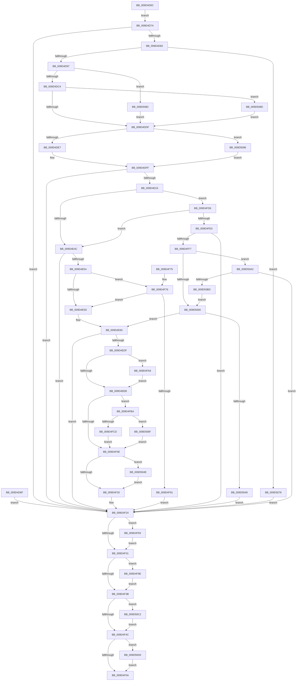

# ExpWnfSubscribeWnfStateChange

- RVA: `0x009D4D0C`–`0x009D50E2` (길이 `982` bytes)
- VA: `0x00000001409D4D0C`
- 실행 섹션: `PAGE`
- PDB 이름 있음: `예`; PDB Function 태그: `아니요`
- unwind 정보 RVA: `0x000A1C9C`
- 디코드: `220`개 명령, `982/982` bytes 표시
- 미해석 바이트: `0` (있으면 어셈블리에 `.byte`로 보존)

> 이 문서는 커널 이미지의 기계어와 PDB 기호를 분석해 생성했습니다. 4번과 5번은 함수 원형과 자료형을 바이너리 사용 방식에서 추정한 C 해석이며 원본 소스 복구 결과는 아닙니다.

## 1. Dependencies

- 직접 호출 지점: **14**; 고유 호출 대상: **10**
- 직접 호출자로 확인된 함수: **2**
- RIP 상대 이미지 참조: **1**

### Outgoing calls
- `0x009D4D62` → [ExpCaptureWnfStateName](../90/ExpCaptureWnfStateName_function_00909370.md) (function, `0x00909370`)
- `0x009D4E1B` → [ExpWnfResolveScopeInstance](../90/ExpWnfResolveScopeInstance_function_0090B280.md) (function, `0x0090B280`)
- `0x009D4E3A` → [ExpWnfLookupNameInstance](../90/ExpWnfLookupNameInstance_function_00908C70.md) (function, `0x00908C70`)
- `0x009D4ED0` → [ExpWnfSubscribeNameInstance](ExpWnfSubscribeNameInstance_function_009D50E8.md) (function, `0x009D50E8`)
- `0x009D4F82` → [ExpWnfCheckCallerAccess](ExpWnfCheckCallerAccess_function_009D57C0.md) (function, `0x009D57C0`)
- `0x009D4F97` → [ExReleaseRundownProtection](../../text/34/ExReleaseRundownProtection_function_00349E80.md) (function, `0x00349E80`)
- `0x009D4FA2` → [ExReleaseRundownProtection](../../text/34/ExReleaseRundownProtection_function_00349E80.md) (function, `0x00349E80`)
- `0x009D4FE8` → [ExpWnfLookupPermanentName](../8B/ExpWnfLookupPermanentName_function_008BD914.md) (function, `0x008BD914`)
- `0x009D5025` → [ExpWnfCreateNameInstance](../8B/ExpWnfCreateNameInstance_function_008BF590.md) (function, `0x008BF590`)
- `0x009D5036` → [ExFreePoolWithTag](../../poolcode/B8/ExFreePoolWithTag_function_00B82870.md) (function, `0x00B82870`)
- `0x009D5065` → [ExpWnfNotifySubscription](ExpWnfNotifySubscription_function_009D587C.md) (function, `0x009D587C`)
- `0x009D50AE` → [ExpWnfCheckCallerAccess](ExpWnfCheckCallerAccess_function_009D57C0.md) (function, `0x009D57C0`)
- `0x009D50C6` → [ExReleaseRundownProtection](../../text/34/ExReleaseRundownProtection_function_00349E80.md) (function, `0x00349E80`)
- `0x009D50D8` → [ExFreePoolWithTag](../../poolcode/B8/ExFreePoolWithTag_function_00B82870.md) (function, `0x00B82870`)

### Direct callers
- [ExSubscribeWnfStateChange](ExSubscribeWnfStateChange_function_009D4BC0.md) at `0x009D4BFD`
- [NtSubscribeWnfStateChange](NtSubscribeWnfStateChange_function_009D4C20.md) at `0x009D4CCB`

### Static image references
- `0x009D5096` → RVA `0x00FC6AB0` (`ALMOSTRO`; read)

## 2. Other-region calls and transfers

- 다른 실행 섹션으로 향하는 call: **5**
  - `0x009D4F97` → [ExReleaseRundownProtection](../../text/34/ExReleaseRundownProtection_function_00349E80.md) (`PAGE` → `.text`)
  - `0x009D4FA2` → [ExReleaseRundownProtection](../../text/34/ExReleaseRundownProtection_function_00349E80.md) (`PAGE` → `.text`)
  - `0x009D5036` → [ExFreePoolWithTag](../../poolcode/B8/ExFreePoolWithTag_function_00B82870.md) (`PAGE` → `POOLCODE`)
  - `0x009D50C6` → [ExReleaseRundownProtection](../../text/34/ExReleaseRundownProtection_function_00349E80.md) (`PAGE` → `.text`)
  - `0x009D50D8` → [ExFreePoolWithTag](../../poolcode/B8/ExFreePoolWithTag_function_00B82870.md) (`PAGE` → `POOLCODE`)
- 별도 외부 분기/꼬리 이동을 확인하지 못했습니다.

## 3. Assembly (complete function range)

```asm
009D4D0C  4C 8B DC                        mov r11, rsp
009D4D0F  49 89 5B 18                     mov qword ptr [r11 + 0x18], rbx
009D4D13  45 89 4B 20                     mov dword ptr [r11 + 0x20], r9d
009D4D17  49 89 53 10                     mov qword ptr [r11 + 0x10], rdx
009D4D1B  49 89 4B 08                     mov qword ptr [r11 + 8], rcx
009D4D1F  56                              push rsi
009D4D20  41 54                           push r12
009D4D22  41 55                           push r13
009D4D24  41 56                           push r14
009D4D26  41 57                           push r15
009D4D28  48 81 EC B0 00 00 00            sub rsp, 0xb0
009D4D2F  49 8B C0                        mov rax, r8
009D4D32  49 83 63 B8 00                  and qword ptr [r11 - 0x48], 0
009D4D37  83 64 24 70 00                  and dword ptr [rsp + 0x70], 0
009D4D3C  49 83 63 A0 00                  and qword ptr [r11 - 0x60], 0
009D4D41  49 83 63 B0 00                  and qword ptr [r11 - 0x50], 0
009D4D46  49 83 63 90 00                  and qword ptr [r11 - 0x70], 0
009D4D4B  49 83 63 C0 00                  and qword ptr [r11 - 0x40], 0
009D4D50  45 33 F6                        xor r14d, r14d
009D4D53  44 8A 84 24 18 01 00 00         mov r8b, byte ptr [rsp + 0x118]
009D4D5B  49 8D 53 B8                     lea rdx, [r11 - 0x48]
009D4D5F  48 8B C8                        mov rcx, rax
009D4D62  E8 09 46 F3 FF                  call 0x140909370
009D4D67  8B F0                           mov esi, eax
009D4D69  89 44 24 64                     mov dword ptr [rsp + 0x64], eax
009D4D6D  EB 0B                           jmp 0x1409d4d7a
009D4D6F  8B F0                           mov esi, eax
009D4D71  89 44 24 64                     mov dword ptr [rsp + 0x64], eax
009D4D75  E9 AA 01 00 00                  jmp 0x1409d4f24
009D4D7A  85 C0                           test eax, eax
009D4D7C  0F 88 A2 01 00 00               js 0x1409d4f24
009D4D82  44 8B A4 24 10 01 00 00         mov r12d, dword ptr [rsp + 0x110]
009D4D8A  41 F7 C4 E0 FF FF FF            test r12d, 0xffffffe0
009D4D91  0F 85 E1 02 00 00               jne 0x1409d5078
009D4D97  48 8B 9C 24 90 00 00 00         mov rbx, qword ptr [rsp + 0x90]
009D4D9F  4C 8B FB                        mov r15, rbx
009D4DA2  49 C1 EF 04                     shr r15, 4
009D4DA6  41 83 E7 03                     and r15d, 3
009D4DAA  4C 8B CB                        mov r9, rbx
009D4DAD  49 C1 E9 06                     shr r9, 6
009D4DB1  41 83 E1 0F                     and r9d, 0xf
009D4DB5  8A 8C 24 18 01 00 00            mov cl, byte ptr [rsp + 0x118]
009D4DBC  84 C9                           test cl, cl
009D4DBE  0F 84 BE 02 00 00               je 0x1409d5082
009D4DC4  45 33 ED                        xor r13d, r13d
009D4DC7  45 33 F6                        xor r14d, r14d
009D4DCA  41 F6 C4 11                     test r12b, 0x11
009D4DCE  41 0F 95 C6                     setne r14b
009D4DD2  41 F7 C4 EE FF FF FF            test r12d, 0xffffffee
009D4DD9  0F 85 AE 02 00 00               jne 0x1409d508d
009D4DDF  84 C9                           test cl, cl
009D4DE1  0F 84 AF 02 00 00               je 0x1409d5096
009D4DE7  65 48 8B 04 25 88 01 00 00      mov rax, qword ptr gs:[0x188]
009D4DF0  48 8B 80 B8 00 00 00            mov rax, qword ptr [rax + 0xb8]
009D4DF7  48 8B 9C 24 90 00 00 00         mov rbx, qword ptr [rsp + 0x90]
009D4DFF  48 89 84 24 80 00 00 00         mov qword ptr [rsp + 0x80], rax
009D4E07  48 83 64 24 20 00               and qword ptr [rsp + 0x20], 0
009D4E0D  45 33 C0                        xor r8d, r8d
009D4E10  48 8B D0                        mov rdx, rax
009D4E13  48 8D 8C 24 88 00 00 00         lea rcx, [rsp + 0x88]
009D4E1B  E8 60 64 F3 FF                  call 0x14090b280
009D4E20  8B F0                           mov esi, eax
009D4E22  85 C0                           test eax, eax
009D4E24  0F 88 FA 00 00 00               js 0x1409d4f24
009D4E2A  4C 8D 44 24 68                  lea r8, [rsp + 0x68]
009D4E2F  48 8B D3                        mov rdx, rbx
009D4E32  48 8B 8C 24 88 00 00 00         mov rcx, qword ptr [rsp + 0x88]
009D4E3A  E8 31 3E F3 FF                  call 0x140908c70
009D4E3F  8B F0                           mov esi, eax
009D4E41  3D 34 00 00 C0                  cmp eax, 0xc0000034
009D4E46  0F 84 8A 01 00 00               je 0x1409d4fd6
009D4E4C  85 C0                           test eax, eax
009D4E4E  0F 88 D0 00 00 00               js 0x1409d4f24
009D4E54  45 85 ED                        test r13d, r13d
009D4E57  0F 84 19 01 00 00               je 0x1409d4f76
009D4E5D  4C 8B AC 24 80 00 00 00         mov r13, qword ptr [rsp + 0x80]
009D4E65  48 8D 44 24 70                  lea rax, [rsp + 0x70]
009D4E6A  48 89 44 24 50                  mov qword ptr [rsp + 0x50], rax
009D4E6F  48 8D 84 24 98 00 00 00         lea rax, [rsp + 0x98]
009D4E77  48 89 44 24 48                  mov qword ptr [rsp + 0x48], rax
009D4E7C  48 8B 84 24 E8 00 00 00         mov rax, qword ptr [rsp + 0xe8]
009D4E84  48 89 44 24 40                  mov qword ptr [rsp + 0x40], rax
009D4E89  48 8B 84 24 E0 00 00 00         mov rax, qword ptr [rsp + 0xe0]
009D4E91  48 89 44 24 38                  mov qword ptr [rsp + 0x38], rax
009D4E96  44 8A BC 24 18 01 00 00         mov r15b, byte ptr [rsp + 0x118]
009D4E9E  44 88 7C 24 30                  mov byte ptr [rsp + 0x30], r15b
009D4EA3  44 89 64 24 28                  mov dword ptr [rsp + 0x28], r12d
009D4EA8  44 8B B4 24 F8 00 00 00         mov r14d, dword ptr [rsp + 0xf8]
009D4EB0  44 89 74 24 20                  mov dword ptr [rsp + 0x20], r14d
009D4EB5  4C 8B 8C 24 08 01 00 00         mov r9, qword ptr [rsp + 0x108]
009D4EBD  4C 8B 84 24 00 01 00 00         mov r8, qword ptr [rsp + 0x100]
009D4EC5  49 8B D5                        mov rdx, r13
009D4EC8  48 8B 5C 24 68                  mov rbx, qword ptr [rsp + 0x68]
009D4ECD  48 8B CB                        mov rcx, rbx
009D4ED0  E8 13 02 00 00                  call 0x1409d50e8
009D4ED5  8B F0                           mov esi, eax
009D4ED7  89 44 24 64                     mov dword ptr [rsp + 0x64], eax
009D4EDB  85 C0                           test eax, eax
009D4EDD  78 45                           js 0x1409d4f24
009D4EDF  33 D2                           xor edx, edx
009D4EE1  44 3B 73 60                     cmp r14d, dword ptr [rbx + 0x60]
009D4EE5  0F 85 BE 00 00 00               jne 0x1409d4fa9
009D4EEB  48 8B 44 24 68                  mov rax, qword ptr [rsp + 0x68]
009D4EF0  8B 88 A4 00 00 00               mov ecx, dword ptr [rax + 0xa4]
009D4EF6  44 8B C2                        mov r8d, edx
009D4EF9  41 83 C8 08                     or r8d, 8
009D4EFD  85 C9                           test ecx, ecx
009D4EFF  44 0F 45 C2                     cmovne r8d, edx
009D4F03  83 7C 24 70 00                  cmp dword ptr [rsp + 0x70], 0
009D4F08  0F 84 AC 00 00 00               je 0x1409d4fba
009D4F0E  8B 44 24 70                     mov eax, dword ptr [rsp + 0x70]
009D4F12  F7 D0                           not eax
009D4F14  41 23 C4                        and eax, r12d
009D4F17  44 23 C0                        and r8d, eax
009D4F1A  0F 85 2E 01 00 00               jne 0x1409d504e
009D4F20  8B 74 24 64                     mov esi, dword ptr [rsp + 0x64]
009D4F24  48 8B 8C 24 98 00 00 00         mov rcx, qword ptr [rsp + 0x98]
009D4F2C  48 85 C9                        test rcx, rcx
009D4F2F  75 62                           jne 0x1409d4f93
009D4F31  48 8B 5C 24 68                  mov rbx, qword ptr [rsp + 0x68]
009D4F36  48 85 DB                        test rbx, rbx
009D4F39  75 63                           jne 0x1409d4f9e
009D4F3B  48 8B 8C 24 88 00 00 00         mov rcx, qword ptr [rsp + 0x88]
009D4F43  48 85 C9                        test rcx, rcx
009D4F46  0F 85 76 01 00 00               jne 0x1409d50c2
009D4F4C  4C 8B 74 24 78                  mov r14, qword ptr [rsp + 0x78]
009D4F51  4D 85 F6                        test r14, r14
009D4F54  0F 85 76 01 00 00               jne 0x1409d50d0
009D4F5A  8B C6                           mov eax, esi
009D4F5C  48 8B 9C 24 F0 00 00 00         mov rbx, qword ptr [rsp + 0xf0]
009D4F64  48 81 C4 B0 00 00 00            add rsp, 0xb0
009D4F6B  41 5F                           pop r15
009D4F6D  41 5E                           pop r14
009D4F6F  41 5D                           pop r13
009D4F71  41 5C                           pop r12
009D4F73  5E                              pop rsi
009D4F74  C3                              ret
009D4F75  CC                              int3
009D4F76  41 8B D6                        mov edx, r14d
009D4F79  48 8B 4C 24 68                  mov rcx, qword ptr [rsp + 0x68]
009D4F7E  48 8B 49 48                     mov rcx, qword ptr [rcx + 0x48]
009D4F82  E8 39 08 00 00                  call 0x1409d57c0
009D4F87  8B F0                           mov esi, eax
009D4F89  85 C0                           test eax, eax
009D4F8B  0F 89 CC FE FF FF               jns 0x1409d4e5d
009D4F91  EB 91                           jmp 0x1409d4f24
009D4F93  48 83 C1 08                     add rcx, 8
009D4F97  E8 E4 4E 97 FF                  call 0x140349e80
009D4F9C  EB 93                           jmp 0x1409d4f31
009D4F9E  48 8D 4B 08                     lea rcx, [rbx + 8]
009D4FA2  E8 D9 4E 97 FF                  call 0x140349e80
009D4FA7  EB 92                           jmp 0x1409d4f3b
009D4FA9  48 39 53 58                     cmp qword ptr [rbx + 0x58], rdx
009D4FAD  B8 01 00 00 00                  mov eax, 1
009D4FB2  0F 45 D0                        cmovne edx, eax
009D4FB5  E9 31 FF FF FF                  jmp 0x1409d4eeb
009D4FBA  48 8B 44 24 68                  mov rax, qword ptr [rsp + 0x68]
009D4FBF  8B 80 A0 00 00 00               mov eax, dword ptr [rax + 0xa0]
009D4FC5  85 C0                           test eax, eax
009D4FC7  0F 85 A2 00 00 00               jne 0x1409d506f
009D4FCD  41 83 C8 04                     or r8d, 4
009D4FD1  E9 38 FF FF FF                  jmp 0x1409d4f0e
009D4FD6  41 83 FF 03                     cmp r15d, 3
009D4FDA  0F 84 6C FE FF FF               je 0x1409d4e4c
009D4FE0  48 8D 54 24 78                  lea rdx, [rsp + 0x78]
009D4FE5  48 8B CB                        mov rcx, rbx
009D4FE8  E8 27 89 EE FF                  call 0x1408bd914
009D4FED  8B F0                           mov esi, eax
009D4FEF  85 C0                           test eax, eax
009D4FF1  0F 88 2D FF FF FF               js 0x1409d4f24
009D4FF7  45 85 ED                        test r13d, r13d
009D4FFA  0F 84 A2 00 00 00               je 0x1409d50a2
009D5000  48 8D 44 24 68                  lea rax, [rsp + 0x68]
009D5005  48 89 44 24 20                  mov qword ptr [rsp + 0x20], rax
009D500A  4C 8B AC 24 80 00 00 00         mov r13, qword ptr [rsp + 0x80]
009D5012  4D 8B CD                        mov r9, r13
009D5015  4C 8B 44 24 78                  mov r8, qword ptr [rsp + 0x78]
009D501A  48 8B D3                        mov rdx, rbx
009D501D  48 8B 8C 24 88 00 00 00         mov rcx, qword ptr [rsp + 0x88]
009D5025  E8 66 A5 EE FF                  call 0x1408bf590
009D502A  8B F0                           mov esi, eax
009D502C  BA 57 6E 66 20                  mov edx, 0x20666e57
009D5031  48 8B 4C 24 78                  mov rcx, qword ptr [rsp + 0x78]
009D5036  E8 35 D8 1A 00                  call 0x140b82870
009D503B  48 83 64 24 78 00               and qword ptr [rsp + 0x78], 0
009D5041  85 F6                           test esi, esi
009D5043  0F 89 1C FE FF FF               jns 0x1409d4e65
009D5049  E9 D6 FE FF FF                  jmp 0x1409d4f24
009D504E  45 33 C9                        xor r9d, r9d
009D5051  45 84 FF                        test r15b, r15b
009D5054  41 0F 95 C1                     setne r9b
009D5058  48 8B 94 24 98 00 00 00         mov rdx, qword ptr [rsp + 0x98]
009D5060  48 8B 4C 24 68                  mov rcx, qword ptr [rsp + 0x68]
009D5065  E8 12 08 00 00                  call 0x1409d587c
009D506A  E9 B1 FE FF FF                  jmp 0x1409d4f20
009D506F  41 83 C8 02                     or r8d, 2
009D5073  E9 96 FE FF FF                  jmp 0x1409d4f0e
009D5078  BE 0D 00 00 C0                  mov esi, 0xc000000d
009D507D  E9 A2 FE FF FF                  jmp 0x1409d4f24
009D5082  41 BD 01 00 00 00               mov r13d, 1
009D5088  E9 52 FD FF FF                  jmp 0x1409d4ddf
009D508D  41 83 CE 02                     or r14d, 2
009D5091  E9 49 FD FF FF                  jmp 0x1409d4ddf
009D5096  48 8B 05 13 1A 5F 00            mov rax, qword ptr [rip + 0x5f1a13]
009D509D  E9 5D FD FF FF                  jmp 0x1409d4dff
009D50A2  41 8B D6                        mov edx, r14d
009D50A5  48 8B 4C 24 78                  mov rcx, qword ptr [rsp + 0x78]
009D50AA  48 8B 49 10                     mov rcx, qword ptr [rcx + 0x10]
009D50AE  E8 0D 07 00 00                  call 0x1409d57c0
009D50B3  8B F0                           mov esi, eax
009D50B5  85 C0                           test eax, eax
009D50B7  0F 88 67 FE FF FF               js 0x1409d4f24
009D50BD  E9 3E FF FF FF                  jmp 0x1409d5000
009D50C2  48 83 C1 08                     add rcx, 8
009D50C6  E8 B5 4D 97 FF                  call 0x140349e80
009D50CB  E9 7C FE FF FF                  jmp 0x1409d4f4c
009D50D0  BA 57 6E 66 20                  mov edx, 0x20666e57
009D50D5  49 8B CE                        mov rcx, r14
009D50D8  E8 93 D7 1A 00                  call 0x140b82870
009D50DD  E9 78 FE FF FF                  jmp 0x1409d4f5a
```

## 4. C-style interpretation (structured pseudocode)

```c
__int64 __fastcall ExpWnfSubscribeWnfStateChange(__int64 a1, __int64 a2, __int64 a3, int a4, __int64 a5, __int64 a6, unsigned int a7, unsigned __int8 a8)
{
    __int64 result;
    __int64 v_r13;
    __int64 v_r14;
    __int64 v_r15;
    __int64 v_rsp;
    unsigned __int64 v_stack_m40;
    unsigned __int64 v_stack_m48;
    unsigned __int64 v_stack_m50;
    unsigned __int64 v_stack_m58;
    unsigned __int64 v_stack_m60;
    unsigned int v_stack_m68;
    unsigned __int64 v_stack_m70;
    unsigned int v_stack_m74;
    unsigned __int64 v_stack_m88;
    unsigned __int64 v_stack_m90;
    unsigned __int64 v_stack_m98;
    unsigned __int64 v_stack_mA0;
    unsigned __int8 v_stack_mA8;
    unsigned int v_stack_mB0;
    unsigned __int64 v_stack_mB8;
    unsigned __int64 v_stack_p10;
    unsigned __int64 v_stack_p18;
    unsigned int v_stack_p20;
    unsigned __int64 v_stack_p68;
    unsigned __int64 v_stack_p78;
    unsigned __int64 v_stack_p8;
    unsigned __int64 v_stack_p80;
    unsigned __int64 v_stack_p88;
    unsigned __int64 v_stack_p98;

    *(unsigned __int64 *)(v_rsp + 24) = v_rbx;
    *(unsigned int *)(v_rsp + 32) = a4;
    *(unsigned __int64 *)(v_rsp + 16) = a2;
    *(unsigned __int64 *)(v_rsp + 8) = a1;
    v_rsp = (v_rsp) - (176);
    v_r14 = 0;
    result = ExpCaptureWnfStateName(a3, v_rsp - 72, a8, a4);
    v_stack_m74 = (unsigned int)(result);
    goto loc_009D4D7A;
loc_009D4D7A:
    if (sign_flag) goto loc_009D4F24;
    if ((((unsigned int)((unsigned int)(a7))) & (0xFFFFFFE0ULL)) != 0) goto loc_009D5078;
    v_r15 = (v_stack_m48) >> (4);
    v_r15 = (unsigned int)((v_r15) & (3));
    a4 = (v_stack_m48) >> (6);
    a4 = (unsigned int)((a4) & (15));
    if (a8 == 0) goto loc_009D5082;
    v_r13 = 0;
    v_r14 = 0;
    v_r14 = ((((unsigned __int8)((unsigned int)(a7))) & (17)) != 0) ? 1 : 0;
    if ((((unsigned int)((unsigned int)(a7))) & (0xFFFFFFEEULL)) != 0) goto loc_009D508D;
loc_009D4DDF:
    if (a8 == 0) goto loc_009D5096;
loc_009D4DFF:
    v_stack_m58 = *(unsigned __int64 *)(*(unsigned __int64 *)(gs_base + (0 + 392)) + 184);
    a3 = 0;
    result = ExpWnfResolveScopeInstance(v_stack_m50, *(unsigned __int64 *)(*(unsigned __int64 *)(gs_base + (0 + 392)) + 184), a3, a4);
    if (sign_flag) goto loc_009D4F24;
    result = ExpWnfLookupNameInstance(v_stack_m50, v_stack_m48, v_stack_m70, a4);
    if (((unsigned int)(result)) == 0xC0000034ULL) goto loc_009D4FD6;
loc_009D4E4C:
    if (sign_flag) goto loc_009D4F24;
    if (0 == 0) goto loc_009D4F76;
loc_009D4E5D:
loc_009D4E65:
    v_stack_m88 = v_stack_m68;
    v_stack_m90 = v_stack_m40;
    v_stack_m98 = v_stack_p10;
    v_stack_mA0 = v_stack_p8;
    v_stack_mA8 = a8;
    v_stack_mB0 = (unsigned int)((unsigned int)(a7));
    v_stack_mB8 = (unsigned int)((unsigned int)(v_stack_p20));
    result = ExpWnfSubscribeNameInstance(v_stack_m70, v_stack_m58, a5, a6);
    v_stack_m74 = (unsigned int)(result);
    if (sign_flag) goto loc_009D4F24;
    a2 = 0;
    if (((unsigned int)((unsigned int)(v_stack_p20))) != (*(unsigned int *)(v_stack_m70 + 96))) goto loc_009D4FA9;
loc_009D4EEB:
    a3 = (unsigned int)((0) | (8));
    if ((unsigned int)((unsigned int)(*(unsigned int *)(v_stack_m70 + 164))) != 0) { a3 = 0; }
    if (v_stack_m68 == 0) goto loc_009D4FBA;
loc_009D4F0E:
    result = (unsigned int)(~((unsigned int)(v_stack_m68)));
    result = (unsigned int)((result) & ((unsigned int)((unsigned int)(a7))));
    a3 = (unsigned int)((a3) & ((unsigned int)(result)));
    if (condition_is_not_equal) goto loc_009D504E;
loc_009D4F20:
loc_009D4F24:
    if (v_stack_m40 != 0) goto loc_009D4F93;
loc_009D4F31:
    if (v_stack_m70 != 0) goto loc_009D4F9E;
loc_009D4F3B:
    if (v_stack_m50 != 0) goto loc_009D50C2;
loc_009D4F4C:
    if (v_stack_m60 != 0) goto loc_009D50D0;
loc_009D4F5A:
    v_rsp = (v_rsp) + (176);
    return (unsigned int)((unsigned int)((unsigned int)(v_stack_m74)));
loc_009D4F76:
    result = ExpWnfCheckCallerAccess(*(unsigned __int64 *)(v_stack_p68 + 72), (unsigned int)((unsigned int)(v_stack_m60)), a3, a6);
    if (!sign_flag) goto loc_009D4E5D;
    goto loc_009D4F24;
loc_009D4F93:
    a1 = (*(unsigned __int64 *)(v_stack_p68 + 72)) + (8);
    result = ExReleaseRundownProtection(a1, (unsigned int)((unsigned int)(v_stack_m60)), a3, a6);
    goto loc_009D4F31;
loc_009D4F9E:
    result = ExReleaseRundownProtection(v_stack_p18 + 8, (unsigned int)((unsigned int)(v_stack_m60)), a3, a6);
    goto loc_009D4F3B;
loc_009D4FA9:
    a2 = (unsigned int)((unsigned int)(v_stack_m60));
    if ((*(unsigned __int64 *)(v_stack_p18 + 88)) != ((unsigned int)((unsigned int)(v_stack_m60)))) { a2 = 1; }
    goto loc_009D4EEB;
loc_009D4FBA:
    if ((unsigned int)((unsigned int)(*(unsigned int *)(v_stack_p68 + 160))) != 0) goto loc_009D506F;
    a3 = (unsigned int)((a3) | (4));
    goto loc_009D4F0E;
loc_009D4FD6:
    if (a8 == 3) goto loc_009D4E4C;
    result = ExpWnfLookupPermanentName(v_stack_p18, v_stack_p78, a3, a6);
    if (sign_flag) goto loc_009D4F24;
    if ((unsigned int)(v_stack_m58) == 0) goto loc_009D50A2;
loc_009D5000:
    v_stack_p20 = v_stack_p68;
    result = ExpWnfCreateNameInstance(v_stack_p88, v_stack_p18, v_stack_p78, v_stack_p80);
    result = ExFreePoolWithTag(v_stack_p78, (unsigned int)(0x20666E57ULL), v_stack_p78, v_stack_p80);
    if (!sign_flag) goto loc_009D4E65;
    goto loc_009D4F24;
loc_009D504E:
    a4 = 0;
    a4 = (a8 != 0) ? 1 : 0;
    result = ExpWnfNotifySubscription(v_stack_p68, v_stack_p98, v_stack_p78, a4);
    goto loc_009D4F20;
loc_009D506F:
    a3 = (unsigned int)((v_stack_p78) | (2));
    goto loc_009D4F0E;
loc_009D5078:
    goto loc_009D4F24;
loc_009D5082:
    goto loc_009D4DDF;
loc_009D508D:
    v_r14 = (unsigned int)((v_stack_m60) | (2));
    goto loc_009D4DDF;
loc_009D5096:
    goto loc_009D4DFF;
loc_009D50A2:
    result = ExpWnfCheckCallerAccess(*(unsigned __int64 *)(v_stack_p78 + 16), (unsigned int)((unsigned int)(v_r14)), a3, a4);
    if (sign_flag) goto loc_009D4F24;
    goto loc_009D5000;
loc_009D50C2:
    a1 = (*(unsigned __int64 *)(v_stack_p78 + 16)) + (8);
    result = ExReleaseRundownProtection(a1, (unsigned int)((unsigned int)(v_r14)), a3, a4);
    goto loc_009D4F4C;
loc_009D50D0:
    result = ExFreePoolWithTag(v_r14, (unsigned int)(0x20666E57ULL), a3, a4);
    goto loc_009D4F5A;
}
```

## 5. (Beta) C Style

```c
int64_t ExpWnfSubscribeWnfStateChange(int64_t Arg1, int64_t Arg2, int64_t Arg3, int32_t Arg4, int64_t Arg5, int64_t Arg6, uint32_t Arg7, uint8_t Arg8)
{
    int64_t result;
    int64_t local_r13;
    int64_t local_r14;
    int64_t local_r15;
    int64_t local_rsp;
    uint64_t v_stack_m40;
    uint64_t v_stack_m48;
    uint64_t v_stack_m50;
    uint64_t v_stack_m58;
    uint64_t v_stack_m60;
    uint32_t v_stack_m68;
    uint64_t v_stack_m70;
    uint32_t v_stack_m74;
    uint64_t v_stack_m88;
    uint64_t v_stack_m90;
    uint64_t v_stack_m98;
    uint64_t v_stack_mA0;
    uint8_t v_stack_mA8;
    uint32_t v_stack_mB0;
    uint64_t v_stack_mB8;
    uint64_t v_stack_p10;
    uint64_t v_stack_p18;
    uint32_t v_stack_p20;
    uint64_t v_stack_p68;
    uint64_t v_stack_p78;
    uint64_t v_stack_p8;
    uint64_t v_stack_p80;
    uint64_t v_stack_p88;
    uint64_t v_stack_p98;

    *(uint64_t *)(local_rsp + 0x18) = local_rbx;
    *(uint32_t *)(local_rsp + 0x20) = Arg4;
    *(uint64_t *)(local_rsp + 0x10) = Arg2;
    *(uint64_t *)(local_rsp + 0x8) = Arg1;
    local_rsp = (local_rsp) - (176);
    local_r14 = 0;
    result = ExpCaptureWnfStateName(Arg3, local_rsp - 72, Arg8, Arg4);
    v_stack_m74 = (uint32_t)(result);
    goto loc_009D4D7A;
loc_009D4D7A:
    if (sign_flag) goto loc_009D4F24;
    if ((((uint32_t)((uint32_t)(Arg7))) & (0xFFFFFFE0ULL)) != 0) goto loc_009D5078;
    local_r15 = (v_stack_m48) >> (4);
    local_r15 = (uint32_t)((local_r15) & (3));
    Arg4 = (v_stack_m48) >> (6);
    Arg4 = (uint32_t)((Arg4) & (15));
    if (Arg8 == 0) goto loc_009D5082;
    local_r13 = 0;
    local_r14 = 0;
    local_r14 = ((((uint8_t)((uint32_t)(Arg7))) & (17)) != 0) ? 1 : 0;
    if ((((uint32_t)((uint32_t)(Arg7))) & (0xFFFFFFEEULL)) != 0) goto loc_009D508D;
loc_009D4DDF:
    if (Arg8 == 0) goto loc_009D5096;
loc_009D4DFF:
    v_stack_m58 = *(uint64_t *)(*(uint64_t *)(gs_base + (0 + 0x188)) + 0xB8);
    Arg3 = 0;
    result = ExpWnfResolveScopeInstance(v_stack_m50, *(uint64_t *)(*(uint64_t *)(gs_base + (0 + 0x188)) + 0xB8), Arg3, Arg4);
    if (sign_flag) goto loc_009D4F24;
    result = ExpWnfLookupNameInstance(v_stack_m50, v_stack_m48, v_stack_m70, Arg4);
    if (((uint32_t)(result)) == 0xC0000034ULL) goto loc_009D4FD6;
loc_009D4E4C:
    if (sign_flag) goto loc_009D4F24;
    if (0 == 0) goto loc_009D4F76;
loc_009D4E5D:
loc_009D4E65:
    v_stack_m88 = v_stack_m68;
    v_stack_m90 = v_stack_m40;
    v_stack_m98 = v_stack_p10;
    v_stack_mA0 = v_stack_p8;
    v_stack_mA8 = Arg8;
    v_stack_mB0 = (uint32_t)((uint32_t)(Arg7));
    v_stack_mB8 = (uint32_t)((uint32_t)(v_stack_p20));
    result = ExpWnfSubscribeNameInstance(v_stack_m70, v_stack_m58, Arg5, Arg6);
    v_stack_m74 = (uint32_t)(result);
    if (sign_flag) goto loc_009D4F24;
    Arg2 = 0;
    if (((uint32_t)((uint32_t)(v_stack_p20))) != (*(uint32_t *)(v_stack_m70 + 0x60))) goto loc_009D4FA9;
loc_009D4EEB:
    Arg3 = (uint32_t)((0) | (8));
    if ((uint32_t)((uint32_t)(*(uint32_t *)(v_stack_m70 + 0xA4))) != 0) { Arg3 = 0; }
    if (v_stack_m68 == 0) goto loc_009D4FBA;
loc_009D4F0E:
    result = (uint32_t)(~((uint32_t)(v_stack_m68)));
    result = (uint32_t)((result) & ((uint32_t)((uint32_t)(Arg7))));
    Arg3 = (uint32_t)((Arg3) & ((uint32_t)(result)));
    if (condition_is_not_equal) goto loc_009D504E;
loc_009D4F20:
loc_009D4F24:
    if (v_stack_m40 != 0) goto loc_009D4F93;
loc_009D4F31:
    if (v_stack_m70 != 0) goto loc_009D4F9E;
loc_009D4F3B:
    if (v_stack_m50 != 0) goto loc_009D50C2;
loc_009D4F4C:
    if (v_stack_m60 != 0) goto loc_009D50D0;
loc_009D4F5A:
    local_rsp = (local_rsp) + (176);
    return (uint32_t)((uint32_t)((uint32_t)(v_stack_m74)));
loc_009D4F76:
    result = ExpWnfCheckCallerAccess(*(uint64_t *)(v_stack_p68 + 0x48), (uint32_t)((uint32_t)(v_stack_m60)), Arg3, Arg6);
    if (!sign_flag) goto loc_009D4E5D;
    goto loc_009D4F24;
loc_009D4F93:
    Arg1 = (*(uint64_t *)(v_stack_p68 + 0x48)) + (8);
    result = ExReleaseRundownProtection(Arg1, (uint32_t)((uint32_t)(v_stack_m60)), Arg3, Arg6);
    goto loc_009D4F31;
loc_009D4F9E:
    result = ExReleaseRundownProtection(v_stack_p18 + 8, (uint32_t)((uint32_t)(v_stack_m60)), Arg3, Arg6);
    goto loc_009D4F3B;
loc_009D4FA9:
    Arg2 = (uint32_t)((uint32_t)(v_stack_m60));
    if ((*(uint64_t *)(v_stack_p18 + 0x58)) != ((uint32_t)((uint32_t)(v_stack_m60)))) { Arg2 = 1; }
    goto loc_009D4EEB;
loc_009D4FBA:
    if ((uint32_t)((uint32_t)(*(uint32_t *)(v_stack_p68 + 0xA0))) != 0) goto loc_009D506F;
    Arg3 = (uint32_t)((Arg3) | (4));
    goto loc_009D4F0E;
loc_009D4FD6:
    if (Arg8 == 3) goto loc_009D4E4C;
    result = ExpWnfLookupPermanentName(v_stack_p18, v_stack_p78, Arg3, Arg6);
    if (sign_flag) goto loc_009D4F24;
    if ((uint32_t)(v_stack_m58) == 0) goto loc_009D50A2;
loc_009D5000:
    v_stack_p20 = v_stack_p68;
    result = ExpWnfCreateNameInstance(v_stack_p88, v_stack_p18, v_stack_p78, v_stack_p80);
    result = ExFreePoolWithTag(v_stack_p78, (uint32_t)(0x20666E57ULL), v_stack_p78, v_stack_p80);
    if (!sign_flag) goto loc_009D4E65;
    goto loc_009D4F24;
loc_009D504E:
    Arg4 = 0;
    Arg4 = (Arg8 != 0) ? 1 : 0;
    result = ExpWnfNotifySubscription(v_stack_p68, v_stack_p98, v_stack_p78, Arg4);
    goto loc_009D4F20;
loc_009D506F:
    Arg3 = (uint32_t)((v_stack_p78) | (2));
    goto loc_009D4F0E;
loc_009D5078:
    goto loc_009D4F24;
loc_009D5082:
    goto loc_009D4DDF;
loc_009D508D:
    local_r14 = (uint32_t)((v_stack_m60) | (2));
    goto loc_009D4DDF;
loc_009D5096:
    goto loc_009D4DFF;
loc_009D50A2:
    result = ExpWnfCheckCallerAccess(*(uint64_t *)(v_stack_p78 + 0x10), (uint32_t)((uint32_t)(local_r14)), Arg3, Arg4);
    if (sign_flag) goto loc_009D4F24;
    goto loc_009D5000;
loc_009D50C2:
    Arg1 = (*(uint64_t *)(v_stack_p78 + 0x10)) + (8);
    result = ExReleaseRundownProtection(Arg1, (uint32_t)((uint32_t)(local_r14)), Arg3, Arg4);
    goto loc_009D4F4C;
loc_009D50D0:
    result = ExFreePoolWithTag(local_r14, (uint32_t)(0x20666E57ULL), Arg3, Arg4);
    goto loc_009D4F5A;
}
```

## 6. Execution-region graph

[열기: 2D/3D 그래프와 함수 탐색 컨트롤 패널](../../../control-panel.html?section=page&rva=0x009D4D0C&view=graph)

- 2D 그래프는 위에서 아래로 흐르고, 3D 그래프는 빈 공간을 드래그해 회전합니다. Shift+드래그는 이동, 휠은 확대·축소, 함수 노드 선택은 대상 보고서 이동입니다.

### Static fallback


