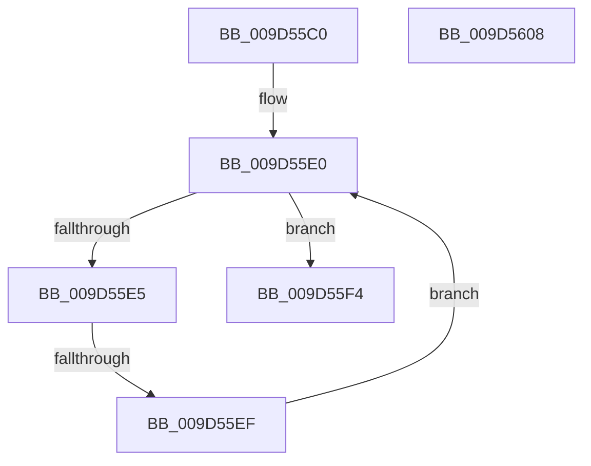

# ExpWnfUpdateSubscription

- RVA: `0x009D55C0`–`0x009D5609` (길이 `73` bytes)
- VA: `0x00000001409D55C0`
- 실행 섹션: `PAGE`
- PDB 이름 있음: `예`; PDB Function 태그: `아니요`
- unwind 정보 RVA: `0x000A1CF8`
- 디코드: `25`개 명령, `73/73` bytes 표시
- 미해석 바이트: `0` (있으면 어셈블리에 `.byte`로 보존)

> 이 문서는 커널 이미지의 기계어와 PDB 기호를 분석해 생성했습니다. 4번과 5번은 함수 원형과 자료형을 바이너리 사용 방식에서 추정한 C 해석이며 원본 소스 복구 결과는 아닙니다.

## 1. Dependencies

- 직접 호출 지점: **0**; 고유 호출 대상: **0**
- 직접 호출자로 확인된 함수: **1**
- RIP 상대 이미지 참조: **0**

### Outgoing calls
- 직접 디코드된 call 명령이 없습니다.

### Direct callers
- [ExpWnfSubscribeNameInstance](ExpWnfSubscribeNameInstance_function_009D50E8.md) at `0x009D51BA`
- [ExpWnfSubscribeNameInstance](ExpWnfSubscribeNameInstance_function_009D50E8.md) at `0x009D5339`

### Static image references
- 디코드된 RIP-relative 메모리 참조가 없습니다.

## 2. Other-region calls and transfers

- 다른 실행 섹션으로 향하는 call: **0**
- call이 아닌 외부 분기/꼬리 이동: **1**
  - `0x009D55ED` → [sub_009D5609](Unknown_function_009D5609.md) (`tail-transfer`)

## 3. Assembly (complete function range)

```asm
009D55C0  40 57                           push rdi
009D55C2  41 54                           push r12
009D55C4  41 55                           push r13
009D55C6  48 83 EC 30                     sub rsp, 0x30
009D55CA  48 8B 42 58                     mov rax, qword ptr [rdx + 0x58]
009D55CE  4C 8D 52 58                     lea r10, [rdx + 0x58]
009D55D2  4D 8B E1                        mov r12, r9
009D55D5  48 89 5C 24 50                  mov qword ptr [rsp + 0x50], rbx
009D55DA  4D 8B E8                        mov r13, r8
009D55DD  48 8B F9                        mov rdi, rcx
009D55E0  49 3B C2                        cmp rax, r10
009D55E3  74 0F                           je 0x1409d55f4
009D55E5  48 39 78 18                     cmp qword ptr [rax + 0x18], rdi
009D55E9  48 8D 58 E8                     lea rbx, [rax - 0x18]
009D55ED  74 1A                           je 0x1409d5609
009D55EF  48 8B 00                        mov rax, qword ptr [rax]
009D55F2  EB EC                           jmp 0x1409d55e0
009D55F4  B8 34 00 00 C0                  mov eax, 0xc0000034
009D55F9  48 8B 5C 24 50                  mov rbx, qword ptr [rsp + 0x50]
009D55FE  48 83 C4 30                     add rsp, 0x30
009D5602  41 5D                           pop r13
009D5604  41 5C                           pop r12
009D5606  5F                              pop rdi
009D5607  C3                              ret
009D5608  CC                              int3
```

## 4. C-style interpretation (structured pseudocode)

```c
__int64 __fastcall ExpWnfUpdateSubscription(__int64 a1, __int64 a2, __int64 a3, __int64 a4)
{
    __int64 v_rsp;
    unsigned __int64 v_stack_p8;

    v_rsp = (v_rsp) - (48);
    v_stack_p8 = v_rbx;
loc_009D55E0:
    if ((*(unsigned __int64 *)(a2 + 88)) == (a2 + 88)) goto loc_009D55F4;
    goto loc_009D55E0;
loc_009D55F4:
    v_rsp = (v_rsp) + (48);
    return (unsigned int)(0xC0000034ULL);
}
```

## 5. (Beta) C Style

```c
int64_t ExpWnfUpdateSubscription(int64_t Arg1, void *Arg2, int64_t Arg3, int64_t Arg4)
{
    uint8_t *arg2 = (uint8_t *)Arg2;

    int64_t local_rsp;
    uint64_t v_stack_p8;

    local_rsp = (local_rsp) - (48);
    v_stack_p8 = local_rbx;
loc_009D55E0:
    if ((*(uint64_t *)(arg2 + 0x58)) == (Arg2 + 88)) goto loc_009D55F4;
    goto loc_009D55E0;
loc_009D55F4:
    local_rsp = (local_rsp) + (48);
    return (uint32_t)(0xC0000034ULL);
}
```

### 관측된 메모리 오프셋

구조체 형식이 확인되지 않은 접근은 인자 기준의 오프셋으로만 기록했습니다.

| 기준 인자 | 오프셋 표현 | 폭 (bit) | 접근 |
|---|---:|---:|---|
| `Arg2` | `+ 0x58` | `64` | `R` |

## 6. Execution-region graph

[열기: 2D/3D 그래프와 함수 탐색 컨트롤 패널](../../../control-panel.html?section=page&rva=0x009D55C0&view=graph)

- 2D 그래프는 위에서 아래로 흐르고, 3D 그래프는 빈 공간을 드래그해 회전합니다. Shift+드래그는 이동, 휠은 확대·축소, 함수 노드 선택은 대상 보고서 이동입니다.

### Static fallback


