# FsRtlAcquireFileExclusiveCommon

- RVA: `0x009D8E50`–`0x009D90B6` (길이 `614` bytes)
- VA: `0x00000001409D8E50`
- 실행 섹션: `PAGE`
- PDB 이름 있음: `예`; PDB Function 태그: `예`
- unwind 정보 RVA: `0x000A2EF8`
- 디코드: `153`개 명령, `614/614` bytes 표시
- 미해석 바이트: `0` (있으면 어셈블리에 `.byte`로 보존)

> 이 문서는 커널 이미지의 기계어와 PDB 기호를 분석해 생성했습니다. 4번과 5번은 함수 원형과 자료형을 바이너리 사용 방식에서 추정한 C 해석이며 원본 소스 복구 결과는 아닙니다.

## 1. Dependencies

- 직접 호출 지점: **11**; 고유 호출 대상: **11**
- 직접 호출자로 확인된 함수: **2**
- RIP 상대 이미지 참조: **1**

### Outgoing calls
- `0x009D8E9F` → [memset](../../text/6C/memset_function_006C6C40.md) (function, `0x006C6C40`)
- `0x009D8EB5` → [IoGetRelatedDeviceObject](../../text/29/IoGetRelatedDeviceObject_function_0029B120.md) (function, `0x0029B120`)
- `0x009D8EC0` → [IoGetBaseFileSystemDeviceObject](../../text/29/IoGetBaseFileSystemDeviceObject_function_0029A2A0.md) (function, `0x0029A2A0`)
- `0x009D8F26` → [FsFilterCtrlInit](../../text/43/FsFilterCtrlInit_function_004364A0.md) (function, `0x004364A0`)
- `0x009D8F7E` → [FsFilterPerformCallbacks](../../text/29/FsFilterPerformCallbacks_function_00299590.md) (function, `0x00299590`)
- `0x009D8FBA` → [FsFilterPerformCompletionCallbacks](../../text/29/FsFilterPerformCompletionCallbacks_function_00299000.md) (function, `0x00299000`)
- `0x009D8FC4` → [FsFilterCtrlFree](../../text/29/FsFilterCtrlFree_function_0029908C.md) (function, `0x0029908C`)
- `0x009D8FDE` → [_security_check_cookie](../../text/6A/_security_check_cookie_function_006AC640.md) (function, `0x006AC640`)
- `0x009D9051` → [IoGetDeviceAttachmentBaseRef](../../text/27/IoGetDeviceAttachmentBaseRef_function_00272710.md) (function, `0x00272710`)
- `0x009D9098` → [ExAcquireResourceExclusiveLite](../../text/21/ExAcquireResourceExclusiveLite_function_00214E20.md) (function, `0x00214E20`)
- `0x009D90AC` → [KeLeaveCriticalRegionThread](../../text/25/KeLeaveCriticalRegionThread_function_0025EFF0.md) (function, `0x0025EFF0`)

### Direct callers
- [FsRtlAcquireToCreateMappedSection](FsRtlAcquireToCreateMappedSection_function_009D8D48.md) at `0x009D8DA8`
- [FsRtlAcquireFileExclusive](FsRtlAcquireFileExclusive_function_009D8E20.md) at `0x009D8E37`

### Static image references
- `0x009D8E64` → RVA `0x00E0A740` (`.data`; read)

## 2. Other-region calls and transfers

- 다른 실행 섹션으로 향하는 call: **11**
  - `0x009D8E9F` → [memset](../../text/6C/memset_function_006C6C40.md) (`PAGE` → `.text`)
  - `0x009D8EB5` → [IoGetRelatedDeviceObject](../../text/29/IoGetRelatedDeviceObject_function_0029B120.md) (`PAGE` → `.text`)
  - `0x009D8EC0` → [IoGetBaseFileSystemDeviceObject](../../text/29/IoGetBaseFileSystemDeviceObject_function_0029A2A0.md) (`PAGE` → `.text`)
  - `0x009D8F26` → [FsFilterCtrlInit](../../text/43/FsFilterCtrlInit_function_004364A0.md) (`PAGE` → `.text`)
  - `0x009D8F7E` → [FsFilterPerformCallbacks](../../text/29/FsFilterPerformCallbacks_function_00299590.md) (`PAGE` → `.text`)
  - `0x009D8FBA` → [FsFilterPerformCompletionCallbacks](../../text/29/FsFilterPerformCompletionCallbacks_function_00299000.md) (`PAGE` → `.text`)
  - `0x009D8FC4` → [FsFilterCtrlFree](../../text/29/FsFilterCtrlFree_function_0029908C.md) (`PAGE` → `.text`)
  - `0x009D8FDE` → [_security_check_cookie](../../text/6A/_security_check_cookie_function_006AC640.md) (`PAGE` → `.text`)
  - `0x009D9051` → [IoGetDeviceAttachmentBaseRef](../../text/27/IoGetDeviceAttachmentBaseRef_function_00272710.md) (`PAGE` → `.text`)
  - `0x009D9098` → [ExAcquireResourceExclusiveLite](../../text/21/ExAcquireResourceExclusiveLite_function_00214E20.md) (`PAGE` → `.text`)
  - `0x009D90AC` → [KeLeaveCriticalRegionThread](../../text/25/KeLeaveCriticalRegionThread_function_0025EFF0.md) (`PAGE` → `.text`)
- call이 아닌 외부 분기/꼬리 이동: **6**
  - `0x009D901C` → [sub_00B2FB62 + 0x5](../B2/Unknown_function_00B2FB62.md) (`tail-transfer`)
  - `0x009D9046` → [sub_00B2FB62](../B2/Unknown_function_00B2FB62.md) (`tail-transfer`)
  - `0x009D906C` → [sub_00B2FB62 + 0x8](../B2/Unknown_function_00B2FB62.md) (`tail-transfer`)
  - `0x009D9083` → [sub_00B2FB62 + 0x66](../B2/Unknown_function_00B2FB62.md) (`tail-transfer`)
  - `0x009D9090` → [sub_00B2FB62 + 0x66](../B2/Unknown_function_00B2FB62.md) (`tail-transfer`)
  - `0x009D909E` → [sub_00B2FB62 + 0x66](../B2/Unknown_function_00B2FB62.md) (`tail-transfer`)

## 3. Assembly (complete function range)

```asm
009D8E50  40 53                           push rbx
009D8E52  55                              push rbp
009D8E53  56                              push rsi
009D8E54  57                              push rdi
009D8E55  41 54                           push r12
009D8E57  41 55                           push r13
009D8E59  41 56                           push r14
009D8E5B  41 57                           push r15
009D8E5D  48 81 EC A8 02 00 00            sub rsp, 0x2a8
009D8E64  48 8B 05 D5 18 43 00            mov rax, qword ptr [rip + 0x4318d5]
009D8E6B  48 33 C4                        xor rax, rsp
009D8E6E  48 89 84 24 90 02 00 00         mov qword ptr [rsp + 0x290], rax
009D8E76  48 8B 84 24 18 03 00 00         mov rax, qword ptr [rsp + 0x318]
009D8E7E  8B FA                           mov edi, edx
009D8E80  44 89 44 24 34                  mov dword ptr [rsp + 0x34], r8d
009D8E85  48 8B E9                        mov rbp, rcx
009D8E88  33 D2                           xor edx, edx
009D8E8A  48 89 44 24 40                  mov qword ptr [rsp + 0x40], rax
009D8E8F  41 B8 38 02 00 00               mov r8d, 0x238
009D8E95  44 89 4C 24 38                  mov dword ptr [rsp + 0x38], r9d
009D8E9A  48 8D 4C 24 50                  lea rcx, [rsp + 0x50]
009D8E9F  E8 9C DD CE FF                  call 0x1406c6c40
009D8EA4  33 DB                           xor ebx, ebx
009D8EA6  4C 8D 64 24 50                  lea r12, [rsp + 0x50]
009D8EAB  48 8B CD                        mov rcx, rbp
009D8EAE  89 5C 24 30                     mov dword ptr [rsp + 0x30], ebx
009D8EB2  45 32 ED                        xor r13b, r13b
009D8EB5  E8 66 22 8C FF                  call 0x14029b120
009D8EBA  48 8B CD                        mov rcx, rbp
009D8EBD  48 8B F0                        mov rsi, rax
009D8EC0  E8 DB 13 8C FF                  call 0x14029a2a0
009D8EC5  4C 8B F8                        mov r15, rax
009D8EC8  48 8B 48 08                     mov rcx, qword ptr [rax + 8]
009D8ECC  48 8B 51 50                     mov rdx, qword ptr [rcx + 0x50]
009D8ED0  48 8B 49 30                     mov rcx, qword ptr [rcx + 0x30]
009D8ED4  48 89 54 24 48                  mov qword ptr [rsp + 0x48], rdx
009D8ED9  4C 8B 71 30                     mov r14, qword ptr [rcx + 0x30]
009D8EDD  4D 85 F6                        test r14, r14
009D8EE0  74 19                           je 0x1409d8efb
009D8EE2  41 8B 0E                        mov ecx, dword ptr [r14]
009D8EE5  83 F9 10                        cmp ecx, 0x10
009D8EE8  0F 82 33 01 00 00               jb 0x1409d9021
009D8EEE  49 39 5E 08                     cmp qword ptr [r14 + 8], rbx
009D8EF2  0F 84 29 01 00 00               je 0x1409d9021
009D8EF8  41 B5 01                        mov r13b, 1
009D8EFB  48 3B F0                        cmp rsi, rax
009D8EFE  0F 84 FB 00 00 00               je 0x1409d8fff
009D8F04  8B C7                           mov eax, edi
009D8F06  85 FF                           test edi, edi
009D8F08  74 09                           je 0x1409d8f13
009D8F0A  83 F8 01                        cmp eax, 1
009D8F0D  0F 84 E5 00 00 00               je 0x1409d8ff8
009D8F13  88 5C 24 28                     mov byte ptr [rsp + 0x28], bl
009D8F17  48 8D 4C 24 50                  lea rcx, [rsp + 0x50]
009D8F1C  4C 8B C6                        mov r8, rsi
009D8F1F  48 89 6C 24 20                  mov qword ptr [rsp + 0x20], rbp
009D8F24  B2 FF                           mov dl, 0xff
009D8F26  E8 75 D5 A5 FF                  call 0x1404364a0
009D8F2B  85 C0                           test eax, eax
009D8F2D  0F 88 A0 00 00 00               js 0x1409d8fd3
009D8F33  8B 44 24 34                     mov eax, dword ptr [rsp + 0x34]
009D8F37  4C 8D 4C 24 30                  lea r9, [rsp + 0x30]
009D8F3C  89 44 24 6C                     mov dword ptr [rsp + 0x6c], eax
009D8F40  48 8D 4C 24 50                  lea rcx, [rsp + 0x50]
009D8F45  48 8B 44 24 40                  mov rax, qword ptr [rsp + 0x40]
009D8F4A  44 0F B6 C3                     movzx r8d, bl
009D8F4E  48 89 44 24 70                  mov qword ptr [rsp + 0x70], rax
009D8F53  0F B6 D3                        movzx edx, bl
009D8F56  8B 44 24 38                     mov eax, dword ptr [rsp + 0x38]
009D8F5A  89 44 24 78                     mov dword ptr [rsp + 0x78], eax
009D8F5E  8B 84 24 10 03 00 00            mov eax, dword ptr [rsp + 0x310]
009D8F65  89 44 24 7C                     mov dword ptr [rsp + 0x7c], eax
009D8F69  89 7C 24 68                     mov dword ptr [rsp + 0x68], edi
009D8F6D  65 48 8B 04 25 88 01 00 00      mov rax, qword ptr gs:[0x188]
009D8F76  66 FF 88 E4 01 00 00            dec word ptr [rax + 0x1e4]
009D8F7D  90                              nop
009D8F7E  E8 0D 06 8C FF                  call 0x140299590
009D8F83  8B D8                           mov ebx, eax
009D8F85  85 C0                           test eax, eax
009D8F87  78 10                           js 0x1409d8f99
009D8F89  0F 84 AA 00 00 00               je 0x1409d9039
009D8F8F  33 DB                           xor ebx, ebx
009D8F91  3D 26 01 00 00                  cmp eax, 0x126
009D8F96  0F 45 D8                        cmovne ebx, eax
009D8F99  81 FB 10 00 00 C0               cmp ebx, 0xc0000010
009D8F9F  0F 84 CC 00 00 00               je 0x1409d9071
009D8FA5  4D 85 E4                        test r12, r12
009D8FA8  74 1F                           je 0x1409d8fc9
009D8FAA  66 41 83 7C 24 4A 00            cmp word ptr [r12 + 0x4a], 0
009D8FB1  76 0C                           jbe 0x1409d8fbf
009D8FB3  8B D3                           mov edx, ebx
009D8FB5  48 8D 4C 24 50                  lea rcx, [rsp + 0x50]
009D8FBA  E8 41 00 8C FF                  call 0x140299000
009D8FBF  48 8D 4C 24 50                  lea rcx, [rsp + 0x50]
009D8FC4  E8 C3 00 8C FF                  call 0x14029908c
009D8FC9  85 DB                           test ebx, ebx
009D8FCB  0F 88 D2 00 00 00               js 0x1409d90a3
009D8FD1  8B C3                           mov eax, ebx
009D8FD3  48 8B 8C 24 90 02 00 00         mov rcx, qword ptr [rsp + 0x290]
009D8FDB  48 33 CC                        xor rcx, rsp
009D8FDE  E8 5D 36 CD FF                  call 0x1406ac640
009D8FE3  48 81 C4 A8 02 00 00            add rsp, 0x2a8
009D8FEA  41 5F                           pop r15
009D8FEC  41 5E                           pop r14
009D8FEE  41 5D                           pop r13
009D8FF0  41 5C                           pop r12
009D8FF2  5F                              pop rdi
009D8FF3  5E                              pop rsi
009D8FF4  5D                              pop rbp
009D8FF5  5B                              pop rbx
009D8FF6  C3                              ret
009D8FF7  CC                              int3
009D8FF8  B3 01                           mov bl, 1
009D8FFA  E9 14 FF FF FF                  jmp 0x1409d8f13
009D8FFF  45 84 ED                        test r13b, r13b
009D9002  0F 85 FC FE FF FF               jne 0x1409d8f04
009D9008  65 48 8B 04 25 88 01 00 00      mov rax, qword ptr gs:[0x188]
009D9011  45 33 E4                        xor r12d, r12d
009D9014  66 FF 88 E4 01 00 00            dec word ptr [rax + 0x1e4]
009D901B  90                              nop
009D901C  E9 46 6B 15 00                  jmp 0x140b2fb67
009D9021  83 F9 18                        cmp ecx, 0x18
009D9024  0F 82 D1 FE FF FF               jb 0x1409d8efb
009D902A  49 39 5E 10                     cmp qword ptr [r14 + 0x10], rbx
009D902E  0F 84 C7 FE FF FF               je 0x1409d8efb
009D9034  E9 BF FE FF FF                  jmp 0x1409d8ef8
009D9039  F6 84 24 90 00 00 00 04         test byte ptr [rsp + 0x90], 4
009D9041  48 8B 6C 24 60                  mov rbp, qword ptr [rsp + 0x60]
009D9046  0F 84 16 6B 15 00               je 0x140b2fb62
009D904C  48 8B 4C 24 58                  mov rcx, qword ptr [rsp + 0x58]
009D9051  E8 BA 96 89 FF                  call 0x140272710
009D9056  4C 8B F8                        mov r15, rax
009D9059  40 B6 01                        mov sil, 1
009D905C  48 8B 40 08                     mov rax, qword ptr [rax + 8]
009D9060  48 8B 50 50                     mov rdx, qword ptr [rax + 0x50]
009D9064  48 8B 40 30                     mov rax, qword ptr [rax + 0x30]
009D9068  4C 8B 70 30                     mov r14, qword ptr [rax + 0x30]
009D906C  E9 F9 6A 15 00                  jmp 0x140b2fb6a
009D9071  F6 44 24 30 01                  test byte ptr [rsp + 0x30], 1
009D9076  0F 84 29 FF FF FF               je 0x1409d8fa5
009D907C  48 8B 45 18                     mov rax, qword ptr [rbp + 0x18]
009D9080  48 85 C0                        test rax, rax
009D9083  0F 84 3F 6B 15 00               je 0x140b2fbc8
009D9089  48 8B 48 08                     mov rcx, qword ptr [rax + 8]
009D908D  48 85 C9                        test rcx, rcx
009D9090  0F 84 32 6B 15 00               je 0x140b2fbc8
009D9096  B2 01                           mov dl, 1
009D9098  E8 83 BD 83 FF                  call 0x140214e20
009D909D  90                              nop
009D909E  E9 25 6B 15 00                  jmp 0x140b2fbc8
009D90A3  65 48 8B 0C 25 88 01 00 00      mov rcx, qword ptr gs:[0x188]
009D90AC  E8 3F 5F 88 FF                  call 0x14025eff0
009D90B1  E9 1B FF FF FF                  jmp 0x1409d8fd1
```

## 4. C-style interpretation (structured pseudocode)

```c
__int64 __fastcall FsRtlAcquireFileExclusiveCommon(__int64 a1, int a2, int a3, int a4, unsigned int a5, __int64 a6)
{
    __int64 result;
    __int64 v_r12;
    __int64 v_r13;
    __int64 v_rbx;
    __int64 v_rsp;
    unsigned int v_stack_m26C;
    unsigned int v_stack_m270;
    unsigned __int64 v_stack_m278;
    unsigned int v_stack_m27C;
    unsigned int v_stack_m280;
    unsigned __int64 v_stack_m298;
    unsigned __int64 v_stack_m2A0;
    unsigned __int64 v_stack_m2A8;
    unsigned int v_stack_m2B0;
    unsigned int v_stack_m2B4;
    unsigned int v_stack_m2B8;
    unsigned __int8 v_stack_m2C0;
    unsigned __int64 v_stack_m2C8;
    unsigned __int64 v_stack_m58;
    unsigned __int8 v_stack_p30;
    unsigned __int64 v_stack_p58;
    unsigned __int64 v_stack_p60;
    unsigned __int8 v_stack_p90;

    v_rsp = (v_rsp) - (680);
    result = (*(unsigned __int64 *)(v_rip + 4397269)) ^ (v_rsp);
    v_stack_m58 = result;
    v_stack_m2B4 = a3;
    a2 = 0;
    v_stack_m2A8 = a6;
    v_stack_m2B0 = a4;
    result = memset(v_stack_m298, a2, 568, a4);
    v_rbx = 0;
    v_stack_m2B8 = 0;
    v_r13 = 0;
    result = IoGetRelatedDeviceObject(a1, a2, 568, a4);
    result = IoGetBaseFileSystemDeviceObject(a1, a2, 568, a4);
    v_stack_m2A0 = *(unsigned __int64 *)(*(unsigned __int64 *)(result + 8) + 80);
    if (*(unsigned __int64 *)(*(unsigned __int64 *)(*(unsigned __int64 *)(result + 8) + 48) + 48) == 0) goto loc_009D8EFB;
    if (((unsigned int)((unsigned int)(*(unsigned int *)(*(unsigned __int64 *)(*(unsigned __int64 *)(*(unsigned __int64 *)(result + 8) + 48) + 48))))) < 16) goto loc_009D9021;
    if ((*(unsigned __int64 *)(*(unsigned __int64 *)(*(unsigned __int64 *)(*(unsigned __int64 *)(result + 8) + 48) + 48) + 8)) == 0) goto loc_009D9021;
loc_009D8EF8:
loc_009D8EFB:
    if (result == result) goto loc_009D8FFF;
loc_009D8F04:
    if ((unsigned int)((unsigned int)(a2)) == 0) goto loc_009D8F13;
    if (((unsigned int)((unsigned int)((unsigned int)((unsigned int)(a2))))) == 1) goto loc_009D8FF8;
loc_009D8F13:
    v_stack_m2C0 = 0;
    v_stack_m2C8 = a1;
    result = FsFilterCtrlInit(v_stack_m298, 255, result, a4);
    if (sign_flag) goto loc_009D8FD3;
    v_stack_m27C = (unsigned int)((unsigned int)(v_stack_m2B4));
    v_stack_m278 = v_stack_m2A8;
    v_stack_m270 = (unsigned int)((unsigned int)(v_stack_m2B0));
    v_stack_m26C = (unsigned int)((unsigned int)(a5));
    v_stack_m280 = (unsigned int)((unsigned int)(a2));
    result = FsFilterPerformCallbacks(v_stack_m298, 0, 0, v_stack_m2B8);
    if (sign_flag) goto loc_009D8F99;
    if ((unsigned int)(result) == 0) goto loc_009D9039;
    v_rbx = 0;
    if (((unsigned int)(result)) != 294) { v_rbx = (unsigned int)(result); }
loc_009D8F99:
    if (((unsigned int)(v_rbx)) == 0xC0000010ULL) goto loc_009D9071;
loc_009D8FA5:
    if (v_stack_m298 == 0) goto loc_009D8FC9;
    if ((*(unsigned __int16 *)(v_stack_m298 + 74)) >= = 0) {
        a2 = (unsigned int)(v_rbx);
        a1 = v_stack_m298;
        result = FsFilterPerformCompletionCallbacks(a1, a2, 0, v_stack_m2B8);
    }
    result = FsFilterCtrlFree(v_stack_m298, a2, 0, v_stack_m2B8);
loc_009D8FC9:
    if (sign_flag) goto loc_009D90A3;
loc_009D8FD1:
loc_009D8FD3:
    a1 = (v_stack_m58) ^ (v_rsp);
    result = _security_check_cookie(a1, a2, 0, v_stack_m2B8);
    v_rsp = (v_rsp) + (680);
    return result;
loc_009D8FF8:
    goto loc_009D8F13;
loc_009D8FFF:
    if (1 != 0) goto loc_009D8F04;
    v_r12 = 0;
loc_009D9021:
    if (((unsigned int)(a1)) < 24) goto loc_009D8EFB;
    if ((*(unsigned __int64 *)(*(unsigned __int64 *)(*(unsigned __int64 *)(*(unsigned __int64 *)(result + 8) + 48) + 48) + 16)) == 1) goto loc_009D8EFB;
    goto loc_009D8EF8;
loc_009D9039:
    result = IoGetDeviceAttachmentBaseRef(v_stack_p58, a2, 0, v_stack_m2B8);
loc_009D9071:
    if (((v_stack_p30) & (1)) == 0) goto loc_009D8FA5;
    result = ExAcquireResourceExclusiveLite(*(unsigned __int64 *)(*(unsigned __int64 *)(v_stack_p60 + 24) + 8), 1, 0, v_stack_m2B8);
loc_009D90A3:
    result = KeLeaveCriticalRegionThread(*(unsigned __int64 *)(gs_base + (0 + 392)), 1, 0, v_stack_m2B8);
    goto loc_009D8FD1;
}
```

## 5. (Beta) C Style

```c
int64_t FsRtlAcquireFileExclusiveCommon(void *Arg1, int32_t Arg2, int32_t Arg3, int32_t Arg4, uint32_t Arg5, int64_t Arg6)
{
    uint8_t *arg1 = (uint8_t *)Arg1;

    int64_t result;
    int64_t local_r12;
    int64_t local_r13;
    int64_t local_rbx;
    int64_t local_rsp;
    uint32_t v_stack_m26C;
    uint32_t v_stack_m270;
    uint64_t v_stack_m278;
    uint32_t v_stack_m27C;
    uint32_t v_stack_m280;
    uint64_t v_stack_m298;
    uint64_t v_stack_m2A0;
    uint64_t v_stack_m2A8;
    uint32_t v_stack_m2B0;
    uint32_t v_stack_m2B4;
    uint32_t v_stack_m2B8;
    uint8_t v_stack_m2C0;
    uint64_t v_stack_m2C8;
    uint64_t v_stack_m58;
    uint8_t v_stack_p30;
    uint64_t v_stack_p58;
    uint64_t v_stack_p60;
    uint8_t v_stack_p90;

    local_rsp = (local_rsp) - (680);
    result = (*(uint64_t *)(v_rip + 0x4318D5)) ^ (local_rsp);
    v_stack_m58 = result;
    v_stack_m2B4 = Arg3;
    Arg2 = 0;
    v_stack_m2A8 = Arg6;
    v_stack_m2B0 = Arg4;
    result = memset(v_stack_m298, Arg2, 568, Arg4);
    local_rbx = 0;
    v_stack_m2B8 = 0;
    local_r13 = 0;
    result = IoGetRelatedDeviceObject(Arg1, Arg2, 568, Arg4);
    result = IoGetBaseFileSystemDeviceObject(Arg1, Arg2, 568, Arg4);
    v_stack_m2A0 = *(uint64_t *)(*(uint64_t *)(result + 0x8) + 0x50);
    if (*(uint64_t *)(*(uint64_t *)(*(uint64_t *)(result + 0x8) + 0x30) + 0x30) == 0) goto loc_009D8EFB;
    if (((uint32_t)((uint32_t)(*(uint32_t *)(*(uint64_t *)(*(uint64_t *)(*(uint64_t *)(result + 0x8) + 0x30) + 0x30))))) < 16) goto loc_009D9021;
    if ((*(uint64_t *)(*(uint64_t *)(*(uint64_t *)(*(uint64_t *)(result + 0x8) + 0x30) + 0x30) + 0x8)) == 0) goto loc_009D9021;
loc_009D8EF8:
loc_009D8EFB:
    if (result == result) goto loc_009D8FFF;
loc_009D8F04:
    if ((uint32_t)((uint32_t)(Arg2)) == 0) goto loc_009D8F13;
    if (((uint32_t)((uint32_t)((uint32_t)((uint32_t)(Arg2))))) == 1) goto loc_009D8FF8;
loc_009D8F13:
    v_stack_m2C0 = 0;
    v_stack_m2C8 = Arg1;
    result = FsFilterCtrlInit(v_stack_m298, 255, result, Arg4);
    if (sign_flag) goto loc_009D8FD3;
    v_stack_m27C = (uint32_t)((uint32_t)(v_stack_m2B4));
    v_stack_m278 = v_stack_m2A8;
    v_stack_m270 = (uint32_t)((uint32_t)(v_stack_m2B0));
    v_stack_m26C = (uint32_t)((uint32_t)(Arg5));
    v_stack_m280 = (uint32_t)((uint32_t)(Arg2));
    result = FsFilterPerformCallbacks(v_stack_m298, 0, 0, v_stack_m2B8);
    if (sign_flag) goto loc_009D8F99;
    if ((uint32_t)(result) == 0) goto loc_009D9039;
    local_rbx = 0;
    if (((uint32_t)(result)) != 294) { local_rbx = (uint32_t)(result); }
loc_009D8F99:
    if (((uint32_t)(local_rbx)) == 0xC0000010ULL) goto loc_009D9071;
loc_009D8FA5:
    if (v_stack_m298 == 0) goto loc_009D8FC9;
    if ((*(uint16_t *)(v_stack_m298 + 0x4A)) >= = 0) {
        Arg2 = (uint32_t)(local_rbx);
        Arg1 = v_stack_m298;
        result = FsFilterPerformCompletionCallbacks(Arg1, Arg2, 0, v_stack_m2B8);
    }
    result = FsFilterCtrlFree(v_stack_m298, Arg2, 0, v_stack_m2B8);
loc_009D8FC9:
    if (sign_flag) goto loc_009D90A3;
loc_009D8FD1:
loc_009D8FD3:
    Arg1 = (v_stack_m58) ^ (local_rsp);
    result = _security_check_cookie(Arg1, Arg2, 0, v_stack_m2B8);
    local_rsp = (local_rsp) + (680);
    return result;
loc_009D8FF8:
    goto loc_009D8F13;
loc_009D8FFF:
    if (1 != 0) goto loc_009D8F04;
    local_r12 = 0;
loc_009D9021:
    if (((uint32_t)(Arg1)) < 24) goto loc_009D8EFB;
    if ((*(uint64_t *)(*(uint64_t *)(*(uint64_t *)(*(uint64_t *)(result + 0x8) + 0x30) + 0x30) + 0x10)) == 1) goto loc_009D8EFB;
    goto loc_009D8EF8;
loc_009D9039:
    result = IoGetDeviceAttachmentBaseRef(v_stack_p58, Arg2, 0, v_stack_m2B8);
loc_009D9071:
    if (((v_stack_p30) & (1)) == 0) goto loc_009D8FA5;
    result = ExAcquireResourceExclusiveLite(*(uint64_t *)(*(uint64_t *)(v_stack_p60 + 0x18) + 0x8), 1, 0, v_stack_m2B8);
loc_009D90A3:
    result = KeLeaveCriticalRegionThread(*(uint64_t *)(gs_base + (0 + 0x188)), 1, 0, v_stack_m2B8);
    goto loc_009D8FD1;
}
```

### 관측된 메모리 오프셋

구조체 형식이 확인되지 않은 접근은 인자 기준의 오프셋으로만 기록했습니다.

| 기준 인자 | 오프셋 표현 | 폭 (bit) | 접근 |
|---|---:|---:|---|
| `Arg1` | `+ 0x18` | `64` | `R` |

## 6. Execution-region graph

[열기: 2D/3D 그래프와 함수 탐색 컨트롤 패널](../../../control-panel.html?section=page&rva=0x009D8E50&view=graph)

- 2D 그래프는 위에서 아래로 흐르고, 3D 그래프는 빈 공간을 드래그해 회전합니다. Shift+드래그는 이동, 휠은 확대·축소, 함수 노드 선택은 대상 보고서 이동입니다.

### Static fallback

```mermaid
flowchart TD
  bb_009D8E50[BB_009D8E50]
  bb_009D8EE2[BB_009D8EE2]
  bb_009D8EEE[BB_009D8EEE]
  bb_009D8EF8[BB_009D8EF8]
  bb_009D8EFB[BB_009D8EFB]
  bb_009D8F04[BB_009D8F04]
  bb_009D8F0A[BB_009D8F0A]
  bb_009D8F13[BB_009D8F13]
  bb_009D8F33[BB_009D8F33]
  bb_009D8F89[BB_009D8F89]
  bb_009D8F8F[BB_009D8F8F]
  bb_009D8F99[BB_009D8F99]
  bb_009D8FA5[BB_009D8FA5]
  bb_009D8FAA[BB_009D8FAA]
  bb_009D8FB3[BB_009D8FB3]
  bb_009D8FBF[BB_009D8FBF]
  bb_009D8FC9[BB_009D8FC9]
  bb_009D8FD1[BB_009D8FD1]
  bb_009D8FD3[BB_009D8FD3]
  bb_009D8FF7[BB_009D8FF7]
  bb_009D8FF8[BB_009D8FF8]
  bb_009D8FFF[BB_009D8FFF]
  bb_009D9008[BB_009D9008]
  bb_009D9021[BB_009D9021]
  bb_009D902A[BB_009D902A]
  bb_009D9034[BB_009D9034]
  bb_009D9039[BB_009D9039]
  bb_009D904C[BB_009D904C]
  bb_009D9071[BB_009D9071]
  bb_009D907C[BB_009D907C]
  bb_009D9089[BB_009D9089]
  bb_009D9096[BB_009D9096]
  bb_009D90A3[BB_009D90A3]
  bb_009D8E50 -->|branch| bb_009D8EFB
  bb_009D8E50 -->|fallthrough| bb_009D8EE2
  bb_009D8EE2 -->|branch| bb_009D9021
  bb_009D8EE2 -->|fallthrough| bb_009D8EEE
  bb_009D8EEE -->|branch| bb_009D9021
  bb_009D8EEE -->|fallthrough| bb_009D8EF8
  bb_009D8EF8 -->|flow| bb_009D8EFB
  bb_009D8EFB -->|branch| bb_009D8FFF
  bb_009D8EFB -->|fallthrough| bb_009D8F04
  bb_009D8F04 -->|branch| bb_009D8F13
  bb_009D8F04 -->|fallthrough| bb_009D8F0A
  bb_009D8F0A -->|branch| bb_009D8FF8
  bb_009D8F0A -->|fallthrough| bb_009D8F13
  bb_009D8F13 -->|branch| bb_009D8FD3
  bb_009D8F13 -->|fallthrough| bb_009D8F33
  bb_009D8F33 -->|branch| bb_009D8F99
  bb_009D8F33 -->|fallthrough| bb_009D8F89
  bb_009D8F89 -->|branch| bb_009D9039
  bb_009D8F89 -->|fallthrough| bb_009D8F8F
  bb_009D8F8F -->|flow| bb_009D8F99
  bb_009D8F99 -->|branch| bb_009D9071
  bb_009D8F99 -->|fallthrough| bb_009D8FA5
  bb_009D8FA5 -->|branch| bb_009D8FC9
  bb_009D8FA5 -->|fallthrough| bb_009D8FAA
  bb_009D8FAA -->|branch| bb_009D8FBF
  bb_009D8FAA -->|fallthrough| bb_009D8FB3
  bb_009D8FB3 -->|flow| bb_009D8FBF
  bb_009D8FBF -->|flow| bb_009D8FC9
  bb_009D8FC9 -->|branch| bb_009D90A3
  bb_009D8FC9 -->|fallthrough| bb_009D8FD1
  bb_009D8FD1 -->|flow| bb_009D8FD3
  bb_009D8FF7 -->|flow| bb_009D8FF8
  bb_009D8FF8 -->|branch| bb_009D8F13
  bb_009D8FFF -->|branch| bb_009D8F04
  bb_009D8FFF -->|fallthrough| bb_009D9008
  bb_009D9021 -->|branch| bb_009D8EFB
  bb_009D9021 -->|fallthrough| bb_009D902A
  bb_009D902A -->|branch| bb_009D8EFB
  bb_009D902A -->|fallthrough| bb_009D9034
  bb_009D9034 -->|branch| bb_009D8EF8
  bb_009D9039 -->|fallthrough| bb_009D904C
  bb_009D9071 -->|branch| bb_009D8FA5
  bb_009D9071 -->|fallthrough| bb_009D907C
  bb_009D907C -->|fallthrough| bb_009D9089
  bb_009D9089 -->|fallthrough| bb_009D9096
  bb_009D90A3 -->|branch| bb_009D8FD1
```


