# FsRtlAcquireFileForCcFlushEx

- RVA: `0x009D72F0`–`0x009D758C` (길이 `668` bytes)
- VA: `0x00000001409D72F0`
- 실행 섹션: `PAGE`
- PDB 이름 있음: `예`; PDB Function 태그: `아니요`
- unwind 정보 RVA: `0x000A281C`
- 디코드: `173`개 명령, `668/668` bytes 표시
- 미해석 바이트: `0` (있으면 어셈블리에 `.byte`로 보존)

> 이 문서는 커널 이미지의 기계어와 PDB 기호를 분석해 생성했습니다. 4번과 5번은 함수 원형과 자료형을 바이너리 사용 방식에서 추정한 C 해석이며 원본 소스 복구 결과는 아닙니다.

## 1. Dependencies

- 직접 호출 지점: **16**; 고유 호출 대상: **15**
- 직접 호출자로 확인된 함수: **3**
- RIP 상대 이미지 참조: **1**

### Outgoing calls
- `0x009D7331` → [memset](../../text/6C/memset_function_006C6C40.md) (function, `0x006C6C40`)
- `0x009D7347` → [IoGetRelatedDeviceObject](../../text/29/IoGetRelatedDeviceObject_function_0029B120.md) (function, `0x0029B120`)
- `0x009D7352` → [IoGetBaseFileSystemDeviceObject](../../text/29/IoGetBaseFileSystemDeviceObject_function_0029A2A0.md) (function, `0x0029A2A0`)
- `0x009D73AE` → [FsFilterCtrlInit](../../text/43/FsFilterCtrlInit_function_004364A0.md) (function, `0x004364A0`)
- `0x009D73DD` → [FsFilterPerformCallbacks](../../text/29/FsFilterPerformCallbacks_function_00299590.md) (function, `0x00299590`)
- `0x009D7406` → [IoGetDeviceAttachmentBaseRef](../../text/27/IoGetDeviceAttachmentBaseRef_function_00272710.md) (function, `0x00272710`)
- `0x009D746C` → [guard_dispatch_icall](../../text/6B/guard_dispatch_icall_function_006BAAD0.md) (function, `0x006BAAD0`)
- `0x009D749C` → [FsFilterPerformCompletionCallbacks](../../text/29/FsFilterPerformCompletionCallbacks_function_00299000.md) (function, `0x00299000`)
- `0x009D74A6` → [FsFilterCtrlFree](../../text/29/FsFilterCtrlFree_function_0029908C.md) (function, `0x0029908C`)
- `0x009D74C0` → [_security_check_cookie](../../text/6A/_security_check_cookie_function_006AC640.md) (function, `0x006AC640`)
- `0x009D7502` → [ExIsResourceAcquiredSharedLite](../../text/34/ExIsResourceAcquiredSharedLite_function_00341B10.md) (function, `0x00341B10`)
- `0x009D7511` → [ExAcquireResourceSharedLite](../../text/21/ExAcquireResourceSharedLite_function_00211BC0.md) (function, `0x00211BC0`)
- `0x009D752F` → [ExAcquireResourceSharedLite](../../text/21/ExAcquireResourceSharedLite_function_00211BC0.md) (function, `0x00211BC0`)
- `0x009D7539` → [ObfDereferenceObject](../../text/2F/ObfDereferenceObject_function_002F9350.md) (function, `0x002F9350`)
- `0x009D7572` → [ExAcquireResourceExclusiveLite](../../text/21/ExAcquireResourceExclusiveLite_function_00214E20.md) (function, `0x00214E20`)
- `0x009D7582` → [KeLeaveCriticalRegionThread](../../text/25/KeLeaveCriticalRegionThread_function_0025EFF0.md) (function, `0x0025EFF0`)

### Direct callers
- [MmFlushSection](../../text/23/MmFlushSection_function_002375E4.md) at `0x002376F3`
- [MiPrepareToFlushSubsection](../../text/36/MiPrepareToFlushSubsection_function_00369094.md) at `0x00369106`
- [MmFlushVirtualMemory](MmFlushVirtualMemory_function_009D6F5C.md) at `0x009D7151`

### Static image references
- `0x009D730F` → RVA `0x00E0A740` (`.data`; read)

## 2. Other-region calls and transfers

- 다른 실행 섹션으로 향하는 call: **16**
  - `0x009D7331` → [memset](../../text/6C/memset_function_006C6C40.md) (`PAGE` → `.text`)
  - `0x009D7347` → [IoGetRelatedDeviceObject](../../text/29/IoGetRelatedDeviceObject_function_0029B120.md) (`PAGE` → `.text`)
  - `0x009D7352` → [IoGetBaseFileSystemDeviceObject](../../text/29/IoGetBaseFileSystemDeviceObject_function_0029A2A0.md) (`PAGE` → `.text`)
  - `0x009D73AE` → [FsFilterCtrlInit](../../text/43/FsFilterCtrlInit_function_004364A0.md) (`PAGE` → `.text`)
  - `0x009D73DD` → [FsFilterPerformCallbacks](../../text/29/FsFilterPerformCallbacks_function_00299590.md) (`PAGE` → `.text`)
  - `0x009D7406` → [IoGetDeviceAttachmentBaseRef](../../text/27/IoGetDeviceAttachmentBaseRef_function_00272710.md) (`PAGE` → `.text`)
  - `0x009D746C` → [guard_dispatch_icall](../../text/6B/guard_dispatch_icall_function_006BAAD0.md) (`PAGE` → `.text`)
  - `0x009D749C` → [FsFilterPerformCompletionCallbacks](../../text/29/FsFilterPerformCompletionCallbacks_function_00299000.md) (`PAGE` → `.text`)
  - `0x009D74A6` → [FsFilterCtrlFree](../../text/29/FsFilterCtrlFree_function_0029908C.md) (`PAGE` → `.text`)
  - `0x009D74C0` → [_security_check_cookie](../../text/6A/_security_check_cookie_function_006AC640.md) (`PAGE` → `.text`)
  - `0x009D7502` → [ExIsResourceAcquiredSharedLite](../../text/34/ExIsResourceAcquiredSharedLite_function_00341B10.md) (`PAGE` → `.text`)
  - `0x009D7511` → [ExAcquireResourceSharedLite](../../text/21/ExAcquireResourceSharedLite_function_00211BC0.md) (`PAGE` → `.text`)
  - `0x009D752F` → [ExAcquireResourceSharedLite](../../text/21/ExAcquireResourceSharedLite_function_00211BC0.md) (`PAGE` → `.text`)
  - `0x009D7539` → [ObfDereferenceObject](../../text/2F/ObfDereferenceObject_function_002F9350.md) (`PAGE` → `.text`)
  - `0x009D7572` → [ExAcquireResourceExclusiveLite](../../text/21/ExAcquireResourceExclusiveLite_function_00214E20.md) (`PAGE` → `.text`)
  - `0x009D7582` → [KeLeaveCriticalRegionThread](../../text/25/KeLeaveCriticalRegionThread_function_0025EFF0.md) (`PAGE` → `.text`)
- 별도 외부 분기/꼬리 이동을 확인하지 못했습니다.

## 3. Assembly (complete function range)

```asm
009D72F0  48 89 5C 24 10                  mov qword ptr [rsp + 0x10], rbx
009D72F5  48 89 6C 24 18                  mov qword ptr [rsp + 0x18], rbp
009D72FA  48 89 74 24 20                  mov qword ptr [rsp + 0x20], rsi
009D72FF  57                              push rdi
009D7300  41 54                           push r12
009D7302  41 55                           push r13
009D7304  41 56                           push r14
009D7306  41 57                           push r15
009D7308  48 81 EC 90 02 00 00            sub rsp, 0x290
009D730F  48 8B 05 2A 34 43 00            mov rax, qword ptr [rip + 0x43342a]
009D7316  48 33 C4                        xor rax, rsp
009D7319  48 89 84 24 80 02 00 00         mov qword ptr [rsp + 0x280], rax
009D7321  4C 8B E9                        mov r13, rcx
009D7324  33 D2                           xor edx, edx
009D7326  48 8D 4C 24 40                  lea rcx, [rsp + 0x40]
009D732B  41 B8 38 02 00 00               mov r8d, 0x238
009D7331  E8 0A F9 CE FF                  call 0x1406c6c40
009D7336  33 DB                           xor ebx, ebx
009D7338  48 8D 7C 24 40                  lea rdi, [rsp + 0x40]
009D733D  49 8B CD                        mov rcx, r13
009D7340  89 5C 24 30                     mov dword ptr [rsp + 0x30], ebx
009D7344  45 32 E4                        xor r12b, r12b
009D7347  E8 D4 3D 8C FF                  call 0x14029b120
009D734C  49 8B CD                        mov rcx, r13
009D734F  4C 8B F0                        mov r14, rax
009D7352  E8 49 2F 8C FF                  call 0x14029a2a0
009D7357  48 8B E8                        mov rbp, rax
009D735A  48 8B 48 08                     mov rcx, qword ptr [rax + 8]
009D735E  4C 8B 79 50                     mov r15, qword ptr [rcx + 0x50]
009D7362  48 8B 49 30                     mov rcx, qword ptr [rcx + 0x30]
009D7366  48 8B 71 30                     mov rsi, qword ptr [rcx + 0x30]
009D736A  48 85 F6                        test rsi, rsi
009D736D  74 20                           je 0x1409d738f
009D736F  8B 06                           mov eax, dword ptr [rsi]
009D7371  83 F8 30                        cmp eax, 0x30
009D7374  72 0A                           jb 0x1409d7380
009D7376  48 39 5E 28                     cmp qword ptr [rsi + 0x28], rbx
009D737A  0F 85 A6 01 00 00               jne 0x1409d7526
009D7380  83 F8 38                        cmp eax, 0x38
009D7383  72 0A                           jb 0x1409d738f
009D7385  48 39 5E 30                     cmp qword ptr [rsi + 0x30], rbx
009D7389  0F 85 97 01 00 00               jne 0x1409d7526
009D738F  32 C0                           xor al, al
009D7391  4C 3B F5                        cmp r14, rbp
009D7394  0F 84 A9 01 00 00               je 0x1409d7543
009D739A  C6 44 24 28 01                  mov byte ptr [rsp + 0x28], 1
009D739F  48 8D 4C 24 40                  lea rcx, [rsp + 0x40]
009D73A4  4D 8B C6                        mov r8, r14
009D73A7  4C 89 6C 24 20                  mov qword ptr [rsp + 0x20], r13
009D73AC  B2 FB                           mov dl, 0xfb
009D73AE  E8 ED F0 A5 FF                  call 0x1404364a0
009D73B3  85 C0                           test eax, eax
009D73B5  0F 88 FA 00 00 00               js 0x1409d74b5
009D73BB  65 48 8B 04 25 88 01 00 00      mov rax, qword ptr gs:[0x188]
009D73C4  4C 8D 4C 24 30                  lea r9, [rsp + 0x30]
009D73C9  41 B0 01                        mov r8b, 1
009D73CC  48 8D 4C 24 40                  lea rcx, [rsp + 0x40]
009D73D1  41 0F B6 D0                     movzx edx, r8b
009D73D5  66 FF 88 E4 01 00 00            dec word ptr [rax + 0x1e4]
009D73DC  90                              nop
009D73DD  E8 AE 21 8C FF                  call 0x140299590
009D73E2  8B D8                           mov ebx, eax
009D73E4  85 C0                           test eax, eax
009D73E6  0F 88 95 00 00 00               js 0x1409d7481
009D73EC  0F 85 71 01 00 00               jne 0x1409d7563
009D73F2  F6 84 24 80 00 00 00 04         test byte ptr [rsp + 0x80], 4
009D73FA  4C 8B 6C 24 50                  mov r13, qword ptr [rsp + 0x50]
009D73FF  74 20                           je 0x1409d7421
009D7401  48 8B 4C 24 48                  mov rcx, qword ptr [rsp + 0x48]
009D7406  E8 05 B3 89 FF                  call 0x140272710
009D740B  48 8B E8                        mov rbp, rax
009D740E  41 B4 01                        mov r12b, 1
009D7411  48 8B 40 08                     mov rax, qword ptr [rax + 8]
009D7415  4C 8B 78 50                     mov r15, qword ptr [rax + 0x50]
009D7419  48 8B 40 30                     mov rax, qword ptr [rax + 0x30]
009D741D  48 8B 70 30                     mov rsi, qword ptr [rax + 0x30]
009D7421  48 85 F6                        test rsi, rsi
009D7424  74 1A                           je 0x1409d7440
009D7426  8B 06                           mov eax, dword ptr [rsi]
009D7428  83 F8 30                        cmp eax, 0x30
009D742B  72 07                           jb 0x1409d7434
009D742D  48 83 7E 28 00                  cmp qword ptr [rsi + 0x28], 0
009D7432  75 44                           jne 0x1409d7478
009D7434  83 F8 38                        cmp eax, 0x38
009D7437  72 07                           jb 0x1409d7440
009D7439  48 83 7E 30 00                  cmp qword ptr [rsi + 0x30], 0
009D743E  75 38                           jne 0x1409d7478
009D7440  4D 85 FF                        test r15, r15
009D7443  0F 84 9E 00 00 00               je 0x1409d74e7
009D7449  41 81 3F D8 00 00 00            cmp dword ptr [r15], 0xd8
009D7450  0F 82 91 00 00 00               jb 0x1409d74e7
009D7456  49 8B 87 D0 00 00 00            mov rax, qword ptr [r15 + 0xd0]
009D745D  48 85 C0                        test rax, rax
009D7460  0F 84 81 00 00 00               je 0x1409d74e7
009D7466  48 8B D5                        mov rdx, rbp
009D7469  49 8B CD                        mov rcx, r13
009D746C  E8 5F 36 CE FF                  call 0x1406baad0
009D7471  8B D8                           mov ebx, eax
009D7473  83 4C 24 30 01                  or dword ptr [rsp + 0x30], 1
009D7478  45 84 E4                        test r12b, r12b
009D747B  0F 85 B5 00 00 00               jne 0x1409d7536
009D7481  81 FB 10 00 00 C0               cmp ebx, 0xc0000010
009D7487  74 65                           je 0x1409d74ee
009D7489  48 85 FF                        test rdi, rdi
009D748C  74 1D                           je 0x1409d74ab
009D748E  66 83 7F 4A 00                  cmp word ptr [rdi + 0x4a], 0
009D7493  76 0C                           jbe 0x1409d74a1
009D7495  8B D3                           mov edx, ebx
009D7497  48 8D 4C 24 40                  lea rcx, [rsp + 0x40]
009D749C  E8 5F 1B 8C FF                  call 0x140299000
009D74A1  48 8D 4C 24 40                  lea rcx, [rsp + 0x40]
009D74A6  E8 E1 1B 8C FF                  call 0x14029908c
009D74AB  85 DB                           test ebx, ebx
009D74AD  0F 88 C6 00 00 00               js 0x1409d7579
009D74B3  8B C3                           mov eax, ebx
009D74B5  48 8B 8C 24 80 02 00 00         mov rcx, qword ptr [rsp + 0x280]
009D74BD  48 33 CC                        xor rcx, rsp
009D74C0  E8 7B 51 CD FF                  call 0x1406ac640
009D74C5  4C 8D 9C 24 90 02 00 00         lea r11, [rsp + 0x290]
009D74CD  49 8B 5B 38                     mov rbx, qword ptr [r11 + 0x38]
009D74D1  49 8B 6B 40                     mov rbp, qword ptr [r11 + 0x40]
009D74D5  49 8B 73 48                     mov rsi, qword ptr [r11 + 0x48]
009D74D9  49 8B E3                        mov rsp, r11
009D74DC  41 5F                           pop r15
009D74DE  41 5E                           pop r14
009D74E0  41 5D                           pop r13
009D74E2  41 5C                           pop r12
009D74E4  5F                              pop rdi
009D74E5  C3                              ret
009D74E6  CC                              int3
009D74E7  BB 10 00 00 C0                  mov ebx, 0xc0000010
009D74EC  EB 85                           jmp 0x1409d7473
009D74EE  F6 44 24 30 01                  test byte ptr [rsp + 0x30], 1
009D74F3  74 94                           je 0x1409d7489
009D74F5  49 8B 5D 18                     mov rbx, qword ptr [r13 + 0x18]
009D74F9  48 8B 4B 08                     mov rcx, qword ptr [rbx + 8]
009D74FD  48 85 C9                        test rcx, rcx
009D7500  74 14                           je 0x1409d7516
009D7502  E8 09 A6 96 FF                  call 0x140341b10
009D7507  48 8B 4B 08                     mov rcx, qword ptr [rbx + 8]
009D750B  B2 01                           mov dl, 1
009D750D  85 C0                           test eax, eax
009D750F  74 61                           je 0x1409d7572
009D7511  E8 AA A6 83 FF                  call 0x140211bc0
009D7516  48 8B 4B 10                     mov rcx, qword ptr [rbx + 0x10]
009D751A  48 85 C9                        test rcx, rcx
009D751D  75 0E                           jne 0x1409d752d
009D751F  33 DB                           xor ebx, ebx
009D7521  E9 63 FF FF FF                  jmp 0x1409d7489
009D7526  B0 01                           mov al, 1
009D7528  E9 64 FE FF FF                  jmp 0x1409d7391
009D752D  B2 01                           mov dl, 1
009D752F  E8 8C A6 83 FF                  call 0x140211bc0
009D7534  EB E9                           jmp 0x1409d751f
009D7536  48 8B CD                        mov rcx, rbp
009D7539  E8 12 1E 92 FF                  call 0x1402f9350
009D753E  E9 3E FF FF FF                  jmp 0x1409d7481
009D7543  84 C0                           test al, al
009D7545  0F 85 4F FE FF FF               jne 0x1409d739a
009D754B  65 48 8B 04 25 88 01 00 00      mov rax, qword ptr gs:[0x188]
009D7554  33 FF                           xor edi, edi
009D7556  66 FF 88 E4 01 00 00            dec word ptr [rax + 0x1e4]
009D755D  90                              nop
009D755E  E9 BE FE FF FF                  jmp 0x1409d7421
009D7563  33 DB                           xor ebx, ebx
009D7565  3D 26 01 00 00                  cmp eax, 0x126
009D756A  0F 45 D8                        cmovne ebx, eax
009D756D  E9 0F FF FF FF                  jmp 0x1409d7481
009D7572  E8 A9 D8 83 FF                  call 0x140214e20
009D7577  EB 9D                           jmp 0x1409d7516
009D7579  65 48 8B 0C 25 88 01 00 00      mov rcx, qword ptr gs:[0x188]
009D7582  E8 69 7A 88 FF                  call 0x14025eff0
009D7587  E9 27 FF FF FF                  jmp 0x1409d74b3
```

## 4. C-style interpretation (structured pseudocode)

```c
__int64 __fastcall FsRtlAcquireFileForCcFlushEx(__int64 a1, int a2)
{
    __int64 result;
    __int64 v_r12;
    __int64 v_r15;
    __int64 v_rbp;
    __int64 v_rbx;
    __int64 v_rdi;
    __int64 v_rsi;
    __int64 v_rsp;
    unsigned __int8 v_stack_m238;
    unsigned __int8 v_stack_m260;
    unsigned __int64 v_stack_m268;
    unsigned __int64 v_stack_m270;
    unsigned __int64 v_stack_m278;
    unsigned __int64 v_stack_m28;
    unsigned int v_stack_m288;
    unsigned __int8 v_stack_m290;
    unsigned __int64 v_stack_m298;
    unsigned __int64 v_stack_m38;
    unsigned __int64 v_stack_p10;
    unsigned __int64 v_stack_p18;
    unsigned __int64 v_stack_p20;

    v_stack_p10 = v_rbx;
    v_stack_p18 = v_rbp;
    v_stack_p20 = v_rsi;
    v_rsp = (v_rsp) - (656);
    result = (*(unsigned __int64 *)(v_rip + 4404266)) ^ (v_rsp);
    v_stack_m38 = result;
    a2 = 0;
    result = memset(v_stack_m278, a2, 568, a4);
    v_rbx = 0;
    v_stack_m288 = 0;
    v_r12 = 0;
    result = IoGetRelatedDeviceObject(a1, a2, 568, a4);
    result = IoGetBaseFileSystemDeviceObject(a1, a2, 568, a4);
    if (*(unsigned __int64 *)(*(unsigned __int64 *)(*(unsigned __int64 *)(result + 8) + 48) + 48) == 0) goto loc_009D738F;
    if (((unsigned int)((unsigned int)(*(unsigned int *)(*(unsigned __int64 *)(*(unsigned __int64 *)(*(unsigned __int64 *)(result + 8) + 48) + 48))))) < 48) goto loc_009D7380;
    if ((*(unsigned __int64 *)(*(unsigned __int64 *)(*(unsigned __int64 *)(*(unsigned __int64 *)(result + 8) + 48) + 48) + 40)) != 0) goto loc_009D7526;
loc_009D7380:
    if (((unsigned int)((unsigned int)(*(unsigned int *)(*(unsigned __int64 *)(*(unsigned __int64 *)(*(unsigned __int64 *)(result + 8) + 48) + 48))))) < 56) goto loc_009D738F;
    if ((*(unsigned __int64 *)(*(unsigned __int64 *)(*(unsigned __int64 *)(*(unsigned __int64 *)(result + 8) + 48) + 48) + 48)) != 0) goto loc_009D7526;
loc_009D738F:
    result = 0;
loc_009D7391:
    if (0 == 0) goto loc_009D7543;
loc_009D739A:
    v_stack_m290 = 1;
    v_stack_m298 = a1;
    result = FsFilterCtrlInit(v_stack_m278, 251, 0, a4);
    if (sign_flag) goto loc_009D74B5;
    result = FsFilterPerformCallbacks(v_stack_m278, 1, 1, v_stack_m288);
    if (sign_flag) goto loc_009D7481;
    if ((unsigned int)(result) != 0) goto loc_009D7563;
    v_rsi = *(unsigned __int64 *)(*(unsigned __int64 *)(*(unsigned __int64 *)(result + 8) + 48) + 48);
    v_rbp = result;
    v_r15 = *(unsigned __int64 *)(*(unsigned __int64 *)(result + 8) + 80);
    if (((v_stack_m238) & (4)) != 0) {
        a1 = v_stack_m270;
        result = IoGetDeviceAttachmentBaseRef(a1, 1, 1, v_stack_m288);
        v_rbp = result;
        v_r12 = 1;
        result = *(unsigned __int64 *)(result + 8);
        v_r15 = *(unsigned __int64 *)(result + 80);
        result = *(unsigned __int64 *)(result + 48);
        v_rsi = *(unsigned __int64 *)(result + 48);
    }
    if (v_rsi == 0) goto loc_009D7440;
    if (((unsigned int)((unsigned int)(*(unsigned int *)(v_rsi)))) < 48) goto loc_009D7434;
    if ((*(unsigned __int64 *)(v_rsi + 40)) != 0) goto loc_009D7478;
loc_009D7434:
    if (((unsigned int)((unsigned int)(*(unsigned int *)(v_rsi)))) < 56) goto loc_009D7440;
    if ((*(unsigned __int64 *)(v_rsi + 48)) != 0) goto loc_009D7478;
loc_009D7440:
    if (v_r15 == 0) goto loc_009D74E7;
    if ((*(unsigned int *)(v_r15)) < 216) goto loc_009D74E7;
    if (*(unsigned __int64 *)(v_r15 + 208) == 0) goto loc_009D74E7;
    result = guard_dispatch_icall(v_stack_m268, v_rbp, 1, v_stack_m288);
loc_009D7473:
loc_009D7478:
    if ((unsigned __int8)(v_r12) != 0) goto loc_009D7536;
loc_009D7481:
    if (((unsigned int)((unsigned int)((unsigned int)(result)))) == 0xC0000010ULL) goto loc_009D74EE;
loc_009D7489:
    if (v_stack_m278 == 0) goto loc_009D74AB;
    if ((*(unsigned __int16 *)(v_stack_m278 + 74)) >= = 0) {
        a2 = (unsigned int)((unsigned int)((unsigned int)(result)));
        a1 = v_stack_m278;
        result = FsFilterPerformCompletionCallbacks(a1, a2, 1, v_stack_m288);
    }
    result = FsFilterCtrlFree(v_stack_m278, a2, 1, v_stack_m288);
loc_009D74AB:
    if (sign_flag) goto loc_009D7579;
loc_009D74B3:
loc_009D74B5:
    a1 = (v_stack_m38) ^ (v_rsp);
    result = _security_check_cookie(a1, a2, 1, v_stack_m288);
    return result;
loc_009D74E7:
    goto loc_009D7473;
loc_009D74EE:
    if (((v_stack_m260) & (1)) == 0) goto loc_009D7489;
    if (*(unsigned __int64 *)(*(unsigned __int64 *)(v_stack_m268 + 24) + 8) == 0) goto loc_009D7516;
    result = ExIsResourceAcquiredSharedLite(*(unsigned __int64 *)(*(unsigned __int64 *)(v_stack_m268 + 24) + 8), a2, 1, v_stack_m288);
    if ((unsigned int)(result) == 0) goto loc_009D7572;
    result = ExAcquireResourceSharedLite(*(unsigned __int64 *)(*(unsigned __int64 *)(v_stack_m268 + 24) + 8), 1, 1, v_stack_m288);
loc_009D7516:
    if (*(unsigned __int64 *)(*(unsigned __int64 *)(v_stack_m268 + 24) + 16) != 0) goto loc_009D752D;
loc_009D751F:
    v_rbx = 0;
    goto loc_009D7489;
loc_009D7526:
    goto loc_009D7391;
loc_009D752D:
    result = ExAcquireResourceSharedLite(*(unsigned __int64 *)(*(unsigned __int64 *)(v_stack_m268 + 24) + 16), 1, 1, v_stack_m288);
    goto loc_009D751F;
loc_009D7536:
    result = ObfDereferenceObject(*(unsigned __int64 *)(v_stack_m28 + 64), 1, 1, v_stack_m288);
    goto loc_009D7481;
loc_009D7543:
    if ((unsigned __int8)(result) != 0) goto loc_009D739A;
    v_rdi = 0;
    goto loc_009D7421;
loc_009D7563:
    v_rbx = 0;
    if (((unsigned int)(*(unsigned __int64 *)(gs_base + (0 + 392)))) != 294) { v_rbx = (unsigned int)(*(unsigned __int64 *)(gs_base + (0 + 392))); }
    goto loc_009D7481;
loc_009D7572:
    result = ExAcquireResourceExclusiveLite(*(unsigned __int64 *)(v_stack_m28 + 64), 1, 1, v_stack_m288);
    goto loc_009D7516;
loc_009D7579:
    result = KeLeaveCriticalRegionThread(*(unsigned __int64 *)(gs_base + (0 + 392)), 1, 1, v_stack_m288);
    goto loc_009D74B3;
}
```

## 5. (Beta) C Style

```c
int64_t FsRtlAcquireFileForCcFlushEx(int64_t Arg1, int32_t Arg2)
{
    int64_t result;
    int64_t local_r12;
    int64_t local_r15;
    int64_t local_rbp;
    int64_t local_rbx;
    int64_t local_rdi;
    int64_t local_rsi;
    int64_t local_rsp;
    uint8_t v_stack_m238;
    uint8_t v_stack_m260;
    uint64_t v_stack_m268;
    uint64_t v_stack_m270;
    uint64_t v_stack_m278;
    uint64_t v_stack_m28;
    uint32_t v_stack_m288;
    uint8_t v_stack_m290;
    uint64_t v_stack_m298;
    uint64_t v_stack_m38;
    uint64_t v_stack_p10;
    uint64_t v_stack_p18;
    uint64_t v_stack_p20;

    v_stack_p10 = local_rbx;
    v_stack_p18 = local_rbp;
    v_stack_p20 = local_rsi;
    local_rsp = (local_rsp) - (656);
    result = (*(uint64_t *)(v_rip + 0x43342A)) ^ (local_rsp);
    v_stack_m38 = result;
    Arg2 = 0;
    result = memset(v_stack_m278, Arg2, 568, a4);
    local_rbx = 0;
    v_stack_m288 = 0;
    local_r12 = 0;
    result = IoGetRelatedDeviceObject(Arg1, Arg2, 568, a4);
    result = IoGetBaseFileSystemDeviceObject(Arg1, Arg2, 568, a4);
    if (*(uint64_t *)(*(uint64_t *)(*(uint64_t *)(result + 0x8) + 0x30) + 0x30) == 0) goto loc_009D738F;
    if (((uint32_t)((uint32_t)(*(uint32_t *)(*(uint64_t *)(*(uint64_t *)(*(uint64_t *)(result + 0x8) + 0x30) + 0x30))))) < 48) goto loc_009D7380;
    if ((*(uint64_t *)(*(uint64_t *)(*(uint64_t *)(*(uint64_t *)(result + 0x8) + 0x30) + 0x30) + 0x28)) != 0) goto loc_009D7526;
loc_009D7380:
    if (((uint32_t)((uint32_t)(*(uint32_t *)(*(uint64_t *)(*(uint64_t *)(*(uint64_t *)(result + 0x8) + 0x30) + 0x30))))) < 56) goto loc_009D738F;
    if ((*(uint64_t *)(*(uint64_t *)(*(uint64_t *)(*(uint64_t *)(result + 0x8) + 0x30) + 0x30) + 0x30)) != 0) goto loc_009D7526;
loc_009D738F:
    result = 0;
loc_009D7391:
    if (0 == 0) goto loc_009D7543;
loc_009D739A:
    v_stack_m290 = 1;
    v_stack_m298 = Arg1;
    result = FsFilterCtrlInit(v_stack_m278, 251, 0, a4);
    if (sign_flag) goto loc_009D74B5;
    result = FsFilterPerformCallbacks(v_stack_m278, 1, 1, v_stack_m288);
    if (sign_flag) goto loc_009D7481;
    if ((uint32_t)(result) != 0) goto loc_009D7563;
    local_rsi = *(uint64_t *)(*(uint64_t *)(*(uint64_t *)(result + 0x8) + 0x30) + 0x30);
    local_rbp = result;
    local_r15 = *(uint64_t *)(*(uint64_t *)(result + 0x8) + 0x50);
    if (((v_stack_m238) & (4)) != 0) {
        Arg1 = v_stack_m270;
        result = IoGetDeviceAttachmentBaseRef(Arg1, 1, 1, v_stack_m288);
        local_rbp = result;
        local_r12 = 1;
        result = *(uint64_t *)(result + 0x8);
        local_r15 = *(uint64_t *)(result + 0x50);
        result = *(uint64_t *)(result + 0x30);
        local_rsi = *(uint64_t *)(result + 0x30);
    }
    if (local_rsi == 0) goto loc_009D7440;
    if (((uint32_t)((uint32_t)(*(uint32_t *)(local_rsi)))) < 48) goto loc_009D7434;
    if ((*(uint64_t *)(local_rsi + 0x28)) != 0) goto loc_009D7478;
loc_009D7434:
    if (((uint32_t)((uint32_t)(*(uint32_t *)(local_rsi)))) < 56) goto loc_009D7440;
    if ((*(uint64_t *)(local_rsi + 0x30)) != 0) goto loc_009D7478;
loc_009D7440:
    if (local_r15 == 0) goto loc_009D74E7;
    if ((*(uint32_t *)(local_r15)) < 216) goto loc_009D74E7;
    if (*(uint64_t *)(local_r15 + 0xD0) == 0) goto loc_009D74E7;
    result = guard_dispatch_icall(v_stack_m268, local_rbp, 1, v_stack_m288);
loc_009D7473:
loc_009D7478:
    if ((uint8_t)(local_r12) != 0) goto loc_009D7536;
loc_009D7481:
    if (((uint32_t)((uint32_t)((uint32_t)(result)))) == 0xC0000010ULL) goto loc_009D74EE;
loc_009D7489:
    if (v_stack_m278 == 0) goto loc_009D74AB;
    if ((*(uint16_t *)(v_stack_m278 + 0x4A)) >= = 0) {
        Arg2 = (uint32_t)((uint32_t)((uint32_t)(result)));
        Arg1 = v_stack_m278;
        result = FsFilterPerformCompletionCallbacks(Arg1, Arg2, 1, v_stack_m288);
    }
    result = FsFilterCtrlFree(v_stack_m278, Arg2, 1, v_stack_m288);
loc_009D74AB:
    if (sign_flag) goto loc_009D7579;
loc_009D74B3:
loc_009D74B5:
    Arg1 = (v_stack_m38) ^ (local_rsp);
    result = _security_check_cookie(Arg1, Arg2, 1, v_stack_m288);
    return result;
loc_009D74E7:
    goto loc_009D7473;
loc_009D74EE:
    if (((v_stack_m260) & (1)) == 0) goto loc_009D7489;
    if (*(uint64_t *)(*(uint64_t *)(v_stack_m268 + 0x18) + 0x8) == 0) goto loc_009D7516;
    result = ExIsResourceAcquiredSharedLite(*(uint64_t *)(*(uint64_t *)(v_stack_m268 + 0x18) + 0x8), Arg2, 1, v_stack_m288);
    if ((uint32_t)(result) == 0) goto loc_009D7572;
    result = ExAcquireResourceSharedLite(*(uint64_t *)(*(uint64_t *)(v_stack_m268 + 0x18) + 0x8), 1, 1, v_stack_m288);
loc_009D7516:
    if (*(uint64_t *)(*(uint64_t *)(v_stack_m268 + 0x18) + 0x10) != 0) goto loc_009D752D;
loc_009D751F:
    local_rbx = 0;
    goto loc_009D7489;
loc_009D7526:
    goto loc_009D7391;
loc_009D752D:
    result = ExAcquireResourceSharedLite(*(uint64_t *)(*(uint64_t *)(v_stack_m268 + 0x18) + 0x10), 1, 1, v_stack_m288);
    goto loc_009D751F;
loc_009D7536:
    result = ObfDereferenceObject(*(uint64_t *)(v_stack_m28 + 0x40), 1, 1, v_stack_m288);
    goto loc_009D7481;
loc_009D7543:
    if ((uint8_t)(result) != 0) goto loc_009D739A;
    local_rdi = 0;
    goto loc_009D7421;
loc_009D7563:
    local_rbx = 0;
    if (((uint32_t)(*(uint64_t *)(gs_base + (0 + 0x188)))) != 294) { local_rbx = (uint32_t)(*(uint64_t *)(gs_base + (0 + 0x188))); }
    goto loc_009D7481;
loc_009D7572:
    result = ExAcquireResourceExclusiveLite(*(uint64_t *)(v_stack_m28 + 0x40), 1, 1, v_stack_m288);
    goto loc_009D7516;
loc_009D7579:
    result = KeLeaveCriticalRegionThread(*(uint64_t *)(gs_base + (0 + 0x188)), 1, 1, v_stack_m288);
    goto loc_009D74B3;
}
```

## 6. Execution-region graph

[열기: 2D/3D 그래프와 함수 탐색 컨트롤 패널](../../../control-panel.html?section=page&rva=0x009D72F0&view=graph)

- 2D 그래프는 위에서 아래로 흐르고, 3D 그래프는 빈 공간을 드래그해 회전합니다. Shift+드래그는 이동, 휠은 확대·축소, 함수 노드 선택은 대상 보고서 이동입니다.

### Static fallback

```mermaid
flowchart TD
  bb_009D72F0[BB_009D72F0]
  bb_009D736F[BB_009D736F]
  bb_009D7376[BB_009D7376]
  bb_009D7380[BB_009D7380]
  bb_009D7385[BB_009D7385]
  bb_009D738F[BB_009D738F]
  bb_009D7391[BB_009D7391]
  bb_009D739A[BB_009D739A]
  bb_009D73BB[BB_009D73BB]
  bb_009D73EC[BB_009D73EC]
  bb_009D73F2[BB_009D73F2]
  bb_009D7401[BB_009D7401]
  bb_009D7421[BB_009D7421]
  bb_009D7426[BB_009D7426]
  bb_009D742D[BB_009D742D]
  bb_009D7434[BB_009D7434]
  bb_009D7439[BB_009D7439]
  bb_009D7440[BB_009D7440]
  bb_009D7449[BB_009D7449]
  bb_009D7456[BB_009D7456]
  bb_009D7466[BB_009D7466]
  bb_009D7473[BB_009D7473]
  bb_009D7478[BB_009D7478]
  bb_009D7481[BB_009D7481]
  bb_009D7489[BB_009D7489]
  bb_009D748E[BB_009D748E]
  bb_009D7495[BB_009D7495]
  bb_009D74A1[BB_009D74A1]
  bb_009D74AB[BB_009D74AB]
  bb_009D74B3[BB_009D74B3]
  bb_009D74B5[BB_009D74B5]
  bb_009D74E6[BB_009D74E6]
  bb_009D74E7[BB_009D74E7]
  bb_009D74EE[BB_009D74EE]
  bb_009D74F5[BB_009D74F5]
  bb_009D7502[BB_009D7502]
  bb_009D7511[BB_009D7511]
  bb_009D7516[BB_009D7516]
  bb_009D751F[BB_009D751F]
  bb_009D7526[BB_009D7526]
  bb_009D752D[BB_009D752D]
  bb_009D7536[BB_009D7536]
  bb_009D7543[BB_009D7543]
  bb_009D754B[BB_009D754B]
  bb_009D7563[BB_009D7563]
  bb_009D7572[BB_009D7572]
  bb_009D7579[BB_009D7579]
  bb_009D72F0 -->|branch| bb_009D738F
  bb_009D72F0 -->|fallthrough| bb_009D736F
  bb_009D736F -->|branch| bb_009D7380
  bb_009D736F -->|fallthrough| bb_009D7376
  bb_009D7376 -->|branch| bb_009D7526
  bb_009D7376 -->|fallthrough| bb_009D7380
  bb_009D7380 -->|branch| bb_009D738F
  bb_009D7380 -->|fallthrough| bb_009D7385
  bb_009D7385 -->|branch| bb_009D7526
  bb_009D7385 -->|fallthrough| bb_009D738F
  bb_009D738F -->|flow| bb_009D7391
  bb_009D7391 -->|branch| bb_009D7543
  bb_009D7391 -->|fallthrough| bb_009D739A
  bb_009D739A -->|branch| bb_009D74B5
  bb_009D739A -->|fallthrough| bb_009D73BB
  bb_009D73BB -->|branch| bb_009D7481
  bb_009D73BB -->|fallthrough| bb_009D73EC
  bb_009D73EC -->|branch| bb_009D7563
  bb_009D73EC -->|fallthrough| bb_009D73F2
  bb_009D73F2 -->|branch| bb_009D7421
  bb_009D73F2 -->|fallthrough| bb_009D7401
  bb_009D7401 -->|flow| bb_009D7421
  bb_009D7421 -->|branch| bb_009D7440
  bb_009D7421 -->|fallthrough| bb_009D7426
  bb_009D7426 -->|branch| bb_009D7434
  bb_009D7426 -->|fallthrough| bb_009D742D
  bb_009D742D -->|branch| bb_009D7478
  bb_009D742D -->|fallthrough| bb_009D7434
  bb_009D7434 -->|branch| bb_009D7440
  bb_009D7434 -->|fallthrough| bb_009D7439
  bb_009D7439 -->|branch| bb_009D7478
  bb_009D7439 -->|fallthrough| bb_009D7440
  bb_009D7440 -->|branch| bb_009D74E7
  bb_009D7440 -->|fallthrough| bb_009D7449
  bb_009D7449 -->|branch| bb_009D74E7
  bb_009D7449 -->|fallthrough| bb_009D7456
  bb_009D7456 -->|branch| bb_009D74E7
  bb_009D7456 -->|fallthrough| bb_009D7466
  bb_009D7466 -->|flow| bb_009D7473
  bb_009D7473 -->|flow| bb_009D7478
  bb_009D7478 -->|branch| bb_009D7536
  bb_009D7478 -->|fallthrough| bb_009D7481
  bb_009D7481 -->|branch| bb_009D74EE
  bb_009D7481 -->|fallthrough| bb_009D7489
  bb_009D7489 -->|branch| bb_009D74AB
  bb_009D7489 -->|fallthrough| bb_009D748E
  bb_009D748E -->|branch| bb_009D74A1
  bb_009D748E -->|fallthrough| bb_009D7495
  bb_009D7495 -->|flow| bb_009D74A1
  bb_009D74A1 -->|flow| bb_009D74AB
  bb_009D74AB -->|branch| bb_009D7579
  bb_009D74AB -->|fallthrough| bb_009D74B3
  bb_009D74B3 -->|flow| bb_009D74B5
  bb_009D74E6 -->|flow| bb_009D74E7
  bb_009D74E7 -->|branch| bb_009D7473
  bb_009D74EE -->|branch| bb_009D7489
  bb_009D74EE -->|fallthrough| bb_009D74F5
  bb_009D74F5 -->|branch| bb_009D7516
  bb_009D74F5 -->|fallthrough| bb_009D7502
  bb_009D7502 -->|branch| bb_009D7572
  bb_009D7502 -->|fallthrough| bb_009D7511
  bb_009D7511 -->|flow| bb_009D7516
  bb_009D7516 -->|branch| bb_009D752D
  bb_009D7516 -->|fallthrough| bb_009D751F
  bb_009D751F -->|branch| bb_009D7489
  bb_009D7526 -->|branch| bb_009D7391
  bb_009D752D -->|branch| bb_009D751F
  bb_009D7536 -->|branch| bb_009D7481
  bb_009D7543 -->|branch| bb_009D739A
  bb_009D7543 -->|fallthrough| bb_009D754B
  bb_009D754B -->|branch| bb_009D7421
  bb_009D7563 -->|branch| bb_009D7481
  bb_009D7572 -->|branch| bb_009D7516
  bb_009D7579 -->|branch| bb_009D74B3
```


