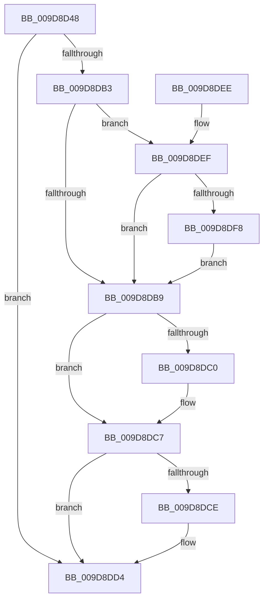

# FsRtlAcquireToCreateMappedSection

- RVA: `0x009D8D48`–`0x009D8E10` (길이 `200` bytes)
- VA: `0x00000001409D8D48`
- 실행 섹션: `PAGE`
- PDB 이름 있음: `예`; PDB Function 태그: `아니요`
- unwind 정보 RVA: `0x000A2EDC`
- 디코드: `59`개 명령, `200/200` bytes 표시
- 미해석 바이트: `0` (있으면 어셈블리에 `.byte`로 보존)

> 이 문서는 커널 이미지의 기계어와 PDB 기호를 분석해 생성했습니다. 4번과 5번은 함수 원형과 자료형을 바이너리 사용 방식에서 추정한 C 해석이며 원본 소스 복구 결과는 아닙니다.

## 1. Dependencies

- 직접 호출 지점: **4**; 고유 호출 대상: **4**
- 직접 호출자로 확인된 함수: **2**
- RIP 상대 이미지 참조: **1**

### Outgoing calls
- `0x009D8DA8` → [FsRtlAcquireFileExclusiveCommon](FsRtlAcquireFileExclusiveCommon_function_009D8E50.md) (function, `0x009D8E50`)
- `0x009D8DDE` → [_security_check_cookie](../../text/6A/_security_check_cookie_function_006AC640.md) (function, `0x006AC640`)
- `0x009D8DFC` → [ExAcquireFastMutex](../../text/20/ExAcquireFastMutex_function_0020E5A0.md) (function, `0x0020E5A0`)
- `0x009D8E09` → [ExReleaseFastMutex](../../text/25/ExReleaseFastMutex_function_002519C0.md) (function, `0x002519C0`)

### Direct callers
- [FsRtlCreateSectionForDataScan](../../text/45/FsRtlCreateSectionForDataScan_function_00453330.md) at `0x004533E7`
- [MiCallCreateSectionFilters](../98/MiCallCreateSectionFilters_function_00984EB8.md) at `0x00984F06`

### Static image references
- `0x009D8D53` → RVA `0x00E0A740` (`.data`; read)

## 2. Other-region calls and transfers

- 다른 실행 섹션으로 향하는 call: **3**
  - `0x009D8DDE` → [_security_check_cookie](../../text/6A/_security_check_cookie_function_006AC640.md) (`PAGE` → `.text`)
  - `0x009D8DFC` → [ExAcquireFastMutex](../../text/20/ExAcquireFastMutex_function_0020E5A0.md) (`PAGE` → `.text`)
  - `0x009D8E09` → [ExReleaseFastMutex](../../text/25/ExReleaseFastMutex_function_002519C0.md) (`PAGE` → `.text`)
- 별도 외부 분기/꼬리 이동을 확인하지 못했습니다.

## 3. Assembly (complete function range)

```asm
009D8D48  40 53                           push rbx
009D8D4A  55                              push rbp
009D8D4B  56                              push rsi
009D8D4C  57                              push rdi
009D8D4D  41 56                           push r14
009D8D4F  48 83 EC 50                     sub rsp, 0x50
009D8D53  48 8B 05 E6 19 43 00            mov rax, qword ptr [rip + 0x4319e6]
009D8D5A  48 33 C4                        xor rax, rsp
009D8D5D  48 89 44 24 40                  mov qword ptr [rsp + 0x40], rax
009D8D62  4C 8B B4 24 A0 00 00 00         mov r14, qword ptr [rsp + 0xa0]
009D8D6A  48 8D 44 24 30                  lea rax, [rsp + 0x30]
009D8D6F  48 8B B4 24 A8 00 00 00         mov rsi, qword ptr [rsp + 0xa8]
009D8D77  0F 57 C0                        xorps xmm0, xmm0
009D8D7A  48 89 44 24 28                  mov qword ptr [rsp + 0x28], rax
009D8D7F  8B EA                           mov ebp, edx
009D8D81  44 89 4C 24 20                  mov dword ptr [rsp + 0x20], r9d
009D8D86  48 8B D9                        mov rbx, rcx
009D8D89  41 83 26 00                     and dword ptr [r14], 0
009D8D8D  45 8B C8                        mov r9d, r8d
009D8D90  83 26 00                        and dword ptr [rsi], 0
009D8D93  44 8B C2                        mov r8d, edx
009D8D96  0F 11 44 24 30                  movups xmmword ptr [rsp + 0x30], xmm0
009D8D9B  BA 01 00 00 00                  mov edx, 1
009D8DA0  C7 44 24 30 10 00 00 00         mov dword ptr [rsp + 0x30], 0x10
009D8DA8  E8 A3 00 00 00                  call 0x1409d8e50
009D8DAD  8B F8                           mov edi, eax
009D8DAF  85 C0                           test eax, eax
009D8DB1  78 21                           js 0x1409d8dd4
009D8DB3  40 F6 C5 44                     test bpl, 0x44
009D8DB7  75 36                           jne 0x1409d8def
009D8DB9  83 7C 24 34 0C                  cmp dword ptr [rsp + 0x34], 0xc
009D8DBE  72 07                           jb 0x1409d8dc7
009D8DC0  8B 44 24 38                     mov eax, dword ptr [rsp + 0x38]
009D8DC4  41 89 06                        mov dword ptr [r14], eax
009D8DC7  83 7C 24 34 10                  cmp dword ptr [rsp + 0x34], 0x10
009D8DCC  72 06                           jb 0x1409d8dd4
009D8DCE  8B 44 24 3C                     mov eax, dword ptr [rsp + 0x3c]
009D8DD2  89 06                           mov dword ptr [rsi], eax
009D8DD4  8B C7                           mov eax, edi
009D8DD6  48 8B 4C 24 40                  mov rcx, qword ptr [rsp + 0x40]
009D8DDB  48 33 CC                        xor rcx, rsp
009D8DDE  E8 5D 38 CD FF                  call 0x1406ac640
009D8DE3  48 83 C4 50                     add rsp, 0x50
009D8DE7  41 5E                           pop r14
009D8DE9  5F                              pop rdi
009D8DEA  5E                              pop rsi
009D8DEB  5D                              pop rbp
009D8DEC  5B                              pop rbx
009D8DED  C3                              ret
009D8DEE  CC                              int3
009D8DEF  48 8B 5B 18                     mov rbx, qword ptr [rbx + 0x18]
009D8DF3  48 85 DB                        test rbx, rbx
009D8DF6  74 C1                           je 0x1409d8db9
009D8DF8  48 8B 4B 30                     mov rcx, qword ptr [rbx + 0x30]
009D8DFC  E8 9F 57 83 FF                  call 0x14020e5a0
009D8E01  48 8B 4B 30                     mov rcx, qword ptr [rbx + 0x30]
009D8E05  80 4B 06 10                     or byte ptr [rbx + 6], 0x10
009D8E09  E8 B2 8B 87 FF                  call 0x1402519c0
009D8E0E  EB A9                           jmp 0x1409d8db9
```

## 4. C-style interpretation (structured pseudocode)

```c
__int64 __fastcall FsRtlAcquireToCreateMappedSection(__int64 a1, int a2, int a3, int a4, __int64 a5, __int64 a6)
{
    __int64 result;
    __int64 v_rsp;
    unsigned __int64 v_stack_m38;
    unsigned int v_stack_m3C;
    unsigned int v_stack_m40;
    unsigned int v_stack_m44;
    unsigned __int64 v_stack_m48;
    unsigned __int64 v_stack_m50;
    unsigned int v_stack_m58;

    v_rsp = (v_rsp) - (80);
    result = (*(unsigned __int64 *)(v_rip + 4397542)) ^ (v_rsp);
    v_stack_m38 = result;
    v_stack_m50 = v_stack_m48;
    v_stack_m58 = a4;
    v_stack_m48 = v_xmm0;
    v_stack_m48 = 16;
    result = FsRtlAcquireFileExclusiveCommon(a1, 1, (unsigned int)(a2), (unsigned int)(a3));
    if (sign_flag) goto loc_009D8DD4;
    if ((((unsigned __int8)((unsigned int)(a2))) & (68)) != 0) goto loc_009D8DEF;
loc_009D8DB9:
    if (v_stack_m44 >= 12) {
        result = v_stack_m40;
        *(unsigned int *)(a5) = (unsigned int)(result);
    }
    if (v_stack_m44 >= 16) {
        result = v_stack_m3C;
        *(unsigned int *)(a6) = (unsigned int)(result);
    }
    a1 = (v_stack_m38) ^ (v_rsp);
    result = _security_check_cookie(a1, 1, (unsigned int)(a2), (unsigned int)(a3));
    v_rsp = (v_rsp) + (80);
    return result;
loc_009D8DEF:
    if (*(unsigned __int64 *)(a1 + 24) == 0) goto loc_009D8DB9;
    result = ExAcquireFastMutex(*(unsigned __int64 *)(*(unsigned __int64 *)(a1 + 24) + 48), 1, (unsigned int)(a2), (unsigned int)(a3));
    result = ExReleaseFastMutex(*(unsigned __int64 *)(*(unsigned __int64 *)(a1 + 24) + 48), 1, (unsigned int)(a2), (unsigned int)(a3));
    goto loc_009D8DB9;
}
```

## 5. (Beta) C Style

```c
int64_t FsRtlAcquireToCreateMappedSection(void *Arg1, int32_t Arg2, int32_t Arg3, int32_t Arg4, void *Arg5, void *Arg6)
{
    uint8_t *arg1 = (uint8_t *)Arg1;
    uint8_t *arg5 = (uint8_t *)Arg5;
    uint8_t *arg6 = (uint8_t *)Arg6;

    int64_t result;
    int64_t local_rsp;
    uint64_t v_stack_m38;
    uint32_t v_stack_m3C;
    uint32_t v_stack_m40;
    uint32_t v_stack_m44;
    uint64_t v_stack_m48;
    uint64_t v_stack_m50;
    uint32_t v_stack_m58;

    local_rsp = (local_rsp) - (80);
    result = (*(uint64_t *)(v_rip + 0x4319E6)) ^ (local_rsp);
    v_stack_m38 = result;
    v_stack_m50 = v_stack_m48;
    v_stack_m58 = Arg4;
    v_stack_m48 = v_xmm0;
    v_stack_m48 = 16;
    result = FsRtlAcquireFileExclusiveCommon(Arg1, 1, (uint32_t)(Arg2), (uint32_t)(Arg3));
    if (sign_flag) goto loc_009D8DD4;
    if ((((uint8_t)((uint32_t)(Arg2))) & (68)) != 0) goto loc_009D8DEF;
loc_009D8DB9:
    if (v_stack_m44 >= 12) {
        result = v_stack_m40;
        *(uint32_t *)(arg5) = (uint32_t)(result);
    }
    if (v_stack_m44 >= 16) {
        result = v_stack_m3C;
        *(uint32_t *)(arg6) = (uint32_t)(result);
    }
    Arg1 = (v_stack_m38) ^ (local_rsp);
    result = _security_check_cookie(Arg1, 1, (uint32_t)(Arg2), (uint32_t)(Arg3));
    local_rsp = (local_rsp) + (80);
    return result;
loc_009D8DEF:
    if (*(uint64_t *)(arg1 + 0x18) == 0) goto loc_009D8DB9;
    result = ExAcquireFastMutex(*(uint64_t *)(*(uint64_t *)(arg1 + 0x18) + 0x30), 1, (uint32_t)(Arg2), (uint32_t)(Arg3));
    result = ExReleaseFastMutex(*(uint64_t *)(*(uint64_t *)(arg1 + 0x18) + 0x30), 1, (uint32_t)(Arg2), (uint32_t)(Arg3));
    goto loc_009D8DB9;
}
```

### 관측된 메모리 오프셋

구조체 형식이 확인되지 않은 접근은 인자 기준의 오프셋으로만 기록했습니다.

| 기준 인자 | 오프셋 표현 | 폭 (bit) | 접근 |
|---|---:|---:|---|
| `Arg1` | `+ 0x18` | `64` | `R` |
| `Arg5` | `+ 0x0` | `32` | `R/W` |
| `Arg5` | `+ 0x0` | `32` | `W` |
| `Arg6` | `+ 0x0` | `32` | `R/W` |
| `Arg6` | `+ 0x0` | `32` | `W` |

## 6. Execution-region graph

[열기: 2D/3D 그래프와 함수 탐색 컨트롤 패널](../../../control-panel.html?section=page&rva=0x009D8D48&view=graph)

- 2D 그래프는 위에서 아래로 흐르고, 3D 그래프는 빈 공간을 드래그해 회전합니다. Shift+드래그는 이동, 휠은 확대·축소, 함수 노드 선택은 대상 보고서 이동입니다.

### Static fallback


