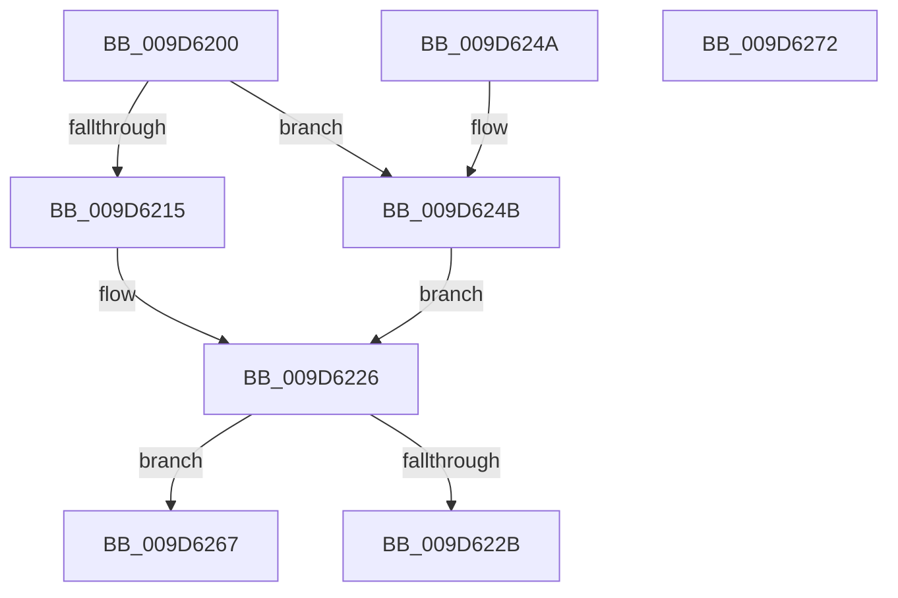

# FsRtlAllocateExtraCreateParameterList

- RVA: `0x009D6200`–`0x009D6273` (길이 `115` bytes)
- VA: `0x00000001409D6200`
- 실행 섹션: `PAGE`
- PDB 이름 있음: `예`; PDB Function 태그: `아니요`
- unwind 정보 RVA: `0x000A2428`
- 디코드: `33`개 명령, `115/115` bytes 표시
- 미해석 바이트: `0` (있으면 어셈블리에 `.byte`로 보존)

> 이 문서는 커널 이미지의 기계어와 PDB 기호를 분석해 생성했습니다. 4번과 5번은 함수 원형과 자료형을 바이너리 사용 방식에서 추정한 C 해석이며 원본 소스 복구 결과는 아닙니다.

## 1. Dependencies

- 직접 호출 지점: **2**; 고유 호출 대상: **2**
- 직접 호출자로 확인된 함수: **1**
- RIP 상대 이미지 참조: **1**

### Outgoing calls
- `0x009D621C` → [ExAllocateFromPagedLookasideList](../../text/3F/ExAllocateFromPagedLookasideList_function_003FB730.md) (function, `0x003FB730`)
- `0x009D625B` → [ExAllocatePool2](../../poolcode/B8/ExAllocatePool2_function_00B820F0.md) (function, `0x00B820F0`)

### Direct callers
- [sub_00B19FF6](../B1/Unknown_function_00B19FF6.md) at `0x00B1A344`

### Static image references
- `0x009D6215` → RVA `0x00E11D00` (`.data`; read)

## 2. Other-region calls and transfers

- 다른 실행 섹션으로 향하는 call: **2**
  - `0x009D621C` → [ExAllocateFromPagedLookasideList](../../text/3F/ExAllocateFromPagedLookasideList_function_003FB730.md) (`PAGE` → `.text`)
  - `0x009D625B` → [ExAllocatePool2](../../poolcode/B8/ExAllocatePool2_function_00B820F0.md) (`PAGE` → `POOLCODE`)
- 별도 외부 분기/꼬리 이동을 확인하지 못했습니다.

## 3. Assembly (complete function range)

```asm
009D6200  40 53                           push rbx
009D6202  48 83 EC 20                     sub rsp, 0x20
009D6206  48 C7 02 00 00 00 00            mov qword ptr [rdx], 0
009D620D  48 8B DA                        mov rbx, rdx
009D6210  F6 C1 01                        test cl, 1
009D6213  75 36                           jne 0x1409d624b
009D6215  48 8D 0D E4 BA 43 00            lea rcx, [rip + 0x43bae4]
009D621C  E8 0F 55 A2 FF                  call 0x1403fb730
009D6221  BA 06 00 00 00                  mov edx, 6
009D6226  48 85 C0                        test rax, rax
009D6229  74 3C                           je 0x1409d6267
009D622B  48 8D 48 08                     lea rcx, [rax + 8]
009D622F  48 89 49 08                     mov qword ptr [rcx + 8], rcx
009D6233  48 89 09                        mov qword ptr [rcx], rcx
009D6236  89 50 04                        mov dword ptr [rax + 4], edx
009D6239  C7 00 45 63 70 4C               mov dword ptr [rax], 0x4c706345
009D623F  48 89 03                        mov qword ptr [rbx], rax
009D6242  33 C0                           xor eax, eax
009D6244  48 83 C4 20                     add rsp, 0x20
009D6248  5B                              pop rbx
009D6249  C3                              ret
009D624A  CC                              int3
009D624B  BA 18 00 00 00                  mov edx, 0x18
009D6250  B9 03 01 00 00                  mov ecx, 0x103
009D6255  41 B8 46 53 65 6C               mov r8d, 0x6c655346
009D625B  E8 90 BE 1A 00                  call 0x140b820f0
009D6260  BA 02 00 00 00                  mov edx, 2
009D6265  EB BF                           jmp 0x1409d6226
009D6267  B8 9A 00 00 C0                  mov eax, 0xc000009a
009D626C  48 83 C4 20                     add rsp, 0x20
009D6270  5B                              pop rbx
009D6271  C3                              ret
009D6272  CC                              int3
```

## 4. C-style interpretation (structured pseudocode)

```c
__int64 __fastcall FsRtlAllocateExtraCreateParameterList(unsigned __int8 a1, __int64 a2)
{
    __int64 result;
    __int64 v_rsp;

    v_rsp = (v_rsp) - (32);
    *(unsigned __int64 *)(a2) = 0;
    if (((a1) & (1)) != 0) goto loc_009D624B;
    result = ExAllocateFromPagedLookasideList(v_rip + 4438756, a2, a3, a4);
loc_009D6226:
    if (result == 0) goto loc_009D6267;
    *(unsigned __int64 *)(result + 8 + 8) = result + 8;
    *(unsigned __int64 *)(result + 8) = result + 8;
    *(unsigned int *)(result + 4) = 6;
    *(unsigned int *)(result) = 0x4C706345ULL;
    *(unsigned __int64 *)(a2) = result;
    result = 0;
    v_rsp = (v_rsp) + (32);
    return result;
loc_009D624B:
    result = ExAllocatePool2(259, 24, (unsigned int)(0x6C655346ULL), a4);
    goto loc_009D6226;
loc_009D6267:
    v_rsp = (v_rsp) + (32);
    return (unsigned int)(0xC000009AULL);
}
```

## 5. (Beta) C Style

```c
int64_t FsRtlAllocateExtraCreateParameterList(uint8_t Arg1, void *Arg2)
{
    uint8_t *arg2 = (uint8_t *)Arg2;

    int64_t result;
    int64_t local_rsp;

    local_rsp = (local_rsp) - (32);
    *(uint64_t *)(arg2) = 0;
    if (((Arg1) & (1)) != 0) goto loc_009D624B;
    result = ExAllocateFromPagedLookasideList(v_rip + 4438756, Arg2, a3, a4);
loc_009D6226:
    if (result == 0) goto loc_009D6267;
    *(uint64_t *)(result + 0x8 + 0x8) = result + 8;
    *(uint64_t *)(result + 0x8) = result + 8;
    *(uint32_t *)(result + 0x4) = 6;
    *(uint32_t *)(result) = 0x4C706345ULL;
    *(uint64_t *)(arg2) = result;
    result = 0;
    local_rsp = (local_rsp) + (32);
    return result;
loc_009D624B:
    result = ExAllocatePool2(259, 24, (uint32_t)(0x6C655346ULL), a4);
    goto loc_009D6226;
loc_009D6267:
    local_rsp = (local_rsp) + (32);
    return (uint32_t)(0xC000009AULL);
}
```

### 관측된 메모리 오프셋

구조체 형식이 확인되지 않은 접근은 인자 기준의 오프셋으로만 기록했습니다.

| 기준 인자 | 오프셋 표현 | 폭 (bit) | 접근 |
|---|---:|---:|---|
| `Arg2` | `+ 0x0` | `64` | `W` |

## 6. Execution-region graph

[열기: 2D/3D 그래프와 함수 탐색 컨트롤 패널](../../../control-panel.html?section=page&rva=0x009D6200&view=graph)

- 2D 그래프는 위에서 아래로 흐르고, 3D 그래프는 빈 공간을 드래그해 회전합니다. Shift+드래그는 이동, 휠은 확대·축소, 함수 노드 선택은 대상 보고서 이동입니다.

### Static fallback


