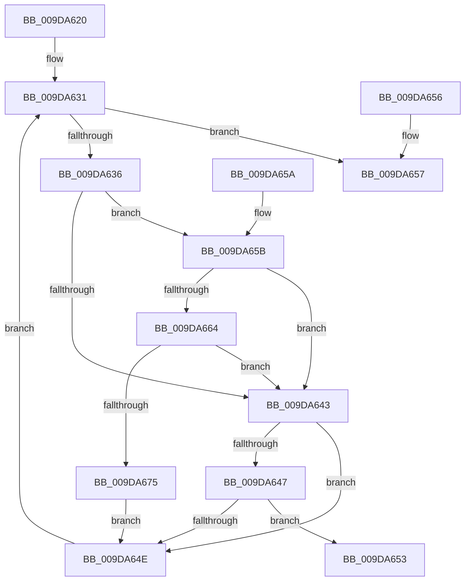

# FsRtlDoesDbcsContainWildCards

- RVA: `0x009DA620`–`0x009DA67A` (길이 `90` bytes)
- VA: `0x00000001409DA620`
- 실행 섹션: `PAGE`
- PDB 이름 있음: `예`; PDB Function 태그: `아니요`
- unwind 정보 RVA: `0x000DB714`
- 디코드: `30`개 명령, `90/90` bytes 표시
- 미해석 바이트: `0` (있으면 어셈블리에 `.byte`로 보존)

> 이 문서는 커널 이미지의 기계어와 PDB 기호를 분석해 생성했습니다. 4번과 5번은 함수 원형과 자료형을 바이너리 사용 방식에서 추정한 C 해석이며 원본 소스 복구 결과는 아닙니다.

## 1. Dependencies

- 직접 호출 지점: **0**; 고유 호출 대상: **0**
- 직접 호출자로 확인된 함수: **1**
- RIP 상대 이미지 참조: **3**

### Outgoing calls
- 직접 디코드된 call 명령이 없습니다.

### Direct callers
- [FsRtlIsFatDbcsLegal](FsRtlIsFatDbcsLegal_function_009DA3C0.md) at `0x009DA50A`

### Static image references
- `0x009DA624` → RVA `0x00013E90` (`.rdata`; read)
- `0x009DA65B` → RVA `0x00FD8000` (`PAGEDATA`; read)
- `0x009DA664` → RVA `0x00FD8090` (`PAGEDATA`; read)

## 2. Other-region calls and transfers

- 다른 실행 섹션으로 향하는 call: **0**
- 별도 외부 분기/꼬리 이동을 확인하지 못했습니다.

## 3. Assembly (complete function range)

```asm
009DA620  44 0F B7 09                     movzx r9d, word ptr [rcx]
009DA624  4C 8D 1D 65 98 63 FF            lea r11, [rip - 0x9c679b]
009DA62B  4C 8B D1                        mov r10, rcx
009DA62E  45 33 C0                        xor r8d, r8d
009DA631  45 3B C1                        cmp r8d, r9d
009DA634  73 21                           jae 0x1409da657
009DA636  49 8B 42 08                     mov rax, qword ptr [r10 + 8]
009DA63A  49 0F BE 04 00                  movsx rax, byte ptr [r8 + rax]
009DA63F  3C 80                           cmp al, 0x80
009DA641  73 18                           jae 0x1409da65b
009DA643  84 C0                           test al, al
009DA645  78 07                           js 0x1409da64e
009DA647  42 F6 04 18 08                  test byte ptr [rax + r11], 8
009DA64C  75 05                           jne 0x1409da653
009DA64E  41 FF C0                        inc r8d
009DA651  EB DE                           jmp 0x1409da631
009DA653  B0 01                           mov al, 1
009DA655  C3                              ret
009DA656  CC                              int3
009DA657  32 C0                           xor al, al
009DA659  C3                              ret
009DA65A  CC                              int3
009DA65B  80 3D 9E D9 5F 00 00            cmp byte ptr [rip + 0x5fd99e], 0
009DA662  74 DF                           je 0x1409da643
009DA664  48 8B 0D 25 DA 5F 00            mov rcx, qword ptr [rip + 0x5fda25]
009DA66B  0F B6 D0                        movzx edx, al
009DA66E  66 83 3C 51 00                  cmp word ptr [rcx + rdx*2], 0
009DA673  74 CE                           je 0x1409da643
009DA675  41 FF C0                        inc r8d
009DA678  EB D4                           jmp 0x1409da64e
```

## 4. C-style interpretation (structured pseudocode)

```c
__int64 __fastcall FsRtlDoesDbcsContainWildCards(__int64 a1, __int64 a2, int a3)
{
    __int64 result;

    a3 = 0;
loc_009DA631:
    if (0 >= ((unsigned int)(*(unsigned __int16 *)(a1)))) goto loc_009DA657;
    if (((unsigned __int8)((__int8)(*(unsigned __int8 *)(a3 + *(unsigned __int64 *)(a1 + 8) * 1)))) >= 128) goto loc_009DA65B;
loc_009DA643:
    if (sign_flag) goto loc_009DA64E;
    if (((*(unsigned __int8 *)((__int8)(*(unsigned __int8 *)(a3 + *(unsigned __int64 *)(a1 + 8) * 1)) + v_rip - 10250139 * 1)) & (8)) != 0) goto loc_009DA653;
loc_009DA64E:
    a3 = (unsigned int)((a3) + 1);
    goto loc_009DA631;
loc_009DA653:
    return 1;
loc_009DA657:
    result = 0;
    return result;
loc_009DA65B:
    if ((*(unsigned __int8 *)(v_rip + 6281630)) == 0) goto loc_009DA643;
    if ((*(unsigned __int16 *)(*(unsigned __int64 *)(v_rip + 6281765) + 0 * 2)) == 0) goto loc_009DA643;
    a3 = (unsigned int)((a3) + 1);
    goto loc_009DA64E;
}
```

## 5. (Beta) C Style

```c
int64_t FsRtlDoesDbcsContainWildCards(void *Arg1, int64_t Arg2, int32_t Arg3)
{
    uint8_t *arg1 = (uint8_t *)Arg1;

    int64_t result;

    Arg3 = 0;
loc_009DA631:
    if (0 >= ((uint32_t)(*(uint16_t *)(arg1)))) goto loc_009DA657;
    if (((uint8_t)((int8_t)(*(uint8_t *)(Arg3 + *(uint64_t *)(arg1 + 0x8) * 1)))) >= 128) goto loc_009DA65B;
loc_009DA643:
    if (sign_flag) goto loc_009DA64E;
    if (((*(uint8_t *)((int8_t)(*(uint8_t *)(Arg3 + *(uint64_t *)(arg1 + 0x8) * 1)) + v_rip - 0x9C679B * 1)) & (8)) != 0) goto loc_009DA653;
loc_009DA64E:
    Arg3 = (uint32_t)((Arg3) + 1);
    goto loc_009DA631;
loc_009DA653:
    return 1;
loc_009DA657:
    result = 0;
    return result;
loc_009DA65B:
    if ((*(uint8_t *)(v_rip + 0x5FD99E)) == 0) goto loc_009DA643;
    if ((*(uint16_t *)(*(uint64_t *)(v_rip + 0x5FDA25) + 0x0 * 2)) == 0) goto loc_009DA643;
    Arg3 = (uint32_t)((Arg3) + 1);
    goto loc_009DA64E;
}
```

### 관측된 메모리 오프셋

구조체 형식이 확인되지 않은 접근은 인자 기준의 오프셋으로만 기록했습니다.

| 기준 인자 | 오프셋 표현 | 폭 (bit) | 접근 |
|---|---:|---:|---|
| `Arg1` | `+ 0x0` | `16` | `R` |
| `Arg1` | `+ 0x8` | `64` | `R` |

## 6. Execution-region graph

[열기: 2D/3D 그래프와 함수 탐색 컨트롤 패널](../../../control-panel.html?section=page&rva=0x009DA620&view=graph)

- 2D 그래프는 위에서 아래로 흐르고, 3D 그래프는 빈 공간을 드래그해 회전합니다. Shift+드래그는 이동, 휠은 확대·축소, 함수 노드 선택은 대상 보고서 이동입니다.

### Static fallback


