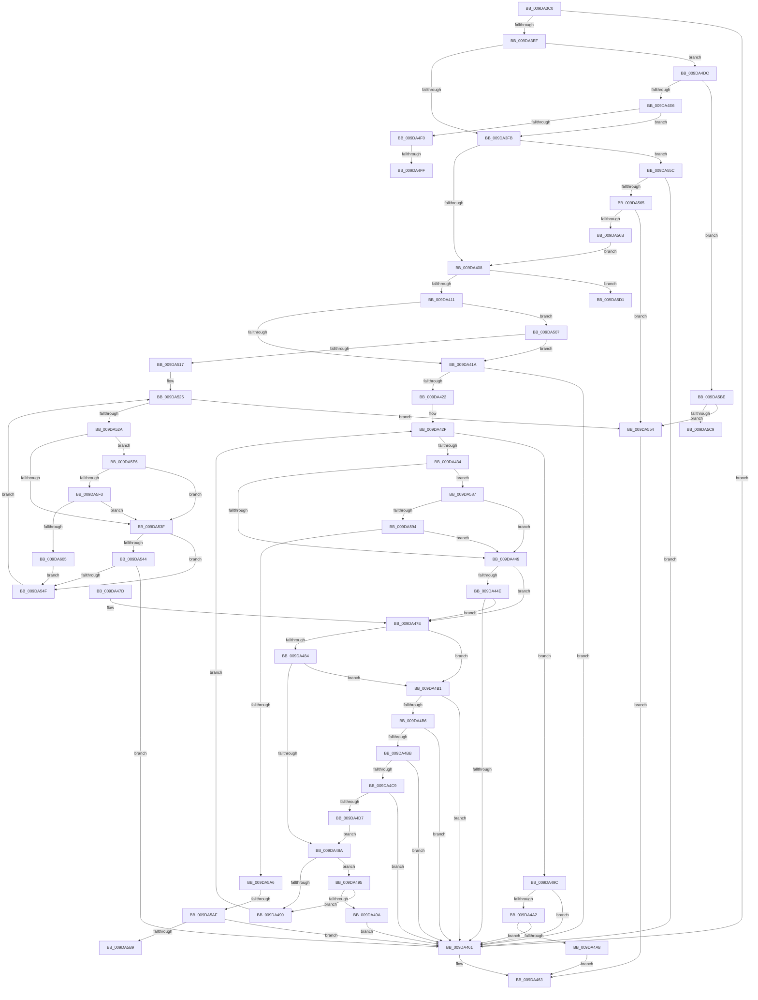

# FsRtlIsFatDbcsLegal

- RVA: `0x009DA3C0`–`0x009DA60D` (길이 `589` bytes)
- VA: `0x00000001409DA3C0`
- 실행 섹션: `PAGE`
- PDB 이름 있음: `예`; PDB Function 태그: `예`
- unwind 정보 RVA: `0x000A31C0`
- 디코드: `162`개 명령, `589/589` bytes 표시
- 미해석 바이트: `0` (있으면 어셈블리에 `.byte`로 보존)

> 이 문서는 커널 이미지의 기계어와 PDB 기호를 분석해 생성했습니다. 4번과 5번은 함수 원형과 자료형을 바이너리 사용 방식에서 추정한 C 해석이며 원본 소스 복구 결과는 아닙니다.

## 1. Dependencies

- 직접 호출 지점: **1**; 고유 호출 대상: **1**
- 직접 호출자로 확인된 함수: **1**
- RIP 상대 이미지 참조: **3**

### Outgoing calls
- `0x009DA50A` → [FsRtlDoesDbcsContainWildCards](FsRtlDoesDbcsContainWildCards_function_009DA620.md) (function, `0x009DA620`)

### Direct callers
- [sub_00B2FBD0](../B2/Unknown_function_00B2FBD0.md) at `0x00B2FC3E`

### Static image references
- `0x009DA425` → RVA `0x00013E90` (`.rdata`; read)
- `0x009DA587` → RVA `0x00FD8000` (`PAGEDATA`; read)
- `0x009DA594` → RVA `0x00FD8090` (`PAGEDATA`; read)

## 2. Other-region calls and transfers

- 다른 실행 섹션으로 향하는 call: **0**
- call이 아닌 외부 분기/꼬리 이동: **6**
  - `0x009DA4F9` → [sub_00B2FBD0](../B2/Unknown_function_00B2FBD0.md) (`tail-transfer`)
  - `0x009DA502` → [sub_00B2FBD0 + 0xC](../B2/Unknown_function_00B2FBD0.md) (`tail-transfer`)
  - `0x009DA5A9` → [sub_00B2FBD0 + 0x82](../B2/Unknown_function_00B2FBD0.md) (`tail-transfer`)
  - `0x009DA5B9` → [sub_00B2FBD0 + 0x82](../B2/Unknown_function_00B2FBD0.md) (`tail-transfer`)
  - `0x009DA5CC` → [sub_00B2FBD0 + 0xC](../B2/Unknown_function_00B2FBD0.md) (`tail-transfer`)
  - `0x009DA5E1` → [sub_00B2FBD0 + 0x17](../B2/Unknown_function_00B2FBD0.md) (`tail-transfer`)

## 3. Assembly (complete function range)

```asm
009DA3C0  48 89 5C 24 08                  mov qword ptr [rsp + 8], rbx
009DA3C5  48 89 6C 24 10                  mov qword ptr [rsp + 0x10], rbp
009DA3CA  48 89 74 24 18                  mov qword ptr [rsp + 0x18], rsi
009DA3CF  57                              push rdi
009DA3D0  41 56                           push r14
009DA3D2  41 57                           push r15
009DA3D4  48 83 EC 50                     sub rsp, 0x50
009DA3D8  45 33 F6                        xor r14d, r14d
009DA3DB  48 8B D9                        mov rbx, rcx
009DA3DE  0F B7 09                        movzx ecx, word ptr [rcx]
009DA3E1  40 8A EA                        mov bpl, dl
009DA3E4  41 8A F6                        mov sil, r14b
009DA3E7  41 8A FE                        mov dil, r14b
009DA3EA  66 85 C9                        test cx, cx
009DA3ED  74 72                           je 0x1409da461
009DA3EF  45 8D 7E 01                     lea r15d, [r14 + 1]
009DA3F3  84 D2                           test dl, dl
009DA3F5  0F 85 E1 00 00 00               jne 0x1409da4dc
009DA3FB  48 8B 43 08                     mov rax, qword ptr [rbx + 8]
009DA3FF  80 38 5C                        cmp byte ptr [rax], 0x5c
009DA402  0F 84 54 01 00 00               je 0x1409da55c
009DA408  45 84 C0                        test r8b, r8b
009DA40B  0F 85 C0 01 00 00               jne 0x1409da5d1
009DA411  40 84 ED                        test bpl, bpl
009DA414  0F 85 ED 00 00 00               jne 0x1409da507
009DA41A  0F B7 03                        movzx eax, word ptr [rbx]
009DA41D  83 F8 0C                        cmp eax, 0xc
009DA420  77 3F                           ja 0x1409da461
009DA422  45 8B C6                        mov r8d, r14d
009DA425  4C 8D 15 64 9A 63 FF            lea r10, [rip - 0x9c659c]
009DA42C  44 8B C8                        mov r9d, eax
009DA42F  45 3B C1                        cmp r8d, r9d
009DA432  73 68                           jae 0x1409da49c
009DA434  48 8B 43 08                     mov rax, qword ptr [rbx + 8]
009DA438  41 8B C8                        mov ecx, r8d
009DA43B  0F B6 3C 01                     movzx edi, byte ptr [rcx + rax]
009DA43F  40 80 FF 80                     cmp dil, 0x80
009DA443  0F 83 3E 01 00 00               jae 0x1409da587
009DA449  40 84 FF                        test dil, dil
009DA44C  78 30                           js 0x1409da47e
009DA44E  40 8A C5                        mov al, bpl
009DA451  F6 D8                           neg al
009DA453  1B C9                           sbb ecx, ecx
009DA455  83 E1 08                        and ecx, 8
009DA458  41 03 CF                        add ecx, r15d
009DA45B  42 84 0C 17                     test byte ptr [rdi + r10], cl
009DA45F  75 1D                           jne 0x1409da47e
009DA461  32 C0                           xor al, al
009DA463  4C 8D 5C 24 50                  lea r11, [rsp + 0x50]
009DA468  49 8B 5B 20                     mov rbx, qword ptr [r11 + 0x20]
009DA46C  49 8B 6B 28                     mov rbp, qword ptr [r11 + 0x28]
009DA470  49 8B 73 30                     mov rsi, qword ptr [r11 + 0x30]
009DA474  49 8B E3                        mov rsp, r11
009DA477  41 5F                           pop r15
009DA479  41 5E                           pop r14
009DA47B  5F                              pop rdi
009DA47C  C3                              ret
009DA47D  CC                              int3
009DA47E  40 80 FF 2E                     cmp dil, 0x2e
009DA482  74 2D                           je 0x1409da4b1
009DA484  40 80 FF 22                     cmp dil, 0x22
009DA488  74 27                           je 0x1409da4b1
009DA48A  41 83 F8 08                     cmp r8d, 8
009DA48E  73 05                           jae 0x1409da495
009DA490  45 03 C7                        add r8d, r15d
009DA493  EB 9A                           jmp 0x1409da42f
009DA495  40 84 F6                        test sil, sil
009DA498  75 F6                           jne 0x1409da490
009DA49A  EB C5                           jmp 0x1409da461
009DA49C  40 80 FF 20                     cmp dil, 0x20
009DA4A0  74 BF                           je 0x1409da461
009DA4A2  40 80 FF 2E                     cmp dil, 0x2e
009DA4A6  74 B9                           je 0x1409da461
009DA4A8  40 80 FF 22                     cmp dil, 0x22
009DA4AC  0F 95 C0                        setne al
009DA4AF  EB B2                           jmp 0x1409da463
009DA4B1  45 85 C0                        test r8d, r8d
009DA4B4  74 AB                           je 0x1409da461
009DA4B6  40 84 F6                        test sil, sil
009DA4B9  75 A6                           jne 0x1409da461
009DA4BB  41 8B C1                        mov eax, r9d
009DA4BE  41 2B C0                        sub eax, r8d
009DA4C1  41 2B C7                        sub eax, r15d
009DA4C4  83 F8 03                        cmp eax, 3
009DA4C7  77 98                           ja 0x1409da461
009DA4C9  48 8B 43 08                     mov rax, qword ptr [rbx + 8]
009DA4CD  41 8D 48 FF                     lea ecx, [r8 - 1]
009DA4D1  80 3C 01 20                     cmp byte ptr [rcx + rax], 0x20
009DA4D5  74 8A                           je 0x1409da461
009DA4D7  41 8A F7                        mov sil, r15b
009DA4DA  EB AE                           jmp 0x1409da48a
009DA4DC  66 41 3B CF                     cmp cx, r15w
009DA4E0  0F 84 D8 00 00 00               je 0x1409da5be
009DA4E6  66 83 F9 02                     cmp cx, 2
009DA4EA  0F 85 0B FF FF FF               jne 0x1409da3fb
009DA4F0  48 8B 43 08                     mov rax, qword ptr [rbx + 8]
009DA4F4  8A 10                           mov dl, byte ptr [rax]
009DA4F6  80 FA 2E                        cmp dl, 0x2e
009DA4F9  0F 85 D1 56 15 00               jne 0x140b2fbd0
009DA4FF  38 50 01                        cmp byte ptr [rax + 1], dl
009DA502  E9 D5 56 15 00                  jmp 0x140b2fbdc
009DA507  48 8B CB                        mov rcx, rbx
009DA50A  E8 11 01 00 00                  call 0x1409da620
009DA50F  84 C0                           test al, al
009DA511  0F 84 03 FF FF FF               je 0x1409da41a
009DA517  44 0F B7 0B                     movzx r9d, word ptr [rbx]
009DA51B  4C 8D 15 6E 99 63 FF            lea r10, [rip - 0x9c6692]
009DA522  41 8B D6                        mov edx, r14d
009DA525  41 3B D1                        cmp edx, r9d
009DA528  73 2A                           jae 0x1409da554
009DA52A  48 8B 43 08                     mov rax, qword ptr [rbx + 8]
009DA52E  8B CA                           mov ecx, edx
009DA530  44 0F B6 04 01                  movzx r8d, byte ptr [rcx + rax]
009DA535  41 80 F8 80                     cmp r8b, 0x80
009DA539  0F 83 A7 00 00 00               jae 0x1409da5e6
009DA53F  45 84 C0                        test r8b, r8b
009DA542  78 0B                           js 0x1409da54f
009DA544  43 F6 04 10 09                  test byte ptr [r8 + r10], 9
009DA549  0F 84 12 FF FF FF               je 0x1409da461
009DA54F  41 03 D7                        add edx, r15d
009DA552  EB D1                           jmp 0x1409da525
009DA554  41 8A C7                        mov al, r15b
009DA557  E9 07 FF FF FF                  jmp 0x1409da463
009DA55C  45 84 C9                        test r9b, r9b
009DA55F  0F 84 FC FE FF FF               je 0x1409da461
009DA565  66 41 3B CF                     cmp cx, r15w
009DA569  76 E9                           jbe 0x1409da554
009DA56B  48 FF C0                        inc rax
009DA56E  66 41 2B CF                     sub cx, r15w
009DA572  48 89 43 08                     mov qword ptr [rbx + 8], rax
009DA576  B8 FF FF 00 00                  mov eax, 0xffff
009DA57B  66 01 43 02                     add word ptr [rbx + 2], ax
009DA57F  66 89 0B                        mov word ptr [rbx], cx
009DA582  E9 81 FE FF FF                  jmp 0x1409da408
009DA587  44 38 35 72 DA 5F 00            cmp byte ptr [rip + 0x5fda72], r14b
009DA58E  0F 84 B5 FE FF FF               je 0x1409da449
009DA594  48 8B 05 F5 DA 5F 00            mov rax, qword ptr [rip + 0x5fdaf5]
009DA59B  66 44 39 34 78                  cmp word ptr [rax + rdi*2], r14w
009DA5A0  0F 84 A3 FE FF FF               je 0x1409da449
009DA5A6  40 84 F6                        test sil, sil
009DA5A9  0F 85 A3 56 15 00               jne 0x140b2fc52
009DA5AF  41 83 F8 07                     cmp r8d, 7
009DA5B3  0F 83 A8 FE FF FF               jae 0x1409da461
009DA5B9  E9 94 56 15 00                  jmp 0x140b2fc52
009DA5BE  48 8B 43 08                     mov rax, qword ptr [rbx + 8]
009DA5C2  8A 10                           mov dl, byte ptr [rax]
009DA5C4  80 FA 2E                        cmp dl, 0x2e
009DA5C7  74 8B                           je 0x1409da554
009DA5C9  80 FA 22                        cmp dl, 0x22
009DA5CC  E9 0B 56 15 00                  jmp 0x140b2fbdc
009DA5D1  0F 10 0B                        movups xmm1, xmmword ptr [rbx]
009DA5D4  0F 57 C0                        xorps xmm0, xmm0
009DA5D7  0F 29 4C 24 30                  movaps xmmword ptr [rsp + 0x30], xmm1
009DA5DC  0F 11 44 24 20                  movups xmmword ptr [rsp + 0x20], xmm0
009DA5E1  E9 01 56 15 00                  jmp 0x140b2fbe7
009DA5E6  44 38 35 13 DA 5F 00            cmp byte ptr [rip + 0x5fda13], r14b
009DA5ED  0F 84 4C FF FF FF               je 0x1409da53f
009DA5F3  48 8B 05 96 DA 5F 00            mov rax, qword ptr [rip + 0x5fda96]
009DA5FA  66 46 39 34 40                  cmp word ptr [rax + r8*2], r14w
009DA5FF  0F 84 3A FF FF FF               je 0x1409da53f
009DA605  41 03 D7                        add edx, r15d
009DA608  E9 42 FF FF FF                  jmp 0x1409da54f
```

## 4. C-style interpretation (structured pseudocode)

```c
__int64 __fastcall FsRtlIsFatDbcsLegal(__int64 a1, unsigned __int8 a2, unsigned __int8 a3)
{
    __int64 result;
    __int64 v_r14;
    __int64 v_rsp;
    unsigned __int64 v_stack_m18;
    unsigned __int64 v_stack_m20;
    unsigned __int64 v_stack_m30;
    unsigned __int64 v_stack_p10;
    unsigned __int64 v_stack_p18;
    unsigned __int64 v_stack_p8;

    v_stack_p8 = v_rbx;
    v_stack_p10 = v_rbp;
    v_stack_p18 = v_rsi;
    v_rsp = (v_rsp) - (80);
    v_r14 = 0;
    if ((unsigned __int16)(*(unsigned __int16 *)(a1)) == 0) goto loc_009DA461;
    if (a2 != 0) goto loc_009DA4DC;
loc_009DA3FB:
    if ((*(unsigned __int8 *)(*(unsigned __int64 *)(a1 + 8))) == 92) goto loc_009DA55C;
loc_009DA408:
    if (a3 != 0) goto loc_009DA5D1;
    if (a2 != 0) goto loc_009DA507;
loc_009DA41A:
    if (((unsigned int)(*(unsigned __int16 *)(a1))) > 12) goto loc_009DA461;
loc_009DA42F:
    if (0 >= ((unsigned int)((unsigned int)((unsigned int)(*(unsigned __int16 *)(a1)))))) goto loc_009DA49C;
    if (((unsigned __int8)(*(unsigned __int8 *)(0 + *(unsigned __int64 *)(a1 + 8) * 1))) >= 128) goto loc_009DA587;
loc_009DA449:
    if (sign_flag) goto loc_009DA47E;
    result = (unsigned __int8)(-(a2));
    a1 = (unsigned int)((0) & (8));
    a1 = (unsigned int)((a1) + ((unsigned int)(v_r14 + 1)));
    if (((*(unsigned __int8 *)(*(unsigned __int8 *)(0 + *(unsigned __int64 *)(a1 + 8) * 1) + v_rip - 10249628 * 1)) & ((unsigned __int8)(a1))) != 0) goto loc_009DA47E;
loc_009DA461:
    result = 0;
loc_009DA463:
    return result;
loc_009DA47E:
    if (((unsigned __int8)(*(unsigned __int8 *)(0 + *(unsigned __int64 *)(a1 + 8) * 1))) == 46) goto loc_009DA4B1;
    if (((unsigned __int8)(*(unsigned __int8 *)(0 + *(unsigned __int64 *)(a1 + 8) * 1))) == 34) goto loc_009DA4B1;
loc_009DA48A:
    if (0 >= 8) goto loc_009DA495;
loc_009DA490:
    a3 = (unsigned int)((0) + ((unsigned int)(v_r14 + 1)));
    goto loc_009DA42F;
loc_009DA495:
    if ((unsigned __int8)(*(unsigned __int64 *)(v_stack_m18 + 48)) != 0) goto loc_009DA490;
    goto loc_009DA461;
loc_009DA49C:
    if (((unsigned __int8)(*(unsigned __int8 *)(0 + *(unsigned __int64 *)(a1 + 8) * 1))) == 32) goto loc_009DA461;
    if (((unsigned __int8)(*(unsigned __int8 *)(0 + *(unsigned __int64 *)(a1 + 8) * 1))) == 46) goto loc_009DA461;
    result = (((unsigned __int8)(*(unsigned __int8 *)(0 + *(unsigned __int64 *)(a1 + 8) * 1))) != 34) ? 1 : 0;
    goto loc_009DA463;
loc_009DA4B1:
    if (a3 == 0) goto loc_009DA461;
    if ((unsigned __int8)(*(unsigned __int64 *)(v_stack_m18 + 48)) != 0) goto loc_009DA461;
    result = (unsigned int)(((unsigned int)((unsigned int)((unsigned int)((unsigned int)(*(unsigned __int16 *)(a1)))))) - (a3));
    result = (unsigned int)((result) - ((unsigned int)(v_r14 + 1)));
    if (((unsigned int)(result)) > 3) goto loc_009DA461;
    if ((*(unsigned __int8 *)(a3 - 1 + *(unsigned __int64 *)(*(unsigned __int64 *)(v_stack_m18 + 32) + 8) * 1)) == 32) goto loc_009DA461;
    goto loc_009DA48A;
loc_009DA4DC:
    if (((unsigned __int16)(a3 - 1)) == ((unsigned __int16)(v_r14 + 1))) goto loc_009DA5BE;
    if (((unsigned __int16)(a3 - 1)) != 2) goto loc_009DA3FB;
loc_009DA507:
    result = FsRtlDoesDbcsContainWildCards(*(unsigned __int64 *)(v_stack_m18 + 32), *(unsigned __int8 *)(*(unsigned __int64 *)(*(unsigned __int64 *)(v_stack_m18 + 32) + 8)), a3, (unsigned int)((unsigned int)(*(unsigned __int16 *)(a1))));
    if ((unsigned __int8)(result) == 0) goto loc_009DA41A;
loc_009DA525:
    if (0 >= ((unsigned int)(*(unsigned __int16 *)(*(unsigned __int64 *)(v_stack_m18 + 32))))) goto loc_009DA554;
    if (((unsigned __int8)(*(unsigned __int8 *)(0 + *(unsigned __int64 *)(*(unsigned __int64 *)(v_stack_m18 + 32) + 8) * 1))) >= 128) goto loc_009DA5E6;
loc_009DA53F:
    if (sign_flag) goto loc_009DA54F;
    if (((*(unsigned __int8 *)(*(unsigned __int8 *)(0 + *(unsigned __int64 *)(*(unsigned __int64 *)(v_stack_m18 + 32) + 8) * 1) + v_rip - 10249874 * 1)) & (9)) == 0) goto loc_009DA461;
loc_009DA54F:
    a2 = (unsigned int)((0) + ((unsigned int)(v_r14 + 1)));
    goto loc_009DA525;
loc_009DA554:
    goto loc_009DA463;
loc_009DA55C:
    if ((unsigned __int8)(*(unsigned __int16 *)(*(unsigned __int64 *)(v_stack_m18 + 32))) == 0) goto loc_009DA461;
    if (0 <= ((unsigned __int16)(v_r14 + 1))) goto loc_009DA554;
    result = ((unsigned __int8)(v_r14 + 1)) + 1;
    a1 = (unsigned __int16)((0) - ((unsigned __int16)(v_r14 + 1)));
    *(unsigned __int64 *)(*(unsigned __int64 *)(v_stack_m18 + 32) + 8) = result;
    *(unsigned __int16 *)(*(unsigned __int64 *)(v_stack_m18 + 32)) = (unsigned __int16)(a1);
    goto loc_009DA408;
loc_009DA587:
    if ((*(unsigned __int8 *)(v_rip + 6281842)) == 0) goto loc_009DA449;
    if ((*(unsigned __int16 *)(*(unsigned __int64 *)(v_rip + 6281973) + *(unsigned __int8 *)(0 + *(unsigned __int64 *)(a1 + 8) * 1) * 2)) == 0) goto loc_009DA449;
    if (((unsigned int)(*(unsigned __int8 *)(0 + *(unsigned __int64 *)(*(unsigned __int64 *)(v_stack_m18 + 32) + 8) * 1))) >= 7) goto loc_009DA461;
loc_009DA5BE:
    if (((unsigned __int8)(*(unsigned __int8 *)(*(unsigned __int64 *)(*(unsigned __int64 *)(v_stack_m18 + 32) + 8)))) == 46) goto loc_009DA554;
loc_009DA5D1:
    v_stack_m20 = v_xmm1;
    v_stack_m30 = v_xmm0;
loc_009DA5E6:
    if ((*(unsigned __int8 *)(v_rip + 6281747)) == 0) goto loc_009DA53F;
    if ((*(unsigned __int16 *)(*(unsigned __int64 *)(v_rip + 6281878) + *(unsigned __int8 *)(0 + *(unsigned __int64 *)(*(unsigned __int64 *)(v_stack_m18 + 32) + 8) * 1) * 2)) == 0) goto loc_009DA53F;
    a2 = (unsigned int)((*(unsigned __int8 *)(*(unsigned __int64 *)(*(unsigned __int64 *)(v_stack_m18 + 32) + 8))) + ((unsigned int)(v_r14 + 1)));
    goto loc_009DA54F;
}
```

## 5. (Beta) C Style

```c
int64_t FsRtlIsFatDbcsLegal(void *Arg1, uint8_t Arg2, uint8_t Arg3)
{
    uint8_t *arg1 = (uint8_t *)Arg1;

    int64_t result;
    int64_t local_r14;
    int64_t local_rsp;
    uint64_t v_stack_m18;
    uint64_t v_stack_m20;
    uint64_t v_stack_m30;
    uint64_t v_stack_p10;
    uint64_t v_stack_p18;
    uint64_t v_stack_p8;

    v_stack_p8 = local_rbx;
    v_stack_p10 = local_rbp;
    v_stack_p18 = local_rsi;
    local_rsp = (local_rsp) - (80);
    local_r14 = 0;
    if ((uint16_t)(*(uint16_t *)(arg1)) == 0) goto loc_009DA461;
    if (Arg2 != 0) goto loc_009DA4DC;
loc_009DA3FB:
    if ((*(uint8_t *)(*(uint64_t *)(arg1 + 0x8))) == 92) goto loc_009DA55C;
loc_009DA408:
    if (Arg3 != 0) goto loc_009DA5D1;
    if (Arg2 != 0) goto loc_009DA507;
loc_009DA41A:
    if (((uint32_t)(*(uint16_t *)(arg1))) > 12) goto loc_009DA461;
loc_009DA42F:
    if (0 >= ((uint32_t)((uint32_t)((uint32_t)(*(uint16_t *)(arg1)))))) goto loc_009DA49C;
    if (((uint8_t)(*(uint8_t *)(0 + *(uint64_t *)(arg1 + 0x8) * 1))) >= 128) goto loc_009DA587;
loc_009DA449:
    if (sign_flag) goto loc_009DA47E;
    result = (uint8_t)(-(Arg2));
    Arg1 = (uint32_t)((0) & (8));
    Arg1 = (uint32_t)((Arg1) + ((uint32_t)(local_r14 + 1)));
    if (((*(uint8_t *)(*(uint8_t *)(0 + *(uint64_t *)(arg1 + 0x8) * 1) + v_rip - 0x9C659C * 1)) & ((uint8_t)(Arg1))) != 0) goto loc_009DA47E;
loc_009DA461:
    result = 0;
loc_009DA463:
    return result;
loc_009DA47E:
    if (((uint8_t)(*(uint8_t *)(0 + *(uint64_t *)(arg1 + 0x8) * 1))) == 46) goto loc_009DA4B1;
    if (((uint8_t)(*(uint8_t *)(0 + *(uint64_t *)(arg1 + 0x8) * 1))) == 34) goto loc_009DA4B1;
loc_009DA48A:
    if (0 >= 8) goto loc_009DA495;
loc_009DA490:
    Arg3 = (uint32_t)((0) + ((uint32_t)(local_r14 + 1)));
    goto loc_009DA42F;
loc_009DA495:
    if ((uint8_t)(*(uint64_t *)(v_stack_m18 + 0x30)) != 0) goto loc_009DA490;
    goto loc_009DA461;
loc_009DA49C:
    if (((uint8_t)(*(uint8_t *)(0 + *(uint64_t *)(arg1 + 0x8) * 1))) == 32) goto loc_009DA461;
    if (((uint8_t)(*(uint8_t *)(0 + *(uint64_t *)(arg1 + 0x8) * 1))) == 46) goto loc_009DA461;
    result = (((uint8_t)(*(uint8_t *)(0 + *(uint64_t *)(arg1 + 0x8) * 1))) != 34) ? 1 : 0;
    goto loc_009DA463;
loc_009DA4B1:
    if (Arg3 == 0) goto loc_009DA461;
    if ((uint8_t)(*(uint64_t *)(v_stack_m18 + 0x30)) != 0) goto loc_009DA461;
    result = (uint32_t)(((uint32_t)((uint32_t)((uint32_t)((uint32_t)(*(uint16_t *)(arg1)))))) - (Arg3));
    result = (uint32_t)((result) - ((uint32_t)(local_r14 + 1)));
    if (((uint32_t)(result)) > 3) goto loc_009DA461;
    if ((*(uint8_t *)(Arg3 - 0x1 + *(uint64_t *)(*(uint64_t *)(v_stack_m18 + 0x20) + 0x8) * 1)) == 32) goto loc_009DA461;
    goto loc_009DA48A;
loc_009DA4DC:
    if (((uint16_t)(Arg3 - 1)) == ((uint16_t)(local_r14 + 1))) goto loc_009DA5BE;
    if (((uint16_t)(Arg3 - 1)) != 2) goto loc_009DA3FB;
loc_009DA507:
    result = FsRtlDoesDbcsContainWildCards(*(uint64_t *)(v_stack_m18 + 0x20), *(uint8_t *)(*(uint64_t *)(*(uint64_t *)(v_stack_m18 + 0x20) + 0x8)), Arg3, (uint32_t)((uint32_t)(*(uint16_t *)(arg1))));
    if ((uint8_t)(result) == 0) goto loc_009DA41A;
loc_009DA525:
    if (0 >= ((uint32_t)(*(uint16_t *)(*(uint64_t *)(v_stack_m18 + 0x20))))) goto loc_009DA554;
    if (((uint8_t)(*(uint8_t *)(0 + *(uint64_t *)(*(uint64_t *)(v_stack_m18 + 0x20) + 0x8) * 1))) >= 128) goto loc_009DA5E6;
loc_009DA53F:
    if (sign_flag) goto loc_009DA54F;
    if (((*(uint8_t *)(*(uint8_t *)(0 + *(uint64_t *)(*(uint64_t *)(v_stack_m18 + 0x20) + 0x8) * 1) + v_rip - 0x9C6692 * 1)) & (9)) == 0) goto loc_009DA461;
loc_009DA54F:
    Arg2 = (uint32_t)((0) + ((uint32_t)(local_r14 + 1)));
    goto loc_009DA525;
loc_009DA554:
    goto loc_009DA463;
loc_009DA55C:
    if ((uint8_t)(*(uint16_t *)(*(uint64_t *)(v_stack_m18 + 0x20))) == 0) goto loc_009DA461;
    if (0 <= ((uint16_t)(local_r14 + 1))) goto loc_009DA554;
    result = ((uint8_t)(local_r14 + 1)) + 1;
    Arg1 = (uint16_t)((0) - ((uint16_t)(local_r14 + 1)));
    *(uint64_t *)(*(uint64_t *)(v_stack_m18 + 0x20) + 0x8) = result;
    *(uint16_t *)(*(uint64_t *)(v_stack_m18 + 0x20)) = (uint16_t)(Arg1);
    goto loc_009DA408;
loc_009DA587:
    if ((*(uint8_t *)(v_rip + 0x5FDA72)) == 0) goto loc_009DA449;
    if ((*(uint16_t *)(*(uint64_t *)(v_rip + 0x5FDAF5) + *(uint8_t *)(0 + *(uint64_t *)(arg1 + 0x8) * 1) * 2)) == 0) goto loc_009DA449;
    if (((uint32_t)(*(uint8_t *)(0 + *(uint64_t *)(*(uint64_t *)(v_stack_m18 + 0x20) + 0x8) * 1))) >= 7) goto loc_009DA461;
loc_009DA5BE:
    if (((uint8_t)(*(uint8_t *)(*(uint64_t *)(*(uint64_t *)(v_stack_m18 + 0x20) + 0x8)))) == 46) goto loc_009DA554;
loc_009DA5D1:
    v_stack_m20 = v_xmm1;
    v_stack_m30 = v_xmm0;
loc_009DA5E6:
    if ((*(uint8_t *)(v_rip + 0x5FDA13)) == 0) goto loc_009DA53F;
    if ((*(uint16_t *)(*(uint64_t *)(v_rip + 0x5FDA96) + *(uint8_t *)(0 + *(uint64_t *)(*(uint64_t *)(v_stack_m18 + 0x20) + 0x8) * 1) * 2)) == 0) goto loc_009DA53F;
    Arg2 = (uint32_t)((*(uint8_t *)(*(uint64_t *)(*(uint64_t *)(v_stack_m18 + 0x20) + 0x8))) + ((uint32_t)(local_r14 + 1)));
    goto loc_009DA54F;
}
```

### 관측된 메모리 오프셋

구조체 형식이 확인되지 않은 접근은 인자 기준의 오프셋으로만 기록했습니다.

| 기준 인자 | 오프셋 표현 | 폭 (bit) | 접근 |
|---|---:|---:|---|
| `Arg1` | `+ 0x0` | `16` | `R` |
| `Arg1` | `+ 0x0` | `16` | `W` |
| `Arg1` | `+ 0x0` | `128` | `R` |
| `Arg1` | `+ 0x2` | `16` | `R/W` |
| `Arg1` | `+ 0x8` | `64` | `R` |
| `Arg1` | `+ 0x8` | `64` | `W` |

## 6. Execution-region graph

[열기: 2D/3D 그래프와 함수 탐색 컨트롤 패널](../../../control-panel.html?section=page&rva=0x009DA3C0&view=graph)

- 2D 그래프는 위에서 아래로 흐르고, 3D 그래프는 빈 공간을 드래그해 회전합니다. Shift+드래그는 이동, 휠은 확대·축소, 함수 노드 선택은 대상 보고서 이동입니다.

### Static fallback


