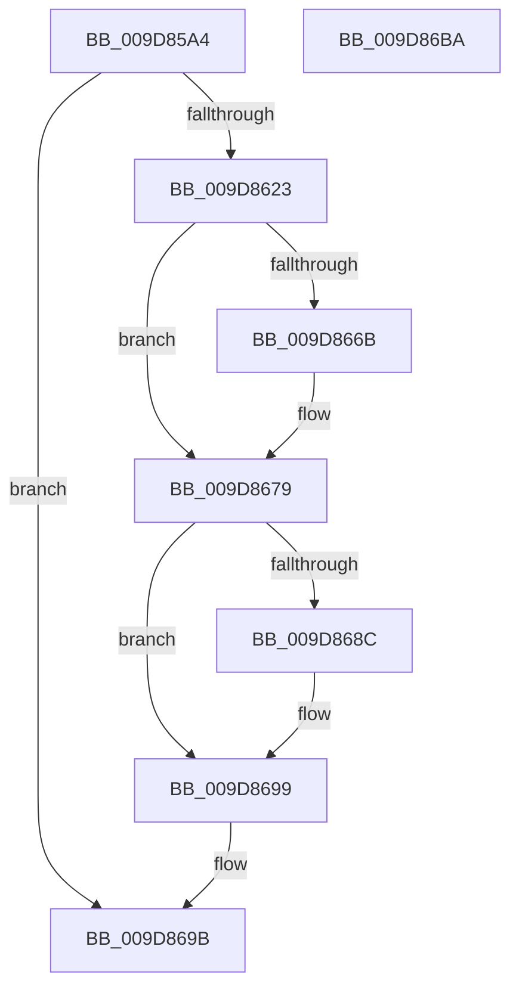

# FsRtlQueryOpen

- RVA: `0x009D85A4`–`0x009D86BB` (길이 `279` bytes)
- VA: `0x00000001409D85A4`
- 실행 섹션: `PAGE`
- PDB 이름 있음: `예`; PDB Function 태그: `아니요`
- unwind 정보 RVA: `0x000A2E14`
- 디코드: `74`개 명령, `279/279` bytes 표시
- 미해석 바이트: `0` (있으면 어셈블리에 `.byte`로 보존)

> 이 문서는 커널 이미지의 기계어와 PDB 기호를 분석해 생성했습니다. 4번과 5번은 함수 원형과 자료형을 바이너리 사용 방식에서 추정한 C 해석이며 원본 소스 복구 결과는 아닙니다.

## 1. Dependencies

- 직접 호출 지점: **8**; 고유 호출 대상: **8**
- 직접 호출자로 확인된 함수: **1**
- RIP 상대 이미지 참조: **1**

### Outgoing calls
- `0x009D85EE` → [memset](../../text/6C/memset_function_006C6C40.md) (function, `0x006C6C40`)
- `0x009D85F6` → [IoGetAttachedDevice](../../text/41/IoGetAttachedDevice_function_00410810.md) (function, `0x00410810`)
- `0x009D861A` → [FsFilterCtrlInit](../../text/43/FsFilterCtrlInit_function_004364A0.md) (function, `0x004364A0`)
- `0x009D865D` → [FsFilterPerformCallbacks](../../text/29/FsFilterPerformCallbacks_function_00299590.md) (function, `0x00299590`)
- `0x009D8672` → [FsFilterPerformCompletionCallbacks](../../text/29/FsFilterPerformCompletionCallbacks_function_00299000.md) (function, `0x00299000`)
- `0x009D8679` → [KeLeaveCriticalRegion](../../text/25/KeLeaveCriticalRegion_function_0025D8B0.md) (function, `0x0025D8B0`)
- `0x009D8683` → [FsFilterCtrlFree](../../text/29/FsFilterCtrlFree_function_0029908C.md) (function, `0x0029908C`)
- `0x009D86A5` → [_security_check_cookie](../../text/6A/_security_check_cookie_function_006AC640.md) (function, `0x006AC640`)

### Direct callers
- [IopQueryInformation](IopQueryInformation_function_009D8370.md) at `0x009D8503`

### Static image references
- `0x009D85BC` → RVA `0x00E0A740` (`.data`; read)

## 2. Other-region calls and transfers

- 다른 실행 섹션으로 향하는 call: **8**
  - `0x009D85EE` → [memset](../../text/6C/memset_function_006C6C40.md) (`PAGE` → `.text`)
  - `0x009D85F6` → [IoGetAttachedDevice](../../text/41/IoGetAttachedDevice_function_00410810.md) (`PAGE` → `.text`)
  - `0x009D861A` → [FsFilterCtrlInit](../../text/43/FsFilterCtrlInit_function_004364A0.md) (`PAGE` → `.text`)
  - `0x009D865D` → [FsFilterPerformCallbacks](../../text/29/FsFilterPerformCallbacks_function_00299590.md) (`PAGE` → `.text`)
  - `0x009D8672` → [FsFilterPerformCompletionCallbacks](../../text/29/FsFilterPerformCompletionCallbacks_function_00299000.md) (`PAGE` → `.text`)
  - `0x009D8679` → [KeLeaveCriticalRegion](../../text/25/KeLeaveCriticalRegion_function_0025D8B0.md) (`PAGE` → `.text`)
  - `0x009D8683` → [FsFilterCtrlFree](../../text/29/FsFilterCtrlFree_function_0029908C.md) (`PAGE` → `.text`)
  - `0x009D86A5` → [_security_check_cookie](../../text/6A/_security_check_cookie_function_006AC640.md) (`PAGE` → `.text`)
- 별도 외부 분기/꼬리 이동을 확인하지 못했습니다.

## 3. Assembly (complete function range)

```asm
009D85A4  40 55                           push rbp
009D85A6  53                              push rbx
009D85A7  56                              push rsi
009D85A8  57                              push rdi
009D85A9  41 56                           push r14
009D85AB  41 57                           push r15
009D85AD  48 8D AC 24 68 FE FF FF         lea rbp, [rsp - 0x198]
009D85B5  48 81 EC 98 02 00 00            sub rsp, 0x298
009D85BC  48 8B 05 7D 21 43 00            mov rax, qword ptr [rip + 0x43217d]
009D85C3  48 33 C4                        xor rax, rsp
009D85C6  48 89 85 80 01 00 00            mov qword ptr [rbp + 0x180], rax
009D85CD  49 8B F0                        mov rsi, r8
009D85D0  48 8B FA                        mov rdi, rdx
009D85D3  48 8B D9                        mov rbx, rcx
009D85D6  45 33 FF                        xor r15d, r15d
009D85D9  33 D2                           xor edx, edx
009D85DB  44 89 7C 24 30                  mov dword ptr [rsp + 0x30], r15d
009D85E0  41 B8 38 02 00 00               mov r8d, 0x238
009D85E6  48 8D 4C 24 40                  lea rcx, [rsp + 0x40]
009D85EB  4D 8B F1                        mov r14, r9
009D85EE  E8 4D E6 CE FF                  call 0x1406c6c40
009D85F3  48 8B CB                        mov rcx, rbx
009D85F6  E8 15 82 A3 FF                  call 0x140410810
009D85FB  48 8B 8F B8 00 00 00            mov rcx, qword ptr [rdi + 0xb8]
009D8602  4C 8B C0                        mov r8, rax
009D8605  C6 44 24 28 01                  mov byte ptr [rsp + 0x28], 1
009D860A  B2 F9                           mov dl, 0xf9
009D860C  48 8B 49 30                     mov rcx, qword ptr [rcx + 0x30]
009D8610  48 89 4C 24 20                  mov qword ptr [rsp + 0x20], rcx
009D8615  48 8D 4C 24 40                  lea rcx, [rsp + 0x40]
009D861A  E8 81 DE A5 FF                  call 0x1404364a0
009D861F  85 C0                           test eax, eax
009D8621  78 78                           js 0x1409d869b
009D8623  8B 85 F0 01 00 00               mov eax, dword ptr [rbp + 0x1f0]
009D8629  4C 8D 4C 24 30                  lea r9, [rsp + 0x30]
009D862E  89 44 24 70                     mov dword ptr [rsp + 0x70], eax
009D8632  48 8D 4C 24 40                  lea rcx, [rsp + 0x40]
009D8637  48 89 7C 24 58                  mov qword ptr [rsp + 0x58], rdi
009D863C  41 B0 01                        mov r8b, 1
009D863F  48 89 74 24 60                  mov qword ptr [rsp + 0x60], rsi
009D8644  41 8A D0                        mov dl, r8b
009D8647  4C 89 74 24 68                  mov qword ptr [rsp + 0x68], r14
009D864C  65 48 8B 04 25 88 01 00 00      mov rax, qword ptr gs:[0x188]
009D8655  66 FF 88 E4 01 00 00            dec word ptr [rax + 0x1e4]
009D865C  90                              nop
009D865D  E8 2E 0F 8C FF                  call 0x140299590
009D8662  8B D8                           mov ebx, eax
009D8664  66 44 39 7D 8A                  cmp word ptr [rbp - 0x76], r15w
009D8669  76 0E                           jbe 0x1409d8679
009D866B  8B D0                           mov edx, eax
009D866D  48 8D 4C 24 40                  lea rcx, [rsp + 0x40]
009D8672  E8 89 09 8C FF                  call 0x140299000
009D8677  8B D8                           mov ebx, eax
009D8679  E8 32 52 88 FF                  call 0x14025d8b0
009D867E  48 8D 4C 24 40                  lea rcx, [rsp + 0x40]
009D8683  E8 04 0A 8C FF                  call 0x14029908c
009D8688  85 DB                           test ebx, ebx
009D868A  78 0D                           js 0x1409d8699
009D868C  F6 44 24 30 02                  test byte ptr [rsp + 0x30], 2
009D8691  B8 02 00 00 C0                  mov eax, 0xc0000002
009D8696  0F 44 D8                        cmove ebx, eax
009D8699  8B C3                           mov eax, ebx
009D869B  48 8B 8D 80 01 00 00            mov rcx, qword ptr [rbp + 0x180]
009D86A2  48 33 CC                        xor rcx, rsp
009D86A5  E8 96 3F CD FF                  call 0x1406ac640
009D86AA  48 81 C4 98 02 00 00            add rsp, 0x298
009D86B1  41 5F                           pop r15
009D86B3  41 5E                           pop r14
009D86B5  5F                              pop rdi
009D86B6  5E                              pop rsi
009D86B7  5B                              pop rbx
009D86B8  5D                              pop rbp
009D86B9  C3                              ret
009D86BA  CC                              int3
```

## 4. C-style interpretation (structured pseudocode)

```c
__int64 __fastcall FsRtlQueryOpen(__int64 a1, __int64 a2, __int64 a3, __int64 a4, unsigned int a5)
{
    __int64 result;
    __int64 v_r15;
    __int64 v_rbx;
    __int64 v_rsp;
    unsigned __int64 v_stack_m1C8;
    unsigned __int16 v_stack_m23E;
    unsigned int v_stack_m258;
    unsigned __int64 v_stack_m260;
    unsigned __int64 v_stack_m268;
    unsigned __int64 v_stack_m270;
    unsigned __int64 v_stack_m288;
    unsigned int v_stack_m298;
    unsigned __int8 v_stack_m2A0;
    unsigned __int64 v_stack_m2A8;
    unsigned __int64 v_stack_m48;

    v_rsp = (v_rsp) - (664);
    result = (*(unsigned __int64 *)(v_rip + 4399485)) ^ (v_rsp);
    v_stack_m48 = result;
    v_r15 = 0;
    a2 = 0;
    v_stack_m298 = 0;
    result = memset(v_stack_m288, a2, 568, a4);
    result = IoGetAttachedDevice(a1, a2, 568, a4);
    v_stack_m2A0 = 1;
    v_stack_m2A8 = *(unsigned __int64 *)(*(unsigned __int64 *)(a2 + 184) + 48);
    result = FsFilterCtrlInit(v_stack_m288, 249, result, a4);
    if (sign_flag) goto loc_009D869B;
    v_stack_m258 = (unsigned int)((unsigned int)(a5));
    v_stack_m270 = 0;
    v_stack_m268 = a3;
    v_stack_m260 = a4;
    result = FsFilterPerformCallbacks(v_stack_m288, 1, 1, v_stack_m298);
    v_rbx = (unsigned int)((unsigned int)(result));
    if (v_stack_m23E >= = 0) {
        a2 = (unsigned int)(result);
        a1 = v_stack_m288;
        result = FsFilterPerformCompletionCallbacks(a1, a2, 1, v_stack_m298);
        v_rbx = (unsigned int)(result);
    }
    result = KeLeaveCriticalRegion(a1, a2, 1, v_stack_m298);
    result = FsFilterCtrlFree(v_stack_m288, a2, 1, v_stack_m298);
    if (!(sign_flag)) {
        result = 0xC0000002ULL;
        if (((v_stack_m298) & (2)) == 0) { v_rbx = (unsigned int)(result); }
    }
loc_009D869B:
    a1 = (v_stack_m48) ^ (v_rsp);
    result = _security_check_cookie(a1, a2, 1, v_stack_m298);
    v_rsp = (v_rsp) + (664);
    return result;
}
```

## 5. (Beta) C Style

```c
int64_t FsRtlQueryOpen(int64_t Arg1, void *Arg2, int64_t Arg3, int64_t Arg4, uint32_t Arg5)
{
    uint8_t *arg2 = (uint8_t *)Arg2;

    int64_t result;
    int64_t local_r15;
    int64_t local_rbx;
    int64_t local_rsp;
    uint64_t v_stack_m1C8;
    uint16_t v_stack_m23E;
    uint32_t v_stack_m258;
    uint64_t v_stack_m260;
    uint64_t v_stack_m268;
    uint64_t v_stack_m270;
    uint64_t v_stack_m288;
    uint32_t v_stack_m298;
    uint8_t v_stack_m2A0;
    uint64_t v_stack_m2A8;
    uint64_t v_stack_m48;

    local_rsp = (local_rsp) - (664);
    result = (*(uint64_t *)(v_rip + 0x43217D)) ^ (local_rsp);
    v_stack_m48 = result;
    local_r15 = 0;
    Arg2 = 0;
    v_stack_m298 = 0;
    result = memset(v_stack_m288, Arg2, 568, Arg4);
    result = IoGetAttachedDevice(Arg1, Arg2, 568, Arg4);
    v_stack_m2A0 = 1;
    v_stack_m2A8 = *(uint64_t *)(*(uint64_t *)(arg2 + 0xB8) + 0x30);
    result = FsFilterCtrlInit(v_stack_m288, 249, result, Arg4);
    if (sign_flag) goto loc_009D869B;
    v_stack_m258 = (uint32_t)((uint32_t)(Arg5));
    v_stack_m270 = 0;
    v_stack_m268 = Arg3;
    v_stack_m260 = Arg4;
    result = FsFilterPerformCallbacks(v_stack_m288, 1, 1, v_stack_m298);
    local_rbx = (uint32_t)((uint32_t)(result));
    if (v_stack_m23E >= = 0) {
        Arg2 = (uint32_t)(result);
        Arg1 = v_stack_m288;
        result = FsFilterPerformCompletionCallbacks(Arg1, Arg2, 1, v_stack_m298);
        local_rbx = (uint32_t)(result);
    }
    result = KeLeaveCriticalRegion(Arg1, Arg2, 1, v_stack_m298);
    result = FsFilterCtrlFree(v_stack_m288, Arg2, 1, v_stack_m298);
    if (!(sign_flag)) {
        result = 0xC0000002ULL;
        if (((v_stack_m298) & (2)) == 0) { local_rbx = (uint32_t)(result); }
    }
loc_009D869B:
    Arg1 = (v_stack_m48) ^ (local_rsp);
    result = _security_check_cookie(Arg1, Arg2, 1, v_stack_m298);
    local_rsp = (local_rsp) + (664);
    return result;
}
```

### 관측된 메모리 오프셋

구조체 형식이 확인되지 않은 접근은 인자 기준의 오프셋으로만 기록했습니다.

| 기준 인자 | 오프셋 표현 | 폭 (bit) | 접근 |
|---|---:|---:|---|
| `Arg2` | `+ 0xB8` | `64` | `R` |

## 6. Execution-region graph

[열기: 2D/3D 그래프와 함수 탐색 컨트롤 패널](../../../control-panel.html?section=page&rva=0x009D85A4&view=graph)

- 2D 그래프는 위에서 아래로 흐르고, 3D 그래프는 빈 공간을 드래그해 회전합니다. Shift+드래그는 이동, 휠은 확대·축소, 함수 노드 선택은 대상 보고서 이동입니다.

### Static fallback


