# FsRtlReleaseFileForCcFlush

- RVA: `0x009D75A0`–`0x009D77E7` (길이 `583` bytes)
- VA: `0x00000001409D75A0`
- 실행 섹션: `PAGE`
- PDB 이름 있음: `예`; PDB Function 태그: `아니요`
- unwind 정보 RVA: `0x000A2848`
- 디코드: `152`개 명령, `583/583` bytes 표시
- 미해석 바이트: `0` (있으면 어셈블리에 `.byte`로 보존)

> 이 문서는 커널 이미지의 기계어와 PDB 기호를 분석해 생성했습니다. 4번과 5번은 함수 원형과 자료형을 바이너리 사용 방식에서 추정한 C 해석이며 원본 소스 복구 결과는 아닙니다.

## 1. Dependencies

- 직접 호출 지점: **14**; 고유 호출 대상: **13**
- 직접 호출자로 확인된 함수: **4**
- RIP 상대 이미지 참조: **1**

### Outgoing calls
- `0x009D75E1` → [memset](../../text/6C/memset_function_006C6C40.md) (function, `0x006C6C40`)
- `0x009D75F7` → [IoGetRelatedDeviceObject](../../text/29/IoGetRelatedDeviceObject_function_0029B120.md) (function, `0x0029B120`)
- `0x009D7602` → [IoGetBaseFileSystemDeviceObject](../../text/29/IoGetBaseFileSystemDeviceObject_function_0029A2A0.md) (function, `0x0029A2A0`)
- `0x009D765D` → [FsFilterCtrlInit](../../text/43/FsFilterCtrlInit_function_004364A0.md) (function, `0x004364A0`)
- `0x009D7671` → [FsFilterPerformCallbacks](../../text/29/FsFilterPerformCallbacks_function_00299590.md) (function, `0x00299590`)
- `0x009D769A` → [IoGetDeviceAttachmentBaseRef](../../text/27/IoGetDeviceAttachmentBaseRef_function_00272710.md) (function, `0x00272710`)
- `0x009D7701` → [guard_dispatch_icall](../../text/6B/guard_dispatch_icall_function_006BAAD0.md) (function, `0x006BAAD0`)
- `0x009D7731` → [FsFilterPerformCompletionCallbacks](../../text/29/FsFilterPerformCompletionCallbacks_function_00299000.md) (function, `0x00299000`)
- `0x009D773B` → [FsFilterCtrlFree](../../text/29/FsFilterCtrlFree_function_0029908C.md) (function, `0x0029908C`)
- `0x009D7749` → [KeLeaveCriticalRegionThread](../../text/25/KeLeaveCriticalRegionThread_function_0025EFF0.md) (function, `0x0025EFF0`)
- `0x009D7759` → [_security_check_cookie](../../text/6A/_security_check_cookie_function_006AC640.md) (function, `0x006AC640`)
- `0x009D779B` → [ExReleaseResourceLite](../../text/25/ExReleaseResourceLite_function_0025FA10.md) (function, `0x0025FA10`)
- `0x009D77A9` → [ExReleaseResourceLite](../../text/25/ExReleaseResourceLite_function_0025FA10.md) (function, `0x0025FA10`)
- `0x009D77DD` → [ObfDereferenceObject](../../text/2F/ObfDereferenceObject_function_002F9350.md) (function, `0x002F9350`)

### Direct callers
- [MmFlushSection](../../text/23/MmFlushSection_function_002375E4.md) at `0x0023772B`
- [MiDeleteCachedSubsection](../../text/29/MiDeleteCachedSubsection_function_00297888.md) at `0x00297A95`
- [MiDeleteCachedSubsection](../../text/29/MiDeleteCachedSubsection_function_00297888.md) at `0x00297BD7`
- [MiPrepareToFlushSubsection](../../text/36/MiPrepareToFlushSubsection_function_00369094.md) at `0x003691AC`
- [MmFlushVirtualMemory](MmFlushVirtualMemory_function_009D6F5C.md) at `0x009D718B`

### Static image references
- `0x009D75BF` → RVA `0x00E0A740` (`.data`; read)

## 2. Other-region calls and transfers

- 다른 실행 섹션으로 향하는 call: **14**
  - `0x009D75E1` → [memset](../../text/6C/memset_function_006C6C40.md) (`PAGE` → `.text`)
  - `0x009D75F7` → [IoGetRelatedDeviceObject](../../text/29/IoGetRelatedDeviceObject_function_0029B120.md) (`PAGE` → `.text`)
  - `0x009D7602` → [IoGetBaseFileSystemDeviceObject](../../text/29/IoGetBaseFileSystemDeviceObject_function_0029A2A0.md) (`PAGE` → `.text`)
  - `0x009D765D` → [FsFilterCtrlInit](../../text/43/FsFilterCtrlInit_function_004364A0.md) (`PAGE` → `.text`)
  - `0x009D7671` → [FsFilterPerformCallbacks](../../text/29/FsFilterPerformCallbacks_function_00299590.md) (`PAGE` → `.text`)
  - `0x009D769A` → [IoGetDeviceAttachmentBaseRef](../../text/27/IoGetDeviceAttachmentBaseRef_function_00272710.md) (`PAGE` → `.text`)
  - `0x009D7701` → [guard_dispatch_icall](../../text/6B/guard_dispatch_icall_function_006BAAD0.md) (`PAGE` → `.text`)
  - `0x009D7731` → [FsFilterPerformCompletionCallbacks](../../text/29/FsFilterPerformCompletionCallbacks_function_00299000.md) (`PAGE` → `.text`)
  - `0x009D773B` → [FsFilterCtrlFree](../../text/29/FsFilterCtrlFree_function_0029908C.md) (`PAGE` → `.text`)
  - `0x009D7749` → [KeLeaveCriticalRegionThread](../../text/25/KeLeaveCriticalRegionThread_function_0025EFF0.md) (`PAGE` → `.text`)
  - `0x009D7759` → [_security_check_cookie](../../text/6A/_security_check_cookie_function_006AC640.md) (`PAGE` → `.text`)
  - `0x009D779B` → [ExReleaseResourceLite](../../text/25/ExReleaseResourceLite_function_0025FA10.md) (`PAGE` → `.text`)
  - `0x009D77A9` → [ExReleaseResourceLite](../../text/25/ExReleaseResourceLite_function_0025FA10.md) (`PAGE` → `.text`)
  - `0x009D77DD` → [ObfDereferenceObject](../../text/2F/ObfDereferenceObject_function_002F9350.md) (`PAGE` → `.text`)
- 별도 외부 분기/꼬리 이동을 확인하지 못했습니다.

## 3. Assembly (complete function range)

```asm
009D75A0  48 89 5C 24 10                  mov qword ptr [rsp + 0x10], rbx
009D75A5  48 89 6C 24 18                  mov qword ptr [rsp + 0x18], rbp
009D75AA  48 89 74 24 20                  mov qword ptr [rsp + 0x20], rsi
009D75AF  57                              push rdi
009D75B0  41 54                           push r12
009D75B2  41 55                           push r13
009D75B4  41 56                           push r14
009D75B6  41 57                           push r15
009D75B8  48 81 EC 90 02 00 00            sub rsp, 0x290
009D75BF  48 8B 05 7A 31 43 00            mov rax, qword ptr [rip + 0x43317a]
009D75C6  48 33 C4                        xor rax, rsp
009D75C9  48 89 84 24 80 02 00 00         mov qword ptr [rsp + 0x280], rax
009D75D1  4C 8B F9                        mov r15, rcx
009D75D4  33 D2                           xor edx, edx
009D75D6  48 8D 4C 24 40                  lea rcx, [rsp + 0x40]
009D75DB  41 B8 38 02 00 00               mov r8d, 0x238
009D75E1  E8 5A F6 CE FF                  call 0x1406c6c40
009D75E6  33 DB                           xor ebx, ebx
009D75E8  48 8D 7C 24 40                  lea rdi, [rsp + 0x40]
009D75ED  49 8B CF                        mov rcx, r15
009D75F0  89 5C 24 30                     mov dword ptr [rsp + 0x30], ebx
009D75F4  45 32 E4                        xor r12b, r12b
009D75F7  E8 24 3B 8C FF                  call 0x14029b120
009D75FC  49 8B CF                        mov rcx, r15
009D75FF  4C 8B F0                        mov r14, rax
009D7602  E8 99 2C 8C FF                  call 0x14029a2a0
009D7607  48 8B E8                        mov rbp, rax
009D760A  48 8B 48 08                     mov rcx, qword ptr [rax + 8]
009D760E  4C 8B 69 50                     mov r13, qword ptr [rcx + 0x50]
009D7612  48 8B 49 30                     mov rcx, qword ptr [rcx + 0x30]
009D7616  48 8B 71 30                     mov rsi, qword ptr [rcx + 0x30]
009D761A  48 85 F6                        test rsi, rsi
009D761D  74 20                           je 0x1409d763f
009D761F  8B 06                           mov eax, dword ptr [rsi]
009D7621  83 F8 40                        cmp eax, 0x40
009D7624  72 0A                           jb 0x1409d7630
009D7626  48 39 5E 38                     cmp qword ptr [rsi + 0x38], rbx
009D762A  0F 85 85 01 00 00               jne 0x1409d77b5
009D7630  83 F8 48                        cmp eax, 0x48
009D7633  72 0A                           jb 0x1409d763f
009D7635  48 39 5E 40                     cmp qword ptr [rsi + 0x40], rbx
009D7639  0F 85 76 01 00 00               jne 0x1409d77b5
009D763F  32 C0                           xor al, al
009D7641  4C 3B F5                        cmp r14, rbp
009D7644  0F 84 72 01 00 00               je 0x1409d77bc
009D764A  88 5C 24 28                     mov byte ptr [rsp + 0x28], bl
009D764E  48 8D 4C 24 40                  lea rcx, [rsp + 0x40]
009D7653  4D 8B C6                        mov r8, r14
009D7656  4C 89 7C 24 20                  mov qword ptr [rsp + 0x20], r15
009D765B  B2 FA                           mov dl, 0xfa
009D765D  E8 3E EE A5 FF                  call 0x1404364a0
009D7662  4C 8D 4C 24 30                  lea r9, [rsp + 0x30]
009D7667  41 B0 01                        mov r8b, 1
009D766A  33 D2                           xor edx, edx
009D766C  48 8D 4C 24 40                  lea rcx, [rsp + 0x40]
009D7671  E8 1A 1F 8C FF                  call 0x140299590
009D7676  8B D8                           mov ebx, eax
009D7678  85 C0                           test eax, eax
009D767A  0F 88 96 00 00 00               js 0x1409d7716
009D7680  0F 85 45 01 00 00               jne 0x1409d77cb
009D7686  F6 84 24 80 00 00 00 04         test byte ptr [rsp + 0x80], 4
009D768E  4C 8B 7C 24 50                  mov r15, qword ptr [rsp + 0x50]
009D7693  74 20                           je 0x1409d76b5
009D7695  48 8B 4C 24 48                  mov rcx, qword ptr [rsp + 0x48]
009D769A  E8 71 B0 89 FF                  call 0x140272710
009D769F  48 8B E8                        mov rbp, rax
009D76A2  41 B4 01                        mov r12b, 1
009D76A5  48 8B 40 08                     mov rax, qword ptr [rax + 8]
009D76A9  4C 8B 68 50                     mov r13, qword ptr [rax + 0x50]
009D76AD  48 8B 40 30                     mov rax, qword ptr [rax + 0x30]
009D76B1  48 8B 70 30                     mov rsi, qword ptr [rax + 0x30]
009D76B5  48 85 F6                        test rsi, rsi
009D76B8  74 1A                           je 0x1409d76d4
009D76BA  8B 06                           mov eax, dword ptr [rsi]
009D76BC  83 F8 40                        cmp eax, 0x40
009D76BF  72 07                           jb 0x1409d76c8
009D76C1  48 83 7E 38 00                  cmp qword ptr [rsi + 0x38], 0
009D76C6  75 45                           jne 0x1409d770d
009D76C8  83 F8 48                        cmp eax, 0x48
009D76CB  72 07                           jb 0x1409d76d4
009D76CD  48 83 7E 40 00                  cmp qword ptr [rsi + 0x40], 0
009D76D2  75 39                           jne 0x1409d770d
009D76D4  4D 85 ED                        test r13, r13
009D76D7  0F 84 A3 00 00 00               je 0x1409d7780
009D76DD  41 81 7D 00 E0 00 00 00         cmp dword ptr [r13], 0xe0
009D76E5  0F 82 95 00 00 00               jb 0x1409d7780
009D76EB  49 8B 85 D8 00 00 00            mov rax, qword ptr [r13 + 0xd8]
009D76F2  48 85 C0                        test rax, rax
009D76F5  0F 84 85 00 00 00               je 0x1409d7780
009D76FB  48 8B D5                        mov rdx, rbp
009D76FE  49 8B CF                        mov rcx, r15
009D7701  E8 CA 33 CE FF                  call 0x1406baad0
009D7706  8B D8                           mov ebx, eax
009D7708  83 4C 24 30 01                  or dword ptr [rsp + 0x30], 1
009D770D  45 84 E4                        test r12b, r12b
009D7710  0F 85 C4 00 00 00               jne 0x1409d77da
009D7716  81 FB 10 00 00 C0               cmp ebx, 0xc0000010
009D771C  74 69                           je 0x1409d7787
009D771E  48 85 FF                        test rdi, rdi
009D7721  74 1D                           je 0x1409d7740
009D7723  66 83 7F 4A 00                  cmp word ptr [rdi + 0x4a], 0
009D7728  76 0C                           jbe 0x1409d7736
009D772A  8B D3                           mov edx, ebx
009D772C  48 8D 4C 24 40                  lea rcx, [rsp + 0x40]
009D7731  E8 CA 18 8C FF                  call 0x140299000
009D7736  48 8D 4C 24 40                  lea rcx, [rsp + 0x40]
009D773B  E8 4C 19 8C FF                  call 0x14029908c
009D7740  65 48 8B 0C 25 88 01 00 00      mov rcx, qword ptr gs:[0x188]
009D7749  E8 A2 78 88 FF                  call 0x14025eff0
009D774E  48 8B 8C 24 80 02 00 00         mov rcx, qword ptr [rsp + 0x280]
009D7756  48 33 CC                        xor rcx, rsp
009D7759  E8 E2 4E CD FF                  call 0x1406ac640
009D775E  4C 8D 9C 24 90 02 00 00         lea r11, [rsp + 0x290]
009D7766  49 8B 5B 38                     mov rbx, qword ptr [r11 + 0x38]
009D776A  49 8B 6B 40                     mov rbp, qword ptr [r11 + 0x40]
009D776E  49 8B 73 48                     mov rsi, qword ptr [r11 + 0x48]
009D7772  49 8B E3                        mov rsp, r11
009D7775  41 5F                           pop r15
009D7777  41 5E                           pop r14
009D7779  41 5D                           pop r13
009D777B  41 5C                           pop r12
009D777D  5F                              pop rdi
009D777E  C3                              ret
009D777F  CC                              int3
009D7780  BB 10 00 00 C0                  mov ebx, 0xc0000010
009D7785  EB 81                           jmp 0x1409d7708
009D7787  F6 44 24 30 01                  test byte ptr [rsp + 0x30], 1
009D778C  74 90                           je 0x1409d771e
009D778E  49 8B 5F 18                     mov rbx, qword ptr [r15 + 0x18]
009D7792  48 8B 4B 10                     mov rcx, qword ptr [rbx + 0x10]
009D7796  48 85 C9                        test rcx, rcx
009D7799  74 05                           je 0x1409d77a0
009D779B  E8 70 82 88 FF                  call 0x14025fa10
009D77A0  48 8B 4B 08                     mov rcx, qword ptr [rbx + 8]
009D77A4  48 85 C9                        test rcx, rcx
009D77A7  74 05                           je 0x1409d77ae
009D77A9  E8 62 82 88 FF                  call 0x14025fa10
009D77AE  33 DB                           xor ebx, ebx
009D77B0  E9 69 FF FF FF                  jmp 0x1409d771e
009D77B5  B0 01                           mov al, 1
009D77B7  E9 85 FE FF FF                  jmp 0x1409d7641
009D77BC  84 C0                           test al, al
009D77BE  0F 85 86 FE FF FF               jne 0x1409d764a
009D77C4  33 FF                           xor edi, edi
009D77C6  E9 EA FE FF FF                  jmp 0x1409d76b5
009D77CB  33 DB                           xor ebx, ebx
009D77CD  3D 26 01 00 00                  cmp eax, 0x126
009D77D2  0F 45 D8                        cmovne ebx, eax
009D77D5  E9 3C FF FF FF                  jmp 0x1409d7716
009D77DA  48 8B CD                        mov rcx, rbp
009D77DD  E8 6E 1B 92 FF                  call 0x1402f9350
009D77E2  E9 2F FF FF FF                  jmp 0x1409d7716
```

## 4. C-style interpretation (structured pseudocode)

```c
__int64 __fastcall FsRtlReleaseFileForCcFlush(__int64 a1, int a2)
{
    __int64 result;
    __int64 v_r12;
    __int64 v_r13;
    __int64 v_rbp;
    __int64 v_rbx;
    __int64 v_rdi;
    __int64 v_rsi;
    __int64 v_rsp;
    unsigned __int8 v_stack_m238;
    unsigned __int8 v_stack_m260;
    unsigned __int64 v_stack_m268;
    unsigned __int64 v_stack_m270;
    unsigned __int64 v_stack_m278;
    unsigned __int64 v_stack_m28;
    unsigned int v_stack_m288;
    unsigned __int8 v_stack_m290;
    unsigned __int64 v_stack_m298;
    unsigned __int64 v_stack_m38;
    unsigned __int64 v_stack_p10;
    unsigned __int64 v_stack_p18;
    unsigned __int64 v_stack_p20;

    v_stack_p10 = v_rbx;
    v_stack_p18 = v_rbp;
    v_stack_p20 = v_rsi;
    v_rsp = (v_rsp) - (656);
    result = (*(unsigned __int64 *)(v_rip + 4403578)) ^ (v_rsp);
    v_stack_m38 = result;
    a2 = 0;
    result = memset(v_stack_m278, a2, 568, a4);
    v_rbx = 0;
    v_stack_m288 = 0;
    v_r12 = 0;
    result = IoGetRelatedDeviceObject(a1, a2, 568, a4);
    result = IoGetBaseFileSystemDeviceObject(a1, a2, 568, a4);
    if (*(unsigned __int64 *)(*(unsigned __int64 *)(*(unsigned __int64 *)(result + 8) + 48) + 48) == 0) goto loc_009D763F;
    if (((unsigned int)((unsigned int)(*(unsigned int *)(*(unsigned __int64 *)(*(unsigned __int64 *)(*(unsigned __int64 *)(result + 8) + 48) + 48))))) < 64) goto loc_009D7630;
    if ((*(unsigned __int64 *)(*(unsigned __int64 *)(*(unsigned __int64 *)(*(unsigned __int64 *)(result + 8) + 48) + 48) + 56)) != 0) goto loc_009D77B5;
loc_009D7630:
    if (((unsigned int)((unsigned int)(*(unsigned int *)(*(unsigned __int64 *)(*(unsigned __int64 *)(*(unsigned __int64 *)(result + 8) + 48) + 48))))) < 72) goto loc_009D763F;
    if ((*(unsigned __int64 *)(*(unsigned __int64 *)(*(unsigned __int64 *)(*(unsigned __int64 *)(result + 8) + 48) + 48) + 64)) != 0) goto loc_009D77B5;
loc_009D763F:
    result = 0;
loc_009D7641:
    if (0 == 0) goto loc_009D77BC;
loc_009D764A:
    v_stack_m290 = 0;
    v_stack_m298 = a1;
    result = FsFilterCtrlInit(v_stack_m278, 250, 0, a4);
    a2 = 0;
    result = FsFilterPerformCallbacks(v_stack_m278, a2, 1, v_stack_m288);
    if (sign_flag) goto loc_009D7716;
    if ((unsigned int)(result) != 0) goto loc_009D77CB;
    v_rsi = *(unsigned __int64 *)(*(unsigned __int64 *)(*(unsigned __int64 *)(result + 8) + 48) + 48);
    v_rbp = result;
    v_r13 = *(unsigned __int64 *)(*(unsigned __int64 *)(result + 8) + 80);
    if (((v_stack_m238) & (4)) != 0) {
        a1 = v_stack_m270;
        result = IoGetDeviceAttachmentBaseRef(a1, a2, 1, v_stack_m288);
        v_rbp = result;
        v_r12 = 1;
        result = *(unsigned __int64 *)(result + 8);
        v_r13 = *(unsigned __int64 *)(result + 80);
        result = *(unsigned __int64 *)(result + 48);
        v_rsi = *(unsigned __int64 *)(result + 48);
    }
    if (v_rsi == 0) goto loc_009D76D4;
    if (((unsigned int)((unsigned int)(*(unsigned int *)(v_rsi)))) < 64) goto loc_009D76C8;
    if ((*(unsigned __int64 *)(v_rsi + 56)) != 0) goto loc_009D770D;
loc_009D76C8:
    if (((unsigned int)((unsigned int)(*(unsigned int *)(v_rsi)))) < 72) goto loc_009D76D4;
    if ((*(unsigned __int64 *)(v_rsi + 64)) != 0) goto loc_009D770D;
loc_009D76D4:
    if (v_r13 == 0) goto loc_009D7780;
    if ((*(unsigned int *)(v_r13)) < 224) goto loc_009D7780;
    if (*(unsigned __int64 *)(v_r13 + 216) == 0) goto loc_009D7780;
    result = guard_dispatch_icall(v_stack_m268, v_rbp, 1, v_stack_m288);
loc_009D7708:
loc_009D770D:
    if ((unsigned __int8)(v_r12) != 0) goto loc_009D77DA;
loc_009D7716:
    if (((unsigned int)((unsigned int)((unsigned int)(result)))) == 0xC0000010ULL) goto loc_009D7787;
loc_009D771E:
    if (v_stack_m278 == 0) goto loc_009D7740;
    if ((*(unsigned __int16 *)(v_stack_m278 + 74)) >= = 0) {
        a2 = (unsigned int)((unsigned int)((unsigned int)(result)));
        a1 = v_stack_m278;
        result = FsFilterPerformCompletionCallbacks(a1, a2, 1, v_stack_m288);
    }
    result = FsFilterCtrlFree(v_stack_m278, a2, 1, v_stack_m288);
loc_009D7740:
    result = KeLeaveCriticalRegionThread(*(unsigned __int64 *)(gs_base + (0 + 392)), a2, 1, v_stack_m288);
    a1 = (v_stack_m38) ^ (v_rsp);
    result = _security_check_cookie(a1, a2, 1, v_stack_m288);
    return result;
loc_009D7780:
    goto loc_009D7708;
loc_009D7787:
    if (((v_stack_m260) & (1)) == 0) goto loc_009D771E;
    if (*(unsigned __int64 *)(*(unsigned __int64 *)(v_stack_m268 + 24) + 16) != 0) {
        result = ExReleaseResourceLite(*(unsigned __int64 *)(*(unsigned __int64 *)(v_stack_m268 + 24) + 16), a2, 1, v_stack_m288);
    }
    if (*(unsigned __int64 *)(*(unsigned __int64 *)(v_stack_m268 + 24) + 8) != 0) {
        result = ExReleaseResourceLite(*(unsigned __int64 *)(*(unsigned __int64 *)(v_stack_m268 + 24) + 8), a2, 1, v_stack_m288);
    }
    v_rbx = 0;
    goto loc_009D771E;
loc_009D77B5:
    goto loc_009D7641;
loc_009D77BC:
    if (1 != 0) goto loc_009D764A;
    v_rdi = 0;
    goto loc_009D76B5;
loc_009D77CB:
    v_rbx = 0;
    if (1 != 294) { v_rbx = 1; }
    goto loc_009D7716;
loc_009D77DA:
    result = ObfDereferenceObject(*(unsigned __int64 *)(v_stack_m28 + 64), a2, 1, v_stack_m288);
    goto loc_009D7716;
}
```

## 5. (Beta) C Style

```c
int64_t FsRtlReleaseFileForCcFlush(int64_t Arg1, int32_t Arg2)
{
    int64_t result;
    int64_t local_r12;
    int64_t local_r13;
    int64_t local_rbp;
    int64_t local_rbx;
    int64_t local_rdi;
    int64_t local_rsi;
    int64_t local_rsp;
    uint8_t v_stack_m238;
    uint8_t v_stack_m260;
    uint64_t v_stack_m268;
    uint64_t v_stack_m270;
    uint64_t v_stack_m278;
    uint64_t v_stack_m28;
    uint32_t v_stack_m288;
    uint8_t v_stack_m290;
    uint64_t v_stack_m298;
    uint64_t v_stack_m38;
    uint64_t v_stack_p10;
    uint64_t v_stack_p18;
    uint64_t v_stack_p20;

    v_stack_p10 = local_rbx;
    v_stack_p18 = local_rbp;
    v_stack_p20 = local_rsi;
    local_rsp = (local_rsp) - (656);
    result = (*(uint64_t *)(v_rip + 0x43317A)) ^ (local_rsp);
    v_stack_m38 = result;
    Arg2 = 0;
    result = memset(v_stack_m278, Arg2, 568, a4);
    local_rbx = 0;
    v_stack_m288 = 0;
    local_r12 = 0;
    result = IoGetRelatedDeviceObject(Arg1, Arg2, 568, a4);
    result = IoGetBaseFileSystemDeviceObject(Arg1, Arg2, 568, a4);
    if (*(uint64_t *)(*(uint64_t *)(*(uint64_t *)(result + 0x8) + 0x30) + 0x30) == 0) goto loc_009D763F;
    if (((uint32_t)((uint32_t)(*(uint32_t *)(*(uint64_t *)(*(uint64_t *)(*(uint64_t *)(result + 0x8) + 0x30) + 0x30))))) < 64) goto loc_009D7630;
    if ((*(uint64_t *)(*(uint64_t *)(*(uint64_t *)(*(uint64_t *)(result + 0x8) + 0x30) + 0x30) + 0x38)) != 0) goto loc_009D77B5;
loc_009D7630:
    if (((uint32_t)((uint32_t)(*(uint32_t *)(*(uint64_t *)(*(uint64_t *)(*(uint64_t *)(result + 0x8) + 0x30) + 0x30))))) < 72) goto loc_009D763F;
    if ((*(uint64_t *)(*(uint64_t *)(*(uint64_t *)(*(uint64_t *)(result + 0x8) + 0x30) + 0x30) + 0x40)) != 0) goto loc_009D77B5;
loc_009D763F:
    result = 0;
loc_009D7641:
    if (0 == 0) goto loc_009D77BC;
loc_009D764A:
    v_stack_m290 = 0;
    v_stack_m298 = Arg1;
    result = FsFilterCtrlInit(v_stack_m278, 250, 0, a4);
    Arg2 = 0;
    result = FsFilterPerformCallbacks(v_stack_m278, Arg2, 1, v_stack_m288);
    if (sign_flag) goto loc_009D7716;
    if ((uint32_t)(result) != 0) goto loc_009D77CB;
    local_rsi = *(uint64_t *)(*(uint64_t *)(*(uint64_t *)(result + 0x8) + 0x30) + 0x30);
    local_rbp = result;
    local_r13 = *(uint64_t *)(*(uint64_t *)(result + 0x8) + 0x50);
    if (((v_stack_m238) & (4)) != 0) {
        Arg1 = v_stack_m270;
        result = IoGetDeviceAttachmentBaseRef(Arg1, Arg2, 1, v_stack_m288);
        local_rbp = result;
        local_r12 = 1;
        result = *(uint64_t *)(result + 0x8);
        local_r13 = *(uint64_t *)(result + 0x50);
        result = *(uint64_t *)(result + 0x30);
        local_rsi = *(uint64_t *)(result + 0x30);
    }
    if (local_rsi == 0) goto loc_009D76D4;
    if (((uint32_t)((uint32_t)(*(uint32_t *)(local_rsi)))) < 64) goto loc_009D76C8;
    if ((*(uint64_t *)(local_rsi + 0x38)) != 0) goto loc_009D770D;
loc_009D76C8:
    if (((uint32_t)((uint32_t)(*(uint32_t *)(local_rsi)))) < 72) goto loc_009D76D4;
    if ((*(uint64_t *)(local_rsi + 0x40)) != 0) goto loc_009D770D;
loc_009D76D4:
    if (local_r13 == 0) goto loc_009D7780;
    if ((*(uint32_t *)(local_r13)) < 224) goto loc_009D7780;
    if (*(uint64_t *)(local_r13 + 0xD8) == 0) goto loc_009D7780;
    result = guard_dispatch_icall(v_stack_m268, local_rbp, 1, v_stack_m288);
loc_009D7708:
loc_009D770D:
    if ((uint8_t)(local_r12) != 0) goto loc_009D77DA;
loc_009D7716:
    if (((uint32_t)((uint32_t)((uint32_t)(result)))) == 0xC0000010ULL) goto loc_009D7787;
loc_009D771E:
    if (v_stack_m278 == 0) goto loc_009D7740;
    if ((*(uint16_t *)(v_stack_m278 + 0x4A)) >= = 0) {
        Arg2 = (uint32_t)((uint32_t)((uint32_t)(result)));
        Arg1 = v_stack_m278;
        result = FsFilterPerformCompletionCallbacks(Arg1, Arg2, 1, v_stack_m288);
    }
    result = FsFilterCtrlFree(v_stack_m278, Arg2, 1, v_stack_m288);
loc_009D7740:
    result = KeLeaveCriticalRegionThread(*(uint64_t *)(gs_base + (0 + 0x188)), Arg2, 1, v_stack_m288);
    Arg1 = (v_stack_m38) ^ (local_rsp);
    result = _security_check_cookie(Arg1, Arg2, 1, v_stack_m288);
    return result;
loc_009D7780:
    goto loc_009D7708;
loc_009D7787:
    if (((v_stack_m260) & (1)) == 0) goto loc_009D771E;
    if (*(uint64_t *)(*(uint64_t *)(v_stack_m268 + 0x18) + 0x10) != 0) {
        result = ExReleaseResourceLite(*(uint64_t *)(*(uint64_t *)(v_stack_m268 + 0x18) + 0x10), Arg2, 1, v_stack_m288);
    }
    if (*(uint64_t *)(*(uint64_t *)(v_stack_m268 + 0x18) + 0x8) != 0) {
        result = ExReleaseResourceLite(*(uint64_t *)(*(uint64_t *)(v_stack_m268 + 0x18) + 0x8), Arg2, 1, v_stack_m288);
    }
    local_rbx = 0;
    goto loc_009D771E;
loc_009D77B5:
    goto loc_009D7641;
loc_009D77BC:
    if (1 != 0) goto loc_009D764A;
    local_rdi = 0;
    goto loc_009D76B5;
loc_009D77CB:
    local_rbx = 0;
    if (1 != 294) { local_rbx = 1; }
    goto loc_009D7716;
loc_009D77DA:
    result = ObfDereferenceObject(*(uint64_t *)(v_stack_m28 + 0x40), Arg2, 1, v_stack_m288);
    goto loc_009D7716;
}
```

## 6. Execution-region graph

[열기: 2D/3D 그래프와 함수 탐색 컨트롤 패널](../../../control-panel.html?section=page&rva=0x009D75A0&view=graph)

- 2D 그래프는 위에서 아래로 흐르고, 3D 그래프는 빈 공간을 드래그해 회전합니다. Shift+드래그는 이동, 휠은 확대·축소, 함수 노드 선택은 대상 보고서 이동입니다.

### Static fallback

```mermaid
flowchart TD
  bb_009D75A0[BB_009D75A0]
  bb_009D761F[BB_009D761F]
  bb_009D7626[BB_009D7626]
  bb_009D7630[BB_009D7630]
  bb_009D7635[BB_009D7635]
  bb_009D763F[BB_009D763F]
  bb_009D7641[BB_009D7641]
  bb_009D764A[BB_009D764A]
  bb_009D7680[BB_009D7680]
  bb_009D7686[BB_009D7686]
  bb_009D7695[BB_009D7695]
  bb_009D76B5[BB_009D76B5]
  bb_009D76BA[BB_009D76BA]
  bb_009D76C1[BB_009D76C1]
  bb_009D76C8[BB_009D76C8]
  bb_009D76CD[BB_009D76CD]
  bb_009D76D4[BB_009D76D4]
  bb_009D76DD[BB_009D76DD]
  bb_009D76EB[BB_009D76EB]
  bb_009D76FB[BB_009D76FB]
  bb_009D7708[BB_009D7708]
  bb_009D770D[BB_009D770D]
  bb_009D7716[BB_009D7716]
  bb_009D771E[BB_009D771E]
  bb_009D7723[BB_009D7723]
  bb_009D772A[BB_009D772A]
  bb_009D7736[BB_009D7736]
  bb_009D7740[BB_009D7740]
  bb_009D777F[BB_009D777F]
  bb_009D7780[BB_009D7780]
  bb_009D7787[BB_009D7787]
  bb_009D778E[BB_009D778E]
  bb_009D779B[BB_009D779B]
  bb_009D77A0[BB_009D77A0]
  bb_009D77A9[BB_009D77A9]
  bb_009D77AE[BB_009D77AE]
  bb_009D77B5[BB_009D77B5]
  bb_009D77BC[BB_009D77BC]
  bb_009D77C4[BB_009D77C4]
  bb_009D77CB[BB_009D77CB]
  bb_009D77DA[BB_009D77DA]
  bb_009D75A0 -->|branch| bb_009D763F
  bb_009D75A0 -->|fallthrough| bb_009D761F
  bb_009D761F -->|branch| bb_009D7630
  bb_009D761F -->|fallthrough| bb_009D7626
  bb_009D7626 -->|branch| bb_009D77B5
  bb_009D7626 -->|fallthrough| bb_009D7630
  bb_009D7630 -->|branch| bb_009D763F
  bb_009D7630 -->|fallthrough| bb_009D7635
  bb_009D7635 -->|branch| bb_009D77B5
  bb_009D7635 -->|fallthrough| bb_009D763F
  bb_009D763F -->|flow| bb_009D7641
  bb_009D7641 -->|branch| bb_009D77BC
  bb_009D7641 -->|fallthrough| bb_009D764A
  bb_009D764A -->|branch| bb_009D7716
  bb_009D764A -->|fallthrough| bb_009D7680
  bb_009D7680 -->|branch| bb_009D77CB
  bb_009D7680 -->|fallthrough| bb_009D7686
  bb_009D7686 -->|branch| bb_009D76B5
  bb_009D7686 -->|fallthrough| bb_009D7695
  bb_009D7695 -->|flow| bb_009D76B5
  bb_009D76B5 -->|branch| bb_009D76D4
  bb_009D76B5 -->|fallthrough| bb_009D76BA
  bb_009D76BA -->|branch| bb_009D76C8
  bb_009D76BA -->|fallthrough| bb_009D76C1
  bb_009D76C1 -->|branch| bb_009D770D
  bb_009D76C1 -->|fallthrough| bb_009D76C8
  bb_009D76C8 -->|branch| bb_009D76D4
  bb_009D76C8 -->|fallthrough| bb_009D76CD
  bb_009D76CD -->|branch| bb_009D770D
  bb_009D76CD -->|fallthrough| bb_009D76D4
  bb_009D76D4 -->|branch| bb_009D7780
  bb_009D76D4 -->|fallthrough| bb_009D76DD
  bb_009D76DD -->|branch| bb_009D7780
  bb_009D76DD -->|fallthrough| bb_009D76EB
  bb_009D76EB -->|branch| bb_009D7780
  bb_009D76EB -->|fallthrough| bb_009D76FB
  bb_009D76FB -->|flow| bb_009D7708
  bb_009D7708 -->|flow| bb_009D770D
  bb_009D770D -->|branch| bb_009D77DA
  bb_009D770D -->|fallthrough| bb_009D7716
  bb_009D7716 -->|branch| bb_009D7787
  bb_009D7716 -->|fallthrough| bb_009D771E
  bb_009D771E -->|branch| bb_009D7740
  bb_009D771E -->|fallthrough| bb_009D7723
  bb_009D7723 -->|branch| bb_009D7736
  bb_009D7723 -->|fallthrough| bb_009D772A
  bb_009D772A -->|flow| bb_009D7736
  bb_009D7736 -->|flow| bb_009D7740
  bb_009D777F -->|flow| bb_009D7780
  bb_009D7780 -->|branch| bb_009D7708
  bb_009D7787 -->|branch| bb_009D771E
  bb_009D7787 -->|fallthrough| bb_009D778E
  bb_009D778E -->|branch| bb_009D77A0
  bb_009D778E -->|fallthrough| bb_009D779B
  bb_009D779B -->|flow| bb_009D77A0
  bb_009D77A0 -->|branch| bb_009D77AE
  bb_009D77A0 -->|fallthrough| bb_009D77A9
  bb_009D77A9 -->|flow| bb_009D77AE
  bb_009D77AE -->|branch| bb_009D771E
  bb_009D77B5 -->|branch| bb_009D7641
  bb_009D77BC -->|branch| bb_009D764A
  bb_009D77BC -->|fallthrough| bb_009D77C4
  bb_009D77C4 -->|branch| bb_009D76B5
  bb_009D77CB -->|branch| bb_009D7716
  bb_009D77DA -->|branch| bb_009D7716
```


