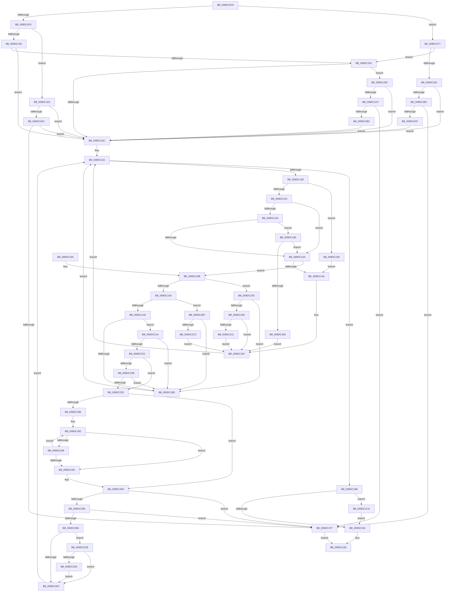

# FsRtlRemoveDotsFromPath

- RVA: `0x009DC0C0`–`0x009DC2D8` (길이 `536` bytes)
- VA: `0x00000001409DC0C0`
- 실행 섹션: `PAGE`
- PDB 이름 있음: `예`; PDB Function 태그: `아니요`
- unwind 정보 RVA: `0x000A3654`
- 디코드: `140`개 명령, `536/536` bytes 표시
- 미해석 바이트: `0` (있으면 어셈블리에 `.byte`로 보존)

> 이 문서는 커널 이미지의 기계어와 PDB 기호를 분석해 생성했습니다. 4번과 5번은 함수 원형과 자료형을 바이너리 사용 방식에서 추정한 C 해석이며 원본 소스 복구 결과는 아닙니다.

## 1. Dependencies

- 직접 호출 지점: **0**; 고유 호출 대상: **0**
- 직접 호출자로 확인된 함수: **1**
- RIP 상대 이미지 참조: **0**

### Outgoing calls
- 직접 디코드된 call 명령이 없습니다.

### Direct callers
- [IopReplaceSymlinkPath](IopReplaceSymlinkPath_function_009DBE80.md) at `0x009DBF69`

### Static image references
- 디코드된 RIP-relative 메모리 참조가 없습니다.

## 2. Other-region calls and transfers

- 다른 실행 섹션으로 향하는 call: **0**
- 별도 외부 분기/꼬리 이동을 확인하지 못했습니다.

## 3. Assembly (complete function range)

```asm
009DC0C0  48 89 5C 24 08                  mov qword ptr [rsp + 8], rbx
009DC0C5  48 89 6C 24 10                  mov qword ptr [rsp + 0x10], rbp
009DC0CA  48 89 74 24 18                  mov qword ptr [rsp + 0x18], rsi
009DC0CF  48 89 7C 24 20                  mov qword ptr [rsp + 0x20], rdi
009DC0D4  41 56                           push r14
009DC0D6  33 ED                           xor ebp, ebp
009DC0D8  44 0F B7 D2                     movzx r10d, dx
009DC0DC  66 41 D1 EA                     shr r10w, 1
009DC0E0  49 8B F0                        mov rsi, r8
009DC0E3  48 8B F9                        mov rdi, rcx
009DC0E6  44 0F B7 CD                     movzx r9d, bp
009DC0EA  66 41 83 FA 03                  cmp r10w, 3
009DC0EF  0F 84 82 01 00 00               je 0x1409dc277
009DC0F5  66 41 83 FA 02                  cmp r10w, 2
009DC0FA  0F 84 E2 00 00 00               je 0x1409dc1e2
009DC100  76 0A                           jbe 0x1409dc10c
009DC102  66 83 39 2E                     cmp word ptr [rcx], 0x2e
009DC106  0F 84 90 01 00 00               je 0x1409dc29c
009DC10C  0F B7 C5                        movzx eax, bp
009DC10F  41 BE 2E 00 00 00               mov r14d, 0x2e
009DC115  66 41 3B C2                     cmp ax, r10w
009DC119  73 50                           jae 0x1409dc16b
009DC11B  66 85 C0                        test ax, ax
009DC11E  74 39                           je 0x1409dc159
009DC120  45 0F B7 DA                     movzx r11d, r10w
009DC124  0F B7 D0                        movzx edx, ax
009DC127  45 8D 43 FF                     lea r8d, [r11 - 1]
009DC12B  41 3B D0                        cmp edx, r8d
009DC12E  7D 0A                           jge 0x1409dc13a
009DC130  0F B7 C8                        movzx ecx, ax
009DC133  66 83 3C 4F 5C                  cmp word ptr [rdi + rcx*2], 0x5c
009DC138  74 24                           je 0x1409dc15e
009DC13A  0F B7 C8                        movzx ecx, ax
009DC13D  66 44 39 34 4F                  cmp word ptr [rdi + rcx*2], r14w
009DC142  74 57                           je 0x1409dc19b
009DC144  0F B7 0C 4F                     movzx ecx, word ptr [rdi + rcx*2]
009DC148  49 0F BF D1                     movsx rdx, r9w
009DC14C  66 41 FF C1                     inc r9w
009DC150  66 89 0C 57                     mov word ptr [rdi + rdx*2], cx
009DC154  66 FF C0                        inc ax
009DC157  EB BC                           jmp 0x1409dc115
009DC159  0F B7 C8                        movzx ecx, ax
009DC15C  EB E6                           jmp 0x1409dc144
009DC15E  48 63 CA                        movsxd rcx, edx
009DC161  66 83 7C 4F 02 5C               cmp word ptr [rdi + rcx*2 + 2], 0x5c
009DC167  75 D1                           jne 0x1409dc13a
009DC169  EB E9                           jmp 0x1409dc154
009DC16B  41 0F B7 C1                     movzx eax, r9w
009DC16F  41 0F B7 CA                     movzx ecx, r10w
009DC173  66 03 C0                        add ax, ax
009DC176  66 89 06                        mov word ptr [rsi], ax
009DC179  41 0F BF C1                     movsx eax, r9w
009DC17D  3B C1                           cmp eax, ecx
009DC17F  7C 49                           jl 0x1409dc1ca
009DC181  33 C0                           xor eax, eax
009DC183  48 8B 5C 24 10                  mov rbx, qword ptr [rsp + 0x10]
009DC188  48 8B 6C 24 18                  mov rbp, qword ptr [rsp + 0x18]
009DC18D  48 8B 74 24 20                  mov rsi, qword ptr [rsp + 0x20]
009DC192  48 8B 7C 24 28                  mov rdi, qword ptr [rsp + 0x28]
009DC197  41 5E                           pop r14
009DC199  C3                              ret
009DC19A  CC                              int3
009DC19B  41 3B D0                        cmp edx, r8d
009DC19E  74 5E                           je 0x1409dc1fe
009DC1A0  0F B7 4C 57 02                  movzx ecx, word ptr [rdi + rdx*2 + 2]
009DC1A5  66 83 F9 5C                     cmp cx, 0x5c
009DC1A9  0F 84 08 01 00 00               je 0x1409dc2b7
009DC1AF  66 41 3B CE                     cmp cx, r14w
009DC1B3  74 65                           je 0x1409dc21a
009DC1B5  49 0F BF C9                     movsx rcx, r9w
009DC1B9  66 41 FF C1                     inc r9w
009DC1BD  66 FF C0                        inc ax
009DC1C0  66 44 89 34 4F                  mov word ptr [rdi + rcx*2], r14w
009DC1C5  E9 4B FF FF FF                  jmp 0x1409dc115
009DC1CA  49 0F BF C1                     movsx rax, r9w
009DC1CE  66 45 2B D1                     sub r10w, r9w
009DC1D2  49 0F BF CA                     movsx rcx, r10w
009DC1D6  48 8D 3C 47                     lea rdi, [rdi + rax*2]
009DC1DA  0F B7 C5                        movzx eax, bp
009DC1DD  66 F3 AB                        rep stosw word ptr [rdi], ax
009DC1E0  EB 9F                           jmp 0x1409dc181
009DC1E2  66 83 39 2E                     cmp word ptr [rcx], 0x2e
009DC1E6  0F 85 20 FF FF FF               jne 0x1409dc10c
009DC1EC  66 83 79 02 2E                  cmp word ptr [rcx + 2], 0x2e
009DC1F1  0F 85 15 FF FF FF               jne 0x1409dc10c
009DC1F7  B8 78 02 00 C0                  mov eax, 0xc0000278
009DC1FC  EB 85                           jmp 0x1409dc183
009DC1FE  66 83 7C 57 FE 5C               cmp word ptr [rdi + rdx*2 - 2], 0x5c
009DC204  75 AF                           jne 0x1409dc1b5
009DC206  66 41 83 F9 01                  cmp r9w, 1
009DC20B  0F 8E 43 FF FF FF               jle 0x1409dc154
009DC211  66 41 FF C9                     dec r9w
009DC215  E9 3A FF FF FF                  jmp 0x1409dc154
009DC21A  66 83 7C 57 FE 5C               cmp word ptr [rdi + rdx*2 - 2], 0x5c
009DC220  75 93                           jne 0x1409dc1b5
009DC222  41 83 C3 FE                     add r11d, -2
009DC226  41 3B D3                        cmp edx, r11d
009DC229  74 08                           je 0x1409dc233
009DC22B  66 83 7C 57 04 5C               cmp word ptr [rdi + rdx*2 + 4], 0x5c
009DC231  75 82                           jne 0x1409dc1b5
009DC233  66 41 83 C1 FE                  add r9w, -2
009DC238  66 45 85 C9                     test r9w, r9w
009DC23C  7E 1B                           jle 0x1409dc259
009DC23E  66 90                           nop
009DC240  49 0F BF C9                     movsx rcx, r9w
009DC244  66 83 3C 4F 5C                  cmp word ptr [rdi + rcx*2], 0x5c
009DC249  74 0A                           je 0x1409dc255
009DC24B  66 41 FF C9                     dec r9w
009DC24F  66 45 85 C9                     test r9w, r9w
009DC253  7F EB                           jg 0x1409dc240
009DC255  66 45 85 C9                     test r9w, r9w
009DC259  78 9C                           js 0x1409dc1f7
009DC25B  49 0F BF C9                     movsx rcx, r9w
009DC25F  66 83 3C 4F 5C                  cmp word ptr [rdi + rcx*2], 0x5c
009DC264  75 91                           jne 0x1409dc1f7
009DC266  66 45 85 C9                     test r9w, r9w
009DC26A  74 5F                           je 0x1409dc2cb
009DC26C  66 FF C0                        inc ax
009DC26F  66 FF C0                        inc ax
009DC272  E9 9E FE FF FF                  jmp 0x1409dc115
009DC277  66 83 39 5C                     cmp word ptr [rcx], 0x5c
009DC27B  0F 85 81 FE FF FF               jne 0x1409dc102
009DC281  66 83 79 02 2E                  cmp word ptr [rcx + 2], 0x2e
009DC286  0F 85 80 FE FF FF               jne 0x1409dc10c
009DC28C  66 83 79 04 2E                  cmp word ptr [rcx + 4], 0x2e
009DC291  0F 84 60 FF FF FF               je 0x1409dc1f7
009DC297  E9 70 FE FF FF                  jmp 0x1409dc10c
009DC29C  66 83 79 02 2E                  cmp word ptr [rcx + 2], 0x2e
009DC2A1  0F 85 65 FE FF FF               jne 0x1409dc10c
009DC2A7  66 83 79 04 5C                  cmp word ptr [rcx + 4], 0x5c
009DC2AC  0F 84 45 FF FF FF               je 0x1409dc1f7
009DC2B2  E9 55 FE FF FF                  jmp 0x1409dc10c
009DC2B7  66 83 7C 57 FE 5C               cmp word ptr [rdi + rdx*2 - 2], 0x5c
009DC2BD  0F 85 F2 FE FF FF               jne 0x1409dc1b5
009DC2C3  66 FF C0                        inc ax
009DC2C6  E9 89 FE FF FF                  jmp 0x1409dc154
009DC2CB  41 3B D3                        cmp edx, r11d
009DC2CE  75 9C                           jne 0x1409dc26c
009DC2D0  41 B9 01 00 00 00               mov r9d, 1
009DC2D6  EB 94                           jmp 0x1409dc26c
```

## 4. C-style interpretation (structured pseudocode)

```c
__int64 __fastcall FsRtlRemoveDotsFromPath(__int64 a1, unsigned __int16 a2, __int64 a3)
{
    __int64 result;
    __int64 v_r10;
    __int64 v_r11;
    __int64 v_rbp;
    unsigned __int64 v_stack_p10;
    unsigned __int64 v_stack_p18;
    unsigned __int64 v_stack_p20;
    unsigned __int64 v_stack_p8;

    v_stack_p8 = v_rbx;
    v_stack_p10 = v_rbp;
    v_stack_p18 = v_rsi;
    v_stack_p20 = v_rdi;
    v_rbp = 0;
    v_r10 = (unsigned __int16)((a2) >> (1));
    if (((unsigned __int16)(v_r10)) == 3) goto loc_009DC277;
    if (((unsigned __int16)(v_r10)) == 2) goto loc_009DC1E2;
    if (((unsigned __int16)(v_r10)) <= 2) goto loc_009DC10C;
loc_009DC102:
    if ((*(unsigned __int16 *)(a1)) == 46) goto loc_009DC29C;
loc_009DC10C:
loc_009DC115:
    if (0 >= ((unsigned __int16)(v_r10))) goto loc_009DC16B;
    if (0 == 0) goto loc_009DC159;
    if (0 >= ((unsigned int)((unsigned __int16)(v_r10) - 1))) goto loc_009DC13A;
    if ((*(unsigned __int16 *)(a1 + 0 * 2)) == 92) goto loc_009DC15E;
loc_009DC13A:
    if ((*(unsigned __int16 *)(a1 + 0 * 2)) == 46) goto loc_009DC19B;
loc_009DC144:
    a4 = (unsigned __int16)((0) + 1);
    *(unsigned __int16 *)(a1 + (__int16)(0) * 2) = (unsigned __int16)(*(unsigned __int16 *)(a1 + 0 * 2));
loc_009DC154:
    result = (unsigned __int16)((0) + 1);
    goto loc_009DC115;
loc_009DC159:
    goto loc_009DC144;
loc_009DC15E:
    if ((*(unsigned __int16 *)(a1 + (int)((unsigned int)((__int16)(0))) * 2 + 2)) != 92) goto loc_009DC13A;
    goto loc_009DC154;
loc_009DC16B:
    result = (unsigned __int16)(((unsigned __int16)(a4)) + ((unsigned __int16)((unsigned __int16)(a4))));
    *(unsigned __int16 *)(a3) = (unsigned __int16)(result);
    if (((unsigned int)((__int16)((unsigned __int16)(a4)))) < ((unsigned int)((unsigned __int16)(v_r10)))) goto loc_009DC1CA;
loc_009DC181:
    result = 0;
loc_009DC183:
    return result;
loc_009DC19B:
    if (((unsigned int)((__int16)(0))) == ((unsigned int)((unsigned __int16)(v_r10) - 1))) goto loc_009DC1FE;
    if (((unsigned __int16)(*(unsigned __int16 *)(v_stack_p20 + (__int16)(0) * 2 + 2))) == 92) goto loc_009DC2B7;
    if (((unsigned __int16)(*(unsigned __int16 *)(v_stack_p20 + (__int16)(0) * 2 + 2))) == 46) goto loc_009DC21A;
loc_009DC1B5:
    a4 = (unsigned __int16)((a4) + 1);
    result = (unsigned __int16)((result) + 1);
    *(unsigned __int16 *)(v_stack_p20 + (__int16)((unsigned __int16)(a4)) * 2) = 46;
    goto loc_009DC115;
loc_009DC1CA:
    v_r10 = (unsigned __int16)((v_r10) - ((unsigned __int16)(a4)));
    goto loc_009DC181;
loc_009DC1E2:
    if ((*(unsigned __int16 *)((__int16)((unsigned __int16)(v_r10)))) != 46) goto loc_009DC10C;
    if ((*(unsigned __int16 *)((__int16)((unsigned __int16)(v_r10)) + 2)) != 46) goto loc_009DC10C;
loc_009DC1F7:
    goto loc_009DC183;
loc_009DC1FE:
    if ((*(unsigned __int16 *)(v_stack_p20 + (__int16)((unsigned __int16)(a4)) * 2 + (__int16)(0) * 2 - 2)) != 92) goto loc_009DC1B5;
    if (((unsigned __int16)(a4)) <= 1) goto loc_009DC154;
    a4 = (unsigned __int16)((a4) - 1);
    goto loc_009DC154;
loc_009DC21A:
    if ((*(unsigned __int16 *)(v_stack_p20 + (__int16)((unsigned __int16)(a4)) * 2 + (__int16)(0) * 2 - 2)) != 92) goto loc_009DC1B5;
    v_r11 = (unsigned int)(((unsigned __int16)(v_r10)) + (-2));
    if (((unsigned int)((__int16)(0))) == ((unsigned int)(v_r11))) goto loc_009DC233;
    if ((*(unsigned __int16 *)(v_stack_p20 + (__int16)((unsigned __int16)(a4)) * 2 + (__int16)(0) * 2 + 4)) != 92) goto loc_009DC1B5;
loc_009DC233:
    a4 = (unsigned __int16)((a4) + (-2));
    if (condition_is_less_or_equal) goto loc_009DC259;
loc_009DC240:
    if ((*(unsigned __int16 *)(v_stack_p20 + (__int16)((unsigned __int16)(a4)) * 2 + (__int16)((unsigned __int16)(a4)) * 2)) == 92) goto loc_009DC255;
    a4 = (unsigned __int16)((a4) - 1);
    if (condition_is_greater) goto loc_009DC240;
loc_009DC255:
loc_009DC259:
    if (sign_flag) goto loc_009DC1F7;
    if ((*(unsigned __int16 *)(v_stack_p20 + (__int16)((unsigned __int16)(a4)) * 2 + (__int16)((unsigned __int16)(a4)) * 2)) != 92) goto loc_009DC1F7;
    if ((unsigned __int16)(a4) == 0) goto loc_009DC2CB;
loc_009DC26C:
    result = (unsigned __int16)(((unsigned int)(0xC0000278ULL)) + 1);
    result = (unsigned __int16)((result) + 1);
    goto loc_009DC115;
loc_009DC277:
    if ((*(unsigned __int16 *)((__int16)((unsigned __int16)(a4)))) != 92) goto loc_009DC102;
    if ((*(unsigned __int16 *)((__int16)((unsigned __int16)(a4)) + 2)) != 46) goto loc_009DC10C;
    if ((*(unsigned __int16 *)((__int16)((unsigned __int16)(a4)) + 4)) == 46) goto loc_009DC1F7;
    goto loc_009DC10C;
loc_009DC29C:
    if ((*(unsigned __int16 *)((__int16)((unsigned __int16)(a4)) + 2)) != 46) goto loc_009DC10C;
    if ((*(unsigned __int16 *)((__int16)((unsigned __int16)(a4)) + 4)) == 92) goto loc_009DC1F7;
    goto loc_009DC10C;
loc_009DC2B7:
    if ((*(unsigned __int16 *)(v_stack_p20 + (__int16)((unsigned __int16)(a4)) * 2 + (__int16)(0) * 2 - 2)) != 92) goto loc_009DC1B5;
    result = (unsigned __int16)((result) + 1);
    goto loc_009DC154;
loc_009DC2CB:
    if (((unsigned int)((__int16)(0))) != ((unsigned int)(v_r11))) goto loc_009DC26C;
    goto loc_009DC26C;
}
```

## 5. (Beta) C Style

```c
int64_t FsRtlRemoveDotsFromPath(void *Arg1, uint16_t Arg2, void *Arg3)
{
    uint8_t *arg1 = (uint8_t *)Arg1;
    uint8_t *arg3 = (uint8_t *)Arg3;

    int64_t result;
    int64_t local_r10;
    int64_t local_r11;
    int64_t local_rbp;
    uint64_t v_stack_p10;
    uint64_t v_stack_p18;
    uint64_t v_stack_p20;
    uint64_t v_stack_p8;

    v_stack_p8 = local_rbx;
    v_stack_p10 = local_rbp;
    v_stack_p18 = local_rsi;
    v_stack_p20 = local_rdi;
    local_rbp = 0;
    local_r10 = (uint16_t)((Arg2) >> (1));
    if (((uint16_t)(local_r10)) == 3) goto loc_009DC277;
    if (((uint16_t)(local_r10)) == 2) goto loc_009DC1E2;
    if (((uint16_t)(local_r10)) <= 2) goto loc_009DC10C;
loc_009DC102:
    if ((*(uint16_t *)(arg1)) == 46) goto loc_009DC29C;
loc_009DC10C:
loc_009DC115:
    if (0 >= ((uint16_t)(local_r10))) goto loc_009DC16B;
    if (0 == 0) goto loc_009DC159;
    if (0 >= ((uint32_t)((uint16_t)(local_r10) - 1))) goto loc_009DC13A;
    if ((*(uint16_t *)(arg1 + 0x0 * 2)) == 92) goto loc_009DC15E;
loc_009DC13A:
    if ((*(uint16_t *)(arg1 + 0x0 * 2)) == 46) goto loc_009DC19B;
loc_009DC144:
    a4 = (uint16_t)((0) + 1);
    *(uint16_t *)(arg1 + (int16_t)(0) * 2) = (uint16_t)(*(uint16_t *)(arg1 + 0x0 * 2));
loc_009DC154:
    result = (uint16_t)((0) + 1);
    goto loc_009DC115;
loc_009DC159:
    goto loc_009DC144;
loc_009DC15E:
    if ((*(uint16_t *)(arg1 + (int32_t)((uint32_t)((int16_t)(0))) * 2 + 0x2)) != 92) goto loc_009DC13A;
    goto loc_009DC154;
loc_009DC16B:
    result = (uint16_t)(((uint16_t)(a4)) + ((uint16_t)((uint16_t)(a4))));
    *(uint16_t *)(arg3) = (uint16_t)(result);
    if (((uint32_t)((int16_t)((uint16_t)(a4)))) < ((uint32_t)((uint16_t)(local_r10)))) goto loc_009DC1CA;
loc_009DC181:
    result = 0;
loc_009DC183:
    return result;
loc_009DC19B:
    if (((uint32_t)((int16_t)(0))) == ((uint32_t)((uint16_t)(local_r10) - 1))) goto loc_009DC1FE;
    if (((uint16_t)(*(uint16_t *)(v_stack_p20 + (int16_t)(0) * 2 + 0x2))) == 92) goto loc_009DC2B7;
    if (((uint16_t)(*(uint16_t *)(v_stack_p20 + (int16_t)(0) * 2 + 0x2))) == 46) goto loc_009DC21A;
loc_009DC1B5:
    a4 = (uint16_t)((a4) + 1);
    result = (uint16_t)((result) + 1);
    *(uint16_t *)(v_stack_p20 + (int16_t)((uint16_t)(a4)) * 2) = 46;
    goto loc_009DC115;
loc_009DC1CA:
    local_r10 = (uint16_t)((local_r10) - ((uint16_t)(a4)));
    goto loc_009DC181;
loc_009DC1E2:
    if ((*(uint16_t *)((int16_t)((uint16_t)(local_r10)))) != 46) goto loc_009DC10C;
    if ((*(uint16_t *)((int16_t)((uint16_t)(local_r10)) + 0x2)) != 46) goto loc_009DC10C;
loc_009DC1F7:
    goto loc_009DC183;
loc_009DC1FE:
    if ((*(uint16_t *)(v_stack_p20 + (int16_t)((uint16_t)(a4)) * 2 + (int16_t)(0) * 2 - 0x2)) != 92) goto loc_009DC1B5;
    if (((uint16_t)(a4)) <= 1) goto loc_009DC154;
    a4 = (uint16_t)((a4) - 1);
    goto loc_009DC154;
loc_009DC21A:
    if ((*(uint16_t *)(v_stack_p20 + (int16_t)((uint16_t)(a4)) * 2 + (int16_t)(0) * 2 - 0x2)) != 92) goto loc_009DC1B5;
    local_r11 = (uint32_t)(((uint16_t)(local_r10)) + (-2));
    if (((uint32_t)((int16_t)(0))) == ((uint32_t)(local_r11))) goto loc_009DC233;
    if ((*(uint16_t *)(v_stack_p20 + (int16_t)((uint16_t)(a4)) * 2 + (int16_t)(0) * 2 + 0x4)) != 92) goto loc_009DC1B5;
loc_009DC233:
    a4 = (uint16_t)((a4) + (-2));
    if (condition_is_less_or_equal) goto loc_009DC259;
loc_009DC240:
    if ((*(uint16_t *)(v_stack_p20 + (int16_t)((uint16_t)(a4)) * 2 + (int16_t)((uint16_t)(a4)) * 2)) == 92) goto loc_009DC255;
    a4 = (uint16_t)((a4) - 1);
    if (condition_is_greater) goto loc_009DC240;
loc_009DC255:
loc_009DC259:
    if (sign_flag) goto loc_009DC1F7;
    if ((*(uint16_t *)(v_stack_p20 + (int16_t)((uint16_t)(a4)) * 2 + (int16_t)((uint16_t)(a4)) * 2)) != 92) goto loc_009DC1F7;
    if ((uint16_t)(a4) == 0) goto loc_009DC2CB;
loc_009DC26C:
    result = (uint16_t)(((uint32_t)(0xC0000278ULL)) + 1);
    result = (uint16_t)((result) + 1);
    goto loc_009DC115;
loc_009DC277:
    if ((*(uint16_t *)((int16_t)((uint16_t)(a4)))) != 92) goto loc_009DC102;
    if ((*(uint16_t *)((int16_t)((uint16_t)(a4)) + 0x2)) != 46) goto loc_009DC10C;
    if ((*(uint16_t *)((int16_t)((uint16_t)(a4)) + 0x4)) == 46) goto loc_009DC1F7;
    goto loc_009DC10C;
loc_009DC29C:
    if ((*(uint16_t *)((int16_t)((uint16_t)(a4)) + 0x2)) != 46) goto loc_009DC10C;
    if ((*(uint16_t *)((int16_t)((uint16_t)(a4)) + 0x4)) == 92) goto loc_009DC1F7;
    goto loc_009DC10C;
loc_009DC2B7:
    if ((*(uint16_t *)(v_stack_p20 + (int16_t)((uint16_t)(a4)) * 2 + (int16_t)(0) * 2 - 0x2)) != 92) goto loc_009DC1B5;
    result = (uint16_t)((result) + 1);
    goto loc_009DC154;
loc_009DC2CB:
    if (((uint32_t)((int16_t)(0))) != ((uint32_t)(local_r11))) goto loc_009DC26C;
    goto loc_009DC26C;
}
```

### 관측된 메모리 오프셋

구조체 형식이 확인되지 않은 접근은 인자 기준의 오프셋으로만 기록했습니다.

| 기준 인자 | 오프셋 표현 | 폭 (bit) | 접근 |
|---|---:|---:|---|
| `Arg1` | `- 0x2 + rdx*2` | `16` | `R` |
| `Arg1` | `+ 0x0` | `16` | `R` |
| `Arg1` | `+ 0x0` | `16` | `W` |
| `Arg1` | `+ 0x0 + rax*2` | `64` | `R` |
| `Arg1` | `+ 0x0 + rcx*2` | `16` | `R` |
| `Arg1` | `+ 0x0 + rcx*2` | `16` | `W` |
| `Arg1` | `+ 0x0 + rdx*2` | `16` | `W` |
| `Arg1` | `+ 0x2` | `16` | `R` |
| `Arg1` | `+ 0x2 + rcx*2` | `16` | `R` |
| `Arg1` | `+ 0x2 + rdx*2` | `16` | `R` |
| `Arg1` | `+ 0x4` | `16` | `R` |
| `Arg1` | `+ 0x4 + rdx*2` | `16` | `R` |
| `Arg3` | `+ 0x0` | `16` | `W` |

## 6. Execution-region graph

[열기: 2D/3D 그래프와 함수 탐색 컨트롤 패널](../../../control-panel.html?section=page&rva=0x009DC0C0&view=graph)

- 2D 그래프는 위에서 아래로 흐르고, 3D 그래프는 빈 공간을 드래그해 회전합니다. Shift+드래그는 이동, 휠은 확대·축소, 함수 노드 선택은 대상 보고서 이동입니다.

### Static fallback


