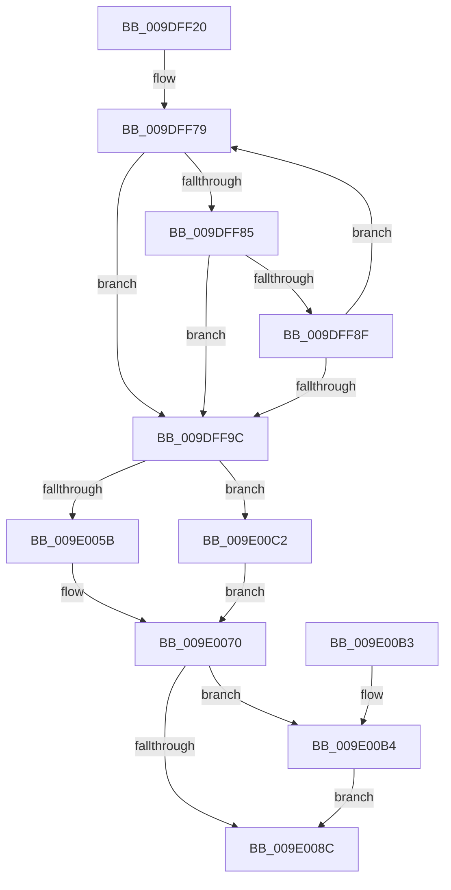

# IoWMIOpenBlock

- RVA: `0x009DFF20`–`0x009E00C9` (길이 `425` bytes)
- VA: `0x00000001409DFF20`
- 실행 섹션: `PAGE`
- PDB 이름 있음: `예`; PDB Function 태그: `아니요`
- unwind 정보 RVA: `0x000A3BCC`
- 디코드: `111`개 명령, `425/425` bytes 표시
- 미해석 바이트: `0` (있으면 어셈블리에 `.byte`로 보존)

> 이 문서는 커널 이미지의 기계어와 PDB 기호를 분석해 생성했습니다. 4번과 5번은 함수 원형과 자료형을 바이너리 사용 방식에서 추정한 C 해석이며 원본 소스 복구 결과는 아닙니다.

## 1. Dependencies

- 직접 호출 지점: **4**; 고유 호출 대상: **4**
- 직접 호출자로 확인된 함수: **0**
- RIP 상대 이미지 참조: **3**

### Outgoing calls
- `0x009E001C` → [RtlStringCchPrintfW](../../text/48/RtlStringCchPrintfW_function_00482D5C.md) (function, `0x00482D5C`)
- `0x009E002A` → [RtlInitUnicodeString](../../text/42/RtlInitUnicodeString_function_0042A780.md) (function, `0x0042A780`)
- `0x009E0083` → [WmipOpenBlock](../9E/WmipOpenBlock_function_009E00D0.md) (function, `0x009E00D0`)
- `0x009E0093` → [_security_check_cookie](../../text/6A/_security_check_cookie_function_006AC640.md) (function, `0x006AC640`)

### Direct callers
- 이 함수 시작 RVA로 연결되는 직접 call은 확인되지 않았습니다. 간접 호출은 완전히 역산할 수 없습니다.

### Static image references
- `0x009DFF3C` → RVA `0x00E0A740` (`.data`; read)
- `0x009DFF5C` → RVA `0x00B06EB0` (` ?? ::NNGAKEGL::`string'`; read)
- `0x009DFFFA` → RVA `0x00B06E40` (` ?? ::NNGAKEGL::`string'`; read)

## 2. Other-region calls and transfers

- 다른 실행 섹션으로 향하는 call: **3**
  - `0x009E001C` → [RtlStringCchPrintfW](../../text/48/RtlStringCchPrintfW_function_00482D5C.md) (`PAGE` → `.text`)
  - `0x009E002A` → [RtlInitUnicodeString](../../text/42/RtlInitUnicodeString_function_0042A780.md) (`PAGE` → `.text`)
  - `0x009E0093` → [_security_check_cookie](../../text/6A/_security_check_cookie_function_006AC640.md) (`PAGE` → `.text`)
- 별도 외부 분기/꼬리 이동을 확인하지 못했습니다.

## 3. Assembly (complete function range)

```asm
009DFF20  48 89 5C 24 20                  mov qword ptr [rsp + 0x20], rbx
009DFF25  55                              push rbp
009DFF26  56                              push rsi
009DFF27  57                              push rdi
009DFF28  41 54                           push r12
009DFF2A  41 55                           push r13
009DFF2C  41 56                           push r14
009DFF2E  41 57                           push r15
009DFF30  48 8D 6C 24 D0                  lea rbp, [rsp - 0x30]
009DFF35  48 81 EC 30 01 00 00            sub rsp, 0x130
009DFF3C  48 8B 05 FD A7 42 00            mov rax, qword ptr [rip + 0x42a7fd]
009DFF43  48 33 C4                        xor rax, rsp
009DFF46  48 89 45 20                     mov qword ptr [rbp + 0x20], rax
009DFF4A  45 33 ED                        xor r13d, r13d
009DFF4D  48 8D 45 C0                     lea rax, [rbp - 0x40]
009DFF51  4D 8B E0                        mov r12, r8
009DFF54  4C 89 6C 24 70                  mov qword ptr [rsp + 0x70], r13
009DFF59  0F 57 C0                        xorps xmm0, xmm0
009DFF5C  4C 8D 05 4D 6F 12 00            lea r8, [rip + 0x126f4d]
009DFF63  44 8B FA                        mov r15d, edx
009DFF66  4C 8B C9                        mov r9, rcx
009DFF69  41 8D 55 2E                     lea edx, [r13 + 0x2e]
009DFF6D  4C 2B C0                        sub r8, rax
009DFF70  0F 11 44 24 78                  movups xmmword ptr [rsp + 0x78], xmm0
009DFF75  48 8D 4D C0                     lea rcx, [rbp - 0x40]
009DFF79  48 8D 82 D0 FF FF 7F            lea rax, [rdx + 0x7fffffd0]
009DFF80  48 85 C0                        test rax, rax
009DFF83  74 17                           je 0x1409dff9c
009DFF85  41 0F B7 04 08                  movzx eax, word ptr [r8 + rcx]
009DFF8A  66 85 C0                        test ax, ax
009DFF8D  74 0D                           je 0x1409dff9c
009DFF8F  66 89 01                        mov word ptr [rcx], ax
009DFF92  48 83 C1 02                     add rcx, 2
009DFF96  48 83 EA 01                     sub rdx, 1
009DFF9A  75 DD                           jne 0x1409dff79
009DFF9C  45 0F B6 41 0C                  movzx r8d, byte ptr [r9 + 0xc]
009DFFA1  48 8D 41 FE                     lea rax, [rcx - 2]
009DFFA5  45 0F B6 51 0B                  movzx r10d, byte ptr [r9 + 0xb]
009DFFAA  48 85 D2                        test rdx, rdx
009DFFAD  41 0F B6 51 0D                  movzx edx, byte ptr [r9 + 0xd]
009DFFB2  45 0F B6 59 0A                  movzx r11d, byte ptr [r9 + 0xa]
009DFFB7  48 0F 45 C1                     cmovne rax, rcx
009DFFBB  41 0F B6 49 0E                  movzx ecx, byte ptr [r9 + 0xe]
009DFFC0  41 0F B6 59 09                  movzx ebx, byte ptr [r9 + 9]
009DFFC5  41 0F B6 79 08                  movzx edi, byte ptr [r9 + 8]
009DFFCA  41 0F B7 71 06                  movzx esi, word ptr [r9 + 6]
009DFFCF  45 0F B7 71 04                  movzx r14d, word ptr [r9 + 4]
009DFFD4  66 44 89 28                     mov word ptr [rax], r13w
009DFFD8  41 0F B6 41 0F                  movzx eax, byte ptr [r9 + 0xf]
009DFFDD  45 8B 09                        mov r9d, dword ptr [r9]
009DFFE0  89 44 24 68                     mov dword ptr [rsp + 0x68], eax
009DFFE4  89 4C 24 60                     mov dword ptr [rsp + 0x60], ecx
009DFFE8  48 8D 4D D2                     lea rcx, [rbp - 0x2e]
009DFFEC  89 54 24 58                     mov dword ptr [rsp + 0x58], edx
009DFFF0  BA 25 00 00 00                  mov edx, 0x25
009DFFF5  44 89 44 24 50                  mov dword ptr [rsp + 0x50], r8d
009DFFFA  4C 8D 05 3F 6E 12 00            lea r8, [rip + 0x126e3f]
009E0001  44 89 54 24 48                  mov dword ptr [rsp + 0x48], r10d
009E0006  44 89 5C 24 40                  mov dword ptr [rsp + 0x40], r11d
009E000B  89 5C 24 38                     mov dword ptr [rsp + 0x38], ebx
009E000F  89 7C 24 30                     mov dword ptr [rsp + 0x30], edi
009E0013  89 74 24 28                     mov dword ptr [rsp + 0x28], esi
009E0017  44 89 74 24 20                  mov dword ptr [rsp + 0x20], r14d
009E001C  E8 3B 2D AA FF                  call 0x140482d5c
009E0021  48 8D 55 C0                     lea rdx, [rbp - 0x40]
009E0025  48 8D 4C 24 78                  lea rcx, [rsp + 0x78]
009E002A  E8 51 A7 A4 FF                  call 0x14042a780
009E002F  48 8D 44 24 78                  lea rax, [rsp + 0x78]
009E0034  0F 57 C0                        xorps xmm0, xmm0
009E0037  0F 11 45 98                     movups xmmword ptr [rbp - 0x68], xmm0
009E003B  48 89 45 98                     mov qword ptr [rbp - 0x68], rax
009E003F  C7 45 A0 00 02 00 00            mov dword ptr [rbp - 0x60], 0x200
009E0046  0F 11 45 88                     movups xmmword ptr [rbp - 0x78], xmm0
009E004A  C7 45 88 30 00 00 00            mov dword ptr [rbp - 0x78], 0x30
009E0051  0F 11 45 A8                     movups xmmword ptr [rbp - 0x58], xmm0
009E0055  41 F6 C7 04                     test r15b, 4
009E0059  75 67                           jne 0x1409e00c2
009E005B  41 8B C7                        mov eax, r15d
009E005E  25 00 00 04 00                  and eax, 0x40000
009E0063  F7 D8                           neg eax
009E0065  1B C9                           sbb ecx, ecx
009E0067  83 E1 CC                        and ecx, 0xffffffcc
009E006A  81 C1 3C 41 22 00               add ecx, 0x22413c
009E0070  48 8D 44 24 70                  lea rax, [rsp + 0x70]
009E0075  45 8B CF                        mov r9d, r15d
009E0078  4C 8D 45 88                     lea r8, [rbp - 0x78]
009E007C  48 89 44 24 20                  mov qword ptr [rsp + 0x20], rax
009E0081  33 D2                           xor edx, edx
009E0083  E8 48 00 00 00                  call 0x1409e00d0
009E0088  85 C0                           test eax, eax
009E008A  79 28                           jns 0x1409e00b4
009E008C  48 8B 4D 20                     mov rcx, qword ptr [rbp + 0x20]
009E0090  48 33 CC                        xor rcx, rsp
009E0093  E8 A8 C5 CC FF                  call 0x1406ac640
009E0098  48 8B 9C 24 88 01 00 00         mov rbx, qword ptr [rsp + 0x188]
009E00A0  48 81 C4 30 01 00 00            add rsp, 0x130
009E00A7  41 5F                           pop r15
009E00A9  41 5E                           pop r14
009E00AB  41 5D                           pop r13
009E00AD  41 5C                           pop r12
009E00AF  5F                              pop rdi
009E00B0  5E                              pop rsi
009E00B1  5D                              pop rbp
009E00B2  C3                              ret
009E00B3  CC                              int3
009E00B4  48 8B 44 24 70                  mov rax, qword ptr [rsp + 0x70]
009E00B9  49 89 04 24                     mov qword ptr [r12], rax
009E00BD  41 8B C5                        mov eax, r13d
009E00C0  EB CA                           jmp 0x1409e008c
009E00C2  B9 40 41 22 00                  mov ecx, 0x224140
009E00C7  EB A7                           jmp 0x1409e0070
```

## 4. C-style interpretation (structured pseudocode)

```c
__int64 __fastcall IoWMIOpenBlock(__int64 a1, int a2, __int64 a3)
{
    __int64 result;
    __int64 v_r13;
    __int64 v_rsp;
    unsigned int v_stack_m100;
    unsigned int v_stack_m108;
    unsigned int v_stack_m110;
    unsigned int v_stack_m118;
    unsigned int v_stack_m120;
    unsigned int v_stack_m128;
    unsigned int v_stack_m130;
    unsigned int v_stack_m138;
    unsigned int v_stack_m140;
    unsigned int v_stack_m148;
    unsigned __int64 v_stack_m48;
    unsigned __int64 v_stack_m68;
    unsigned __int64 v_stack_m96;
    unsigned __int64 v_stack_mA8;
    unsigned __int64 v_stack_mC0;
    unsigned int v_stack_mC8;
    unsigned __int64 v_stack_mD0;
    unsigned __int64 v_stack_mE0;
    unsigned __int64 v_stack_mF0;
    unsigned __int64 v_stack_mF8;
    unsigned __int64 v_stack_p20;
    unsigned __int64 v_stack_p70;

    v_stack_p20 = v_rbx;
    v_rsp = (v_rsp) - (304);
    result = (*(unsigned __int64 *)(v_rip + 4368381)) ^ (v_rsp);
    v_stack_m48 = result;
    v_r13 = 0;
    v_stack_mF8 = 0;
    a3 = (v_rip + 1208141) - (v_stack_mA8);
    v_stack_mF0 = v_xmm0;
loc_009DFF79:
    if (v_r13 + 46 + 2147483600 == 0) goto loc_009DFF9C;
    if ((unsigned __int16)(*(unsigned __int16 *)(a3 + v_stack_mA8 * 1)) == 0) goto loc_009DFF9C;
    *(unsigned __int16 *)(v_stack_mA8) = (unsigned __int16)(*(unsigned __int16 *)(a3 + v_stack_mA8 * 1));
    a1 = (v_stack_mA8) + (2);
    a2 = (v_r13 + 46) - (1);
    if (condition_is_not_equal) goto loc_009DFF79;
loc_009DFF9C:
    result = a1 - 2;
    if (a2 != 0) { result = a1; }
    *(unsigned __int16 *)(result) = 0;
    v_stack_m100 = (unsigned int)(*(unsigned __int8 *)(a1 + 15));
    v_stack_m108 = (unsigned int)(*(unsigned __int8 *)(a1 + 14));
    v_stack_m110 = (unsigned int)(*(unsigned __int8 *)(a1 + 13));
    v_stack_m118 = (unsigned int)(*(unsigned __int8 *)(a1 + 12));
    v_stack_m120 = (unsigned int)(*(unsigned __int8 *)(a1 + 11));
    v_stack_m128 = (unsigned int)(*(unsigned __int8 *)(a1 + 10));
    v_stack_m130 = (unsigned int)(*(unsigned __int8 *)(a1 + 9));
    v_stack_m138 = (unsigned int)(*(unsigned __int8 *)(a1 + 8));
    v_stack_m140 = (unsigned int)(*(unsigned __int16 *)(a1 + 6));
    v_stack_m148 = (unsigned int)(*(unsigned __int16 *)(a1 + 4));
    result = RtlStringCchPrintfW(v_stack_m96, 37, v_rip + 1207871, (unsigned int)(*(unsigned int *)(a1)));
    result = RtlInitUnicodeString(v_stack_mF0, v_stack_mA8, v_rip + 1207871, (unsigned int)(*(unsigned int *)(a1)));
    v_stack_mD0 = v_xmm0;
    v_stack_mD0 = v_stack_mF0;
    v_stack_mC8 = 512;
    v_stack_mE0 = v_xmm0;
    v_stack_mE0 = 48;
    v_stack_mC0 = v_xmm0;
    if ((((unsigned __int8)((unsigned int)(a2))) & (4)) != 0) goto loc_009E00C2;
    result = (unsigned int)(((unsigned int)((unsigned int)((unsigned int)(a2)))) & (0x40000ULL));
    result = (unsigned int)(-(result));
    a1 = (unsigned int)((v_stack_mF0) & (0xFFFFFFCCULL));
    a1 = (unsigned int)((a1) + (0x22413CULL));
loc_009E0070:
    v_stack_m148 = v_stack_mF8;
    a2 = 0;
    result = WmipOpenBlock(a1, a2, v_stack_mE0, (unsigned int)((unsigned int)((unsigned int)(a2))));
    if (!sign_flag) goto loc_009E00B4;
loc_009E008C:
    a1 = (v_stack_m48) ^ (v_rsp);
    result = _security_check_cookie(a1, a2, v_stack_mE0, (unsigned int)((unsigned int)((unsigned int)(a2))));
    v_rsp = (v_rsp) + (304);
    return result;
loc_009E00B4:
    *(unsigned __int64 *)(a3) = v_stack_p70;
    goto loc_009E008C;
loc_009E00C2:
    goto loc_009E0070;
}
```

## 5. (Beta) C Style

```c
int64_t IoWMIOpenBlock(void *Arg1, int32_t Arg2, void *Arg3)
{
    uint8_t *arg1 = (uint8_t *)Arg1;
    uint8_t *arg3 = (uint8_t *)Arg3;

    int64_t result;
    int64_t local_r13;
    int64_t local_rsp;
    uint32_t v_stack_m100;
    uint32_t v_stack_m108;
    uint32_t v_stack_m110;
    uint32_t v_stack_m118;
    uint32_t v_stack_m120;
    uint32_t v_stack_m128;
    uint32_t v_stack_m130;
    uint32_t v_stack_m138;
    uint32_t v_stack_m140;
    uint32_t v_stack_m148;
    uint64_t v_stack_m48;
    uint64_t v_stack_m68;
    uint64_t v_stack_m96;
    uint64_t v_stack_mA8;
    uint64_t v_stack_mC0;
    uint32_t v_stack_mC8;
    uint64_t v_stack_mD0;
    uint64_t v_stack_mE0;
    uint64_t v_stack_mF0;
    uint64_t v_stack_mF8;
    uint64_t v_stack_p20;
    uint64_t v_stack_p70;

    v_stack_p20 = local_rbx;
    local_rsp = (local_rsp) - (304);
    result = (*(uint64_t *)(v_rip + 0x42A7FD)) ^ (local_rsp);
    v_stack_m48 = result;
    local_r13 = 0;
    v_stack_mF8 = 0;
    Arg3 = (v_rip + 1208141) - (v_stack_mA8);
    v_stack_mF0 = v_xmm0;
loc_009DFF79:
    if (local_r13 + 46 + 2147483600 == 0) goto loc_009DFF9C;
    if ((uint16_t)(*(uint16_t *)(arg3 + v_stack_mA8 * 1)) == 0) goto loc_009DFF9C;
    *(uint16_t *)(v_stack_mA8) = (uint16_t)(*(uint16_t *)(arg3 + v_stack_mA8 * 1));
    Arg1 = (v_stack_mA8) + (2);
    Arg2 = (local_r13 + 46) - (1);
    if (condition_is_not_equal) goto loc_009DFF79;
loc_009DFF9C:
    result = Arg1 - 2;
    if (Arg2 != 0) { result = Arg1; }
    *(uint16_t *)(result) = 0;
    v_stack_m100 = (uint32_t)(*(uint8_t *)(arg1 + 0xF));
    v_stack_m108 = (uint32_t)(*(uint8_t *)(arg1 + 0xE));
    v_stack_m110 = (uint32_t)(*(uint8_t *)(arg1 + 0xD));
    v_stack_m118 = (uint32_t)(*(uint8_t *)(arg1 + 0xC));
    v_stack_m120 = (uint32_t)(*(uint8_t *)(arg1 + 0xB));
    v_stack_m128 = (uint32_t)(*(uint8_t *)(arg1 + 0xA));
    v_stack_m130 = (uint32_t)(*(uint8_t *)(arg1 + 0x9));
    v_stack_m138 = (uint32_t)(*(uint8_t *)(arg1 + 0x8));
    v_stack_m140 = (uint32_t)(*(uint16_t *)(arg1 + 0x6));
    v_stack_m148 = (uint32_t)(*(uint16_t *)(arg1 + 0x4));
    result = RtlStringCchPrintfW(v_stack_m96, 37, v_rip + 1207871, (uint32_t)(*(uint32_t *)(arg1)));
    result = RtlInitUnicodeString(v_stack_mF0, v_stack_mA8, v_rip + 1207871, (uint32_t)(*(uint32_t *)(arg1)));
    v_stack_mD0 = v_xmm0;
    v_stack_mD0 = v_stack_mF0;
    v_stack_mC8 = 512;
    v_stack_mE0 = v_xmm0;
    v_stack_mE0 = 48;
    v_stack_mC0 = v_xmm0;
    if ((((uint8_t)((uint32_t)(Arg2))) & (4)) != 0) goto loc_009E00C2;
    result = (uint32_t)(((uint32_t)((uint32_t)((uint32_t)(Arg2)))) & (0x40000ULL));
    result = (uint32_t)(-(result));
    Arg1 = (uint32_t)((v_stack_mF0) & (0xFFFFFFCCULL));
    Arg1 = (uint32_t)((Arg1) + (0x22413CULL));
loc_009E0070:
    v_stack_m148 = v_stack_mF8;
    Arg2 = 0;
    result = WmipOpenBlock(Arg1, Arg2, v_stack_mE0, (uint32_t)((uint32_t)((uint32_t)(Arg2))));
    if (!sign_flag) goto loc_009E00B4;
loc_009E008C:
    Arg1 = (v_stack_m48) ^ (local_rsp);
    result = _security_check_cookie(Arg1, Arg2, v_stack_mE0, (uint32_t)((uint32_t)((uint32_t)(Arg2))));
    local_rsp = (local_rsp) + (304);
    return result;
loc_009E00B4:
    *(uint64_t *)(arg3) = v_stack_p70;
    goto loc_009E008C;
loc_009E00C2:
    goto loc_009E0070;
}
```

### 관측된 메모리 오프셋

구조체 형식이 확인되지 않은 접근은 인자 기준의 오프셋으로만 기록했습니다.

| 기준 인자 | 오프셋 표현 | 폭 (bit) | 접근 |
|---|---:|---:|---|
| `Arg1` | `+ 0x0` | `32` | `R` |
| `Arg1` | `+ 0x4` | `16` | `R` |
| `Arg1` | `+ 0x6` | `16` | `R` |
| `Arg1` | `+ 0x8` | `8` | `R` |
| `Arg1` | `+ 0x9` | `8` | `R` |
| `Arg1` | `+ 0xA` | `8` | `R` |
| `Arg1` | `+ 0xB` | `8` | `R` |
| `Arg1` | `+ 0xC` | `8` | `R` |
| `Arg1` | `+ 0xD` | `8` | `R` |
| `Arg1` | `+ 0xE` | `8` | `R` |
| `Arg1` | `+ 0xF` | `8` | `R` |
| `Arg3` | `+ 0x0` | `64` | `W` |

## 6. Execution-region graph

[열기: 2D/3D 그래프와 함수 탐색 컨트롤 패널](../../../control-panel.html?section=page&rva=0x009DFF20&view=graph)

- 2D 그래프는 위에서 아래로 흐르고, 3D 그래프는 빈 공간을 드래그해 회전합니다. Shift+드래그는 이동, 휠은 확대·축소, 함수 노드 선택은 대상 보고서 이동입니다.

### Static fallback


