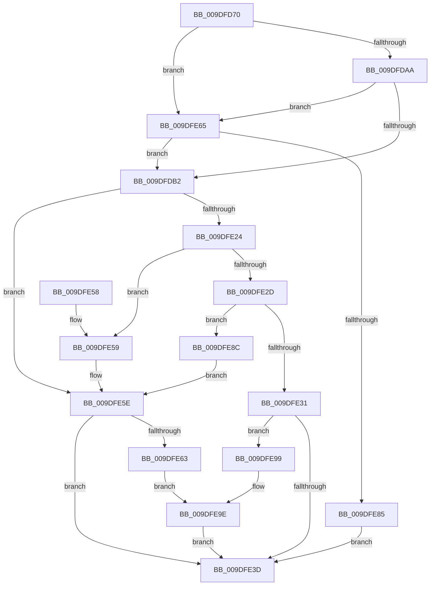

# IoWMIQuerySingleInstance

- RVA: `0x009DFD70`–`0x009DFEAA` (길이 `314` bytes)
- VA: `0x00000001409DFD70`
- 실행 섹션: `PAGE`
- PDB 이름 있음: `예`; PDB Function 태그: `아니요`
- unwind 정보 RVA: `0x000A3BB0`
- 디코드: `95`개 명령, `314/314` bytes 표시
- 미해석 바이트: `0` (있으면 어셈블리에 `.byte`로 보존)

> 이 문서는 커널 이미지의 기계어와 PDB 기호를 분석해 생성했습니다. 4번과 5번은 함수 원형과 자료형을 바이너리 사용 방식에서 추정한 C 해석이며 원본 소스 복구 결과는 아닙니다.

## 1. Dependencies

- 직접 호출 지점: **5**; 고유 호출 대상: **5**
- 직접 호출자로 확인된 함수: **0**
- RIP 상대 이미지 참조: **0**

### Outgoing calls
- `0x009DFDBB` → [memset](../../text/6C/memset_function_006C6C40.md) (function, `0x006C6C40`)
- `0x009DFDF0` → [memcpy](../../text/6C/memcpy_function_006C6840.md) (function, `0x006C6840`)
- `0x009DFE19` → [WmipQuerySetExecuteSI](../9E/WmipQuerySetExecuteSI_function_009E0574.md) (function, `0x009E0574`)
- `0x009DFE72` → [ExAllocatePool2](../../poolcode/B8/ExAllocatePool2_function_00B820F0.md) (function, `0x00B820F0`)
- `0x009DFEA3` → [ExFreePoolWithTag](../../poolcode/B8/ExFreePoolWithTag_function_00B82870.md) (function, `0x00B82870`)

### Direct callers
- 이 함수 시작 RVA로 연결되는 직접 call은 확인되지 않았습니다. 간접 호출은 완전히 역산할 수 없습니다.

### Static image references
- 디코드된 RIP-relative 메모리 참조가 없습니다.

## 2. Other-region calls and transfers

- 다른 실행 섹션으로 향하는 call: **4**
  - `0x009DFDBB` → [memset](../../text/6C/memset_function_006C6C40.md) (`PAGE` → `.text`)
  - `0x009DFDF0` → [memcpy](../../text/6C/memcpy_function_006C6840.md) (`PAGE` → `.text`)
  - `0x009DFE72` → [ExAllocatePool2](../../poolcode/B8/ExAllocatePool2_function_00B820F0.md) (`PAGE` → `POOLCODE`)
  - `0x009DFEA3` → [ExFreePoolWithTag](../../poolcode/B8/ExFreePoolWithTag_function_00B82870.md) (`PAGE` → `POOLCODE`)
- 별도 외부 분기/꼬리 이동을 확인하지 못했습니다.

## 3. Assembly (complete function range)

```asm
009DFD70  48 89 5C 24 08                  mov qword ptr [rsp + 8], rbx
009DFD75  48 89 6C 24 18                  mov qword ptr [rsp + 0x18], rbp
009DFD7A  56                              push rsi
009DFD7B  57                              push rdi
009DFD7C  41 54                           push r12
009DFD7E  41 56                           push r14
009DFD80  41 57                           push r15
009DFD82  48 83 EC 40                     sub rsp, 0x40
009DFD86  0F B7 3A                        movzx edi, word ptr [rdx]
009DFD89  49 8B F1                        mov rsi, r9
009DFD8C  41 8B 28                        mov ebp, dword ptr [r8]
009DFD8F  83 C7 49                        add edi, 0x49
009DFD92  83 E7 F8                        and edi, 0xfffffff8
009DFD95  4D 8B F0                        mov r14, r8
009DFD98  4C 8B FA                        mov r15, rdx
009DFD9B  4C 8B E1                        mov r12, rcx
009DFD9E  49 8B D9                        mov rbx, r9
009DFDA1  4D 85 C9                        test r9, r9
009DFDA4  0F 84 BB 00 00 00               je 0x1409dfe65
009DFDAA  3B EF                           cmp ebp, edi
009DFDAC  0F 82 B3 00 00 00               jb 0x1409dfe65
009DFDB2  33 D2                           xor edx, edx
009DFDB4  48 8B CB                        mov rcx, rbx
009DFDB7  44 8D 42 40                     lea r8d, [rdx + 0x40]
009DFDBB  E8 80 6E CE FF                  call 0x1406c6c40
009DFDC0  48 83 63 10 00                  and qword ptr [rbx + 0x10], 0
009DFDC5  48 8D 4B 42                     lea rcx, [rbx + 0x42]
009DFDC9  83 63 0C 00                     and dword ptr [rbx + 0xc], 0
009DFDCD  C7 43 2C 02 00 00 00            mov dword ptr [rbx + 0x2c], 2
009DFDD4  89 3B                           mov dword ptr [rbx], edi
009DFDD6  C7 43 30 40 00 00 00            mov dword ptr [rbx + 0x30], 0x40
009DFDDD  89 7B 38                        mov dword ptr [rbx + 0x38], edi
009DFDE0  41 0F B7 07                     movzx eax, word ptr [r15]
009DFDE4  66 89 43 40                     mov word ptr [rbx + 0x40], ax
009DFDE8  45 0F B7 07                     movzx r8d, word ptr [r15]
009DFDEC  49 8B 57 08                     mov rdx, qword ptr [r15 + 8]
009DFDF0  E8 4B 6A CE FF                  call 0x1406c6840
009DFDF5  8B 03                           mov eax, dword ptr [rbx]
009DFDF7  41 B1 01                        mov r9b, 1
009DFDFA  89 44 24 78                     mov dword ptr [rsp + 0x78], eax
009DFDFE  45 33 C0                        xor r8d, r8d
009DFE01  48 8D 44 24 78                  lea rax, [rsp + 0x78]
009DFE06  33 D2                           xor edx, edx
009DFE08  48 89 44 24 30                  mov qword ptr [rsp + 0x30], rax
009DFE0D  49 8B CC                        mov rcx, r12
009DFE10  89 6C 24 28                     mov dword ptr [rsp + 0x28], ebp
009DFE14  48 89 5C 24 20                  mov qword ptr [rsp + 0x20], rbx
009DFE19  E8 56 07 00 00                  call 0x1409e0574
009DFE1E  8B F8                           mov edi, eax
009DFE20  85 C0                           test eax, eax
009DFE22  78 3A                           js 0x1409dfe5e
009DFE24  8B 43 2C                        mov eax, dword ptr [rbx + 0x2c]
009DFE27  0F BA E0 08                     bt eax, 8
009DFE2B  72 2C                           jb 0x1409dfe59
009DFE2D  A8 20                           test al, 0x20
009DFE2F  75 5B                           jne 0x1409dfe8c
009DFE31  8B 44 24 78                     mov eax, dword ptr [rsp + 0x78]
009DFE35  41 89 06                        mov dword ptr [r14], eax
009DFE38  48 3B DE                        cmp rbx, rsi
009DFE3B  75 5C                           jne 0x1409dfe99
009DFE3D  4C 8D 5C 24 40                  lea r11, [rsp + 0x40]
009DFE42  8B C7                           mov eax, edi
009DFE44  49 8B 5B 30                     mov rbx, qword ptr [r11 + 0x30]
009DFE48  49 8B 6B 40                     mov rbp, qword ptr [r11 + 0x40]
009DFE4C  49 8B E3                        mov rsp, r11
009DFE4F  41 5F                           pop r15
009DFE51  41 5E                           pop r14
009DFE53  41 5C                           pop r12
009DFE55  5F                              pop rdi
009DFE56  5E                              pop rsi
009DFE57  C3                              ret
009DFE58  CC                              int3
009DFE59  BF BB 00 00 C0                  mov edi, 0xc00000bb
009DFE5E  48 3B DE                        cmp rbx, rsi
009DFE61  74 DA                           je 0x1409dfe3d
009DFE63  EB 39                           jmp 0x1409dfe9e
009DFE65  8B D7                           mov edx, edi
009DFE67  B9 40 00 00 00                  mov ecx, 0x40
009DFE6C  41 B8 57 6D 69 70               mov r8d, 0x70696d57
009DFE72  E8 79 22 1A 00                  call 0x140b820f0
009DFE77  48 8B D8                        mov rbx, rax
009DFE7A  8B EF                           mov ebp, edi
009DFE7C  48 85 C0                        test rax, rax
009DFE7F  0F 85 2D FF FF FF               jne 0x1409dfdb2
009DFE85  BF 9A 00 00 C0                  mov edi, 0xc000009a
009DFE8A  EB B1                           jmp 0x1409dfe3d
009DFE8C  8B 43 30                        mov eax, dword ptr [rbx + 0x30]
009DFE8F  BF 23 00 00 C0                  mov edi, 0xc0000023
009DFE94  41 89 06                        mov dword ptr [r14], eax
009DFE97  EB C5                           jmp 0x1409dfe5e
009DFE99  BF 23 00 00 C0                  mov edi, 0xc0000023
009DFE9E  33 D2                           xor edx, edx
009DFEA0  48 8B CB                        mov rcx, rbx
009DFEA3  E8 C8 29 1A 00                  call 0x140b82870
009DFEA8  EB 93                           jmp 0x1409dfe3d
```

## 4. C-style interpretation (structured pseudocode)

```c
__int64 __fastcall IoWMIQuerySingleInstance(__int64 a1, __int64 a2, __int64 a3, __int64 a4)
{
    __int64 result;
    __int64 v_rdi;
    __int64 v_rsp;
    unsigned __int64 v_stack_m28;
    unsigned __int64 v_stack_m38;
    unsigned int v_stack_m40;
    unsigned __int64 v_stack_m48;
    unsigned int v_stack_p10;
    unsigned __int64 v_stack_p18;
    unsigned __int64 v_stack_p8;

    v_stack_p8 = v_rbx;
    v_stack_p18 = v_rbp;
    v_rsp = (v_rsp) - (64);
    v_rdi = (unsigned int)((*(unsigned __int16 *)(a2)) + (73));
    v_rdi = (unsigned int)((v_rdi) & (0xFFFFFFF8ULL));
    if (a4 == 0) goto loc_009DFE65;
    if (((unsigned int)((unsigned int)(*(unsigned int *)(a3)))) < ((unsigned int)(v_rdi))) goto loc_009DFE65;
loc_009DFDB2:
    a2 = 0;
    result = memset(a4, a2, a2 + 64, a4);
    *(unsigned int *)(a4 + 44) = 2;
    *(unsigned int *)(a4) = (unsigned int)(v_rdi);
    *(unsigned int *)(a4 + 48) = 64;
    *(unsigned int *)(a4 + 56) = (unsigned int)(v_rdi);
    *(unsigned __int16 *)(a4 + 64) = (unsigned __int16)(*(unsigned __int16 *)(a2));
    result = memcpy(a4 + 66, *(unsigned __int64 *)(a2 + 8), *(unsigned __int16 *)(a2), a4);
    v_stack_p10 = (unsigned int)((unsigned int)(*(unsigned int *)(a4)));
    a3 = 0;
    a2 = 0;
    v_stack_m38 = v_stack_p10;
    v_stack_m40 = (unsigned int)((unsigned int)(*(unsigned int *)(a3)));
    v_stack_m48 = a4;
    result = WmipQuerySetExecuteSI(a1, a2, a3, 1);
    if (sign_flag) goto loc_009DFE5E;
    if (condition_is_below) goto loc_009DFE59;
    if ((((unsigned __int8)((unsigned int)(*(unsigned int *)(a4 + 44)))) & (32)) != 0) goto loc_009DFE8C;
    *(unsigned int *)(a3) = (unsigned int)((unsigned int)(v_stack_p10));
    if (a4 != a4) goto loc_009DFE99;
loc_009DFE3D:
    return (unsigned int)((unsigned int)((unsigned int)((unsigned int)(result))));
loc_009DFE59:
loc_009DFE5E:
    if ((*(unsigned __int64 *)(v_stack_m28 + 48)) == a4) goto loc_009DFE3D;
    goto loc_009DFE9E;
loc_009DFE65:
    result = ExAllocatePool2(64, (unsigned int)((unsigned int)((unsigned int)(0xC00000BBULL))), (unsigned int)(0x70696D57ULL), 1);
    if (result != 0) goto loc_009DFDB2;
    goto loc_009DFE3D;
loc_009DFE8C:
    *(unsigned int *)(a3) = (unsigned int)((unsigned int)(*(unsigned int *)(result + 48)));
    goto loc_009DFE5E;
loc_009DFE99:
loc_009DFE9E:
    a2 = 0;
    result = ExFreePoolWithTag(result, a2, (unsigned int)(0x70696D57ULL), 1);
    goto loc_009DFE3D;
}
```

## 5. (Beta) C Style

```c
int64_t IoWMIQuerySingleInstance(int64_t Arg1, void *Arg2, void *Arg3, int64_t Arg4)
{
    uint8_t *arg2 = (uint8_t *)Arg2;
    uint8_t *arg3 = (uint8_t *)Arg3;

    int64_t result;
    int64_t local_rdi;
    int64_t local_rsp;
    uint64_t v_stack_m28;
    uint64_t v_stack_m38;
    uint32_t v_stack_m40;
    uint64_t v_stack_m48;
    uint32_t v_stack_p10;
    uint64_t v_stack_p18;
    uint64_t v_stack_p8;

    v_stack_p8 = local_rbx;
    v_stack_p18 = local_rbp;
    local_rsp = (local_rsp) - (64);
    local_rdi = (uint32_t)((*(uint16_t *)(arg2)) + (73));
    local_rdi = (uint32_t)((local_rdi) & (0xFFFFFFF8ULL));
    if (Arg4 == 0) goto loc_009DFE65;
    if (((uint32_t)((uint32_t)(*(uint32_t *)(arg3)))) < ((uint32_t)(local_rdi))) goto loc_009DFE65;
loc_009DFDB2:
    Arg2 = 0;
    result = memset(Arg4, Arg2, Arg2 + 64, Arg4);
    *(uint32_t *)(Arg4 + 0x2C) = 2;
    *(uint32_t *)(Arg4) = (uint32_t)(local_rdi);
    *(uint32_t *)(Arg4 + 0x30) = 64;
    *(uint32_t *)(Arg4 + 0x38) = (uint32_t)(local_rdi);
    *(uint16_t *)(Arg4 + 0x40) = (uint16_t)(*(uint16_t *)(arg2));
    result = memcpy(Arg4 + 66, *(uint64_t *)(arg2 + 0x8), *(uint16_t *)(arg2), Arg4);
    v_stack_p10 = (uint32_t)((uint32_t)(*(uint32_t *)(Arg4)));
    Arg3 = 0;
    Arg2 = 0;
    v_stack_m38 = v_stack_p10;
    v_stack_m40 = (uint32_t)((uint32_t)(*(uint32_t *)(arg3)));
    v_stack_m48 = Arg4;
    result = WmipQuerySetExecuteSI(Arg1, Arg2, Arg3, 1);
    if (sign_flag) goto loc_009DFE5E;
    if (condition_is_below) goto loc_009DFE59;
    if ((((uint8_t)((uint32_t)(*(uint32_t *)(Arg4 + 0x2C)))) & (32)) != 0) goto loc_009DFE8C;
    *(uint32_t *)(arg3) = (uint32_t)((uint32_t)(v_stack_p10));
    if (Arg4 != Arg4) goto loc_009DFE99;
loc_009DFE3D:
    return (uint32_t)((uint32_t)((uint32_t)((uint32_t)(result))));
loc_009DFE59:
loc_009DFE5E:
    if ((*(uint64_t *)(v_stack_m28 + 0x30)) == Arg4) goto loc_009DFE3D;
    goto loc_009DFE9E;
loc_009DFE65:
    result = ExAllocatePool2(64, (uint32_t)((uint32_t)((uint32_t)(0xC00000BBULL))), (uint32_t)(0x70696D57ULL), 1);
    if (result != 0) goto loc_009DFDB2;
    goto loc_009DFE3D;
loc_009DFE8C:
    *(uint32_t *)(arg3) = (uint32_t)((uint32_t)(*(uint32_t *)(result + 0x30)));
    goto loc_009DFE5E;
loc_009DFE99:
loc_009DFE9E:
    Arg2 = 0;
    result = ExFreePoolWithTag(result, Arg2, (uint32_t)(0x70696D57ULL), 1);
    goto loc_009DFE3D;
}
```

### 관측된 메모리 오프셋

구조체 형식이 확인되지 않은 접근은 인자 기준의 오프셋으로만 기록했습니다.

| 기준 인자 | 오프셋 표현 | 폭 (bit) | 접근 |
|---|---:|---:|---|
| `Arg2` | `+ 0x0` | `16` | `R` |
| `Arg2` | `+ 0x8` | `64` | `R` |
| `Arg3` | `+ 0x0` | `32` | `R` |
| `Arg3` | `+ 0x0` | `32` | `W` |

## 6. Execution-region graph

[열기: 2D/3D 그래프와 함수 탐색 컨트롤 패널](../../../control-panel.html?section=page&rva=0x009DFD70&view=graph)

- 2D 그래프는 위에서 아래로 흐르고, 3D 그래프는 빈 공간을 드래그해 회전합니다. Shift+드래그는 이동, 휠은 확대·축소, 함수 노드 선택은 대상 보고서 이동입니다.

### Static fallback


