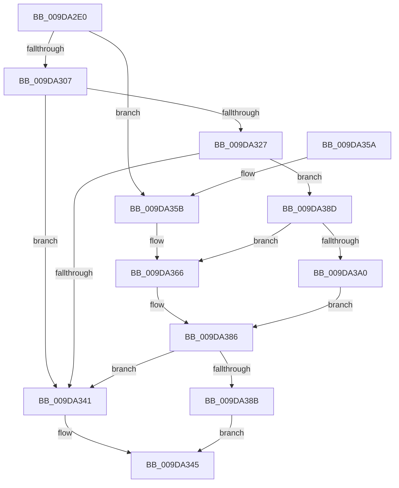

# IopAllocateMiniCompletionPacket

- RVA: `0x009DA2E0`–`0x009DA3AD` (길이 `205` bytes)
- VA: `0x00000001409DA2E0`
- 실행 섹션: `PAGE`
- PDB 이름 있음: `예`; PDB Function 태그: `아니요`
- unwind 정보 RVA: `0x000A31A8`
- 디코드: `54`개 명령, `205/205` bytes 표시
- 미해석 바이트: `0` (있으면 어셈블리에 `.byte`로 보존)

> 이 문서는 커널 이미지의 기계어와 PDB 기호를 분석해 생성했습니다. 4번과 5번은 함수 원형과 자료형을 바이너리 사용 방식에서 추정한 C 해석이며 원본 소스 복구 결과는 아닙니다.

## 1. Dependencies

- 직접 호출 지점: **4**; 고유 호출 대상: **3**
- 직접 호출자로 확인된 함수: **7**
- RIP 상대 이미지 참조: **0**

### Outgoing calls
- `0x009DA31D` → [ExpInterlockedPopEntrySList](../../text/6B/ExpInterlockedPopEntrySList_function_006BA570.md) (function, `0x006BA570`)
- `0x009DA337` → [ExpInterlockedPopEntrySList](../../text/6B/ExpInterlockedPopEntrySList_function_006BA570.md) (function, `0x006BA570`)
- `0x009DA381` → [ExAllocatePool3](../../poolcode/B8/ExAllocatePool3_function_00B84270.md) (function, `0x00B84270`)
- `0x009DA3A6` → [ExAllocatePool2](../../poolcode/B8/ExAllocatePool2_function_00B820F0.md) (function, `0x00B820F0`)

### Direct callers
- [IoSetIoCompletionEx3](../../text/24/IoSetIoCompletionEx3_function_0024EEE0.md) at `0x0024F139`
- [IoSetIoCompletionEx](../../text/24/IoSetIoCompletionEx_function_0024FA80.md) at `0x0024FB8D`
- [AlpcpSignalAndWait](../../text/2F/AlpcpSignalAndWait_function_002F9620.md) at `0x002F990E`
- [sub_00343C50](../../text/34/Unknown_function_00343C50.md) at `0x00343C54`
- [AlpcpSignal](../../text/39/AlpcpSignal_function_003955E0.md) at `0x00395BB7`
- [AlpcpQueueIoCompletion](../../text/39/AlpcpQueueIoCompletion_function_00397480.md) at `0x003976CE`
- [AlpcpQueueIoCompletionPort](../../text/3F/AlpcpQueueIoCompletionPort_function_003FF760.md) at `0x003FFBCC`

### Static image references
- 디코드된 RIP-relative 메모리 참조가 없습니다.

## 2. Other-region calls and transfers

- 다른 실행 섹션으로 향하는 call: **4**
  - `0x009DA31D` → [ExpInterlockedPopEntrySList](../../text/6B/ExpInterlockedPopEntrySList_function_006BA570.md) (`PAGE` → `.text`)
  - `0x009DA337` → [ExpInterlockedPopEntrySList](../../text/6B/ExpInterlockedPopEntrySList_function_006BA570.md) (`PAGE` → `.text`)
  - `0x009DA381` → [ExAllocatePool3](../../poolcode/B8/ExAllocatePool3_function_00B84270.md) (`PAGE` → `POOLCODE`)
  - `0x009DA3A6` → [ExAllocatePool2](../../poolcode/B8/ExAllocatePool2_function_00B820F0.md) (`PAGE` → `POOLCODE`)
- 별도 외부 분기/꼬리 이동을 확인하지 못했습니다.

## 3. Assembly (complete function range)

```asm
009DA2E0  48 89 5C 24 08                  mov qword ptr [rsp + 8], rbx
009DA2E5  48 89 6C 24 10                  mov qword ptr [rsp + 0x10], rbp
009DA2EA  48 89 74 24 18                  mov qword ptr [rsp + 0x18], rsi
009DA2EF  57                              push rdi
009DA2F0  48 83 EC 40                     sub rsp, 0x40
009DA2F4  0F 57 C0                        xorps xmm0, xmm0
009DA2F7  0F B6 EA                        movzx ebp, dl
009DA2FA  0F B6 F9                        movzx edi, cl
009DA2FD  0F 11 44 24 30                  movups xmmword ptr [rsp + 0x30], xmm0
009DA302  80 F9 04                        cmp cl, 4
009DA305  74 54                           je 0x1409da35b
009DA307  65 48 8B 34 25 20 00 00 00      mov rsi, qword ptr gs:[0x20]
009DA310  48 8B 9E 70 08 00 00            mov rbx, qword ptr [rsi + 0x870]
009DA317  48 8B CB                        mov rcx, rbx
009DA31A  FF 43 14                        inc dword ptr [rbx + 0x14]
009DA31D  E8 4E 02 CE FF                  call 0x1406ba570
009DA322  48 85 C0                        test rax, rax
009DA325  75 1A                           jne 0x1409da341
009DA327  FF 43 18                        inc dword ptr [rbx + 0x18]
009DA32A  48 8B 9E 78 08 00 00            mov rbx, qword ptr [rsi + 0x878]
009DA331  48 8B CB                        mov rcx, rbx
009DA334  FF 43 14                        inc dword ptr [rbx + 0x14]
009DA337  E8 34 02 CE FF                  call 0x1406ba570
009DA33C  48 85 C0                        test rax, rax
009DA33F  74 4C                           je 0x1409da38d
009DA341  40 88 78 10                     mov byte ptr [rax + 0x10], dil
009DA345  48 8B 5C 24 50                  mov rbx, qword ptr [rsp + 0x50]
009DA34A  48 8B 6C 24 58                  mov rbp, qword ptr [rsp + 0x58]
009DA34F  48 8B 74 24 60                  mov rsi, qword ptr [rsp + 0x60]
009DA354  48 83 C4 40                     add rsp, 0x40
009DA358  5F                              pop rdi
009DA359  C3                              ret
009DA35A  CC                              int3
009DA35B  BA 50 00 00 00                  mov edx, 0x50
009DA360  41 B8 49 63 70 20               mov r8d, 0x20706349
009DA366  33 C0                           xor eax, eax
009DA368  C7 44 24 20 01 00 00 00         mov dword ptr [rsp + 0x20], 1
009DA370  4C 8D 4C 24 30                  lea r9, [rsp + 0x30]
009DA375  C6 44 24 30 01                  mov byte ptr [rsp + 0x30], 1
009DA37A  89 44 24 38                     mov dword ptr [rsp + 0x38], eax
009DA37E  8D 48 40                        lea ecx, [rax + 0x40]
009DA381  E8 EA 9E 1A 00                  call 0x140b84270
009DA386  48 85 C0                        test rax, rax
009DA389  75 B6                           jne 0x1409da341
009DA38B  EB B8                           jmp 0x1409da345
009DA38D  FF 43 18                        inc dword ptr [rbx + 0x18]
009DA390  BA 38 00 00 00                  mov edx, 0x38
009DA395  41 B8 49 63 70 20               mov r8d, 0x20706349
009DA39B  40 84 ED                        test bpl, bpl
009DA39E  74 C6                           je 0x1409da366
009DA3A0  8D 4A 09                        lea ecx, [rdx + 9]
009DA3A3  40 B7 03                        mov dil, 3
009DA3A6  E8 45 7D 1A 00                  call 0x140b820f0
009DA3AB  EB D9                           jmp 0x1409da386
```

## 4. C-style interpretation (structured pseudocode)

```c
__int64 __fastcall IopAllocateMiniCompletionPacket(unsigned __int8 a1, unsigned __int8 a2)
{
    __int64 result;
    __int64 v_rsp;
    unsigned __int64 v_stack_m18;
    unsigned __int64 v_stack_p10;
    unsigned __int64 v_stack_p18;
    unsigned int v_stack_p20;
    unsigned __int64 v_stack_p30;
    unsigned int v_stack_p38;
    unsigned __int64 v_stack_p8;

    v_stack_p8 = v_rbx;
    v_stack_p10 = v_rbp;
    v_stack_p18 = v_rsi;
    v_rsp = (v_rsp) - (64);
    v_stack_m18 = v_xmm0;
    if (a1 == 4) goto loc_009DA35B;
    result = ExpInterlockedPopEntrySList(*(unsigned __int64 *)(*(unsigned __int64 *)(gs_base + (0 + 32)) + 2160), a2, a3, a4);
    if (result != 0) goto loc_009DA341;
    result = ExpInterlockedPopEntrySList(*(unsigned __int64 *)(*(unsigned __int64 *)(gs_base + (0 + 32)) + 2168), a2, a3, a4);
    if (result == 0) goto loc_009DA38D;
loc_009DA341:
    *(unsigned __int8 *)(result + 16) = a1;
loc_009DA345:
    v_rsp = (v_rsp) + (64);
    return result;
loc_009DA35B:
loc_009DA366:
    result = 0;
    v_stack_p20 = 1;
    v_stack_p30 = 1;
    v_stack_p38 = 0;
    result = ExAllocatePool3(result + 64, 80, (unsigned int)(0x20706349ULL), v_stack_p30);
loc_009DA386:
    if (result != 0) goto loc_009DA341;
    goto loc_009DA345;
loc_009DA38D:
    if ((unsigned __int8)(v_stack_p10) == 0) goto loc_009DA366;
    result = ExAllocatePool2(56 + 9, 56, (unsigned int)(0x20706349ULL), v_stack_p30);
    goto loc_009DA386;
}
```

## 5. (Beta) C Style

```c
int64_t IopAllocateMiniCompletionPacket(uint8_t Arg1, uint8_t Arg2)
{
    int64_t result;
    int64_t local_rsp;
    uint64_t v_stack_m18;
    uint64_t v_stack_p10;
    uint64_t v_stack_p18;
    uint32_t v_stack_p20;
    uint64_t v_stack_p30;
    uint32_t v_stack_p38;
    uint64_t v_stack_p8;

    v_stack_p8 = local_rbx;
    v_stack_p10 = local_rbp;
    v_stack_p18 = local_rsi;
    local_rsp = (local_rsp) - (64);
    v_stack_m18 = v_xmm0;
    if (Arg1 == 4) goto loc_009DA35B;
    result = ExpInterlockedPopEntrySList(*(uint64_t *)(*(uint64_t *)(gs_base + (0 + 0x20)) + 0x870), Arg2, a3, a4);
    if (result != 0) goto loc_009DA341;
    result = ExpInterlockedPopEntrySList(*(uint64_t *)(*(uint64_t *)(gs_base + (0 + 0x20)) + 0x878), Arg2, a3, a4);
    if (result == 0) goto loc_009DA38D;
loc_009DA341:
    *(uint8_t *)(result + 0x10) = Arg1;
loc_009DA345:
    local_rsp = (local_rsp) + (64);
    return result;
loc_009DA35B:
loc_009DA366:
    result = 0;
    v_stack_p20 = 1;
    v_stack_p30 = 1;
    v_stack_p38 = 0;
    result = ExAllocatePool3(result + 64, 80, (uint32_t)(0x20706349ULL), v_stack_p30);
loc_009DA386:
    if (result != 0) goto loc_009DA341;
    goto loc_009DA345;
loc_009DA38D:
    if ((uint8_t)(v_stack_p10) == 0) goto loc_009DA366;
    result = ExAllocatePool2(56 + 9, 56, (uint32_t)(0x20706349ULL), v_stack_p30);
    goto loc_009DA386;
}
```

## 6. Execution-region graph

[열기: 2D/3D 그래프와 함수 탐색 컨트롤 패널](../../../control-panel.html?section=page&rva=0x009DA2E0&view=graph)

- 2D 그래프는 위에서 아래로 흐르고, 3D 그래프는 빈 공간을 드래그해 회전합니다. Shift+드래그는 이동, 휠은 확대·축소, 함수 노드 선택은 대상 보고서 이동입니다.

### Static fallback


