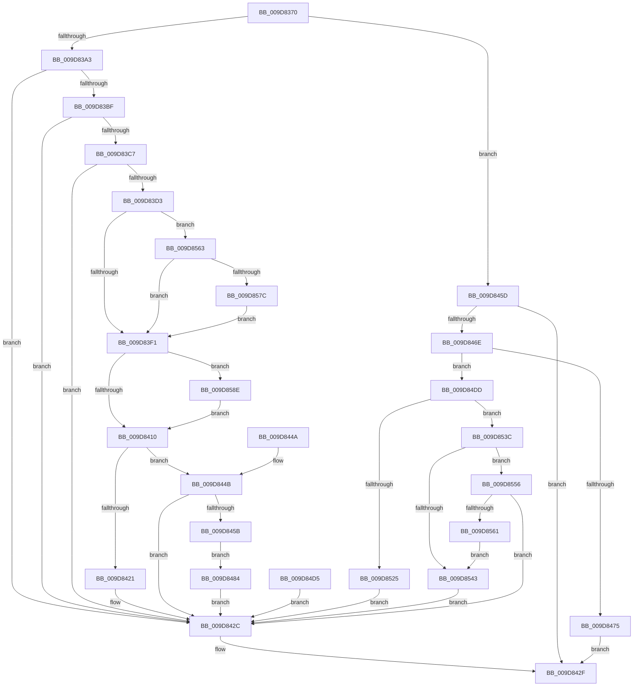

# IopQueryInformation

- RVA: `0x009D8370`–`0x009D859E` (길이 `558` bytes)
- VA: `0x00000001409D8370`
- 실행 섹션: `PAGE`
- PDB 이름 있음: `예`; PDB Function 태그: `아니요`
- unwind 정보 RVA: `0x000A2DE0`
- 디코드: `139`개 명령, `558/558` bytes 표시
- 미해석 바이트: `0` (있으면 어셈블리에 `.byte`로 보존)

> 이 문서는 커널 이미지의 기계어와 PDB 기호를 분석해 생성했습니다. 4번과 5번은 함수 원형과 자료형을 바이너리 사용 방식에서 추정한 C 해석이며 원본 소스 복구 결과는 아닙니다.

## 1. Dependencies

- 직접 호출 지점: **6**; 고유 호출 대상: **6**
- 직접 호출자로 확인된 함수: **1**
- RIP 상대 이미지 참조: **1**

### Outgoing calls
- `0x009D83FE` → [guard_dispatch_icall](../../text/6B/guard_dispatch_icall_function_006BAAD0.md) (function, `0x006BAAD0`)
- `0x009D8465` → [FsRtlGetSupportedFeatures](../../text/47/FsRtlGetSupportedFeatures_function_00473F20.md) (function, `0x00473F20`)
- `0x009D8503` → [FsRtlQueryOpen](FsRtlQueryOpen_function_009D85A4.md) (function, `0x009D85A4`)
- `0x009D856F` → [MmIsDriverVerifying](../../text/4A/MmIsDriverVerifying_function_004A8770.md) (function, `0x004A8770`)
- `0x009D8581` → [VfFastIoSnapState](../../pagevrfy/BB/VfFastIoSnapState_function_00BB97BC.md) (function, `0x00BB97BC`)
- `0x009D8594` → [VfFastIoCheckState](../../pagevrfy/BB/VfFastIoCheckState_function_00BB9440.md) (function, `0x00BB9440`)

### Direct callers
- [IopParseDevice](../89/IopParseDevice_function_0089E510.md) at `0x0089F4F4`

### Static image references
- `0x009D83E3` → RVA `0x00F04A20` (`.data`; read)

## 2. Other-region calls and transfers

- 다른 실행 섹션으로 향하는 call: **5**
  - `0x009D83FE` → [guard_dispatch_icall](../../text/6B/guard_dispatch_icall_function_006BAAD0.md) (`PAGE` → `.text`)
  - `0x009D8465` → [FsRtlGetSupportedFeatures](../../text/47/FsRtlGetSupportedFeatures_function_00473F20.md) (`PAGE` → `.text`)
  - `0x009D856F` → [MmIsDriverVerifying](../../text/4A/MmIsDriverVerifying_function_004A8770.md) (`PAGE` → `.text`)
  - `0x009D8581` → [VfFastIoSnapState](../../pagevrfy/BB/VfFastIoSnapState_function_00BB97BC.md) (`PAGE` → `PAGEVRFY`)
  - `0x009D8594` → [VfFastIoCheckState](../../pagevrfy/BB/VfFastIoCheckState_function_00BB9440.md) (`PAGE` → `PAGEVRFY`)
- 별도 외부 분기/꼬리 이동을 확인하지 못했습니다.

## 3. Assembly (complete function range)

```asm
009D8370  48 89 5C 24 10                  mov qword ptr [rsp + 0x10], rbx
009D8375  48 89 74 24 18                  mov qword ptr [rsp + 0x18], rsi
009D837A  57                              push rdi
009D837B  41 54                           push r12
009D837D  41 55                           push r13
009D837F  41 56                           push r14
009D8381  41 57                           push r15
009D8383  48 83 EC 40                     sub rsp, 0x40
009D8387  49 8B D8                        mov rbx, r8
009D838A  4C 8B FA                        mov r15, rdx
009D838D  48 8B F1                        mov rsi, rcx
009D8390  33 FF                           xor edi, edi
009D8392  89 7C 24 70                     mov dword ptr [rsp + 0x70], edi
009D8396  40 38 B9 D0 00 00 00            cmp byte ptr [rcx + 0xd0], dil
009D839D  0F 85 BA 00 00 00               jne 0x1409d845d
009D83A3  4C 8B A4 24 90 00 00 00         mov r12, qword ptr [rsp + 0x90]
009D83AB  41 88 3C 24                     mov byte ptr [r12], dil
009D83AF  44 8B F7                        mov r14d, edi
009D83B2  48 8B 42 08                     mov rax, qword ptr [rdx + 8]
009D83B6  48 8B 48 50                     mov rcx, qword ptr [rax + 0x50]
009D83BA  48 85 C9                        test rcx, rcx
009D83BD  74 6D                           je 0x1409d842c
009D83BF  81 39 C0 00 00 00               cmp dword ptr [rcx], 0xc0
009D83C5  76 65                           jbe 0x1409d842c
009D83C7  4C 8B A9 C0 00 00 00            mov r13, qword ptr [rcx + 0xc0]
009D83CE  4D 85 ED                        test r13, r13
009D83D1  74 59                           je 0x1409d842c
009D83D3  41 FE 48 43                     dec byte ptr [r8 + 0x43]
009D83D7  49 83 A8 B8 00 00 00 48         sub qword ptr [r8 + 0xb8], 0x48
009D83DF  49 89 51 28                     mov qword ptr [r9 + 0x28], rdx
009D83E3  8B 05 37 C6 52 00               mov eax, dword ptr [rip + 0x52c637]
009D83E9  A8 10                           test al, 0x10
009D83EB  0F 85 72 01 00 00               jne 0x1409d8563
009D83F1  4D 8B C7                        mov r8, r15
009D83F4  48 8B 56 68                     mov rdx, qword ptr [rsi + 0x68]
009D83F8  48 8B CB                        mov rcx, rbx
009D83FB  49 8B C5                        mov rax, r13
009D83FE  E8 CD 26 CE FF                  call 0x1406baad0
009D8403  41 88 04 24                     mov byte ptr [r12], al
009D8407  48 85 FF                        test rdi, rdi
009D840A  0F 85 7E 01 00 00               jne 0x1409d858e
009D8410  48 8B 43 70                     mov rax, qword ptr [rbx + 0x70]
009D8414  48 89 86 A8 00 00 00            mov qword ptr [rsi + 0xa8], rax
009D841B  45 38 34 24                     cmp byte ptr [r12], r14b
009D841F  75 2A                           jne 0x1409d844b
009D8421  48 83 83 B8 00 00 00 48         add qword ptr [rbx + 0xb8], 0x48
009D8429  FE 43 43                        inc byte ptr [rbx + 0x43]
009D842C  41 8B C6                        mov eax, r14d
009D842F  48 8B 5C 24 78                  mov rbx, qword ptr [rsp + 0x78]
009D8434  48 8B B4 24 80 00 00 00         mov rsi, qword ptr [rsp + 0x80]
009D843C  48 83 C4 40                     add rsp, 0x40
009D8440  41 5F                           pop r15
009D8442  41 5E                           pop r14
009D8444  41 5D                           pop r13
009D8446  41 5C                           pop r12
009D8448  5F                              pop rdi
009D8449  C3                              ret
009D844A  CC                              int3
009D844B  C7 46 20 51 02 AA BE            mov dword ptr [rsi + 0x20], 0xbeaa0251
009D8452  44 38 B6 8B 00 00 00            cmp byte ptr [rsi + 0x8b], r14b
009D8459  75 D1                           jne 0x1409d842c
009D845B  EB 27                           jmp 0x1409d8484
009D845D  48 8D 54 24 70                  lea rdx, [rsp + 0x70]
009D8462  49 8B CF                        mov rcx, r15
009D8465  E8 B6 BA A9 FF                  call 0x140473f20
009D846A  85 C0                           test eax, eax
009D846C  78 C1                           js 0x1409d842f
009D846E  F6 44 24 70 04                  test byte ptr [rsp + 0x70], 4
009D8473  75 68                           jne 0x1409d84dd
009D8475  48 8B 84 24 90 00 00 00         mov rax, qword ptr [rsp + 0x90]
009D847D  40 88 38                        mov byte ptr [rax], dil
009D8480  33 C0                           xor eax, eax
009D8482  EB AB                           jmp 0x1409d842f
009D8484  48 8B 46 68                     mov rax, qword ptr [rsi + 0x68]
009D8488  48 8B 08                        mov rcx, qword ptr [rax]
009D848B  48 8B 46 60                     mov rax, qword ptr [rsi + 0x60]
009D848F  48 89 08                        mov qword ptr [rax], rcx
009D8492  48 8B 46 68                     mov rax, qword ptr [rsi + 0x68]
009D8496  48 8B 48 08                     mov rcx, qword ptr [rax + 8]
009D849A  48 8B 46 60                     mov rax, qword ptr [rsi + 0x60]
009D849E  48 89 48 08                     mov qword ptr [rax + 8], rcx
009D84A2  48 8B 46 68                     mov rax, qword ptr [rsi + 0x68]
009D84A6  48 8B 48 10                     mov rcx, qword ptr [rax + 0x10]
009D84AA  48 8B 46 60                     mov rax, qword ptr [rsi + 0x60]
009D84AE  48 89 48 10                     mov qword ptr [rax + 0x10], rcx
009D84B2  48 8B 46 68                     mov rax, qword ptr [rsi + 0x68]
009D84B6  48 8B 48 18                     mov rcx, qword ptr [rax + 0x18]
009D84BA  48 8B 46 60                     mov rax, qword ptr [rsi + 0x60]
009D84BE  48 89 48 18                     mov qword ptr [rax + 0x18], rcx
009D84C2  48 8B 46 68                     mov rax, qword ptr [rsi + 0x68]
009D84C6  48 8B 4E 60                     mov rcx, qword ptr [rsi + 0x60]
009D84CA  8B 40 30                        mov eax, dword ptr [rax + 0x30]
009D84CD  89 41 20                        mov dword ptr [rcx + 0x20], eax
009D84D0  E9 57 FF FF FF                  jmp 0x1409d842c
009D84D5  44 8B F0                        mov r14d, eax
009D84D8  E9 4F FF FF FF                  jmp 0x1409d842c
009D84DD  FE 4B 43                        dec byte ptr [rbx + 0x43]
009D84E0  48 83 AB B8 00 00 00 48         sub qword ptr [rbx + 0xb8], 0x48
009D84E8  4C 8D 8E CC 00 00 00            lea r9, [rsi + 0xcc]
009D84EF  8B 86 C8 00 00 00               mov eax, dword ptr [rsi + 0xc8]
009D84F5  89 44 24 20                     mov dword ptr [rsp + 0x20], eax
009D84F9  4C 8B 46 70                     mov r8, qword ptr [rsi + 0x70]
009D84FD  48 8B D3                        mov rdx, rbx
009D8500  49 8B CF                        mov rcx, r15
009D8503  E8 9C 00 00 00                  call 0x1409d85a4
009D8508  44 8B F0                        mov r14d, eax
009D850B  FE 43 43                        inc byte ptr [rbx + 0x43]
009D850E  48 83 83 B8 00 00 00 48         add qword ptr [rbx + 0xb8], 0x48
009D8516  48 8B 4B 70                     mov rcx, qword ptr [rbx + 0x70]
009D851A  48 89 8E A8 00 00 00            mov qword ptr [rsi + 0xa8], rcx
009D8521  85 C0                           test eax, eax
009D8523  78 17                           js 0x1409d853c
009D8525  C7 46 20 51 02 AA BE            mov dword ptr [rsi + 0x20], 0xbeaa0251
009D852C  48 8B 8C 24 90 00 00 00         mov rcx, qword ptr [rsp + 0x90]
009D8534  C6 01 01                        mov byte ptr [rcx], 1
009D8537  E9 F0 FE FF FF                  jmp 0x1409d842c
009D853C  3D 04 00 1C C0                  cmp eax, 0xc01c0004
009D8541  75 13                           jne 0x1409d8556
009D8543  44 8B F7                        mov r14d, edi
009D8546  48 8B 84 24 90 00 00 00         mov rax, qword ptr [rsp + 0x90]
009D854E  40 88 38                        mov byte ptr [rax], dil
009D8551  E9 D6 FE FF FF                  jmp 0x1409d842c
009D8556  3D 02 00 00 C0                  cmp eax, 0xc0000002
009D855B  0F 85 CB FE FF FF               jne 0x1409d842c
009D8561  EB E0                           jmp 0x1409d8543
009D8563  48 8B 42 08                     mov rax, qword ptr [rdx + 8]
009D8567  48 89 44 24 30                  mov qword ptr [rsp + 0x30], rax
009D856C  48 8B C8                        mov rcx, rax
009D856F  E8 FC 01 AD FF                  call 0x1404a8770
009D8574  85 C0                           test eax, eax
009D8576  0F 84 75 FE FF FF               je 0x1409d83f1
009D857C  48 8B 4C 24 30                  mov rcx, qword ptr [rsp + 0x30]
009D8581  E8 36 12 1E 00                  call 0x140bb97bc
009D8586  48 8B F8                        mov rdi, rax
009D8589  E9 63 FE FF FF                  jmp 0x1409d83f1
009D858E  49 8B D5                        mov rdx, r13
009D8591  48 8B CF                        mov rcx, rdi
009D8594  E8 A7 0E 1E 00                  call 0x140bb9440
009D8599  E9 72 FE FF FF                  jmp 0x1409d8410
```

## 4. C-style interpretation (structured pseudocode)

```c
__int64 __fastcall IopQueryInformation(__int64 a1, __int64 a2, __int64 a3, __int64 a4, __int64 a5)
{
    __int64 result;
    __int64 v_rdi;
    __int64 v_rsp;
    unsigned __int64 v_stack_p10;
    unsigned __int64 v_stack_p18;
    unsigned int v_stack_p20;
    unsigned __int64 v_stack_p30;
    unsigned __int64 v_stack_p70;
    unsigned int v_stack_p8;

    v_stack_p10 = v_rbx;
    v_stack_p18 = v_rsi;
    v_rsp = (v_rsp) - (64);
    v_rdi = 0;
    v_stack_p8 = 0;
    if ((*(unsigned __int8 *)(a1 + 208)) != 0) goto loc_009D845D;
    *(unsigned __int8 *)(a5) = 0;
    if (*(unsigned __int64 *)(*(unsigned __int64 *)(a2 + 8) + 80) == 0) goto loc_009D842C;
    if ((*(unsigned int *)(*(unsigned __int64 *)(*(unsigned __int64 *)(a2 + 8) + 80))) <= 192) goto loc_009D842C;
    if (*(unsigned __int64 *)(*(unsigned __int64 *)(*(unsigned __int64 *)(a2 + 8) + 80) + 192) == 0) goto loc_009D842C;
    *(unsigned __int64 *)(a4 + 40) = a2;
    if ((((unsigned __int8)((unsigned int)(*(unsigned int *)(v_rip + 5424695)))) & (16)) != 0) goto loc_009D8563;
loc_009D83F1:
    result = guard_dispatch_icall(a3, *(unsigned __int64 *)(a1 + 104), a2, a4);
    *(unsigned __int8 *)(a5) = (unsigned __int8)(result);
    if (0 != 0) goto loc_009D858E;
loc_009D8410:
    *(unsigned __int64 *)(a1 + 168) = *(unsigned __int64 *)(a3 + 112);
    if ((*(unsigned __int8 *)(a5)) != 0) goto loc_009D844B;
loc_009D842C:
loc_009D842F:
    v_rsp = (v_rsp) + (64);
    return 0;
loc_009D844B:
    *(unsigned int *)(v_stack_p18 + 32) = 0xBEAA0251ULL;
    if ((*(unsigned __int8 *)(v_stack_p18 + 139)) != 0) goto loc_009D842C;
    goto loc_009D8484;
loc_009D845D:
    result = FsRtlGetSupportedFeatures(a2, v_stack_p70, a2, a4);
    if (sign_flag) goto loc_009D842F;
    if (((v_stack_p70) & (4)) != 0) goto loc_009D84DD;
    *(unsigned __int8 *)(a5) = 0;
    result = 0;
    goto loc_009D842F;
loc_009D8484:
    *(unsigned __int64 *)(*(unsigned __int64 *)(v_stack_p18 + 96)) = *(unsigned __int64 *)(*(unsigned __int64 *)(v_stack_p18 + 104));
    *(unsigned __int64 *)(*(unsigned __int64 *)(v_stack_p18 + 96) + 8) = *(unsigned __int64 *)(*(unsigned __int64 *)(v_stack_p18 + 104) + 8);
    *(unsigned __int64 *)(*(unsigned __int64 *)(v_stack_p18 + 96) + 16) = *(unsigned __int64 *)(*(unsigned __int64 *)(v_stack_p18 + 104) + 16);
    *(unsigned __int64 *)(*(unsigned __int64 *)(v_stack_p18 + 96) + 24) = *(unsigned __int64 *)(*(unsigned __int64 *)(v_stack_p18 + 104) + 24);
    *(unsigned int *)(*(unsigned __int64 *)(v_stack_p18 + 96) + 32) = (unsigned int)((unsigned int)(*(unsigned int *)(*(unsigned __int64 *)(v_stack_p18 + 104) + 48)));
    goto loc_009D842C;
loc_009D84DD:
    v_stack_p20 = (unsigned int)((unsigned int)(*(unsigned int *)(v_stack_p18 + 200)));
    result = FsRtlQueryOpen(a2, v_stack_p10, *(unsigned __int64 *)(v_stack_p18 + 112), v_stack_p18 + 204);
    *(unsigned __int64 *)(v_stack_p18 + 168) = *(unsigned __int64 *)(v_stack_p10 + 112);
    if (sign_flag) goto loc_009D853C;
    *(unsigned int *)(v_stack_p18 + 32) = 0xBEAA0251ULL;
    *(unsigned __int8 *)(a5) = 1;
    goto loc_009D842C;
loc_009D853C:
    if (((unsigned int)(result)) != 0xC01C0004ULL) goto loc_009D8556;
loc_009D8543:
    *(unsigned __int8 *)(a5) = 0;
    goto loc_009D842C;
loc_009D8556:
    if (((unsigned int)(a5)) != 0xC0000002ULL) goto loc_009D842C;
    goto loc_009D8543;
loc_009D8563:
    v_stack_p30 = *(unsigned __int64 *)(v_stack_p10 + 8);
    result = MmIsDriverVerifying(*(unsigned __int64 *)(v_stack_p10 + 8), v_stack_p10, *(unsigned __int64 *)(v_stack_p18 + 112), v_stack_p18 + 204);
    if ((unsigned int)(result) == 0) goto loc_009D83F1;
    result = VfFastIoSnapState(v_stack_p30, v_stack_p10, *(unsigned __int64 *)(v_stack_p18 + 112), v_stack_p18 + 204);
    goto loc_009D83F1;
loc_009D858E:
    result = VfFastIoCheckState(result, *(unsigned __int64 *)(*(unsigned __int64 *)(*(unsigned __int64 *)(a2 + 8) + 80) + 192), *(unsigned __int64 *)(v_stack_p18 + 112), v_stack_p18 + 204);
    goto loc_009D8410;
}
```

## 5. (Beta) C Style

```c
int64_t IopQueryInformation(void *Arg1, void *Arg2, void *Arg3, void *Arg4, void *Arg5)
{
    uint8_t *arg1 = (uint8_t *)Arg1;
    uint8_t *arg2 = (uint8_t *)Arg2;
    uint8_t *arg3 = (uint8_t *)Arg3;
    uint8_t *arg4 = (uint8_t *)Arg4;
    uint8_t *arg5 = (uint8_t *)Arg5;

    int64_t result;
    int64_t local_rdi;
    int64_t local_rsp;
    uint64_t v_stack_p10;
    uint64_t v_stack_p18;
    uint32_t v_stack_p20;
    uint64_t v_stack_p30;
    uint64_t v_stack_p70;
    uint32_t v_stack_p8;

    v_stack_p10 = local_rbx;
    v_stack_p18 = local_rsi;
    local_rsp = (local_rsp) - (64);
    local_rdi = 0;
    v_stack_p8 = 0;
    if ((*(uint8_t *)(arg1 + 0xD0)) != 0) goto loc_009D845D;
    *(uint8_t *)(arg5) = 0;
    if (*(uint64_t *)(*(uint64_t *)(arg2 + 0x8) + 0x50) == 0) goto loc_009D842C;
    if ((*(uint32_t *)(*(uint64_t *)(*(uint64_t *)(arg2 + 0x8) + 0x50))) <= 192) goto loc_009D842C;
    if (*(uint64_t *)(*(uint64_t *)(*(uint64_t *)(arg2 + 0x8) + 0x50) + 0xC0) == 0) goto loc_009D842C;
    *(void **)(arg4 + 0x28) = Arg2;
    if ((((uint8_t)((uint32_t)(*(uint32_t *)(v_rip + 0x52C637)))) & (16)) != 0) goto loc_009D8563;
loc_009D83F1:
    result = guard_dispatch_icall(Arg3, *(uint64_t *)(arg1 + 0x68), Arg2, Arg4);
    *(uint8_t *)(arg5) = (uint8_t)(result);
    if (0 != 0) goto loc_009D858E;
loc_009D8410:
    *(uint64_t *)(arg1 + 0xA8) = *(uint64_t *)(arg3 + 0x70);
    if ((*(uint8_t *)(arg5)) != 0) goto loc_009D844B;
loc_009D842C:
loc_009D842F:
    local_rsp = (local_rsp) + (64);
    return 0;
loc_009D844B:
    *(uint32_t *)(v_stack_p18 + 0x20) = 0xBEAA0251ULL;
    if ((*(uint8_t *)(v_stack_p18 + 0x8B)) != 0) goto loc_009D842C;
    goto loc_009D8484;
loc_009D845D:
    result = FsRtlGetSupportedFeatures(Arg2, v_stack_p70, Arg2, Arg4);
    if (sign_flag) goto loc_009D842F;
    if (((v_stack_p70) & (4)) != 0) goto loc_009D84DD;
    *(uint8_t *)(arg5) = 0;
    result = 0;
    goto loc_009D842F;
loc_009D8484:
    *(uint64_t *)(*(uint64_t *)(v_stack_p18 + 0x60)) = *(uint64_t *)(*(uint64_t *)(v_stack_p18 + 0x68));
    *(uint64_t *)(*(uint64_t *)(v_stack_p18 + 0x60) + 0x8) = *(uint64_t *)(*(uint64_t *)(v_stack_p18 + 0x68) + 0x8);
    *(uint64_t *)(*(uint64_t *)(v_stack_p18 + 0x60) + 0x10) = *(uint64_t *)(*(uint64_t *)(v_stack_p18 + 0x68) + 0x10);
    *(uint64_t *)(*(uint64_t *)(v_stack_p18 + 0x60) + 0x18) = *(uint64_t *)(*(uint64_t *)(v_stack_p18 + 0x68) + 0x18);
    *(uint32_t *)(*(uint64_t *)(v_stack_p18 + 0x60) + 0x20) = (uint32_t)((uint32_t)(*(uint32_t *)(*(uint64_t *)(v_stack_p18 + 0x68) + 0x30)));
    goto loc_009D842C;
loc_009D84DD:
    v_stack_p20 = (uint32_t)((uint32_t)(*(uint32_t *)(v_stack_p18 + 0xC8)));
    result = FsRtlQueryOpen(Arg2, v_stack_p10, *(uint64_t *)(v_stack_p18 + 0x70), v_stack_p18 + 204);
    *(uint64_t *)(v_stack_p18 + 0xA8) = *(uint64_t *)(v_stack_p10 + 0x70);
    if (sign_flag) goto loc_009D853C;
    *(uint32_t *)(v_stack_p18 + 0x20) = 0xBEAA0251ULL;
    *(uint8_t *)(arg5) = 1;
    goto loc_009D842C;
loc_009D853C:
    if (((uint32_t)(result)) != 0xC01C0004ULL) goto loc_009D8556;
loc_009D8543:
    *(uint8_t *)(arg5) = 0;
    goto loc_009D842C;
loc_009D8556:
    if (((uint32_t)(Arg5)) != 0xC0000002ULL) goto loc_009D842C;
    goto loc_009D8543;
loc_009D8563:
    v_stack_p30 = *(uint64_t *)(v_stack_p10 + 0x8);
    result = MmIsDriverVerifying(*(uint64_t *)(v_stack_p10 + 0x8), v_stack_p10, *(uint64_t *)(v_stack_p18 + 0x70), v_stack_p18 + 204);
    if ((uint32_t)(result) == 0) goto loc_009D83F1;
    result = VfFastIoSnapState(v_stack_p30, v_stack_p10, *(uint64_t *)(v_stack_p18 + 0x70), v_stack_p18 + 204);
    goto loc_009D83F1;
loc_009D858E:
    result = VfFastIoCheckState(result, *(uint64_t *)(*(uint64_t *)(*(uint64_t *)(arg2 + 0x8) + 0x50) + 0xC0), *(uint64_t *)(v_stack_p18 + 0x70), v_stack_p18 + 204);
    goto loc_009D8410;
}
```

### 관측된 메모리 오프셋

구조체 형식이 확인되지 않은 접근은 인자 기준의 오프셋으로만 기록했습니다.

| 기준 인자 | 오프셋 표현 | 폭 (bit) | 접근 |
|---|---:|---:|---|
| `Arg1` | `+ 0x20` | `32` | `W` |
| `Arg1` | `+ 0x60` | `64` | `R` |
| `Arg1` | `+ 0x68` | `64` | `R` |
| `Arg1` | `+ 0x70` | `64` | `R` |
| `Arg1` | `+ 0x8B` | `8` | `R` |
| `Arg1` | `+ 0xA8` | `64` | `W` |
| `Arg1` | `+ 0xC8` | `32` | `R` |
| `Arg1` | `+ 0xCC` | `64` | `R` |
| `Arg1` | `+ 0xD0` | `8` | `R` |
| `Arg2` | `+ 0x8` | `64` | `R` |
| `Arg3` | `+ 0x43` | `8` | `R/W` |
| `Arg3` | `+ 0x70` | `64` | `R` |
| `Arg3` | `+ 0xB8` | `64` | `R/W` |
| `Arg4` | `+ 0x28` | `64` | `W` |
| `Arg5` | `+ 0x0` | `8` | `R` |
| `Arg5` | `+ 0x0` | `8` | `W` |

## 6. Execution-region graph

[열기: 2D/3D 그래프와 함수 탐색 컨트롤 패널](../../../control-panel.html?section=page&rva=0x009D8370&view=graph)

- 2D 그래프는 위에서 아래로 흐르고, 3D 그래프는 빈 공간을 드래그해 회전합니다. Shift+드래그는 이동, 휠은 확대·축소, 함수 노드 선택은 대상 보고서 이동입니다.

### Static fallback


