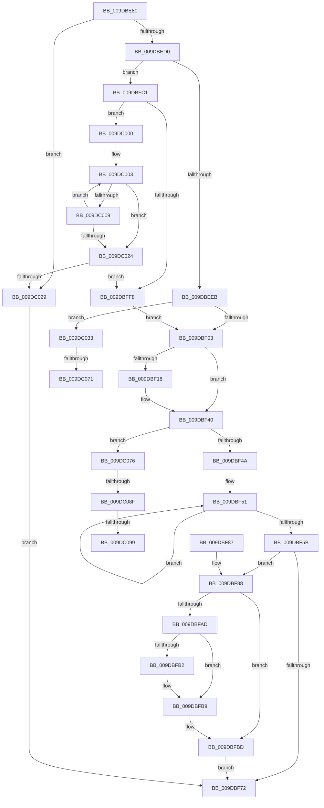

# IopReplaceSymlinkPath

- RVA: `0x009DBE80`–`0x009DC0AF` (길이 `559` bytes)
- VA: `0x00000001409DBE80`
- 실행 섹션: `PAGE`
- PDB 이름 있음: `예`; PDB Function 태그: `예`
- unwind 정보 RVA: `0x000A3628`
- 디코드: `148`개 명령, `559/559` bytes 표시
- 미해석 바이트: `0` (있으면 어셈블리에 `.byte`로 보존)

> 이 문서는 커널 이미지의 기계어와 PDB 기호를 분석해 생성했습니다. 4번과 5번은 함수 원형과 자료형을 바이너리 사용 방식에서 추정한 C 해석이며 원본 소스 복구 결과는 아닙니다.

## 1. Dependencies

- 직접 호출 지점: **5**; 고유 호출 대상: **4**
- 직접 호출자로 확인된 함수: **1**
- RIP 상대 이미지 참조: **1**

### Outgoing calls
- `0x009DBEF6` → [wcsnicmp](../../text/50/wcsnicmp_function_005001C0.md) (function, `0x005001C0`)
- `0x009DBF25` → [memcpy](../../text/6C/memcpy_function_006C6840.md) (function, `0x006C6840`)
- `0x009DBF69` → [FsRtlRemoveDotsFromPath](FsRtlRemoveDotsFromPath_function_009DC0C0.md) (function, `0x009DC0C0`)
- `0x009DBFB4` → [ExFreePoolWithTag](../../poolcode/B8/ExFreePoolWithTag_function_00B82870.md) (function, `0x00B82870`)
- `0x009DBFDF` → [memcpy](../../text/6C/memcpy_function_006C6840.md) (function, `0x006C6840`)

### Direct callers
- [IopSymlinkApplyToOpenedName](IopSymlinkApplyToOpenedName_function_009DBCF8.md) at `0x009DBDD0`

### Static image references
- `0x009DBEEF` → RVA `0x00AFBD90` (` ?? ::NNGAKEGL::`string'`; read)

## 2. Other-region calls and transfers

- 다른 실행 섹션으로 향하는 call: **4**
  - `0x009DBEF6` → [wcsnicmp](../../text/50/wcsnicmp_function_005001C0.md) (`PAGE` → `.text`)
  - `0x009DBF25` → [memcpy](../../text/6C/memcpy_function_006C6840.md) (`PAGE` → `.text`)
  - `0x009DBFB4` → [ExFreePoolWithTag](../../poolcode/B8/ExFreePoolWithTag_function_00B82870.md) (`PAGE` → `POOLCODE`)
  - `0x009DBFDF` → [memcpy](../../text/6C/memcpy_function_006C6840.md) (`PAGE` → `.text`)
- call이 아닌 외부 분기/꼬리 이동: **5**
  - `0x009DC06B` → [sub_00B2FCA2](../B2/Unknown_function_00B2FCA2.md) (`tail-transfer`)
  - `0x009DC071` → [sub_00B2FCA2 + 0x5F](../B2/Unknown_function_00B2FCA2.md) (`tail-transfer`)
  - `0x009DC089` → [sub_00B2FCA2 + 0xB4](../B2/Unknown_function_00B2FCA2.md) (`tail-transfer`)
  - `0x009DC093` → [sub_00B2FCA2 + 0xB4](../B2/Unknown_function_00B2FCA2.md) (`tail-transfer`)
  - `0x009DC0AA` → [sub_00B2FCA2 + 0xB4](../B2/Unknown_function_00B2FCA2.md) (`tail-transfer`)

## 3. Assembly (complete function range)

```asm
009DBE80  4C 8B DC                        mov r11, rsp
009DBE83  49 89 5B 18                     mov qword ptr [r11 + 0x18], rbx
009DBE87  55                              push rbp
009DBE88  56                              push rsi
009DBE89  57                              push rdi
009DBE8A  41 54                           push r12
009DBE8C  41 55                           push r13
009DBE8E  41 56                           push r14
009DBE90  41 57                           push r15
009DBE92  48 83 EC 20                     sub rsp, 0x20
009DBE96  8B 9C 24 80 00 00 00            mov ebx, dword ptr [rsp + 0x80]
009DBE9D  45 33 F6                        xor r14d, r14d
009DBEA0  45 0F B7 69 06                  movzx r13d, word ptr [r9 + 6]
009DBEA5  49 8B E8                        mov rbp, r8
009DBEA8  8B C2                           mov eax, edx
009DBEAA  4C 8B E1                        mov r12, rcx
009DBEAD  66 45 89 73 28                  mov word ptr [r11 + 0x28], r14w
009DBEB2  41 0F B7 F6                     movzx esi, r14w
009DBEB6  4C 8D 3C 59                     lea r15, [rcx + rbx*2]
009DBEBA  48 8D 3C 41                     lea rdi, [rcx + rax*2]
009DBEBE  41 0F B7 41 0A                  movzx eax, word ptr [r9 + 0xa]
009DBEC3  66 89 44 24 68                  mov word ptr [rsp + 0x68], ax
009DBEC8  3B D3                           cmp edx, ebx
009DBECA  0F 82 59 01 00 00               jb 0x1409dc029
009DBED0  41 0F B7 41 08                  movzx eax, word ptr [r9 + 8]
009DBED5  48 83 C0 14                     add rax, 0x14
009DBED9  49 03 C1                        add rax, r9
009DBEDC  48 89 44 24 60                  mov qword ptr [rsp + 0x60], rax
009DBEE1  66 83 38 5C                     cmp word ptr [rax], 0x5c
009DBEE5  0F 85 D6 00 00 00               jne 0x1409dbfc1
009DBEEB  45 8D 46 0B                     lea r8d, [r14 + 0xb]
009DBEEF  48 8D 15 9A FE 11 00            lea rdx, [rip + 0x11fe9a]
009DBEF6  E8 C5 42 B2 FF                  call 0x1405001c0
009DBEFB  85 C0                           test eax, eax
009DBEFD  0F 84 30 01 00 00               je 0x1409dc033
009DBF03  44 0F B7 B4 24 88 00 00 00      movzx r14d, word ptr [rsp + 0x88]
009DBF0C  0F B7 44 24 68                  movzx eax, word ptr [rsp + 0x68]
009DBF11  33 DB                           xor ebx, ebx
009DBF13  66 85 C0                        test ax, ax
009DBF16  74 28                           je 0x1409dbf40
009DBF18  48 8B 54 24 60                  mov rdx, qword ptr [rsp + 0x60]
009DBF1D  44 8B C0                        mov r8d, eax
009DBF20  48 8B CF                        mov rcx, rdi
009DBF23  8B D8                           mov ebx, eax
009DBF25  E8 16 A9 CE FF                  call 0x1406c6840
009DBF2A  66 03 74 24 68                  add si, word ptr [rsp + 0x68]
009DBF2F  48 D1 EB                        shr rbx, 1
009DBF32  66 89 B4 24 80 00 00 00         mov word ptr [rsp + 0x80], si
009DBF3A  48 8D 3C 5F                     lea rdi, [rdi + rbx*2]
009DBF3E  33 DB                           xor ebx, ebx
009DBF40  66 45 85 ED                     test r13w, r13w
009DBF44  0F 85 2C 01 00 00               jne 0x1409dc076
009DBF4A  66 89 1F                        mov word ptr [rdi], bx
009DBF4D  48 83 CA FF                     or rdx, 0xffffffffffffffff
009DBF51  48 FF C2                        inc rdx
009DBF54  66 41 39 1C 57                  cmp word ptr [r15 + rdx*2], bx
009DBF59  75 F6                           jne 0x1409dbf51
009DBF5B  66 03 D2                        add dx, dx
009DBF5E  4C 8D 84 24 80 00 00 00         lea r8, [rsp + 0x80]
009DBF66  49 8B CF                        mov rcx, r15
009DBF69  E8 52 01 00 00                  call 0x1409dc0c0
009DBF6E  85 C0                           test eax, eax
009DBF70  79 16                           jns 0x1409dbf88
009DBF72  48 8B 5C 24 70                  mov rbx, qword ptr [rsp + 0x70]
009DBF77  48 83 C4 20                     add rsp, 0x20
009DBF7B  41 5F                           pop r15
009DBF7D  41 5E                           pop r14
009DBF7F  41 5D                           pop r13
009DBF81  41 5C                           pop r12
009DBF83  5F                              pop rdi
009DBF84  5E                              pop rsi
009DBF85  5D                              pop rbp
009DBF86  C3                              ret
009DBF87  CC                              int3
009DBF88  0F B7 84 24 80 00 00 00         movzx eax, word ptr [rsp + 0x80]
009DBF90  48 8B 4D 60                     mov rcx, qword ptr [rbp + 0x60]
009DBF94  66 41 03 C6                     add ax, r14w
009DBF98  66 89 45 58                     mov word ptr [rbp + 0x58], ax
009DBF9C  0F B7 84 24 90 00 00 00         movzx eax, word ptr [rsp + 0x90]
009DBFA4  66 89 45 5A                     mov word ptr [rbp + 0x5a], ax
009DBFA8  4C 3B E1                        cmp r12, rcx
009DBFAB  74 10                           je 0x1409dbfbd
009DBFAD  48 85 C9                        test rcx, rcx
009DBFB0  74 07                           je 0x1409dbfb9
009DBFB2  33 D2                           xor edx, edx
009DBFB4  E8 B7 68 1A 00                  call 0x140b82870
009DBFB9  4C 89 65 60                     mov qword ptr [rbp + 0x60], r12
009DBFBD  33 C0                           xor eax, eax
009DBFBF  EB B1                           jmp 0x1409dbf72
009DBFC1  41 0F B7 40 58                  movzx eax, word ptr [r8 + 0x58]
009DBFC6  48 8B CF                        mov rcx, rdi
009DBFC9  48 8B 55 60                     mov rdx, qword ptr [rbp + 0x60]
009DBFCD  66 41 2B C5                     sub ax, r13w
009DBFD1  0F B7 F0                        movzx esi, ax
009DBFD4  44 8B C6                        mov r8d, esi
009DBFD7  66 89 B4 24 80 00 00 00         mov word ptr [rsp + 0x80], si
009DBFDF  E8 5C A8 CE FF                  call 0x1406c6840
009DBFE4  8B C6                           mov eax, esi
009DBFE6  41 B8 02 00 00 00               mov r8d, 2
009DBFEC  48 D1 E8                        shr rax, 1
009DBFEF  48 8D 3C 47                     lea rdi, [rdi + rax*2]
009DBFF3  49 3B FF                        cmp rdi, r15
009DBFF6  75 08                           jne 0x1409dc000
009DBFF8  49 03 F8                        add rdi, r8
009DBFFB  E9 03 FF FF FF                  jmp 0x1409dbf03
009DC000  0F B7 C6                        movzx eax, si
009DC003  66 83 3F 5C                     cmp word ptr [rdi], 0x5c
009DC007  74 1B                           je 0x1409dc024
009DC009  66 41 2B C0                     sub ax, r8w
009DC00D  66 44 89 37                     mov word ptr [rdi], r14w
009DC011  49 2B F8                        sub rdi, r8
009DC014  66 89 84 24 80 00 00 00         mov word ptr [rsp + 0x80], ax
009DC01C  0F B7 F0                        movzx esi, ax
009DC01F  49 3B FF                        cmp rdi, r15
009DC022  75 DF                           jne 0x1409dc003
009DC024  49 3B FF                        cmp rdi, r15
009DC027  73 CF                           jae 0x1409dbff8
009DC029  B8 78 02 00 C0                  mov eax, 0xc0000278
009DC02E  E9 3F FF FF FF                  jmp 0x1409dbf72
009DC033  48 8B 45 60                     mov rax, qword ptr [rbp + 0x60]
009DC037  41 8B CE                        mov ecx, r14d
009DC03A  44 0F B7 4D 58                  movzx r9d, word ptr [rbp + 0x58]
009DC03F  41 B8 FE FF 00 00               mov r8d, 0xfffe
009DC045  41 0F B7 D6                     movzx edx, r14w
009DC049  44 0F B7 38                     movzx r15d, word ptr [rax]
009DC04D  41 0F B7 C1                     movzx eax, r9w
009DC051  66 41 83 FF 3B                  cmp r15w, 0x3b
009DC056  0F 95 C1                        setne cl
009DC059  66 41 23 C0                     and ax, r8w
009DC05D  66 83 C1 03                     add cx, 3
009DC061  41 B8 02 00 00 00               mov r8d, 2
009DC067  66 44 3B F0                     cmp r14w, ax
009DC06B  0F 82 31 3C 15 00               jb 0x140b2fca2
009DC071  E9 8B 3C 15 00                  jmp 0x140b2fd01
009DC076  0F B7 55 58                     movzx edx, word ptr [rbp + 0x58]
009DC07A  49 8B DD                        mov rbx, r13
009DC07D  49 2B D5                        sub rdx, r13
009DC080  48 03 55 60                     add rdx, qword ptr [rbp + 0x60]
009DC084  66 83 7F FE 5C                  cmp word ptr [rdi - 2], 0x5c
009DC089  0F 85 C7 3C 15 00               jne 0x140b2fd56
009DC08F  66 83 3A 5C                     cmp word ptr [rdx], 0x5c
009DC093  0F 85 BD 3C 15 00               jne 0x140b2fd56
009DC099  33 C9                           xor ecx, ecx
009DC09B  B8 FE FF 00 00                  mov eax, 0xfffe
009DC0A0  66 89 0F                        mov word ptr [rdi], cx
009DC0A3  48 83 C7 FE                     add rdi, -2
009DC0A7  66 03 F0                        add si, ax
009DC0AA  E9 A7 3C 15 00                  jmp 0x140b2fd56
```

## 4. C-style interpretation (structured pseudocode)

```c
__int64 __fastcall IopReplaceSymlinkPath(__int64 a1, int a2, __int64 a3, __int64 a4, unsigned __int16 a5, unsigned __int16 a6, unsigned __int16 a7)
{
    __int64 result;
    __int64 v_r14;
    __int64 v_rbx;
    __int64 v_rdi;
    __int64 v_rsi;
    __int64 v_rsp;
    unsigned __int16 v_stack_p10;
    unsigned __int64 v_stack_p18;
    unsigned __int16 v_stack_p28;
    unsigned __int64 v_stack_p8;
    unsigned __int16 v_stack_p80;

    *(unsigned __int64 *)(v_rsp + 24) = v_rbx;
    v_rsp = (v_rsp) - (32);
    v_r14 = 0;
    *(unsigned __int16 *)(v_rsp + 40) = 0;
    v_stack_p10 = (unsigned __int16)(*(unsigned __int16 *)(a4 + 10));
    if (a2 < ((unsigned int)((unsigned int)(a5)))) goto loc_009DC029;
    result = (*(unsigned __int16 *)(a4 + 8)) + (20);
    result = (result) + (a4);
    v_stack_p8 = result;
    if ((*(unsigned __int16 *)(result)) != 92) goto loc_009DBFC1;
    result = wcsnicmp(a1, v_rip + 1179290, v_r14 + 11, a4);
    if ((unsigned int)(result) == 0) goto loc_009DC033;
loc_009DBF03:
    v_rbx = 0;
    result = v_stack_p10;
    v_rsi = 0;
    v_rdi = a1 + (unsigned int)(a2) * 2;
    if ((unsigned __int16)(v_stack_p10) != 0) {
        a2 = v_stack_p8;
        a3 = (unsigned int)(v_stack_p10);
        a1 = a1 + (unsigned int)(a2) * 2;
        v_rbx = (unsigned int)(v_stack_p10);
        result = memcpy(a1, a2, a3, a4);
        v_rsi = (unsigned __int16)((0) + (v_stack_p10));
        v_rbx = (v_rbx) >> (1);
        v_stack_p28 = (unsigned __int16)(v_rsi);
        v_rdi = a1 + (unsigned int)(a2) * 2 + v_rbx * 2;
        v_rbx = 0;
    }
    if ((unsigned __int16)(*(unsigned __int16 *)(a4 + 6)) != 0) goto loc_009DC076;
    *(unsigned __int16 *)(v_rdi) = 0;
    a2 = (a2) | (-1);
loc_009DBF51:
    a2 = (a2) + 1;
    if ((*(unsigned __int16 *)(a1 + (unsigned int)(a5) * 2 + a2 * 2)) != 0) goto loc_009DBF51;
    a2 = (unsigned __int16)((a2) + ((unsigned __int16)(a2)));
    result = FsRtlRemoveDotsFromPath(a1 + (unsigned int)(a5) * 2, a2, a5, a4);
    if (!sign_flag) goto loc_009DBF88;
loc_009DBF72:
    v_rsp = (v_rsp) + (32);
    return result;
loc_009DBF88:
    result = (unsigned __int16)((a5) + (a6));
    *(unsigned __int16 *)(a3 + 88) = (unsigned __int16)(result);
    *(unsigned __int16 *)(a3 + 90) = a7;
    if (a1 == (*(unsigned __int64 *)(a3 + 96))) goto loc_009DBFBD;
    result = a7;
    if (*(unsigned __int64 *)(a3 + 96) != 0) {
        a2 = 0;
        result = ExFreePoolWithTag(*(unsigned __int64 *)(a3 + 96), a2, a5, a4);
    }
    *(unsigned __int64 *)(a3 + 96) = a1;
loc_009DBFBD:
    result = 0;
    goto loc_009DBF72;
loc_009DBFC1:
    result = (unsigned __int16)((*(unsigned __int16 *)(a5 + 88)) - ((unsigned __int16)(*(unsigned __int16 *)(a4 + 6))));
    v_stack_p80 = (unsigned __int16)((unsigned __int16)(result));
    result = memcpy(v_rdi, *(unsigned __int64 *)(a3 + 96), (unsigned int)((unsigned int)((unsigned __int16)(result))), a4);
    result = ((unsigned int)((unsigned int)((unsigned __int16)(result)))) >> (1);
    if ((v_rdi + result * 2) != (a1 + (unsigned int)(a5) * 2)) goto loc_009DC000;
loc_009DBFF8:
    v_rdi = (v_rdi + result * 2) + (2);
    goto loc_009DBF03;
loc_009DC000:
loc_009DC003:
    if ((*(unsigned __int16 *)(v_rdi)) == 92) goto loc_009DC024;
    result = (unsigned __int16)(((unsigned __int16)((unsigned __int16)(result))) - (2));
    *(unsigned __int16 *)(v_rdi) = a6;
    v_rdi = (v_rdi) - (2);
    v_stack_p80 = (unsigned __int16)(result);
    if (v_rdi != (a1 + (unsigned int)(a5) * 2)) goto loc_009DC003;
loc_009DC024:
    if (v_rdi >= (a1 + (unsigned int)(a5) * 2)) goto loc_009DBFF8;
loc_009DC029:
    goto loc_009DBF72;
loc_009DC033:
    a1 = (((unsigned __int16)(*(unsigned __int16 *)(*(unsigned __int64 *)(a3 + 96)))) != 59) ? 1 : 0;
    result = (unsigned __int16)(((unsigned __int16)(*(unsigned __int16 *)(a3 + 88))) & ((unsigned __int16)((unsigned int)(0xFFFEULL))));
    a1 = (unsigned __int16)((a1) + (3));
loc_009DC076:
    a2 = (*(unsigned __int16 *)(a3 + 88)) - (*(unsigned __int16 *)(a4 + 6));
    a2 = (a2) + (*(unsigned __int64 *)(a3 + 96));
    a1 = 0;
    *(unsigned __int16 *)(v_rdi) = 0;
    v_rdi = (v_rdi) + (-2);
    v_rsi = (unsigned __int16)(((unsigned __int16)(result)) + ((unsigned __int16)((unsigned int)(0xFFFEULL))));
}
```

## 5. (Beta) C Style

```c
int64_t IopReplaceSymlinkPath(void *Arg1, int32_t Arg2, void *Arg3, void *Arg4, uint16_t Arg5, uint16_t Arg6, uint16_t Arg7)
{
    uint8_t *arg1 = (uint8_t *)Arg1;
    uint8_t *arg3 = (uint8_t *)Arg3;
    uint8_t *arg4 = (uint8_t *)Arg4;

    int64_t result;
    int64_t local_r14;
    int64_t local_rbx;
    int64_t local_rdi;
    int64_t local_rsi;
    int64_t local_rsp;
    uint16_t v_stack_p10;
    uint64_t v_stack_p18;
    uint16_t v_stack_p28;
    uint64_t v_stack_p8;
    uint16_t v_stack_p80;

    *(uint64_t *)(local_rsp + 0x18) = local_rbx;
    local_rsp = (local_rsp) - (32);
    local_r14 = 0;
    *(uint16_t *)(local_rsp + 0x28) = 0;
    v_stack_p10 = (uint16_t)(*(uint16_t *)(arg4 + 0xA));
    if (Arg2 < ((uint32_t)((uint32_t)(Arg5)))) goto loc_009DC029;
    result = (*(uint16_t *)(arg4 + 0x8)) + (20);
    result = (result) + (Arg4);
    v_stack_p8 = result;
    if ((*(uint16_t *)(result)) != 92) goto loc_009DBFC1;
    result = wcsnicmp(Arg1, v_rip + 1179290, local_r14 + 11, Arg4);
    if ((uint32_t)(result) == 0) goto loc_009DC033;
loc_009DBF03:
    local_rbx = 0;
    result = v_stack_p10;
    local_rsi = 0;
    local_rdi = Arg1 + (uint32_t)(Arg2) * 2;
    if ((uint16_t)(v_stack_p10) != 0) {
        Arg2 = v_stack_p8;
        Arg3 = (uint32_t)(v_stack_p10);
        Arg1 = Arg1 + (uint32_t)(Arg2) * 2;
        local_rbx = (uint32_t)(v_stack_p10);
        result = memcpy(Arg1, Arg2, Arg3, Arg4);
        local_rsi = (uint16_t)((0) + (v_stack_p10));
        local_rbx = (local_rbx) >> (1);
        v_stack_p28 = (uint16_t)(local_rsi);
        local_rdi = Arg1 + (uint32_t)(Arg2) * 2 + local_rbx * 2;
        local_rbx = 0;
    }
    if ((uint16_t)(*(uint16_t *)(arg4 + 0x6)) != 0) goto loc_009DC076;
    *(uint16_t *)(local_rdi) = 0;
    Arg2 = (Arg2) | (-1);
loc_009DBF51:
    Arg2 = (Arg2) + 1;
    if ((*(uint16_t *)(arg1 + (uint32_t)(Arg5) * 2 + Arg2 * 2)) != 0) goto loc_009DBF51;
    Arg2 = (uint16_t)((Arg2) + ((uint16_t)(Arg2)));
    result = FsRtlRemoveDotsFromPath(Arg1 + (uint32_t)(Arg5) * 2, Arg2, Arg5, Arg4);
    if (!sign_flag) goto loc_009DBF88;
loc_009DBF72:
    local_rsp = (local_rsp) + (32);
    return result;
loc_009DBF88:
    result = (uint16_t)((Arg5) + (Arg6));
    *(uint16_t *)(arg3 + 0x58) = (uint16_t)(result);
    *(uint16_t *)(arg3 + 0x5A) = Arg7;
    if (Arg1 == (*(uint64_t *)(arg3 + 0x60))) goto loc_009DBFBD;
    result = Arg7;
    if (*(uint64_t *)(arg3 + 0x60) != 0) {
        Arg2 = 0;
        result = ExFreePoolWithTag(*(uint64_t *)(arg3 + 0x60), Arg2, Arg5, Arg4);
    }
    *(void **)(arg3 + 0x60) = Arg1;
loc_009DBFBD:
    result = 0;
    goto loc_009DBF72;
loc_009DBFC1:
    result = (uint16_t)((*(uint16_t *)(Arg5 + 0x58)) - ((uint16_t)(*(uint16_t *)(arg4 + 0x6))));
    v_stack_p80 = (uint16_t)((uint16_t)(result));
    result = memcpy(local_rdi, *(uint64_t *)(arg3 + 0x60), (uint32_t)((uint32_t)((uint16_t)(result))), Arg4);
    result = ((uint32_t)((uint32_t)((uint16_t)(result)))) >> (1);
    if ((local_rdi + result * 2) != (Arg1 + (uint32_t)(Arg5) * 2)) goto loc_009DC000;
loc_009DBFF8:
    local_rdi = (local_rdi + result * 2) + (2);
    goto loc_009DBF03;
loc_009DC000:
loc_009DC003:
    if ((*(uint16_t *)(local_rdi)) == 92) goto loc_009DC024;
    result = (uint16_t)(((uint16_t)((uint16_t)(result))) - (2));
    *(uint16_t *)(local_rdi) = Arg6;
    local_rdi = (local_rdi) - (2);
    v_stack_p80 = (uint16_t)(result);
    if (local_rdi != (Arg1 + (uint32_t)(Arg5) * 2)) goto loc_009DC003;
loc_009DC024:
    if (local_rdi >= (Arg1 + (uint32_t)(Arg5) * 2)) goto loc_009DBFF8;
loc_009DC029:
    goto loc_009DBF72;
loc_009DC033:
    Arg1 = (((uint16_t)(*(uint16_t *)(*(uint64_t *)(arg3 + 0x60)))) != 59) ? 1 : 0;
    result = (uint16_t)(((uint16_t)(*(uint16_t *)(arg3 + 0x58))) & ((uint16_t)((uint32_t)(0xFFFEULL))));
    Arg1 = (uint16_t)((Arg1) + (3));
loc_009DC076:
    Arg2 = (*(uint16_t *)(arg3 + 0x58)) - (*(uint16_t *)(arg4 + 0x6));
    Arg2 = (Arg2) + (*(uint64_t *)(arg3 + 0x60));
    Arg1 = 0;
    *(uint16_t *)(local_rdi) = 0;
    local_rdi = (local_rdi) + (-2);
    local_rsi = (uint16_t)(((uint16_t)(result)) + ((uint16_t)((uint32_t)(0xFFFEULL))));
}
```

### 관측된 메모리 오프셋

구조체 형식이 확인되지 않은 접근은 인자 기준의 오프셋으로만 기록했습니다.

| 기준 인자 | 오프셋 표현 | 폭 (bit) | 접근 |
|---|---:|---:|---|
| `Arg1` | `+ 0x0 + rax*2` | `64` | `R` |
| `Arg1` | `+ 0x0 + rbx*2` | `64` | `R` |
| `Arg1` | `+ 0x0 + rdx*2` | `16` | `R` |
| `Arg3` | `+ 0x58` | `16` | `R` |
| `Arg3` | `+ 0x58` | `16` | `W` |
| `Arg3` | `+ 0x5A` | `16` | `W` |
| `Arg3` | `+ 0x60` | `64` | `R` |
| `Arg3` | `+ 0x60` | `64` | `W` |
| `Arg4` | `+ 0x6` | `16` | `R` |
| `Arg4` | `+ 0x8` | `16` | `R` |
| `Arg4` | `+ 0xA` | `16` | `R` |

## 6. Execution-region graph

[열기: 2D/3D 그래프와 함수 탐색 컨트롤 패널](../../../control-panel.html?section=page&rva=0x009DBE80&view=graph)

- 2D 그래프는 위에서 아래로 흐르고, 3D 그래프는 빈 공간을 드래그해 회전합니다. Shift+드래그는 이동, 휠은 확대·축소, 함수 노드 선택은 대상 보고서 이동입니다.

### Static fallback


