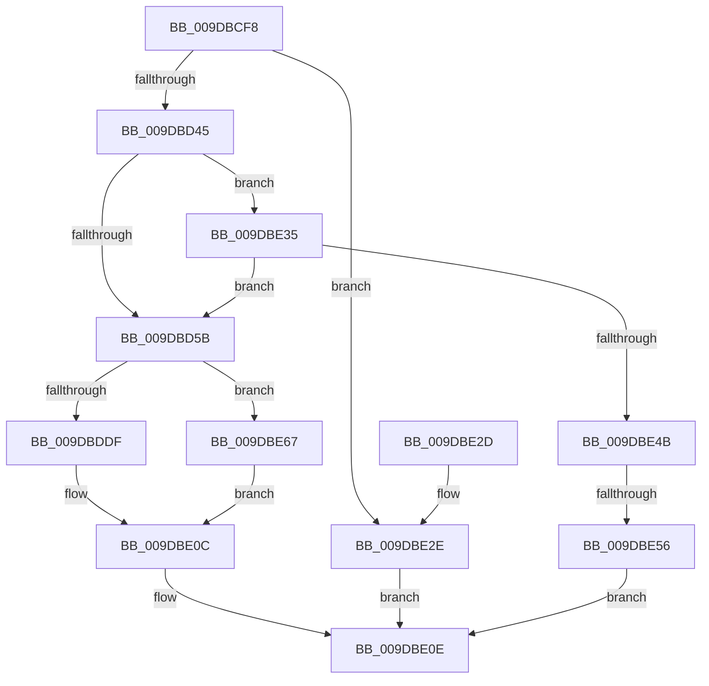

# IopSymlinkApplyToOpenedName

- RVA: `0x009DBCF8`–`0x009DBE78` (길이 `384` bytes)
- VA: `0x00000001409DBCF8`
- 실행 섹션: `PAGE`
- PDB 이름 있음: `예`; PDB Function 태그: `예`
- unwind 정보 RVA: `0x000A35F8`
- 디코드: `99`개 명령, `384/384` bytes 표시
- 미해석 바이트: `0` (있으면 어셈블리에 `.byte`로 보존)

> 이 문서는 커널 이미지의 기계어와 PDB 기호를 분석해 생성했습니다. 4번과 5번은 함수 원형과 자료형을 바이너리 사용 방식에서 추정한 C 해석이며 원본 소스 복구 결과는 아닙니다.

## 1. Dependencies

- 직접 호출 지점: **8**; 고유 호출 대상: **5**
- 직접 호출자로 확인된 함수: **1**
- RIP 상대 이미지 참조: **0**

### Outgoing calls
- `0x009DBD34` → [ExAllocatePool2](../../poolcode/B8/ExAllocatePool2_function_00B820F0.md) (function, `0x00B820F0`)
- `0x009DBD6C` → [memcpy](../../text/6C/memcpy_function_006C6840.md) (function, `0x006C6840`)
- `0x009DBD84` → [memcpy](../../text/6C/memcpy_function_006C6840.md) (function, `0x006C6840`)
- `0x009DBDA1` → [ExFreePoolWithTag](../../poolcode/B8/ExFreePoolWithTag_function_00B82870.md) (function, `0x00B82870`)
- `0x009DBDD0` → [IopReplaceSymlinkPath](IopReplaceSymlinkPath_function_009DBE80.md) (function, `0x009DBE80`)
- `0x009DBE05` → [IopSymlinkUpdateECP](../8A/IopSymlinkUpdateECP_function_008A20CC.md) (function, `0x008A20CC`)
- `0x009DBE5B` → [ExFreePoolWithTag](../../poolcode/B8/ExFreePoolWithTag_function_00B82870.md) (function, `0x00B82870`)
- `0x009DBE71` → [ExFreePoolWithTag](../../poolcode/B8/ExFreePoolWithTag_function_00B82870.md) (function, `0x00B82870`)

### Direct callers
- [sub_00B39C68](../B3/Unknown_function_00B39C68.md) at `0x00B39F38`

### Static image references
- 디코드된 RIP-relative 메모리 참조가 없습니다.

## 2. Other-region calls and transfers

- 다른 실행 섹션으로 향하는 call: **6**
  - `0x009DBD34` → [ExAllocatePool2](../../poolcode/B8/ExAllocatePool2_function_00B820F0.md) (`PAGE` → `POOLCODE`)
  - `0x009DBD6C` → [memcpy](../../text/6C/memcpy_function_006C6840.md) (`PAGE` → `.text`)
  - `0x009DBD84` → [memcpy](../../text/6C/memcpy_function_006C6840.md) (`PAGE` → `.text`)
  - `0x009DBDA1` → [ExFreePoolWithTag](../../poolcode/B8/ExFreePoolWithTag_function_00B82870.md) (`PAGE` → `POOLCODE`)
  - `0x009DBE5B` → [ExFreePoolWithTag](../../poolcode/B8/ExFreePoolWithTag_function_00B82870.md) (`PAGE` → `POOLCODE`)
  - `0x009DBE71` → [ExFreePoolWithTag](../../poolcode/B8/ExFreePoolWithTag_function_00B82870.md) (`PAGE` → `POOLCODE`)
- call이 아닌 외부 분기/꼬리 이동: **1**
  - `0x009DBE50` → [sub_00B2FC90](../B2/Unknown_function_00B2FC90.md) (`tail-transfer`)

## 3. Assembly (complete function range)

```asm
009DBCF8  48 8B C4                        mov rax, rsp
009DBCFB  48 89 58 08                     mov qword ptr [rax + 8], rbx
009DBCFF  48 89 68 10                     mov qword ptr [rax + 0x10], rbp
009DBD03  48 89 70 18                     mov qword ptr [rax + 0x18], rsi
009DBD07  48 89 78 20                     mov qword ptr [rax + 0x20], rdi
009DBD0B  41 54                           push r12
009DBD0D  41 55                           push r13
009DBD0F  41 56                           push r14
009DBD11  48 83 EC 40                     sub rsp, 0x40
009DBD15  4C 8B 69 60                     mov r13, qword ptr [rcx + 0x60]
009DBD19  49 8B E8                        mov rbp, r8
009DBD1C  48 8B DA                        mov rbx, rdx
009DBD1F  48 8B F1                        mov rsi, rcx
009DBD22  0F B7 52 10                     movzx edx, word ptr [rdx + 0x10]
009DBD26  B9 00 01 00 00                  mov ecx, 0x100
009DBD2B  41 B8 49 6F 46 63               mov r8d, 0x63466f49
009DBD31  4D 8B E1                        mov r12, r9
009DBD34  E8 B7 63 1A 00                  call 0x140b820f0
009DBD39  4C 8B F0                        mov r14, rax
009DBD3C  48 85 C0                        test rax, rax
009DBD3F  0F 84 E9 00 00 00               je 0x1409dbe2e
009DBD45  48 8D 7E 58                     lea rdi, [rsi + 0x58]
009DBD49  41 B8 FE FF 00 00               mov r8d, 0xfffe
009DBD4F  0F B7 17                        movzx edx, word ptr [rdi]
009DBD52  83 FA 02                        cmp edx, 2
009DBD55  0F 87 DA 00 00 00               ja 0x1409dbe35
009DBD5B  44 0F B7 43 04                  movzx r8d, word ptr [rbx + 4]
009DBD60  48 8B 53 18                     mov rdx, qword ptr [rbx + 0x18]
009DBD64  48 8B 8C 24 80 00 00 00         mov rcx, qword ptr [rsp + 0x80]
009DBD6C  E8 CF AA CE FF                  call 0x1406c6840
009DBD71  0F B7 53 04                     movzx edx, word ptr [rbx + 4]
009DBD75  49 8B CE                        mov rcx, r14
009DBD78  44 0F B7 43 10                  movzx r8d, word ptr [rbx + 0x10]
009DBD7D  4C 2B C2                        sub r8, rdx
009DBD80  48 03 53 18                     add rdx, qword ptr [rbx + 0x18]
009DBD84  E8 B7 AA CE FF                  call 0x1406c6840
009DBD89  4C 89 76 60                     mov qword ptr [rsi + 0x60], r14
009DBD8D  49 8B CD                        mov rcx, r13
009DBD90  0F B7 53 10                     movzx edx, word ptr [rbx + 0x10]
009DBD94  66 2B 53 04                     sub dx, word ptr [rbx + 4]
009DBD98  66 89 56 5A                     mov word ptr [rsi + 0x5a], dx
009DBD9C  66 89 17                        mov word ptr [rdi], dx
009DBD9F  33 D2                           xor edx, edx
009DBDA1  E8 CA 6A 1A 00                  call 0x140b82870
009DBDA6  0F B7 4B 04                     movzx ecx, word ptr [rbx + 4]
009DBDAA  4C 8B CD                        mov r9, rbp
009DBDAD  8B 84 24 88 00 00 00            mov eax, dword ptr [rsp + 0x88]
009DBDB4  8B D1                           mov edx, ecx
009DBDB6  89 44 24 30                     mov dword ptr [rsp + 0x30], eax
009DBDBA  4C 8B C6                        mov r8, rsi
009DBDBD  66 89 4C 24 28                  mov word ptr [rsp + 0x28], cx
009DBDC2  48 8B 8C 24 80 00 00 00         mov rcx, qword ptr [rsp + 0x80]
009DBDCA  D1 EA                           shr edx, 1
009DBDCC  89 54 24 20                     mov dword ptr [rsp + 0x20], edx
009DBDD0  E8 AB 00 00 00                  call 0x1409dbe80
009DBDD5  8B F0                           mov esi, eax
009DBDD7  85 C0                           test eax, eax
009DBDD9  0F 88 88 00 00 00               js 0x1409dbe67
009DBDDF  0F B7 43 02                     movzx eax, word ptr [rbx + 2]
009DBDE3  B9 FE FF 00 00                  mov ecx, 0xfffe
009DBDE8  66 23 C1                        and ax, cx
009DBDEB  45 33 C0                        xor r8d, r8d
009DBDEE  66 89 44 24 28                  mov word ptr [rsp + 0x28], ax
009DBDF3  4C 8B CF                        mov r9, rdi
009DBDF6  0F B7 43 04                     movzx eax, word ptr [rbx + 4]
009DBDFA  48 8B D3                        mov rdx, rbx
009DBDFD  49 8B CC                        mov rcx, r12
009DBE00  66 89 44 24 20                  mov word ptr [rsp + 0x20], ax
009DBE05  E8 C2 62 EC FF                  call 0x1408a20cc
009DBE0A  8B F0                           mov esi, eax
009DBE0C  8B C6                           mov eax, esi
009DBE0E  48 8B 5C 24 60                  mov rbx, qword ptr [rsp + 0x60]
009DBE13  48 8B 6C 24 68                  mov rbp, qword ptr [rsp + 0x68]
009DBE18  48 8B 74 24 70                  mov rsi, qword ptr [rsp + 0x70]
009DBE1D  48 8B 7C 24 78                  mov rdi, qword ptr [rsp + 0x78]
009DBE22  48 83 C4 40                     add rsp, 0x40
009DBE26  41 5E                           pop r14
009DBE28  41 5D                           pop r13
009DBE2A  41 5C                           pop r12
009DBE2C  C3                              ret
009DBE2D  CC                              int3
009DBE2E  B8 9A 00 00 C0                  mov eax, 0xc000009a
009DBE33  EB D9                           jmp 0x1409dbe0e
009DBE35  48 8B 46 60                     mov rax, qword ptr [rsi + 0x60]
009DBE39  48 8B CA                        mov rcx, rdx
009DBE3C  48 D1 E9                        shr rcx, 1
009DBE3F  66 83 7C 48 FE 5C               cmp word ptr [rax + rcx*2 - 2], 0x5c
009DBE45  0F 85 10 FF FF FF               jne 0x1409dbd5b
009DBE4B  66 83 7D 06 02                  cmp word ptr [rbp + 6], 2
009DBE50  0F 83 3A 3E 15 00               jae 0x140b2fc90
009DBE56  33 D2                           xor edx, edx
009DBE58  49 8B CE                        mov rcx, r14
009DBE5B  E8 10 6A 1A 00                  call 0x140b82870
009DBE60  B8 0D 00 00 C0                  mov eax, 0xc000000d
009DBE65  EB A7                           jmp 0x1409dbe0e
009DBE67  48 8B 8C 24 80 00 00 00         mov rcx, qword ptr [rsp + 0x80]
009DBE6F  33 D2                           xor edx, edx
009DBE71  E8 FA 69 1A 00                  call 0x140b82870
009DBE76  EB 94                           jmp 0x1409dbe0c
```

## 4. C-style interpretation (structured pseudocode)

```c
__int64 __fastcall IopSymlinkApplyToOpenedName(__int64 a1, __int64 a2, __int64 a3, __int64 a4, __int64 a5, unsigned int a6)
{
    __int64 result;
    __int64 v_rsp;
    unsigned int v_stack_m28;
    unsigned __int16 v_stack_m30;
    unsigned int v_stack_m38;
    unsigned __int64 v_stack_p10;
    unsigned __int64 v_stack_p18;
    unsigned __int64 v_stack_p20;
    unsigned __int64 v_stack_p8;

    *(unsigned __int64 *)(v_rsp + 8) = v_rbx;
    *(unsigned __int64 *)(v_rsp + 16) = v_rbp;
    *(unsigned __int64 *)(v_rsp + 24) = v_rsi;
    *(unsigned __int64 *)(v_rsp + 32) = v_rdi;
    v_rsp = (v_rsp) - (64);
    result = ExAllocatePool2(256, *(unsigned __int16 *)(a2 + 16), (unsigned int)(0x63466F49ULL), a4);
    if (result == 0) goto loc_009DBE2E;
    if (((unsigned int)(*(unsigned __int16 *)(a1 + 88))) > 2) goto loc_009DBE35;
loc_009DBD5B:
    result = memcpy(a5, *(unsigned __int64 *)(a2 + 24), *(unsigned __int16 *)(a2 + 4), a4);
    a3 = (*(unsigned __int16 *)(a2 + 16)) - (*(unsigned __int16 *)(a2 + 4));
    a2 = (*(unsigned __int16 *)(a2 + 4)) + (*(unsigned __int64 *)(a2 + 24));
    result = memcpy(result, a2, a3, a4);
    *(unsigned __int64 *)(a1 + 96) = result;
    a2 = (unsigned __int16)((*(unsigned __int16 *)(a2 + 16)) - (*(unsigned __int16 *)(a2 + 4)));
    *(unsigned __int16 *)(a1 + 90) = (unsigned __int16)(a2);
    *(unsigned __int16 *)(a1 + 88) = (unsigned __int16)(a2);
    a2 = 0;
    result = ExFreePoolWithTag(*(unsigned __int64 *)(a1 + 96), a2, a3, a4);
    v_stack_m28 = (unsigned int)((unsigned int)(a6));
    v_stack_m30 = (unsigned __int16)(*(unsigned __int16 *)(a2 + 4));
    a2 = (unsigned int)(((unsigned int)((unsigned int)(*(unsigned __int16 *)(a2 + 4)))) >> (1));
    v_stack_m38 = (unsigned int)(a2);
    result = IopReplaceSymlinkPath(a5, a2, a1, a3);
    if (sign_flag) goto loc_009DBE67;
    result = (unsigned __int16)((*(unsigned __int16 *)(a2 + 2)) & ((unsigned __int16)((unsigned int)(0xFFFEULL))));
    a3 = 0;
    v_stack_m30 = (unsigned __int16)(result);
    v_stack_m38 = (unsigned __int16)(*(unsigned __int16 *)(a2 + 4));
    result = IopSymlinkUpdateECP(a4, a2, a3, a1 + 88);
loc_009DBE0C:
loc_009DBE0E:
    v_rsp = (v_rsp) + (64);
    return (unsigned int)((unsigned int)((unsigned int)((unsigned int)(result))));
loc_009DBE2E:
    goto loc_009DBE0E;
loc_009DBE35:
    a1 = (a2) >> (1);
    if ((*(unsigned __int16 *)(*(unsigned __int64 *)(v_stack_p18 + 96) + a1 * 2 - 2)) != 92) goto loc_009DBD5B;
    a2 = 0;
    result = ExFreePoolWithTag(result, a2, a3, a1 + 88);
    goto loc_009DBE0E;
loc_009DBE67:
    a2 = 0;
    result = ExFreePoolWithTag(a5, a2, a3, a1 + 88);
    goto loc_009DBE0C;
}
```

## 5. (Beta) C Style

```c
int64_t IopSymlinkApplyToOpenedName(void *Arg1, void *Arg2, void *Arg3, int64_t Arg4, int64_t Arg5, uint32_t Arg6)
{
    uint8_t *arg1 = (uint8_t *)Arg1;
    uint8_t *arg2 = (uint8_t *)Arg2;
    uint8_t *arg3 = (uint8_t *)Arg3;

    int64_t result;
    int64_t local_rsp;
    uint32_t v_stack_m28;
    uint16_t v_stack_m30;
    uint32_t v_stack_m38;
    uint64_t v_stack_p10;
    uint64_t v_stack_p18;
    uint64_t v_stack_p20;
    uint64_t v_stack_p8;

    *(uint64_t *)(local_rsp + 0x8) = local_rbx;
    *(uint64_t *)(local_rsp + 0x10) = local_rbp;
    *(uint64_t *)(local_rsp + 0x18) = local_rsi;
    *(uint64_t *)(local_rsp + 0x20) = local_rdi;
    local_rsp = (local_rsp) - (64);
    result = ExAllocatePool2(256, *(uint16_t *)(arg2 + 0x10), (uint32_t)(0x63466F49ULL), Arg4);
    if (result == 0) goto loc_009DBE2E;
    if (((uint32_t)(*(uint16_t *)(arg1 + 0x58))) > 2) goto loc_009DBE35;
loc_009DBD5B:
    result = memcpy(Arg5, *(uint64_t *)(arg2 + 0x18), *(uint16_t *)(arg2 + 0x4), Arg4);
    Arg3 = (*(uint16_t *)(arg2 + 0x10)) - (*(uint16_t *)(arg2 + 0x4));
    Arg2 = (*(uint16_t *)(arg2 + 0x4)) + (*(uint64_t *)(arg2 + 0x18));
    result = memcpy(result, Arg2, Arg3, Arg4);
    *(uint64_t *)(arg1 + 0x60) = result;
    Arg2 = (uint16_t)((*(uint16_t *)(arg2 + 0x10)) - (*(uint16_t *)(arg2 + 0x4)));
    *(uint16_t *)(arg1 + 0x5A) = (uint16_t)(Arg2);
    *(uint16_t *)(arg1 + 0x58) = (uint16_t)(Arg2);
    Arg2 = 0;
    result = ExFreePoolWithTag(*(uint64_t *)(arg1 + 0x60), Arg2, Arg3, Arg4);
    v_stack_m28 = (uint32_t)((uint32_t)(Arg6));
    v_stack_m30 = (uint16_t)(*(uint16_t *)(arg2 + 0x4));
    Arg2 = (uint32_t)(((uint32_t)((uint32_t)(*(uint16_t *)(arg2 + 0x4)))) >> (1));
    v_stack_m38 = (uint32_t)(Arg2);
    result = IopReplaceSymlinkPath(Arg5, Arg2, Arg1, Arg3);
    if (sign_flag) goto loc_009DBE67;
    result = (uint16_t)((*(uint16_t *)(arg2 + 0x2)) & ((uint16_t)((uint32_t)(0xFFFEULL))));
    Arg3 = 0;
    v_stack_m30 = (uint16_t)(result);
    v_stack_m38 = (uint16_t)(*(uint16_t *)(arg2 + 0x4));
    result = IopSymlinkUpdateECP(Arg4, Arg2, Arg3, Arg1 + 88);
loc_009DBE0C:
loc_009DBE0E:
    local_rsp = (local_rsp) + (64);
    return (uint32_t)((uint32_t)((uint32_t)((uint32_t)(result))));
loc_009DBE2E:
    goto loc_009DBE0E;
loc_009DBE35:
    Arg1 = (Arg2) >> (1);
    if ((*(uint16_t *)(*(uint64_t *)(v_stack_p18 + 0x60) + arg1 * 2 - 0x2)) != 92) goto loc_009DBD5B;
    Arg2 = 0;
    result = ExFreePoolWithTag(result, Arg2, Arg3, Arg1 + 88);
    goto loc_009DBE0E;
loc_009DBE67:
    Arg2 = 0;
    result = ExFreePoolWithTag(Arg5, Arg2, Arg3, Arg1 + 88);
    goto loc_009DBE0C;
}
```

### 관측된 메모리 오프셋

구조체 형식이 확인되지 않은 접근은 인자 기준의 오프셋으로만 기록했습니다.

| 기준 인자 | 오프셋 표현 | 폭 (bit) | 접근 |
|---|---:|---:|---|
| `Arg1` | `+ 0x0` | `16` | `R` |
| `Arg1` | `+ 0x0` | `16` | `W` |
| `Arg1` | `+ 0x58` | `64` | `R` |
| `Arg1` | `+ 0x5A` | `16` | `W` |
| `Arg1` | `+ 0x60` | `64` | `R` |
| `Arg1` | `+ 0x60` | `64` | `W` |
| `Arg2` | `+ 0x2` | `16` | `R` |
| `Arg2` | `+ 0x4` | `16` | `R` |
| `Arg2` | `+ 0x10` | `16` | `R` |
| `Arg2` | `+ 0x18` | `64` | `R` |
| `Arg3` | `+ 0x6` | `16` | `R` |

## 6. Execution-region graph

[열기: 2D/3D 그래프와 함수 탐색 컨트롤 패널](../../../control-panel.html?section=page&rva=0x009DBCF8&view=graph)

- 2D 그래프는 위에서 아래로 흐르고, 3D 그래프는 빈 공간을 드래그해 회전합니다. Shift+드래그는 이동, 휠은 확대·축소, 함수 노드 선택은 대상 보고서 이동입니다.

### Static fallback


