# MmFlushVirtualMemory

- RVA: `0x009D6F5C`–`0x009D72DE` (길이 `898` bytes)
- VA: `0x00000001409D6F5C`
- 실행 섹션: `PAGE`
- PDB 이름 있음: `예`; PDB Function 태그: `예`
- unwind 정보 RVA: `0x000A27E8`
- 디코드: `241`개 명령, `898/898` bytes 표시
- 미해석 바이트: `0` (있으면 어셈블리에 `.byte`로 보존)

> 이 문서는 커널 이미지의 기계어와 PDB 기호를 분석해 생성했습니다. 4번과 5번은 함수 원형과 자료형을 바이너리 사용 방식에서 추정한 C 해석이며 원본 소스 복구 결과는 아닙니다.

## 1. Dependencies

- 직접 호출 지점: **21**; 고유 호출 대상: **17**
- 직접 호출자로 확인된 함수: **2**
- RIP 상대 이미지 참조: **2**

### Outgoing calls
- `0x009D6FF2` → [KeAreAllApcsDisabled](../../text/2F/KeAreAllApcsDisabled_function_002F7AC0.md) (function, `0x002F7AC0`)
- `0x009D7004` → [MiObtainReferencedVadEx](../../text/31/MiObtainReferencedVadEx_function_00316690.md) (function, `0x00316690`)
- `0x009D70AA` → [MiFlushDirtyBitsToPfn](../../text/44/MiFlushDirtyBitsToPfn_function_004455D0.md) (function, `0x004455D0`)
- `0x009D70BC` → [MiGetProtoPteAddress](../../text/32/MiGetProtoPteAddress_function_0032E970.md) (function, `0x0032E970`)
- `0x009D70D2` → [MiGetProtoPteAddress](../../text/32/MiGetProtoPteAddress_function_0032E970.md) (function, `0x0032E970`)
- `0x009D70FD` → [MiGetProtoPteAddress](../../text/32/MiGetProtoPteAddress_function_0032E970.md) (function, `0x0032E970`)
- `0x009D710F` → [MiFlushAcquire](../../text/49/MiFlushAcquire_function_00495B70.md) (function, `0x00495B70`)
- `0x009D711F` → [MiUnlockAndDereferenceVadShared](../../text/2A/MiUnlockAndDereferenceVadShared_function_002AEF10.md) (function, `0x002AEF10`)
- `0x009D7130` → [MiReferenceControlAreaFile](../../text/43/MiReferenceControlAreaFile_function_00431554.md) (function, `0x00431554`)
- `0x009D7151` → [FsRtlAcquireFileForCcFlushEx](FsRtlAcquireFileForCcFlushEx_function_009D72F0.md) (function, `0x009D72F0`)
- `0x009D7181` → [MiFlushSection](../../text/40/MiFlushSection_function_004036B0.md) (function, `0x004036B0`)
- `0x009D718B` → [FsRtlReleaseFileForCcFlush](FsRtlReleaseFileForCcFlush_function_009D75A0.md) (function, `0x009D75A0`)
- `0x009D71B4` → [MiDereferenceControlAreaFile](../../text/43/MiDereferenceControlAreaFile_function_004345E0.md) (function, `0x004345E0`)
- `0x009D71C3` → [MiFlushRelease](../../text/29/MiFlushRelease_function_002982C0.md) (function, `0x002982C0`)
- `0x009D71D9` → [MiUnlockAndDereferenceVadShared](../../text/2A/MiUnlockAndDereferenceVadShared_function_002AEF10.md) (function, `0x002AEF10`)
- `0x009D7203` → [_security_check_cookie](../../text/6A/_security_check_cookie_function_006AC640.md) (function, `0x006AC640`)
- `0x009D724A` → [KeDelayExecutionThread](../../text/20/KeDelayExecutionThread_function_00209550.md) (function, `0x00209550`)
- `0x009D7260` → [KiStackAttachProcess](../../text/21/KiStackAttachProcess_function_00216820.md) (function, `0x00216820`)
- `0x009D7281` → [MiFindLastSubsection](../../text/2A/MiFindLastSubsection_function_002ACF20.md) (function, `0x002ACF20`)
- `0x009D72B2` → [KiUnstackDetachProcess](../../text/21/KiUnstackDetachProcess_function_00217D30.md) (function, `0x00217D30`)
- `0x009D72D4` → [KiUnstackDetachProcess](../../text/21/KiUnstackDetachProcess_function_00217D30.md) (function, `0x00217D30`)

### Direct callers
- [CMFFlushHitsFile](../7D/CMFFlushHitsFile_function_007D3140.md) at `0x007D31FF`
- [NtFlushVirtualMemory](NtFlushVirtualMemory_function_009D6DB0.md) at `0x009D6ECE`

### Static image references
- `0x009D6F75` → RVA `0x00E0A740` (`.data`; read)
- `0x009D723F` → RVA `0x00010780` (`.rdata`; read)

## 2. Other-region calls and transfers

- 다른 실행 섹션으로 향하는 call: **19**
  - `0x009D6FF2` → [KeAreAllApcsDisabled](../../text/2F/KeAreAllApcsDisabled_function_002F7AC0.md) (`PAGE` → `.text`)
  - `0x009D7004` → [MiObtainReferencedVadEx](../../text/31/MiObtainReferencedVadEx_function_00316690.md) (`PAGE` → `.text`)
  - `0x009D70AA` → [MiFlushDirtyBitsToPfn](../../text/44/MiFlushDirtyBitsToPfn_function_004455D0.md) (`PAGE` → `.text`)
  - `0x009D70BC` → [MiGetProtoPteAddress](../../text/32/MiGetProtoPteAddress_function_0032E970.md) (`PAGE` → `.text`)
  - `0x009D70D2` → [MiGetProtoPteAddress](../../text/32/MiGetProtoPteAddress_function_0032E970.md) (`PAGE` → `.text`)
  - `0x009D70FD` → [MiGetProtoPteAddress](../../text/32/MiGetProtoPteAddress_function_0032E970.md) (`PAGE` → `.text`)
  - `0x009D710F` → [MiFlushAcquire](../../text/49/MiFlushAcquire_function_00495B70.md) (`PAGE` → `.text`)
  - `0x009D711F` → [MiUnlockAndDereferenceVadShared](../../text/2A/MiUnlockAndDereferenceVadShared_function_002AEF10.md) (`PAGE` → `.text`)
  - `0x009D7130` → [MiReferenceControlAreaFile](../../text/43/MiReferenceControlAreaFile_function_00431554.md) (`PAGE` → `.text`)
  - `0x009D7181` → [MiFlushSection](../../text/40/MiFlushSection_function_004036B0.md) (`PAGE` → `.text`)
  - `0x009D71B4` → [MiDereferenceControlAreaFile](../../text/43/MiDereferenceControlAreaFile_function_004345E0.md) (`PAGE` → `.text`)
  - `0x009D71C3` → [MiFlushRelease](../../text/29/MiFlushRelease_function_002982C0.md) (`PAGE` → `.text`)
  - `0x009D71D9` → [MiUnlockAndDereferenceVadShared](../../text/2A/MiUnlockAndDereferenceVadShared_function_002AEF10.md) (`PAGE` → `.text`)
  - `0x009D7203` → [_security_check_cookie](../../text/6A/_security_check_cookie_function_006AC640.md) (`PAGE` → `.text`)
  - `0x009D724A` → [KeDelayExecutionThread](../../text/20/KeDelayExecutionThread_function_00209550.md) (`PAGE` → `.text`)
  - `0x009D7260` → [KiStackAttachProcess](../../text/21/KiStackAttachProcess_function_00216820.md) (`PAGE` → `.text`)
  - `0x009D7281` → [MiFindLastSubsection](../../text/2A/MiFindLastSubsection_function_002ACF20.md) (`PAGE` → `.text`)
  - `0x009D72B2` → [KiUnstackDetachProcess](../../text/21/KiUnstackDetachProcess_function_00217D30.md) (`PAGE` → `.text`)
  - `0x009D72D4` → [KiUnstackDetachProcess](../../text/21/KiUnstackDetachProcess_function_00217D30.md) (`PAGE` → `.text`)
- call이 아닌 외부 분기/꼬리 이동: **2**
  - `0x009D726D` → [sub_00B2FA42](../B2/Unknown_function_00B2FA42.md) (`tail-transfer`)
  - `0x009D7276` → [sub_00B2FA42](../B2/Unknown_function_00B2FA42.md) (`tail-transfer`)

## 3. Assembly (complete function range)

```asm
009D6F5C  40 55                           push rbp
009D6F5E  53                              push rbx
009D6F5F  56                              push rsi
009D6F60  57                              push rdi
009D6F61  41 54                           push r12
009D6F63  41 55                           push r13
009D6F65  41 56                           push r14
009D6F67  41 57                           push r15
009D6F69  48 8D 6C 24 E1                  lea rbp, [rsp - 0x1f]
009D6F6E  48 81 EC D8 00 00 00            sub rsp, 0xd8
009D6F75  48 8B 05 C4 37 43 00            mov rax, qword ptr [rip + 0x4337c4]
009D6F7C  48 33 C4                        xor rax, rsp
009D6F7F  48 89 45 07                     mov qword ptr [rbp + 7], rax
009D6F83  4C 8B 2A                        mov r13, qword ptr [rdx]
009D6F86  33 F6                           xor esi, esi
009D6F88  4D 8B 38                        mov r15, qword ptr [r8]
009D6F8B  0F 57 C0                        xorps xmm0, xmm0
009D6F8E  0F 11 45 D7                     movups xmmword ptr [rbp - 0x29], xmm0
009D6F92  8B DE                           mov ebx, esi
009D6F94  4C 89 4D BF                     mov qword ptr [rbp - 0x41], r9
009D6F98  49 8D 7D FF                     lea rdi, [r13 - 1]
009D6F9C  48 89 75 B7                     mov qword ptr [rbp - 0x49], rsi
009D6FA0  49 81 E5 00 F0 FF FF            and r13, 0xfffffffffffff000
009D6FA7  48 89 75 97                     mov qword ptr [rbp - 0x69], rsi
009D6FAB  4C 89 2A                        mov qword ptr [rdx], r13
009D6FAE  44 8D 76 02                     lea r14d, [rsi + 2]
009D6FB2  0F 11 45 E7                     movups xmmword ptr [rbp - 0x19], xmm0
009D6FB6  49 03 FF                        add rdi, r15
009D6FB9  89 75 9F                        mov dword ptr [rbp - 0x61], esi
009D6FBC  0F 11 45 F7                     movups xmmword ptr [rbp - 9], xmm0
009D6FC0  48 81 CF FF 0F 00 00            or rdi, 0xfff
009D6FC7  44 8B E6                        mov r12d, esi
009D6FCA  0F 11 45 C7                     movups xmmword ptr [rbp - 0x39], xmm0
009D6FCE  65 48 8B 04 25 88 01 00 00      mov rax, qword ptr gs:[0x188]
009D6FD7  48 89 75 A7                     mov qword ptr [rbp - 0x59], rsi
009D6FDB  89 5D 8B                        mov dword ptr [rbp - 0x75], ebx
009D6FDE  48 89 45 AF                     mov qword ptr [rbp - 0x51], rax
009D6FE2  48 39 88 B8 00 00 00            cmp qword ptr [rax + 0xb8], rcx
009D6FE9  0F 85 65 02 00 00               jne 0x1409d7254
009D6FEF  89 75 8F                        mov dword ptr [rbp - 0x71], esi
009D6FF2  E8 C9 0A 92 FF                  call 0x1402f7ac0
009D6FF7  4C 8D 45 9F                     lea r8, [rbp - 0x61]
009D6FFB  88 45 87                        mov byte ptr [rbp - 0x79], al
009D6FFE  41 8B D6                        mov edx, r14d
009D7001  49 8B CD                        mov rcx, r13
009D7004  E8 87 F6 93 FF                  call 0x140316690
009D7009  4C 8B F0                        mov r14, rax
009D700C  48 85 C0                        test rax, rax
009D700F  0F 84 18 02 00 00               je 0x1409d722d
009D7015  0F B6 48 21                     movzx ecx, byte ptr [rax + 0x21]
009D7019  8B 40 1C                        mov eax, dword ptr [rax + 0x1c]
009D701C  48 C1 E1 20                     shl rcx, 0x20
009D7020  48 0B C8                        or rcx, rax
009D7023  4D 85 FF                        test r15, r15
009D7026  75 14                           jne 0x1409d703c
009D7028  48 8B F9                        mov rdi, rcx
009D702B  48 C1 E7 0C                     shl rdi, 0xc
009D702F  48 81 CF FF 0F 00 00            or rdi, 0xfff
009D7036  83 CB 01                        or ebx, 1
009D7039  89 5D 8B                        mov dword ptr [rbp - 0x75], ebx
009D703C  41 8B 56 30                     mov edx, dword ptr [r14 + 0x30]
009D7040  0F BA E2 15                     bt edx, 0x15
009D7044  0F 82 7A 02 00 00               jb 0x1409d72c4
009D704A  4C 8B E7                        mov r12, rdi
009D704D  49 C1 EC 0C                     shr r12, 0xc
009D7051  4C 3B E1                        cmp r12, rcx
009D7054  0F 87 6A 02 00 00               ja 0x1409d72c4
009D705A  49 8B 46 48                     mov rax, qword ptr [r14 + 0x48]
009D705E  4C 8B 38                        mov r15, qword ptr [rax]
009D7061  4C 89 7D 9F                     mov qword ptr [rbp - 0x61], r15
009D7065  49 39 77 40                     cmp qword ptr [r15 + 0x40], rsi
009D7069  0F 84 62 01 00 00               je 0x1409d71d1
009D706F  80 E2 70                        and dl, 0x70
009D7072  80 FA 20                        cmp dl, 0x20
009D7075  0F 84 56 01 00 00               je 0x1409d71d1
009D707B  49 39 77 20                     cmp qword ptr [r15 + 0x20], rsi
009D707F  0F 84 A4 01 00 00               je 0x1409d7229
009D7085  40 38 75 87                     cmp byte ptr [rbp - 0x79], sil
009D7089  75 15                           jne 0x1409d70a0
009D708B  41 F7 47 38 00 00 02 00         test dword ptr [r15 + 0x38], 0x20000
009D7093  8B C6                           mov eax, esi
009D7095  B9 04 00 00 00                  mov ecx, 4
009D709A  0F 45 C1                        cmovne eax, ecx
009D709D  89 45 8F                        mov dword ptr [rbp - 0x71], eax
009D70A0  4C 8B 45 AF                     mov r8, qword ptr [rbp - 0x51]
009D70A4  48 8B D7                        mov rdx, rdi
009D70A7  49 8B CD                        mov rcx, r13
009D70AA  E8 21 E5 A6 FF                  call 0x1404455d0
009D70AF  4C 8D 4D 97                     lea r9, [rbp - 0x69]
009D70B3  45 33 C0                        xor r8d, r8d
009D70B6  49 8B D4                        mov rdx, r12
009D70B9  49 8B CE                        mov rcx, r14
009D70BC  E8 AF 78 95 FF                  call 0x14032e970
009D70C1  49 C1 ED 0C                     shr r13, 0xc
009D70C5  4C 8D 4D B7                     lea r9, [rbp - 0x49]
009D70C9  49 8B D5                        mov rdx, r13
009D70CC  45 33 C0                        xor r8d, r8d
009D70CF  49 8B CE                        mov rcx, r14
009D70D2  E8 99 78 95 FF                  call 0x14032e970
009D70D7  4C 8B 6D 97                     mov r13, qword ptr [rbp - 0x69]
009D70DB  4C 8B 65 B7                     mov r12, qword ptr [rbp - 0x49]
009D70DF  48 89 45 AF                     mov qword ptr [rbp - 0x51], rax
009D70E3  4D 85 ED                        test r13, r13
009D70E6  0F 84 7E 01 00 00               je 0x1409d726a
009D70EC  48 C1 EF 0C                     shr rdi, 0xc
009D70F0  4C 8D 4D 97                     lea r9, [rbp - 0x69]
009D70F4  48 8B D7                        mov rdx, rdi
009D70F7  45 33 C0                        xor r8d, r8d
009D70FA  49 8B CE                        mov rcx, r14
009D70FD  E8 6E 78 95 FF                  call 0x14032e970
009D7102  48 89 45 97                     mov qword ptr [rbp - 0x69], rax
009D7106  4D 8B C5                        mov r8, r13
009D7109  49 8B D4                        mov rdx, r12
009D710C  49 8B CF                        mov rcx, r15
009D710F  E8 5C EA AB FF                  call 0x140495b70
009D7114  85 C0                           test eax, eax
009D7116  0F 84 06 01 00 00               je 0x1409d7222
009D711C  49 8B CE                        mov rcx, r14
009D711F  E8 EC 7D 8D FF                  call 0x1402aef10
009D7124  83 FB 02                        cmp ebx, 2
009D7127  0F 83 7F 01 00 00               jae 0x1409d72ac
009D712D  49 8B CF                        mov rcx, r15
009D7130  E8 1F A4 A5 FF                  call 0x140431554
009D7135  44 8B 7D 8F                     mov r15d, dword ptr [rbp - 0x71]
009D7139  4C 8B F0                        mov r14, rax
009D713C  48 8B 5D 97                     mov rbx, qword ptr [rbp - 0x69]
009D7140  8B FE                           mov edi, esi
009D7142  81 FE 54 00 00 C0               cmp esi, 0xc0000054
009D7148  0F 84 F1 00 00 00               je 0x1409d723f
009D714E  49 8B CE                        mov rcx, r14
009D7151  E8 9A 01 00 00                  call 0x1409d72f0
009D7156  8B F8                           mov edi, eax
009D7158  85 C0                           test eax, eax
009D715A  78 51                           js 0x1409d71ad
009D715C  48 8B 4D AF                     mov rcx, qword ptr [rbp - 0x51]
009D7160  48 8D 45 C7                     lea rax, [rbp - 0x39]
009D7164  48 89 44 24 38                  mov qword ptr [rsp + 0x38], rax
009D7169  4D 8B CD                        mov r9, r13
009D716C  48 89 74 24 30                  mov qword ptr [rsp + 0x30], rsi
009D7171  4D 8B C4                        mov r8, r12
009D7174  44 89 7C 24 28                  mov dword ptr [rsp + 0x28], r15d
009D7179  48 8B D3                        mov rdx, rbx
009D717C  48 89 74 24 20                  mov qword ptr [rsp + 0x20], rsi
009D7181  E8 2A C5 A2 FF                  call 0x1404036b0
009D7186  49 8B CE                        mov rcx, r14
009D7189  8B F8                           mov edi, eax
009D718B  E8 10 04 00 00                  call 0x1409d75a0
009D7190  48 8B 45 A7                     mov rax, qword ptr [rbp - 0x59]
009D7194  48 3B 45 CF                     cmp rax, qword ptr [rbp - 0x31]
009D7198  48 0F 42 45 CF                  cmovb rax, qword ptr [rbp - 0x31]
009D719D  48 89 45 A7                     mov qword ptr [rbp - 0x59], rax
009D71A1  81 FF 54 00 00 C0               cmp edi, 0xc0000054
009D71A7  0F 84 92 00 00 00               je 0x1409d723f
009D71AD  48 8B 4D 9F                     mov rcx, qword ptr [rbp - 0x61]
009D71B1  49 8B D6                        mov rdx, r14
009D71B4  E8 27 D4 A5 FF                  call 0x1404345e0
009D71B9  48 8B 4D 9F                     mov rcx, qword ptr [rbp - 0x61]
009D71BD  4D 8B C5                        mov r8, r13
009D71C0  49 8B D4                        mov rdx, r12
009D71C3  E8 F8 10 8C FF                  call 0x1402982c0
009D71C8  8B 5D 8B                        mov ebx, dword ptr [rbp - 0x75]
009D71CB  4C 8B 65 A7                     mov r12, qword ptr [rbp - 0x59]
009D71CF  EB 10                           jmp 0x1409d71e1
009D71D1  BF 88 00 00 C0                  mov edi, 0xc0000088
009D71D6  49 8B CE                        mov rcx, r14
009D71D9  E8 32 7D 8D FF                  call 0x1402aef10
009D71DE  4C 8B E6                        mov r12, rsi
009D71E1  F6 C3 02                        test bl, 2
009D71E4  0F 85 E4 00 00 00               jne 0x1409d72ce
009D71EA  85 FF                           test edi, edi
009D71EC  79 2F                           jns 0x1409d721d
009D71EE  8B F7                           mov esi, edi
009D71F0  48 8B 45 BF                     mov rax, qword ptr [rbp - 0x41]
009D71F4  89 30                           mov dword ptr [rax], esi
009D71F6  4C 89 60 08                     mov qword ptr [rax + 8], r12
009D71FA  8B C7                           mov eax, edi
009D71FC  48 8B 4D 07                     mov rcx, qword ptr [rbp + 7]
009D7200  48 33 CC                        xor rcx, rsp
009D7203  E8 38 54 CD FF                  call 0x1406ac640
009D7208  48 81 C4 D8 00 00 00            add rsp, 0xd8
009D720F  41 5F                           pop r15
009D7211  41 5E                           pop r14
009D7213  41 5D                           pop r13
009D7215  41 5C                           pop r12
009D7217  5F                              pop rdi
009D7218  5E                              pop rsi
009D7219  5B                              pop rbx
009D721A  5D                              pop rbp
009D721B  C3                              ret
009D721C  CC                              int3
009D721D  4C 8B E6                        mov r12, rsi
009D7220  EB CE                           jmp 0x1409d71f0
009D7222  BF 9A 00 00 C0                  mov edi, 0xc000009a
009D7227  EB AD                           jmp 0x1409d71d6
009D7229  8B FE                           mov edi, esi
009D722B  EB A9                           jmp 0x1409d71d6
009D722D  8B 7D 9F                        mov edi, dword ptr [rbp - 0x61]
009D7230  81 FF A0 00 00 C0               cmp edi, 0xc00000a0
009D7236  75 A9                           jne 0x1409d71e1
009D7238  BF 19 00 00 C0                  mov edi, 0xc0000019
009D723D  EB A2                           jmp 0x1409d71e1
009D723F  4C 8D 05 3A 95 63 FF            lea r8, [rip - 0x9c6ac6]
009D7246  33 D2                           xor edx, edx
009D7248  33 C9                           xor ecx, ecx
009D724A  E8 01 23 83 FF                  call 0x140209550
009D724F  E9 FA FE FF FF                  jmp 0x1409d714e
009D7254  41 8B DE                        mov ebx, r14d
009D7257  4C 8D 45 D7                     lea r8, [rbp - 0x29]
009D725B  33 D2                           xor edx, edx
009D725D  89 5D 8B                        mov dword ptr [rbp - 0x75], ebx
009D7260  E8 BB F5 83 FF                  call 0x140216820
009D7265  E9 85 FD FF FF                  jmp 0x1409d6fef
009D726A  4D 85 E4                        test r12, r12
009D726D  0F 84 CF 87 15 00               je 0x140b2fa42
009D7273  F6 C3 01                        test bl, 1
009D7276  0F 84 C6 87 15 00               je 0x140b2fa42
009D727C  33 D2                           xor edx, edx
009D727E  49 8B CF                        mov rcx, r15
009D7281  E8 9A 5C 8D FF                  call 0x1402acf20
009D7286  4C 8B E8                        mov r13, rax
009D7289  8B 40 34                        mov eax, dword ptr [rax + 0x34]
009D728C  41 8B 7D 2C                     mov edi, dword ptr [r13 + 0x2c]
009D7290  25 FF FF FF 3F                  and eax, 0x3fffffff
009D7295  48 2B F8                        sub rdi, rax
009D7298  49 8B 45 08                     mov rax, qword ptr [r13 + 8]
009D729C  48 FF CF                        dec rdi
009D729F  48 8D 3C F8                     lea rdi, [rax + rdi*8]
009D72A3  48 89 7D 97                     mov qword ptr [rbp - 0x69], rdi
009D72A7  E9 5A FE FF FF                  jmp 0x1409d7106
009D72AC  33 D2                           xor edx, edx
009D72AE  48 8D 4D D7                     lea rcx, [rbp - 0x29]
009D72B2  E8 79 0A 84 FF                  call 0x140217d30
009D72B7  BB FD FF FF FF                  mov ebx, 0xfffffffd
009D72BC  89 5D 8B                        mov dword ptr [rbp - 0x75], ebx
009D72BF  E9 69 FE FF FF                  jmp 0x1409d712d
009D72C4  BF 19 00 00 C0                  mov edi, 0xc0000019
009D72C9  E9 08 FF FF FF                  jmp 0x1409d71d6
009D72CE  33 D2                           xor edx, edx
009D72D0  48 8D 4D D7                     lea rcx, [rbp - 0x29]
009D72D4  E8 57 0A 84 FF                  call 0x140217d30
009D72D9  E9 0C FF FF FF                  jmp 0x1409d71ea
```

## 4. C-style interpretation (structured pseudocode)

```c
__int64 __fastcall MmFlushVirtualMemory(__int64 a1, __int64 a2, __int64 a3, __int64 a4)
{
    __int64 result;
    __int64 v_r12;
    __int64 v_r13;
    __int64 v_rbx;
    __int64 v_rdi;
    __int64 v_rsi;
    __int64 v_rsp;
    unsigned __int64 v_stack_m58;
    unsigned __int64 v_stack_m5F;
    unsigned __int64 v_stack_m68;
    unsigned __int64 v_stack_m78;
    unsigned __int64 v_stack_m88;
    unsigned __int64 v_stack_m90;
    unsigned __int64 v_stack_m98;
    unsigned __int64 v_stack_mA0;
    unsigned __int64 v_stack_mA8;
    unsigned __int64 v_stack_mB0;
    unsigned __int64 v_stack_mB8;
    unsigned int v_stack_mC0;
    unsigned __int64 v_stack_mC8;
    unsigned int v_stack_mD0;
    unsigned int v_stack_mD4;
    unsigned __int8 v_stack_mD8;
    unsigned __int64 v_stack_mE0;
    unsigned __int64 v_stack_mE8;
    unsigned int v_stack_mF0;
    unsigned __int64 v_stack_mF8;

    v_rsp = (v_rsp) - (216);
    result = (*(unsigned __int64 *)(v_rip + 4405188)) ^ (v_rsp);
    v_stack_m58 = result;
    v_rsi = 0;
    v_stack_m88 = v_xmm0;
    v_stack_mA0 = a4;
    v_stack_mA8 = 0;
    v_r13 = (*(unsigned __int64 *)(a2)) & (0xFFFFFFFFFFFFF000ULL);
    v_stack_mC8 = 0;
    *(unsigned __int64 *)(a2) = v_r13;
    v_stack_m78 = v_xmm0;
    v_rdi = (*(unsigned __int64 *)(a2) - 1) + (*(unsigned __int64 *)(a3));
    v_stack_mC0 = 0;
    v_stack_m68 = v_xmm0;
    v_rdi = (v_rdi) | (0xFFFULL);
    v_stack_m98 = v_xmm0;
    v_stack_mB8 = 0;
    v_stack_mD4 = 0;
    v_stack_mB0 = *(unsigned __int64 *)(gs_base + (0 + 392));
    if ((*(unsigned __int64 *)(*(unsigned __int64 *)(gs_base + (0 + 392)) + 184)) != a1) goto loc_009D7254;
loc_009D6FEF:
    v_stack_mD0 = 0;
    result = KeAreAllApcsDisabled(a1, a2, a3, a4);
    v_stack_mD8 = (unsigned __int8)(result);
    result = MiObtainReferencedVadEx(v_r13, (unsigned int)((unsigned int)(v_rsi + 2)), v_stack_mC0, a4);
    if (result == 0) goto loc_009D722D;
    a1 = (*(unsigned __int8 *)(result + 33)) << (32);
    a1 = (a1) | ((unsigned int)(*(unsigned int *)(result + 28)));
    v_rbx = 0;
    if (*(unsigned __int64 *)(a3) == 0) {
        v_rdi = a1;
        v_rdi = (v_rdi) << (12);
        v_rdi = (v_rdi) | (0xFFFULL);
        v_rbx = (unsigned int)((0) | (1));
        v_stack_mD4 = (unsigned int)(v_rbx);
    }
    if (condition_is_below) goto loc_009D72C4;
    v_r12 = (v_rdi) >> (12);
    if (v_r12 > a1) goto loc_009D72C4;
    v_stack_mC0 = *(unsigned __int64 *)(*(unsigned __int64 *)(result + 72));
    if ((*(unsigned __int64 *)(*(unsigned __int64 *)(*(unsigned __int64 *)(result + 72)) + 64)) == 0) goto loc_009D71D1;
    a2 = (unsigned __int8)(((unsigned int)(*(unsigned int *)(result + 48))) & (112));
    if (((unsigned __int8)(a2)) == 32) goto loc_009D71D1;
    if ((*(unsigned __int64 *)(*(unsigned __int64 *)(*(unsigned __int64 *)(result + 72)) + 32)) == 0) goto loc_009D7229;
    result = *(unsigned __int64 *)(result + 72);
    if (v_stack_mD8 == 0) {
        result = 0;
        a1 = 4;
        if (((*(unsigned int *)(*(unsigned __int64 *)(*(unsigned __int64 *)(result + 72)) + 56)) & (0x20000ULL)) != 0) { result = (unsigned int)(a1); }
        v_stack_mD0 = (unsigned int)(result);
    }
    result = MiFlushDirtyBitsToPfn(v_r13, v_rdi, v_stack_mB0, a4);
    a3 = 0;
    result = MiGetProtoPteAddress(result, v_r12, a3, v_stack_mC8);
    v_r13 = (v_r13) >> (12);
    a3 = 0;
    result = MiGetProtoPteAddress(result, v_r13, a3, v_stack_mA8);
    v_stack_mB0 = result;
    if (v_stack_mC8 == 0) goto loc_009D726A;
    v_rdi = (v_rdi) >> (12);
    a3 = 0;
    result = MiGetProtoPteAddress(result, v_rdi, a3, v_stack_mC8);
    v_stack_mC8 = result;
loc_009D7106:
    result = MiFlushAcquire(*(unsigned __int64 *)(*(unsigned __int64 *)(result + 72)), v_stack_mA8, v_stack_mC8, v_stack_mC8);
    if ((unsigned int)(result) == 0) goto loc_009D7222;
    result = MiUnlockAndDereferenceVadShared(result, v_stack_mA8, v_stack_mC8, v_stack_mC8);
    if (((unsigned int)(v_rbx)) >= 2) goto loc_009D72AC;
loc_009D712D:
    result = MiReferenceControlAreaFile(*(unsigned __int64 *)(*(unsigned __int64 *)(result + 72)), v_stack_mA8, v_stack_mC8, v_stack_mC8);
    if (0 == 0xC0000054ULL) goto loc_009D723F;
loc_009D714E:
    result = FsRtlAcquireFileForCcFlushEx(result, v_stack_mA8, v_stack_mC8, v_stack_mC8);
    if (sign_flag) goto loc_009D71AD;
    v_stack_mE0 = v_stack_m98;
    v_stack_mE8 = 0;
    v_stack_mF0 = (unsigned int)((unsigned int)(v_stack_mD0));
    v_stack_mF8 = 0;
    result = MiFlushSection(v_stack_mB0, v_stack_mC8, v_stack_mA8, v_stack_mC8);
    result = FsRtlReleaseFileForCcFlush(result, v_stack_mC8, v_stack_mA8, v_stack_mC8);
    result = v_stack_mB8;
    if (v_stack_mB8 < v_stack_m90) { result = v_stack_m90; }
    v_stack_mB8 = result;
    if (((unsigned int)((unsigned int)((unsigned int)(result)))) == 0xC0000054ULL) goto loc_009D723F;
loc_009D71AD:
    result = MiDereferenceControlAreaFile(v_stack_mC0, result, v_stack_mA8, v_stack_mC8);
    result = MiFlushRelease(v_stack_mC0, v_stack_mA8, v_stack_mC8, v_stack_mC8);
    goto loc_009D71E1;
loc_009D71D1:
loc_009D71D6:
    result = MiUnlockAndDereferenceVadShared(result, v_stack_mA8, v_stack_mC8, v_stack_mC8);
loc_009D71E1:
    if ((((unsigned __int8)((unsigned int)(v_stack_mD4))) & (2)) != 0) goto loc_009D72CE;
loc_009D71EA:
    if (!sign_flag) goto loc_009D721D;
loc_009D71F0:
    *(unsigned int *)(v_stack_mA0) = (unsigned int)((unsigned int)((unsigned int)((unsigned int)(0xC0000088ULL))));
    *(unsigned __int64 *)(v_stack_mA0 + 8) = 0;
    a1 = (v_stack_m58) ^ (v_rsp);
    result = _security_check_cookie(a1, v_stack_mA8, v_stack_mC8, v_stack_mC8);
    v_rsp = (v_rsp) + (216);
    return result;
loc_009D721D:
    goto loc_009D71F0;
loc_009D7222:
    goto loc_009D71D6;
loc_009D7229:
    goto loc_009D71D6;
loc_009D722D:
    if (((unsigned int)((unsigned int)(v_stack_mC0))) != 0xC00000A0ULL) goto loc_009D71E1;
    goto loc_009D71E1;
loc_009D723F:
    a2 = 0;
    a1 = 0;
    result = KeDelayExecutionThread(a1, a2, v_rip - 10250950, v_stack_mC8);
    goto loc_009D714E;
loc_009D7254:
    a2 = 0;
    v_stack_mD4 = (unsigned int)((unsigned int)((unsigned int)(result)));
    result = KiStackAttachProcess(a1, a2, v_stack_m88, v_stack_mC8);
    goto loc_009D6FEF;
loc_009D726A:
    a2 = 0;
    result = MiFindLastSubsection((unsigned int)(v_stack_mD0), a2, v_stack_m88, v_stack_mC8);
    result = (unsigned int)(((unsigned int)(*(unsigned int *)(result + 52))) & (0x3FFFFFFFULL));
    v_rdi = ((unsigned int)(*(unsigned int *)(result + 44))) - (result);
    v_rdi = (v_rdi) - 1;
    v_stack_mC8 = *(unsigned __int64 *)(result + 8) + v_rdi * 8;
    goto loc_009D7106;
loc_009D72AC:
    a2 = 0;
    result = KiUnstackDetachProcess(v_stack_m88, a2, v_stack_m88, v_stack_mC8);
    v_stack_mD4 = (unsigned int)((unsigned int)(0xFFFFFFFDULL));
    goto loc_009D712D;
loc_009D72C4:
    goto loc_009D71D6;
loc_009D72CE:
    a2 = 0;
    result = KiUnstackDetachProcess(v_stack_m88, a2, v_stack_m88, v_stack_mC8);
    goto loc_009D71EA;
}
```

## 5. (Beta) C Style

```c
int64_t MmFlushVirtualMemory(int64_t Arg1, void *Arg2, void *Arg3, int64_t Arg4)
{
    uint8_t *arg2 = (uint8_t *)Arg2;
    uint8_t *arg3 = (uint8_t *)Arg3;

    int64_t result;
    int64_t local_r12;
    int64_t local_r13;
    int64_t local_rbx;
    int64_t local_rdi;
    int64_t local_rsi;
    int64_t local_rsp;
    uint64_t v_stack_m58;
    uint64_t v_stack_m5F;
    uint64_t v_stack_m68;
    uint64_t v_stack_m78;
    uint64_t v_stack_m88;
    uint64_t v_stack_m90;
    uint64_t v_stack_m98;
    uint64_t v_stack_mA0;
    uint64_t v_stack_mA8;
    uint64_t v_stack_mB0;
    uint64_t v_stack_mB8;
    uint32_t v_stack_mC0;
    uint64_t v_stack_mC8;
    uint32_t v_stack_mD0;
    uint32_t v_stack_mD4;
    uint8_t v_stack_mD8;
    uint64_t v_stack_mE0;
    uint64_t v_stack_mE8;
    uint32_t v_stack_mF0;
    uint64_t v_stack_mF8;

    local_rsp = (local_rsp) - (216);
    result = (*(uint64_t *)(v_rip + 0x4337C4)) ^ (local_rsp);
    v_stack_m58 = result;
    local_rsi = 0;
    v_stack_m88 = v_xmm0;
    v_stack_mA0 = Arg4;
    v_stack_mA8 = 0;
    local_r13 = (*(uint64_t *)(arg2)) & (0xFFFFFFFFFFFFF000ULL);
    v_stack_mC8 = 0;
    *(uint64_t *)(arg2) = local_r13;
    v_stack_m78 = v_xmm0;
    local_rdi = (*(uint64_t *)(arg2) - 1) + (*(uint64_t *)(arg3));
    v_stack_mC0 = 0;
    v_stack_m68 = v_xmm0;
    local_rdi = (local_rdi) | (0xFFFULL);
    v_stack_m98 = v_xmm0;
    v_stack_mB8 = 0;
    v_stack_mD4 = 0;
    v_stack_mB0 = *(uint64_t *)(gs_base + (0 + 0x188));
    if ((*(uint64_t *)(*(uint64_t *)(gs_base + (0 + 0x188)) + 0xB8)) != Arg1) goto loc_009D7254;
loc_009D6FEF:
    v_stack_mD0 = 0;
    result = KeAreAllApcsDisabled(Arg1, Arg2, Arg3, Arg4);
    v_stack_mD8 = (uint8_t)(result);
    result = MiObtainReferencedVadEx(local_r13, (uint32_t)((uint32_t)(local_rsi + 2)), v_stack_mC0, Arg4);
    if (result == 0) goto loc_009D722D;
    Arg1 = (*(uint8_t *)(result + 0x21)) << (32);
    Arg1 = (Arg1) | ((uint32_t)(*(uint32_t *)(result + 0x1C)));
    local_rbx = 0;
    if (*(uint64_t *)(arg3) == 0) {
        local_rdi = Arg1;
        local_rdi = (local_rdi) << (12);
        local_rdi = (local_rdi) | (0xFFFULL);
        local_rbx = (uint32_t)((0) | (1));
        v_stack_mD4 = (uint32_t)(local_rbx);
    }
    if (condition_is_below) goto loc_009D72C4;
    local_r12 = (local_rdi) >> (12);
    if (local_r12 > Arg1) goto loc_009D72C4;
    v_stack_mC0 = *(uint64_t *)(*(uint64_t *)(result + 0x48));
    if ((*(uint64_t *)(*(uint64_t *)(*(uint64_t *)(result + 0x48)) + 0x40)) == 0) goto loc_009D71D1;
    Arg2 = (uint8_t)(((uint32_t)(*(uint32_t *)(result + 0x30))) & (112));
    if (((uint8_t)(Arg2)) == 32) goto loc_009D71D1;
    if ((*(uint64_t *)(*(uint64_t *)(*(uint64_t *)(result + 0x48)) + 0x20)) == 0) goto loc_009D7229;
    result = *(uint64_t *)(result + 0x48);
    if (v_stack_mD8 == 0) {
        result = 0;
        Arg1 = 4;
        if (((*(uint32_t *)(*(uint64_t *)(*(uint64_t *)(result + 0x48)) + 0x38)) & (0x20000ULL)) != 0) { result = (uint32_t)(Arg1); }
        v_stack_mD0 = (uint32_t)(result);
    }
    result = MiFlushDirtyBitsToPfn(local_r13, local_rdi, v_stack_mB0, Arg4);
    Arg3 = 0;
    result = MiGetProtoPteAddress(result, local_r12, Arg3, v_stack_mC8);
    local_r13 = (local_r13) >> (12);
    Arg3 = 0;
    result = MiGetProtoPteAddress(result, local_r13, Arg3, v_stack_mA8);
    v_stack_mB0 = result;
    if (v_stack_mC8 == 0) goto loc_009D726A;
    local_rdi = (local_rdi) >> (12);
    Arg3 = 0;
    result = MiGetProtoPteAddress(result, local_rdi, Arg3, v_stack_mC8);
    v_stack_mC8 = result;
loc_009D7106:
    result = MiFlushAcquire(*(uint64_t *)(*(uint64_t *)(result + 0x48)), v_stack_mA8, v_stack_mC8, v_stack_mC8);
    if ((uint32_t)(result) == 0) goto loc_009D7222;
    result = MiUnlockAndDereferenceVadShared(result, v_stack_mA8, v_stack_mC8, v_stack_mC8);
    if (((uint32_t)(local_rbx)) >= 2) goto loc_009D72AC;
loc_009D712D:
    result = MiReferenceControlAreaFile(*(uint64_t *)(*(uint64_t *)(result + 0x48)), v_stack_mA8, v_stack_mC8, v_stack_mC8);
    if (0 == 0xC0000054ULL) goto loc_009D723F;
loc_009D714E:
    result = FsRtlAcquireFileForCcFlushEx(result, v_stack_mA8, v_stack_mC8, v_stack_mC8);
    if (sign_flag) goto loc_009D71AD;
    v_stack_mE0 = v_stack_m98;
    v_stack_mE8 = 0;
    v_stack_mF0 = (uint32_t)((uint32_t)(v_stack_mD0));
    v_stack_mF8 = 0;
    result = MiFlushSection(v_stack_mB0, v_stack_mC8, v_stack_mA8, v_stack_mC8);
    result = FsRtlReleaseFileForCcFlush(result, v_stack_mC8, v_stack_mA8, v_stack_mC8);
    result = v_stack_mB8;
    if (v_stack_mB8 < v_stack_m90) { result = v_stack_m90; }
    v_stack_mB8 = result;
    if (((uint32_t)((uint32_t)((uint32_t)(result)))) == 0xC0000054ULL) goto loc_009D723F;
loc_009D71AD:
    result = MiDereferenceControlAreaFile(v_stack_mC0, result, v_stack_mA8, v_stack_mC8);
    result = MiFlushRelease(v_stack_mC0, v_stack_mA8, v_stack_mC8, v_stack_mC8);
    goto loc_009D71E1;
loc_009D71D1:
loc_009D71D6:
    result = MiUnlockAndDereferenceVadShared(result, v_stack_mA8, v_stack_mC8, v_stack_mC8);
loc_009D71E1:
    if ((((uint8_t)((uint32_t)(v_stack_mD4))) & (2)) != 0) goto loc_009D72CE;
loc_009D71EA:
    if (!sign_flag) goto loc_009D721D;
loc_009D71F0:
    *(uint32_t *)(v_stack_mA0) = (uint32_t)((uint32_t)((uint32_t)((uint32_t)(0xC0000088ULL))));
    *(uint64_t *)(v_stack_mA0 + 0x8) = 0;
    Arg1 = (v_stack_m58) ^ (local_rsp);
    result = _security_check_cookie(Arg1, v_stack_mA8, v_stack_mC8, v_stack_mC8);
    local_rsp = (local_rsp) + (216);
    return result;
loc_009D721D:
    goto loc_009D71F0;
loc_009D7222:
    goto loc_009D71D6;
loc_009D7229:
    goto loc_009D71D6;
loc_009D722D:
    if (((uint32_t)((uint32_t)(v_stack_mC0))) != 0xC00000A0ULL) goto loc_009D71E1;
    goto loc_009D71E1;
loc_009D723F:
    Arg2 = 0;
    Arg1 = 0;
    result = KeDelayExecutionThread(Arg1, Arg2, v_rip - 10250950, v_stack_mC8);
    goto loc_009D714E;
loc_009D7254:
    Arg2 = 0;
    v_stack_mD4 = (uint32_t)((uint32_t)((uint32_t)(result)));
    result = KiStackAttachProcess(Arg1, Arg2, v_stack_m88, v_stack_mC8);
    goto loc_009D6FEF;
loc_009D726A:
    Arg2 = 0;
    result = MiFindLastSubsection((uint32_t)(v_stack_mD0), Arg2, v_stack_m88, v_stack_mC8);
    result = (uint32_t)(((uint32_t)(*(uint32_t *)(result + 0x34))) & (0x3FFFFFFFULL));
    local_rdi = ((uint32_t)(*(uint32_t *)(result + 0x2C))) - (result);
    local_rdi = (local_rdi) - 1;
    v_stack_mC8 = *(uint64_t *)(result + 0x8) + local_rdi * 8;
    goto loc_009D7106;
loc_009D72AC:
    Arg2 = 0;
    result = KiUnstackDetachProcess(v_stack_m88, Arg2, v_stack_m88, v_stack_mC8);
    v_stack_mD4 = (uint32_t)((uint32_t)(0xFFFFFFFDULL));
    goto loc_009D712D;
loc_009D72C4:
    goto loc_009D71D6;
loc_009D72CE:
    Arg2 = 0;
    result = KiUnstackDetachProcess(v_stack_m88, Arg2, v_stack_m88, v_stack_mC8);
    goto loc_009D71EA;
}
```

### 관측된 메모리 오프셋

구조체 형식이 확인되지 않은 접근은 인자 기준의 오프셋으로만 기록했습니다.

| 기준 인자 | 오프셋 표현 | 폭 (bit) | 접근 |
|---|---:|---:|---|
| `Arg2` | `+ 0x0` | `64` | `R` |
| `Arg2` | `+ 0x0` | `64` | `W` |
| `Arg3` | `+ 0x0` | `64` | `R` |

## 6. Execution-region graph

[열기: 2D/3D 그래프와 함수 탐색 컨트롤 패널](../../../control-panel.html?section=page&rva=0x009D6F5C&view=graph)

- 2D 그래프는 위에서 아래로 흐르고, 3D 그래프는 빈 공간을 드래그해 회전합니다. Shift+드래그는 이동, 휠은 확대·축소, 함수 노드 선택은 대상 보고서 이동입니다.

### Static fallback

```mermaid
flowchart TD
  bb_009D6F5C[BB_009D6F5C]
  bb_009D6FEF[BB_009D6FEF]
  bb_009D7015[BB_009D7015]
  bb_009D7028[BB_009D7028]
  bb_009D703C[BB_009D703C]
  bb_009D704A[BB_009D704A]
  bb_009D705A[BB_009D705A]
  bb_009D706F[BB_009D706F]
  bb_009D707B[BB_009D707B]
  bb_009D7085[BB_009D7085]
  bb_009D708B[BB_009D708B]
  bb_009D70A0[BB_009D70A0]
  bb_009D70EC[BB_009D70EC]
  bb_009D7106[BB_009D7106]
  bb_009D711C[BB_009D711C]
  bb_009D712D[BB_009D712D]
  bb_009D714E[BB_009D714E]
  bb_009D715C[BB_009D715C]
  bb_009D71AD[BB_009D71AD]
  bb_009D71D1[BB_009D71D1]
  bb_009D71D6[BB_009D71D6]
  bb_009D71E1[BB_009D71E1]
  bb_009D71EA[BB_009D71EA]
  bb_009D71EE[BB_009D71EE]
  bb_009D71F0[BB_009D71F0]
  bb_009D721C[BB_009D721C]
  bb_009D721D[BB_009D721D]
  bb_009D7222[BB_009D7222]
  bb_009D7229[BB_009D7229]
  bb_009D722D[BB_009D722D]
  bb_009D7238[BB_009D7238]
  bb_009D723F[BB_009D723F]
  bb_009D7254[BB_009D7254]
  bb_009D726A[BB_009D726A]
  bb_009D7273[BB_009D7273]
  bb_009D727C[BB_009D727C]
  bb_009D72AC[BB_009D72AC]
  bb_009D72C4[BB_009D72C4]
  bb_009D72CE[BB_009D72CE]
  bb_009D6F5C -->|branch| bb_009D7254
  bb_009D6F5C -->|fallthrough| bb_009D6FEF
  bb_009D6FEF -->|branch| bb_009D722D
  bb_009D6FEF -->|fallthrough| bb_009D7015
  bb_009D7015 -->|branch| bb_009D703C
  bb_009D7015 -->|fallthrough| bb_009D7028
  bb_009D7028 -->|flow| bb_009D703C
  bb_009D703C -->|branch| bb_009D72C4
  bb_009D703C -->|fallthrough| bb_009D704A
  bb_009D704A -->|branch| bb_009D72C4
  bb_009D704A -->|fallthrough| bb_009D705A
  bb_009D705A -->|branch| bb_009D71D1
  bb_009D705A -->|fallthrough| bb_009D706F
  bb_009D706F -->|branch| bb_009D71D1
  bb_009D706F -->|fallthrough| bb_009D707B
  bb_009D707B -->|branch| bb_009D7229
  bb_009D707B -->|fallthrough| bb_009D7085
  bb_009D7085 -->|branch| bb_009D70A0
  bb_009D7085 -->|fallthrough| bb_009D708B
  bb_009D708B -->|flow| bb_009D70A0
  bb_009D70A0 -->|branch| bb_009D726A
  bb_009D70A0 -->|fallthrough| bb_009D70EC
  bb_009D70EC -->|flow| bb_009D7106
  bb_009D7106 -->|branch| bb_009D7222
  bb_009D7106 -->|fallthrough| bb_009D711C
  bb_009D711C -->|branch| bb_009D72AC
  bb_009D711C -->|fallthrough| bb_009D712D
  bb_009D712D -->|branch| bb_009D723F
  bb_009D712D -->|fallthrough| bb_009D714E
  bb_009D714E -->|branch| bb_009D71AD
  bb_009D714E -->|fallthrough| bb_009D715C
  bb_009D715C -->|branch| bb_009D723F
  bb_009D715C -->|fallthrough| bb_009D71AD
  bb_009D71AD -->|branch| bb_009D71E1
  bb_009D71D1 -->|flow| bb_009D71D6
  bb_009D71D6 -->|flow| bb_009D71E1
  bb_009D71E1 -->|branch| bb_009D72CE
  bb_009D71E1 -->|fallthrough| bb_009D71EA
  bb_009D71EA -->|branch| bb_009D721D
  bb_009D71EA -->|fallthrough| bb_009D71EE
  bb_009D71EE -->|flow| bb_009D71F0
  bb_009D721C -->|flow| bb_009D721D
  bb_009D721D -->|branch| bb_009D71F0
  bb_009D7222 -->|branch| bb_009D71D6
  bb_009D7229 -->|branch| bb_009D71D6
  bb_009D722D -->|branch| bb_009D71E1
  bb_009D722D -->|fallthrough| bb_009D7238
  bb_009D7238 -->|branch| bb_009D71E1
  bb_009D723F -->|branch| bb_009D714E
  bb_009D7254 -->|branch| bb_009D6FEF
  bb_009D726A -->|fallthrough| bb_009D7273
  bb_009D7273 -->|fallthrough| bb_009D727C
  bb_009D727C -->|branch| bb_009D7106
  bb_009D72AC -->|branch| bb_009D712D
  bb_009D72C4 -->|branch| bb_009D71D6
  bb_009D72CE -->|branch| bb_009D71EA
```


