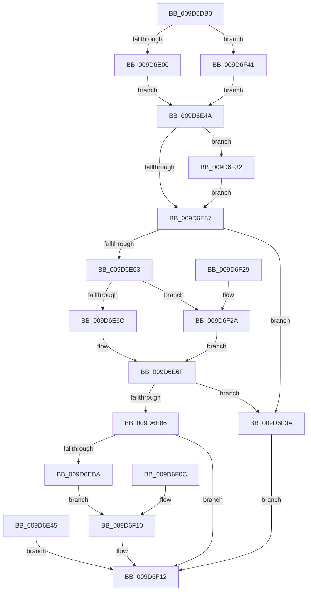

# NtFlushVirtualMemory

- RVA: `0x009D6DB0`–`0x009D6F56` (길이 `422` bytes)
- VA: `0x00000001409D6DB0`
- 실행 섹션: `PAGE`
- PDB 이름 있음: `예`; PDB Function 태그: `아니요`
- unwind 정보 RVA: `0x000A27A8`
- 디코드: `105`개 명령, `422/422` bytes 표시
- 미해석 바이트: `0` (있으면 어셈블리에 `.byte`로 보존)

> 이 문서는 커널 이미지의 기계어와 PDB 기호를 분석해 생성했습니다. 4번과 5번은 함수 원형과 자료형을 바이너리 사용 방식에서 추정한 C 해석이며 원본 소스 복구 결과는 아닙니다.

## 1. Dependencies

- 직접 호출 지점: **3**; 고유 호출 대상: **3**
- 직접 호출자로 확인된 함수: **0**
- RIP 상대 이미지 참조: **1**

### Outgoing calls
- `0x009D6EB1` → [ObpReferenceObjectByHandleWithTag](../86/ObpReferenceObjectByHandleWithTag_function_00869650.md) (function, `0x00869650`)
- `0x009D6ECE` → [MmFlushVirtualMemory](MmFlushVirtualMemory_function_009D6F5C.md) (function, `0x009D6F5C`)
- `0x009D6EE3` → [ObfDereferenceObjectWithTag](../../text/2F/ObfDereferenceObjectWithTag_function_002F78E0.md) (function, `0x002F78E0`)

### Direct callers
- 이 함수 시작 RVA로 연결되는 직접 call은 확인되지 않았습니다. 간접 호출은 완전히 역산할 수 없습니다.

### Static image references
- `0x009D6E86` → RVA `0x00FC6A98` (`ALMOSTRO`; read)

## 2. Other-region calls and transfers

- 다른 실행 섹션으로 향하는 call: **1**
  - `0x009D6EE3` → [ObfDereferenceObjectWithTag](../../text/2F/ObfDereferenceObjectWithTag_function_002F78E0.md) (`PAGE` → `.text`)
- 별도 외부 분기/꼬리 이동을 확인하지 못했습니다.

## 3. Assembly (complete function range)

```asm
009D6DB0  4C 8B DC                        mov r11, rsp
009D6DB3  49 89 5B 08                     mov qword ptr [r11 + 8], rbx
009D6DB7  49 89 73 10                     mov qword ptr [r11 + 0x10], rsi
009D6DBB  49 89 7B 18                     mov qword ptr [r11 + 0x18], rdi
009D6DBF  41 56                           push r14
009D6DC1  48 83 EC 70                     sub rsp, 0x70
009D6DC5  4D 8B F1                        mov r14, r9
009D6DC8  49 8B F8                        mov rdi, r8
009D6DCB  48 8B F2                        mov rsi, rdx
009D6DCE  4C 8B D1                        mov r10, rcx
009D6DD1  33 DB                           xor ebx, ebx
009D6DD3  49 89 5B E0                     mov qword ptr [r11 - 0x20], rbx
009D6DD7  49 89 5B D8                     mov qword ptr [r11 - 0x28], rbx
009D6DDB  49 89 5B D0                     mov qword ptr [r11 - 0x30], rbx
009D6DDF  0F 57 C0                        xorps xmm0, xmm0
009D6DE2  0F 11 44 24 60                  movups xmmword ptr [rsp + 0x60], xmm0
009D6DE7  65 48 8B 04 25 88 01 00 00      mov rax, qword ptr gs:[0x188]
009D6DF0  44 8A 88 32 02 00 00            mov r9b, byte ptr [rax + 0x232]
009D6DF7  45 84 C9                        test r9b, r9b
009D6DFA  0F 84 41 01 00 00               je 0x1409d6f41
009D6E00  48 BA 00 00 FF FF FF 7F 00 00   movabs rdx, 0x7fffffff0000
009D6E0A  48 8B CA                        mov rcx, rdx
009D6E0D  48 3B F2                        cmp rsi, rdx
009D6E10  48 0F 42 CE                     cmovb rcx, rsi
009D6E14  48 8B 01                        mov rax, qword ptr [rcx]
009D6E17  48 89 01                        mov qword ptr [rcx], rax
009D6E1A  48 8B CA                        mov rcx, rdx
009D6E1D  4C 3B C2                        cmp r8, rdx
009D6E20  49 0F 42 C8                     cmovb rcx, r8
009D6E24  48 8B 01                        mov rax, qword ptr [rcx]
009D6E27  48 89 01                        mov qword ptr [rcx], rax
009D6E2A  4C 3B F2                        cmp r14, rdx
009D6E2D  49 0F 42 D6                     cmovb rdx, r14
009D6E31  8B 02                           mov eax, dword ptr [rdx]
009D6E33  89 02                           mov dword ptr [rdx], eax
009D6E35  48 8B 16                        mov rdx, qword ptr [rsi]
009D6E38  49 89 53 D8                     mov qword ptr [r11 - 0x28], rdx
009D6E3C  49 8B 08                        mov rcx, qword ptr [r8]
009D6E3F  49 89 4B D0                     mov qword ptr [r11 - 0x30], rcx
009D6E43  EB 05                           jmp 0x1409d6e4a
009D6E45  E9 C8 00 00 00                  jmp 0x1409d6f12
009D6E4A  48 85 C9                        test rcx, rcx
009D6E4D  48 8D 41 FF                     lea rax, [rcx - 1]
009D6E51  0F 84 DB 00 00 00               je 0x1409d6f32
009D6E57  48 03 C2                        add rax, rdx
009D6E5A  48 3B C2                        cmp rax, rdx
009D6E5D  0F 82 D7 00 00 00               jb 0x1409d6f3a
009D6E63  48 85 C9                        test rcx, rcx
009D6E66  0F 84 BE 00 00 00               je 0x1409d6f2a
009D6E6C  48 FF C9                        dec rcx
009D6E6F  48 8D 04 11                     lea rax, [rcx + rdx]
009D6E73  48 B9 FF FF FE FF FF 7F 00 00   movabs rcx, 0x7ffffffeffff
009D6E7D  48 3B C1                        cmp rax, rcx
009D6E80  0F 87 B4 00 00 00               ja 0x1409d6f3a
009D6E86  4C 8B 05 0B FC 5E 00            mov r8, qword ptr [rip + 0x5efc0b]
009D6E8D  48 89 5C 24 38                  mov qword ptr [rsp + 0x38], rbx
009D6E92  48 89 5C 24 30                  mov qword ptr [rsp + 0x30], rbx
009D6E97  48 8D 44 24 58                  lea rax, [rsp + 0x58]
009D6E9C  48 89 44 24 28                  mov qword ptr [rsp + 0x28], rax
009D6EA1  C7 44 24 20 4D 6D 46 6C         mov dword ptr [rsp + 0x20], 0x6c466d4d
009D6EA9  BA 08 00 00 00                  mov edx, 8
009D6EAE  49 8B CA                        mov rcx, r10
009D6EB1  E8 9A 27 E9 FF                  call 0x140869650
009D6EB6  85 C0                           test eax, eax
009D6EB8  78 58                           js 0x1409d6f12
009D6EBA  4C 8D 4C 24 60                  lea r9, [rsp + 0x60]
009D6EBF  4C 8D 44 24 48                  lea r8, [rsp + 0x48]
009D6EC4  48 8D 54 24 50                  lea rdx, [rsp + 0x50]
009D6EC9  48 8B 4C 24 58                  mov rcx, qword ptr [rsp + 0x58]
009D6ECE  E8 89 00 00 00                  call 0x1409d6f5c
009D6ED3  8B D8                           mov ebx, eax
009D6ED5  89 44 24 40                     mov dword ptr [rsp + 0x40], eax
009D6ED9  BA 4D 6D 46 6C                  mov edx, 0x6c466d4d
009D6EDE  48 8B 4C 24 58                  mov rcx, qword ptr [rsp + 0x58]
009D6EE3  E8 F8 09 92 FF                  call 0x1402f78e0
009D6EE8  90                              nop
009D6EE9  48 8B 4C 24 48                  mov rcx, qword ptr [rsp + 0x48]
009D6EEE  48 89 0F                        mov qword ptr [rdi], rcx
009D6EF1  48 8B 4C 24 50                  mov rcx, qword ptr [rsp + 0x50]
009D6EF6  48 81 E1 00 F0 FF FF            and rcx, 0xfffffffffffff000
009D6EFD  48 89 0E                        mov qword ptr [rsi], rcx
009D6F00  0F 10 44 24 60                  movups xmm0, xmmword ptr [rsp + 0x60]
009D6F05  F3 41 0F 7F 06                  movdqu xmmword ptr [r14], xmm0
009D6F0A  EB 04                           jmp 0x1409d6f10
009D6F0C  8B 5C 24 40                     mov ebx, dword ptr [rsp + 0x40]
009D6F10  8B C3                           mov eax, ebx
009D6F12  4C 8D 5C 24 70                  lea r11, [rsp + 0x70]
009D6F17  49 8B 5B 10                     mov rbx, qword ptr [r11 + 0x10]
009D6F1B  49 8B 73 18                     mov rsi, qword ptr [r11 + 0x18]
009D6F1F  49 8B 7B 20                     mov rdi, qword ptr [r11 + 0x20]
009D6F23  49 8B E3                        mov rsp, r11
009D6F26  41 5E                           pop r14
009D6F28  C3                              ret
009D6F29  CC                              int3
009D6F2A  48 8B CB                        mov rcx, rbx
009D6F2D  E9 3D FF FF FF                  jmp 0x1409d6e6f
009D6F32  48 8B C3                        mov rax, rbx
009D6F35  E9 1D FF FF FF                  jmp 0x1409d6e57
009D6F3A  B8 0D 00 00 C0                  mov eax, 0xc000000d
009D6F3F  EB D1                           jmp 0x1409d6f12
009D6F41  48 8B 12                        mov rdx, qword ptr [rdx]
009D6F44  48 89 54 24 50                  mov qword ptr [rsp + 0x50], rdx
009D6F49  49 8B 08                        mov rcx, qword ptr [r8]
009D6F4C  48 89 4C 24 48                  mov qword ptr [rsp + 0x48], rcx
009D6F51  E9 F4 FE FF FF                  jmp 0x1409d6e4a
```

## 4. C-style interpretation (structured pseudocode)

```c
__int64 __fastcall NtFlushVirtualMemory(__int64 a1, __int64 a2, __int64 a3, __int64 a4)
{
    __int64 result;
    __int64 v_rbx;
    __int64 v_rsp;
    unsigned __int64 v_stack_m18;
    unsigned __int64 v_stack_m20;
    unsigned __int64 v_stack_m28;
    unsigned __int64 v_stack_m30;
    unsigned int v_stack_m38;
    unsigned __int64 v_stack_m40;
    unsigned __int64 v_stack_m48;
    unsigned __int64 v_stack_m50;
    unsigned int v_stack_m58;
    unsigned __int64 v_stack_m8;

    *(unsigned __int64 *)(v_rsp + 8) = v_rbx;
    *(unsigned __int64 *)(v_rsp + 16) = v_rsi;
    *(unsigned __int64 *)(v_rsp + 24) = v_rdi;
    v_rsp = (v_rsp) - (112);
    v_rbx = 0;
    *(unsigned __int64 *)(v_rsp - 32) = 0;
    *(unsigned __int64 *)(v_rsp - 40) = 0;
    *(unsigned __int64 *)(v_rsp - 48) = 0;
    v_stack_m18 = v_xmm0;
    if ((unsigned __int8)(*(unsigned __int8 *)(*(unsigned __int64 *)(gs_base + (0 + 392)) + 562)) == 0) goto loc_009D6F41;
    if (a2 < a2) { a2 = a2; }
    *(unsigned __int64 *)(a2) = *(unsigned __int64 *)(a2);
    if (a3 < a2) { a2 = a3; }
    *(unsigned __int64 *)(a2) = *(unsigned __int64 *)(a2);
    if (a4 < a2) { a2 = a4; }
    *(unsigned int *)(a2) = (unsigned int)((unsigned int)(*(unsigned int *)(a2)));
    *(unsigned __int64 *)(v_rsp - 40) = *(unsigned __int64 *)(a2);
    *(unsigned __int64 *)(v_rsp - 48) = *(unsigned __int64 *)(a3);
    goto loc_009D6E4A;
loc_009D6E4A:
    if (*(unsigned __int64 *)(a3) == 0) goto loc_009D6F32;
loc_009D6E57:
    result = (*(unsigned __int64 *)(a3) - 1) + (*(unsigned __int64 *)(a2));
    if (result < (*(unsigned __int64 *)(a2))) goto loc_009D6F3A;
    if (*(unsigned __int64 *)(a3) == 0) goto loc_009D6F2A;
    a1 = (*(unsigned __int64 *)(a3)) - 1;
loc_009D6E6F:
    if ((a1 + *(unsigned __int64 *)(a2) * 1) > a1) goto loc_009D6F3A;
    v_stack_m40 = 0;
    v_stack_m48 = 0;
    v_stack_m50 = v_stack_m20;
    v_stack_m58 = 0x6C466D4DULL;
    result = ObpReferenceObjectByHandleWithTag(a1, 8, *(unsigned __int64 *)(v_rip + 6224907), *(unsigned __int8 *)(*(unsigned __int64 *)(gs_base + (0 + 392)) + 562));
    if (sign_flag) goto loc_009D6F12;
    result = MmFlushVirtualMemory(v_stack_m20, v_stack_m28, v_stack_m30, v_stack_m18);
    v_stack_m38 = (unsigned int)(result);
    result = ObfDereferenceObjectWithTag(v_stack_m20, (unsigned int)(0x6C466D4DULL), v_stack_m30, v_stack_m18);
    *(unsigned __int64 *)(a3) = v_stack_m30;
    a1 = (v_stack_m28) & (0xFFFFFFFFFFFFF000ULL);
    *(unsigned __int64 *)(a2) = a1;
    *(unsigned __int64 *)(a4) = v_xmm0;
    goto loc_009D6F10;
loc_009D6F10:
loc_009D6F12:
    return (unsigned int)((unsigned int)((unsigned int)((unsigned int)(result))));
loc_009D6F2A:
    goto loc_009D6E6F;
loc_009D6F32:
    goto loc_009D6E57;
loc_009D6F3A:
    goto loc_009D6F12;
loc_009D6F41:
    v_stack_m20 = *(unsigned __int64 *)((unsigned int)(0x6C466D4DULL));
    v_stack_m28 = *(unsigned __int64 *)(v_stack_m30);
    goto loc_009D6E4A;
}
```

## 5. (Beta) C Style

```c
int64_t NtFlushVirtualMemory(int64_t Arg1, void *Arg2, void *Arg3, int64_t Arg4)
{
    uint8_t *arg2 = (uint8_t *)Arg2;
    uint8_t *arg3 = (uint8_t *)Arg3;

    int64_t result;
    int64_t local_rbx;
    int64_t local_rsp;
    uint64_t v_stack_m18;
    uint64_t v_stack_m20;
    uint64_t v_stack_m28;
    uint64_t v_stack_m30;
    uint32_t v_stack_m38;
    uint64_t v_stack_m40;
    uint64_t v_stack_m48;
    uint64_t v_stack_m50;
    uint32_t v_stack_m58;
    uint64_t v_stack_m8;

    *(uint64_t *)(local_rsp + 0x8) = local_rbx;
    *(uint64_t *)(local_rsp + 0x10) = local_rsi;
    *(uint64_t *)(local_rsp + 0x18) = local_rdi;
    local_rsp = (local_rsp) - (112);
    local_rbx = 0;
    *(uint64_t *)(local_rsp - 0x20) = 0;
    *(uint64_t *)(local_rsp - 0x28) = 0;
    *(uint64_t *)(local_rsp - 0x30) = 0;
    v_stack_m18 = v_xmm0;
    if ((uint8_t)(*(uint8_t *)(*(uint64_t *)(gs_base + (0 + 0x188)) + 0x232)) == 0) goto loc_009D6F41;
    if (Arg2 < Arg2) { Arg2 = Arg2; }
    *(uint64_t *)(arg2) = *(uint64_t *)(arg2);
    if (Arg3 < Arg2) { Arg2 = Arg3; }
    *(uint64_t *)(arg2) = *(uint64_t *)(arg2);
    if (Arg4 < Arg2) { Arg2 = Arg4; }
    *(uint32_t *)(arg2) = (uint32_t)((uint32_t)(*(uint32_t *)(arg2)));
    *(uint64_t *)(local_rsp - 0x28) = *(uint64_t *)(arg2);
    *(uint64_t *)(local_rsp - 0x30) = *(uint64_t *)(arg3);
    goto loc_009D6E4A;
loc_009D6E4A:
    if (*(uint64_t *)(arg3) == 0) goto loc_009D6F32;
loc_009D6E57:
    result = (*(uint64_t *)(arg3) - 1) + (*(uint64_t *)(arg2));
    if (result < (*(uint64_t *)(arg2))) goto loc_009D6F3A;
    if (*(uint64_t *)(arg3) == 0) goto loc_009D6F2A;
    Arg1 = (*(uint64_t *)(arg3)) - 1;
loc_009D6E6F:
    if ((Arg1 + *(uint64_t *)(arg2) * 1) > Arg1) goto loc_009D6F3A;
    v_stack_m40 = 0;
    v_stack_m48 = 0;
    v_stack_m50 = v_stack_m20;
    v_stack_m58 = 0x6C466D4DULL;
    result = ObpReferenceObjectByHandleWithTag(Arg1, 8, *(uint64_t *)(v_rip + 0x5EFC0B), *(uint8_t *)(*(uint64_t *)(gs_base + (0 + 0x188)) + 0x232));
    if (sign_flag) goto loc_009D6F12;
    result = MmFlushVirtualMemory(v_stack_m20, v_stack_m28, v_stack_m30, v_stack_m18);
    v_stack_m38 = (uint32_t)(result);
    result = ObfDereferenceObjectWithTag(v_stack_m20, (uint32_t)(0x6C466D4DULL), v_stack_m30, v_stack_m18);
    *(uint64_t *)(arg3) = v_stack_m30;
    Arg1 = (v_stack_m28) & (0xFFFFFFFFFFFFF000ULL);
    *(uint64_t *)(arg2) = Arg1;
    *(uint64_t *)(Arg4) = v_xmm0;
    goto loc_009D6F10;
loc_009D6F10:
loc_009D6F12:
    return (uint32_t)((uint32_t)((uint32_t)((uint32_t)(result))));
loc_009D6F2A:
    goto loc_009D6E6F;
loc_009D6F32:
    goto loc_009D6E57;
loc_009D6F3A:
    goto loc_009D6F12;
loc_009D6F41:
    v_stack_m20 = *(uint64_t *)((uint32_t)(0x6C466D4DULL));
    v_stack_m28 = *(uint64_t *)(v_stack_m30);
    goto loc_009D6E4A;
}
```

### 관측된 메모리 오프셋

구조체 형식이 확인되지 않은 접근은 인자 기준의 오프셋으로만 기록했습니다.

| 기준 인자 | 오프셋 표현 | 폭 (bit) | 접근 |
|---|---:|---:|---|
| `Arg2` | `+ 0x0` | `64` | `R` |
| `Arg3` | `+ 0x0` | `64` | `R` |
| `Arg3` | `+ 0x0` | `64` | `W` |

## 6. Execution-region graph

[열기: 2D/3D 그래프와 함수 탐색 컨트롤 패널](../../../control-panel.html?section=page&rva=0x009D6DB0&view=graph)

- 2D 그래프는 위에서 아래로 흐르고, 3D 그래프는 빈 공간을 드래그해 회전합니다. Shift+드래그는 이동, 휠은 확대·축소, 함수 노드 선택은 대상 보고서 이동입니다.

### Static fallback


