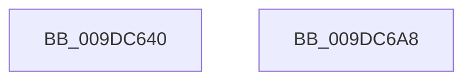

# NtNotifyChangeKey

- RVA: `0x009DC640`–`0x009DC6A9` (길이 `105` bytes)
- VA: `0x00000001409DC640`
- 실행 섹션: `PAGE`
- PDB 이름 있음: `예`; PDB Function 태그: `아니요`
- unwind 정보 RVA: `0x0006E590`
- 디코드: `22`개 명령, `105/105` bytes 표시
- 미해석 바이트: `0` (있으면 어셈블리에 `.byte`로 보존)

> 이 문서는 커널 이미지의 기계어와 PDB 기호를 분석해 생성했습니다. 4번과 5번은 함수 원형과 자료형을 바이너리 사용 방식에서 추정한 C 해석이며 원본 소스 복구 결과는 아닙니다.

## 1. Dependencies

- 직접 호출 지점: **1**; 고유 호출 대상: **1**
- 직접 호출자로 확인된 함수: **1**
- RIP 상대 이미지 참조: **0**

### Outgoing calls
- `0x009DC69E` → [NtNotifyChangeMultipleKeys](NtNotifyChangeMultipleKeys_function_009DC6B0.md) (function, `0x009DC6B0`)

### Direct callers
- [ExpWatchProductTypeInitialization](../../init/C5/ExpWatchProductTypeInitialization_function_00C52170.md) at `0x00C526A9`
- [ExpWatchProductTypeInitialization](../../init/C5/ExpWatchProductTypeInitialization_function_00C52170.md) at `0x00C52AA2`

### Static image references
- 디코드된 RIP-relative 메모리 참조가 없습니다.

## 2. Other-region calls and transfers

- 다른 실행 섹션으로 향하는 call: **0**
- 별도 외부 분기/꼬리 이동을 확인하지 못했습니다.

## 3. Assembly (complete function range)

```asm
009DC640  48 83 EC 68                     sub rsp, 0x68
009DC644  0F B6 84 24 B8 00 00 00         movzx eax, byte ptr [rsp + 0xb8]
009DC64C  88 44 24 58                     mov byte ptr [rsp + 0x58], al
009DC650  8B 84 24 B0 00 00 00            mov eax, dword ptr [rsp + 0xb0]
009DC657  89 44 24 50                     mov dword ptr [rsp + 0x50], eax
009DC65B  48 8B 84 24 A8 00 00 00         mov rax, qword ptr [rsp + 0xa8]
009DC663  48 89 44 24 48                  mov qword ptr [rsp + 0x48], rax
009DC668  0F B6 84 24 A0 00 00 00         movzx eax, byte ptr [rsp + 0xa0]
009DC670  88 44 24 40                     mov byte ptr [rsp + 0x40], al
009DC674  8B 84 24 98 00 00 00            mov eax, dword ptr [rsp + 0x98]
009DC67B  89 44 24 38                     mov dword ptr [rsp + 0x38], eax
009DC67F  48 8B 84 24 90 00 00 00         mov rax, qword ptr [rsp + 0x90]
009DC687  48 89 44 24 30                  mov qword ptr [rsp + 0x30], rax
009DC68C  4C 89 4C 24 28                  mov qword ptr [rsp + 0x28], r9
009DC691  4C 8B CA                        mov r9, rdx
009DC694  4C 89 44 24 20                  mov qword ptr [rsp + 0x20], r8
009DC699  33 D2                           xor edx, edx
009DC69B  45 33 C0                        xor r8d, r8d
009DC69E  E8 0D 00 00 00                  call 0x1409dc6b0
009DC6A3  48 83 C4 68                     add rsp, 0x68
009DC6A7  C3                              ret
009DC6A8  CC                              int3
```

## 4. C-style interpretation (structured pseudocode)

```c
__int64 __fastcall NtNotifyChangeKey(__int64 a1, __int64 a2, __int64 a3, __int64 a4, __int64 a5, unsigned int a6, unsigned __int8 a7, __int64 a8, unsigned int a9, unsigned __int8 a10)
{
    __int64 result;
    __int64 v_rsp;
    unsigned __int8 v_stack_m10;
    unsigned int v_stack_m18;
    unsigned __int64 v_stack_m20;
    unsigned __int8 v_stack_m28;
    unsigned int v_stack_m30;
    unsigned __int64 v_stack_m38;
    unsigned __int64 v_stack_m40;
    unsigned __int64 v_stack_m48;

    v_rsp = (v_rsp) - (104);
    v_stack_m10 = a10;
    v_stack_m18 = (unsigned int)((unsigned int)(a9));
    v_stack_m20 = a8;
    v_stack_m28 = a7;
    v_stack_m30 = (unsigned int)((unsigned int)(a6));
    v_stack_m38 = a5;
    v_stack_m40 = a4;
    v_stack_m48 = a3;
    a2 = 0;
    a3 = 0;
    result = NtNotifyChangeMultipleKeys(a1, a2, a3, a2);
    v_rsp = (v_rsp) + (104);
    return result;
}
```

## 5. (Beta) C Style

```c
int64_t NtNotifyChangeKey(int64_t Arg1, int64_t Arg2, int64_t Arg3, int64_t Arg4, int64_t Arg5, uint32_t Arg6, uint8_t Arg7, int64_t Arg8, uint32_t Arg9, uint8_t Arg10)
{
    int64_t result;
    int64_t local_rsp;
    uint8_t v_stack_m10;
    uint32_t v_stack_m18;
    uint64_t v_stack_m20;
    uint8_t v_stack_m28;
    uint32_t v_stack_m30;
    uint64_t v_stack_m38;
    uint64_t v_stack_m40;
    uint64_t v_stack_m48;

    local_rsp = (local_rsp) - (104);
    v_stack_m10 = Arg10;
    v_stack_m18 = (uint32_t)((uint32_t)(Arg9));
    v_stack_m20 = Arg8;
    v_stack_m28 = Arg7;
    v_stack_m30 = (uint32_t)((uint32_t)(Arg6));
    v_stack_m38 = Arg5;
    v_stack_m40 = Arg4;
    v_stack_m48 = Arg3;
    Arg2 = 0;
    Arg3 = 0;
    result = NtNotifyChangeMultipleKeys(Arg1, Arg2, Arg3, Arg2);
    local_rsp = (local_rsp) + (104);
    return result;
}
```

## 6. Execution-region graph

[열기: 2D/3D 그래프와 함수 탐색 컨트롤 패널](../../../control-panel.html?section=page&rva=0x009DC640&view=graph)

- 2D 그래프는 위에서 아래로 흐르고, 3D 그래프는 빈 공간을 드래그해 회전합니다. Shift+드래그는 이동, 휠은 확대·축소, 함수 노드 선택은 대상 보고서 이동입니다.

### Static fallback


