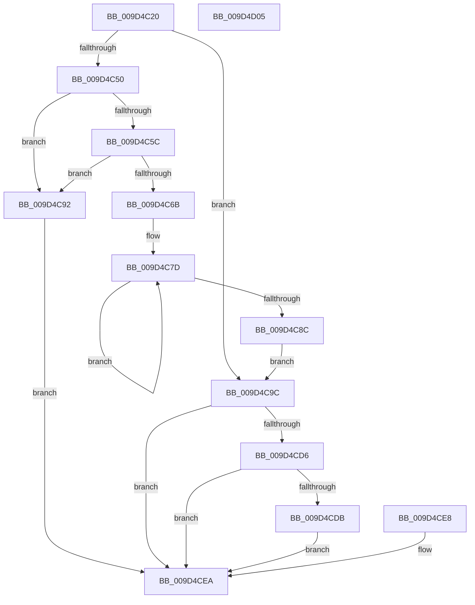

# NtSubscribeWnfStateChange

- RVA: `0x009D4C20`–`0x009D4D06` (길이 `230` bytes)
- VA: `0x00000001409D4C20`
- 실행 섹션: `PAGE`
- PDB 이름 있음: `예`; PDB Function 태그: `아니요`
- unwind 정보 RVA: `0x000A1C4C`
- 디코드: `65`개 명령, `230/230` bytes 표시
- 미해석 바이트: `0` (있으면 어셈블리에 `.byte`로 보존)

> 이 문서는 커널 이미지의 기계어와 PDB 기호를 분석해 생성했습니다. 4번과 5번은 함수 원형과 자료형을 바이너리 사용 방식에서 추정한 C 해석이며 원본 소스 복구 결과는 아닙니다.

## 1. Dependencies

- 직접 호출 지점: **3**; 고유 호출 대상: **3**
- 직접 호출자로 확인된 함수: **0**
- RIP 상대 이미지 참조: **0**

### Outgoing calls
- `0x009D4C92` → [ExRaiseAccessViolation](../8E/ExRaiseAccessViolation_function_008E9240.md) (function, `0x008E9240`)
- `0x009D4CCB` → [ExpWnfSubscribeWnfStateChange](ExpWnfSubscribeWnfStateChange_function_009D4D0C.md) (function, `0x009D4D0C`)
- `0x009D4CF3` → [KeLeaveCriticalRegionThread](../../text/25/KeLeaveCriticalRegionThread_function_0025EFF0.md) (function, `0x0025EFF0`)

### Direct callers
- 이 함수 시작 RVA로 연결되는 직접 call은 확인되지 않았습니다. 간접 호출은 완전히 역산할 수 없습니다.

### Static image references
- 디코드된 RIP-relative 메모리 참조가 없습니다.

## 2. Other-region calls and transfers

- 다른 실행 섹션으로 향하는 call: **1**
  - `0x009D4CF3` → [KeLeaveCriticalRegionThread](../../text/25/KeLeaveCriticalRegionThread_function_0025EFF0.md) (`PAGE` → `.text`)
- 별도 외부 분기/꼬리 이동을 확인하지 못했습니다.

## 3. Assembly (complete function range)

```asm
009D4C20  4C 8B DC                        mov r11, rsp
009D4C23  49 89 5B 08                     mov qword ptr [r11 + 8], rbx
009D4C27  57                              push rdi
009D4C28  48 83 EC 60                     sub rsp, 0x60
009D4C2C  49 8B D9                        mov rbx, r9
009D4C2F  44 8B CA                        mov r9d, edx
009D4C32  4C 8B D1                        mov r10, rcx
009D4C35  65 48 8B 04 25 88 01 00 00      mov rax, qword ptr gs:[0x188]
009D4C3E  66 FF 88 E4 01 00 00            dec word ptr [rax + 0x1e4]
009D4C45  90                              nop
009D4C46  49 83 63 20 00                  and qword ptr [r11 + 0x20], 0
009D4C4B  48 85 DB                        test rbx, rbx
009D4C4E  74 4C                           je 0x1409d4c9c
009D4C50  48 8B D3                        mov rdx, rbx
009D4C53  48 8D 4B 07                     lea rcx, [rbx + 7]
009D4C57  48 3B D9                        cmp rbx, rcx
009D4C5A  77 36                           ja 0x1409d4c92
009D4C5C  48 B8 00 00 FF FF FF 7F 00 00   movabs rax, 0x7fffffff0000
009D4C66  48 3B C8                        cmp rcx, rax
009D4C69  73 27                           jae 0x1409d4c92
009D4C6B  49 C7 C3 00 F0 FF FF            mov r11, 0xfffffffffffff000
009D4C72  49 23 CB                        and rcx, r11
009D4C75  BF 00 10 00 00                  mov edi, 0x1000
009D4C7A  48 03 CF                        add rcx, rdi
009D4C7D  8A 02                           mov al, byte ptr [rdx]
009D4C7F  88 02                           mov byte ptr [rdx], al
009D4C81  49 23 D3                        and rdx, r11
009D4C84  48 03 D7                        add rdx, rdi
009D4C87  48 3B D1                        cmp rdx, rcx
009D4C8A  75 F1                           jne 0x1409d4c7d
009D4C8C  48 83 23 00                     and qword ptr [rbx], 0
009D4C90  EB 0A                           jmp 0x1409d4c9c
009D4C92  E8 A9 45 F1 FF                  call 0x1408e9240
009D4C97  90                              nop
009D4C98  8B F8                           mov edi, eax
009D4C9A  EB 4E                           jmp 0x1409d4cea
009D4C9C  48 8B C3                        mov rax, rbx
009D4C9F  48 F7 D8                        neg rax
009D4CA2  48 1B C9                        sbb rcx, rcx
009D4CA5  48 8D 84 24 88 00 00 00         lea rax, [rsp + 0x88]
009D4CAD  48 23 C8                        and rcx, rax
009D4CB0  C6 44 24 38 01                  mov byte ptr [rsp + 0x38], 1
009D4CB5  44 89 44 24 30                  mov dword ptr [rsp + 0x30], r8d
009D4CBA  48 83 64 24 28 00               and qword ptr [rsp + 0x28], 0
009D4CC0  48 83 64 24 20 00               and qword ptr [rsp + 0x20], 0
009D4CC6  4D 8B C2                        mov r8, r10
009D4CC9  33 D2                           xor edx, edx
009D4CCB  E8 3C 00 00 00                  call 0x1409d4d0c
009D4CD0  8B F8                           mov edi, eax
009D4CD2  85 C0                           test eax, eax
009D4CD4  78 14                           js 0x1409d4cea
009D4CD6  48 85 DB                        test rbx, rbx
009D4CD9  74 0F                           je 0x1409d4cea
009D4CDB  48 8B 8C 24 88 00 00 00         mov rcx, qword ptr [rsp + 0x88]
009D4CE3  48 89 0B                        mov qword ptr [rbx], rcx
009D4CE6  EB 02                           jmp 0x1409d4cea
009D4CE8  8B F8                           mov edi, eax
009D4CEA  65 48 8B 0C 25 88 01 00 00      mov rcx, qword ptr gs:[0x188]
009D4CF3  E8 F8 A2 88 FF                  call 0x14025eff0
009D4CF8  8B C7                           mov eax, edi
009D4CFA  48 8B 5C 24 70                  mov rbx, qword ptr [rsp + 0x70]
009D4CFF  48 83 C4 60                     add rsp, 0x60
009D4D03  5F                              pop rdi
009D4D04  C3                              ret
009D4D05  CC                              int3
```

## 4. C-style interpretation (structured pseudocode)

```c
__int64 __fastcall NtSubscribeWnfStateChange(__int64 a1, int a2, int a3, __int64 a4)
{
    __int64 result;
    __int64 v_rsp;
    unsigned __int8 v_stack_m30;
    unsigned int v_stack_m38;
    unsigned __int64 v_stack_m40;
    unsigned __int64 v_stack_m48;
    unsigned __int64 v_stack_p20;
    unsigned __int64 v_stack_p8;

    *(unsigned __int64 *)(v_rsp + 8) = v_rbx;
    v_rsp = (v_rsp) - (96);
    if (a4 == 0) goto loc_009D4C9C;
    if (a4 > (a4 + 7)) goto loc_009D4C92;
    if ((a4 + 7) >= (*(unsigned __int64 *)(gs_base + (0 + 392)))) goto loc_009D4C92;
    a1 = (a4 + 7) & (0xFFFFFFFFFFFFF000ULL);
    a1 = (a1) + ((unsigned int)(0x1000ULL));
loc_009D4C7D:
    *(unsigned __int8 *)(a4) = (unsigned __int8)(*(unsigned __int8 *)(a4));
    a2 = (a4) & (0xFFFFFFFFFFFFF000ULL);
    a2 = (a2) + ((unsigned int)(0x1000ULL));
    if (a2 != a1) goto loc_009D4C7D;
    goto loc_009D4C9C;
loc_009D4C92:
    result = ExRaiseAccessViolation(a1, a2, a3, (unsigned int)(a2));
    goto loc_009D4CEA;
loc_009D4C9C:
    result = -(a4);
    a1 = (a1) & (v_stack_p20);
    v_stack_m30 = 1;
    v_stack_m38 = a3;
    a2 = 0;
    result = ExpWnfSubscribeWnfStateChange(a1, a2, a1, (unsigned int)(a2));
    if (sign_flag) goto loc_009D4CEA;
    if (a4 == 0) goto loc_009D4CEA;
    *(unsigned __int64 *)(a4) = v_stack_p20;
    goto loc_009D4CEA;
loc_009D4CEA:
    result = KeLeaveCriticalRegionThread(*(unsigned __int64 *)(gs_base + (0 + 392)), a2, a1, (unsigned int)(a2));
    v_rsp = (v_rsp) + (96);
    return (unsigned int)((unsigned int)((unsigned int)((unsigned int)(result))));
}
```

## 5. (Beta) C Style

```c
int64_t NtSubscribeWnfStateChange(int64_t Arg1, int32_t Arg2, int32_t Arg3, int64_t Arg4)
{
    int64_t result;
    int64_t local_rsp;
    uint8_t v_stack_m30;
    uint32_t v_stack_m38;
    uint64_t v_stack_m40;
    uint64_t v_stack_m48;
    uint64_t v_stack_p20;
    uint64_t v_stack_p8;

    *(uint64_t *)(local_rsp + 0x8) = local_rbx;
    local_rsp = (local_rsp) - (96);
    if (Arg4 == 0) goto loc_009D4C9C;
    if (Arg4 > (Arg4 + 7)) goto loc_009D4C92;
    if ((Arg4 + 7) >= (*(uint64_t *)(gs_base + (0 + 0x188)))) goto loc_009D4C92;
    Arg1 = (Arg4 + 7) & (0xFFFFFFFFFFFFF000ULL);
    Arg1 = (Arg1) + ((uint32_t)(0x1000ULL));
loc_009D4C7D:
    *(uint8_t *)(Arg4) = (uint8_t)(*(uint8_t *)(Arg4));
    Arg2 = (Arg4) & (0xFFFFFFFFFFFFF000ULL);
    Arg2 = (Arg2) + ((uint32_t)(0x1000ULL));
    if (Arg2 != Arg1) goto loc_009D4C7D;
    goto loc_009D4C9C;
loc_009D4C92:
    result = ExRaiseAccessViolation(Arg1, Arg2, Arg3, (uint32_t)(Arg2));
    goto loc_009D4CEA;
loc_009D4C9C:
    result = -(Arg4);
    Arg1 = (Arg1) & (v_stack_p20);
    v_stack_m30 = 1;
    v_stack_m38 = Arg3;
    Arg2 = 0;
    result = ExpWnfSubscribeWnfStateChange(Arg1, Arg2, Arg1, (uint32_t)(Arg2));
    if (sign_flag) goto loc_009D4CEA;
    if (Arg4 == 0) goto loc_009D4CEA;
    *(uint64_t *)(Arg4) = v_stack_p20;
    goto loc_009D4CEA;
loc_009D4CEA:
    result = KeLeaveCriticalRegionThread(*(uint64_t *)(gs_base + (0 + 0x188)), Arg2, Arg1, (uint32_t)(Arg2));
    local_rsp = (local_rsp) + (96);
    return (uint32_t)((uint32_t)((uint32_t)((uint32_t)(result))));
}
```

## 6. Execution-region graph

[열기: 2D/3D 그래프와 함수 탐색 컨트롤 패널](../../../control-panel.html?section=page&rva=0x009D4C20&view=graph)

- 2D 그래프는 위에서 아래로 흐르고, 3D 그래프는 빈 공간을 드래그해 회전합니다. Shift+드래그는 이동, 휠은 확대·축소, 함수 노드 선택은 대상 보고서 이동입니다.

### Static fallback


