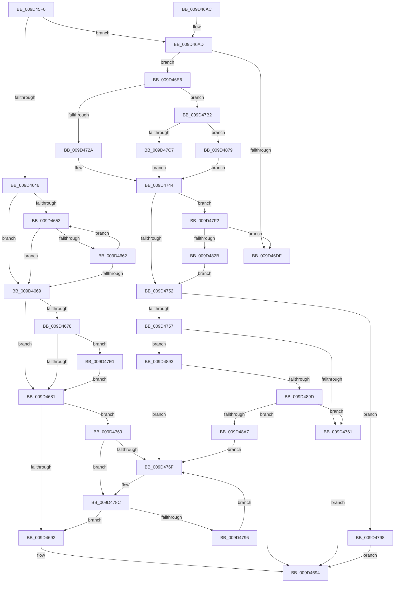

# ObGetObjectSecurity

- RVA: `0x009D45F0`–`0x009D48AC` (길이 `700` bytes)
- VA: `0x00000001409D45F0`
- 실행 섹션: `PAGE`
- PDB 이름 있음: `예`; PDB Function 태그: `아니요`
- unwind 정보 RVA: `0x000A1934`
- 디코드: `171`개 명령, `700/700` bytes 표시
- 미해석 바이트: `0` (있으면 어셈블리에 `.byte`로 보존)

> 이 문서는 커널 이미지의 기계어와 PDB 기호를 분석해 생성했습니다. 4번과 5번은 함수 원형과 자료형을 바이너리 사용 방식에서 추정한 C 해석이며 원본 소스 복구 결과는 아닙니다.

## 1. Dependencies

- 직접 호출 지점: **10**; 고유 호출 대상: **7**
- 직접 호출자로 확인된 함수: **3**
- RIP 상대 이미지 참조: **7**

### Outgoing calls
- `0x009D46D2` → [ExAllocatePool2](../../poolcode/B8/ExAllocatePool2_function_00B820F0.md) (function, `0x00B820F0`)
- `0x009D473F` → [CmpSecurityMethod](../87/CmpSecurityMethod_function_00870CC0.md) (function, `0x00870CC0`)
- `0x009D4786` → [KeBugCheckEx](../../text/4F/KeBugCheckEx_function_004FD660.md) (function, `0x004FD660`)
- `0x009D479D` → [ExFreePoolWithTag](../../poolcode/B8/ExFreePoolWithTag_function_00B82870.md) (function, `0x00B82870`)
- `0x009D47D7` → [IopGetSetSecurityObject](../87/IopGetSetSecurityObject_function_00873A80.md) (function, `0x00873A80`)
- `0x009D47E8` → [ObpReferenceSecurityDescriptorSlow](../87/ObpReferenceSecurityDescriptorSlow_function_0087484C.md) (function, `0x0087484C`)
- `0x009D47F7` → [ExFreePoolWithTag](../../poolcode/B8/ExFreePoolWithTag_function_00B82870.md) (function, `0x00B82870`)
- `0x009D481A` → [ExAllocatePool2](../../poolcode/B8/ExAllocatePool2_function_00B820F0.md) (function, `0x00B820F0`)
- `0x009D486C` → [guard_dispatch_icall](../../text/6B/guard_dispatch_icall_function_006BAAD0.md) (function, `0x006BAAD0`)
- `0x009D4889` → [guard_dispatch_icall](../../text/6B/guard_dispatch_icall_function_006BAAD0.md) (function, `0x006BAAD0`)

### Direct callers
- [sub_004007F5](../../text/40/Unknown_function_004007F5.md) at `0x0040081F`
- [SeComputeMandatoryDeniedAccess](../../text/60/SeComputeMandatoryDeniedAccess_function_006076BC.md) at `0x006076F5`
- [DifObGetObjectSecurityWrapper](../../text/63/DifObGetObjectSecurityWrapper_function_00637EC0.md) at `0x00637FA5`

### Static image references
- `0x009D460F` → RVA `0x00FC7800` (`ALMOSTRO`; read)
- `0x009D4627` → RVA `0x00FC6E4C` (`ALMOSTRO`; read)
- `0x009D4631` → RVA `0x008BA2B0` (`SeDefaultObjectMethod`; read)
- `0x009D46AD` → RVA `0x00E0B38C` (`.data`; read)
- `0x009D46F5` → RVA `0x00870CC0` (`CmpSecurityMethod`; read)
- `0x009D47B2` → RVA `0x00873A80` (`IopGetSetSecurityObject`; read)
- `0x009D4814` → RVA `0x00E0B38C` (`.data`; write)

## 2. Other-region calls and transfers

- 다른 실행 섹션으로 향하는 call: **7**
  - `0x009D46D2` → [ExAllocatePool2](../../poolcode/B8/ExAllocatePool2_function_00B820F0.md) (`PAGE` → `POOLCODE`)
  - `0x009D4786` → [KeBugCheckEx](../../text/4F/KeBugCheckEx_function_004FD660.md) (`PAGE` → `.text`)
  - `0x009D479D` → [ExFreePoolWithTag](../../poolcode/B8/ExFreePoolWithTag_function_00B82870.md) (`PAGE` → `POOLCODE`)
  - `0x009D47F7` → [ExFreePoolWithTag](../../poolcode/B8/ExFreePoolWithTag_function_00B82870.md) (`PAGE` → `POOLCODE`)
  - `0x009D481A` → [ExAllocatePool2](../../poolcode/B8/ExAllocatePool2_function_00B820F0.md) (`PAGE` → `POOLCODE`)
  - `0x009D486C` → [guard_dispatch_icall](../../text/6B/guard_dispatch_icall_function_006BAAD0.md) (`PAGE` → `.text`)
  - `0x009D4889` → [guard_dispatch_icall](../../text/6B/guard_dispatch_icall_function_006BAAD0.md) (`PAGE` → `.text`)
- 별도 외부 분기/꼬리 이동을 확인하지 못했습니다.

## 3. Assembly (complete function range)

```asm
009D45F0  48 89 5C 24 10                  mov qword ptr [rsp + 0x10], rbx
009D45F5  55                              push rbp
009D45F6  56                              push rsi
009D45F7  57                              push rdi
009D45F8  41 54                           push r12
009D45FA  41 55                           push r13
009D45FC  41 56                           push r14
009D45FE  41 57                           push r15
009D4600  48 83 EC 50                     sub rsp, 0x50
009D4604  48 8D 41 D0                     lea rax, [rcx - 0x30]
009D4608  4D 8B F0                        mov r14, r8
009D460B  48 C1 E8 08                     shr rax, 8
009D460F  48 8D 2D EA 31 5F 00            lea rbp, [rip + 0x5f31ea]
009D4616  44 0F B6 C8                     movzx r9d, al
009D461A  48 8B FA                        mov rdi, rdx
009D461D  0F B6 41 E8                     movzx eax, byte ptr [rcx - 0x18]
009D4621  48 8B F1                        mov rsi, rcx
009D4624  4C 33 C8                        xor r9, rax
009D4627  0F B6 05 1E 28 5F 00            movzx eax, byte ptr [rip + 0x5f281e]
009D462E  4C 33 C8                        xor r9, rax
009D4631  48 8D 05 78 5C EE FF            lea rax, [rip - 0x11a388]
009D4638  4A 8B 6C CD 00                  mov rbp, qword ptr [rbp + r9*8]
009D463D  48 39 85 98 00 00 00            cmp qword ptr [rbp + 0x98], rax
009D4644  75 67                           jne 0x1409d46ad
009D4646  0F 0D 49 F8                     prefetchw byte ptr [rcx - 8]
009D464A  48 8B 51 F8                     mov rdx, qword ptr [rcx - 8]
009D464E  F6 C2 0F                        test dl, 0xf
009D4651  74 16                           je 0x1409d4669
009D4653  48 8D 4A FF                     lea rcx, [rdx - 1]
009D4657  48 8B C2                        mov rax, rdx
009D465A  F0 48 0F B1 4E F8               lock cmpxchg qword ptr [rsi - 8], rcx
009D4660  74 07                           je 0x1409d4669
009D4662  48 8B D0                        mov rdx, rax
009D4665  A8 0F                           test al, 0xf
009D4667  75 EA                           jne 0x1409d4653
009D4669  48 8B C2                        mov rax, rdx
009D466C  83 E2 0F                        and edx, 0xf
009D466F  48 83 E0 F0                     and rax, 0xfffffffffffffff0
009D4673  83 FA 01                        cmp edx, 1
009D4676  77 09                           ja 0x1409d4681
009D4678  48 85 C0                        test rax, rax
009D467B  0F 85 60 01 00 00               jne 0x1409d47e1
009D4681  48 89 07                        mov qword ptr [rdi], rax
009D4684  41 C6 06 00                     mov byte ptr [r14], 0
009D4688  48 83 3F 00                     cmp qword ptr [rdi], 0
009D468C  0F 84 D7 00 00 00               je 0x1409d4769
009D4692  33 C0                           xor eax, eax
009D4694  48 8B 9C 24 98 00 00 00         mov rbx, qword ptr [rsp + 0x98]
009D469C  48 83 C4 50                     add rsp, 0x50
009D46A0  41 5F                           pop r15
009D46A2  41 5E                           pop r14
009D46A4  41 5D                           pop r13
009D46A6  41 5C                           pop r12
009D46A8  5F                              pop rdi
009D46A9  5E                              pop rsi
009D46AA  5D                              pop rbp
009D46AB  C3                              ret
009D46AC  CC                              int3
009D46AD  8B 05 D9 6C 43 00               mov eax, dword ptr [rip + 0x436cd9]
009D46B3  B9 00 01 00 00                  mov ecx, 0x100
009D46B8  8B D0                           mov edx, eax
009D46BA  C7 84 24 A8 00 00 00 BF 01 00 00  mov dword ptr [rsp + 0xa8], 0x1bf
009D46C5  41 B8 4F 62 53 71               mov r8d, 0x7153624f
009D46CB  89 84 24 90 00 00 00            mov dword ptr [rsp + 0x90], eax
009D46D2  E8 19 DA 1A 00                  call 0x140b820f0
009D46D7  48 89 07                        mov qword ptr [rdi], rax
009D46DA  48 85 C0                        test rax, rax
009D46DD  75 07                           jne 0x1409d46e6
009D46DF  B8 9A 00 00 C0                  mov eax, 0xc000009a
009D46E4  EB AE                           jmp 0x1409d4694
009D46E6  41 C6 06 01                     mov byte ptr [r14], 1
009D46EA  4C 8D 65 4C                     lea r12, [rbp + 0x4c]
009D46EE  48 8B 85 98 00 00 00            mov rax, qword ptr [rbp + 0x98]
009D46F5  48 8D 15 C4 C5 E9 FF            lea rdx, [rip - 0x163a3c]
009D46FC  8B 4D 64                        mov ecx, dword ptr [rbp + 0x64]
009D46FF  4C 8D 6E F8                     lea r13, [rsi - 8]
009D4703  4C 8B 0F                        mov r9, qword ptr [rdi]
009D4706  4C 8D 84 24 A8 00 00 00         lea r8, [rsp + 0xa8]
009D470E  C6 44 24 40 00                  mov byte ptr [rsp + 0x40], 0
009D4713  4C 89 64 24 38                  mov qword ptr [rsp + 0x38], r12
009D4718  89 4C 24 30                     mov dword ptr [rsp + 0x30], ecx
009D471C  4C 89 6C 24 28                  mov qword ptr [rsp + 0x28], r13
009D4721  48 3B C2                        cmp rax, rdx
009D4724  0F 85 88 00 00 00               jne 0x1409d47b2
009D472A  48 8D 84 24 90 00 00 00         lea rax, [rsp + 0x90]
009D4732  BA 01 00 00 00                  mov edx, 1
009D4737  48 8B CE                        mov rcx, rsi
009D473A  48 89 44 24 20                  mov qword ptr [rsp + 0x20], rax
009D473F  E8 7C C5 E9 FF                  call 0x140870cc0
009D4744  44 8B F8                        mov r15d, eax
009D4747  3D 23 00 00 C0                  cmp eax, 0xc0000023
009D474C  0F 84 A0 00 00 00               je 0x1409d47f2
009D4752  45 85 FF                        test r15d, r15d
009D4755  78 41                           js 0x1409d4798
009D4757  48 83 3F 00                     cmp qword ptr [rdi], 0
009D475B  0F 84 32 01 00 00               je 0x1409d4893
009D4761  41 8B C7                        mov eax, r15d
009D4764  E9 2B FF FF FF                  jmp 0x1409d4694
009D4769  F6 45 42 08                     test byte ptr [rbp + 0x42], 8
009D476D  74 1D                           je 0x1409d478c
009D476F  33 C0                           xor eax, eax
009D4771  48 8D 56 D0                     lea rdx, [rsi - 0x30]
009D4775  4C 8B C5                        mov r8, rbp
009D4778  48 89 44 24 20                  mov qword ptr [rsp + 0x20], rax
009D477D  B9 89 01 00 00                  mov ecx, 0x189
009D4782  44 8D 48 01                     lea r9d, [rax + 1]
009D4786  E8 D5 8E B2 FF                  call 0x1404fd660
009D478B  CC                              int3
009D478C  F6 46 EA 02                     test byte ptr [rsi - 0x16], 2
009D4790  0F 84 FC FE FF FF               je 0x1409d4692
009D4796  EB D7                           jmp 0x1409d476f
009D4798  48 8B 0F                        mov rcx, qword ptr [rdi]
009D479B  33 D2                           xor edx, edx
009D479D  E8 CE E0 1A 00                  call 0x140b82870
009D47A2  33 C0                           xor eax, eax
009D47A4  48 89 07                        mov qword ptr [rdi], rax
009D47A7  41 88 06                        mov byte ptr [r14], al
009D47AA  41 8B C7                        mov eax, r15d
009D47AD  E9 E2 FE FF FF                  jmp 0x1409d4694
009D47B2  48 8D 15 C7 F2 E9 FF            lea rdx, [rip - 0x160d39]
009D47B9  48 3B C2                        cmp rax, rdx
009D47BC  BA 01 00 00 00                  mov edx, 1
009D47C1  0F 85 B2 00 00 00               jne 0x1409d4879
009D47C7  48 8D 84 24 90 00 00 00         lea rax, [rsp + 0x90]
009D47CF  48 8B CE                        mov rcx, rsi
009D47D2  48 89 44 24 20                  mov qword ptr [rsp + 0x20], rax
009D47D7  E8 A4 F2 E9 FF                  call 0x140873a80
009D47DC  E9 63 FF FF FF                  jmp 0x1409d4744
009D47E1  4C 8B C0                        mov r8, rax
009D47E4  48 8D 4E D0                     lea rcx, [rsi - 0x30]
009D47E8  E8 5F 00 EA FF                  call 0x14087484c
009D47ED  E9 8F FE FF FF                  jmp 0x1409d4681
009D47F2  48 8B 0F                        mov rcx, qword ptr [rdi]
009D47F5  33 D2                           xor edx, edx
009D47F7  E8 74 E0 1A 00                  call 0x140b82870
009D47FC  8B 84 24 90 00 00 00            mov eax, dword ptr [rsp + 0x90]
009D4803  B9 00 01 00 00                  mov ecx, 0x100
009D4808  8B D0                           mov edx, eax
009D480A  41 C6 06 00                     mov byte ptr [r14], 0
009D480E  41 B8 4F 62 53 71               mov r8d, 0x7153624f
009D4814  89 05 72 6B 43 00               mov dword ptr [rip + 0x436b72], eax
009D481A  E8 D1 D8 1A 00                  call 0x140b820f0
009D481F  48 89 07                        mov qword ptr [rdi], rax
009D4822  48 85 C0                        test rax, rax
009D4825  0F 84 B4 FE FF FF               je 0x1409d46df
009D482B  41 C6 06 01                     mov byte ptr [r14], 1
009D482F  4C 8D 84 24 A8 00 00 00         lea r8, [rsp + 0xa8]
009D4837  8B 4D 64                        mov ecx, dword ptr [rbp + 0x64]
009D483A  BA 01 00 00 00                  mov edx, 1
009D483F  48 8B 85 98 00 00 00            mov rax, qword ptr [rbp + 0x98]
009D4846  4C 8B 0F                        mov r9, qword ptr [rdi]
009D4849  C6 44 24 40 00                  mov byte ptr [rsp + 0x40], 0
009D484E  4C 89 64 24 38                  mov qword ptr [rsp + 0x38], r12
009D4853  89 4C 24 30                     mov dword ptr [rsp + 0x30], ecx
009D4857  48 8D 8C 24 90 00 00 00         lea rcx, [rsp + 0x90]
009D485F  4C 89 6C 24 28                  mov qword ptr [rsp + 0x28], r13
009D4864  48 89 4C 24 20                  mov qword ptr [rsp + 0x20], rcx
009D4869  48 8B CE                        mov rcx, rsi
009D486C  E8 5F 62 CE FF                  call 0x1406baad0
009D4871  44 8B F8                        mov r15d, eax
009D4874  E9 D9 FE FF FF                  jmp 0x1409d4752
009D4879  48 8D 8C 24 90 00 00 00         lea rcx, [rsp + 0x90]
009D4881  48 89 4C 24 20                  mov qword ptr [rsp + 0x20], rcx
009D4886  48 8B CE                        mov rcx, rsi
009D4889  E8 42 62 CE FF                  call 0x1406baad0
009D488E  E9 B1 FE FF FF                  jmp 0x1409d4744
009D4893  F6 45 42 08                     test byte ptr [rbp + 0x42], 8
009D4897  0F 85 D2 FE FF FF               jne 0x1409d476f
009D489D  F6 46 EA 02                     test byte ptr [rsi - 0x16], 2
009D48A1  0F 84 BA FE FF FF               je 0x1409d4761
009D48A7  E9 C3 FE FF FF                  jmp 0x1409d476f
```

## 4. C-style interpretation (structured pseudocode)

```c
__int64 __fastcall ObGetObjectSecurity(__int64 a1, __int64 a2, __int64 a3)
{
    __int64 result;
    __int64 v_rsp;
    unsigned __int64 v_stack_p10;
    unsigned __int64 v_stack_p20;
    unsigned __int64 v_stack_p28;
    unsigned int v_stack_p30;
    unsigned __int64 v_stack_p38;
    unsigned __int8 v_stack_p40;
    unsigned int v_stack_p90;
    unsigned int v_stack_pA8;

    v_stack_p10 = v_rbx;
    v_rsp = (v_rsp) - (80);
    result = (a1 - 48) >> (8);
    a4 = ((unsigned __int8)(result)) ^ (*(unsigned __int8 *)(a1 - 24));
    a4 = (a4) ^ (*(unsigned __int8 *)(v_rip + 6236190));
    if ((*(unsigned __int64 *)(*(unsigned __int64 *)(v_rip + 6238698 + a4 * 8) + 152)) != (v_rip - 1155976)) goto loc_009D46AD;
    if ((((unsigned __int8)(*(unsigned __int64 *)(a1 - 8))) & (15)) == 0) goto loc_009D4669;
loc_009D4653:
    if ((((unsigned __int8)(*(unsigned __int64 *)(a1 - 8))) & (15)) == 0) goto loc_009D4669;
    if ((((unsigned __int8)(*(unsigned __int64 *)(a1 - 8))) & (15)) != 0) goto loc_009D4653;
loc_009D4669:
    a2 = (unsigned int)((*(unsigned __int64 *)(a1 - 8)) & (15));
    result = (*(unsigned __int64 *)(a1 - 8)) & (-16);
    if (((unsigned int)(a2)) > 1) goto loc_009D4681;
    if (result != 0) goto loc_009D47E1;
loc_009D4681:
    *(unsigned __int64 *)(a2) = result;
    *(unsigned __int8 *)(a3) = 0;
    if ((*(unsigned __int64 *)(a2)) == 0) goto loc_009D4769;
loc_009D4692:
    result = 0;
loc_009D4694:
    v_rsp = (v_rsp) + (80);
    return result;
loc_009D46AD:
    v_stack_pA8 = 447;
    v_stack_p90 = (unsigned int)((unsigned int)(*(unsigned int *)(v_rip + 4418777)));
    result = ExAllocatePool2(256, (unsigned int)((unsigned int)((unsigned int)(*(unsigned int *)(v_rip + 4418777)))), (unsigned int)(0x7153624FULL), a4);
    *(unsigned __int64 *)(a2) = result;
    if (result != 0) goto loc_009D46E6;
loc_009D46DF:
    goto loc_009D4694;
loc_009D46E6:
    *(unsigned __int8 *)(a3) = 1;
    v_stack_p40 = 0;
    v_stack_p38 = *(unsigned __int64 *)(v_rip + 6238698 + a4 * 8) + 76;
    v_stack_p30 = (unsigned int)((unsigned int)(*(unsigned int *)(*(unsigned __int64 *)(v_rip + 6238698 + a4 * 8) + 100)));
    v_stack_p28 = a1 - 8;
    if ((*(unsigned __int64 *)(*(unsigned __int64 *)(v_rip + 6238698 + a4 * 8) + 152)) != (v_rip - 1456700)) goto loc_009D47B2;
    v_stack_p20 = v_stack_p90;
    result = CmpSecurityMethod(a1, 1, v_stack_pA8, *(unsigned __int64 *)(a2));
loc_009D4744:
    if (((unsigned int)(result)) == 0xC0000023ULL) goto loc_009D47F2;
loc_009D4752:
    if (sign_flag) goto loc_009D4798;
    if ((*(unsigned __int64 *)(a2)) == 0) goto loc_009D4893;
loc_009D4761:
    goto loc_009D4694;
loc_009D4769:
    result = (unsigned int)((unsigned int)((unsigned int)((unsigned int)(result))));
    if (((*(unsigned __int8 *)(*(unsigned __int64 *)(v_rip + 6238698 + a4 * 8) + 66)) & (8)) != 0) {
        result = 0;
        a2 = a1 - 48;
        a3 = *(unsigned __int64 *)(v_rip + 6238698 + a4 * 8);
        v_stack_p20 = 0;
        a1 = 393;
        a4 = result + 1;
        result = KeBugCheckEx(a1, a2, a3, a4);
    }
    if (((*(unsigned __int8 *)(a1 - 22)) & (2)) == 0) goto loc_009D4692;
    goto loc_009D476F;
loc_009D4798:
    a2 = 0;
    result = ExFreePoolWithTag(*(unsigned __int64 *)(a2), a2, a3, a4);
    result = 0;
    *(unsigned __int64 *)(a2) = 0;
    *(unsigned __int8 *)(a3) = 0;
    goto loc_009D4694;
loc_009D47B2:
    if (((unsigned int)((unsigned int)((unsigned int)((unsigned int)(result))))) != (v_rip - 1445177)) goto loc_009D4879;
    v_stack_p20 = v_stack_p90;
    result = IopGetSetSecurityObject(a1, 1, a3, a4);
    goto loc_009D4744;
loc_009D47E1:
    result = ObpReferenceSecurityDescriptorSlow(a1 - 48, 1, result, a4);
    goto loc_009D4681;
loc_009D47F2:
    a2 = 0;
    result = ExFreePoolWithTag(*(unsigned __int64 *)(a2), a2, result, a4);
    *(unsigned __int8 *)(a3) = 0;
    *(unsigned int *)(v_rip + 4418418) = (unsigned int)((unsigned int)(v_stack_p90));
    result = ExAllocatePool2(256, (unsigned int)((unsigned int)((unsigned int)(v_stack_p90))), (unsigned int)(0x7153624FULL), a4);
    *(unsigned __int64 *)(a2) = result;
    if (result == 0) goto loc_009D46DF;
    *(unsigned __int8 *)(a3) = 1;
    v_stack_p40 = 0;
    v_stack_p38 = *(unsigned __int64 *)(v_rip + 6238698 + a4 * 8) + 76;
    v_stack_p30 = (unsigned int)((unsigned int)(*(unsigned int *)(*(unsigned __int64 *)(v_rip + 6238698 + a4 * 8) + 100)));
    v_stack_p28 = a1 - 8;
    v_stack_p20 = v_stack_p90;
    result = guard_dispatch_icall(a1, 1, v_stack_pA8, *(unsigned __int64 *)(a2));
    goto loc_009D4752;
loc_009D4879:
    v_stack_p20 = v_stack_p90;
    result = guard_dispatch_icall(a1, 1, v_stack_pA8, *(unsigned __int64 *)(a2));
    goto loc_009D4744;
loc_009D4893:
    if (((*(unsigned __int8 *)(*(unsigned __int64 *)(v_rip + 6238698 + a4 * 8) + 66)) & (8)) != 0) goto loc_009D476F;
    if (((*(unsigned __int8 *)(a1 - 22)) & (2)) == 0) goto loc_009D4761;
    goto loc_009D476F;
}
```

## 5. (Beta) C Style

```c
int64_t ObGetObjectSecurity(void *Arg1, void *Arg2, void *Arg3)
{
    uint8_t *arg1 = (uint8_t *)Arg1;
    uint8_t *arg2 = (uint8_t *)Arg2;
    uint8_t *arg3 = (uint8_t *)Arg3;

    int64_t result;
    int64_t local_rsp;
    uint64_t v_stack_p10;
    uint64_t v_stack_p20;
    uint64_t v_stack_p28;
    uint32_t v_stack_p30;
    uint64_t v_stack_p38;
    uint8_t v_stack_p40;
    uint32_t v_stack_p90;
    uint32_t v_stack_pA8;

    v_stack_p10 = local_rbx;
    local_rsp = (local_rsp) - (80);
    result = (Arg1 - 48) >> (8);
    a4 = ((uint8_t)(result)) ^ (*(uint8_t *)(arg1 - 0x18));
    a4 = (a4) ^ (*(uint8_t *)(v_rip + 0x5F281E));
    if ((*(uint64_t *)(*(uint64_t *)(v_rip + 0x5F31EA + a4 * 8) + 0x98)) != (v_rip - 1155976)) goto loc_009D46AD;
    if ((((uint8_t)(*(uint64_t *)(arg1 - 0x8))) & (15)) == 0) goto loc_009D4669;
loc_009D4653:
    if ((((uint8_t)(*(uint64_t *)(arg1 - 0x8))) & (15)) == 0) goto loc_009D4669;
    if ((((uint8_t)(*(uint64_t *)(arg1 - 0x8))) & (15)) != 0) goto loc_009D4653;
loc_009D4669:
    Arg2 = (uint32_t)((*(uint64_t *)(arg1 - 0x8)) & (15));
    result = (*(uint64_t *)(arg1 - 0x8)) & (-16);
    if (((uint32_t)(Arg2)) > 1) goto loc_009D4681;
    if (result != 0) goto loc_009D47E1;
loc_009D4681:
    *(uint64_t *)(arg2) = result;
    *(uint8_t *)(arg3) = 0;
    if ((*(uint64_t *)(arg2)) == 0) goto loc_009D4769;
loc_009D4692:
    result = 0;
loc_009D4694:
    local_rsp = (local_rsp) + (80);
    return result;
loc_009D46AD:
    v_stack_pA8 = 447;
    v_stack_p90 = (uint32_t)((uint32_t)(*(uint32_t *)(v_rip + 0x436CD9)));
    result = ExAllocatePool2(256, (uint32_t)((uint32_t)((uint32_t)(*(uint32_t *)(v_rip + 0x436CD9)))), (uint32_t)(0x7153624FULL), a4);
    *(uint64_t *)(arg2) = result;
    if (result != 0) goto loc_009D46E6;
loc_009D46DF:
    goto loc_009D4694;
loc_009D46E6:
    *(uint8_t *)(arg3) = 1;
    v_stack_p40 = 0;
    v_stack_p38 = *(uint64_t *)(v_rip + 0x5F31EA + a4 * 8) + 76;
    v_stack_p30 = (uint32_t)((uint32_t)(*(uint32_t *)(*(uint64_t *)(v_rip + 0x5F31EA + a4 * 8) + 0x64)));
    v_stack_p28 = Arg1 - 8;
    if ((*(uint64_t *)(*(uint64_t *)(v_rip + 0x5F31EA + a4 * 8) + 0x98)) != (v_rip - 1456700)) goto loc_009D47B2;
    v_stack_p20 = v_stack_p90;
    result = CmpSecurityMethod(Arg1, 1, v_stack_pA8, *(uint64_t *)(arg2));
loc_009D4744:
    if (((uint32_t)(result)) == 0xC0000023ULL) goto loc_009D47F2;
loc_009D4752:
    if (sign_flag) goto loc_009D4798;
    if ((*(uint64_t *)(arg2)) == 0) goto loc_009D4893;
loc_009D4761:
    goto loc_009D4694;
loc_009D4769:
    result = (uint32_t)((uint32_t)((uint32_t)((uint32_t)(result))));
    if (((*(uint8_t *)(*(uint64_t *)(v_rip + 0x5F31EA + a4 * 8) + 0x42)) & (8)) != 0) {
        result = 0;
        Arg2 = Arg1 - 48;
        Arg3 = *(uint64_t *)(v_rip + 0x5F31EA + a4 * 8);
        v_stack_p20 = 0;
        Arg1 = 393;
        a4 = result + 1;
        result = KeBugCheckEx(Arg1, Arg2, Arg3, a4);
    }
    if (((*(uint8_t *)(arg1 - 0x16)) & (2)) == 0) goto loc_009D4692;
    goto loc_009D476F;
loc_009D4798:
    Arg2 = 0;
    result = ExFreePoolWithTag(*(uint64_t *)(arg2), Arg2, Arg3, a4);
    result = 0;
    *(uint64_t *)(arg2) = 0;
    *(uint8_t *)(arg3) = 0;
    goto loc_009D4694;
loc_009D47B2:
    if (((uint32_t)((uint32_t)((uint32_t)((uint32_t)(result))))) != (v_rip - 1445177)) goto loc_009D4879;
    v_stack_p20 = v_stack_p90;
    result = IopGetSetSecurityObject(Arg1, 1, Arg3, a4);
    goto loc_009D4744;
loc_009D47E1:
    result = ObpReferenceSecurityDescriptorSlow(Arg1 - 48, 1, result, a4);
    goto loc_009D4681;
loc_009D47F2:
    Arg2 = 0;
    result = ExFreePoolWithTag(*(uint64_t *)(arg2), Arg2, result, a4);
    *(uint8_t *)(arg3) = 0;
    *(uint32_t *)(v_rip + 0x436B72) = (uint32_t)((uint32_t)(v_stack_p90));
    result = ExAllocatePool2(256, (uint32_t)((uint32_t)((uint32_t)(v_stack_p90))), (uint32_t)(0x7153624FULL), a4);
    *(uint64_t *)(arg2) = result;
    if (result == 0) goto loc_009D46DF;
    *(uint8_t *)(arg3) = 1;
    v_stack_p40 = 0;
    v_stack_p38 = *(uint64_t *)(v_rip + 0x5F31EA + a4 * 8) + 76;
    v_stack_p30 = (uint32_t)((uint32_t)(*(uint32_t *)(*(uint64_t *)(v_rip + 0x5F31EA + a4 * 8) + 0x64)));
    v_stack_p28 = Arg1 - 8;
    v_stack_p20 = v_stack_p90;
    result = guard_dispatch_icall(Arg1, 1, v_stack_pA8, *(uint64_t *)(arg2));
    goto loc_009D4752;
loc_009D4879:
    v_stack_p20 = v_stack_p90;
    result = guard_dispatch_icall(Arg1, 1, v_stack_pA8, *(uint64_t *)(arg2));
    goto loc_009D4744;
loc_009D4893:
    if (((*(uint8_t *)(*(uint64_t *)(v_rip + 0x5F31EA + a4 * 8) + 0x42)) & (8)) != 0) goto loc_009D476F;
    if (((*(uint8_t *)(arg1 - 0x16)) & (2)) == 0) goto loc_009D4761;
    goto loc_009D476F;
}
```

### 관측된 메모리 오프셋

구조체 형식이 확인되지 않은 접근은 인자 기준의 오프셋으로만 기록했습니다.

| 기준 인자 | 오프셋 표현 | 폭 (bit) | 접근 |
|---|---:|---:|---|
| `Arg1` | `- 0x30` | `64` | `R` |
| `Arg1` | `- 0x18` | `8` | `R` |
| `Arg1` | `- 0x16` | `8` | `R` |
| `Arg1` | `- 0x8` | `8` | `R` |
| `Arg1` | `- 0x8` | `64` | `R` |
| `Arg2` | `+ 0x0` | `64` | `R` |
| `Arg2` | `+ 0x0` | `64` | `W` |
| `Arg3` | `+ 0x0` | `8` | `W` |

## 6. Execution-region graph

[열기: 2D/3D 그래프와 함수 탐색 컨트롤 패널](../../../control-panel.html?section=page&rva=0x009D45F0&view=graph)

- 2D 그래프는 위에서 아래로 흐르고, 3D 그래프는 빈 공간을 드래그해 회전합니다. Shift+드래그는 이동, 휠은 확대·축소, 함수 노드 선택은 대상 보고서 이동입니다.

### Static fallback


