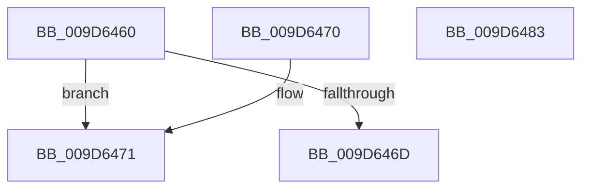

# ObQueryNameInfo

- RVA: `0x009D6460`–`0x009D6484` (길이 `36` bytes)
- VA: `0x00000001409D6460`
- 실행 섹션: `PAGE`
- PDB 이름 있음: `예`; PDB Function 태그: `아니요`
- unwind 정보 RVA: `0x000DB714`
- 디코드: `13`개 명령, `36/36` bytes 표시
- 미해석 바이트: `0` (있으면 어셈블리에 `.byte`로 보존)

> 이 문서는 커널 이미지의 기계어와 PDB 기호를 분석해 생성했습니다. 4번과 5번은 함수 원형과 자료형을 바이너리 사용 방식에서 추정한 C 해석이며 원본 소스 복구 결과는 아닙니다.

## 1. Dependencies

- 직접 호출 지점: **0**; 고유 호출 대상: **0**
- 직접 호출자로 확인된 함수: **0**
- RIP 상대 이미지 참조: **1**

### Outgoing calls
- 직접 디코드된 call 명령이 없습니다.

### Direct callers
- 이 함수 시작 RVA로 연결되는 직접 call은 확인되지 않았습니다. 간접 호출은 완전히 역산할 수 없습니다.

### Static image references
- `0x009D6474` → RVA `0x00F0FF80` (`.data`; read)

## 2. Other-region calls and transfers

- 다른 실행 섹션으로 향하는 call: **0**
- 별도 외부 분기/꼬리 이동을 확인하지 못했습니다.

## 3. Assembly (complete function range)

```asm
009D6460  48 8D 41 D0                     lea rax, [rcx - 0x30]
009D6464  0F B6 49 EA                     movzx ecx, byte ptr [rcx - 0x16]
009D6468  F6 C1 02                        test cl, 2
009D646B  75 04                           jne 0x1409d6471
009D646D  33 C0                           xor eax, eax
009D646F  C3                              ret
009D6470  CC                              int3
009D6471  83 E1 03                        and ecx, 3
009D6474  48 8D 15 05 9B 53 00            lea rdx, [rip + 0x539b05]
009D647B  0F B6 0C 11                     movzx ecx, byte ptr [rcx + rdx]
009D647F  48 2B C1                        sub rax, rcx
009D6482  C3                              ret
009D6483  CC                              int3
```

## 4. C-style interpretation (structured pseudocode)

```c
__int64 __fastcall ObQueryNameInfo(__int64 a1)
{
    __int64 result;

    if ((((unsigned __int8)(*(unsigned __int8 *)(a1 - 22))) & (2)) != 0) goto loc_009D6471;
    result = 0;
    return result;
loc_009D6471:
    a1 = (unsigned int)((*(unsigned __int8 *)(a1 - 22)) & (3));
    result = (result) - (*(unsigned __int8 *)(a1 + v_rip + 5479173 * 1));
    return result;
}
```

## 5. (Beta) C Style

```c
int64_t ObQueryNameInfo(void *Arg1)
{
    uint8_t *arg1 = (uint8_t *)Arg1;

    int64_t result;

    if ((((uint8_t)(*(uint8_t *)(arg1 - 0x16))) & (2)) != 0) goto loc_009D6471;
    result = 0;
    return result;
loc_009D6471:
    Arg1 = (uint32_t)((*(uint8_t *)(arg1 - 0x16)) & (3));
    result = (result) - (*(uint8_t *)(arg1 + v_rip + 0x539B05 * 1));
    return result;
}
```

### 관측된 메모리 오프셋

구조체 형식이 확인되지 않은 접근은 인자 기준의 오프셋으로만 기록했습니다.

| 기준 인자 | 오프셋 표현 | 폭 (bit) | 접근 |
|---|---:|---:|---|
| `Arg1` | `- 0x30` | `64` | `R` |
| `Arg1` | `- 0x16` | `8` | `R` |

## 6. Execution-region graph

[열기: 2D/3D 그래프와 함수 탐색 컨트롤 패널](../../../control-panel.html?section=page&rva=0x009D6460&view=graph)

- 2D 그래프는 위에서 아래로 흐르고, 3D 그래프는 빈 공간을 드래그해 회전합니다. Shift+드래그는 이동, 휠은 확대·축소, 함수 노드 선택은 대상 보고서 이동입니다.

### Static fallback


