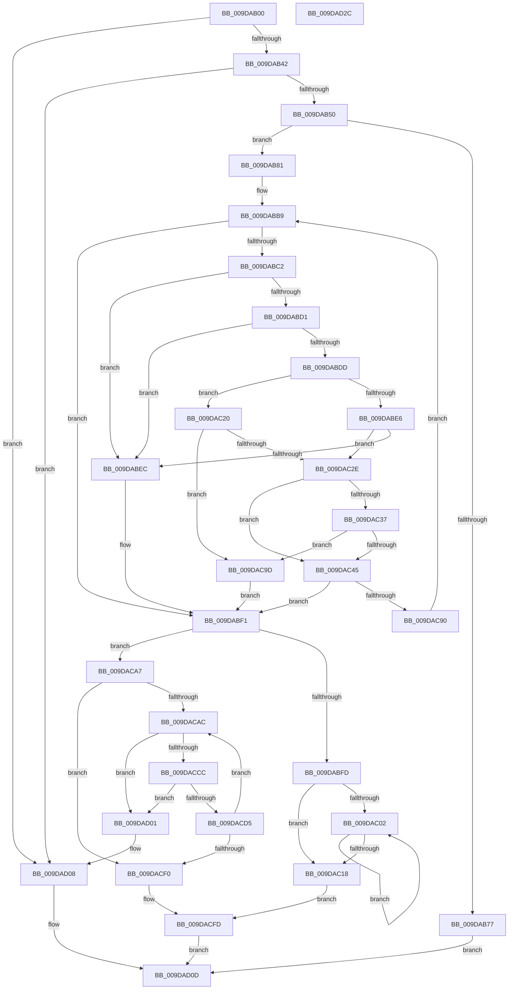

# ObRegisterCallbacks

- RVA: `0x009DAB00`–`0x009DAD2D` (길이 `557` bytes)
- VA: `0x00000001409DAB00`
- 실행 섹션: `PAGE`
- PDB 이름 있음: `예`; PDB Function 태그: `아니요`
- unwind 정보 RVA: `0x0005FEF8`
- 디코드: `160`개 명령, `557/557` bytes 표시
- 미해석 바이트: `0` (있으면 어셈블리에 `.byte`로 보존)

> 이 문서는 커널 이미지의 기계어와 PDB 기호를 분석해 생성했습니다. 4번과 5번은 함수 원형과 자료형을 바이너리 사용 방식에서 추정한 C 해석이며 원본 소스 복구 결과는 아닙니다.

## 1. Dependencies

- 직접 호출 지점: **8**; 고유 호출 대상: **7**
- 직접 호출자로 확인된 함수: **0**
- RIP 상대 이미지 참조: **0**

### Outgoing calls
- `0x009DAB6A` → [ExAllocatePool2](../../poolcode/B8/ExAllocatePool2_function_00B820F0.md) (function, `0x00B820F0`)
- `0x009DABAC` → [memcpy](../../text/6C/memcpy_function_006C6840.md) (function, `0x006C6840`)
- `0x009DAC25` → [MmVerifyCallbackFunctionCheckFlags](../../text/4F/MmVerifyCallbackFunctionCheckFlags_function_004F7360.md) (function, `0x004F7360`)
- `0x009DAC3C` → [MmVerifyCallbackFunctionCheckFlags](../../text/4F/MmVerifyCallbackFunctionCheckFlags_function_004F7360.md) (function, `0x004F7360`)
- `0x009DAC81` → [ObpInsertCallbackByAltitude](ObpInsertCallbackByAltitude_function_009DAD34.md) (function, `0x009DAD34`)
- `0x009DACBE` → [ObpLockObjectTypeExclusive](ObpLockObjectTypeExclusive_function_009DB5C4.md) (function, `0x009DB5C4`)
- `0x009DACE0` → [ObpUnlockObjectType](ObpUnlockObjectType_function_009DB54C.md) (function, `0x009DB54C`)
- `0x009DACF8` → [ExFreePoolWithTag](../../poolcode/B8/ExFreePoolWithTag_function_00B82870.md) (function, `0x00B82870`)

### Direct callers
- 이 함수 시작 RVA로 연결되는 직접 call은 확인되지 않았습니다. 간접 호출은 완전히 역산할 수 없습니다.

### Static image references
- 디코드된 RIP-relative 메모리 참조가 없습니다.

## 2. Other-region calls and transfers

- 다른 실행 섹션으로 향하는 call: **5**
  - `0x009DAB6A` → [ExAllocatePool2](../../poolcode/B8/ExAllocatePool2_function_00B820F0.md) (`PAGE` → `POOLCODE`)
  - `0x009DABAC` → [memcpy](../../text/6C/memcpy_function_006C6840.md) (`PAGE` → `.text`)
  - `0x009DAC25` → [MmVerifyCallbackFunctionCheckFlags](../../text/4F/MmVerifyCallbackFunctionCheckFlags_function_004F7360.md) (`PAGE` → `.text`)
  - `0x009DAC3C` → [MmVerifyCallbackFunctionCheckFlags](../../text/4F/MmVerifyCallbackFunctionCheckFlags_function_004F7360.md) (`PAGE` → `.text`)
  - `0x009DACF8` → [ExFreePoolWithTag](../../poolcode/B8/ExFreePoolWithTag_function_00B82870.md) (`PAGE` → `POOLCODE`)
- 별도 외부 분기/꼬리 이동을 확인하지 못했습니다.

## 3. Assembly (complete function range)

```asm
009DAB00  48 8B C4                        mov rax, rsp
009DAB03  48 89 58 08                     mov qword ptr [rax + 8], rbx
009DAB07  48 89 68 10                     mov qword ptr [rax + 0x10], rbp
009DAB0B  48 89 70 18                     mov qword ptr [rax + 0x18], rsi
009DAB0F  48 89 78 20                     mov qword ptr [rax + 0x20], rdi
009DAB13  41 54                           push r12
009DAB15  41 56                           push r14
009DAB17  41 57                           push r15
009DAB19  48 83 EC 20                     sub rsp, 0x20
009DAB1D  0F B7 01                        movzx eax, word ptr [rcx]
009DAB20  33 DB                           xor ebx, ebx
009DAB22  4C 8B F1                        mov r14, rcx
009DAB25  41 BC 00 01 00 00               mov r12d, 0x100
009DAB2B  B9 00 FF 00 00                  mov ecx, 0xff00
009DAB30  4C 8B FA                        mov r15, rdx
009DAB33  66 23 C1                        and ax, cx
009DAB36  8B F3                           mov esi, ebx
009DAB38  66 41 3B C4                     cmp ax, r12w
009DAB3C  0F 85 C6 01 00 00               jne 0x1409dad08
009DAB42  41 0F B7 46 02                  movzx eax, word ptr [r14 + 2]
009DAB47  66 85 C0                        test ax, ax
009DAB4A  0F 84 B8 01 00 00               je 0x1409dad08
009DAB50  41 0F B7 6E 08                  movzx ebp, word ptr [r14 + 8]
009DAB55  8B C8                           mov ecx, eax
009DAB57  C1 E1 06                        shl ecx, 6
009DAB5A  83 C5 20                        add ebp, 0x20
009DAB5D  03 E9                           add ebp, ecx
009DAB5F  41 B8 4F 62 46 6C               mov r8d, 0x6c46624f
009DAB65  8B D5                           mov edx, ebp
009DAB67  41 8B CC                        mov ecx, r12d
009DAB6A  E8 81 75 1A 00                  call 0x140b820f0
009DAB6F  48 8B F8                        mov rdi, rax
009DAB72  48 85 C0                        test rax, rax
009DAB75  75 0A                           jne 0x1409dab81
009DAB77  B8 9A 00 00 C0                  mov eax, 0xc000009a
009DAB7C  E9 8C 01 00 00                  jmp 0x1409dad0d
009DAB81  66 44 89 20                     mov word ptr [rax], r12w
009DAB85  49 8B 46 18                     mov rax, qword ptr [r14 + 0x18]
009DAB89  48 89 47 08                     mov qword ptr [rdi + 8], rax
009DAB8D  41 0F B7 56 08                  movzx edx, word ptr [r14 + 8]
009DAB92  2B EA                           sub ebp, edx
009DAB94  66 89 57 12                     mov word ptr [rdi + 0x12], dx
009DAB98  66 89 57 10                     mov word ptr [rdi + 0x10], dx
009DAB9C  44 8B C2                        mov r8d, edx
009DAB9F  8B CD                           mov ecx, ebp
009DABA1  48 03 CF                        add rcx, rdi
009DABA4  48 89 4F 18                     mov qword ptr [rdi + 0x18], rcx
009DABA8  49 8B 56 10                     mov rdx, qword ptr [r14 + 0x10]
009DABAC  E8 8F BC CE FF                  call 0x1406c6840
009DABB1  8B EB                           mov ebp, ebx
009DABB3  41 BC 01 00 00 00               mov r12d, 1
009DABB9  41 0F B7 46 02                  movzx eax, word ptr [r14 + 2]
009DABBE  3B E8                           cmp ebp, eax
009DABC0  73 2F                           jae 0x1409dabf1
009DABC2  8B F5                           mov esi, ebp
009DABC4  48 C1 E6 05                     shl rsi, 5
009DABC8  49 03 76 20                     add rsi, qword ptr [r14 + 0x20]
009DABCC  39 5E 08                        cmp dword ptr [rsi + 8], ebx
009DABCF  74 1B                           je 0x1409dabec
009DABD1  48 8B 06                        mov rax, qword ptr [rsi]
009DABD4  48 8B 08                        mov rcx, qword ptr [rax]
009DABD7  F6 41 42 40                     test byte ptr [rcx + 0x42], 0x40
009DABDB  74 0F                           je 0x1409dabec
009DABDD  48 8B 4E 10                     mov rcx, qword ptr [rsi + 0x10]
009DABE1  48 85 C9                        test rcx, rcx
009DABE4  75 3A                           jne 0x1409dac20
009DABE6  48 39 5E 18                     cmp qword ptr [rsi + 0x18], rbx
009DABEA  75 42                           jne 0x1409dac2e
009DABEC  BE 0D 00 00 C0                  mov esi, 0xc000000d
009DABF1  0F B7 47 02                     movzx eax, word ptr [rdi + 2]
009DABF5  85 F6                           test esi, esi
009DABF7  0F 88 AA 00 00 00               js 0x1409daca7
009DABFD  66 3B D8                        cmp bx, ax
009DAC00  73 16                           jae 0x1409dac18
009DAC02  8B C3                           mov eax, ebx
009DAC04  41 03 DC                        add ebx, r12d
009DAC07  48 C1 E0 06                     shl rax, 6
009DAC0B  44 09 64 38 34                  or dword ptr [rax + rdi + 0x34], r12d
009DAC10  0F B7 47 02                     movzx eax, word ptr [rdi + 2]
009DAC14  3B D8                           cmp ebx, eax
009DAC16  72 EA                           jb 0x1409dac02
009DAC18  49 89 3F                        mov qword ptr [r15], rdi
009DAC1B  E9 DD 00 00 00                  jmp 0x1409dacfd
009DAC20  BA 20 00 00 00                  mov edx, 0x20
009DAC25  E8 36 C7 B1 FF                  call 0x1404f7360
009DAC2A  85 C0                           test eax, eax
009DAC2C  74 6F                           je 0x1409dac9d
009DAC2E  48 8B 4E 18                     mov rcx, qword ptr [rsi + 0x18]
009DAC32  48 85 C9                        test rcx, rcx
009DAC35  74 0E                           je 0x1409dac45
009DAC37  BA 20 00 00 00                  mov edx, 0x20
009DAC3C  E8 1F C7 B1 FF                  call 0x1404f7360
009DAC41  85 C0                           test eax, eax
009DAC43  74 58                           je 0x1409dac9d
009DAC45  8B D5                           mov edx, ebp
009DAC47  48 C1 E2 06                     shl rdx, 6
009DAC4B  48 83 C2 20                     add rdx, 0x20
009DAC4F  48 03 D7                        add rdx, rdi
009DAC52  48 89 52 08                     mov qword ptr [rdx + 8], rdx
009DAC56  48 89 12                        mov qword ptr [rdx], rdx
009DAC59  48 89 5A 38                     mov qword ptr [rdx + 0x38], rbx
009DAC5D  8B 46 08                        mov eax, dword ptr [rsi + 8]
009DAC60  89 42 10                        mov dword ptr [rdx + 0x10], eax
009DAC63  48 89 7A 18                     mov qword ptr [rdx + 0x18], rdi
009DAC67  48 8B 06                        mov rax, qword ptr [rsi]
009DAC6A  48 8B 08                        mov rcx, qword ptr [rax]
009DAC6D  48 89 4A 20                     mov qword ptr [rdx + 0x20], rcx
009DAC71  48 8B 46 10                     mov rax, qword ptr [rsi + 0x10]
009DAC75  48 89 42 28                     mov qword ptr [rdx + 0x28], rax
009DAC79  48 8B 46 18                     mov rax, qword ptr [rsi + 0x18]
009DAC7D  48 89 42 30                     mov qword ptr [rdx + 0x30], rax
009DAC81  E8 AE 00 00 00                  call 0x1409dad34
009DAC86  8B F0                           mov esi, eax
009DAC88  85 C0                           test eax, eax
009DAC8A  0F 88 61 FF FF FF               js 0x1409dabf1
009DAC90  66 44 01 67 02                  add word ptr [rdi + 2], r12w
009DAC95  41 03 EC                        add ebp, r12d
009DAC98  E9 1C FF FF FF                  jmp 0x1409dabb9
009DAC9D  BE 22 00 00 C0                  mov esi, 0xc0000022
009DACA2  E9 4A FF FF FF                  jmp 0x1409dabf1
009DACA7  66 3B D8                        cmp bx, ax
009DACAA  73 44                           jae 0x1409dacf0
009DACAC  44 8B F3                        mov r14d, ebx
009DACAF  49 C1 E6 06                     shl r14, 6
009DACB3  49 83 C6 20                     add r14, 0x20
009DACB7  4C 03 F7                        add r14, rdi
009DACBA  49 8B 4E 20                     mov rcx, qword ptr [r14 + 0x20]
009DACBE  E8 01 09 00 00                  call 0x1409db5c4
009DACC3  49 8B 0E                        mov rcx, qword ptr [r14]
009DACC6  4C 39 71 08                     cmp qword ptr [rcx + 8], r14
009DACCA  75 35                           jne 0x1409dad01
009DACCC  49 8B 46 08                     mov rax, qword ptr [r14 + 8]
009DACD0  4C 39 30                        cmp qword ptr [rax], r14
009DACD3  75 2C                           jne 0x1409dad01
009DACD5  48 89 08                        mov qword ptr [rax], rcx
009DACD8  48 89 41 08                     mov qword ptr [rcx + 8], rax
009DACDC  49 8B 4E 20                     mov rcx, qword ptr [r14 + 0x20]
009DACE0  E8 67 08 00 00                  call 0x1409db54c
009DACE5  0F B7 47 02                     movzx eax, word ptr [rdi + 2]
009DACE9  41 03 DC                        add ebx, r12d
009DACEC  3B D8                           cmp ebx, eax
009DACEE  72 BC                           jb 0x1409dacac
009DACF0  BA 4F 62 46 6C                  mov edx, 0x6c46624f
009DACF5  48 8B CF                        mov rcx, rdi
009DACF8  E8 73 7B 1A 00                  call 0x140b82870
009DACFD  8B C6                           mov eax, esi
009DACFF  EB 0C                           jmp 0x1409dad0d
009DAD01  B9 03 00 00 00                  mov ecx, 3
009DAD06  CD 29                           int 0x29
009DAD08  B8 0D 00 00 C0                  mov eax, 0xc000000d
009DAD0D  48 8B 5C 24 40                  mov rbx, qword ptr [rsp + 0x40]
009DAD12  48 8B 6C 24 48                  mov rbp, qword ptr [rsp + 0x48]
009DAD17  48 8B 74 24 50                  mov rsi, qword ptr [rsp + 0x50]
009DAD1C  48 8B 7C 24 58                  mov rdi, qword ptr [rsp + 0x58]
009DAD21  48 83 C4 20                     add rsp, 0x20
009DAD25  41 5F                           pop r15
009DAD27  41 5E                           pop r14
009DAD29  41 5C                           pop r12
009DAD2B  C3                              ret
009DAD2C  CC                              int3
```

## 4. C-style interpretation (structured pseudocode)

```c
__int64 __fastcall ObRegisterCallbacks(__int64 a1, __int64 a2)
{
    __int64 result;
    __int64 v_r14;
    __int64 v_rbp;
    __int64 v_rbx;
    __int64 v_rsi;
    __int64 v_rsp;
    unsigned __int64 v_stack_p10;
    unsigned __int64 v_stack_p18;
    unsigned __int64 v_stack_p20;
    unsigned __int64 v_stack_p8;

    *(unsigned __int64 *)(v_rsp + 8) = v_rbx;
    *(unsigned __int64 *)(v_rsp + 16) = v_rbp;
    *(unsigned __int64 *)(v_rsp + 24) = v_rsi;
    *(unsigned __int64 *)(v_rsp + 32) = v_rdi;
    v_rsp = (v_rsp) - (32);
    v_rbx = 0;
    result = (unsigned __int16)((*(unsigned __int16 *)(a1)) & ((unsigned __int16)((unsigned int)(0xFF00ULL))));
    if (((unsigned __int16)(result)) != 256) goto loc_009DAD08;
    if ((unsigned __int16)(*(unsigned __int16 *)(a1 + 2)) == 0) goto loc_009DAD08;
    a1 = (unsigned int)(((unsigned int)((unsigned int)(*(unsigned __int16 *)(a1 + 2)))) << (6));
    v_rbp = (unsigned int)((*(unsigned __int16 *)(a1 + 8)) + (32));
    v_rbp = (unsigned int)((v_rbp) + ((unsigned int)(a1)));
    result = ExAllocatePool2(256, (unsigned int)((unsigned int)(v_rbp)), (unsigned int)(0x6C46624FULL), a4);
    if (result != 0) goto loc_009DAB81;
    goto loc_009DAD0D;
loc_009DAB81:
    *(unsigned __int16 *)((unsigned int)(0xC000009AULL)) = 256;
    *(unsigned __int64 *)(result + 8) = *(unsigned __int64 *)(a1 + 24);
    v_rbp = (unsigned int)((v_rbp) - ((unsigned int)(*(unsigned __int16 *)(a1 + 8))));
    *(unsigned __int16 *)(result + 18) = (unsigned __int16)(*(unsigned __int16 *)(a1 + 8));
    *(unsigned __int16 *)(result + 16) = (unsigned __int16)(*(unsigned __int16 *)(a1 + 8));
    a1 = ((unsigned int)((unsigned int)(v_rbp))) + (result);
    *(unsigned __int64 *)(result + 24) = a1;
    result = memcpy(a1, *(unsigned __int64 *)(a1 + 16), (unsigned int)((unsigned int)(*(unsigned __int16 *)(a1 + 8))), a4);
loc_009DABB9:
    if (0 >= ((unsigned int)(*(unsigned __int16 *)(a1 + 2)))) goto loc_009DABF1;
    v_rsi = (0) << (5);
    v_rsi = (v_rsi) + (*(unsigned __int64 *)(a1 + 32));
    if ((*(unsigned int *)(v_rsi + 8)) == 0) goto loc_009DABEC;
    if (((*(unsigned __int8 *)(*(unsigned __int64 *)(*(unsigned __int64 *)(v_rsi)) + 66)) & (64)) == 0) goto loc_009DABEC;
    if (*(unsigned __int64 *)(v_rsi + 16) != 0) goto loc_009DAC20;
    if ((*(unsigned __int64 *)(v_rsi + 24)) != 0) goto loc_009DAC2E;
loc_009DABEC:
loc_009DABF1:
    if (sign_flag) goto loc_009DACA7;
    if (0 >= ((unsigned __int16)(*(unsigned __int16 *)(result + 2)))) goto loc_009DAC18;
loc_009DAC02:
    v_rbx = (unsigned int)((v_rbx) + (1));
    result = (0) << (6);
    if (((unsigned int)(v_rbx)) < ((unsigned int)(*(unsigned __int16 *)(result + 2)))) goto loc_009DAC02;
loc_009DAC18:
    *(unsigned __int64 *)(a2) = result;
    goto loc_009DACFD;
loc_009DAC20:
    result = MmVerifyCallbackFunctionCheckFlags(*(unsigned __int64 *)(v_rsi + 16), 32, (unsigned int)((unsigned int)(*(unsigned __int16 *)(a1 + 8))), a4);
    if ((unsigned int)(result) == 0) goto loc_009DAC9D;
loc_009DAC2E:
    if (*(unsigned __int64 *)((unsigned int)(0xC000000DULL) + 24) == 0) goto loc_009DAC45;
    result = MmVerifyCallbackFunctionCheckFlags(*(unsigned __int64 *)((unsigned int)(0xC000000DULL) + 24), 32, (unsigned int)((unsigned int)(*(unsigned __int16 *)(a1 + 8))), a4);
    if ((unsigned int)(result) == 0) goto loc_009DAC9D;
loc_009DAC45:
    a2 = (0) << (6);
    a2 = (a2) + (32);
    a2 = (a2) + (result);
    *(unsigned __int64 *)(a2 + 8) = a2;
    *(unsigned __int64 *)(a2) = a2;
    *(unsigned __int64 *)(a2 + 56) = v_rbx;
    *(unsigned int *)(a2 + 16) = (unsigned int)((unsigned int)(*(unsigned int *)((unsigned int)(0xC000000DULL) + 8)));
    *(unsigned __int64 *)(a2 + 24) = result;
    *(unsigned __int64 *)(a2 + 32) = *(unsigned __int64 *)(*(unsigned __int64 *)((unsigned int)(0xC000000DULL)));
    *(unsigned __int64 *)(a2 + 40) = *(unsigned __int64 *)((unsigned int)(0xC000000DULL) + 16);
    *(unsigned __int64 *)(a2 + 48) = *(unsigned __int64 *)((unsigned int)(0xC000000DULL) + 24);
    result = ObpInsertCallbackByAltitude(*(unsigned __int64 *)(*(unsigned __int64 *)((unsigned int)(0xC000000DULL))), a2, (unsigned int)((unsigned int)(*(unsigned __int16 *)(a1 + 8))), a4);
    if (sign_flag) goto loc_009DABF1;
    v_rbp = (unsigned int)((0) + (1));
    goto loc_009DABB9;
loc_009DAC9D:
    goto loc_009DABF1;
loc_009DACA7:
    if (((unsigned __int16)(v_rbx)) >= ((unsigned __int16)(result))) goto loc_009DACF0;
loc_009DACAC:
    v_r14 = ((unsigned int)((unsigned int)(v_rbx))) << (6);
    v_r14 = (v_r14) + (32);
    v_r14 = (v_r14) + (result);
    result = ObpLockObjectTypeExclusive(*(unsigned __int64 *)(v_r14 + 32), a2, (unsigned int)((unsigned int)(*(unsigned __int16 *)(a1 + 8))), a4);
    if ((*(unsigned __int64 *)(*(unsigned __int64 *)(v_r14) + 8)) != v_r14) goto loc_009DAD01;
    if ((*(unsigned __int64 *)(*(unsigned __int64 *)(v_r14 + 8))) != v_r14) goto loc_009DAD01;
    *(unsigned __int64 *)(*(unsigned __int64 *)(v_r14 + 8)) = *(unsigned __int64 *)(v_r14);
    *(unsigned __int64 *)(*(unsigned __int64 *)(v_r14) + 8) = *(unsigned __int64 *)(v_r14 + 8);
    result = ObpUnlockObjectType(*(unsigned __int64 *)(v_r14 + 32), a2, (unsigned int)((unsigned int)(*(unsigned __int16 *)(a1 + 8))), a4);
    v_rbx = (unsigned int)((v_rbx) + (1));
    if (((unsigned int)(v_rbx)) < ((unsigned int)(*(unsigned __int16 *)(result + 2)))) goto loc_009DACAC;
loc_009DACF0:
    result = ExFreePoolWithTag(result, (unsigned int)(0x6C46624FULL), (unsigned int)((unsigned int)(*(unsigned __int16 *)(a1 + 8))), a4);
loc_009DACFD:
    goto loc_009DAD0D;
loc_009DAD01:
loc_009DAD08:
loc_009DAD0D:
    v_rsp = (v_rsp) + (32);
    return (unsigned int)(0xC000000DULL);
}
```

## 5. (Beta) C Style

```c
int64_t ObRegisterCallbacks(void *Arg1, void *Arg2)
{
    uint8_t *arg1 = (uint8_t *)Arg1;
    uint8_t *arg2 = (uint8_t *)Arg2;

    int64_t result;
    int64_t local_r14;
    int64_t local_rbp;
    int64_t local_rbx;
    int64_t local_rsi;
    int64_t local_rsp;
    uint64_t v_stack_p10;
    uint64_t v_stack_p18;
    uint64_t v_stack_p20;
    uint64_t v_stack_p8;

    *(uint64_t *)(local_rsp + 0x8) = local_rbx;
    *(uint64_t *)(local_rsp + 0x10) = local_rbp;
    *(uint64_t *)(local_rsp + 0x18) = local_rsi;
    *(uint64_t *)(local_rsp + 0x20) = local_rdi;
    local_rsp = (local_rsp) - (32);
    local_rbx = 0;
    result = (uint16_t)((*(uint16_t *)(arg1)) & ((uint16_t)((uint32_t)(0xFF00ULL))));
    if (((uint16_t)(result)) != 256) goto loc_009DAD08;
    if ((uint16_t)(*(uint16_t *)(arg1 + 0x2)) == 0) goto loc_009DAD08;
    Arg1 = (uint32_t)(((uint32_t)((uint32_t)(*(uint16_t *)(arg1 + 0x2)))) << (6));
    local_rbp = (uint32_t)((*(uint16_t *)(arg1 + 0x8)) + (32));
    local_rbp = (uint32_t)((local_rbp) + ((uint32_t)(Arg1)));
    result = ExAllocatePool2(256, (uint32_t)((uint32_t)(local_rbp)), (uint32_t)(0x6C46624FULL), a4);
    if (result != 0) goto loc_009DAB81;
    goto loc_009DAD0D;
loc_009DAB81:
    *(uint16_t *)((uint32_t)(0xC000009AULL)) = 256;
    *(uint64_t *)(result + 0x8) = *(uint64_t *)(arg1 + 0x18);
    local_rbp = (uint32_t)((local_rbp) - ((uint32_t)(*(uint16_t *)(arg1 + 0x8))));
    *(uint16_t *)(result + 0x12) = (uint16_t)(*(uint16_t *)(arg1 + 0x8));
    *(uint16_t *)(result + 0x10) = (uint16_t)(*(uint16_t *)(arg1 + 0x8));
    Arg1 = ((uint32_t)((uint32_t)(local_rbp))) + (result);
    *(void **)(result + 0x18) = Arg1;
    result = memcpy(Arg1, *(uint64_t *)(arg1 + 0x10), (uint32_t)((uint32_t)(*(uint16_t *)(arg1 + 0x8))), a4);
loc_009DABB9:
    if (0 >= ((uint32_t)(*(uint16_t *)(arg1 + 0x2)))) goto loc_009DABF1;
    local_rsi = (0) << (5);
    local_rsi = (local_rsi) + (*(uint64_t *)(arg1 + 0x20));
    if ((*(uint32_t *)(local_rsi + 0x8)) == 0) goto loc_009DABEC;
    if (((*(uint8_t *)(*(uint64_t *)(*(uint64_t *)(local_rsi)) + 0x42)) & (64)) == 0) goto loc_009DABEC;
    if (*(uint64_t *)(local_rsi + 0x10) != 0) goto loc_009DAC20;
    if ((*(uint64_t *)(local_rsi + 0x18)) != 0) goto loc_009DAC2E;
loc_009DABEC:
loc_009DABF1:
    if (sign_flag) goto loc_009DACA7;
    if (0 >= ((uint16_t)(*(uint16_t *)(result + 0x2)))) goto loc_009DAC18;
loc_009DAC02:
    local_rbx = (uint32_t)((local_rbx) + (1));
    result = (0) << (6);
    if (((uint32_t)(local_rbx)) < ((uint32_t)(*(uint16_t *)(result + 0x2)))) goto loc_009DAC02;
loc_009DAC18:
    *(uint64_t *)(arg2) = result;
    goto loc_009DACFD;
loc_009DAC20:
    result = MmVerifyCallbackFunctionCheckFlags(*(uint64_t *)(local_rsi + 0x10), 32, (uint32_t)((uint32_t)(*(uint16_t *)(arg1 + 0x8))), a4);
    if ((uint32_t)(result) == 0) goto loc_009DAC9D;
loc_009DAC2E:
    if (*(uint64_t *)((uint32_t)(0xC000000DULL) + 0x18) == 0) goto loc_009DAC45;
    result = MmVerifyCallbackFunctionCheckFlags(*(uint64_t *)((uint32_t)(0xC000000DULL) + 0x18), 32, (uint32_t)((uint32_t)(*(uint16_t *)(arg1 + 0x8))), a4);
    if ((uint32_t)(result) == 0) goto loc_009DAC9D;
loc_009DAC45:
    Arg2 = (0) << (6);
    Arg2 = (Arg2) + (32);
    Arg2 = (Arg2) + (result);
    *(void **)(arg2 + 0x8) = Arg2;
    *(void **)(arg2) = Arg2;
    *(uint64_t *)(arg2 + 0x38) = local_rbx;
    *(uint32_t *)(arg2 + 0x10) = (uint32_t)((uint32_t)(*(uint32_t *)((uint32_t)(0xC000000DULL) + 0x8)));
    *(uint64_t *)(arg2 + 0x18) = result;
    *(uint64_t *)(arg2 + 0x20) = *(uint64_t *)(*(uint64_t *)((uint32_t)(0xC000000DULL)));
    *(uint64_t *)(arg2 + 0x28) = *(uint64_t *)((uint32_t)(0xC000000DULL) + 0x10);
    *(uint64_t *)(arg2 + 0x30) = *(uint64_t *)((uint32_t)(0xC000000DULL) + 0x18);
    result = ObpInsertCallbackByAltitude(*(uint64_t *)(*(uint64_t *)((uint32_t)(0xC000000DULL))), Arg2, (uint32_t)((uint32_t)(*(uint16_t *)(arg1 + 0x8))), a4);
    if (sign_flag) goto loc_009DABF1;
    local_rbp = (uint32_t)((0) + (1));
    goto loc_009DABB9;
loc_009DAC9D:
    goto loc_009DABF1;
loc_009DACA7:
    if (((uint16_t)(local_rbx)) >= ((uint16_t)(result))) goto loc_009DACF0;
loc_009DACAC:
    local_r14 = ((uint32_t)((uint32_t)(local_rbx))) << (6);
    local_r14 = (local_r14) + (32);
    local_r14 = (local_r14) + (result);
    result = ObpLockObjectTypeExclusive(*(uint64_t *)(local_r14 + 0x20), Arg2, (uint32_t)((uint32_t)(*(uint16_t *)(arg1 + 0x8))), a4);
    if ((*(uint64_t *)(*(uint64_t *)(local_r14) + 0x8)) != local_r14) goto loc_009DAD01;
    if ((*(uint64_t *)(*(uint64_t *)(local_r14 + 0x8))) != local_r14) goto loc_009DAD01;
    *(uint64_t *)(*(uint64_t *)(local_r14 + 0x8)) = *(uint64_t *)(local_r14);
    *(uint64_t *)(*(uint64_t *)(local_r14) + 0x8) = *(uint64_t *)(local_r14 + 0x8);
    result = ObpUnlockObjectType(*(uint64_t *)(local_r14 + 0x20), Arg2, (uint32_t)((uint32_t)(*(uint16_t *)(arg1 + 0x8))), a4);
    local_rbx = (uint32_t)((local_rbx) + (1));
    if (((uint32_t)(local_rbx)) < ((uint32_t)(*(uint16_t *)(result + 0x2)))) goto loc_009DACAC;
loc_009DACF0:
    result = ExFreePoolWithTag(result, (uint32_t)(0x6C46624FULL), (uint32_t)((uint32_t)(*(uint16_t *)(arg1 + 0x8))), a4);
loc_009DACFD:
    goto loc_009DAD0D;
loc_009DAD01:
loc_009DAD08:
loc_009DAD0D:
    local_rsp = (local_rsp) + (32);
    return (uint32_t)(0xC000000DULL);
}
```

### 관측된 메모리 오프셋

구조체 형식이 확인되지 않은 접근은 인자 기준의 오프셋으로만 기록했습니다.

| 기준 인자 | 오프셋 표현 | 폭 (bit) | 접근 |
|---|---:|---:|---|
| `Arg1` | `+ 0x0` | `16` | `R` |
| `Arg1` | `+ 0x2` | `16` | `R` |
| `Arg1` | `+ 0x8` | `16` | `R` |
| `Arg1` | `+ 0x10` | `64` | `R` |
| `Arg1` | `+ 0x18` | `64` | `R` |
| `Arg1` | `+ 0x20` | `64` | `R` |
| `Arg2` | `+ 0x0` | `64` | `W` |

## 6. Execution-region graph

[열기: 2D/3D 그래프와 함수 탐색 컨트롤 패널](../../../control-panel.html?section=page&rva=0x009DAB00&view=graph)

- 2D 그래프는 위에서 아래로 흐르고, 3D 그래프는 빈 공간을 드래그해 회전합니다. Shift+드래그는 이동, 휠은 확대·축소, 함수 노드 선택은 대상 보고서 이동입니다.

### Static fallback


