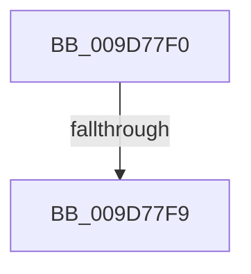

# ObReleaseObjectSecurity

- RVA: `0x009D77F0`–`0x009D7801` (길이 `17` bytes)
- VA: `0x00000001409D77F0`
- 실행 섹션: `PAGE`
- PDB 이름 있음: `예`; PDB Function 태그: `아니요`
- unwind 정보 RVA: `0x000A2874`
- 디코드: `5`개 명령, `17/17` bytes 표시
- 미해석 바이트: `0` (있으면 어셈블리에 `.byte`로 보존)

> 이 문서는 커널 이미지의 기계어와 PDB 기호를 분석해 생성했습니다. 4번과 5번은 함수 원형과 자료형을 바이너리 사용 방식에서 추정한 C 해석이며 원본 소스 복구 결과는 아닙니다.

## 1. Dependencies

- 직접 호출 지점: **0**; 고유 호출 대상: **0**
- 직접 호출자로 확인된 함수: **3**
- RIP 상대 이미지 참조: **0**

### Outgoing calls
- 직접 디코드된 call 명령이 없습니다.

### Direct callers
- [sub_00400A46](../../text/40/Unknown_function_00400A46.md) at `0x00400A53`
- [SeComputeMandatoryDeniedAccess](../../text/60/SeComputeMandatoryDeniedAccess_function_006076BC.md) at `0x00607756`
- [DifObReleaseObjectSecurityWrapper](../../text/63/DifObReleaseObjectSecurityWrapper_function_00638550.md) at `0x00638627`

### Static image references
- 디코드된 RIP-relative 메모리 참조가 없습니다.

## 2. Other-region calls and transfers

- 다른 실행 섹션으로 향하는 call: **0**
- call이 아닌 외부 분기/꼬리 이동: **2**
  - `0x009D77F7` → [sub_009D7828](Unknown_function_009D7828.md) (`tail-transfer`)
  - `0x009D77FB` → [sub_009D794E](Unknown_function_009D794E.md) (`tail-transfer`)

## 3. Assembly (complete function range)

```asm
009D77F0  48 83 EC 28                     sub rsp, 0x28
009D77F4  48 85 C9                        test rcx, rcx
009D77F7  74 2F                           je 0x1409d7828
009D77F9  84 D2                           test dl, dl
009D77FB  0F 85 4D 01 00 00               jne 0x1409d794e
```

## 4. C-style interpretation (structured pseudocode)

```c
void __fastcall ObReleaseObjectSecurity(__int64 a1, unsigned __int8 a2)
{
    __int64 v_rsp;

    v_rsp = (v_rsp) - (40);
}
```

## 5. (Beta) C Style

```c
void ObReleaseObjectSecurity(int64_t Arg1, uint8_t Arg2)
{
    int64_t local_rsp;

    local_rsp = (local_rsp) - (40);
}
```

## 6. Execution-region graph

[열기: 2D/3D 그래프와 함수 탐색 컨트롤 패널](../../../control-panel.html?section=page&rva=0x009D77F0&view=graph)

- 2D 그래프는 위에서 아래로 흐르고, 3D 그래프는 빈 공간을 드래그해 회전합니다. Shift+드래그는 이동, 휠은 확대·축소, 함수 노드 선택은 대상 보고서 이동입니다.

### Static fallback


