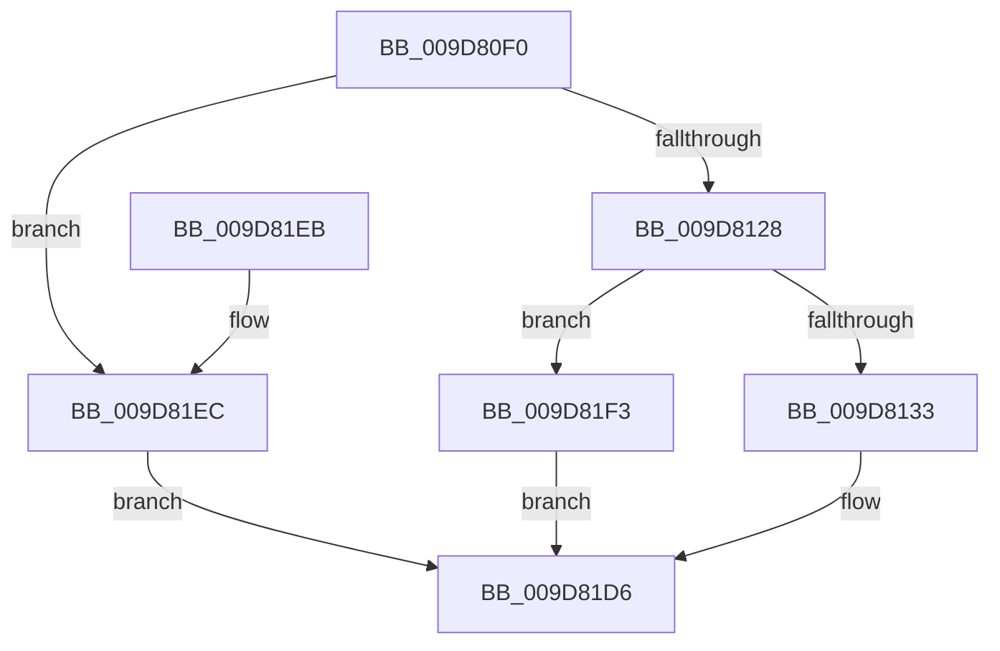

# ObpCaptureHandleInformationEx

- RVA: `0x009D80F0`–`0x009D81FA` (길이 `266` bytes)
- VA: `0x00000001409D80F0`
- 실행 섹션: `PAGE`
- PDB 이름 있음: `예`; PDB Function 태그: `아니요`
- unwind 정보 RVA: `0x0007A3F0`
- 디코드: `72`개 명령, `266/266` bytes 표시
- 미해석 바이트: `0` (있으면 어셈블리에 `.byte`로 보존)

> 이 문서는 커널 이미지의 기계어와 PDB 기호를 분석해 생성했습니다. 4번과 5번은 함수 원형과 자료형을 바이너리 사용 방식에서 추정한 C 해석이며 원본 소스 복구 결과는 아닙니다.

## 1. Dependencies

- 직접 호출 지점: **1**; 고유 호출 대상: **1**
- 직접 호출자로 확인된 함수: **0**
- RIP 상대 이미지 참조: **2**

### Outgoing calls
- `0x009D8136` → [ExGetHandlePointer](../../text/43/ExGetHandlePointer_function_00430C90.md) (function, `0x00430C90`)

### Direct callers
- 이 함수 시작 RVA로 연결되는 직접 call은 확인되지 않았습니다. 간접 호출은 완전히 역산할 수 없습니다.

### Static image references
- `0x009D817C` → RVA `0x00FC6E4C` (`ALMOSTRO`; read)
- `0x009D8186` → RVA `0x00FC7800` (`ALMOSTRO`; read)

## 2. Other-region calls and transfers

- 다른 실행 섹션으로 향하는 call: **1**
  - `0x009D8136` → [ExGetHandlePointer](../../text/43/ExGetHandlePointer_function_00430C90.md) (`PAGE` → `.text`)
- 별도 외부 분기/꼬리 이동을 확인하지 못했습니다.

## 3. Assembly (complete function range)

```asm
009D80F0  48 89 5C 24 08                  mov qword ptr [rsp + 8], rbx
009D80F5  48 89 6C 24 10                  mov qword ptr [rsp + 0x10], rbp
009D80FA  48 89 74 24 18                  mov qword ptr [rsp + 0x18], rsi
009D80FF  57                              push rdi
009D8100  48 83 EC 20                     sub rsp, 0x20
009D8104  4C 8B 5C 24 60                  mov r11, qword ptr [rsp + 0x60]
009D8109  49 8B F9                        mov rdi, r9
009D810C  49 8B F0                        mov rsi, r8
009D810F  48 8B DA                        mov rbx, rdx
009D8112  8B E9                           mov ebp, ecx
009D8114  45 8B 13                        mov r10d, dword ptr [r11]
009D8117  41 83 C2 28                     add r10d, 0x28
009D811B  45 89 13                        mov dword ptr [r11], r10d
009D811E  41 83 FA 28                     cmp r10d, 0x28
009D8122  0F 82 C4 00 00 00               jb 0x1409d81ec
009D8128  44 39 54 24 58                  cmp dword ptr [rsp + 0x58], r10d
009D812D  0F 82 C0 00 00 00               jb 0x1409d81f3
009D8133  49 8B C9                        mov rcx, r9
009D8136  E8 55 8B A5 FF                  call 0x140430c90
009D813B  48 8B 0B                        mov rcx, qword ptr [rbx]
009D813E  4C 8B C8                        mov r9, rax
009D8141  48 89 71 08                     mov qword ptr [rcx + 8], rsi
009D8145  44 8B 07                        mov r8d, dword ptr [rdi]
009D8148  48 8B 03                        mov rax, qword ptr [rbx]
009D814B  49 C1 F8 11                     sar r8, 0x11
009D814F  41 83 E0 07                     and r8d, 7
009D8153  41 8B D0                        mov edx, r8d
009D8156  83 CA 08                        or edx, 8
009D8159  F7 47 08 00 00 00 02            test dword ptr [rdi + 8], 0x2000000
009D8160  41 0F 44 D0                     cmove edx, r8d
009D8164  83 E2 07                        and edx, 7
009D8167  89 50 20                        mov dword ptr [rax + 0x20], edx
009D816A  49 8B C1                        mov rax, r9
009D816D  48 C1 E8 08                     shr rax, 8
009D8171  0F B6 C8                        movzx ecx, al
009D8174  41 0F B6 41 18                  movzx eax, byte ptr [r9 + 0x18]
009D8179  48 33 C8                        xor rcx, rax
009D817C  0F B6 05 C9 EC 5E 00            movzx eax, byte ptr [rip + 0x5eecc9]
009D8183  48 33 C8                        xor rcx, rax
009D8186  48 8D 05 73 F6 5E 00            lea rax, [rip + 0x5ef673]
009D818D  48 8B 04 C8                     mov rax, qword ptr [rax + rcx*8]
009D8191  0F B6 48 28                     movzx ecx, byte ptr [rax + 0x28]
009D8195  48 8B 03                        mov rax, qword ptr [rbx]
009D8198  66 89 48 1E                     mov word ptr [rax + 0x1e], cx
009D819C  48 8B 0B                        mov rcx, qword ptr [rbx]
009D819F  48 8B 44 24 50                  mov rax, qword ptr [rsp + 0x50]
009D81A4  48 89 41 10                     mov qword ptr [rcx + 0x10], rax
009D81A8  33 C0                           xor eax, eax
009D81AA  85 ED                           test ebp, ebp
009D81AC  49 8D 49 30                     lea rcx, [r9 + 0x30]
009D81B0  8B D0                           mov edx, eax
009D81B2  48 0F 44 D1                     cmove rdx, rcx
009D81B6  48 8B 0B                        mov rcx, qword ptr [rbx]
009D81B9  48 89 11                        mov qword ptr [rcx], rdx
009D81BC  48 8B 0B                        mov rcx, qword ptr [rbx]
009D81BF  66 89 41 1C                     mov word ptr [rcx + 0x1c], ax
009D81C3  8B 57 08                        mov edx, dword ptr [rdi + 8]
009D81C6  48 8B 0B                        mov rcx, qword ptr [rbx]
009D81C9  81 E2 FF FF FF 01               and edx, 0x1ffffff
009D81CF  89 51 18                        mov dword ptr [rcx + 0x18], edx
009D81D2  48 83 03 28                     add qword ptr [rbx], 0x28
009D81D6  48 8B 5C 24 30                  mov rbx, qword ptr [rsp + 0x30]
009D81DB  48 8B 6C 24 38                  mov rbp, qword ptr [rsp + 0x38]
009D81E0  48 8B 74 24 40                  mov rsi, qword ptr [rsp + 0x40]
009D81E5  48 83 C4 20                     add rsp, 0x20
009D81E9  5F                              pop rdi
009D81EA  C3                              ret
009D81EB  CC                              int3
009D81EC  B8 95 00 00 C0                  mov eax, 0xc0000095
009D81F1  EB E3                           jmp 0x1409d81d6
009D81F3  B8 04 00 00 C0                  mov eax, 0xc0000004
009D81F8  EB DC                           jmp 0x1409d81d6
```

## 4. C-style interpretation (structured pseudocode)

```c
__int64 __fastcall ObpCaptureHandleInformationEx(int a1, __int64 a2, __int64 a3, __int64 a4, __int64 a5, unsigned int a6, __int64 a7)
{
    __int64 result;
    __int64 v_r10;
    __int64 v_rsp;
    unsigned __int64 v_stack_p10;
    unsigned __int64 v_stack_p18;
    unsigned __int64 v_stack_p8;

    v_stack_p8 = v_rbx;
    v_stack_p10 = v_rbp;
    v_stack_p18 = v_rsi;
    v_rsp = (v_rsp) - (32);
    v_r10 = (unsigned int)(((unsigned int)(*(unsigned int *)(a7))) + (40));
    *(unsigned int *)(a7) = (unsigned int)(v_r10);
    if (((unsigned int)(v_r10)) < 40) goto loc_009D81EC;
    if (a6 < ((unsigned int)(v_r10))) goto loc_009D81F3;
    result = ExGetHandlePointer(a4, a2, a3, a4);
    *(unsigned __int64 *)(*(unsigned __int64 *)(a2) + 8) = a3;
    a3 = ((unsigned int)(*(unsigned int *)(a4))) >> (17);
    a3 = (unsigned int)((a3) & (7));
    a2 = (unsigned int)(((unsigned int)((unsigned int)(a3))) | (8));
    if (((*(unsigned int *)(a4 + 8)) & (0x2000000ULL)) == 0) { a2 = (unsigned int)(a3); }
    a2 = (unsigned int)((a2) & (7));
    *(unsigned int *)(*(unsigned __int64 *)(a2) + 32) = (unsigned int)(a2);
    result = (result) >> (8);
    a1 = ((unsigned __int8)(result)) ^ (*(unsigned __int8 *)(result + 24));
    a1 = (a1) ^ (*(unsigned __int8 *)(v_rip + 6221001));
    *(unsigned __int16 *)(*(unsigned __int64 *)(a2) + 30) = (unsigned __int16)(*(unsigned __int8 *)(*(unsigned __int64 *)(v_rip + 6223475 + a1 * 8) + 40));
    *(unsigned __int64 *)(*(unsigned __int64 *)(a2) + 16) = a5;
    result = 0;
    a2 = 0;
    if ((unsigned int)((unsigned int)(a1)) == 0) { a2 = result + 48; }
    *(unsigned __int64 *)(*(unsigned __int64 *)(a2)) = a2;
    *(unsigned __int16 *)(*(unsigned __int64 *)(a2) + 28) = 0;
    a2 = (unsigned int)(((unsigned int)(*(unsigned int *)(a4 + 8))) & (0x1FFFFFFULL));
    *(unsigned int *)(*(unsigned __int64 *)(a2) + 24) = (unsigned int)(a2);
loc_009D81D6:
    v_rsp = (v_rsp) + (32);
    return result;
loc_009D81EC:
    goto loc_009D81D6;
loc_009D81F3:
    goto loc_009D81D6;
}
```

## 5. (Beta) C Style

```c
int64_t ObpCaptureHandleInformationEx(int32_t Arg1, void *Arg2, int64_t Arg3, void *Arg4, int64_t Arg5, uint32_t Arg6, void *Arg7)
{
    uint8_t *arg2 = (uint8_t *)Arg2;
    uint8_t *arg4 = (uint8_t *)Arg4;
    uint8_t *arg7 = (uint8_t *)Arg7;

    int64_t result;
    int64_t local_r10;
    int64_t local_rsp;
    uint64_t v_stack_p10;
    uint64_t v_stack_p18;
    uint64_t v_stack_p8;

    v_stack_p8 = local_rbx;
    v_stack_p10 = local_rbp;
    v_stack_p18 = local_rsi;
    local_rsp = (local_rsp) - (32);
    local_r10 = (uint32_t)(((uint32_t)(*(uint32_t *)(arg7))) + (40));
    *(uint32_t *)(arg7) = (uint32_t)(local_r10);
    if (((uint32_t)(local_r10)) < 40) goto loc_009D81EC;
    if (Arg6 < ((uint32_t)(local_r10))) goto loc_009D81F3;
    result = ExGetHandlePointer(Arg4, Arg2, Arg3, Arg4);
    *(uint64_t *)(*(uint64_t *)(arg2) + 0x8) = Arg3;
    Arg3 = ((uint32_t)(*(uint32_t *)(arg4))) >> (17);
    Arg3 = (uint32_t)((Arg3) & (7));
    Arg2 = (uint32_t)(((uint32_t)((uint32_t)(Arg3))) | (8));
    if (((*(uint32_t *)(arg4 + 0x8)) & (0x2000000ULL)) == 0) { Arg2 = (uint32_t)(Arg3); }
    Arg2 = (uint32_t)((Arg2) & (7));
    *(uint32_t *)(*(uint64_t *)(arg2) + 0x20) = (uint32_t)(Arg2);
    result = (result) >> (8);
    Arg1 = ((uint8_t)(result)) ^ (*(uint8_t *)(result + 0x18));
    Arg1 = (Arg1) ^ (*(uint8_t *)(v_rip + 0x5EECC9));
    *(uint16_t *)(*(uint64_t *)(arg2) + 0x1E) = (uint16_t)(*(uint8_t *)(*(uint64_t *)(v_rip + 0x5EF673 + Arg1 * 8) + 0x28));
    *(uint64_t *)(*(uint64_t *)(arg2) + 0x10) = Arg5;
    result = 0;
    Arg2 = 0;
    if ((uint32_t)((uint32_t)(Arg1)) == 0) { Arg2 = result + 48; }
    *(void **)(*(uint64_t *)(arg2)) = Arg2;
    *(uint16_t *)(*(uint64_t *)(arg2) + 0x1C) = 0;
    Arg2 = (uint32_t)(((uint32_t)(*(uint32_t *)(arg4 + 0x8))) & (0x1FFFFFFULL));
    *(uint32_t *)(*(uint64_t *)(arg2) + 0x18) = (uint32_t)(Arg2);
loc_009D81D6:
    local_rsp = (local_rsp) + (32);
    return result;
loc_009D81EC:
    goto loc_009D81D6;
loc_009D81F3:
    goto loc_009D81D6;
}
```

### 관측된 메모리 오프셋

구조체 형식이 확인되지 않은 접근은 인자 기준의 오프셋으로만 기록했습니다.

| 기준 인자 | 오프셋 표현 | 폭 (bit) | 접근 |
|---|---:|---:|---|
| `Arg2` | `+ 0x0` | `64` | `R` |
| `Arg2` | `+ 0x0` | `64` | `R/W` |
| `Arg4` | `+ 0x0` | `32` | `R` |
| `Arg4` | `+ 0x8` | `32` | `R` |
| `Arg7` | `+ 0x0` | `32` | `R` |
| `Arg7` | `+ 0x0` | `32` | `W` |

## 6. Execution-region graph

[열기: 2D/3D 그래프와 함수 탐색 컨트롤 패널](../../../control-panel.html?section=page&rva=0x009D80F0&view=graph)

- 2D 그래프는 위에서 아래로 흐르고, 3D 그래프는 빈 공간을 드래그해 회전합니다. Shift+드래그는 이동, 휠은 확대·축소, 함수 노드 선택은 대상 보고서 이동입니다.

### Static fallback


