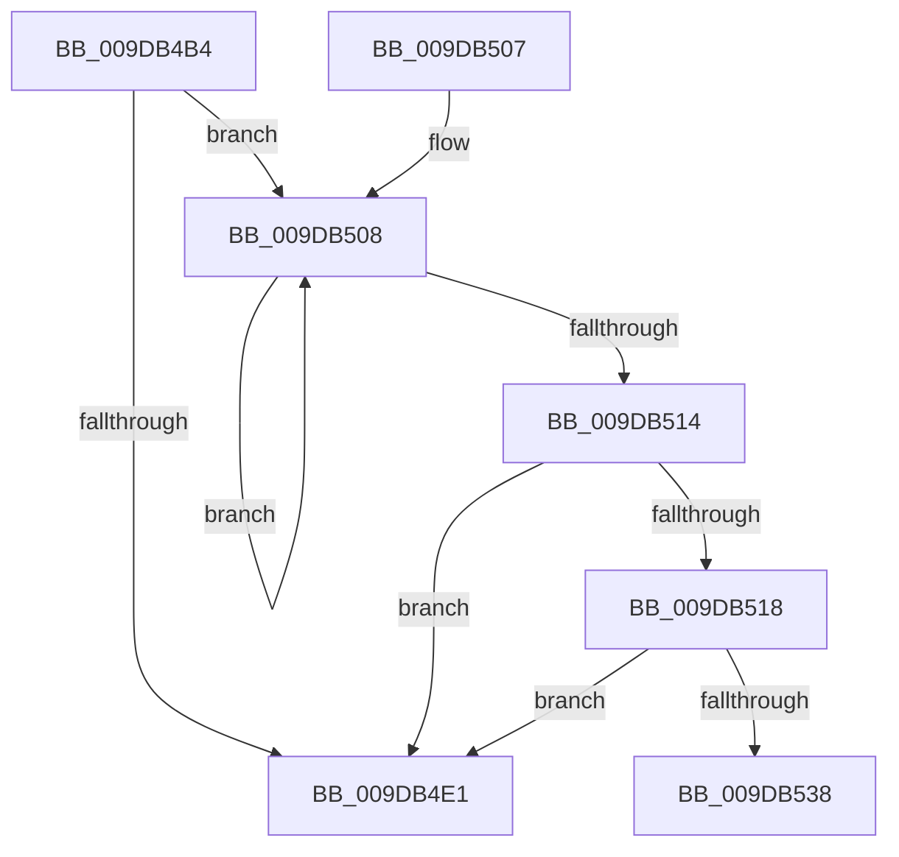

# ObpCreateTypeArray

- RVA: `0x009DB4B4`–`0x009DB544` (길이 `144` bytes)
- VA: `0x00000001409DB4B4`
- 실행 섹션: `PAGE`
- PDB 이름 있음: `예`; PDB Function 태그: `예`
- unwind 정보 RVA: `0x000A342C`
- 디코드: `43`개 명령, `144/144` bytes 표시
- 미해석 바이트: `0` (있으면 어셈블리에 `.byte`로 보존)

> 이 문서는 커널 이미지의 기계어와 PDB 기호를 분석해 생성했습니다. 4번과 5번은 함수 원형과 자료형을 바이너리 사용 방식에서 추정한 C 해석이며 원본 소스 복구 결과는 아닙니다.

## 1. Dependencies

- 직접 호출 지점: **3**; 고유 호출 대상: **3**
- 직접 호출자로 확인된 함수: **2**
- RIP 상대 이미지 참조: **0**

### Outgoing calls
- `0x009DB4D0` → [ObpLockObjectTypeExclusive](ObpLockObjectTypeExclusive_function_009DB5C4.md) (function, `0x009DB5C4`)
- `0x009DB4E4` → [ObpUnlockObjectType](ObpUnlockObjectType_function_009DB54C.md) (function, `0x009DB54C`)
- `0x009DB52B` → [ExAllocatePool2](../../poolcode/B8/ExAllocatePool2_function_00B820F0.md) (function, `0x00B820F0`)

### Direct callers
- [ObEnumerateObjectsByType](../74/ObEnumerateObjectsByType_function_0074EF90.md) at `0x0074EFB0`
- [ObGetObjectInformation](ObGetObjectInformation_function_009DADE0.md) at `0x009DAE73`
- [ObGetObjectInformation](ObGetObjectInformation_function_009DADE0.md) at `0x009DAED5`

### Static image references
- 디코드된 RIP-relative 메모리 참조가 없습니다.

## 2. Other-region calls and transfers

- 다른 실행 섹션으로 향하는 call: **1**
  - `0x009DB52B` → [ExAllocatePool2](../../poolcode/B8/ExAllocatePool2_function_00B820F0.md) (`PAGE` → `POOLCODE`)
- call이 아닌 외부 분기/꼬리 이동: **1**
  - `0x009DB53F` → [sub_00B2FC68 + 0x1D](../B2/Unknown_function_00B2FC68.md) (`tail-transfer`)

## 3. Assembly (complete function range)

```asm
009DB4B4  48 8B C4                        mov rax, rsp
009DB4B7  48 89 58 08                     mov qword ptr [rax + 8], rbx
009DB4BB  48 89 68 10                     mov qword ptr [rax + 0x10], rbp
009DB4BF  48 89 70 18                     mov qword ptr [rax + 0x18], rsi
009DB4C3  48 89 78 20                     mov qword ptr [rax + 0x20], rdi
009DB4C7  41 56                           push r14
009DB4C9  48 83 EC 20                     sub rsp, 0x20
009DB4CD  48 8B D9                        mov rbx, rcx
009DB4D0  E8 EF 00 00 00                  call 0x1409db5c4
009DB4D5  48 8B 03                        mov rax, qword ptr [rbx]
009DB4D8  33 F6                           xor esi, esi
009DB4DA  33 FF                           xor edi, edi
009DB4DC  48 3B C3                        cmp rax, rbx
009DB4DF  75 27                           jne 0x1409db508
009DB4E1  48 8B CB                        mov rcx, rbx
009DB4E4  E8 63 00 00 00                  call 0x1409db54c
009DB4E9  48 8B 5C 24 30                  mov rbx, qword ptr [rsp + 0x30]
009DB4EE  48 8B C6                        mov rax, rsi
009DB4F1  48 8B 74 24 40                  mov rsi, qword ptr [rsp + 0x40]
009DB4F6  48 8B 6C 24 38                  mov rbp, qword ptr [rsp + 0x38]
009DB4FB  48 8B 7C 24 48                  mov rdi, qword ptr [rsp + 0x48]
009DB500  48 83 C4 20                     add rsp, 0x20
009DB504  41 5E                           pop r14
009DB506  C3                              ret
009DB507  CC                              int3
009DB508  48 8B 00                        mov rax, qword ptr [rax]
009DB50B  8B CF                           mov ecx, edi
009DB50D  FF C7                           inc edi
009DB50F  48 3B C3                        cmp rax, rbx
009DB512  75 F4                           jne 0x1409db508
009DB514  85 FF                           test edi, edi
009DB516  74 C9                           je 0x1409db4e1
009DB518  48 8D 14 CD 10 00 00 00         lea rdx, [rcx*8 + 0x10]
009DB520  41 B8 4F 62 41 72               mov r8d, 0x7241624f
009DB526  B9 00 01 00 00                  mov ecx, 0x100
009DB52B  E8 C0 6B 1A 00                  call 0x140b820f0
009DB530  48 8B F0                        mov rsi, rax
009DB533  48 85 C0                        test rax, rax
009DB536  74 A9                           je 0x1409db4e1
009DB538  89 38                           mov dword ptr [rax], edi
009DB53A  33 ED                           xor ebp, ebp
009DB53C  48 8B 3B                        mov rdi, qword ptr [rbx]
009DB53F  E9 41 47 15 00                  jmp 0x140b2fc85
```

## 4. C-style interpretation (structured pseudocode)

```c
__int64 __fastcall ObpCreateTypeArray(__int64 a1)
{
    __int64 result;
    __int64 v_rbp;
    __int64 v_rdi;
    __int64 v_rsi;
    __int64 v_rsp;
    unsigned __int64 v_stack_p10;
    unsigned __int64 v_stack_p18;
    unsigned __int64 v_stack_p20;
    unsigned __int64 v_stack_p8;

    *(unsigned __int64 *)(v_rsp + 8) = v_rbx;
    *(unsigned __int64 *)(v_rsp + 16) = v_rbp;
    *(unsigned __int64 *)(v_rsp + 24) = v_rsi;
    *(unsigned __int64 *)(v_rsp + 32) = v_rdi;
    v_rsp = (v_rsp) - (32);
    result = ObpLockObjectTypeExclusive(a1, a2, a3, a4);
    v_rsi = 0;
    v_rdi = 0;
    if ((*(unsigned __int64 *)(a1)) != a1) goto loc_009DB508;
loc_009DB4E1:
    result = ObpUnlockObjectType(a1, a2, a3, a4);
    v_rsp = (v_rsp) + (32);
    return 0;
loc_009DB508:
    v_rdi = (unsigned int)((v_stack_p20) + 1);
    if ((*(unsigned __int64 *)(0)) != v_stack_p8) goto loc_009DB508;
    if ((unsigned int)(v_rdi) == 0) goto loc_009DB4E1;
    result = ExAllocatePool2(256, (unsigned int)((unsigned int)(v_stack_p20)) * 8 + 16, (unsigned int)(0x7241624FULL), a4);
    if (result == 0) goto loc_009DB4E1;
    *(unsigned int *)(result) = (unsigned int)(v_rdi);
    v_rbp = 0;
}
```

## 5. (Beta) C Style

```c
int64_t ObpCreateTypeArray(void *Arg1)
{
    uint8_t *arg1 = (uint8_t *)Arg1;

    int64_t result;
    int64_t local_rbp;
    int64_t local_rdi;
    int64_t local_rsi;
    int64_t local_rsp;
    uint64_t v_stack_p10;
    uint64_t v_stack_p18;
    uint64_t v_stack_p20;
    uint64_t v_stack_p8;

    *(uint64_t *)(local_rsp + 0x8) = local_rbx;
    *(uint64_t *)(local_rsp + 0x10) = local_rbp;
    *(uint64_t *)(local_rsp + 0x18) = local_rsi;
    *(uint64_t *)(local_rsp + 0x20) = local_rdi;
    local_rsp = (local_rsp) - (32);
    result = ObpLockObjectTypeExclusive(Arg1, a2, a3, a4);
    local_rsi = 0;
    local_rdi = 0;
    if ((*(uint64_t *)(arg1)) != Arg1) goto loc_009DB508;
loc_009DB4E1:
    result = ObpUnlockObjectType(Arg1, a2, a3, a4);
    local_rsp = (local_rsp) + (32);
    return 0;
loc_009DB508:
    local_rdi = (uint32_t)((v_stack_p20) + 1);
    if ((*(uint64_t *)(0)) != v_stack_p8) goto loc_009DB508;
    if ((uint32_t)(local_rdi) == 0) goto loc_009DB4E1;
    result = ExAllocatePool2(256, (uint32_t)((uint32_t)(v_stack_p20)) * 8 + 16, (uint32_t)(0x7241624FULL), a4);
    if (result == 0) goto loc_009DB4E1;
    *(uint32_t *)(result) = (uint32_t)(local_rdi);
    local_rbp = 0;
}
```

### 관측된 메모리 오프셋

구조체 형식이 확인되지 않은 접근은 인자 기준의 오프셋으로만 기록했습니다.

| 기준 인자 | 오프셋 표현 | 폭 (bit) | 접근 |
|---|---:|---:|---|
| `Arg1` | `+ 0x0` | `64` | `R` |

## 6. Execution-region graph

[열기: 2D/3D 그래프와 함수 탐색 컨트롤 패널](../../../control-panel.html?section=page&rva=0x009DB4B4&view=graph)

- 2D 그래프는 위에서 아래로 흐르고, 3D 그래프는 빈 공간을 드래그해 회전합니다. Shift+드래그는 이동, 휠은 확대·축소, 함수 노드 선택은 대상 보고서 이동입니다.

### Static fallback


