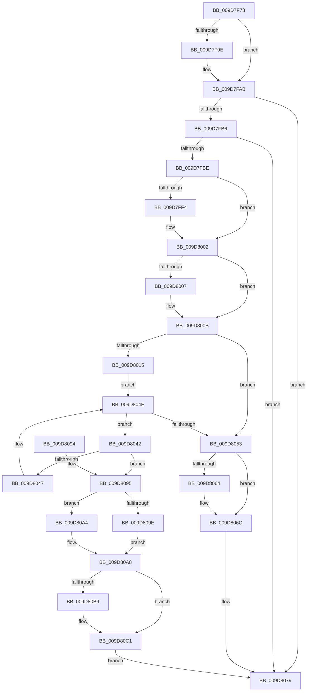

# ObpDeregisterObject

- RVA: `0x009D7F78`–`0x009D80DD` (길이 `357` bytes)
- VA: `0x00000001409D7F78`
- 실행 섹션: `PAGE`
- PDB 이름 있음: `예`; PDB Function 태그: `아니요`
- unwind 정보 RVA: `0x000A2B2C`
- 디코드: `96`개 명령, `357/357` bytes 표시
- 미해석 바이트: `0` (있으면 어셈블리에 `.byte`로 보존)

> 이 문서는 커널 이미지의 기계어와 PDB 기호를 분석해 생성했습니다. 4번과 5번은 함수 원형과 자료형을 바이너리 사용 방식에서 추정한 C 해석이며 원본 소스 복구 결과는 아닙니다.

## 1. Dependencies

- 직접 호출 지점: **10**; 고유 호출 대상: **7**
- 직접 호출자로 확인된 함수: **18**
- RIP 상대 이미지 참조: **5**

### Outgoing calls
- `0x009D7FA6` → [EtwTraceObject](../7B/EtwTraceObject_function_007B81A4.md) (function, `0x007B81A4`)
- `0x009D7FE4` → [KeAbPreAcquire](../../text/21/KeAbPreAcquire_function_00210230.md) (function, `0x00210230`)
- `0x009D7FFD` → [ExfAcquirePushLockExclusiveEx](../../text/20/ExfAcquirePushLockExclusiveEx_function_0020FC90.md) (function, `0x0020FC90`)
- `0x009D8067` → [ExfTryToWakePushLock](../../text/26/ExfTryToWakePushLock_function_00265DD0.md) (function, `0x00265DD0`)
- `0x009D806F` → [KeAbPostRelease](../../text/2E/KeAbPostRelease_function_002E1600.md) (function, `0x002E1600`)
- `0x009D8074` → [KeLeaveGuardedRegion](../../text/2E/KeLeaveGuardedRegion_function_002E2C40.md) (function, `0x002E2C40`)
- `0x009D80BC` → [ExfTryToWakePushLock](../../text/26/ExfTryToWakePushLock_function_00265DD0.md) (function, `0x00265DD0`)
- `0x009D80C4` → [KeAbPostRelease](../../text/2E/KeAbPostRelease_function_002E1600.md) (function, `0x002E1600`)
- `0x009D80C9` → [KeLeaveGuardedRegion](../../text/2E/KeLeaveGuardedRegion_function_002E2C40.md) (function, `0x002E2C40`)
- `0x009D80D6` → [ExFreePoolWithTag](../../poolcode/B8/ExFreePoolWithTag_function_00B82870.md) (function, `0x00B82870`)

### Direct callers
- [IoRemoveIoCompletion](../../text/20/IoRemoveIoCompletion_function_0020B580.md) at `0x0020BB88`
- [IoRemoveIoCompletion](../../text/20/IoRemoveIoCompletion_function_0020B580.md) at `0x0020BC0F`
- [IoRemoveIoCompletion](../../text/20/IoRemoveIoCompletion_function_0020B580.md) at `0x0020BC96`
- [IopReleaseFileObjectLock](../../text/25/IopReleaseFileObjectLock_function_00250A90.md) at `0x00250DE3`
- [NtSetInformationFile](../../text/29/NtSetInformationFile_function_0029C5E0.md) at `0x0029D1A8`
- [ObfDereferenceObjectWithTag](../../text/2F/ObfDereferenceObjectWithTag_function_002F78E0.md) at `0x002F79D9`
- [ObfDereferenceObject](../../text/2F/ObfDereferenceObject_function_002F9350.md) at `0x002F9448`
- [NtTraceEvent](../../text/2F/NtTraceEvent_function_002FA6C0.md) at `0x002FADE9`
- [PfSnGetFileInformation](../../text/34/PfSnGetFileInformation_function_00343210.md) at `0x00343631`
- [sub_00343D34](../../text/34/Unknown_function_00343D34.md) at `0x00343D78`
- [IopFreeWaitCompletionPacket](../../text/35/IopFreeWaitCompletionPacket_function_00351A50.md) at `0x00351D64`
- [IopFreeWaitCompletionPacket](../../text/35/IopFreeWaitCompletionPacket_function_00351A50.md) at `0x00351DE2`
- [IopFreeWaitCompletionPacket](../../text/35/IopFreeWaitCompletionPacket_function_00351A50.md) at `0x00351E5F`
- [sub_0038C58B](../../text/38/Unknown_function_0038C58B.md) at `0x0038C776`
- [sub_00393FDE](../../text/39/Unknown_function_00393FDE.md) at `0x00394056`
- [sub_00393FDE](../../text/39/Unknown_function_00393FDE.md) at `0x003940D3`
- [NtWaitForWorkViaWorkerFactory](../../text/39/NtWaitForWorkViaWorkerFactory_function_00394270.md) at `0x00394DDD`
- [ObpDereferenceNamedObject](../../text/3A/ObpDereferenceNamedObject_function_003A0310.md) at `0x003A041C`
- [ExpSetTimerObject2](../../text/3A/ExpSetTimerObject2_function_003A0658.md) at `0x003A07D0`
- [NtSignalAndWaitForSingleObject](../../text/3A/NtSignalAndWaitForSingleObject_function_003A11D0.md) at `0x003A15E8`
- [NtSignalAndWaitForSingleObject](../../text/3A/NtSignalAndWaitForSingleObject_function_003A11D0.md) at `0x003A1637`
- [IopUnloadSafeCompletion](../../text/3A/IopUnloadSafeCompletion_function_003A16A0.md) at `0x003A17FA`
- [sub_003ED675](../../text/3E/Unknown_function_003ED675.md) at `0x003ED716`
- [ObpProcessRemoveObjectQueue](ObpProcessRemoveObjectQueue_function_009D7B40.md) at `0x009D7D15`

### Static image references
- `0x009D7F91` → RVA `0x00FC6B10` (`ALMOSTRO`; read)
- `0x009D7FC7` → RVA `0x00F0F580` (`.data`; read)
- `0x009D800B` → RVA `0x00FC5010` (`ALMOSTRO`; read)
- `0x009D8035` → RVA `0x00F0F548` (`.data`; read)
- `0x009D8053` → RVA `0x00F0F580` (`.data`; read/write)

## 2. Other-region calls and transfers

- 다른 실행 섹션으로 향하는 call: **9**
  - `0x009D7FE4` → [KeAbPreAcquire](../../text/21/KeAbPreAcquire_function_00210230.md) (`PAGE` → `.text`)
  - `0x009D7FFD` → [ExfAcquirePushLockExclusiveEx](../../text/20/ExfAcquirePushLockExclusiveEx_function_0020FC90.md) (`PAGE` → `.text`)
  - `0x009D8067` → [ExfTryToWakePushLock](../../text/26/ExfTryToWakePushLock_function_00265DD0.md) (`PAGE` → `.text`)
  - `0x009D806F` → [KeAbPostRelease](../../text/2E/KeAbPostRelease_function_002E1600.md) (`PAGE` → `.text`)
  - `0x009D8074` → [KeLeaveGuardedRegion](../../text/2E/KeLeaveGuardedRegion_function_002E2C40.md) (`PAGE` → `.text`)
  - `0x009D80BC` → [ExfTryToWakePushLock](../../text/26/ExfTryToWakePushLock_function_00265DD0.md) (`PAGE` → `.text`)
  - `0x009D80C4` → [KeAbPostRelease](../../text/2E/KeAbPostRelease_function_002E1600.md) (`PAGE` → `.text`)
  - `0x009D80C9` → [KeLeaveGuardedRegion](../../text/2E/KeLeaveGuardedRegion_function_002E2C40.md) (`PAGE` → `.text`)
  - `0x009D80D6` → [ExFreePoolWithTag](../../poolcode/B8/ExFreePoolWithTag_function_00B82870.md) (`PAGE` → `POOLCODE`)
- 별도 외부 분기/꼬리 이동을 확인하지 못했습니다.

## 3. Assembly (complete function range)

```asm
009D7F78  48 8B C4                        mov rax, rsp
009D7F7B  48 89 58 08                     mov qword ptr [rax + 8], rbx
009D7F7F  48 89 68 10                     mov qword ptr [rax + 0x10], rbp
009D7F83  48 89 70 18                     mov qword ptr [rax + 0x18], rsi
009D7F87  48 89 78 20                     mov qword ptr [rax + 0x20], rdi
009D7F8B  41 56                           push r14
009D7F8D  48 83 EC 20                     sub rsp, 0x20
009D7F91  8B 05 79 EB 5E 00               mov eax, dword ptr [rip + 0x5eeb79]
009D7F97  48 8B F1                        mov rsi, rcx
009D7F9A  84 C0                           test al, al
009D7F9C  79 0D                           jns 0x1409d7fab
009D7F9E  B9 31 11 00 00                  mov ecx, 0x1131
009D7FA3  48 8B D6                        mov rdx, rsi
009D7FA6  E8 F9 01 DE FF                  call 0x1407b81a4
009D7FAB  8A 46 19                        mov al, byte ptr [rsi + 0x19]
009D7FAE  A8 01                           test al, 1
009D7FB0  0F 84 C3 00 00 00               je 0x1409d8079
009D7FB6  A8 02                           test al, 2
009D7FB8  0F 85 BB 00 00 00               jne 0x1409d8079
009D7FBE  65 48 8B 04 25 88 01 00 00      mov rax, qword ptr gs:[0x188]
009D7FC7  4C 8D 35 B2 75 53 00            lea r14, [rip + 0x5375b2]
009D7FCE  48 83 CB FF                     or rbx, 0xffffffffffffffff
009D7FD2  45 33 C0                        xor r8d, r8d
009D7FD5  33 D2                           xor edx, edx
009D7FD7  49 8B CE                        mov rcx, r14
009D7FDA  33 ED                           xor ebp, ebp
009D7FDC  66 01 98 E6 01 00 00            add word ptr [rax + 0x1e6], bx
009D7FE3  90                              nop
009D7FE4  E8 47 82 83 FF                  call 0x140210230
009D7FE9  F0 49 0F BA 2E 00               lock bts qword ptr [r14], 0
009D7FEF  48 8B F8                        mov rdi, rax
009D7FF2  73 0E                           jae 0x1409d8002
009D7FF4  4D 8B C6                        mov r8, r14
009D7FF7  48 8B D0                        mov rdx, rax
009D7FFA  49 8B CE                        mov rcx, r14
009D7FFD  E8 8E 7C 83 FF                  call 0x14020fc90
009D8002  48 85 FF                        test rdi, rdi
009D8005  74 04                           je 0x1409d800b
009D8007  C6 47 0A 01                     mov byte ptr [rdi + 0xa], 1
009D800B  8B 05 FF CF 5E 00               mov eax, dword ptr [rip + 0x5ecfff]
009D8011  A8 73                           test al, 0x73
009D8013  74 3E                           je 0x1409d8053
009D8015  8D 4E 30                        lea ecx, [rsi + 0x30]
009D8018  B8 A3 71 6E A3                  mov eax, 0xa36e71a3
009D801D  C1 E9 04                        shr ecx, 4
009D8020  81 E1 FF FF 0F 00               and ecx, 0xfffff
009D8026  F7 E1                           mul ecx
009D8028  C1 EA 08                        shr edx, 8
009D802B  69 C2 91 01 00 00               imul eax, edx, 0x191
009D8031  2B C8                           sub ecx, eax
009D8033  8B D1                           mov edx, ecx
009D8035  48 8B 0D 0C 75 53 00            mov rcx, qword ptr [rip + 0x53750c]
009D803C  48 8B 3C D1                     mov rdi, qword ptr [rcx + rdx*8]
009D8040  EB 0C                           jmp 0x1409d804e
009D8042  48 39 37                        cmp qword ptr [rdi], rsi
009D8045  74 4E                           je 0x1409d8095
009D8047  48 8B EF                        mov rbp, rdi
009D804A  48 8B 7F 08                     mov rdi, qword ptr [rdi + 8]
009D804E  48 85 FF                        test rdi, rdi
009D8051  75 EF                           jne 0x1409d8042
009D8053  F0 48 0F C1 1D 24 75 53 00      lock xadd qword ptr [rip + 0x537524], rbx
009D805C  80 E3 06                        and bl, 6
009D805F  80 FB 02                        cmp bl, 2
009D8062  75 08                           jne 0x1409d806c
009D8064  49 8B CE                        mov rcx, r14
009D8067  E8 64 DD 88 FF                  call 0x140265dd0
009D806C  49 8B CE                        mov rcx, r14
009D806F  E8 8C 95 90 FF                  call 0x1402e1600
009D8074  E8 C7 AB 90 FF                  call 0x1402e2c40
009D8079  48 8B 5C 24 30                  mov rbx, qword ptr [rsp + 0x30]
009D807E  48 8B 6C 24 38                  mov rbp, qword ptr [rsp + 0x38]
009D8083  48 8B 74 24 40                  mov rsi, qword ptr [rsp + 0x40]
009D8088  48 8B 7C 24 48                  mov rdi, qword ptr [rsp + 0x48]
009D808D  48 83 C4 20                     add rsp, 0x20
009D8091  41 5E                           pop r14
009D8093  C3                              ret
009D8094  CC                              int3
009D8095  48 8B 47 08                     mov rax, qword ptr [rdi + 8]
009D8099  48 85 ED                        test rbp, rbp
009D809C  74 06                           je 0x1409d80a4
009D809E  48 89 45 08                     mov qword ptr [rbp + 8], rax
009D80A2  EB 04                           jmp 0x1409d80a8
009D80A4  48 89 04 D1                     mov qword ptr [rcx + rdx*8], rax
009D80A8  F0 48 0F C1 1D CF 74 53 00      lock xadd qword ptr [rip + 0x5374cf], rbx
009D80B1  80 E3 06                        and bl, 6
009D80B4  80 FB 02                        cmp bl, 2
009D80B7  75 08                           jne 0x1409d80c1
009D80B9  49 8B CE                        mov rcx, r14
009D80BC  E8 0F DD 88 FF                  call 0x140265dd0
009D80C1  49 8B CE                        mov rcx, r14
009D80C4  E8 37 95 90 FF                  call 0x1402e1600
009D80C9  E8 72 AB 90 FF                  call 0x1402e2c40
009D80CE  BA 4F 62 52 74                  mov edx, 0x7452624f
009D80D3  48 8B CF                        mov rcx, rdi
009D80D6  E8 95 A7 1A 00                  call 0x140b82870
009D80DB  EB 9C                           jmp 0x1409d8079
```

## 4. C-style interpretation (structured pseudocode)

```c
__int64 __fastcall ObpDeregisterObject(__int64 a1, __int64 a2, int a3)
{
    __int64 result;
    __int64 v_rbp;
    __int64 v_rbx;
    __int64 v_rsp;
    unsigned __int64 v_stack_p10;
    unsigned __int64 v_stack_p18;
    unsigned __int64 v_stack_p20;
    unsigned __int64 v_stack_p8;

    *(unsigned __int64 *)(v_rsp + 8) = v_rbx;
    *(unsigned __int64 *)(v_rsp + 16) = v_rbp;
    *(unsigned __int64 *)(v_rsp + 24) = v_rsi;
    *(unsigned __int64 *)(v_rsp + 32) = v_rdi;
    v_rsp = (v_rsp) - (32);
    result = (unsigned int)(*(unsigned int *)(v_rip + 6220665));
    if (sign_flag) {
        a1 = 0x1131ULL;
        a2 = a1;
        result = EtwTraceObject(a1, a2, a3, a4);
    }
    if ((((unsigned __int8)(*(unsigned __int8 *)(a1 + 25))) & (1)) == 0) goto loc_009D8079;
    if ((((unsigned __int8)(*(unsigned __int8 *)(a1 + 25))) & (2)) != 0) goto loc_009D8079;
    v_rbx = (v_rbx) | (-1);
    a3 = 0;
    a2 = 0;
    v_rbp = 0;
    result = KeAbPreAcquire(v_rip + 5469618, a2, a3, a4);
    if (!(condition_is_above_or_equal)) {
        a3 = v_rip + 5469618;
        a2 = result;
        a1 = v_rip + 5469618;
        result = ExfAcquirePushLockExclusiveEx(a1, a2, a3, a4);
    }
    if (result != 0) {
        *(unsigned __int8 *)(result + 10) = 1;
    }
    if ((((unsigned __int8)((unsigned int)(*(unsigned int *)(v_rip + 6213631)))) & (115)) == 0) goto loc_009D8053;
    a1 = (unsigned int)((a1 + 48) >> (4));
    a1 = (unsigned int)((a1) & (0xFFFFFULL));
    a2 = (unsigned int)((a2) >> (8));
    result = (unsigned int)(((unsigned int)(0xA36E71A3ULL)) * ((unsigned int)(a2)));
    a1 = (unsigned int)((a1) - ((unsigned int)(result)));
    goto loc_009D804E;
loc_009D8042:
    if ((*(unsigned __int64 *)(*(unsigned __int64 *)(*(unsigned __int64 *)(v_rip + 5469452) + (unsigned int)((unsigned int)(a1)) * 8))) == a1) goto loc_009D8095;
loc_009D804E:
    if (*(unsigned __int64 *)(*(unsigned __int64 *)(*(unsigned __int64 *)(v_rip + 5469452) + (unsigned int)((unsigned int)(a1)) * 8) + 8) != 0) goto loc_009D8042;
loc_009D8053:
    v_rbx = (unsigned __int8)((v_rbx) & (6));
    if (((unsigned __int8)(v_rbx)) == 2) {
        a1 = v_rip + 5469618;
        result = ExfTryToWakePushLock(a1, (unsigned int)((unsigned int)(a1)), a3, a4);
    }
    result = KeAbPostRelease(v_rip + 5469618, (unsigned int)((unsigned int)(a1)), a3, a4);
    result = KeLeaveGuardedRegion(v_rip + 5469618, (unsigned int)((unsigned int)(a1)), a3, a4);
loc_009D8079:
    v_rsp = (v_rsp) + (32);
    return result;
loc_009D8095:
    if (v_stack_p10 == 0) goto loc_009D80A4;
    *(unsigned __int64 *)(v_stack_p10 + 8) = *(unsigned __int64 *)(v_stack_p20 + 8);
    goto loc_009D80A8;
loc_009D80A4:
    *(unsigned __int64 *)(v_rip + 5469618 + (unsigned int)((unsigned int)(a1)) * 8) = *(unsigned __int64 *)(v_stack_p20 + 8);
loc_009D80A8:
    v_rbx = (unsigned __int8)((v_stack_p8) & (6));
    result = *(unsigned __int64 *)(v_stack_p20 + 8);
    if (((unsigned __int8)(v_rbx)) == 2) {
        a1 = v_rip + 5469618;
        result = ExfTryToWakePushLock(a1, (unsigned int)((unsigned int)(a1)), a3, a4);
    }
    result = KeAbPostRelease(v_rip + 5469618, (unsigned int)((unsigned int)(a1)), a3, a4);
    result = KeLeaveGuardedRegion(v_rip + 5469618, (unsigned int)((unsigned int)(a1)), a3, a4);
    result = ExFreePoolWithTag(v_stack_p20, (unsigned int)(0x7452624FULL), a3, a4);
    goto loc_009D8079;
}
```

## 5. (Beta) C Style

```c
int64_t ObpDeregisterObject(void *Arg1, int64_t Arg2, int32_t Arg3)
{
    uint8_t *arg1 = (uint8_t *)Arg1;

    int64_t result;
    int64_t local_rbp;
    int64_t local_rbx;
    int64_t local_rsp;
    uint64_t v_stack_p10;
    uint64_t v_stack_p18;
    uint64_t v_stack_p20;
    uint64_t v_stack_p8;

    *(uint64_t *)(local_rsp + 0x8) = local_rbx;
    *(uint64_t *)(local_rsp + 0x10) = local_rbp;
    *(uint64_t *)(local_rsp + 0x18) = local_rsi;
    *(uint64_t *)(local_rsp + 0x20) = local_rdi;
    local_rsp = (local_rsp) - (32);
    result = (uint32_t)(*(uint32_t *)(v_rip + 0x5EEB79));
    if (sign_flag) {
        Arg1 = 0x1131ULL;
        Arg2 = Arg1;
        result = EtwTraceObject(Arg1, Arg2, Arg3, a4);
    }
    if ((((uint8_t)(*(uint8_t *)(arg1 + 0x19))) & (1)) == 0) goto loc_009D8079;
    if ((((uint8_t)(*(uint8_t *)(arg1 + 0x19))) & (2)) != 0) goto loc_009D8079;
    local_rbx = (local_rbx) | (-1);
    Arg3 = 0;
    Arg2 = 0;
    local_rbp = 0;
    result = KeAbPreAcquire(v_rip + 5469618, Arg2, Arg3, a4);
    if (!(condition_is_above_or_equal)) {
        Arg3 = v_rip + 5469618;
        Arg2 = result;
        Arg1 = v_rip + 5469618;
        result = ExfAcquirePushLockExclusiveEx(Arg1, Arg2, Arg3, a4);
    }
    if (result != 0) {
        *(uint8_t *)(result + 0xA) = 1;
    }
    if ((((uint8_t)((uint32_t)(*(uint32_t *)(v_rip + 0x5ECFFF)))) & (115)) == 0) goto loc_009D8053;
    Arg1 = (uint32_t)((Arg1 + 48) >> (4));
    Arg1 = (uint32_t)((Arg1) & (0xFFFFFULL));
    Arg2 = (uint32_t)((Arg2) >> (8));
    result = (uint32_t)(((uint32_t)(0xA36E71A3ULL)) * ((uint32_t)(Arg2)));
    Arg1 = (uint32_t)((Arg1) - ((uint32_t)(result)));
    goto loc_009D804E;
loc_009D8042:
    if ((*(uint64_t *)(*(uint64_t *)(*(uint64_t *)(v_rip + 0x53750C) + (uint32_t)((uint32_t)(arg1)) * 8))) == Arg1) goto loc_009D8095;
loc_009D804E:
    if (*(uint64_t *)(*(uint64_t *)(*(uint64_t *)(v_rip + 0x53750C) + (uint32_t)((uint32_t)(arg1)) * 8) + 0x8) != 0) goto loc_009D8042;
loc_009D8053:
    local_rbx = (uint8_t)((local_rbx) & (6));
    if (((uint8_t)(local_rbx)) == 2) {
        Arg1 = v_rip + 5469618;
        result = ExfTryToWakePushLock(Arg1, (uint32_t)((uint32_t)(Arg1)), Arg3, a4);
    }
    result = KeAbPostRelease(v_rip + 5469618, (uint32_t)((uint32_t)(Arg1)), Arg3, a4);
    result = KeLeaveGuardedRegion(v_rip + 5469618, (uint32_t)((uint32_t)(Arg1)), Arg3, a4);
loc_009D8079:
    local_rsp = (local_rsp) + (32);
    return result;
loc_009D8095:
    if (v_stack_p10 == 0) goto loc_009D80A4;
    *(uint64_t *)(v_stack_p10 + 0x8) = *(uint64_t *)(v_stack_p20 + 0x8);
    goto loc_009D80A8;
loc_009D80A4:
    *(uint64_t *)(v_rip + 0x5375B2 + (uint32_t)((uint32_t)(arg1)) * 8) = *(uint64_t *)(v_stack_p20 + 0x8);
loc_009D80A8:
    local_rbx = (uint8_t)((v_stack_p8) & (6));
    result = *(uint64_t *)(v_stack_p20 + 0x8);
    if (((uint8_t)(local_rbx)) == 2) {
        Arg1 = v_rip + 5469618;
        result = ExfTryToWakePushLock(Arg1, (uint32_t)((uint32_t)(Arg1)), Arg3, a4);
    }
    result = KeAbPostRelease(v_rip + 5469618, (uint32_t)((uint32_t)(Arg1)), Arg3, a4);
    result = KeLeaveGuardedRegion(v_rip + 5469618, (uint32_t)((uint32_t)(Arg1)), Arg3, a4);
    result = ExFreePoolWithTag(v_stack_p20, (uint32_t)(0x7452624FULL), Arg3, a4);
    goto loc_009D8079;
}
```

### 관측된 메모리 오프셋

구조체 형식이 확인되지 않은 접근은 인자 기준의 오프셋으로만 기록했습니다.

| 기준 인자 | 오프셋 표현 | 폭 (bit) | 접근 |
|---|---:|---:|---|
| `Arg1` | `+ 0x19` | `8` | `R` |
| `Arg1` | `+ 0x30` | `32` | `R` |

## 6. Execution-region graph

[열기: 2D/3D 그래프와 함수 탐색 컨트롤 패널](../../../control-panel.html?section=page&rva=0x009D7F78&view=graph)

- 2D 그래프는 위에서 아래로 흐르고, 3D 그래프는 빈 공간을 드래그해 회전합니다. Shift+드래그는 이동, 휠은 확대·축소, 함수 노드 선택은 대상 보고서 이동입니다.

### Static fallback


