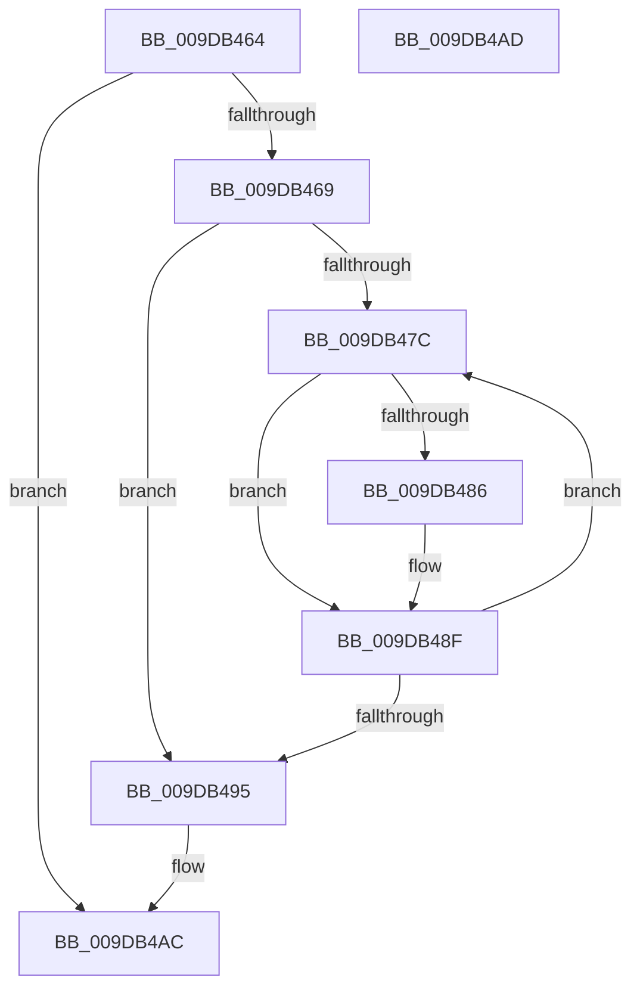

# ObpDestroyTypeArray

- RVA: `0x009DB464`–`0x009DB4AE` (길이 `74` bytes)
- VA: `0x00000001409DB464`
- 실행 섹션: `PAGE`
- PDB 이름 있음: `예`; PDB Function 태그: `아니요`
- unwind 정보 RVA: `0x00084918`
- 디코드: `25`개 명령, `74/74` bytes 표시
- 미해석 바이트: `0` (있으면 어셈블리에 `.byte`로 보존)

> 이 문서는 커널 이미지의 기계어와 PDB 기호를 분석해 생성했습니다. 4번과 5번은 함수 원형과 자료형을 바이너리 사용 방식에서 추정한 C 해석이며 원본 소스 복구 결과는 아닙니다.

## 1. Dependencies

- 직접 호출 지점: **2**; 고유 호출 대상: **2**
- 직접 호출자로 확인된 함수: **3**
- RIP 상대 이미지 참조: **0**

### Outgoing calls
- `0x009DB48A` → [ObfDereferenceObject](../../text/2F/ObfDereferenceObject_function_002F9350.md) (function, `0x002F9350`)
- `0x009DB49D` → [ExFreePoolWithTag](../../poolcode/B8/ExFreePoolWithTag_function_00B82870.md) (function, `0x00B82870`)

### Direct callers
- [ObEnumerateObjectsByType](../74/ObEnumerateObjectsByType_function_0074EF90.md) at `0x0074F02E`
- [ObGetObjectInformation](ObGetObjectInformation_function_009DADE0.md) at `0x009DAF82`
- [ObGetObjectInformation](ObGetObjectInformation_function_009DADE0.md) at `0x009DB42C`
- [ObGetObjectInformation](ObGetObjectInformation_function_009DADE0.md) at `0x009DB436`
- [ObGetObjectInformation$fin$0](../B1/ObGetObjectInformation_fin_0_function_00B10BE4.md) at `0x00B10BF6`
- [ObGetObjectInformation$fin$0](../B1/ObGetObjectInformation_fin_0_function_00B10BE4.md) at `0x00B10C00`

### Static image references
- 디코드된 RIP-relative 메모리 참조가 없습니다.

## 2. Other-region calls and transfers

- 다른 실행 섹션으로 향하는 call: **2**
  - `0x009DB48A` → [ObfDereferenceObject](../../text/2F/ObfDereferenceObject_function_002F9350.md) (`PAGE` → `.text`)
  - `0x009DB49D` → [ExFreePoolWithTag](../../poolcode/B8/ExFreePoolWithTag_function_00B82870.md) (`PAGE` → `POOLCODE`)
- 별도 외부 분기/꼬리 이동을 확인하지 못했습니다.

## 3. Assembly (complete function range)

```asm
009DB464  48 85 C9                        test rcx, rcx
009DB467  74 43                           je 0x1409db4ac
009DB469  48 89 5C 24 08                  mov qword ptr [rsp + 8], rbx
009DB46E  57                              push rdi
009DB46F  48 83 EC 20                     sub rsp, 0x20
009DB473  33 FF                           xor edi, edi
009DB475  48 8B D9                        mov rbx, rcx
009DB478  39 39                           cmp dword ptr [rcx], edi
009DB47A  76 19                           jbe 0x1409db495
009DB47C  48 8B 4C FB 08                  mov rcx, qword ptr [rbx + rdi*8 + 8]
009DB481  48 85 C9                        test rcx, rcx
009DB484  74 09                           je 0x1409db48f
009DB486  48 83 C1 50                     add rcx, 0x50
009DB48A  E8 C1 DE 91 FF                  call 0x1402f9350
009DB48F  FF C7                           inc edi
009DB491  3B 3B                           cmp edi, dword ptr [rbx]
009DB493  72 E7                           jb 0x1409db47c
009DB495  BA 4F 62 41 72                  mov edx, 0x7241624f
009DB49A  48 8B CB                        mov rcx, rbx
009DB49D  E8 CE 73 1A 00                  call 0x140b82870
009DB4A2  48 8B 5C 24 30                  mov rbx, qword ptr [rsp + 0x30]
009DB4A7  48 83 C4 20                     add rsp, 0x20
009DB4AB  5F                              pop rdi
009DB4AC  C3                              ret
009DB4AD  CC                              int3
```

## 4. C-style interpretation (structured pseudocode)

```c
__int64 __fastcall ObpDestroyTypeArray(__int64 a1)
{
    __int64 result;
    __int64 v_rdi;
    __int64 v_rsp;
    unsigned __int64 v_stack_p8;

    if (a1 == 0) goto loc_009DB4AC;
    v_stack_p8 = v_rbx;
    v_rsp = (v_rsp) - (32);
    v_rdi = 0;
    if ((*(unsigned int *)(a1)) <= 0) goto loc_009DB495;
loc_009DB47C:
    if (*(unsigned __int64 *)(a1 + v_rdi * 8 + 8) != 0) {
        a1 = (*(unsigned __int64 *)(a1 + v_rdi * 8 + 8)) + (80);
        result = ObfDereferenceObject(a1, a2, a3, a4);
    }
    v_rdi = (unsigned int)((v_rdi) + 1);
    if (((unsigned int)(v_rdi)) < (*(unsigned int *)(a1))) goto loc_009DB47C;
loc_009DB495:
    result = ExFreePoolWithTag(a1, (unsigned int)(0x7241624FULL), a3, a4);
    v_rsp = (v_rsp) + (32);
loc_009DB4AC:
    return result;
}
```

## 5. (Beta) C Style

```c
int64_t ObpDestroyTypeArray(int64_t Arg1)
{
    int64_t result;
    int64_t local_rdi;
    int64_t local_rsp;
    uint64_t v_stack_p8;

    if (Arg1 == 0) goto loc_009DB4AC;
    v_stack_p8 = local_rbx;
    local_rsp = (local_rsp) - (32);
    local_rdi = 0;
    if ((*(uint32_t *)(Arg1)) <= 0) goto loc_009DB495;
loc_009DB47C:
    if (*(uint64_t *)(Arg1 + local_rdi * 8 + 0x8) != 0) {
        Arg1 = (*(uint64_t *)(Arg1 + local_rdi * 8 + 0x8)) + (80);
        result = ObfDereferenceObject(Arg1, a2, a3, a4);
    }
    local_rdi = (uint32_t)((local_rdi) + 1);
    if (((uint32_t)(local_rdi)) < (*(uint32_t *)(Arg1))) goto loc_009DB47C;
loc_009DB495:
    result = ExFreePoolWithTag(Arg1, (uint32_t)(0x7241624FULL), a3, a4);
    local_rsp = (local_rsp) + (32);
loc_009DB4AC:
    return result;
}
```

## 6. Execution-region graph

[열기: 2D/3D 그래프와 함수 탐색 컨트롤 패널](../../../control-panel.html?section=page&rva=0x009DB464&view=graph)

- 2D 그래프는 위에서 아래로 흐르고, 3D 그래프는 빈 공간을 드래그해 회전합니다. Shift+드래그는 이동, 휠은 확대·축소, 함수 노드 선택은 대상 보고서 이동입니다.

### Static fallback


