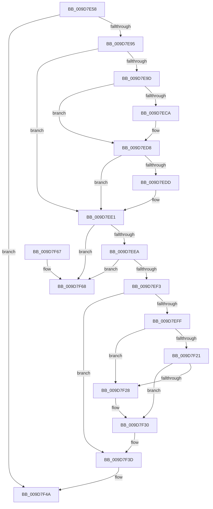

# ObpHandleRevocationBlockRemoveInsertedObject

- RVA: `0x009D7E58`–`0x009D7F6F` (길이 `279` bytes)
- VA: `0x00000001409D7E58`
- 실행 섹션: `PAGE`
- PDB 이름 있음: `예`; PDB Function 태그: `아니요`
- unwind 정보 RVA: `0x000A2B0C`
- 디코드: `81`개 명령, `279/279` bytes 표시
- 미해석 바이트: `0` (있으면 어셈블리에 `.byte`로 보존)

> 이 문서는 커널 이미지의 기계어와 PDB 기호를 분석해 생성했습니다. 4번과 5번은 함수 원형과 자료형을 바이너리 사용 방식에서 추정한 C 해석이며 원본 소스 복구 결과는 아닙니다.

## 1. Dependencies

- 직접 호출 지점: **6**; 고유 호출 대상: **6**
- 직접 호출자로 확인된 함수: **2**
- RIP 상대 이미지 참조: **0**

### Outgoing calls
- `0x009D7EBA` → [KeAbPreAcquire](../../text/21/KeAbPreAcquire_function_00210230.md) (function, `0x00210230`)
- `0x009D7ED3` → [ExfAcquirePushLockExclusiveEx](../../text/20/ExfAcquirePushLockExclusiveEx_function_0020FC90.md) (function, `0x0020FC90`)
- `0x009D7F2B` → [ExfReleasePushLock](../../text/26/ExfReleasePushLock_function_002638D0.md) (function, `0x002638D0`)
- `0x009D7F33` → [KeAbPostRelease](../../text/2E/KeAbPostRelease_function_002E1600.md) (function, `0x002E1600`)
- `0x009D7F38` → [KeLeaveCriticalRegion](../../text/25/KeLeaveCriticalRegion_function_0025D8B0.md) (function, `0x0025D8B0`)
- `0x009D7F41` → [ExReleaseRundownProtection](../../text/34/ExReleaseRundownProtection_function_00349E80.md) (function, `0x00349E80`)

### Direct callers
- [ObRevokeHandles](../74/ObRevokeHandles_function_0074E838.md) at `0x0074E8AC`
- [ObpHandleRevocationBlockRemoveObject](ObpHandleRevocationBlockRemoveObject_function_009D7E30.md) at `0x009D7E44`

### Static image references
- 디코드된 RIP-relative 메모리 참조가 없습니다.

## 2. Other-region calls and transfers

- 다른 실행 섹션으로 향하는 call: **6**
  - `0x009D7EBA` → [KeAbPreAcquire](../../text/21/KeAbPreAcquire_function_00210230.md) (`PAGE` → `.text`)
  - `0x009D7ED3` → [ExfAcquirePushLockExclusiveEx](../../text/20/ExfAcquirePushLockExclusiveEx_function_0020FC90.md) (`PAGE` → `.text`)
  - `0x009D7F2B` → [ExfReleasePushLock](../../text/26/ExfReleasePushLock_function_002638D0.md) (`PAGE` → `.text`)
  - `0x009D7F33` → [KeAbPostRelease](../../text/2E/KeAbPostRelease_function_002E1600.md) (`PAGE` → `.text`)
  - `0x009D7F38` → [KeLeaveCriticalRegion](../../text/25/KeLeaveCriticalRegion_function_0025D8B0.md) (`PAGE` → `.text`)
  - `0x009D7F41` → [ExReleaseRundownProtection](../../text/34/ExReleaseRundownProtection_function_00349E80.md) (`PAGE` → `.text`)
- 별도 외부 분기/꼬리 이동을 확인하지 못했습니다.

## 3. Assembly (complete function range)

```asm
009D7E58  48 89 5C 24 10                  mov qword ptr [rsp + 0x10], rbx
009D7E5D  48 89 6C 24 18                  mov qword ptr [rsp + 0x18], rbp
009D7E62  48 89 74 24 20                  mov qword ptr [rsp + 0x20], rsi
009D7E67  57                              push rdi
009D7E68  41 54                           push r12
009D7E6A  41 55                           push r13
009D7E6C  41 56                           push r14
009D7E6E  41 57                           push r15
009D7E70  48 83 EC 20                     sub rsp, 0x20
009D7E74  45 8A F1                        mov r14b, r9b
009D7E77  4D 8B F8                        mov r15, r8
009D7E7A  48 8B EA                        mov rbp, rdx
009D7E7D  48 8B F9                        mov rdi, rcx
009D7E80  41 BD 02 00 00 00               mov r13d, 2
009D7E86  48 8B C2                        mov rax, rdx
009D7E89  F0 4C 0F B1 69 10               lock cmpxchg qword ptr [rcx + 0x10], r13
009D7E8F  0F 85 B5 00 00 00               jne 0x1409d7f4a
009D7E95  45 33 E4                        xor r12d, r12d
009D7E98  45 84 C9                        test r9b, r9b
009D7E9B  75 44                           jne 0x1409d7ee1
009D7E9D  65 48 8B 04 25 88 01 00 00      mov rax, qword ptr gs:[0x188]
009D7EA6  48 8D 72 10                     lea rsi, [rdx + 0x10]
009D7EAA  45 33 C0                        xor r8d, r8d
009D7EAD  33 D2                           xor edx, edx
009D7EAF  48 8B CE                        mov rcx, rsi
009D7EB2  66 FF 88 E4 01 00 00            dec word ptr [rax + 0x1e4]
009D7EB9  90                              nop
009D7EBA  E8 71 83 83 FF                  call 0x140210230
009D7EBF  F0 48 0F BA 2E 00               lock bts qword ptr [rsi], 0
009D7EC5  48 8B D8                        mov rbx, rax
009D7EC8  73 0E                           jae 0x1409d7ed8
009D7ECA  4C 8B C6                        mov r8, rsi
009D7ECD  48 8B D0                        mov rdx, rax
009D7ED0  48 8B CE                        mov rcx, rsi
009D7ED3  E8 B8 7D 83 FF                  call 0x14020fc90
009D7ED8  48 85 DB                        test rbx, rbx
009D7EDB  74 04                           je 0x1409d7ee1
009D7EDD  C6 43 0A 01                     mov byte ptr [rbx + 0xa], 1
009D7EE1  48 8B 0F                        mov rcx, qword ptr [rdi]
009D7EE4  48 39 79 08                     cmp qword ptr [rcx + 8], rdi
009D7EE8  75 7E                           jne 0x1409d7f68
009D7EEA  48 8B 47 08                     mov rax, qword ptr [rdi + 8]
009D7EEE  48 39 38                        cmp qword ptr [rax], rdi
009D7EF1  75 75                           jne 0x1409d7f68
009D7EF3  48 89 08                        mov qword ptr [rax], rcx
009D7EF6  48 89 41 08                     mov qword ptr [rcx + 8], rax
009D7EFA  45 84 F6                        test r14b, r14b
009D7EFD  75 3E                           jne 0x1409d7f3d
009D7EFF  48 8D 5D 10                     lea rbx, [rbp + 0x10]
009D7F03  0F 0D 0B                        prefetchw byte ptr [rbx]
009D7F06  48 8B 03                        mov rax, qword ptr [rbx]
009D7F09  48 8B C8                        mov rcx, rax
009D7F0C  48 83 E1 F0                     and rcx, 0xfffffffffffffff0
009D7F10  48 83 F9 10                     cmp rcx, 0x10
009D7F14  48 8D 50 F0                     lea rdx, [rax - 0x10]
009D7F18  49 0F 46 D4                     cmovbe rdx, r12
009D7F1C  41 84 C5                        test r13b, al
009D7F1F  75 07                           jne 0x1409d7f28
009D7F21  F0 48 0F B1 13                  lock cmpxchg qword ptr [rbx], rdx
009D7F26  74 08                           je 0x1409d7f30
009D7F28  48 8B CB                        mov rcx, rbx
009D7F2B  E8 A0 B9 88 FF                  call 0x1402638d0
009D7F30  48 8B CB                        mov rcx, rbx
009D7F33  E8 C8 96 90 FF                  call 0x1402e1600
009D7F38  E8 73 59 88 FF                  call 0x14025d8b0
009D7F3D  48 8D 4D 18                     lea rcx, [rbp + 0x18]
009D7F41  E8 3A 1F 97 FF                  call 0x140349e80
009D7F46  4C 89 7F 10                     mov qword ptr [rdi + 0x10], r15
009D7F4A  48 8B 5C 24 58                  mov rbx, qword ptr [rsp + 0x58]
009D7F4F  48 8B 6C 24 60                  mov rbp, qword ptr [rsp + 0x60]
009D7F54  48 8B 74 24 68                  mov rsi, qword ptr [rsp + 0x68]
009D7F59  48 83 C4 20                     add rsp, 0x20
009D7F5D  41 5F                           pop r15
009D7F5F  41 5E                           pop r14
009D7F61  41 5D                           pop r13
009D7F63  41 5C                           pop r12
009D7F65  5F                              pop rdi
009D7F66  C3                              ret
009D7F67  CC                              int3
009D7F68  B9 03 00 00 00                  mov ecx, 3
009D7F6D  CD 29                           int 0x29
```

## 4. C-style interpretation (structured pseudocode)

```c
__int64 __fastcall ObpHandleRevocationBlockRemoveInsertedObject(__int64 a1, __int64 a2, __int64 a3, unsigned __int8 a4)
{
    __int64 result;
    __int64 v_r12;
    __int64 v_rsp;
    unsigned __int64 v_stack_p10;
    unsigned __int64 v_stack_p18;
    unsigned __int64 v_stack_p20;

    v_stack_p10 = v_rbx;
    v_stack_p18 = v_rbp;
    v_stack_p20 = v_rsi;
    v_rsp = (v_rsp) - (32);
    if (condition_is_not_equal) goto loc_009D7F4A;
    v_r12 = 0;
    if (a4 != 0) goto loc_009D7EE1;
    a3 = 0;
    a2 = 0;
    result = KeAbPreAcquire(a2 + 16, a2, a3, a4);
    if (!(condition_is_above_or_equal)) {
        a3 = a2 + 16;
        a2 = result;
        a1 = a2 + 16;
        result = ExfAcquirePushLockExclusiveEx(a1, a2, a3, a4);
    }
    if (result != 0) {
        *(unsigned __int8 *)(result + 10) = 1;
    }
    if ((*(unsigned __int64 *)(*(unsigned __int64 *)(a1) + 8)) != a1) goto loc_009D7F68;
    if ((*(unsigned __int64 *)(*(unsigned __int64 *)(a1 + 8))) != a1) goto loc_009D7F68;
    *(unsigned __int64 *)(*(unsigned __int64 *)(a1 + 8)) = *(unsigned __int64 *)(a1);
    *(unsigned __int64 *)(*(unsigned __int64 *)(a1) + 8) = *(unsigned __int64 *)(a1 + 8);
    if (a4 != 0) goto loc_009D7F3D;
    a1 = (*(unsigned __int64 *)(a2 + 16)) & (-16);
    a2 = *(unsigned __int64 *)(a2 + 16) - 16;
    if (a1 <= 16) { a2 = 0; }
    if (((2) & ((unsigned __int8)(*(unsigned __int64 *)(a2 + 16)))) != 0) goto loc_009D7F28;
    result = *(unsigned __int64 *)(a2 + 16);
    if (((2) & ((unsigned __int8)(*(unsigned __int64 *)(a2 + 16)))) != 0) {
        a1 = a2 + 16;
        result = ExfReleasePushLock(a1, a2, a3, a4);
    }
    result = KeAbPostRelease(a2 + 16, a2, a3, a4);
    result = KeLeaveCriticalRegion(a2 + 16, a2, a3, a4);
loc_009D7F3D:
    result = ExReleaseRundownProtection(a2 + 24, a2, a3, a4);
    *(unsigned __int64 *)(a1 + 16) = a3;
loc_009D7F4A:
    v_rsp = (v_rsp) + (32);
    return result;
loc_009D7F68:
    return result;
}
```

## 5. (Beta) C Style

```c
int64_t ObpHandleRevocationBlockRemoveInsertedObject(void *Arg1, void *Arg2, int64_t Arg3, uint8_t Arg4)
{
    uint8_t *arg1 = (uint8_t *)Arg1;
    uint8_t *arg2 = (uint8_t *)Arg2;

    int64_t result;
    int64_t local_r12;
    int64_t local_rsp;
    uint64_t v_stack_p10;
    uint64_t v_stack_p18;
    uint64_t v_stack_p20;

    v_stack_p10 = local_rbx;
    v_stack_p18 = local_rbp;
    v_stack_p20 = local_rsi;
    local_rsp = (local_rsp) - (32);
    if (condition_is_not_equal) goto loc_009D7F4A;
    local_r12 = 0;
    if (Arg4 != 0) goto loc_009D7EE1;
    Arg3 = 0;
    Arg2 = 0;
    result = KeAbPreAcquire(Arg2 + 16, Arg2, Arg3, Arg4);
    if (!(condition_is_above_or_equal)) {
        Arg3 = Arg2 + 16;
        Arg2 = result;
        Arg1 = Arg2 + 16;
        result = ExfAcquirePushLockExclusiveEx(Arg1, Arg2, Arg3, Arg4);
    }
    if (result != 0) {
        *(uint8_t *)(result + 0xA) = 1;
    }
    if ((*(uint64_t *)(*(uint64_t *)(arg1) + 0x8)) != Arg1) goto loc_009D7F68;
    if ((*(uint64_t *)(*(uint64_t *)(arg1 + 0x8))) != Arg1) goto loc_009D7F68;
    *(uint64_t *)(*(uint64_t *)(arg1 + 0x8)) = *(uint64_t *)(arg1);
    *(uint64_t *)(*(uint64_t *)(arg1) + 0x8) = *(uint64_t *)(arg1 + 0x8);
    if (Arg4 != 0) goto loc_009D7F3D;
    Arg1 = (*(uint64_t *)(arg2 + 0x10)) & (-16);
    Arg2 = *(uint64_t *)(arg2 + 0x10) - 16;
    if (Arg1 <= 16) { Arg2 = 0; }
    if (((2) & ((uint8_t)(*(uint64_t *)(arg2 + 0x10)))) != 0) goto loc_009D7F28;
    result = *(uint64_t *)(arg2 + 0x10);
    if (((2) & ((uint8_t)(*(uint64_t *)(arg2 + 0x10)))) != 0) {
        Arg1 = Arg2 + 16;
        result = ExfReleasePushLock(Arg1, Arg2, Arg3, Arg4);
    }
    result = KeAbPostRelease(Arg2 + 16, Arg2, Arg3, Arg4);
    result = KeLeaveCriticalRegion(Arg2 + 16, Arg2, Arg3, Arg4);
loc_009D7F3D:
    result = ExReleaseRundownProtection(Arg2 + 24, Arg2, Arg3, Arg4);
    *(uint64_t *)(arg1 + 0x10) = Arg3;
loc_009D7F4A:
    local_rsp = (local_rsp) + (32);
    return result;
loc_009D7F68:
    return result;
}
```

### 관측된 메모리 오프셋

구조체 형식이 확인되지 않은 접근은 인자 기준의 오프셋으로만 기록했습니다.

| 기준 인자 | 오프셋 표현 | 폭 (bit) | 접근 |
|---|---:|---:|---|
| `Arg1` | `+ 0x0` | `64` | `R` |
| `Arg1` | `+ 0x8` | `64` | `R` |
| `Arg1` | `+ 0x10` | `64` | `R` |
| `Arg1` | `+ 0x10` | `64` | `W` |
| `Arg2` | `+ 0x0` | `8` | `R` |
| `Arg2` | `+ 0x0` | `64` | `R` |
| `Arg2` | `+ 0x0` | `64` | `R/W` |
| `Arg2` | `+ 0x10` | `64` | `R` |
| `Arg2` | `+ 0x18` | `64` | `R` |

## 6. Execution-region graph

[열기: 2D/3D 그래프와 함수 탐색 컨트롤 패널](../../../control-panel.html?section=page&rva=0x009D7E58&view=graph)

- 2D 그래프는 위에서 아래로 흐르고, 3D 그래프는 빈 공간을 드래그해 회전합니다. Shift+드래그는 이동, 휠은 확대·축소, 함수 노드 선택은 대상 보고서 이동입니다.

### Static fallback


