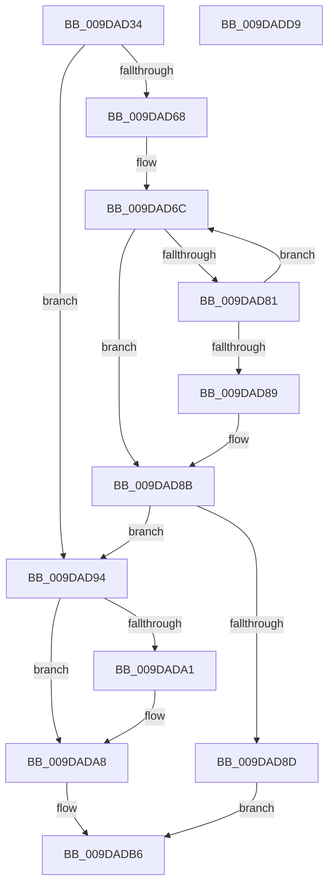

# ObpInsertCallbackByAltitude

- RVA: `0x009DAD34`–`0x009DADDA` (길이 `166` bytes)
- VA: `0x00000001409DAD34`
- 실행 섹션: `PAGE`
- PDB 이름 있음: `예`; PDB Function 태그: `아니요`
- unwind 정보 RVA: `0x00060300`
- 디코드: `51`개 명령, `166/166` bytes 표시
- 미해석 바이트: `0` (있으면 어셈블리에 `.byte`로 보존)

> 이 문서는 커널 이미지의 기계어와 PDB 기호를 분석해 생성했습니다. 4번과 5번은 함수 원형과 자료형을 바이너리 사용 방식에서 추정한 C 해석이며 원본 소스 복구 결과는 아닙니다.

## 1. Dependencies

- 직접 호출 지점: **3**; 고유 호출 대상: **3**
- 직접 호출자로 확인된 함수: **1**
- RIP 상대 이미지 참조: **0**

### Outgoing calls
- `0x009DAD54` → [ObpLockObjectTypeExclusive](ObpLockObjectTypeExclusive_function_009DB5C4.md) (function, `0x009DB5C4`)
- `0x009DAD78` → [RtlCompareAltitudes](../../text/45/RtlCompareAltitudes_function_0045D410.md) (function, `0x0045D410`)
- `0x009DADB9` → [ObpUnlockObjectType](ObpUnlockObjectType_function_009DB54C.md) (function, `0x009DB54C`)

### Direct callers
- [ObRegisterCallbacks](ObRegisterCallbacks_function_009DAB00.md) at `0x009DAC81`

### Static image references
- 디코드된 RIP-relative 메모리 참조가 없습니다.

## 2. Other-region calls and transfers

- 다른 실행 섹션으로 향하는 call: **1**
  - `0x009DAD78` → [RtlCompareAltitudes](../../text/45/RtlCompareAltitudes_function_0045D410.md) (`PAGE` → `.text`)
- 별도 외부 분기/꼬리 이동을 확인하지 못했습니다.

## 3. Assembly (complete function range)

```asm
009DAD34  48 89 5C 24 08                  mov qword ptr [rsp + 8], rbx
009DAD39  48 89 6C 24 10                  mov qword ptr [rsp + 0x10], rbp
009DAD3E  48 89 74 24 18                  mov qword ptr [rsp + 0x18], rsi
009DAD43  57                              push rdi
009DAD44  41 56                           push r14
009DAD46  41 57                           push r15
009DAD48  48 83 EC 20                     sub rsp, 0x20
009DAD4C  48 8B DA                        mov rbx, rdx
009DAD4F  48 8B E9                        mov rbp, rcx
009DAD52  33 F6                           xor esi, esi
009DAD54  E8 6B 08 00 00                  call 0x1409db5c4
009DAD59  4C 8D B5 C8 00 00 00            lea r14, [rbp + 0xc8]
009DAD60  49 8B 3E                        mov rdi, qword ptr [r14]
009DAD63  49 3B FE                        cmp rdi, r14
009DAD66  74 2C                           je 0x1409dad94
009DAD68  4C 8B 7B 18                     mov r15, qword ptr [rbx + 0x18]
009DAD6C  48 8B 4F 18                     mov rcx, qword ptr [rdi + 0x18]
009DAD70  49 8D 57 10                     lea rdx, [r15 + 0x10]
009DAD74  48 83 C1 10                     add rcx, 0x10
009DAD78  E8 93 26 A8 FF                  call 0x14045d410
009DAD7D  85 C0                           test eax, eax
009DAD7F  7E 0A                           jle 0x1409dad8b
009DAD81  48 8B 3F                        mov rdi, qword ptr [rdi]
009DAD84  49 3B FE                        cmp rdi, r14
009DAD87  75 E3                           jne 0x1409dad6c
009DAD89  85 C0                           test eax, eax
009DAD8B  75 07                           jne 0x1409dad94
009DAD8D  BE 11 00 1C C0                  mov esi, 0xc01c0011
009DAD92  EB 22                           jmp 0x1409dadb6
009DAD94  48 8B 47 08                     mov rax, qword ptr [rdi + 8]
009DAD98  48 8B 08                        mov rcx, qword ptr [rax]
009DAD9B  48 39 41 08                     cmp qword ptr [rcx + 8], rax
009DAD9F  74 07                           je 0x1409dada8
009DADA1  B9 03 00 00 00                  mov ecx, 3
009DADA6  CD 29                           int 0x29
009DADA8  48 89 0B                        mov qword ptr [rbx], rcx
009DADAB  48 89 43 08                     mov qword ptr [rbx + 8], rax
009DADAF  48 89 59 08                     mov qword ptr [rcx + 8], rbx
009DADB3  48 89 18                        mov qword ptr [rax], rbx
009DADB6  48 8B CD                        mov rcx, rbp
009DADB9  E8 8E 07 00 00                  call 0x1409db54c
009DADBE  48 8B 5C 24 40                  mov rbx, qword ptr [rsp + 0x40]
009DADC3  8B C6                           mov eax, esi
009DADC5  48 8B 74 24 50                  mov rsi, qword ptr [rsp + 0x50]
009DADCA  48 8B 6C 24 48                  mov rbp, qword ptr [rsp + 0x48]
009DADCF  48 83 C4 20                     add rsp, 0x20
009DADD3  41 5F                           pop r15
009DADD5  41 5E                           pop r14
009DADD7  5F                              pop rdi
009DADD8  C3                              ret
009DADD9  CC                              int3
```

## 4. C-style interpretation (structured pseudocode)

```c
__int64 __fastcall ObpInsertCallbackByAltitude(__int64 a1, __int64 a2)
{
    __int64 result;
    __int64 v_rsi;
    __int64 v_rsp;
    unsigned __int64 v_stack_p10;
    unsigned __int64 v_stack_p18;
    unsigned __int64 v_stack_p8;

    v_stack_p8 = v_rbx;
    v_stack_p10 = v_rbp;
    v_stack_p18 = v_rsi;
    v_rsp = (v_rsp) - (32);
    v_rsi = 0;
    result = ObpLockObjectTypeExclusive(a1, a2, a3, a4);
    if ((*(unsigned __int64 *)(a1 + 200)) == (a1 + 200)) goto loc_009DAD94;
loc_009DAD6C:
    a1 = (*(unsigned __int64 *)(*(unsigned __int64 *)(a1 + 200) + 24)) + (16);
    result = RtlCompareAltitudes(a1, *(unsigned __int64 *)(a2 + 24) + 16, a3, a4);
    if (condition_is_less_or_equal) goto loc_009DAD8B;
    if ((*(unsigned __int64 *)(*(unsigned __int64 *)(a1 + 200))) != (a1 + 200)) goto loc_009DAD6C;
loc_009DAD8B:
    if ((unsigned int)(result) != 0) goto loc_009DAD94;
    goto loc_009DADB6;
loc_009DAD94:
    if ((*(unsigned __int64 *)(*(unsigned __int64 *)(*(unsigned __int64 *)(*(unsigned __int64 *)(*(unsigned __int64 *)(a1 + 200)) + 8)) + 8)) != (*(unsigned __int64 *)(*(unsigned __int64 *)(*(unsigned __int64 *)(a1 + 200)) + 8))) {
        a1 = 3;
    }
    *(unsigned __int64 *)(a2) = a1;
    *(unsigned __int64 *)(a2 + 8) = *(unsigned __int64 *)(*(unsigned __int64 *)(*(unsigned __int64 *)(a1 + 200)) + 8);
    *(unsigned __int64 *)(a1 + 8) = a2;
    *(unsigned __int64 *)(*(unsigned __int64 *)(*(unsigned __int64 *)(*(unsigned __int64 *)(a1 + 200)) + 8)) = a2;
loc_009DADB6:
    result = ObpUnlockObjectType(a1, *(unsigned __int64 *)(a2 + 24) + 16, a3, a4);
    v_rsp = (v_rsp) + (32);
    return (unsigned int)((unsigned int)((unsigned int)(0xC01C0011ULL)));
}
```

## 5. (Beta) C Style

```c
int64_t ObpInsertCallbackByAltitude(void *Arg1, void *Arg2)
{
    uint8_t *arg1 = (uint8_t *)Arg1;
    uint8_t *arg2 = (uint8_t *)Arg2;

    int64_t result;
    int64_t local_rsi;
    int64_t local_rsp;
    uint64_t v_stack_p10;
    uint64_t v_stack_p18;
    uint64_t v_stack_p8;

    v_stack_p8 = local_rbx;
    v_stack_p10 = local_rbp;
    v_stack_p18 = local_rsi;
    local_rsp = (local_rsp) - (32);
    local_rsi = 0;
    result = ObpLockObjectTypeExclusive(Arg1, Arg2, a3, a4);
    if ((*(uint64_t *)(arg1 + 0xC8)) == (Arg1 + 200)) goto loc_009DAD94;
loc_009DAD6C:
    Arg1 = (*(uint64_t *)(*(uint64_t *)(arg1 + 0xC8) + 0x18)) + (16);
    result = RtlCompareAltitudes(Arg1, *(uint64_t *)(arg2 + 0x18) + 16, a3, a4);
    if (condition_is_less_or_equal) goto loc_009DAD8B;
    if ((*(uint64_t *)(*(uint64_t *)(arg1 + 0xC8))) != (Arg1 + 200)) goto loc_009DAD6C;
loc_009DAD8B:
    if ((uint32_t)(result) != 0) goto loc_009DAD94;
    goto loc_009DADB6;
loc_009DAD94:
    if ((*(uint64_t *)(*(uint64_t *)(*(uint64_t *)(*(uint64_t *)(*(uint64_t *)(arg1 + 0xC8)) + 0x8)) + 0x8)) != (*(uint64_t *)(*(uint64_t *)(*(uint64_t *)(arg1 + 0xC8)) + 0x8))) {
        Arg1 = 3;
    }
    *(void **)(arg2) = Arg1;
    *(uint64_t *)(arg2 + 0x8) = *(uint64_t *)(*(uint64_t *)(*(uint64_t *)(arg1 + 0xC8)) + 0x8);
    *(void **)(arg1 + 0x8) = Arg2;
    *(void **)(*(uint64_t *)(*(uint64_t *)(*(uint64_t *)(arg1 + 0xC8)) + 0x8)) = Arg2;
loc_009DADB6:
    result = ObpUnlockObjectType(Arg1, *(uint64_t *)(arg2 + 0x18) + 16, a3, a4);
    local_rsp = (local_rsp) + (32);
    return (uint32_t)((uint32_t)((uint32_t)(0xC01C0011ULL)));
}
```

### 관측된 메모리 오프셋

구조체 형식이 확인되지 않은 접근은 인자 기준의 오프셋으로만 기록했습니다.

| 기준 인자 | 오프셋 표현 | 폭 (bit) | 접근 |
|---|---:|---:|---|
| `Arg1` | `+ 0x0` | `64` | `R` |
| `Arg1` | `+ 0xC8` | `64` | `R` |
| `Arg2` | `+ 0x0` | `64` | `W` |
| `Arg2` | `+ 0x8` | `64` | `W` |
| `Arg2` | `+ 0x18` | `64` | `R` |

## 6. Execution-region graph

[열기: 2D/3D 그래프와 함수 탐색 컨트롤 패널](../../../control-panel.html?section=page&rva=0x009DAD34&view=graph)

- 2D 그래프는 위에서 아래로 흐르고, 3D 그래프는 빈 공간을 드래그해 회전합니다. Shift+드래그는 이동, 휠은 확대·축소, 함수 노드 선택은 대상 보고서 이동입니다.

### Static fallback


