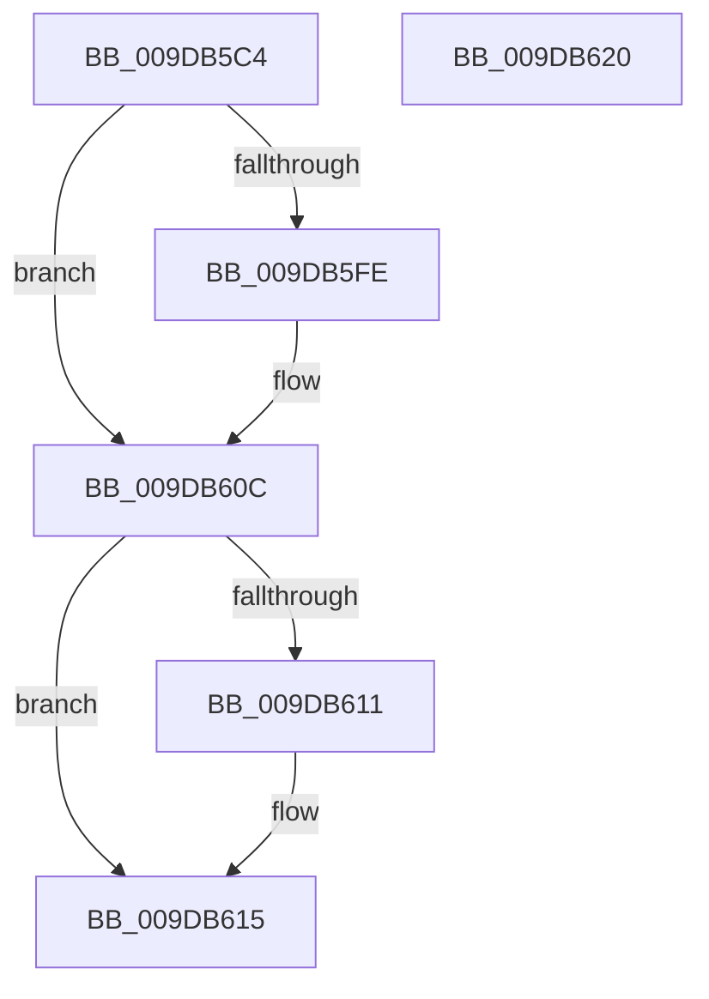

# ObpLockObjectTypeExclusive

- RVA: `0x009DB5C4`–`0x009DB621` (길이 `93` bytes)
- VA: `0x00000001409DB5C4`
- 실행 섹션: `PAGE`
- PDB 이름 있음: `예`; PDB Function 태그: `아니요`
- unwind 정보 RVA: `0x0005CAAC`
- 디코드: `26`개 명령, `93/93` bytes 표시
- 미해석 바이트: `0` (있으면 어셈블리에 `.byte`로 보존)

> 이 문서는 커널 이미지의 기계어와 PDB 기호를 분석해 생성했습니다. 4번과 5번은 함수 원형과 자료형을 바이너리 사용 방식에서 추정한 C 해석이며 원본 소스 복구 결과는 아닙니다.

## 1. Dependencies

- 직접 호출 지점: **2**; 고유 호출 대상: **2**
- 직접 호출자로 확인된 함수: **7**
- RIP 상대 이미지 참조: **0**

### Outgoing calls
- `0x009DB5EE` → [KeAbPreAcquire](../../text/21/KeAbPreAcquire_function_00210230.md) (function, `0x00210230`)
- `0x009DB607` → [ExfAcquirePushLockExclusiveEx](../../text/20/ExfAcquirePushLockExclusiveEx_function_0020FC90.md) (function, `0x0020FC90`)

### Direct callers
- [ObUnRegisterCallbacks](../74/ObUnRegisterCallbacks_function_0074F260.md) at `0x0074F294`
- [sub_00864E32](../86/Unknown_function_00864E32.md) at `0x00864EC0`
- [ObRegisterCallbacks](ObRegisterCallbacks_function_009DAB00.md) at `0x009DACBE`
- [ObpInsertCallbackByAltitude](ObpInsertCallbackByAltitude_function_009DAD34.md) at `0x009DAD54`
- [ObpCreateTypeArray](ObpCreateTypeArray_function_009DB4B4.md) at `0x009DB4D0`
- [ObCreateObjectTypeEx](../AB/ObCreateObjectTypeEx_function_00AB46D0.md) at `0x00AB4BD5`
- [ExpWorkerInitialization](../../init/C5/ExpWorkerInitialization_function_00C539A4.md) at `0x00C53BFE`

### Static image references
- 디코드된 RIP-relative 메모리 참조가 없습니다.

## 2. Other-region calls and transfers

- 다른 실행 섹션으로 향하는 call: **2**
  - `0x009DB5EE` → [KeAbPreAcquire](../../text/21/KeAbPreAcquire_function_00210230.md) (`PAGE` → `.text`)
  - `0x009DB607` → [ExfAcquirePushLockExclusiveEx](../../text/20/ExfAcquirePushLockExclusiveEx_function_0020FC90.md) (`PAGE` → `.text`)
- 별도 외부 분기/꼬리 이동을 확인하지 못했습니다.

## 3. Assembly (complete function range)

```asm
009DB5C4  48 89 5C 24 08                  mov qword ptr [rsp + 8], rbx
009DB5C9  57                              push rdi
009DB5CA  48 83 EC 20                     sub rsp, 0x20
009DB5CE  65 48 8B 04 25 88 01 00 00      mov rax, qword ptr gs:[0x188]
009DB5D7  48 8D B9 B8 00 00 00            lea rdi, [rcx + 0xb8]
009DB5DE  45 33 C0                        xor r8d, r8d
009DB5E1  33 D2                           xor edx, edx
009DB5E3  48 8B CF                        mov rcx, rdi
009DB5E6  66 FF 88 E6 01 00 00            dec word ptr [rax + 0x1e6]
009DB5ED  90                              nop
009DB5EE  E8 3D 4C 83 FF                  call 0x140210230
009DB5F3  F0 48 0F BA 2F 00               lock bts qword ptr [rdi], 0
009DB5F9  48 8B D8                        mov rbx, rax
009DB5FC  73 0E                           jae 0x1409db60c
009DB5FE  4C 8B C7                        mov r8, rdi
009DB601  48 8B D0                        mov rdx, rax
009DB604  48 8B CF                        mov rcx, rdi
009DB607  E8 84 46 83 FF                  call 0x14020fc90
009DB60C  48 85 DB                        test rbx, rbx
009DB60F  74 04                           je 0x1409db615
009DB611  C6 43 0A 01                     mov byte ptr [rbx + 0xa], 1
009DB615  48 8B 5C 24 30                  mov rbx, qword ptr [rsp + 0x30]
009DB61A  48 83 C4 20                     add rsp, 0x20
009DB61E  5F                              pop rdi
009DB61F  C3                              ret
009DB620  CC                              int3
```

## 4. C-style interpretation (structured pseudocode)

```c
__int64 __fastcall ObpLockObjectTypeExclusive(__int64 a1, int a2, int a3)
{
    __int64 result;
    __int64 v_rsp;
    unsigned __int64 v_stack_p8;

    v_stack_p8 = v_rbx;
    v_rsp = (v_rsp) - (32);
    a3 = 0;
    a2 = 0;
    result = KeAbPreAcquire(a1 + 184, a2, a3, a4);
    if (!(condition_is_above_or_equal)) {
        a3 = a1 + 184;
        a2 = result;
        a1 = a1 + 184;
        result = ExfAcquirePushLockExclusiveEx(a1, a2, a3, a4);
    }
    if (result != 0) {
        *(unsigned __int8 *)(result + 10) = 1;
    }
    v_rsp = (v_rsp) + (32);
    return result;
}
```

## 5. (Beta) C Style

```c
int64_t ObpLockObjectTypeExclusive(void *Arg1, int32_t Arg2, int32_t Arg3)
{
    uint8_t *arg1 = (uint8_t *)Arg1;

    int64_t result;
    int64_t local_rsp;
    uint64_t v_stack_p8;

    v_stack_p8 = local_rbx;
    local_rsp = (local_rsp) - (32);
    Arg3 = 0;
    Arg2 = 0;
    result = KeAbPreAcquire(Arg1 + 184, Arg2, Arg3, a4);
    if (!(condition_is_above_or_equal)) {
        Arg3 = Arg1 + 184;
        Arg2 = result;
        Arg1 = Arg1 + 184;
        result = ExfAcquirePushLockExclusiveEx(Arg1, Arg2, Arg3, a4);
    }
    if (result != 0) {
        *(uint8_t *)(result + 0xA) = 1;
    }
    local_rsp = (local_rsp) + (32);
    return result;
}
```

### 관측된 메모리 오프셋

구조체 형식이 확인되지 않은 접근은 인자 기준의 오프셋으로만 기록했습니다.

| 기준 인자 | 오프셋 표현 | 폭 (bit) | 접근 |
|---|---:|---:|---|
| `Arg1` | `+ 0x0` | `64` | `R/W` |
| `Arg1` | `+ 0xB8` | `64` | `R` |

## 6. Execution-region graph

[열기: 2D/3D 그래프와 함수 탐색 컨트롤 패널](../../../control-panel.html?section=page&rva=0x009DB5C4&view=graph)

- 2D 그래프는 위에서 아래로 흐르고, 3D 그래프는 빈 공간을 드래그해 회전합니다. Shift+드래그는 이동, 휠은 확대·축소, 함수 노드 선택은 대상 보고서 이동입니다.

### Static fallback


