# ObpProcessRemoveObjectQueue

- RVA: `0x009D7B40`–`0x009D7E21` (길이 `737` bytes)
- VA: `0x00000001409D7B40`
- 실행 섹션: `PAGE`
- PDB 이름 있음: `예`; PDB Function 태그: `예`
- unwind 정보 RVA: `0x000A2ADC`
- 디코드: `170`개 명령, `737/737` bytes 표시
- 미해석 바이트: `0` (있으면 어셈블리에 `.byte`로 보존)

> 이 문서는 커널 이미지의 기계어와 PDB 기호를 분석해 생성했습니다. 4번과 5번은 함수 원형과 자료형을 바이너리 사용 방식에서 추정한 C 해석이며 원본 소스 복구 결과는 아닙니다.

## 1. Dependencies

- 직접 호출 지점: **7**; 고유 호출 대상: **7**
- 직접 호출자로 확인된 함수: **0**
- RIP 상대 이미지 참조: **24**

### Outgoing calls
- `0x009D7C7F` → [KeInitializeDpc](../../text/45/KeInitializeDpc_function_0045BBD0.md) (function, `0x0045BBD0`)
- `0x009D7C97` → [KeInsertQueueDpc](../../text/20/KeInsertQueueDpc_function_00207C50.md) (function, `0x00207C50`)
- `0x009D7CF7` → [OBJECT_HEADER_TO_HANDLE_REVOCATION_INFO](../../text/3A/OBJECT_HEADER_TO_HANDLE_REVOCATION_INFO_function_003A1840.md) (function, `0x003A1840`)
- `0x009D7D04` → [ObpHandleRevocationBlockRemoveObject](ObpHandleRevocationBlockRemoveObject_function_009D7E30.md) (function, `0x009D7E30`)
- `0x009D7D15` → [ObpDeregisterObject](ObpDeregisterObject_function_009D7F78.md) (function, `0x009D7F78`)
- `0x009D7D24` → [ObpRemoveObjectRoutine](../86/ObpRemoveObjectRoutine_function_00864A60.md) (function, `0x00864A60`)
- `0x009D7D5F` → [ExfUnblockPushLock](../../text/2A/ExfUnblockPushLock_function_002A3FE0.md) (function, `0x002A3FE0`)

### Direct callers
- 이 함수 시작 RVA로 연결되는 직접 call은 확인되지 않았습니다. 간접 호출은 완전히 역산할 수 없습니다.

### Static image references
- `0x009D7B69` → RVA `0x00EF01F0` (`.data`; read)
- `0x009D7BAE` → RVA `0x00EF0200` (`.data`; read)
- `0x009D7BBB` → RVA `0x00EF0208` (`.data`; read)
- `0x009D7BC2` → RVA `0x00FC73E0` (`ALMOSTRO`; read)
- `0x009D7BCE` → RVA `0x00FC72A0` (`ALMOSTRO`; read)
- `0x009D7BE0` → RVA `0x00FC72B0` (`ALMOSTRO`; read)
- `0x009D7BEA` → RVA `0x00F475DC` (`.data`; read)
- `0x009D7C59` → RVA `0x00EF01C0` (`.data`; read)
- `0x009D7C62` → RVA `0x0069BEC0` (`KiSchedulerDpc`; read)
- `0x009D7C69` → RVA `0x00EF0198` (`.data`; read)
- `0x009D7C70` → RVA `0x00EF0180` (`.data`; read)
- `0x009D7C87` → RVA `0x00EF01E8` (`.data`; write)
- `0x009D7CE3` → RVA `0x00EF0200` (`.data`; write)
- `0x009D7CED` → RVA `0x00F0F640` (`.data`; read/write)
- `0x009D7D09` → RVA `0x00FC5010` (`ALMOSTRO`; read)
- `0x009D7D31` → RVA `0x00F0F640` (`.data`; read)
- `0x009D7D4D` → RVA `0x00F0F5C0` (`.data`; read)
- `0x009D7DA2` → RVA `0x00EF01F0` (`.data`; write)
- `0x009D7DCB` → RVA `0x00EF0E1C` (`.data`; read)
- `0x009D7DD1` → RVA `0x00EF0208` (`.data`; write)
- `0x009D7DFC` → RVA `0x00EF01C0` (`.data`; write)
- `0x009D7E03` → RVA `0x00EF01C8` (`.data`; read)
- `0x009D7E0A` → RVA `0x00EF01D8` (`.data`; write)
- `0x009D7E15` → RVA `0x00EF01E0` (`.data`; write)

## 2. Other-region calls and transfers

- 다른 실행 섹션으로 향하는 call: **4**
  - `0x009D7C7F` → [KeInitializeDpc](../../text/45/KeInitializeDpc_function_0045BBD0.md) (`PAGE` → `.text`)
  - `0x009D7C97` → [KeInsertQueueDpc](../../text/20/KeInsertQueueDpc_function_00207C50.md) (`PAGE` → `.text`)
  - `0x009D7CF7` → [OBJECT_HEADER_TO_HANDLE_REVOCATION_INFO](../../text/3A/OBJECT_HEADER_TO_HANDLE_REVOCATION_INFO_function_003A1840.md) (`PAGE` → `.text`)
  - `0x009D7D5F` → [ExfUnblockPushLock](../../text/2A/ExfUnblockPushLock_function_002A3FE0.md) (`PAGE` → `.text`)
- call이 아닌 외부 분기/꼬리 이동: **2**
  - `0x009D7DAB` → [sub_00B2FA58](../B2/Unknown_function_00B2FA58.md) (`tail-transfer`)
  - `0x009D7DB8` → [sub_00B2FA58](../B2/Unknown_function_00B2FA58.md) (`tail-transfer`)

## 3. Assembly (complete function range)

```asm
009D7B40  48 89 5C 24 08                  mov qword ptr [rsp + 8], rbx
009D7B45  48 89 6C 24 18                  mov qword ptr [rsp + 0x18], rbp
009D7B4A  48 89 74 24 20                  mov qword ptr [rsp + 0x20], rsi
009D7B4F  57                              push rdi
009D7B50  41 54                           push r12
009D7B52  41 55                           push r13
009D7B54  41 56                           push r14
009D7B56  41 57                           push r15
009D7B58  48 83 EC 30                     sub rsp, 0x30
009D7B5C  45 33 F6                        xor r14d, r14d
009D7B5F  48 BB 00 20 5F A0 12 00 00 00   movabs rbx, 0x12a05f2000
009D7B69  4C 39 35 80 86 51 00            cmp qword ptr [rip + 0x518680], r14
009D7B70  48 BF 00 40 23 0E 43 00 00 00   movabs rdi, 0x430e234000
009D7B7A  41 BF 01 00 00 00               mov r15d, 1
009D7B80  0F 84 07 02 00 00               je 0x1409d7d8d
009D7B86  49 BC B0 03 00 00 80 F7 FF FF   movabs r12, 0xfffff780000003b0
009D7B90  49 BD 08 00 00 00 80 F7 FF FF   movabs r13, 0xfffff78000000008
009D7B9A  49 8B 14 24                     mov rdx, qword ptr [r12]
009D7B9E  49 8B 4D 00                     mov rcx, qword ptr [r13]
009D7BA2  49 8B 04 24                     mov rax, qword ptr [r12]
009D7BA6  48 3B D0                        cmp rdx, rax
009D7BA9  75 EF                           jne 0x1409d7b9a
009D7BAB  48 2B CA                        sub rcx, rdx
009D7BAE  48 3B 0D 4B 86 51 00            cmp rcx, qword ptr [rip + 0x51864b]
009D7BB5  0F 82 2F 01 00 00               jb 0x1409d7cea
009D7BBB  4C 39 35 46 86 51 00            cmp qword ptr [rip + 0x518646], r14
009D7BC2  48 8D 05 17 F8 5E 00            lea rax, [rip + 0x5ef817]
009D7BC9  48 89 44 24 20                  mov qword ptr [rsp + 0x20], rax
009D7BCE  48 8D 05 CB F6 5E 00            lea rax, [rip + 0x5ef6cb]
009D7BD5  48 89 44 24 28                  mov qword ptr [rsp + 0x28], rax
009D7BDA  0F 84 DD 01 00 00               je 0x1409d7dbd
009D7BE0  8B 05 CA F6 5E 00               mov eax, dword ptr [rip + 0x5ef6ca]
009D7BE6  85 C0                           test eax, eax
009D7BE8  74 6F                           je 0x1409d7c59
009D7BEA  44 38 35 EB F9 56 00            cmp byte ptr [rip + 0x56f9eb], r14b
009D7BF1  74 66                           je 0x1409d7c59
009D7BF3  45 8B C6                        mov r8d, r14d
009D7BF6  4C 8D 5C 24 28                  lea r11, [rsp + 0x28]
009D7BFB  41 BA 02 00 00 00               mov r10d, 2
009D7C01  49 8B 03                        mov rax, qword ptr [r11]
009D7C04  41 8B FE                        mov edi, r14d
009D7C07  48 8B 18                        mov rbx, qword ptr [rax]
009D7C0A  8B 68 10                        mov ebp, dword ptr [rax + 0x10]
009D7C0D  44 8D 0C 03                     lea r9d, [rbx + rax]
009D7C11  45 03 C8                        add r9d, r8d
009D7C14  85 ED                           test ebp, ebp
009D7C16  74 23                           je 0x1409d7c3b
009D7C18  48 8B F3                        mov rsi, rbx
009D7C1B  48 63 16                        movsxd rdx, dword ptr [rsi]
009D7C1E  FF C7                           inc edi
009D7C20  48 8B C2                        mov rax, rdx
009D7C23  48 8D 76 04                     lea rsi, [rsi + 4]
009D7C27  48 C1 F8 04                     sar rax, 4
009D7C2B  8B 0C 18                        mov ecx, dword ptr [rax + rbx]
009D7C2E  03 CA                           add ecx, edx
009D7C30  44 33 C9                        xor r9d, ecx
009D7C33  44 0F AF CF                     imul r9d, edi
009D7C37  3B FD                           cmp edi, ebp
009D7C39  72 E0                           jb 0x1409d7c1b
009D7C3B  49 83 EB 08                     sub r11, 8
009D7C3F  47 8D 04 48                     lea r8d, [r8 + r9*2]
009D7C43  41 83 C2 FF                     add r10d, -1
009D7C47  75 B8                           jne 0x1409d7c01
009D7C49  41 8B C0                        mov eax, r8d
009D7C4C  48 3B 05 B5 85 51 00            cmp rax, qword ptr [rip + 0x5185b5]
009D7C53  0F 85 84 01 00 00               jne 0x1409d7ddd
009D7C59  4C 39 35 60 85 51 00            cmp qword ptr [rip + 0x518560], r14
009D7C60  74 3A                           je 0x1409d7c9c
009D7C62  48 8D 15 57 42 CC FF            lea rdx, [rip - 0x33bda9]
009D7C69  48 39 15 28 85 51 00            cmp qword ptr [rip + 0x518528], rdx
009D7C70  48 8D 1D 09 85 51 00            lea rbx, [rip + 0x518509]
009D7C77  74 0B                           je 0x1409d7c84
009D7C79  4C 8B C3                        mov r8, rbx
009D7C7C  48 8B CB                        mov rcx, rbx
009D7C7F  E8 4C 3F A8 FF                  call 0x14045bbd0
009D7C84  45 33 C0                        xor r8d, r8d
009D7C87  48 C7 05 56 85 51 00 40 2B 3A 00  mov qword ptr [rip + 0x518556], 0x3a2b40
009D7C92  33 D2                           xor edx, edx
009D7C94  48 8B CB                        mov rcx, rbx
009D7C97  E8 B4 FF 82 FF                  call 0x140207c50
009D7C9C  49 8B 0C 24                     mov rcx, qword ptr [r12]
009D7CA0  4D 8B 45 00                     mov r8, qword ptr [r13]
009D7CA4  49 8B 04 24                     mov rax, qword ptr [r12]
009D7CA8  48 3B C8                        cmp rcx, rax
009D7CAB  75 EF                           jne 0x1409d7c9c
009D7CAD  0F 31                           rdtsc
009D7CAF  48 C1 E2 20                     shl rdx, 0x20
009D7CB3  49 B9 00 20 5F A0 12 00 00 00   movabs r9, 0x12a05f2000
009D7CBD  48 0B C2                        or rax, rdx
009D7CC0  33 D2                           xor edx, edx
009D7CC2  48 C1 E8 04                     shr rax, 4
009D7CC6  48 69 C0 BF CB 7F 02            imul rax, rax, 0x27fcbbf
009D7CCD  49 F7 F1                        div r9
009D7CD0  48 2B D1                        sub rdx, rcx
009D7CD3  48 B9 00 40 23 0E 43 00 00 00   movabs rcx, 0x430e234000
009D7CDD  48 03 CA                        add rcx, rdx
009D7CE0  49 03 C8                        add rcx, r8
009D7CE3  48 89 0D 16 85 51 00            mov qword ptr [rip + 0x518516], rcx
009D7CEA  49 8B DF                        mov rbx, r15
009D7CED  48 87 1D 4C 79 53 00            xchg qword ptr [rip + 0x53794c], rbx
009D7CF4  48 8B CB                        mov rcx, rbx
009D7CF7  E8 44 9B 9C FF                  call 0x1403a1840
009D7CFC  48 85 C0                        test rax, rax
009D7CFF  74 08                           je 0x1409d7d09
009D7D01  48 8B C8                        mov rcx, rax
009D7D04  E8 27 01 00 00                  call 0x1409d7e30
009D7D09  44 39 35 00 D3 5E 00            cmp dword ptr [rip + 0x5ed300], r14d
009D7D10  74 08                           je 0x1409d7d1a
009D7D12  48 8B CB                        mov rcx, rbx
009D7D15  E8 5E 02 00 00                  call 0x1409d7f78
009D7D1A  48 8B 7B 08                     mov rdi, qword ptr [rbx + 8]
009D7D1E  41 8A D7                        mov dl, r15b
009D7D21  48 8B CB                        mov rcx, rbx
009D7D24  E8 37 CD E8 FF                  call 0x140864a60
009D7D29  48 8B DF                        mov rbx, rdi
009D7D2C  48 85 FF                        test rdi, rdi
009D7D2F  75 51                           jne 0x1409d7d82
009D7D31  4C 39 3D 08 79 53 00            cmp qword ptr [rip + 0x537908], r15
009D7D38  75 B0                           jne 0x1409d7cea
009D7D3A  49 8B C7                        mov rax, r15
009D7D3D  F0 4C 0F B1 35 FA 78 53 00      lock cmpxchg qword ptr [rip + 0x5378fa], r14
009D7D46  75 A2                           jne 0x1409d7cea
009D7D48  F0 44 09 34 24                  lock or dword ptr [rsp], r14d
009D7D4D  4C 39 35 6C 78 53 00            cmp qword ptr [rip + 0x53786c], r14
009D7D54  74 0E                           je 0x1409d7d64
009D7D56  33 D2                           xor edx, edx
009D7D58  48 8D 0D 61 78 53 00            lea rcx, [rip + 0x537861]
009D7D5F  E8 7C C2 8C FF                  call 0x1402a3fe0
009D7D64  48 8B 5C 24 60                  mov rbx, qword ptr [rsp + 0x60]
009D7D69  48 8B 6C 24 70                  mov rbp, qword ptr [rsp + 0x70]
009D7D6E  48 8B 74 24 78                  mov rsi, qword ptr [rsp + 0x78]
009D7D73  48 83 C4 30                     add rsp, 0x30
009D7D77  41 5F                           pop r15
009D7D79  41 5E                           pop r14
009D7D7B  41 5D                           pop r13
009D7D7D  41 5C                           pop r12
009D7D7F  5F                              pop rdi
009D7D80  C3                              ret
009D7D81  CC                              int3
009D7D82  49 3B FF                        cmp rdi, r15
009D7D85  0F 85 69 FF FF FF               jne 0x1409d7cf4
009D7D8B  EB A4                           jmp 0x1409d7d31
009D7D8D  0F 31                           rdtsc
009D7D8F  48 C1 E2 20                     shl rdx, 0x20
009D7D93  48 0B C2                        or rax, rdx
009D7D96  48 C1 E8 04                     shr rax, 4
009D7D9A  69 C8 BF CB 7F 02               imul ecx, eax, 0x27fcbbf
009D7DA0  8B C1                           mov eax, ecx
009D7DA2  48 89 05 47 84 51 00            mov qword ptr [rip + 0x518447], rax
009D7DA9  85 C9                           test ecx, ecx
009D7DAB  0F 85 A7 7C 15 00               jne 0x140b2fa58
009D7DB1  4C 89 3D 38 84 51 00            mov qword ptr [rip + 0x518438], r15
009D7DB8  E9 9B 7C 15 00                  jmp 0x140b2fa58
009D7DBD  8B 05 ED F4 5E 00               mov eax, dword ptr [rip + 0x5ef4ed]
009D7DC3  85 C0                           test eax, eax
009D7DC5  0F 84 8E FE FF FF               je 0x1409d7c59
009D7DCB  8B 05 4B 90 51 00               mov eax, dword ptr [rip + 0x51904b]
009D7DD1  48 89 05 30 84 51 00            mov qword ptr [rip + 0x518430], rax
009D7DD8  E9 03 FE FF FF                  jmp 0x1409d7be0
009D7DDD  4C 39 35 DC 83 51 00            cmp qword ptr [rip + 0x5183dc], r14
009D7DE4  0F 85 78 FE FF FF               jne 0x1409d7c62
009D7DEA  C7 44 24 68 00 90 10 00         mov dword ptr [rsp + 0x68], 0x109000
009D7DF2  0F 57 C0                        xorps xmm0, xmm0
009D7DF5  8B 44 24 68                     mov eax, dword ptr [rsp + 0x68]
009D7DF9  C1 C8 CC                        ror eax, 0xcc
009D7DFC  48 89 05 BD 83 51 00            mov qword ptr [rip + 0x5183bd], rax
009D7E03  0F 11 05 BE 83 51 00            movups xmmword ptr [rip + 0x5183be], xmm0
009D7E0A  48 C7 05 C3 83 51 00 0A 01 00 00  mov qword ptr [rip + 0x5183c3], 0x10a
009D7E15  48 89 1D C4 83 51 00            mov qword ptr [rip + 0x5183c4], rbx
009D7E1C  E9 38 FE FF FF                  jmp 0x1409d7c59
```

## 4. C-style interpretation (structured pseudocode)

```c
__int64 __fastcall ObpProcessRemoveObjectQueue(void)
{
    __int64 result;
    __int64 v_r10;
    __int64 v_r11;
    __int64 v_r14;
    __int64 v_rdi;
    __int64 v_rsp;
    unsigned __int64 v_stack_m30;
    unsigned __int64 v_stack_m38;
    unsigned int v_stack_m58;
    unsigned __int64 v_stack_p18;
    unsigned __int64 v_stack_p20;
    unsigned int v_stack_p68;
    unsigned __int64 v_stack_p8;

    v_stack_p8 = v_rbx;
    v_stack_p18 = v_rbp;
    v_stack_p20 = v_rsi;
    v_rsp = (v_rsp) - (48);
    v_r14 = 0;
    if ((*(unsigned __int64 *)(v_rip + 5342848)) == 0) goto loc_009D7D8D;
loc_009D7B9A:
    if ((*(unsigned __int64 *)(v_r12)) != (*(unsigned __int64 *)(v_r12))) goto loc_009D7B9A;
    a1 = (*(unsigned __int64 *)(v_r13)) - (*(unsigned __int64 *)(v_r12));
    if (a1 < (*(unsigned __int64 *)(v_rip + 5342795))) goto loc_009D7CEA;
    v_stack_m38 = v_rip + 6223895;
    v_stack_m30 = v_rip + 6223563;
    if ((*(unsigned __int64 *)(v_rip + 5342790)) == 0) goto loc_009D7DBD;
loc_009D7BE0:
    if ((unsigned int)((unsigned int)(*(unsigned int *)(v_rip + 6223562))) == 0) goto loc_009D7C59;
    if ((*(unsigned __int8 *)(v_rip + 5700075)) == 0) goto loc_009D7C59;
loc_009D7C01:
    a4 = (unsigned int)((*(unsigned __int64 *)(*(unsigned __int64 *)(v_stack_m30)) + *(unsigned __int64 *)(v_stack_m30) * 1) + (0));
    if ((unsigned int)((unsigned int)(*(unsigned int *)(*(unsigned __int64 *)(v_stack_m30) + 16))) == 0) goto loc_009D7C3B;
loc_009D7C1B:
    v_rdi = (unsigned int)((0) + 1);
    result = ((int)(*(unsigned int *)(*(unsigned __int64 *)(*(unsigned __int64 *)(v_stack_m30))))) >> (4);
    a1 = (unsigned int)(((unsigned int)(*(unsigned int *)(result + *(unsigned __int64 *)(*(unsigned __int64 *)(v_stack_m30)) * 1))) + ((unsigned int)((int)(*(unsigned int *)(*(unsigned __int64 *)(*(unsigned __int64 *)(v_stack_m30)))))));
    a4 = (unsigned int)((a4) ^ ((unsigned int)(a1)));
    a4 = (unsigned int)((a4) * ((unsigned int)(v_rdi)));
    if (((unsigned int)(v_rdi)) < ((unsigned int)((unsigned int)(*(unsigned int *)(*(unsigned __int64 *)(v_stack_m30) + 16))))) goto loc_009D7C1B;
loc_009D7C3B:
    v_r11 = (v_stack_m30) - (8);
    v_r10 = (unsigned int)((2) + (-1));
    if (condition_is_not_equal) goto loc_009D7C01;
    if (((unsigned int)((unsigned int)(0 + a4 * 2))) != (*(unsigned __int64 *)(v_rip + 5342645))) goto loc_009D7DDD;
loc_009D7C59:
    if ((*(unsigned __int64 *)(v_rip + 5342560)) == 0) goto loc_009D7C9C;
loc_009D7C62:
    result = (unsigned int)((unsigned int)(0 + a4 * 2));
    if ((*(unsigned __int64 *)(v_rip + 5342504)) != (v_rip - 3390889)) {
        a3 = v_rip + 5342473;
        a1 = v_rip + 5342473;
        result = KeInitializeDpc(a1, v_rip - 3390889, a3, a4);
    }
    a3 = 0;
    *(unsigned __int64 *)(v_rip + 5342550) = 0x3A2B40ULL;
    a2 = 0;
    result = KeInsertQueueDpc(v_rip + 5342473, a2, a3, a4);
loc_009D7C9C:
    if ((*(unsigned __int64 *)(v_r12)) != (*(unsigned __int64 *)(v_r12))) goto loc_009D7C9C;
    a2 = (a2) << (32);
    result = (*(unsigned __int64 *)(v_r12)) | (a2);
    a2 = 0;
    result = (result) >> (4);
    result = (result) * (result);
    a2 = (a2) - (*(unsigned __int64 *)(v_r12));
    a1 = (*(unsigned __int64 *)(v_r12)) + (a2);
    a1 = (a1) + (*(unsigned __int64 *)(v_r13));
    *(unsigned __int64 *)(v_rip + 5342486) = a1;
loc_009D7CEA:
loc_009D7CF4:
    result = OBJECT_HEADER_TO_HANDLE_REVOCATION_INFO(1, a2, *(unsigned __int64 *)(v_r13), a4);
    if (result != 0) {
        a1 = result;
        result = ObpHandleRevocationBlockRemoveObject(a1, a2, *(unsigned __int64 *)(v_r13), a4);
    }
    if ((*(unsigned int *)(v_rip + 6214400)) != 0) {
        a1 = 1;
        result = ObpDeregisterObject(a1, a2, *(unsigned __int64 *)(v_r13), a4);
    }
    result = ObpRemoveObjectRoutine(1, 1, *(unsigned __int64 *)(v_r13), a4);
    if (*(unsigned __int64 *)(1 + 8) != 0) goto loc_009D7D82;
loc_009D7D31:
    if ((*(unsigned __int64 *)(v_rip + 5470472)) != 1) goto loc_009D7CEA;
    if ((*(unsigned __int64 *)(v_rip + 5470472)) != 1) goto loc_009D7CEA;
    result = 1;
    if ((*(unsigned __int64 *)(v_rip + 5470316)) != 0) {
        a2 = 0;
        a1 = v_rip + 5470305;
        result = ExfUnblockPushLock(a1, a2, *(unsigned __int64 *)(v_r13), a4);
    }
    v_rsp = (v_rsp) + (48);
    return result;
loc_009D7D82:
    if ((*(unsigned __int64 *)(1 + 8)) != 1) goto loc_009D7CF4;
    goto loc_009D7D31;
loc_009D7D8D:
    a2 = (a2) << (32);
    result = (result) | (a2);
    result = (result) >> (4);
    a1 = (unsigned int)((a1) * ((unsigned int)(result)));
    *(unsigned __int64 *)(v_rip + 5342279) = (unsigned int)((unsigned int)(a1));
    *(unsigned __int64 *)(v_rip + 5342264) = 1;
loc_009D7DBD:
    if ((unsigned int)((unsigned int)(*(unsigned int *)(v_rip + 6223085))) == 0) goto loc_009D7C59;
    *(unsigned __int64 *)(v_rip + 5342256) = (unsigned int)(*(unsigned int *)(v_rip + 5345355));
    goto loc_009D7BE0;
loc_009D7DDD:
    if ((*(unsigned __int64 *)(v_rip + 5342172)) != 0) goto loc_009D7C62;
    v_stack_p68 = 0x109000ULL;
    *(unsigned __int64 *)(v_rip + 5342141) = (unsigned int)(v_stack_p68);
    *(unsigned __int64 *)(v_rip + 5342142) = v_xmm0;
    *(unsigned __int64 *)(v_rip + 5342147) = 266;
    *(unsigned __int64 *)(v_rip + 5342148) = v_stack_p8;
    goto loc_009D7C59;
}
```

## 5. (Beta) C Style

```c
void ObpProcessRemoveObjectQueue(void)
{
    int64_t result;
    int64_t local_r10;
    int64_t local_r11;
    int64_t local_r14;
    int64_t local_rdi;
    int64_t local_rsp;
    uint64_t v_stack_m30;
    uint64_t v_stack_m38;
    uint32_t v_stack_m58;
    uint64_t v_stack_p18;
    uint64_t v_stack_p20;
    uint32_t v_stack_p68;
    uint64_t v_stack_p8;

    v_stack_p8 = local_rbx;
    v_stack_p18 = local_rbp;
    v_stack_p20 = local_rsi;
    local_rsp = (local_rsp) - (48);
    local_r14 = 0;
    if ((*(uint64_t *)(v_rip + 0x518680)) == 0) goto loc_009D7D8D;
loc_009D7B9A:
    if ((*(uint64_t *)(local_r12)) != (*(uint64_t *)(local_r12))) goto loc_009D7B9A;
    a1 = (*(uint64_t *)(local_r13)) - (*(uint64_t *)(local_r12));
    if (a1 < (*(uint64_t *)(v_rip + 0x51864B))) goto loc_009D7CEA;
    v_stack_m38 = v_rip + 6223895;
    v_stack_m30 = v_rip + 6223563;
    if ((*(uint64_t *)(v_rip + 0x518646)) == 0) goto loc_009D7DBD;
loc_009D7BE0:
    if ((uint32_t)((uint32_t)(*(uint32_t *)(v_rip + 0x5EF6CA))) == 0) goto loc_009D7C59;
    if ((*(uint8_t *)(v_rip + 0x56F9EB)) == 0) goto loc_009D7C59;
loc_009D7C01:
    a4 = (uint32_t)((*(uint64_t *)(*(uint64_t *)(v_stack_m30)) + *(uint64_t *)(v_stack_m30) * 1) + (0));
    if ((uint32_t)((uint32_t)(*(uint32_t *)(*(uint64_t *)(v_stack_m30) + 0x10))) == 0) goto loc_009D7C3B;
loc_009D7C1B:
    local_rdi = (uint32_t)((0) + 1);
    result = ((int32_t)(*(uint32_t *)(*(uint64_t *)(*(uint64_t *)(v_stack_m30))))) >> (4);
    a1 = (uint32_t)(((uint32_t)(*(uint32_t *)(result + *(uint64_t *)(*(uint64_t *)(v_stack_m30)) * 1))) + ((uint32_t)((int32_t)(*(uint32_t *)(*(uint64_t *)(*(uint64_t *)(v_stack_m30)))))));
    a4 = (uint32_t)((a4) ^ ((uint32_t)(a1)));
    a4 = (uint32_t)((a4) * ((uint32_t)(local_rdi)));
    if (((uint32_t)(local_rdi)) < ((uint32_t)((uint32_t)(*(uint32_t *)(*(uint64_t *)(v_stack_m30) + 0x10))))) goto loc_009D7C1B;
loc_009D7C3B:
    local_r11 = (v_stack_m30) - (8);
    local_r10 = (uint32_t)((2) + (-1));
    if (condition_is_not_equal) goto loc_009D7C01;
    if (((uint32_t)((uint32_t)(0 + a4 * 2))) != (*(uint64_t *)(v_rip + 0x5185B5))) goto loc_009D7DDD;
loc_009D7C59:
    if ((*(uint64_t *)(v_rip + 0x518560)) == 0) goto loc_009D7C9C;
loc_009D7C62:
    result = (uint32_t)((uint32_t)(0 + a4 * 2));
    if ((*(uint64_t *)(v_rip + 0x518528)) != (v_rip - 3390889)) {
        a3 = v_rip + 5342473;
        a1 = v_rip + 5342473;
        result = KeInitializeDpc(a1, v_rip - 3390889, a3, a4);
    }
    a3 = 0;
    *(uint64_t *)(v_rip + 0x518556) = 0x3A2B40ULL;
    a2 = 0;
    result = KeInsertQueueDpc(v_rip + 5342473, a2, a3, a4);
loc_009D7C9C:
    if ((*(uint64_t *)(local_r12)) != (*(uint64_t *)(local_r12))) goto loc_009D7C9C;
    a2 = (a2) << (32);
    result = (*(uint64_t *)(local_r12)) | (a2);
    a2 = 0;
    result = (result) >> (4);
    result = (result) * (result);
    a2 = (a2) - (*(uint64_t *)(local_r12));
    a1 = (*(uint64_t *)(local_r12)) + (a2);
    a1 = (a1) + (*(uint64_t *)(local_r13));
    *(uint64_t *)(v_rip + 0x518516) = a1;
loc_009D7CEA:
loc_009D7CF4:
    result = OBJECT_HEADER_TO_HANDLE_REVOCATION_INFO(1, a2, *(uint64_t *)(local_r13), a4);
    if (result != 0) {
        a1 = result;
        result = ObpHandleRevocationBlockRemoveObject(a1, a2, *(uint64_t *)(local_r13), a4);
    }
    if ((*(uint32_t *)(v_rip + 0x5ED300)) != 0) {
        a1 = 1;
        result = ObpDeregisterObject(a1, a2, *(uint64_t *)(local_r13), a4);
    }
    result = ObpRemoveObjectRoutine(1, 1, *(uint64_t *)(local_r13), a4);
    if (*(uint64_t *)(1 + 0x8) != 0) goto loc_009D7D82;
loc_009D7D31:
    if ((*(uint64_t *)(v_rip + 0x537908)) != 1) goto loc_009D7CEA;
    if ((*(uint64_t *)(v_rip + 0x537908)) != 1) goto loc_009D7CEA;
    result = 1;
    if ((*(uint64_t *)(v_rip + 0x53786C)) != 0) {
        a2 = 0;
        a1 = v_rip + 5470305;
        result = ExfUnblockPushLock(a1, a2, *(uint64_t *)(local_r13), a4);
    }
    local_rsp = (local_rsp) + (48);
    return result;
loc_009D7D82:
    if ((*(uint64_t *)(1 + 0x8)) != 1) goto loc_009D7CF4;
    goto loc_009D7D31;
loc_009D7D8D:
    a2 = (a2) << (32);
    result = (result) | (a2);
    result = (result) >> (4);
    a1 = (uint32_t)((a1) * ((uint32_t)(result)));
    *(uint64_t *)(v_rip + 0x518447) = (uint32_t)((uint32_t)(a1));
    *(uint64_t *)(v_rip + 0x518438) = 1;
loc_009D7DBD:
    if ((uint32_t)((uint32_t)(*(uint32_t *)(v_rip + 0x5EF4ED))) == 0) goto loc_009D7C59;
    *(uint64_t *)(v_rip + 0x518430) = (uint32_t)(*(uint32_t *)(v_rip + 0x51904B));
    goto loc_009D7BE0;
loc_009D7DDD:
    if ((*(uint64_t *)(v_rip + 0x5183DC)) != 0) goto loc_009D7C62;
    v_stack_p68 = 0x109000ULL;
    *(uint64_t *)(v_rip + 0x5183BD) = (uint32_t)(v_stack_p68);
    *(uint64_t *)(v_rip + 0x5183BE) = v_xmm0;
    *(uint64_t *)(v_rip + 0x5183C3) = 266;
    *(uint64_t *)(v_rip + 0x5183C4) = v_stack_p8;
    goto loc_009D7C59;
}
```

## 6. Execution-region graph

[열기: 2D/3D 그래프와 함수 탐색 컨트롤 패널](../../../control-panel.html?section=page&rva=0x009D7B40&view=graph)

- 2D 그래프는 위에서 아래로 흐르고, 3D 그래프는 빈 공간을 드래그해 회전합니다. Shift+드래그는 이동, 휠은 확대·축소, 함수 노드 선택은 대상 보고서 이동입니다.

### Static fallback

```mermaid
flowchart TD
  bb_009D7B40[BB_009D7B40]
  bb_009D7B86[BB_009D7B86]
  bb_009D7B9A[BB_009D7B9A]
  bb_009D7BAB[BB_009D7BAB]
  bb_009D7BBB[BB_009D7BBB]
  bb_009D7BE0[BB_009D7BE0]
  bb_009D7BEA[BB_009D7BEA]
  bb_009D7BF3[BB_009D7BF3]
  bb_009D7C01[BB_009D7C01]
  bb_009D7C18[BB_009D7C18]
  bb_009D7C1B[BB_009D7C1B]
  bb_009D7C3B[BB_009D7C3B]
  bb_009D7C49[BB_009D7C49]
  bb_009D7C59[BB_009D7C59]
  bb_009D7C62[BB_009D7C62]
  bb_009D7C79[BB_009D7C79]
  bb_009D7C84[BB_009D7C84]
  bb_009D7C9C[BB_009D7C9C]
  bb_009D7CAD[BB_009D7CAD]
  bb_009D7CEA[BB_009D7CEA]
  bb_009D7CF4[BB_009D7CF4]
  bb_009D7D01[BB_009D7D01]
  bb_009D7D09[BB_009D7D09]
  bb_009D7D12[BB_009D7D12]
  bb_009D7D1A[BB_009D7D1A]
  bb_009D7D31[BB_009D7D31]
  bb_009D7D3A[BB_009D7D3A]
  bb_009D7D48[BB_009D7D48]
  bb_009D7D56[BB_009D7D56]
  bb_009D7D64[BB_009D7D64]
  bb_009D7D81[BB_009D7D81]
  bb_009D7D82[BB_009D7D82]
  bb_009D7D8B[BB_009D7D8B]
  bb_009D7D8D[BB_009D7D8D]
  bb_009D7DB1[BB_009D7DB1]
  bb_009D7DBD[BB_009D7DBD]
  bb_009D7DCB[BB_009D7DCB]
  bb_009D7DDD[BB_009D7DDD]
  bb_009D7DEA[BB_009D7DEA]
  bb_009D7B40 -->|branch| bb_009D7D8D
  bb_009D7B40 -->|fallthrough| bb_009D7B86
  bb_009D7B86 -->|flow| bb_009D7B9A
  bb_009D7B9A -->|branch| bb_009D7B9A
  bb_009D7B9A -->|fallthrough| bb_009D7BAB
  bb_009D7BAB -->|branch| bb_009D7CEA
  bb_009D7BAB -->|fallthrough| bb_009D7BBB
  bb_009D7BBB -->|branch| bb_009D7DBD
  bb_009D7BBB -->|fallthrough| bb_009D7BE0
  bb_009D7BE0 -->|branch| bb_009D7C59
  bb_009D7BE0 -->|fallthrough| bb_009D7BEA
  bb_009D7BEA -->|branch| bb_009D7C59
  bb_009D7BEA -->|fallthrough| bb_009D7BF3
  bb_009D7BF3 -->|flow| bb_009D7C01
  bb_009D7C01 -->|branch| bb_009D7C3B
  bb_009D7C01 -->|fallthrough| bb_009D7C18
  bb_009D7C18 -->|flow| bb_009D7C1B
  bb_009D7C1B -->|branch| bb_009D7C1B
  bb_009D7C1B -->|fallthrough| bb_009D7C3B
  bb_009D7C3B -->|branch| bb_009D7C01
  bb_009D7C3B -->|fallthrough| bb_009D7C49
  bb_009D7C49 -->|branch| bb_009D7DDD
  bb_009D7C49 -->|fallthrough| bb_009D7C59
  bb_009D7C59 -->|branch| bb_009D7C9C
  bb_009D7C59 -->|fallthrough| bb_009D7C62
  bb_009D7C62 -->|branch| bb_009D7C84
  bb_009D7C62 -->|fallthrough| bb_009D7C79
  bb_009D7C79 -->|flow| bb_009D7C84
  bb_009D7C84 -->|flow| bb_009D7C9C
  bb_009D7C9C -->|branch| bb_009D7C9C
  bb_009D7C9C -->|fallthrough| bb_009D7CAD
  bb_009D7CAD -->|flow| bb_009D7CEA
  bb_009D7CEA -->|flow| bb_009D7CF4
  bb_009D7CF4 -->|branch| bb_009D7D09
  bb_009D7CF4 -->|fallthrough| bb_009D7D01
  bb_009D7D01 -->|flow| bb_009D7D09
  bb_009D7D09 -->|branch| bb_009D7D1A
  bb_009D7D09 -->|fallthrough| bb_009D7D12
  bb_009D7D12 -->|flow| bb_009D7D1A
  bb_009D7D1A -->|branch| bb_009D7D82
  bb_009D7D1A -->|fallthrough| bb_009D7D31
  bb_009D7D31 -->|branch| bb_009D7CEA
  bb_009D7D31 -->|fallthrough| bb_009D7D3A
  bb_009D7D3A -->|branch| bb_009D7CEA
  bb_009D7D3A -->|fallthrough| bb_009D7D48
  bb_009D7D48 -->|branch| bb_009D7D64
  bb_009D7D48 -->|fallthrough| bb_009D7D56
  bb_009D7D56 -->|flow| bb_009D7D64
  bb_009D7D81 -->|flow| bb_009D7D82
  bb_009D7D82 -->|branch| bb_009D7CF4
  bb_009D7D82 -->|fallthrough| bb_009D7D8B
  bb_009D7D8B -->|branch| bb_009D7D31
  bb_009D7D8D -->|fallthrough| bb_009D7DB1
  bb_009D7DBD -->|branch| bb_009D7C59
  bb_009D7DBD -->|fallthrough| bb_009D7DCB
  bb_009D7DCB -->|branch| bb_009D7BE0
  bb_009D7DDD -->|branch| bb_009D7C62
  bb_009D7DDD -->|fallthrough| bb_009D7DEA
  bb_009D7DEA -->|branch| bb_009D7C59
```


